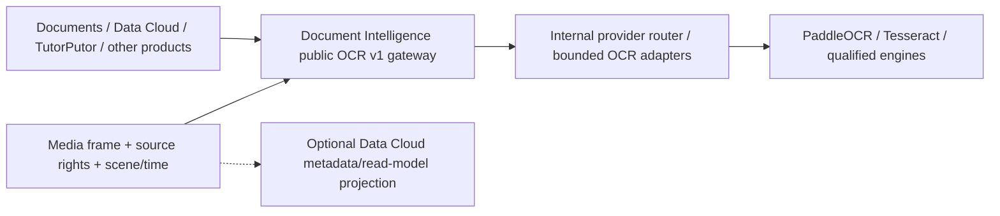

# OCR authority and optional Data Cloud integration

**Decision owner:** Media Product Truth (MDI-001, PDP0-003-D4). **Date:** October 30, 2026.
This is a source/ownership clarification, **not** a product-phase acceptance
or real provider qualification.

## One OCR gateway for all Ghatana products

**Document Intelligence is the only OCR execution API in Ghatana.** The
generic model worker, provider selection, OCR inference, language/model
evaluation, document layout, parser pipelines and text extraction all belong
to `ghatana/services/document-intelligence`, with provider-neutral public
`document-intelligence.v1` contracts. DI may use PaddleOCR, Tesseract,
Docling, qualified accelerated models, or other internally admitted
OCR adapters. Consumers must not call those engines directly.

**Media owns no OCR engine.** Media owns image/video frame sampling, precise
source version/PTS, frame cropping, source-owner rights/consent, regions,
scene/track identity, rendering and editing recognized text. It calls DI
through the already-existing `libs/audio-video-client/src/scene-text-adapter.ts`
(client/catalog/provider/response validation). Media's
`authorized-scene-text.ts` first enforces current source authorization and
both original frame and crop digests; **then constructs the DI-only adapter**.
The old generic Media recognizer callback has been removed; there is no local
alternative Media OCR inference fallback.

Other Ghatana consumers (Kernel, TutorPutor, GharBatai, Data Cloud, Agents)
must use the same DI public gateway, not Media as an OCR proxy. They may
locally own workflows, authorizations and interpretation of returned OCR
text, but OCR model execution/provider qualification are single-owned.

The prior idea of adding an independent Media Vision OCR provider is
**rejected**. Because all consumers remain in development, prefer direct
migration over maintaining two active OCR authorities. See the canonical
[MDI-001 source decision](../migration/decisions/MDI-001-document-intelligence-ownership.md)
and [OCR Product Truth](../../.product-experience/pdp-0-product-truth/ocr-ownership.yaml).

## Media does not require Data Cloud

Media owns artifact/upload, job/attempt, stream, provider dispatch,
consent/rights, transcript/caption versions, render outputs and finality.
Data Cloud is an *optional downstream subscriber* for metadata, semantic
search/read models and analytics. The current
`adapters/data-cloud-media/build.gradle.kts` imports Data Cloud
`:services:data-cloud:delivery:api` and `:services:data-cloud:planes:shared-spi`;
this source-composite compatibility adapter is not a core Media dependency.
Later bind the optional adapter to an installed public Data Cloud API
(Ghatana #254) without creating a second Media store or finality authority.
Data Cloud outage must not prevent Media from completing its own jobs.

Document Intelligence outage likewise affects **only OCR-dependent
operations**; Media speech/video/recording/caption editing remain functional.
A missing OCR provider yields typed `NOT_ADMITTED` or `UNAVAILABLE`,
not fabricated text.

## Exact development migration sequence

1. **DI provider inventory/contract.** Use `ghatana/services/document-intelligence`
   existing `document-intelligence.v1`, `GET /v1/providers`,
   `POST /v1/parse`, operation-generation cancellation and provider
   routing. Publish a source-free/immutable `@ghatana/document-intelligence-client`
   with compatible Shared extraction peer (current 0.1.0 vs
   0.1.0-SNAPSHOT observation). No new v2 or duplicate OCR entry point.
2. **Media integration.** Prove the authorized DI-only scene-text call with
   source digest/version, rights/purpose, immutable PNG ROI and live DI
   provider catalog; map normalized boxes to source-frame coordinates and
   timestamp without assigning false reading order or confidence. Provide
   native Java Vision bridge only as a thin DI client where a Java consumer
   actually requires it. Retain all independent Vision object detectors.
3. **Consumer migration.** Enumerate old `OcrService`,
   `KernelOcrProviderAdapter`, `VisionModelEngine.extractText`,
   `VisionDetector.extractText` and all other Ghatana consumer imports.
   Replace active consumers with the DI public client, conformance-test
   invalid tenant/version, no consent, corrupt image, model unavailable,
   cancellation generation, repeat/UNKNOWN and actual text/box results.
   During migration, legacy shims stay explicitly **not admitted**; no
   second active OCR model is allowed.
4. **Remove obsolete code in dev.** Once each real consumer passes its
   source-free DI test, delete orphan OCR implementation methods/shims,
   private OCR provider registrations and stale build/dependency paths,
   retaining only legitimate non-OCR Vision features. Regenerate existing
   public API and topology projections using their owning tools, never
   manually mutate generated contracts or manufacture PDP completion.
5. **Positive real qualification.** Run DI on a pinned supported model
   and rights-cleared images (including Media cropped frames) to establish
   text, ROI geometry, per-language quality, timeout/cancel, hostile input,
   memory/PIDs, source rights and repeatability. Check at least two independent
   consumers (Media and a document consumer) against the *same* DI entry
   point. An in-process mock is not real OCR validation.
6. **Cross-repo boundary regression.** `pnpm test:media-core-independence`
   and `pnpm test:ocr-single-authority` in Media; DI worker
   `python scripts/verify_increment3.py` plus client typecheck/test and
   source-free installed consumer. Ensure Data Cloud absence cannot change
   Media job finality and DI absence cannot break non-OCR Media operations.

**Current truthful completion status:** MDI-001 ownership decision reaffirmed;
DI real-provider rights, installed client and runtime consumer integration,
VIS-09, OC-04 and Ghatana #252 are NOT automatically accepted by this
decision or source-only tests. Track B/gtool, release and deployment remain
separately governed.
