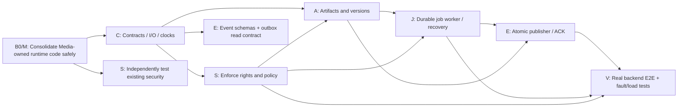

# Ghatana Media — five backend foundations: deep implementation execution slice

> **2026-10-24 owner correction — this repository is the code destination.** ALL Media-owned backend application source, tests, migrations, integration adapters, contracts, build configuration and fixtures are authored and committed to `samujjwal/ghatana-media`. The older `ghatana/services/media` is READ-ONLY migration provenance; **do not put new Media code there**. Do not copy platform-owned Event Plane/AI Inference/Data Cloud/Shared implementations into Media.
>
> **Code development and runtime cutover are separate.** Existing infrastructure might still execute a legacy `ghatana/services/media` binary. That does not make the old repo the destination for development. Until verified source/schema/consumer parity and operational cutover, leave the old deployment alone and do not start a second writer, publisher, migration runner or worker against its state. Media-only testing uses isolated resources. This direction authorizes source development now, NOT formal BUILD/PDP stage promotion or live cutover.
>
> **PDP audit finding:** these 56 tasks have product-intent sources but are NOT universally bound across PDP-1/2/3. Nine logical Media job states/ten attempt states differ from the narrower Java status models, and 22 of 27 PDP-3 HTTP operations still lack exact bounded PDP-1 logical binding in the API registry. Do not claim complete contract coverage while those source bindings remain open.


**Directive:** IMPLEMENT BACKEND NOW / ALL NEW MEDIA CODE IN GHATANA-MEDIA / FORMAL PDP AND GTOOL ADMISSION INDEPENDENT OF CODING  
**Source review:** 2026-10-24; Media `main` previously observed at `c8d8e52d6323151125fd3c2d147246f9b57e6049` before the corresponding AGENTS.md policy edit (`1c9b5a19990eee710472d7cb787c9b562009dcb3`). Ghatana canonical runtime `main` observed at `f5e585892f561c63acd1505cdbe5cb8f533192ee`. These are inspection locators, **not** proof of material semantic currentness, task completion or runtime qualification. Recheck writer HEAD before modifying code.  
**Scope:** five backend implementation units spanning five physical Media surfaces and two meaningful composite dependencies. No GUI, Explorer, client, Studio editor, marketing recording or release work.  
**Position in existing plan:** This is an executable, focused **implementation work slice** of the canonical `MEDIA-BUILD-IMPLEMENTATION-PLAN.md`, primarily `M-BLD-F03` through `M-BLD-F07`, with only necessary `F00/F01/F02` safety checks. It is **not** a new PDP authority, new contract version, second product-wide Build plan or new gtool task schema. The existing full 54-identity campaign remains intact.

## 0. Decision, goals and explicit boundaries

**Decision:** Implement from current PDP-0..3 source intent in the `ghatana-media` repository whether or not gtool has recognized formal completion/currentness/closure. All new Media-specific code and migration source MUST land in this repo; the historical deployment writer in `ghatana/services/media` is read-only for developer implementation until its separate safe retirement/cutover. Keep formal Kernel BUILD advancement, Work Planner Plan Ready, Lifecycle-native PDP receipt/closure and release admission in an independent governance track. No counterfeit phase statuses.

**Outcome after this slice:** A source-current, governed Media input can be accepted, stored and versioned; an authorized job can be admitted, durably claimed/executed/reconciled through explicit UNKNOWN/finality; a lifecycle outcome is persisted transactionally and durably delivered through the admitted Event Plane integration. All five implementation units satisfy their own code, unit, negative, restart, concurrency, integration and performance checks. They are **logically ready** for formal acceptance later, with no native gtool closure required now.

**Non-goals:** every PDP leaf, every encoder/model, every video editor, live GUI, full recorder/animation/simulation execution, platform Event Plane implementation, independent release/certification, DB/queue source cutover, and pretending an Explorer mock or provider fake is a production effect. Those capabilities remain in full Build work packages, not deleted from PDP scope.

### Live-source findings informing the work

1. `ghatana/services/media` is currently the canonical executable and schema writer. The similarly named prepared source under `ghatana-media` is not byte-identical: inspected `MediaRuntimeContracts.java`, `MediaRuntime.java` and `PostgresqlMediaJobStore.java` have different blobs. The canonical provider has Flyway `V001`–`V016`; the prepared mirror lacks the canonical `V009__media_job_attempts_and_outbox.sql` path. Never execute prepared migrations on an authoritative DB.
2. The canonical runtime already contains `MediaRuntime`, tenant-aware HTTP security, typed consent/governance, S3/Postgres artifact persistence, job attempts/fencing, lifecycle publisher, and **two existing outbox-facing implementations** (`PostgresqlMediaLifecycleOutboxSource` and Shared-compatible `PostgresqlMediaOutboxPublicationSource`). Reuse and reconcile; do not rebuild these components.
3. The architecture documents describe accepted jobs launched through in-process futures; durable store/leases exist but **future execution itself is not a restart-safe durable worker deployment**. Crash/recovery and any provider-side ambiguity require real behavior hardening, not a green DTO test.
4. Structural/definition and selected Java tests exist, but a complete fresh, integrated backend build, crash matrix and load baseline have **not been executed in this review**. No claims of passed performance, fully correct execution or feature completeness are made.
5. Media's source topology registers `runtime-contracts`, `launcher`, `providers/aws-postgresql`, `modules/infrastructure/security` and `modules/infrastructure/messaging`. The last two are supporting leaves, **not five independently deployable services**. This slice tracks package-local readiness while respecting physical/composite/root obligations.

## 1. Exact five implementation units and ownership

| Unit / master mapping | Registered physical surface / canonical writer path | Execution owner; independent reviewer | Why first / logical boundary |
| --- | --- | --- | --- |
| **C — contracts, versions and exact domain I/O** / `M-BLD-F03` | `media.physical.runtime-contracts`; `ghatana-media/runtime-contracts/` | **Media domain-contract engineer**; cross-language/interface reviewer | Immutable domain identifiers, typed request/result/errors, clocks, job and artifact contracts, compatibility basis for all other units |
| **S — governance and policy enforcement** / `M-BLD-F04` | `media.physical.modules-infrastructure-security`; `ghatana-media/modules/infrastructure/security/`, plus integration points in `launcher/MediaSecurityFilter.java`, `MediaRuntime.java` and provider consent authorities | **Media security/governance engineer**; Shared identity/policy boundary reviewer | All sensitive ingress, query and provider egress needs actual tenant/principal/purpose authority |
| **A — durable artifact, object/version and erasure storage** / `M-BLD-F05` | `media.physical.providers-aws-postgresql`; `ghatana-media/providers/aws-postgresql/` | **Media persistence engineer**; DB/storage reviewer | Integrity-bound uploads, versioned outputs, retention, dual-store consistency, safe migration |
| **J — durable job engine and recovery** / `M-BLD-F06` | `media.physical.launcher`; `ghatana-media/launcher/` with provider/job-store SPI in A/C | **Media runtime/reliability engineer**; concurrency/recovery reviewer | Convert accepted in-process work into durable admission, leases, bounded worker execution and honest outcomes |
| **E — transactional outbox and reliable event delivery** / `M-BLD-F07` | `media.physical.modules-infrastructure-messaging`; `ghatana-media/modules/infrastructure/messaging/` plus canonical `providers/aws-postgresql/` outbox and `launcher/MediaLifecyclePublisher.java` | **Media messaging/integration engineer**; Shared/Event Plane owner reviewer | One auditable outbox publication path and idempotent at-least-once delivery; no duplicate bus |

**Ownership rule:** Implement and review exclusively in `ghatana-media` even if the legacy service is still deployed. No Media runtime features, schema files or tests are to be committed under `ghatana/services/media`; that path is read-only comparison evidence. Source-composite links to distinct Ghatana *platform* modules do not violate this rule.

**Shared-file lock:** C owns contract changes; S owns enforcement and consent; A owns DB migrations, object store and job-store transactions; J owns runtime and worker orchestration; E owns event projection/outbox publishing. Touching another lane's owner file requires a reviewed handoff and serialized edit. One canonical runtime writer, one migration ledger and one publisher strategy are absolute constraints. No independent running duplicate mirror.

**Existing PDP semantic sources, read-only for this sprint:** `.product-experience/pdp-0-product-truth/{capabilities.yaml,requirements.yaml,nonfunctional-requirements.yaml,policy-authority-model.yaml}`; `pdp-1-domain-data/{domain-objects.yaml,operations.yaml,states.yaml,transitions.yaml,versioning.yaml,authority.yaml,events.yaml}`; `pdp-2-design-interface-system/api/`; `pdp-3-product-experience/api/operations/` and canonical journeys (particularly J-02, J-03, J-20, J-26). The namespace prefix for the latter three is `.product-experience/`. Source IDs are obligations, not a separate executable contract to fork.

### Mapping to real capabilities, not files alone

- C: `media.project.*`, `media.artifact.*`, `media.job.*`, `media.rights.*`, `media.provenance.*`: ID/metadata/version/clock/result semantics and machine channel grammar; no fake project host.
- S: authorized upload/list/download, processing admission, revocation, external provider/biometric rules, artifact read/export/share/erasure and lease-time revalidation.
- A: `media.artifact.ingest`, `media.artifact.upload`, `.resume`, `.inspect`, `.derive`, `.retain`, `.delete` and version/provenance persistence.
- J: `media.job.submit`, `.view-status`, `.list`, `.watch`, `.cancel`, `.retry`, `.check-outcome`, `.outputs.inspect` and durable job/attempt transitions.
- E: Media-owned lifecycle facts from upload, job, cancellation, erasure and derived-result transitions with source-controlled event meanings. Event transport guarantees are those of the admitted Shared/Event Plane public contract.

## 2. Dependency DAG, work lanes and execution calendar

`C01` / `S01` etc. below are **local implementation checklist labels**, not new Lifecycle task IDs or duplicate source authoring. Map review/commit records back to the already registered `M-BLD-F03..F07` packages.



**Parallel assignments:** A dedicated migration integrator owns Media source reconciliation and one schema owner; two implementers can work on C and S tests now; A can prepare storage fixtures while S works. E can prepare the read-only dual-outbox diagnosis and tests while J implements the worker. All new schema source is edited in Media and serialized to A; J and E use additive service interfaces and merge only after review. Do not use multiple agents concurrently to edit the same Java file or migration.

| Wave | Work which can begin | Exit and pulse check |
| --- | --- | --- |
| **W0 — first engineering pulse (up to 4 focused working hours)** | B0 source/writer diff, C01/C02, S01 security threat inventory, A01 migration/store inventory, E01 outbox inventory, run available baseline tests | Exact baseline, five owners and shared locks, tests runnable or exact environmental limitation, **at least one code/test change**; do not spend another pulse drafting proposals |
| **W1 — contracts and authorization (1–2 working days at available capacity)** | Complete C, S01–S08; A02 upload fault fixtures; E02 event invariants | C and S local tests green; safe/denied paths demonstrably distinct; remaining work recorded without halting A/J scaffolding |
| **W2 — durable data/worker (2–4 working days at available capacity)** | A02–A12 and J01–J13; E03–E07 following A/J commit boundaries | Durable upload and terminal/UNKNOWN job readback survive process kill, replay, concurrent claims; schema history reconciled |
| **W3 — delivery and integrated hardening (1–3 working days)** | E08–E11, V01–V10, load/fault matrix, code review and reconciliation | Five unit checklists and reference workflow pass; otherwise exact nonfalse residuals and bounded next patch |

Times are **planning timeboxes, not assertions of elapsed implementation or guaranteed delivery**. Issue a factual pulse after every 4 focused engineering hours or each small PR/commit, whichever happens first: tasks passed, tests run, benchmarks and next two implementation tasks. If a task takes two consecutive pulses without executable progress, narrow it to a failing reproduction/patch or escalate the specific missing semantic/runtime dependency. Do not restart PDP/gtool planning.

## 3. B0 — preflight without gating backend coding

| ID | Concrete action and where | Check |
| --- | --- | --- |
| **B01** | Compare former `ghatana/services/media` READ-ONLY tree with target `ghatana-media` at exact HEADs, including source paths/modes/blobs, Gradle, routes, consumers, migration history and test/fixture files. Classify all missing/divergent target files through M01–M03 below. | Every legacy-only/different Media-owned path has a transfer or exclusion disposition; all code edits remain in Media; no old application writer launched by tests. |
| **B02** | Compare old Flyway `V001..V016` against Media `V001..V009` and real `flyway_schema_history` checksums; V007/V008/V009 are incompatible between branches. Implement M04/M05 adoption strategy before schema execution. | Both histories independently recognized; no in-place rewrite of applied migration or blind Flyway repair; unknown DB lineage blocks DB effect, not unrelated coding. |
| **B03** | Read active OpenAPI `contracts/openapi/media.yaml`, `config/route-manifest.json`, `config/provider-manifest.json`, runtime SPI and shared admission/identity/events contract. | One owner for each ID, field, route and event; any unavailable external contract produces a typed adapter/fixture task, not a parallel contract. |
| **B04** | Execute focused currently runnable Gradle tests (below), record Java/Gradle/Postgres/S3 versions, test skips, p50/p95/p99 baseline and CPU/memory footprint where measurable. | Accurate pre-change benchmark; tests that cannot run are listed with cause/needed environment, while independent tasks continue. |
| **B05** | Commit narrow Media-source changes on `ghatana-media/main`; preserve local work and one-writer file locks. Legacy deployment stays isolated during destination tests. | No new Media code in `ghatana`; no shared live DB/queue/event publisher in tests; no overwriting parallel edits. |

## 4. Unit C — canonical domain, versioning, time and typed outcomes

**Master:** `M-BLD-F03`. **Owner:** Media domain-contract engineer. **Primary location:** canonical `runtime-contracts/src/main/java/com/ghatana/media/runtime/`: `MediaRuntimeContracts.java`, `MediaCreationContracts.java`, `MediaModalityContracts.java`, `MediaTranscriptContracts.java`, `MediaLifecycleEvent.java`; read Media product semantic source and `libs/audio-video-types/src/contracts.ts` for wire parity. Avoid new independent contract authority in TS or tests.

| Task | Prerequisite | Implementation location / prescriptive change | Acceptance case |
| --- | --- | --- | --- |
| **C01** Contract inventory | B01,B03 | Extract Java SPI/records/enums and compare every in-scope PDP-1 operation, lifecycle state, v1 API field and error variant; classify KEEP / EXTEND / LEGACY ADAPTER / UNSUPPORTED. | Named set of concrete unimplemented operations/errors, no autogenerated fake pass status. |
| **C02** Identity and scope | C01 | Normalize tenant, principal, request, job, attempt, provider operation, artifact and immutable version IDs at constructor/parsing boundaries. Keep established wire IDs. | Null/blank/oversized/mismatched IDs rejected; roundtrip preserves exact names and owner scope. |
| **C03** Exact temporal semantics | C01 | Add or reuse rational timebase conversions, sample/frame ticks, overflow guards and distinct source/media/simulation/wall clocks; do not use floating point for canonical offsets. | Property tests on large offsets, NTSC-like frame rates, resampling and forward/back conversion with declared rounding tolerance. |
| **C04** Artifact/version model | C02,C03 | Express complete upload → immutable `ArtifactVersion`, source provenance, derivation and project revision relation using existing contract family and type-safe references. | Stale revision conflicts; unauthorized/missing source cannot synthesize a provenance/immutable version. |
| **C05** Job state algebra | C02 | Make transition intent, cancellation REQUESTED vs CONFIRMED, terminal attempt finality and OUTCOME_UNKNOWN explicit in result envelopes. No undocumented extra terminal status. | Exhaustive transitions, illegal edges rejected; ambiguous provider result never labeled failed/succeeded. |
| **C06** Command and request identity | C02,C05 | Canonicalize submitted command parameters with stable encoding/hash; distinguish same-key replay from same-key changed payload, version pins and allowed provider options. | Same digest returns identical operation; conflicting digest rejects before effect; stable independent of map key iteration. |
| **C07** Rights/provenance schema | C04,C05 | Use existing consent reference/rights decision and execution evidence fields; preserve privacy-safe envelope and sensitive classification. | Missing authority/result stays explicitly unknown/not admitted; sanitizer cannot leak source bytes/token/PII. |
| **C08** Wire parity adapters | C02–C07 | Reconcile actual OpenAPI/route/protobuf/TS generated contract owners through adapters; no second aggregate service contract. | Java/JSON/client fixture roundtrip across accepted/rejected/cancelled/unknown; backward readers of prior wire version pass. |
| **C09** Compatibility + schema evolution | C08 | Implement needed additive reader/upcaster behavior for old jobs/artifacts; do not use destructive renames. | Golden fixtures V(old)→V(current) and tolerant-reader tests pass with no semantic misclassification. |
| **C10** Complete contract checks | C03–C09 | Expand `runtime-contracts/src/test/java/...` contract, generative and security regression tests. | `:services:media:runtime-contracts:test` and API consumption tests pass, including malformed, unknown-enum and large numeric cases. |

**PDP state repair:** PDP-1 defines nine `media-job` and ten `media-attempt` statuses. Current Java runtime enums are narrower (six `JobStatus` values). C05/J01/J11 must implement lossless domain state + attempt-state projection, durable transition handling, and compatibility upcasters; never silently call `PARTIALLY_SUCCEEDED` a `COMPLETED` job, or `RETRY_PENDING` `RUNNING`. Test every legal edge and each unsupported legacy projection.

**Logical C exit:** No uncontrolled parallel definitions; full in-scope command/domain semantics are expressive and roundtrip correctly; C10 green; no unhandled ambiguous state; no changes demanded to official PDP state. Do not call all runtime capabilities implemented merely because their DTOs exist.

## 5. Unit S — identity, authorization, consent, rights and security

**Master:** `M-BLD-F04`. **Owner:** Media security/governance engineer. **Primary files:** `modules/infrastructure/security/src/main/java/com/ghatana/audio/video/infrastructure/security/MediaProcessingSecurityValidator.java`, `launcher/src/main/java/com/ghatana/media/launcher/{MediaSecurityFilter,MediaHttpHandler,MediaRuntime}.java`, and `providers/aws-postgresql/.../{PostgresqlMediaConsentAuthority,PostgresqlMediaConsentAdministration}.java`; identity validation through admitted Shared contracts.

| Task | Prerequisite | Exact work | Acceptance case |
| --- | --- | --- | --- |
| **S01** Threat/boundary matrix | B01,B03 | Trace JWT/bootstrap/local identity, tenant resolution, principals, permissions, request-body metadata, trusted proxy policy, public probes and provider egress. | Each trust boundary has explicit allow/deny rule and corresponding regression test; local fixture identity never enters production-like admission. |
| **S02** Tenant-scoped ingress | S01,C02 | Enforce verified tenant/principal on upload, reads, list, job, stream, consent and erasure commands; scrub caller-supplied principal hints. | Cross-tenant by-ID and list enumeration fail; synthetic header spoof fails; all negative tests observe no DB/object effect. |
| **S03** Fine-grained permissions | S02 | Use exact operation-level permission map and purpose; no broad role inference or catch-all authorization on new routes. | Positive authorized actor + denied role/operation matrix for HTTP and direct service SPI. |
| **S04** Consent source and lifecycle | S02,C07 | Durable purpose, external processing, retention, biometric/voice, region and expiration/revocation checks through canonical authority. | Expired/revoked/absent/out-of-region grant denied; no default-granted external consent. |
| **S05** Admission/dispatch TOCTOU | S04 | Reauthorize at submission, durable worker claim, sensitive provider call, retry and output read/download/share/export. Bind decision to exact job/artifact/version. | Revoke between acceptance and dispatch → zero external call; revoke during retry prevents new external work and preserves truthful prior outcome. |
| **S06** Governed data egress | S04,S05 | Authorize provider residency, retention, training, model policy and classification before upload or frame handoff; attach minimal necessary metadata. | Unauthorized face/voice provider or biometric purpose blocked; requested semantic redaction without eligible provider fails closed. |
| **S07** Cache and dedup isolation | S02,S04 | Verify cache keys, dedup, S3 keys, pagination and response/result sanitizers include tenant and compatible principal/rights where needed. | Identical content across incompatible principals not shared; no secret/content in logs, metrics, error or event payload. |
| **S08** Erasure/hold authority | S04,A01 | Enforce immutable hold/retention policy, policy-scoped tombstones, erase permission and authorized cascade. | Unauthorized erase cannot alter metadata or bytes; legal hold blocks purge; erasure eventuality has explicit status, not false success. |
| **S09** Secret and network hygiene | S05–S07 | TLS/trust selection, secret references, outbound allowlist, max body and request timeout; no dev-key production fallback. | Invalid cert, ambiguous credentials, unsafe redirect/URL, oversize body and connection timeout fail closed. |
| **S10** Security review and tests | S02–S09 | Extend `MediaSecurityFilterTest`, `MediaConsentRevocationTest`, `MediaRuntimeJobGovernanceTest` and container-backed tenant isolation IT. | AuthZ matrix, revocation race, privilege crossing, log snapshot, malicious metadata and policy/property tests pass. |

**PDP erasure truth:** The PDP-1 privacy contract separately tracks logical hiding, access revocation, physical deletion, provider/backup copies, and owner-confirmed erasure. S08/A08 cannot report `ERASURE_CONFIRMED` after only local object deletion; unknown applicable copy receipt keeps `ERASURE_OUTCOME_UNKNOWN` or pending.

**Logical S exit:** Every in-scope backend read/write/effect has verified tenant/purpose/rights path; sensitive work is denied on missing authority with bounded negative proof; no local identity shortcut is reachable in staging/production. Reviewer signs engineering review, **not** independent regulatory certification.

## 6. Unit A — durable assets, versioning, recovery and erasure

**Master:** `M-BLD-F05`. **Owner:** Media persistence engineer; exclusive migration writer. **Primary files:** `providers/aws-postgresql/src/main/java/com/ghatana/media/provider/aws/{S3PostgresqlMediaArtifactStore,MediaAwsPostgresqlRuntimeState,PostgresqlMediaTranscriptStore}.java`; canonical Flyway `providers/aws-postgresql/src/main/resources/db/media-runtime/`; `modules/infrastructure/persistence/` only where existing legacy adapters need safe compatibility.

| Task | Prerequisite | Exact work | Acceptance case |
| --- | --- | --- | --- |
| **A01** Storage & applied history census | B02 | Inspect canonical S3/multipart uploads, DDL V001–V016, artifact/hash/version metadata, retention/hold and existing old JPA audio/transcription schema. Identify live and test data ownership. | Exact table/key/version crosswalk; no existing migration rewritten, no dual writer activated. |
| **A02** Bounded upload admission | C02,S02,A01 | Enforce size/type/byte budget, per-chunk checksum/index, tenant/request idempotency and rate/quota admission; stream request bytes rather than unbounded heap buffering. | Oversize/invalid/reordered chunks fail without upload promotion; heap/backpressure bounded at configured maximum. |
| **A03** Crash-safe resumability | A02 | Persist upload session state, chunk digests, lease/finalization claim and progress; support resume after worker/process loss and stale-finalizer takeover. | Restart at each transition resumes exact committed bytes; concurrent completers yield one final artifact. |
| **A04** Object finality | A03,C04 | Verify full length/hash, malware/format verdict, encryption/key reference and object availability before metadata status becomes finalized; quarantine unknown scan result. | Corrupt/unavailable/incomplete object never visible as complete; re-read verifies exact digest and version. |
| **A05** Immutable version/provenance | A04,C07 | Persist content version, source identity, parent/derivation chain and original metadata; require CAS on project/head revision. | Old version reads remain stable; concurrent revision update rejects; provenance linkage cannot point across tenant. |
| **A06** Idempotency/dedup policy | A04,S07 | Restrict hash dedup to same tenant + compatible principal/rights/classification/retention/key domain; safe object reference counts. | Same compatible upload shares permitted bytes; cross-scope equal hash stays isolated and deletion never destroys other owner's object. |
| **A07** Atomic metadata and outbox hooks | A04,C05 | Insert durable artifact/job state and outbox intent in the same DB transaction when lifecycle semantics require; use S3 reconciliation for DB↔object non-atomic boundary. | Crash between object commit and DB update leaves recoverable orphan/claim, not visible phantom or lost complete event. |
| **A08** Retention, hold and erasure | A05,S08 | Implement expiry scheduling, hold precedence, physical object/chunk deletion, tombstones and proof of purge; idempotent repeated deletes. | Erasure removes qualifying bytes and index; legal hold survives; kill/retry resumes without deleting held/shared object. |
| **A09** Reconciled forward-only migration | M04,M05,A01,A05,A07 | In Media, reconcile divergent applied V007–V009 histories first; then add migrations after BOTH historical version ranges with explicit adoption/backfill and dual-read compatibility. Never rename/replace applied files or force Flyway repair. | Historical DB fixtures for both lineages migrate without checksum conflicts, row loss or phantom state; mid-backfill crash/retry and old reader compatibility pass. |
| **A10** Index/query efficiency | A05,A09 | Tenant/status/createdAt + cursor indexes, bounded pagination, no eager large-object materialization, stable snapshot sort keys. | Query plans and p99 under seeded 100k-artifact dataset documented, no cross-tenant result and no unbounded memory. |
| **A11** Format/security hardening | A02–A10 | Enforce content sniffing vs extensions, decompression bomb bounds, AV/format verifier policy, S3 encryption and least-privilege key scoping. | Adversarial zip/container, metadata spoof and object corruption cases rejected/quarantined; secrets not logged. |
| **A12** Real durable test gate | A03–A11 | Expand `S3PostgresqlMediaArtifactAdmissionTest`, `MediaAwsPostgresqlRuntimeStateIntegrationTest` and new `MediaUploadCrashRecoveryIT` against PostgreSQL and S3-compatible storage. | Clean unmocked DB/object roundtrip; restart/crash, concurrency, version, dedup, retention, delete and migration matrix green. |

**Logical A exit:** Real bytes stored and re-read with verified integrity, no unbounded ingestion or cross-scope dedup, restart-safe upload/version/erasure and forward-only canonical migration. Adapter unit tests alone cannot close A.

## 7. Unit J — durable command acceptance, workers and honest finality

**Master:** `M-BLD-F06`. **Owner:** Media runtime/reliability engineer. **Primary files:** `launcher/src/main/java/com/ghatana/media/launcher/{MediaRuntime,MediaRuntimeConfig,MediaHttpHandler,MediaSubmissionDigest}.java`, `providers/aws-postgresql/.../PostgresqlMediaJobStore.java` and contract SPI from C. This unit must not silently replace the Shared queue, Event Plane or Action Plane.

| Task | Prerequisite | Exact work | Acceptance case |
| --- | --- | --- | --- |
| **J01** State machine + ledger inspection | C05,A01 | Derive legal job and attempt transitions, cancellation/finality/result joins and current in-process future behavior from source+DDL; enumerate unsupported/unknown states. | Exhaustive transition/guard matrix and explicit durable vs local runtime profiles. |
| **J02** Durable submit/idempotency | C06,S05,A05 | Transactionally admit job with exact request digest, artifact version, owner/purpose and selected policy; conflict-safe unique request ID. | Concurrent same-key submission yields one job; different payload same key rejects; no provider called before persisted acceptance. |
| **J03** Durable dispatch selection | J02 | Implement restart-safe claim/poll/dispatch **using an admitted existing Shared/workflow/queue interface** or an explicit product-owned Postgres claim adapter; do not create a second generic scheduler/bus. | Kill launcher after acceptance; another worker deterministically finds and claims job without losing it. |
| **J04** Lease/fence/CAS | J03,A09 | Use monotonic fence/lease attempt token and optimistic job revision on claim, heartbeat, completion and cancellation. | Two workers race: one actual owner; expired worker cannot write terminal state or double-dispatch. |
| **J05** Bounded fair worker | J03,J04 | Per-tenant queues/quotas, max concurrency, bounded I/O, backpressure, job timeout and graceful drain; use structured bounded executor. | No unbounded growth, no starvation in tenant mix, shutdown preserves claimed work and readback. |
| **J06** Attempt intent and external truth | J04,S05 | Persist dispatch intent and provider operation identity before meaningful effect when supported; capture outcome receipt or explicit uncertainty after timeout/disconnect. | Crash before provider dispatch permits safe replay; crash after ambiguous dispatch becomes OUTCOME_UNKNOWN, not blind retry. |
| **J07** Cancellation model | J06,C05 | Keep requested/confirmed/unsupported/cannot-prove distinct; fence provider timeout/cancel late completion and record provider evidence. | Cancel-before-dispatch prevents call; remote cancel unconfirmed retains nonfinal truth; stale success cannot overwrite confirmed cancel. |
| **J08** UNKNOWN reconciliation | J06,J07 | On startup/lease expiry enumerate recoverable jobs; query same provider operation when eligible, adopt signed/identifiable result, otherwise park as OUTCOME_UNKNOWN with explicit check-outcome. | Process kill at every critical edge recovers exact state, no phantom completion or duplicated external charge. |
| **J09** Retry/fallback safety | J08,S06 | Retry only when idempotent/no-effect proven and eligible; bound attempts/backoff/circuit breaker; preserve chosen provider/model/purpose/version and actual cost. | Safe retry succeeds; unsafe ambiguous timeout never causes second external effect; ineligible fallback blocked. |
| **J10** Result/version atomicity | J08,A05,A07 | Verify resulting artifact and governance/redaction before durable final result and outbox transaction; use provider receipt and immutable output version/provenance. | Successful job has re-readable derived bytes/metadata and exact receipt; result sanitization failure cannot falsely finalize success. |
| **J11** API observations | C08,J02–J10 | Implement only existing `submitMediaJob`, `getMediaJob`, `listMediaJobs`, `cancelMediaJob` public routes with truthful state/finality; add internal check-outcome reader. `watch` and new `check-outcome` HTTP paths require explicit PDP-1/2/3/OpenAPI/route bindings first. | Existing APIs parity-tested; job read never conflates the nine logical statuses; added routes only after source authorization. |
| **J12** Queue/worker observability | J05–J10 | Metrics for accepted/queued/running/unknown/lease overdue, wait time, in-flight bytes, retries and cost; tracing by tenant-scoped correlation without payload leak. | Metrics reconcile against DB during restart and known failed attempts; no secrets or content in labels. |
| **J13** Fault and contention suite | J03–J12 | Extend `MediaRuntimeRestartReconciliationTest`, `MediaRuntimeJobGovernanceTest`, `PostgresqlMediaJobStoreMetricsTest`; add `MediaDurableWorkerCrashIT` with DB and a receipt-capable deterministic provider. | Kill before/after claim/dispatch/receipt/commit, network partition, stale fence, duplicate key, cancellation races, 2-worker contention all deterministic and green. |

**Logical J exit:** Accepted durable jobs survive process restart; side-effect ambiguity stays truthful; two-worker test produces no duplicate execution; bounded resources and cross-tenant security verified; real final output/artifact observed when provider actually performed work. A local future and green submit test do not count.

## 8. Unit E — transactional lifecycle events and durable publication

**Master:** `M-BLD-F07`. **Owner:** Media messaging/integration engineer. **Primary files:** `providers/aws-postgresql/.../{PostgresqlMediaLifecycleOutboxSource,PostgresqlMediaOutboxPublicationSource,PostgresqlMediaJobStore}.java`, `launcher/.../MediaLifecyclePublisher.java`, `runtime-contracts/.../{MediaLifecycleEvent,MediaLifecycleOutboxSource}.java`, existing legacy `modules/infrastructure/messaging/`. Media owns event content; Shared/Event Plane owns generic publication semantics.

| Task | Prerequisite | Exact work | Acceptance case |
| --- | --- | --- | --- |
| **E01** Two-outbox truth inventory | B01,A01 | Compare `media_processing_lifecycle_outbox` and `media_lifecycle_outbox`, V009/V014/V016, publisher scheduling, claim/ACK/fence/attempts and published Shared SPI. Choose one canonical publication/read contract, document existing legacy compatibility. | No event type silently emitted twice; source and target event identifiers mapped and versioned. |
| **E02** Canonical event meaning | C07,E01 | Reuse PDP-1 cataloged `media.upload.started`, `media.artifact.completed`, job accepted/cancel_requested/cancelled/completed/failed and stream opened/closed event identities, with stable IDs and privacy-safe fields. Artifact erasure is a PDP-1 event-family intent but the actual canonical event type is not established: do not invent it. | Event names must match PDP-1 catalog; no unapproved `erased` type, sensitive payload or false delivery receipt; reconcile missing erasure type with semantic owner. |
| **E03** Transactional intent | A07,J02,E02 | Include accepted/finality/erasure lifecycle outbox insert in the **same DB commit** as owning state transition. Remove any double independent publish on these paths. | Fault after DB commit before publish leaves durable event; DB rollback leaves neither state nor event. |
| **E04** Canonical publisher adapter | E01,E03 | Prefer the existing Shared `OutboxPublicationSource` adapter + Event Plane public client if admitted. Retain legacy outbox reader only as bounded compatibility with drain proof; no new bus/database source. | Unique active claim owner/transport path, no double send across old/new publisher configurations. |
| **E05** Lease/fence/ACK uncertainty | E04 | Fence publisher owner, bounded batches, authoritative broker acknowledgment, lease-expiry handling and unknown publication attempt state. | Crash after broker ACK before DB ACK may redeliver same ID, **never** claim exactly-once delivery; stale claimant cannot ack. |
| **E06** Retry/dead letter | E05 | Exponential backoff with capped jitter, poison-event quarantine, DLQ/replay interface and alert; preserve stable event ID on replay. | Broker down/backpressure never blocks DB commit indefinitely; poison event bounded retries; operator replay idempotent. |
| **E07** Consumer idempotency | E05 | Exercise event ID dedup and aggregate ordering with the admitted Shared/Event Plane public consumer if available. A local fake is a unit-test only and does not prove external provider/consumer admission. | Duplicate/out-of-order/replayed event yields one logical materialization or explicit conflict/UNKNOWN; exact external receipt proof required to mark integrated delivery complete. |
| **E08** Legacy compatibility | E04,E07 | Read-only old-event reconciliation, drain/dual-read only where safe; forward-only conversion and feature toggles with one active publisher. | Compare event count/digests before/after cutover; no dropped or duplicated lifecycle facts. |
| **E09** Privacy and observability | E02,E06 | Log/metric event age, oldest pending, retries, DLQ, delivery latency and rejected payload; encrypt or redact sensitive fields. | Metrics exact against store, no raw source content or secrets in emitted payload/log. |
| **E10** Operational runbook | E06,E08 | Define publisher start/stop/drain, safe replay, schema changes, Event Plane outage, external admission not available and rollback. | Inject broker down and restore without data loss; operator can distinguish delayed vs unknown vs delivered. |
| **E11** Integration/fault tests | E03–E10 | Extend `PostgresqlMediaLifecycleOutboxSourceTest`, `PostgresqlMediaOutboxPublicationSourceTest`, `MediaLifecyclePublisherTest`; add `MediaEventCrashRecoveryIT`. | Atomic state+outbox, kill before/after send, stale lease, duplicate delivery, partial outages, schema and privacy negative cases pass. |

**PDP event proof:** Event Plane exact append/lookup admission is currently `NOT_ADMITTED` in PDP-1 dependency detail, and PDP-3 event registry is mainly client-local. E04–E11 require a real owner-public adapter and durable receipt to claim integrated delivery. No fake exactly-once promise.

**Logical E exit:** One active publisher authority; durable atomic event intents; at-least-once broker delivery with ID-based dedup and honest ACK uncertainty; crash/replay and Event Plane outage matrix green. The Event Plane platform's deployment is **not** claimed as Media implementation.

## 9. Cross-package E2E scenarios and invariants — must pass before declaring the slice ready

Run all scenarios with **real Postgres and S3-compatible object store** and the actual canonical launcher/worker, using synthetic or legally usable non-sensitive media bytes. Fake external providers may simulate protocol failures but must never count as a verified real-media transform. For a full processed-output claim, use an actually operational, permitted deterministic media engine/provider and verify output bytes/format, not merely a returned success JSON.

| ID | Real backend procedure | Required result |
| --- | --- | --- |
| **V01** | Authenticated principal begins upload, streams chunks, finalizes, GETs metadata and downloads the same exact version | SHA-256/size match; correct scope; no preview/phantom finality |
| **V02** | Parallel same request key with matching/mismatching payload | One admitted logical command for matching request; conflict with zero additional effect for mismatch |
| **V03** | Restart after each upload state/after S3 commit-before-DB receipt | Resume/recover without corruption, orphan reclaim and no duplicate public artifact |
| **V04** | Revoke/expire consent between acceptance, claim, egress and retry | No unauthorized external request; prior committed effect remains truthfully reported |
| **V05** | Two workers contend on same job/attempt; kill winner mid-dispatch | Fence and compare-and-set prevent false dual finality; ambiguity becomes queryable UNKNOWN |
| **V06** | Provider times out after possible effect; then receives delayed receipt | No blind retry; same operation ID reconciled once with verified receipt/version |
| **V07** | Complete legitimate local real transform to derived output, publish terminal event, re-read derived artifact | Actual output version exists and content is verified; rights/provenance retained; one logical event ID |
| **V08** | Kill after state/outbox commit, before broker send, after broker ACK and before DB ACK | Outbox survives; replay safe; consumers idempotent; no exactly-once assertion |
| **V09** | Cross-tenant/cross-principal reads, dedup, role spoof, disallowed purpose, biometric attempt, erasure with hold | All blocked with appropriate typed result; no data/byte/event disclosure |
| **V10** | Migrated old populated DB and prior public client fixtures | Forward schema compatible; old IDs readable where supported; no loss/rewritten migration checksum |

**Build and runtime test commands (execute from the `ghatana-media` repository root using its standalone `:services:media:*` Gradle coordinates; NEVER use tests from old `ghatana/services/media` to claim completed Media-repo implementation):**

```sh
./gradlew :services:media:runtime-contracts:test --no-build-cache
./gradlew :services:media:launcher:test --no-build-cache
./gradlew :services:media:providers:aws-postgresql:check --no-build-cache
./gradlew :services:media:modules:infrastructure:security:test --no-build-cache
./gradlew :services:media:modules:infrastructure:messaging:test --no-build-cache
./gradlew :services:media:modules:integration-tests:test --no-build-cache
./gradlew :services:media:integration-tests:test --no-build-cache
```

Verify the target `ghatana-media/settings.gradle.kts` project names. Its source-composite development profile currently uses some sibling Ghatana **platform** projects; that is a separate dependency-owner issue and is not permission to edit or run old Media runtime code. Only report commands actually run. Integration-tagged suites use Testcontainers/PostgreSQL/S3-compatible local infrastructure and may require Docker; distinguish lack of infrastructure from a passed integration run. Media PDP/source checker commands (`pnpm check:product-experience-local` etc.) validate product sources and are **not substitutes** for backend verification or build admission.

## 10. Performance, correctness and extensibility gates

**Workload protocol.** Establish isolated clean reference datasets (small PCM/WAV, bounded H.264/MP4, chunked large files and metadata-only jobs) and provider variability classes. Use seeded 1/16/64 concurrent clients, at least two worker instances, a second tenant and a realistically seeded 100k-metadata-row query set. Pin JVM, CPU, RAM, DB object store, network latency, payload sizes, pool sizes and git source; report throughput plus p50/p95/p99, timeout rate, RSS/heap/GC, bytes in flight, object/SQL operations and recovery latency. Only enabled real provider performance counts as an engine measurement. Do not require costly all-modality benchmarks to progress contracts/security.

**Release-independent logical acceptance thresholds** (engineering targets, **not** assertions of PDP SLO or achieved results):

| Concern | Acceptance policy |
| --- | --- |
| Integrity and ownership | **Zero** acknowledged corrupt final artifacts; zero cross-tenant/principal/consent leaks; zero unauthorized external effects in fault matrix |
| Idempotency/finality | No duplicate material state or provider dispatch when no-effect/idempotency proof exists; uncertain remote effect stays OUTCOME_UNKNOWN. Exactly-once is **not** promised for broker deliveries |
| Boundedness | Explicit positive configured limit on chunk/body size, concurrency, queue depth, retries, leases, memory and backpressure; test rejects/limits at each boundary |
| Crash/recovery | Every key state transition tested by crash injection with restart on fresh process against same DB/store; no silent completed/failed state after uncertain effect |
| Query/path performance | Capture same-host baselines and query plans; no sustained >10% p95/p99 regression for unchanged comparable core operation without documented tradeoff and correction task |
| Load and fairness | 16/64-client mixes show bounded memory/queue and no indefinite tenant starvation; record p95/p99 and abort on runaway resource use |
| Compatibility | Known prior wire clients and applied DB history remain readable; serialized schema evolution only and one active writer/publisher |
| Observability | Stage metrics reconcile with durable store; positive and error/failure paths are traceable without leaking payload bytes, secrets or sensitive identity |

Do not invent throughput/SLO outcomes. Missing measured baseline means performance **NOT_VERIFIED**, not a passing package. When the reference environment is pinned, test PDP-0 `NFR-PERF-001` **proposed** metadata/control p95 ≤300ms at 50req/s, bounded job admission p95 ≤500ms, cancellation acknowledgment ≤1s (NOT provider cancellation finality). These are not approved SLOs or observed performance. Apply `NFR-COST-001` finite CPU, RAM, VRAM, GPU, network, storage, retry, wall time, process and cost limits; unknown applicable budgets must block dispatch.

**Extensibility design:** typed provider SPI selected through `config/provider-manifest.json`; exact capability eligibility and normalized results; immutable artifact/version IDs; source-bound job templates for future recorder, animation, simulation, speech and vision; structured transitions not dynamic unvalidated maps; post-commit outbox integration instead of inline external side effects. Preserve Ghatana platform boundaries; no copy of Document Intelligence/AI Inference, no speculative new service or contract version.

## 11. How to execute, review, track and decide logical readiness

### Task execution contract (human-readable; no new gtool schema)

Each narrow commit/PR/implementation handoff must contain:

- Local task ID(s) above + mapped `M-BLD-F03..F07` + physical surface ID; named owner/reviewer.
- Exact source requirement/operation IDs used, owning canonical paths and former-to-new behavior. Ambiguous PDP detail: conservative **assumption and safe fallback**, not invented PASS.
- Code and integration changed, real resource touched, failure/rollback behavior, data/version migration effect.
- Tests with commands, actual counts and any skip/unrun reason; negative/restart/concurrency and compatibility cases identified.
- Load baseline/measurement where applicable; perf regression assessment and privacy/authority review.
- Remaining code tasks and real external admission requirements. Do not mix formal closure tasks into implementation denominator.

### Five per-unit readiness decisions

| Unit | Must be true to say **LOGICALLY_BACKEND_DEV_COMPLETE** |
| --- | --- |
| C | C01–C10 all implemented; typed code and backward wire/read adapters executable; negative/property/roundtrip tests green |
| S | S01–S10 all implemented; ingress/read/dispatch/egress/erasure authorization enforced; tenant/purpose/race/security IT green |
| A | A01–A12 all implemented; real DB/object finality, versions, resume, integrity, hold/erasure/migration and crash IT green |
| J | J01–J13 all implemented; durable worker restart, lease/fence, cancellation/UNKNOWN, observed real output and multiworker fault IT green |
| E | E01–E11 all implemented; exactly one active publication path, atomic outbox, replay/ACK failure and privacy/consumer IT green |

No package can be marked ready on zero code or green mocks alone. Mark it **IN_PROGRESS** with exact remaining task IDs or **BLOCKED_EXTERNAL** only for a specific unavailable integration and continue other independently implementable work. For a whole physical leaf (`launcher` or `providers/aws-postgresql`), assess **all** of its declared responsibilities, including any stream and other-provider obligations not in this slice, before asserting **the physical surface** is logically complete. A unit's successful focused scope does not magically close the parent composite or root.

### Compact live status board to update **with observations**, not optimistic checks

| Unit | Owner role | Task count | Baseline status on this review | Evidence needed to upgrade |
| --- | --- | ---: | --- | --- |
| C | Domain-contract engineer | 10 | NOT_REVERIFIED / source exists | C10 + wire/temporal/cross-language matrix |
| S | Security/governance engineer | 10 | NOT_REVERIFIED / security paths exist | S10 + revocation/tenant/egress negatives |
| A | Persistence engineer | 12 | NOT_REVERIFIED / store exists | A12 + DB/S3/crash/migration evidence |
| J | Runtime/reliability engineer | 13 | NOT_REVERIFIED / job attempts exist | J13 + real restart-safe worker + UNKNOWN proof |
| E | Messaging/integration engineer | 11 | NOT_REVERIFIED / outbox code exists | E11 + unified outbox and end-to-end ACK proof |
| **Total** | **5 execution owners** | **56** | **0 accepted by this document** | **All task tests + V01–V10 before slice-wide readiness** |

Counts are **this focused execution checklist only**, not official gtool Build task or native closure denominators. Do not copy these 56 local tasks into the product's 57 generated Build tasks or claim extra formal phase obligations. Update task status on implementation, not on plan publication. A maximum of **two actively edited packages per family lane** and one writer per shared schema/file protects consistency; enforce a reviewable serialized merge order.

### Definition of done for this request versus later work

**Done now (planning/instruction task):** Media is selected as the code-development repo; the 56 foundational tasks and destination scopes are defined. Source reconciliation and PDP binding gaps remain explicit and are NOT counted as implemented, fully source-bound, or formally accepted.

**Not done until code is run and demonstrated:** actual implementations/hardening, any claimed passing integrated tests, source/data cutover, formally current PDP stages, gtool native verification, signed proof, PDP closure or product delivery. Those are not implied by this plan.

**Recommended first implementer action:** Run B01–B04, then C02/C05, S02/S05 denial tests, A03 corrupt/restart test and J03 durable-worker crash reproduction **as code/test patches**. This produces a real failing or passing backend behavior in the first pulse and avoids another planning cycle.

