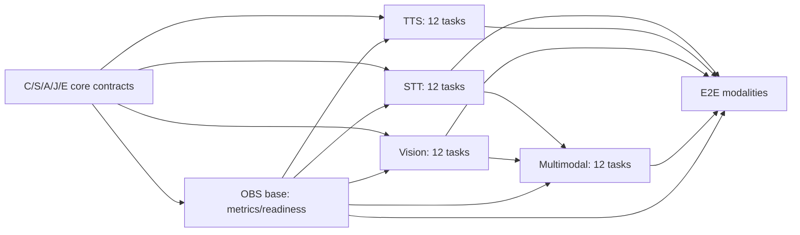

# Ghatana Media — backend modalities + observability, five-surface implementation wave

> **ACTIVE OWNER EXECUTION DIRECTIVE — 2026-10-27:** [R7 engineering decisions, portability gates, 36 remaining tasks and canonical acceptance sequencing](MEDIA-WAVE2-OWNER-IMPLEMENTATION-DIRECTIVE-2026-10-27.md). Implementation permission is approved; no third-party model/voice/corpus/consent rights, production provider, native task closure, release or gtool/PDP status is implied. Source truth and complete task statuses remain below. The last reported ledger is **58 = 22 LOCALLY_VERIFIED + 30 PARTIAL + 6 OWNER_EXTERNAL**. R7 source-pinned codec provisioning and the Mac/Linux TTS test correction are committed but await current-cut native/Gradle verification.


**Status:** IMPLEMENTATION-READY_PLAN / NO RUNTIME CHANGES IN THIS DOCUMENT / NOT VERIFIED_OR_CLOSED  
**Reviewed source:** `samujjwal/ghatana-media/main@0ee65a460665eeb0df118655f93f4112c0be7d9f` (2026-10-25; local `HEAD` matched remote `main` at execution start); source truth is `.product-experience/pdp-0-product-truth`, `pdp-1-domain-data`, `pdp-2-design-interface-system`, `pdp-3-product-experience`. Current uncommitted execution changes are recorded below; this source pin identifies the inspected baseline only.
**Canonical Build owner:** [MEDIA-BUILD-IMPLEMENTATION-PLAN.md](MEDIA-BUILD-IMPLEMENTATION-PLAN.md), especially **F08** provider admission, **F09** headless contract grammar, **F11** temporal/codec primitives, **F12** observability, and **V03/V04/V05/V06/V16/V27** outcome journeys.  
**Foundation predecessor:** [five-core-backend-foundation plan](MEDIA-BACKEND-FOUNDATION-DEEP-IMPLEMENTATION-2026-10-24.md) C/S/A/J/E. Foundation code at latest main exists; this planning review **did not run its full tests**. Do not assume completed foundation closure or formally admitted providers.  
**Actual code owner:** **Only `ghatana-media`**; `ghatana/services/media` is read-only historical comparison. Shared/Kernel/Ghatana platform modules retain their own public contract ownership.  
**Formal Track B:** independent; no claimed gtool/PDP closed/current native receipt, KDEV stage advancement, migration cutover, CI-image qualification, deployment or release. The user-reported V009→V018 lineage fixture and 9 compose skips are residual observations, not certification of live applied DBs or production test completeness.

## Review outcome and selection

This wave selects **five already registered physical surfaces**, four modality services plus one supporting observability module. The existing source contains nontrivial code and tests, so work is **reuse + correctness/hardening + actual provider/quality conformance**, not greenfield rewrites. The Wave 2 task IDs (`STT-01..`, `TTS-01..`, `VIS-01..`, `MM-01..`, `OBS-01..`) are **local execution labels** bound to existing F/V packages, not a replacement for the source or new Lifecycle contracts.

| Surface | Physical registry identity | Implementer and reviewer | PDP meaning/consumer anchor | Work priority |
| --- | --- | --- | --- | --- |
| **STT** | `media.physical.modules-speech-stt-service` | Media speech/transcription engineer; Domain/timing/security reviewer | media.operation.transcription; media.operation.transcription-submission; media.operation.transcript-version-read; media.operation.caption-draft-write; media.operation.caption-version-write; media.operation.caption-version-read; J-03,J-07,J-16; PDP-3 grpc/service-registry.yaml STTService.* | Independent direct service hardening |
| **TTS** | `media.physical.modules-speech-tts-service` | Media synthesis/audio engineer; Voice-rights/audio DSP/security reviewer | media.operation.synthesis; media.operation.tts-request-origin-binding.v1; media.domain.artifact; media.domain.media-asset; media.domain.processing-job; J-04,J-16,J-17; PDP-3 grpc/service-registry.yaml TTSService.* | Independent direct service hardening |
| **VIS** | `media.physical.modules-vision-vision-service` | Media computer-vision engineer; Native/codec-security and model-quality reviewer | media.operation.vision-analysis; media.domain.scene-graph; media.domain.processing-job; media.value.image-video-technical-descriptor; J-05,J-06,J-28; PDP-3 grpc/service-registry.yaml VisionService.* | Independent direct service hardening |
| **MM** | `media.physical.modules-intelligence-multimodal-service` | Media multimodal/reliability engineer; STT+Vision integration, temporal and scientific-fidelity reviewer | media.operation.multimodal-analysis; media.domain.processing-job; media.domain.scene-graph; media.domain.transcript-version; J-06; PDP-3 grpc/service-registry.yaml MultimodalService.* | After STT+Vision APIs validated |
| **OBS** | `media.physical.audio-video-observability` | Media observability/performance engineer; Privacy/SRE and modality owners | media.health.readiness.inspect (PDP-0 intent), Media runtime health/readiness contracts; no invented standalone PDP-1 operation; PDP-3 existing health/status projections; no standalone OBS RPC and no new API | Cross-cutting first + validated last |

**Source populations:** The physical topology associates STT with 16 transcription intents, TTS with 17 synthesis intents, Vision with 22 vision/scene-text intents, and Multimodal with its own cross-modal intents plus reused STT and Vision obligations. Observability owns the single directly registered `media.health.readiness.inspect` capability. Full portfolio still has 54 source identities; these five are not five new services or a denominator reset. The complete per-intent and per-RPC exact mapping is appended below from existing source records.

### Confirmed code risks requiring real changes

- **STT** `PersistentSttGrpcService.java`: falls back to random `UUID` when authenticated user ID is missing; reject instead. STT README describes an external gRPC engine, while `ProductionSttGrpcService` composes local ONNX model config; reconcile via explicit provider policy, not silently assume model availability. Word/diarization/translation capability claims need actual engines.
- **TTS** `TtsSynthesisEngine.java` emits repeating `0x3C` fake audio and labels encoded output; this is never acceptable as real TTS. `SsmlProcessor.java` regex parsing of untrusted markup lacks robust XML nesting/DTD guards. Voice cloning/biometrics must be explicitly authorized and never silently activated.
- **Vision** model/OpenCV/native initialization is environment sensitive; `VideoFrameExtractor` invokes FFmpeg on untrusted media; resource/path/codec constraints need adversarial tests. A YOLO detector does not automatically implement depth, segmentation, face identity or scene-text analysis; generic OCR belongs to Document Intelligence.
- **Multimodal** `MultimodalAnalysisEngine` uses `dummyAudioFrame` and `dummyVideoFrame` while estimating sync; replace with real timestamped input or UNKNOWN. `CrossModalFusionEngine` heuristically averages vectors/confidences; cannot claim a validated calibrated joint embedding. `PersistentMultimodalService` can be constructed without engines, with unsupported paths.
- **Observability** `AudioVideoTracingService` uses a hardcoded 50ms generic SLA threshold, which is inappropriate for actual model execution. `MediaWorkflowMetrics` already has constrained tags; tests must prevent metadata/content leaks and prove cross-service propagation, resource accounting and true readiness.

## Execution controls, reuse and acceptance law

1. Work only in **Media modules** shown below; no second job store, no second model governance stack, no generic Event Plane/OCR implementation, no new gtool/receipt machinery. Reuse foundation job/attempt/consent/artifact/outbox and published platform model/DI/Shared APIs.
2. Every positive result requires actual output artifact/version, declared model and input provenance, consent and a re-readable effect, **not** mock-returned text, dummy PCM, dummy video sync or JSON "success". When the model/hardware/licensing is not admitted, implement the complete typed negative path and keep the real positive effect **NOT_VERIFIED**; do not call the capability fully implemented.
3. Every RPC keeps its existing proto method/field numbers and auth scopes. PDP-3 gRPC service registry contains **43 observed RPCs**: STT 12, TTS 11, Vision 10, Multimodal 10; **24 proposed logical bindings and 19 unresolved**. Source status is proposal-only; the explicit RPC ledger below is a coverage projection, **not** PDP approval.
4. A surface earns `LOGICALLY_BACKEND_DEV_COMPLETE` only if all in-scope PDP capabilities are either supported by real implementation+tests, or formally source-disposed as non-applicable/unsupported with **a legitimate requirement/owner decision**. Typed `NOT_ADMITTED` is safe behavior, NOT automatically development completion for an intended feature. Partial functionality is `IN_PROGRESS` with exact remaining IDs. Do not call the whole physical leaf complete based on one successful API.
5. Use a dedicated healthy local fixture model where available with legally reusable weights and an approved license; never auto-download unknown weights. In-process gRPC and in-memory provider doubles are valid unit tests, not independent real-model/quality evidence. Require container/process integration for the effects they claim, without tying ordinary coding to GH-90000.
6. Negative tests on every boundary: missing/forged principal, other tenant, unauthorized voice/face, expired consent, malformed media/SSML, frame/sample overflow, provider timeout after possible effect, cancelled and stale attempts, resource exhaustion, unavailable model, mismatched output format, and leaking diagnostic fields. Cleanup on every exception.
7. Per-family file ownership and max 2 active edited packages concurrently. STT owns STT module; TTS owns TTS; Vision owns Vision; Multimodal owns MM; OBS owns observability. Any shared `launcher/runtime-contracts/providers` change must be serialized with corresponding foundation owner. No mechanical copy of model code from Ghatana platform.
8. Performance samples require exact model version/hardware/driver/codec/fixture/tenancy/limits with latency histograms and resource counters. PDP-0 `NFR-PERF-001` control-plane budgets are only *proposed* until a reference environment is approved; model inference latency, real-time factor (RTF), image/video fps and sync error are separate measurements.
9. **No new Media backend module is inherently blocked on GH-90000, warn-only Checkstyle, formal gtool transition or the Shared build-logic bug.** They are separately tracked at the end. A missing real service-image test does mean that *that particular cross-process assertion is unverified*, not PASS.

## Dependencies and bounded implementation waves



**Wave W0 (first 4-hour pulse):** refresh current files/real tests; open STT-01/TTS-01/VIS-01/MM-01/OBS-01; begin TTS-02 dangerous synthetic-output fail-closed fix and MM-04 dummy-sync reproduction. Produce at least one code/test patch, not another proposal. **W1 (days 1–2, planning only):** auth/provider/format/model/observability foundation; STT/TTS/Vision work in parallel; MM boundary and timestamp groundwork. **W2 (days 3–6):** real positive path and result/version integration; MM waits for STT/Vision published in-repo API adapter; OBS measurements advance concurrently. **W3 (days 7–10):** 43-RPC matrix, adversarial & real-model tests, performance/failure verification and local package review. These are pulse/checkpoint timeboxes, **not promises of completion**; after two failed pulses on one dependency, isolate one reproducible test and continue independent code. No global sweep or unrelated PDP reopen.

**Workstream merge schedule:** OBS-01/02/03 + STT-01/02 + TTS-01/02 + VIS-01/02 can start without shared-file contention. MM-02/03/04 can run early using read-only fixtures; MM-05 waits for exact STT/Vision provider API. Per-service final review waits for OBS service readiness/latency wiring only where claimed. Image-backed GH-90000 testing is a separate optional real-compose qualification step; not a prerequisite to basic code compilation or in-process gRPC conformance.

## PR-sized backend tasks (one row = one actionable implementation, test and observable acceptance)

**Paths** within each table are relative to the owning module's `src/main/java` or `src/main` as appropriate; `README.md`, `src/test` and provider/contract manifests are addressed by exact paths. Newly proposed classes/fixtures are marked **NEW**. `NFR-*` and `media.*` capability identifiers in each task are source PDP-0 references; the table heading supplies PDP-1 operation and PDP-3 journey/gRPC registry anchors. Actual readiness is checked per exact source cut and owner disposition, not inferred from this plan.

### STT — media.physical.modules-speech-stt-service

**Owner:** Media speech/transcription engineer. **Independent review:** Domain/timing/security reviewer. **Code:** `modules/speech/stt-service`. **PDP-0 NFRs:** `NFR-SEC-001,NFR-PRIV-001,NFR-TIME-001,NFR-RECOVERY-001,NFR-LOC-001,NFR-FIDELITY-001`. **PDP-1:** media.operation.transcription; media.operation.transcription-submission; media.operation.transcript-version-read; media.operation.caption-draft-write; media.operation.caption-version-write; media.operation.caption-version-read. **PDP-3:** J-03,J-07,J-16; PDP-3 grpc/service-registry.yaml STTService.*. PDP-2 headless contract/error/idempotency/stream grammar references: `.product-experience/pdp-2-design-interface-system/api/` plus gRPC proto, not an invented PDP-4.

| ID / pulse | Dependencies | Exact PDP-0 capability / NFR | Where and how to implement | Executable acceptance |
| --- | --- | --- | --- | --- |
| **STT-01** (W0) | — | `media.speech.transcription.file; NFR-RECOVERY-001` | `modules/speech/stt-service/src/main/proto/stt_service.proto; grpc/SttGrpcService.java`: Inventory 12 RPCs, 16 PDP-0 STT intents, current SPI/provider/status, versions and existing tests; separate implemented, contract-only and actual provider qualification. | Saved exact capability/RPC ledger with no missing ID; test contract matches proto field numbers and live implemented statuses. |
| **STT-02** (W0) | STT-01 | `media.speech.transcription.file; NFR-COST-001` | `modules/speech/stt-service/grpc/ProductionSttGrpcService.java; README.md; config/provider-manifest.json`: Resolve README external Whisper gRPC versus local ONNX config: make provider routing explicit (GRPC/qualified local), immutable model ID/version/licence/hardware/region, readiness and fail-closed NOP/unsupported. Reuse AI Inference public adapter only for generic model execution. | Same request on configured provider returns admitted profile or exact NOT_ADMITTED; no synthetic success in production; contract tests cover mismatched configuration. |
| **STT-03** (W1) | STT-01 | `media.speech.transcription.speaker.identify-authorized; NFR-PRIV-001` | `modules/speech/stt-service/grpc/PersistentSttGrpcService.java; grpc/SttGrpcServer.java; service/PersistentSttService.java`: Remove random UUID principal fallback; require trusted authenticated principal/tenant/purpose; verify ownership at direct service and gRPC; apply bounds and min-data audit on each request/retry. | Missing caller identity is UNAUTHENTICATED with no file/DB/provider effect; impersonation and cross-tenant transcript tests green. |
| **STT-04** (W1) | STT-02,STT-03 | `media.speech.transcription.file; NFR-SEC-001` | `modules/speech/stt-service/service/PersistentSttService.java; grpc/SttGrpcService.java`: Consume governed artifact/version or bounded uploaded bytes; sniff codec/container, frame/channel/sample-rate/rational clock; reject decoded-size bombs; use bounded I/O rather than unbounded protobuf/byte-array copy. | WAV/FLAC and explicitly admitted formats roundtrip; 0, oversize, broken header, bad timestamps and sample bounds fail with stable gRPC codes. |
| **STT-05** (W2) | STT-02,STT-04 | `media.speech.transcription.stream; NFR-RECOVERY-001` | `modules/speech/stt-service/grpc/SttGrpcService.java; streaming/SttStreamingLatencyEnhancer.java`: Implement validated chunk/session identity, monotonic sequence/ack, bounded partial revisions, VAD framing, reconnect/resume, backpressure, timeout, cancel and final-result semantics; delegate transport mechanics to Media stream runtime. | Out-of-order, repeat, gap, disconnect, dropped final and revoked consent tests prove no duplicate terminal transcript or fabricated finality. |
| **STT-06** (W2) | STT-04 | `media.speech.transcription.word-timestamp.create; media.speech.transcription.confidence.provide; NFR-TIME-001` | `modules/speech/stt-service/service/PersistentSttService.java; detection/LanguageDetectionService.java; proto adapter`: Bind source-PTS/sample clock, language/alternatives, VAD, words/phonemes and confidence to versioned typed segments; validate alignment and quality provenance; absent model support is a reasoned unavailability, not invented values. | Impulse/boundary tests and gold transcript verify timebase, ordered nonoverlapping bounds and calibrated/not-calibrated confidence distinctions. |
| **STT-07** (W2) | STT-03,STT-06 | `media.speech.transcription.speaker.diarize; media.speech.transcription.speaker.identify-authorized; NFR-PRIV-001` | `modules/speech/stt-service/diarization/SpeakerDiarizationService.java; service/PersistentSttService.java`: Separate anonymous diarization from speaker identity, permission voice-biometric/diarization, overlap and speaker label stability; never infer real identity from clustering or training data. | Overlapping/multi-speaker fixture preserves anonymous speaker IDs and no biometric identity without rights; speaker accuracy evaluated with declared corpus. |
| **STT-08** (W2) | STT-06,STT-07 | `media.speech.transcription.forced-align; media.speech.transcription.subtitle.generate; NFR-FIDELITY-001` | `modules/speech/stt-service/service/PersistentSttService.java; job/AvJobLifecycleAdapter.java; transcript store SPI`: Persist immutable transcript/word-version, parent/source digest, CAS correction and caption draft vs approved version; forced alignment, translation and subtitle producer only when admitted and actually implemented. | Exact source/word/caption lineage and CAS conflict tested; unsupported alignment/translate produce typed unmet-capability with no counterfeit caption version. |
| **STT-09** (W2) | STT-03,STT-08 | `media.speech.transcription.file; NFR-AUD-001` | `modules/speech/stt-service/job/AvJobLifecycleAdapter.java; launcher Media job SPI`: Adopt foundation job idempotency, immutable artifact version, fenced provider attempt, truthful cancellation/UNKNOWN, bounded retry and secure audit; do not build another job store. | Crash after request/dispatch/receipt and replay tested; shared job status projection does not convert UNKNOWN into running/success. |
| **STT-10** (W3) | STT-06,STT-08 | `media.speech.transcription.language.detect; NFR-LOC-001` | `modules/speech/stt-service/src/test/java/.../functional; deterministic fixtures and benchmark corpus`: Validate recognized languages including Devanagari cases, silence/noise, accent/overlap, segmentation, punctuation, WER/CER/DER and fairness/unsupported language disclosure; separate model evaluation from code correctness. | Golden corpus includes language/error distributions; thresholds/real model quality are observed with model+hardware, not claimed from fixtures. |
| **STT-11** (W3) | STT-02,STT-08,OBS-01 | `media.speech.transcription.file; NFR-RECOVERY-001` | `modules/speech/stt-service/grpc/SttGrpcService.java; grpc/ProductionSttGrpcService.java; stt_service.proto`: Exercise every STT RPC: Transcribe/StreamTranscribe, model List/Load/Unload/Adapt, GetStatus/Health, Profile Create/Get/Update and SubmitCorrection. Preserve proto/wire identities; unadmitted effects return explicit codes. | 12/12 RPCs have positive real-engine or source-authorized unavailable paths and auth/invalid/unknown tests, no fabricated adaptation result. |
| **STT-12** (W3) | STT-03..STT-11 | `media.speech.transcription.file; NFR-PERF-001` | `modules/speech/stt-service/src/test; SttGrpcServiceInProcessIntegrationTest; dedicated STT runtime E2E`: Run in-process authenticated gRPC, real admitted engine isolated test, restarts, concurrent batches, 16/64 request load; record RTF/p50/p95/p99, memory, WER/CER, no cross-tenant data, budget caps. | Source-bound 12-RPC and 16-capability matrix is current; all in-scope tests pass, no skips relabeled as PASS, real provider assertions only with actual model. |

### TTS — media.physical.modules-speech-tts-service

**Owner:** Media synthesis/audio engineer. **Independent review:** Voice-rights/audio DSP/security reviewer. **Code:** `modules/speech/tts-service`. **PDP-0 NFRs:** `NFR-SEC-001,NFR-PRIV-001,NFR-TIME-001,NFR-COST-001,NFR-FIDELITY-001,NFR-LOC-001`. **PDP-1:** media.operation.synthesis; media.operation.tts-request-origin-binding.v1; media.domain.artifact; media.domain.media-asset; media.domain.processing-job. **PDP-3:** J-04,J-16,J-17; PDP-3 grpc/service-registry.yaml TTSService.*. PDP-2 headless contract/error/idempotency/stream grammar references: `.product-experience/pdp-2-design-interface-system/api/` plus gRPC proto, not an invented PDP-4.

| ID / pulse | Dependencies | Exact PDP-0 capability / NFR | Where and how to implement | Executable acceptance |
| --- | --- | --- | --- | --- |
| **TTS-01** (W0) | — | `media.speech.synthesis.text-to-speech; NFR-RECOVERY-001` | `modules/speech/tts-service/src/main/proto/tts_service.proto; grpc/TtsGrpcService.java; README.md`: Inventory 11 RPCs/17 capabilities, model/voice profiles and source→output/version/voice rights; compare hosted TtsEngine against TtsSynthesisEngine fallback and actual advertised codecs. | Every RPC/voice/capability classed IMPLEMENTED, PROVIDER_DEPENDENT, NOT_IMPLEMENTED or EXPLICITLY_NOT_ADMITTED; no fake positive. |
| **TTS-02** (W0) | TTS-01 | `media.speech.synthesis.text-to-speech; NFR-FIDELITY-001` | `modules/speech/tts-service/engine/TtsSynthesisEngine.java; grpc/TtsGrpcService.java`: Remove repeating-byte synth from any real provider result: isolate as explicitly named synthetic test fixture, or replace with real admitted synthesis SPI; forbid false PCM/MP3/OPUS claims. | Production-like profile cannot receive 0x3C fabricated bytes or wrong codec; decoder + header + duration and real speech checks required. |
| **TTS-03** (W1) | TTS-01,TTS-02 | `media.speech.synthesis.speaker.condition; NFR-COST-001` | `modules/speech/tts-service/grpc/ProductionTtsGrpcService.java; config/provider-manifest.json`: Bind actual voice model ID/version/digest/license, language, region, retention, hardware memory/compute, model health and prewarming; no implicit model download or synthetic fallback. | Unknown/unavailable model/voice/license fails cleanly before mutation; only admitted and initialized provider may synthesize. |
| **TTS-04** (W1) | TTS-01 | `media.speech.synthesis.control.prosody; NFR-SEC-001` | `modules/speech/tts-service/ssml/SsmlProcessor.java; service/PersistentTtsService.java`: Replace regex tag stripping/parser for untrusted SSML with bounded hardened XML parser (disable DTD/external entities/XInclude), canonical nesting, known tags, max input/depth/duration and escape handling. | XXE/ENTITY bomb, malformed/nested tags, huge pause and injection negatives fail; deterministic normalized phoneme/text segments test green. |
| **TTS-05** (W1) | TTS-03 | `media.speech.synthesis.speaker.clone-authorized; NFR-PRIV-001` | `modules/speech/tts-service/grpc/TtsGrpcService.java; security/EmbeddingEncryptionService.java; service/PersistentTtsService.java`: Enforce authenticated owner, voice identity, source consent, cloning/conditioning/biometrics, expiry and purpose; do not equate uploaded voice profile with legal authorization; encrypt retained embeddings. | Unauthorized clone/profile access/no consent denies before external call; deletion/revocation disables subsequent dispatch; test data never leaked. |
| **TTS-06** (W2) | TTS-03,TTS-04 | `media.speech.synthesis.control.phoneme; media.speech.synthesis.expressive; NFR-FIDELITY-001` | `modules/speech/tts-service/ssml/SsmlProcessor.java; emotion/EmotionControlService.java; mixing/VoiceMixingService.java`: Map rate/pitch/prosody/pronunciation/SSML/emotion to provider-supported parameters; validate units and finite bounded values; opt out unsupported control rather than pretend it changed output. | AB-style control fixtures prove observable effect where enabled; unsupported control returns truthful limitation; sample clocks and volume limits deterministic. |
| **TTS-07** (W2) | TTS-02,TTS-03,TTS-06 | `media.speech.synthesis.text-to-speech; NFR-TIME-001` | `modules/speech/tts-service/engine/TtsSynthesisEngine.java; service/PersistentTtsService.java`: Generate real audio through admitted engine; encode declared PCM/encoded format, sample rate/channels/frame count and loudness, verify bytes can be decoded and duration matches sample count with rational rounding. | Decoded non-empty speech on authorized reference model, playable output and exact format metadata; no label OPUS/MP3 for PCM bytes. |
| **TTS-08** (W2) | TTS-07 | `media.speech.synthesis.streaming; NFR-RECOVERY-001` | `modules/speech/tts-service/grpc/TtsGrpcService.java; proto TTSService.StreamSynthesize`: Stream bounded ordered frames/chunks, backpressure and cancel semantics; preserve output version/finality and timeout/pause/resume where protocol permits; no inferred seek/resume if not in proto. | Stream sequence/chunk count/size/cancel-after-output/partial errors tested, no duplicate final audio or unbounded buffering. |
| **TTS-09** (W2) | TTS-05,TTS-07 | `media.speech.synthesis.text-to-speech; NFR-AUD-001` | `modules/speech/tts-service/service/PersistentTtsService.java; Media artifact/job/outbox SPI`: Persist immutable authorized generated audio and provider/prosody/voice model lineage, rights and quality version; reuse foundation job engine idempotency, attempt fence and outbox. | Replay same request preserves output, different digest conflicts, consent-revoked-before-effect blocked, failure never registers complete artifact. |
| **TTS-10** (W3) | TTS-05,TTS-06,TTS-07 | `media.speech.synthesis.multilingual; media.speech.synthesis.speech.translate; NFR-LOC-001` | `modules/speech/tts-service/grpc/TtsGrpcService.java; voice manifest/qualification fixtures`: Classify supported voice-language/style combinations, cross-lingual, dubbing/voice-conversion/speech-to-speech as provider dependent with explicit output and rights; no unsupported language auto-substitute. | Locale matrix for en/ne/hi and source-declared languages: authorized real provider effects pass, unadmitted variants fail with exact capability reason. |
| **TTS-11** (W3) | TTS-03,TTS-05,TTS-08,OBS-01 | `media.speech.synthesis.speaker.clone-authorized; NFR-PRIV-001` | `modules/speech/tts-service/grpc/TtsGrpcService.java; tts_service.proto`: Exercise all 11 TTS RPCs including GetVoices, LoadVoice, GetStatus/Metrics, profile CRUD, CloneVoice and SubmitFeedback. Any unavailable operation is typed and visibly not admitted. | 11/11 methods covered by supported behavior or source-grounded unavailable response; transport version and credential/tenant negatives pass. |
| **TTS-12** (W3) | TTS-04..TTS-11 | `media.speech.synthesis.text-to-speech; NFR-PERF-001` | `modules/speech/tts-service/src/test; TtsGrpcServiceInProcessIntegrationTest; TtsFunctionalCompletenessTest`: Real reference synthesis, SSML fuzz, sample/codec validity, stream cancellation, 16/64 concurrency, RTF/memory/latency; licensed/consent-ready voice only, no real clone needed for nonadmitted scope. | All in-scope errors/positive outputs check decoded audio; voice privacy and model readiness verified; p50/p95/p99 and RTF recorded separately. |

### VIS — media.physical.modules-vision-vision-service

**Owner:** Media computer-vision engineer. **Independent review:** Native/codec-security and model-quality reviewer. **Code:** `modules/vision/vision-service`. **PDP-0 NFRs:** `NFR-SEC-001,NFR-PRIV-001,NFR-TIME-001,NFR-FIDELITY-001,NFR-COST-001`. **PDP-1:** media.operation.vision-analysis; media.domain.scene-graph; media.domain.processing-job; media.value.image-video-technical-descriptor. **PDP-3:** J-05,J-06,J-28; PDP-3 grpc/service-registry.yaml VisionService.*. PDP-2 headless contract/error/idempotency/stream grammar references: `.product-experience/pdp-2-design-interface-system/api/` plus gRPC proto, not an invented PDP-4.

| ID / pulse | Dependencies | Exact PDP-0 capability / NFR | Where and how to implement | Executable acceptance |
| --- | --- | --- | --- | --- |
| **VIS-01** (W0) | — | `media.vision.detect; NFR-FIDELITY-001` | `modules/vision/vision-service/src/main/proto/vision_service.proto; modules/vision/vision-service/src/main/java/com/ghatana/audio/video/vision/grpc/VisionGrpcService.java`: Inventory 10 RPCs and 22 PDP vision/scene-text capabilities against provider implementation; record strict supported/unsupported model/version/format rows. | Exact 22 capabilities/10 RPC census; no implicit object-detector support for depth/segmentation/pose. |
| **VIS-02** (W0) | VIS-01 | `media.vision.detect; NFR-COST-001` | `modules/vision/vision-service/grpc/ProductionVisionGrpcService.java; yolo/YoloV8Adapter.java`: Qualify pinned signed/hashed YOLO/ONNX model file, classes/version/license, CPU/GPU native library, initialization and bounded model lifetime; handle missing OpenCV as typed unavailable without leaking stack/half-server. | No service reports ready without initialized detector; invalid model/digest/native/lib/license profile fails before traffic, no silent noop. |
| **VIS-03** (W1) | VIS-01 | `media.vision.classify; NFR-SEC-001` | `modules/vision/vision-service/video/VideoFrameExtractor.java; grpc/VisionGrpcService.java`: Reject oversize images/frames/pixels/decoded expansion, malformed codecs/containers, symlinks/traversal and unsafe media metadata before decoding; bound temp directory and native memory. | Adversarial image/video and native parser corpus stays inside CPU/memory/frame/time bounds; quarantine unsupported formats. |
| **VIS-04** (W1) | VIS-03 | `media.vision.detect.shot-boundary; NFR-SEC-001` | `modules/vision/vision-service/video/VideoFrameExtractor.java; VideoFrameExtractorProcessTest.java`: Harden FFmpeg argument allowlist/path containment, timeout/cancel & process-tree kill, diagnostic/output byte budget, isolated temp files, safe metadata; never pass unsanitized network protocols. | Process timeout/symlink/path/infinite stream and ffmpeg stderr spam tests prove no escaped paths/leaked temp bytes. |
| **VIS-05** (W1) | VIS-02,VIS-03 | `media.vision.detect; NFR-TIME-001` | `modules/vision/vision-service/yolo/YoloV8Adapter.java; model/BoundingBox.java; analysis/VideoAnalysisService.java`: Preserve rotation/color/EXIF orientation and scale transforms, normalized ROI/bbox coordinate conventions, confidence units and content version. Manage all OpenCV Mat buffers and Net lifetime. | Synthetic geometry fixtures roundtrip pixels→bbox and back within declared pixel tolerance; native leak stress bounded. |
| **VIS-06** (W2) | VIS-05 | `media.vision.detect; media.vision.classify; NFR-FIDELITY-001` | `modules/vision/vision-service/yolo/YoloV8Adapter.java; detection/VisionDetector.java`: Test ONNX output layout, class mapping, threshold/NMS, invalid/NaN scores, overlapping classes, coordinate clipping and model version changes; no heuristic label as calibrated probability. | Golden object fixture and mAP/PR metrics on licensed corpus, class list + confidence metadata reproducible; no out-of-range boxes. |
| **VIS-07** (W2) | VIS-04,VIS-06 | `media.vision.track.object; media.vision.estimate.camera-motion; NFR-TIME-001` | `modules/vision/vision-service/analysis/VideoAnalysisService.java; video/VideoFrameExtractor.java`: Link detections to exact frame PTS, track IDs, shot boundaries and source clock; bounded temporal windows and missing frame semantics. Don't treat frame index as wall-time. | Variable-frame-rate/reorder/scene-cut tests preserve frame timestamp, track version/identity, sample count and uncertainty. |
| **VIS-08** (W2) | VIS-06,VIS-07 | `media.vision.segment.image; media.vision.estimate.depth; NFR-FIDELITY-001` | `modules/vision/vision-service/grpc/VisionGrpcService.java; model/SPIs via admitted providers`: For segmentation, optical flow, depth/normals, hand/human pose, foreground matte and saliency, require real qualified capability provider/result dimension; otherwise explicitly NOT_ADMITTED, not YOLO-bbox substitution. | Every advanced intent receives provider-backed output validated by ground truth or exact unavailable, with no guessed depth/segmentation tensor. |
| **VIS-09** (W2) | VIS-04,VIS-07 | `media.vision.scene-text.observation.create; NFR-PRIV-001` | `modules/vision/vision-service/src/main/java/com/ghatana/audio/video/vision/ocr/OcrService.java; modules/vision/vision-service/src/main/java/com/ghatana/audio/video/vision/scene/SceneUnderstandingService.java; place any future Document Intelligence adapter under modules/vision/vision-service/src/main/java/com/ghatana/audio/video/vision/ocr/ only after its public owner API contract is available (no adapter source currently exists)`: Replace legacy generic OCR execution with admitted Document Intelligence public API adapter only; keep Media temporal region tracking/scene annotations, bound text image/copy rights. | Text box/time/region evidence tied to immutable frame; no Media-owned generic OCR engine or leakage of protected text; no fake extracted text. |
| **VIS-10** (W2) | VIS-03,VIS-06 | `media.vision.estimate.face-landmarks; media.vision.analyze.gaze; NFR-PRIV-001` | `modules/vision/vision-service/recognition/FacialRecognitionService.java; StructuredFacialRecognitionAuditSink.java`: Enforce biometric purpose/consent/region/retention before face-landmark/gaze/expression/identity; reject unsafe face identification, distinguish bounding boxes from identity assertions. | Same-tenant/other-tenant, revoked consent and sensitive analytics negative fixtures dispatch zero restricted effects. |
| **VIS-11** (W3) | VIS-02,VIS-07,VIS-09,OBS-01 | `media.vision.classify.scene; NFR-RECOVERY-001` | `modules/vision/vision-service/grpc/VisionGrpcService.java; PersistentVisionService.java; Vision proto`: Run 10 Vision RPCs (Detect, AnalyzeImage, Classify, AnalyzeVideoFile, ProcessVideo, model List/Load/Unload, GetStatus, Health); wire existing Media job/artifact/version and provider status to trustworthy gRPC outcomes. | 10/10 proto RPC matrix auth/bounds/status/finality tests; legitimate derived result re-read with provenance; no wrong file metadata as audio. |
| **VIS-12** (W3) | VIS-01..VIS-11 | `media.vision.detect; NFR-PERF-001` | `modules/vision/vision-service/src/test; VisionGrpcServiceInProcessIntegrationTest; VideoFrameExtractorProcessTest`: Real model/reference image tests plus bounded ffmpeg/OpenCV stress, mAP/latency/throughput and CPU/GPU/native-memory; fault/restart/hardware absent profile tested. | All declared positive capabilities actually executable or openly NOT_ADMITTED; signed/model provenance + protected data + native resource tests pass. |

### MM — media.physical.modules-intelligence-multimodal-service

**Owner:** Media multimodal/reliability engineer. **Independent review:** STT+Vision integration, temporal and scientific-fidelity reviewer. **Code:** `modules/intelligence/multimodal-service`. **PDP-0 NFRs:** `NFR-SEC-001,NFR-PRIV-001,NFR-TIME-001,NFR-FIDELITY-001,NFR-RECOVERY-001`. **PDP-1:** media.operation.multimodal-analysis; media.domain.processing-job; media.domain.scene-graph; media.domain.transcript-version. **PDP-3:** J-06; PDP-3 grpc/service-registry.yaml MultimodalService.*. PDP-2 headless contract/error/idempotency/stream grammar references: `.product-experience/pdp-2-design-interface-system/api/` plus gRPC proto, not an invented PDP-4.

| ID / pulse | Dependencies | Exact PDP-0 capability / NFR | Where and how to implement | Executable acceptance |
| --- | --- | --- | --- | --- |
| **MM-01** (W0) | — | `media.multimodal.analyze.cross-modal; NFR-FIDELITY-001` | `modules/intelligence/multimodal-service/src/main/proto/multimodal_service.proto; grpc/MultimodalGrpcService.java`: Inventory 10 RPCs, 7 multimodal-owned intents and delegated STT/Vision intents; map input/output, partial and uncertainty semantics; no duplicated STT or vision engines. | 10 RPC/7 direct intent matrix plus exact delegated 16 STT and 20 Vision references (from the Vision surface's 22); no phantom independent capabilities. |
| **MM-02** (W1) | MM-01,STT-03,VIS-03 | `media.multimodal.observe.source-grounded; NFR-PRIV-001` | `modules/intelligence/multimodal-service/grpc/MultimodalGrpcService.java; engine/MultimodalRequest.java`: Authenticate tenant/principal and inspect rights for each modality and provider egress, source immutable artifact/versions, content size and purpose; no untrusted tenant header. | Cross-tenant mixed input and revoked purpose deny before any call; signed content refs only and bounded bytes/frames. |
| **MM-03** (W1) | MM-02 | `media.multimodal.relate.scene-audio; NFR-TIME-001` | `modules/intelligence/multimodal-service/engine/TemporalAlignment.java; engine/MultimodalAnalysisEngine.java`: Adopt rational source/media clocks, frame PTS/audio samples, feature-window alignment and time bounds; distinguish t_source/t_media/t_sim/t_wall; detect clock mismatch. | Synthetic impulse/fps drift/variable frame rate test gives exact bounded offset and documented unresolvable outcome. |
| **MM-04** (W1) | MM-03 | `media.multimodal.relate.scene-audio; NFR-FIDELITY-001` | `modules/intelligence/multimodal-service/engine/MultimodalAnalysisEngine.java; AudioVideoSyncPipeline adapter`: Eliminate dummyAudioFrame/dummyVideoFrame synchronization evidence; feed real timestamped window features to qualified sync algorithm or return SYNC_UNDETERMINED. Never label fabricated drift confidence. | Sync ground truth with deliberate ±offset/clock discontinuity compared to measured value; unavailable signals yield unknown, not GOOD. |
| **MM-05** (W2) | MM-02,STT-09,VIS-06,VIS-07 | `media.multimodal.analyze.cross-modal; NFR-RECOVERY-001` | `modules/intelligence/multimodal-service/engine/PlatformMultimodalAdapter.java; adapter/GrpcSttClientAdapter.java; service/PersistentMultimodalService.java`: Compose actual allowed STT/Vision service providers through public SPI, bounded concurrency/cancellation/deadlines, stable owner job and split retries; disallow null-engine success paths. | Network partition/timeout/provider unavailable returns exact partial/unknown, not successful synthetic analysis. Cross-service context protected. |
| **MM-06** (W2) | MM-04,MM-05 | `media.multimodal.associate.speaker-face; NFR-FIDELITY-001` | `modules/intelligence/multimodal-service/engine/CrossModalFusionEngine.java; MultimodalAnalysisEngine.java`: Validate equal finite embedding dims/coordinate frames, normalize weights and no Nans; distinguish heuristic similarity from measured calibrated confidence; gate speaker-face identity behind biometric rights. | Dim mismatch, sparse embeddings, missing modalities and misleading confidence tests; no claimed scientifically validated association without labeled corpus. |
| **MM-07** (W2) | MM-06 | `media.multimodal.describe; media.multimodal.summarize; media.multimodal.extract.structured; NFR-FIDELITY-001` | `modules/intelligence/multimodal-service/engine/MultimodalResult.java; engine/MultimodalAnalysisEngine.java`: Produce typed, source-grounded description/summaries/structured outputs with references to frame/word/region/version and uncertainty; if no qualified semantics/provider return abstain. | Every asserted entity/time fact traces to actual source observation; contradictory/audio-only/video-only cases do not invent missing evidence. |
| **MM-08** (W2) | MM-05,MM-06 | `media.multimodal.observe.source-grounded; NFR-RECOVERY-001` | `modules/intelligence/multimodal-service/service/PersistentMultimodalService.java; engine/MultimodalAnalysisEngine.java`: Preserve result, quality, attempt identity and finality independently for each selected capability operation; cancellation and UNKNOWN remain scoped to the affected operation. Keep the legacy cross-modal family transport `NOT_ADMITTED` until its request/result is bound to canonical capability operations. | No family-level aggregate result or PARTIAL is emitted. A failed/ambiguous selected operation retains its own typed outcome and exact attempt/provider identity; the independently submitted capability's result remains separate; no blind retry or false combined completion. |
| **MM-09** (W3) | MM-05,MM-08 | `media.multimodal.observe.source-grounded; NFR-AUD-001` | `modules/intelligence/multimodal-service/service/PersistentMultimodalService.java; Media job/artifact/version outbox SPI`: Persist fusion result, source artifact references, selected provider/model, time mapping, provenance and privacy classification under CAS/fenced job attempt; replay only proved idempotent effects. | Read exact result bytes/version; repeated request same identity stable; no generated output when grounded data missing. |
| **MM-10** (W3) | MM-05,MM-07 | `media.multimodal.extract.structured; NFR-PRIV-001` | `adapters/data-cloud-media/src/main/java/com/ghatana/audio/video/multimodal/datacloud/{DataCloudMultimodalAdapter,MediaSemanticObservationProjector}.java`: Publish only governed typed metadata and redacted source-grounded observations to public Data Cloud/AI Inference boundaries; no direct internal DB access or generic platform engine fork. | Projection format/visibility/classification/version negative tests; disabled platform returns explicit integration unavailable but local Media result preserved. |
| **MM-11** (W3) | MM-07,MM-08,OBS-01 | `media.multimodal.analyze.cross-modal; NFR-RECOVERY-001` | `modules/intelligence/multimodal-service/grpc/MultimodalGrpcService.java; multimodal_service.proto`: Exercise 10 RPCs: Process/AnalyzeVideoWithAudio, GenerateDescription, AnalyzeCrossModal, GetInsights, model Load/Unload/List and GetStatus/Health; management only if provider admission exists. | 10/10 proto method matrix with version, auth, cancellation, unsupported branches; no body success for unsupported models. |
| **MM-12** (W3) | MM-01..MM-11 | `media.multimodal.observe.source-grounded; NFR-PERF-001` | `modules/intelligence/multimodal-service/src/test; MultimodalGrpcServiceInProcessIntegrationTest; MultimodalAnalysisEngineTest`: Run real STT+Vision composed E2E with artifact provenance, offset gold corpus, calibrated/unknown result semantics, 16/64 concurrent requests, p50/p95/p99, backpressure and fanout limits. | Actual source-grounded positive result and protected negative/unknown cases; no dummy frames or unqualified scientific confidence. |

### OBS — media.physical.audio-video-observability

**Owner:** Media observability/performance engineer. **Independent review:** Privacy/SRE and modality owners. **Code:** `audio-video-observability`. **PDP-0 NFRs:** `NFR-OBS-001,NFR-PERF-001,NFR-SEC-001,NFR-COST-001,NFR-RECOVERY-001`. **PDP-1:** media.health.readiness.inspect (PDP-0 intent), Media runtime health/readiness contracts; no invented standalone PDP-1 operation. **PDP-3:** PDP-3 existing health/status projections; no standalone OBS RPC and no new API. PDP-2 headless contract/error/idempotency/stream grammar references: `.product-experience/pdp-2-design-interface-system/api/` plus gRPC proto, not an invented PDP-4.

| ID / pulse | Dependencies | Exact PDP-0 capability / NFR | Where and how to implement | Executable acceptance |
| --- | --- | --- | --- | --- |
| **OBS-01** (W0) | — | `media.health.readiness.inspect; NFR-OBS-001` | `audio-video-observability/AudioVideoHealthService.java; modal gRPC server composition`: Define liveness/readiness/degraded/unavailable per provider and modality, startup and shutdown; empty check registry must not silently imply serving; required checks configured and registered. | 4 gRPC services expose honest SERVING/NOT_SERVING with injected provider crash/missing model; shutdown drains and stops serving. |
| **OBS-02** (W1) | OBS-01 | `media.health.readiness.inspect; NFR-PRIV-001` | `audio-video-observability/AudioVideoHealthService.java; gRPC auth/public probe policy`: Separate public liveness from privileged status/model details; no raw model path/tenant/token in unauth probes, bounded health checks, explicit timeouts. | Unauthenticated status cannot disclose protected configuration; slow dependency does not hang probe. |
| **OBS-03** (W1) | OBS-01 | `media.health.readiness.inspect; NFR-OBS-001` | `audio-video-observability/tracing/AudioVideoTracingService.java; instrumentation/AudioVideoGrpcInstrumentation.java`: Propagate permitted correlation/trace context across async child futures and gRPC STT/Vision/Multimodal; ensure span scopes close, validate permitted attributes. | Parent-child traces remain linked after cross-service async call, no leaked trace scope on exception/cancel, no protected content in spans. |
| **OBS-04** (W1) | OBS-03 | `media.health.readiness.inspect; NFR-PRIV-001` | `audio-video-observability/MediaWorkflowMetrics.java; tracing/AudioVideoTracingService.java`: Use bounded enum tag vocabulary only, no tenant/request/job/personal identifiers in metrics/MDC/events; apply retention and redaction policy to logs and spans. | High-cardinality/adversarial labels collapse to bounded vocabulary; sensitive marker fixture absent in telemetry export. |
| **OBS-05** (W2) | OBS-03,OBS-04 | `media.health.readiness.inspect; NFR-PERF-001` | `audio-video-observability/MediaWorkflowMetrics.java; AudioVideoTracingService.java`: Instrument per-modality service admission, queue/wait, provider/decode, response, success/UNKNOWN and cost durations; remove hardcoded 50ms generic SLA that mislabels model work; separate control vs model latency. | Histograms have correct scope and units; proposed PDP p95 metadata/job-ack measured only on named reference host, model RTF/time separate. |
| **OBS-06** (W2) | OBS-04 | `media.health.readiness.inspect; NFR-RECOVERY-001` | `audio-video-observability/MediaWorkflowMetrics.java; infra/monitoring/alerts/audio-video.yml`: Reconcile store-based queue/backlog/lease metrics to durable job/outbox; distinguish unknown source measurements from zero, reject stale provider status and silent error suppression. | Postgres seed + restart produces exact backlog counts, alert fires on overdue lease/outbox and absent provider, no unverified zero-value success. |
| **OBS-07** (W2) | OBS-02,OBS-05 | `media.health.readiness.inspect; NFR-SEC-001` | `audio-video-observability/AudioVideoHealthService.java; alert rules; docs/OPERATIONS.md`: Define actionable provider-specific unavailable/quality/regression alerts, secure readiness dashboard and privacy redacted diagnostic; no operational deployment claim. | Bounded no-content alert labels; false alarms evaluated on fixture; runbook lists safe operator controls without secret disclosure. |
| **OBS-08** (W3) | OBS-05,OBS-06 | `media.health.readiness.inspect; NFR-COST-001` | `audio-video-observability/src/test; MediaWorkflowMetricsTest.java; performance fixture harness`: Measure CPU/GPU/RAM/native memory/threads/connection pool/network cost for four modalities and native ffmpeg; establish hardware/model/corpus baseline, 1/16/64 concurrency, abort budgets. | Baseline p50/p95/p99, RTF, frames/s and bounded resource profiles reproducible, no fake SLO achievement or ignored runaway load. |
| **OBS-09** (W3) | OBS-02,OBS-03,OBS-07 | `media.health.readiness.inspect; NFR-OBS-001` | `audio-video-observability/instrumentation/AudioVideoGrpcInstrumentation.java; four service composition roots`: Integrate probes, spans and metrics into STT/TTS/Vision/Multimodal server startup, stream, restart and failure flows; reuse current Shared OTel APIs, no second stack. | Four gRPC smoke/in-process tests + traces/metrics assertion, child errors and provider readiness from actual service reflected truthfully. |
| **OBS-10** (W3) | OBS-01..OBS-09 | `media.health.readiness.inspect; NFR-RECOVERY-001` | `audio-video-observability/src/test; AudioVideoHealthServiceTest; MediaWorkflowAlertRulesTest; tracing integration tests`: Run all observability unit, privacy adversarial, health watch and integration tests plus snapshot alerts on actual seeded metrics, with Checkstyle warnings reported separately. | No leakage, no health false positive, finite metrics cardinality, truthful starts/stops and documented SLO source; this support-only physical leaf logically assessed separately. |

## Initial completion and scope policy

**Initial task denominator: 58** across five physical surfaces (STT=12, TTS=12, Vision=12, Multimodal=12, OBS=10), **0 verified by this planning review**. Each claimed completion must link a source diff, actual command/output and positive/negative/fault/quality evidence. Existing green tests from the latest foundation commit may be reused only for unchanged inputs; re-run affected assertions. The whole 54-surface Media campaign and gtool source closure population are unmodified.

## Exact PDP capability obligations for the five registered surfaces

This is a **generated read-only ownership projection** from the current `.product-experience/surfaces/media-physical-topology.v1.json` (not a new capability definition), covering every PDP-0 capability-intent reference of the five selected surfaces. Multimodal's STT/Vision references deliberately repeat declared dependencies; these are **not duplicate implementation engines**. **99 surface-intent memberships:** STT 16, TTS 17, Vision 22, Multimodal 43, Observability 1. For each row, implementer must attach actual test evidence or an explicit incomplete/provisional disposition. `owner task` means *work ownership*, not evidence of implementation.

| Registered surface | Exact PDP-0 capability intent | Implementation task owner | Meaning |
| --- | --- | --- | --- |
| STT | `media.speech.transcription.file` | STT-04 | Local implementation/qualification |
| STT | `media.speech.transcription.stream` | STT-05 | Local implementation/qualification |
| STT | `media.speech.transcription.language.detect` | STT-10 | Local implementation/qualification |
| STT | `media.speech.transcription.voice-activity.detect` | STT-05 | Local implementation/qualification |
| STT | `media.speech.transcription.speaker.diarize` | STT-07 | Local implementation/qualification |
| STT | `media.speech.transcription.speaker.segment` | STT-07 | Local implementation/qualification |
| STT | `media.speech.transcription.speaker.separate` | STT-07 | Local implementation/qualification |
| STT | `media.speech.transcription.speaker.identify-authorized` | STT-07 | Local implementation/qualification |
| STT | `media.speech.transcription.word-timestamp.create` | STT-06 | Local implementation/qualification |
| STT | `media.speech.transcription.phoneme-timestamp.create` | STT-06 | Local implementation/qualification |
| STT | `media.speech.transcription.forced-align` | STT-08 | Local implementation/qualification |
| STT | `media.speech.transcription.punctuate-capitalize` | STT-06 | Local implementation/qualification |
| STT | `media.speech.transcription.alternatives.provide` | STT-06 | Local implementation/qualification |
| STT | `media.speech.transcription.confidence.provide` | STT-06 | Local implementation/qualification |
| STT | `media.speech.transcription.translate` | STT-08 | Local implementation/qualification |
| STT | `media.speech.transcription.subtitle.generate` | STT-08 | Local implementation/qualification |
| TTS | `media.speech.synthesis.text-to-speech` | TTS-07 | Local implementation/qualification |
| TTS | `media.speech.synthesis.streaming` | TTS-08 | Local implementation/qualification |
| TTS | `media.speech.synthesis.multilingual` | TTS-10 | Local implementation/qualification |
| TTS | `media.speech.synthesis.cross-lingual` | TTS-10 | Local implementation/qualification |
| TTS | `media.speech.synthesis.expressive` | TTS-06 | Local implementation/qualification |
| TTS | `media.speech.synthesis.control.prosody` | TTS-06 | Local implementation/qualification |
| TTS | `media.speech.synthesis.control.rate` | TTS-06 | Local implementation/qualification |
| TTS | `media.speech.synthesis.control.pitch` | TTS-06 | Local implementation/qualification |
| TTS | `media.speech.synthesis.control.emotion-style` | TTS-06 | Local implementation/qualification |
| TTS | `media.speech.synthesis.control.pronunciation` | TTS-06 | Local implementation/qualification |
| TTS | `media.speech.synthesis.control.phoneme` | TTS-06 | Local implementation/qualification |
| TTS | `media.speech.synthesis.speaker.condition` | TTS-05 | Local implementation/qualification |
| TTS | `media.speech.synthesis.speaker.clone-authorized` | TTS-05 | Local implementation/qualification |
| TTS | `media.speech.synthesis.voice.convert` | TTS-10 | Local implementation/qualification |
| TTS | `media.speech.synthesis.speech-to-speech` | TTS-10 | Local implementation/qualification |
| TTS | `media.speech.synthesis.speech.translate` | TTS-10 | Local implementation/qualification |
| TTS | `media.speech.synthesis.dub` | TTS-10 | Local implementation/qualification |
| VIS | `media.vision.scene-text.region.track` | VIS-09 | Local implementation/qualification |
| VIS | `media.vision.scene-text.observation.create` | VIS-09 | Local implementation/qualification |
| VIS | `media.vision.detect` | VIS-06 | Local implementation/qualification |
| VIS | `media.vision.classify` | VIS-06 | Local implementation/qualification |
| VIS | `media.vision.segment.image` | VIS-08 | Local implementation/qualification |
| VIS | `media.vision.segment.video` | VIS-08 | Local implementation/qualification |
| VIS | `media.vision.track.object` | VIS-07 | Local implementation/qualification |
| VIS | `media.vision.track.point` | VIS-07 | Local implementation/qualification |
| VIS | `media.vision.estimate.optical-flow` | VIS-08 | Local implementation/qualification |
| VIS | `media.vision.estimate.depth` | VIS-08 | Local implementation/qualification |
| VIS | `media.vision.estimate.surface-normals` | VIS-10 | Local implementation/qualification |
| VIS | `media.vision.estimate.human-pose` | VIS-08 | Local implementation/qualification |
| VIS | `media.vision.estimate.hand-pose` | VIS-08 | Local implementation/qualification |
| VIS | `media.vision.estimate.face-landmarks` | VIS-10 | Local implementation/qualification |
| VIS | `media.vision.analyze.expression` | VIS-10 | Local implementation/qualification |
| VIS | `media.vision.analyze.gaze` | VIS-10 | Local implementation/qualification |
| VIS | `media.vision.matte.foreground-background` | VIS-08 | Local implementation/qualification |
| VIS | `media.vision.segment.motion` | VIS-08 | Local implementation/qualification |
| VIS | `media.vision.estimate.saliency` | VIS-08 | Local implementation/qualification |
| VIS | `media.vision.classify.scene` | VIS-06 | Local implementation/qualification |
| VIS | `media.vision.detect.shot-boundary` | VIS-07 | Local implementation/qualification |
| VIS | `media.vision.estimate.camera-motion` | VIS-07 | Local implementation/qualification |
| MM | `media.speech.transcription.file` | MM-05 (reuses STT) | Delegated exact STT contract |
| MM | `media.speech.transcription.stream` | MM-05 (reuses STT) | Delegated exact STT contract |
| MM | `media.speech.transcription.language.detect` | MM-05 (reuses STT) | Delegated exact STT contract |
| MM | `media.speech.transcription.voice-activity.detect` | MM-05 (reuses STT) | Delegated exact STT contract |
| MM | `media.speech.transcription.speaker.diarize` | MM-05 (reuses STT) | Delegated exact STT contract |
| MM | `media.speech.transcription.speaker.segment` | MM-05 (reuses STT) | Delegated exact STT contract |
| MM | `media.speech.transcription.speaker.separate` | MM-05 (reuses STT) | Delegated exact STT contract |
| MM | `media.speech.transcription.speaker.identify-authorized` | MM-05 (reuses STT) | Delegated exact STT contract |
| MM | `media.speech.transcription.word-timestamp.create` | MM-05 (reuses STT) | Delegated exact STT contract |
| MM | `media.speech.transcription.phoneme-timestamp.create` | MM-05 (reuses STT) | Delegated exact STT contract |
| MM | `media.speech.transcription.forced-align` | MM-05 (reuses STT) | Delegated exact STT contract |
| MM | `media.speech.transcription.punctuate-capitalize` | MM-05 (reuses STT) | Delegated exact STT contract |
| MM | `media.speech.transcription.alternatives.provide` | MM-05 (reuses STT) | Delegated exact STT contract |
| MM | `media.speech.transcription.confidence.provide` | MM-05 (reuses STT) | Delegated exact STT contract |
| MM | `media.speech.transcription.translate` | MM-05 (reuses STT) | Delegated exact STT contract |
| MM | `media.speech.transcription.subtitle.generate` | MM-05 (reuses STT) | Delegated exact STT contract |
| MM | `media.vision.detect` | MM-05 (reuses Vision) | Delegated exact Vision contract |
| MM | `media.vision.classify` | MM-05 (reuses Vision) | Delegated exact Vision contract |
| MM | `media.vision.segment.image` | MM-05 (reuses Vision) | Delegated exact Vision contract |
| MM | `media.vision.segment.video` | MM-05 (reuses Vision) | Delegated exact Vision contract |
| MM | `media.vision.track.object` | MM-05 (reuses Vision) | Delegated exact Vision contract |
| MM | `media.vision.track.point` | MM-05 (reuses Vision) | Delegated exact Vision contract |
| MM | `media.vision.estimate.optical-flow` | MM-05 (reuses Vision) | Delegated exact Vision contract |
| MM | `media.vision.estimate.depth` | MM-05 (reuses Vision) | Delegated exact Vision contract |
| MM | `media.vision.estimate.surface-normals` | MM-05 (reuses Vision) | Delegated exact Vision contract |
| MM | `media.vision.estimate.human-pose` | MM-05 (reuses Vision) | Delegated exact Vision contract |
| MM | `media.vision.estimate.hand-pose` | MM-05 (reuses Vision) | Delegated exact Vision contract |
| MM | `media.vision.estimate.face-landmarks` | MM-05 (reuses Vision) | Delegated exact Vision contract |
| MM | `media.vision.analyze.expression` | MM-05 (reuses Vision) | Delegated exact Vision contract |
| MM | `media.vision.analyze.gaze` | MM-05 (reuses Vision) | Delegated exact Vision contract |
| MM | `media.vision.matte.foreground-background` | MM-05 (reuses Vision) | Delegated exact Vision contract |
| MM | `media.vision.segment.motion` | MM-05 (reuses Vision) | Delegated exact Vision contract |
| MM | `media.vision.estimate.saliency` | MM-05 (reuses Vision) | Delegated exact Vision contract |
| MM | `media.vision.classify.scene` | MM-05 (reuses Vision) | Delegated exact Vision contract |
| MM | `media.vision.detect.shot-boundary` | MM-05 (reuses Vision) | Delegated exact Vision contract |
| MM | `media.vision.estimate.camera-motion` | MM-05 (reuses Vision) | Delegated exact Vision contract |
| MM | `media.multimodal.analyze.cross-modal` | MM-06 | Local implementation/qualification |
| MM | `media.multimodal.describe` | MM-07 | Local implementation/qualification |
| MM | `media.multimodal.summarize` | MM-07 | Local implementation/qualification |
| MM | `media.multimodal.extract.structured` | MM-07 | Local implementation/qualification |
| MM | `media.multimodal.associate.speaker-face` | MM-06 | Local implementation/qualification |
| MM | `media.multimodal.relate.scene-audio` | MM-04 | Local implementation/qualification |
| MM | `media.multimodal.observe.source-grounded` | MM-07 | Local implementation/qualification |
| OBS | `media.health.readiness.inspect` | OBS-01 | Local implementation/qualification |

## Exact 43-method PDP-3 gRPC registry coverage

This table binds **all source-listed RPC identities** from `.product-experience/pdp-3-product-experience/grpc/service-registry.yaml`, currently **43 observed**, of which **24 proposed logical bindings / 19 unresolved**. A code path returning `UNIMPLEMENTED` or `NOT_ADMITTED` is valid safe behavior but is **not a substitute for realizing a required capability**. Any server must prevent unauthorized request, invalid inputs and unsupported effects. No extra RPC or API owner introduced.

| Exact PDP-3 gRPC ID | Responsible implementation task(s) | Required acceptance record |
| --- | --- | --- |
| `media.grpc.STTService.Transcribe` | STT-04 | Positive effect with real qualified provider **or** exact source-grounded unavailable code; auth/bounds/error/transport wire assertions |
| `media.grpc.STTService.StreamTranscribe` | STT-05 | Positive effect with real qualified provider **or** exact source-grounded unavailable code; auth/bounds/error/transport wire assertions |
| `media.grpc.STTService.LoadModel` | STT-02 | Positive effect with real qualified provider **or** exact source-grounded unavailable code; auth/bounds/error/transport wire assertions |
| `media.grpc.STTService.UnloadModel` | STT-11 | Positive effect with real qualified provider **or** exact source-grounded unavailable code; auth/bounds/error/transport wire assertions |
| `media.grpc.STTService.ListModels` | STT-11 | Positive effect with real qualified provider **or** exact source-grounded unavailable code; auth/bounds/error/transport wire assertions |
| `media.grpc.STTService.AdaptModel` | STT-11 | Positive effect with real qualified provider **or** exact source-grounded unavailable code; auth/bounds/error/transport wire assertions |
| `media.grpc.STTService.GetStatus` | STT-11 | Positive effect with real qualified provider **or** exact source-grounded unavailable code; auth/bounds/error/transport wire assertions |
| `media.grpc.STTService.HealthCheck` | STT-11+OBS-01 | Positive effect with real qualified provider **or** exact source-grounded unavailable code; auth/bounds/error/transport wire assertions |
| `media.grpc.STTService.CreateProfile` | STT-11 | Positive effect with real qualified provider **or** exact source-grounded unavailable code; auth/bounds/error/transport wire assertions |
| `media.grpc.STTService.GetProfile` | STT-11 | Positive effect with real qualified provider **or** exact source-grounded unavailable code; auth/bounds/error/transport wire assertions |
| `media.grpc.STTService.UpdateProfile` | STT-11 | Positive effect with real qualified provider **or** exact source-grounded unavailable code; auth/bounds/error/transport wire assertions |
| `media.grpc.STTService.SubmitCorrection` | STT-08+STT-11 | Positive effect with real qualified provider **or** exact source-grounded unavailable code; auth/bounds/error/transport wire assertions |
| `media.grpc.TTSService.Synthesize` | TTS-07 | Positive effect with real qualified provider **or** exact source-grounded unavailable code; auth/bounds/error/transport wire assertions |
| `media.grpc.TTSService.StreamSynthesize` | TTS-08 | Positive effect with real qualified provider **or** exact source-grounded unavailable code; auth/bounds/error/transport wire assertions |
| `media.grpc.TTSService.GetStatus` | TTS-11 | Positive effect with real qualified provider **or** exact source-grounded unavailable code; auth/bounds/error/transport wire assertions |
| `media.grpc.TTSService.GetMetrics` | TTS-11+OBS-05 | Positive effect with real qualified provider **or** exact source-grounded unavailable code; auth/bounds/error/transport wire assertions |
| `media.grpc.TTSService.GetVoices` | TTS-03+TTS-11 | Positive effect with real qualified provider **or** exact source-grounded unavailable code; auth/bounds/error/transport wire assertions |
| `media.grpc.TTSService.LoadVoice` | TTS-03+TTS-11 | Positive effect with real qualified provider **or** exact source-grounded unavailable code; auth/bounds/error/transport wire assertions |
| `media.grpc.TTSService.CreateProfile` | TTS-05+TTS-11 | Positive effect with real qualified provider **or** exact source-grounded unavailable code; auth/bounds/error/transport wire assertions |
| `media.grpc.TTSService.GetProfile` | TTS-05+TTS-11 | Positive effect with real qualified provider **or** exact source-grounded unavailable code; auth/bounds/error/transport wire assertions |
| `media.grpc.TTSService.UpdateProfile` | TTS-05+TTS-11 | Positive effect with real qualified provider **or** exact source-grounded unavailable code; auth/bounds/error/transport wire assertions |
| `media.grpc.TTSService.CloneVoice` | TTS-05+TTS-11 | Positive effect with real qualified provider **or** exact source-grounded unavailable code; auth/bounds/error/transport wire assertions |
| `media.grpc.TTSService.SubmitFeedback` | TTS-11 | Positive effect with real qualified provider **or** exact source-grounded unavailable code; auth/bounds/error/transport wire assertions |
| `media.grpc.VisionService.DetectObjects` | VIS-06 | Positive effect with real qualified provider **or** exact source-grounded unavailable code; auth/bounds/error/transport wire assertions |
| `media.grpc.VisionService.AnalyzeImage` | VIS-06 | Positive effect with real qualified provider **or** exact source-grounded unavailable code; auth/bounds/error/transport wire assertions |
| `media.grpc.VisionService.ClassifyImage` | VIS-08+VIS-11 | Positive effect with real qualified provider **or** exact source-grounded unavailable code; auth/bounds/error/transport wire assertions |
| `media.grpc.VisionService.AnalyzeVideoFile` | VIS-07 | Positive effect with real qualified provider **or** exact source-grounded unavailable code; auth/bounds/error/transport wire assertions |
| `media.grpc.VisionService.ProcessVideo` | VIS-07 | Positive effect with real qualified provider **or** exact source-grounded unavailable code; auth/bounds/error/transport wire assertions |
| `media.grpc.VisionService.LoadModel` | VIS-02+VIS-11 | Positive effect with real qualified provider **or** exact source-grounded unavailable code; auth/bounds/error/transport wire assertions |
| `media.grpc.VisionService.UnloadModel` | VIS-11 | Positive effect with real qualified provider **or** exact source-grounded unavailable code; auth/bounds/error/transport wire assertions |
| `media.grpc.VisionService.ListModels` | VIS-11 | Positive effect with real qualified provider **or** exact source-grounded unavailable code; auth/bounds/error/transport wire assertions |
| `media.grpc.VisionService.GetStatus` | VIS-11 | Positive effect with real qualified provider **or** exact source-grounded unavailable code; auth/bounds/error/transport wire assertions |
| `media.grpc.VisionService.HealthCheck` | VIS-11+OBS-01 | Positive effect with real qualified provider **or** exact source-grounded unavailable code; auth/bounds/error/transport wire assertions |
| `media.grpc.MultimodalService.ProcessMultimodal` | MM-05 | Positive effect with real qualified provider **or** exact source-grounded unavailable code; auth/bounds/error/transport wire assertions |
| `media.grpc.MultimodalService.AnalyzeVideoWithAudio` | MM-04 | Positive effect with real qualified provider **or** exact source-grounded unavailable code; auth/bounds/error/transport wire assertions |
| `media.grpc.MultimodalService.GenerateDescription` | MM-07 | Positive effect with real qualified provider **or** exact source-grounded unavailable code; auth/bounds/error/transport wire assertions |
| `media.grpc.MultimodalService.AnalyzeCrossModal` | MM-06 | Positive effect with real qualified provider **or** exact source-grounded unavailable code; auth/bounds/error/transport wire assertions |
| `media.grpc.MultimodalService.GetInsights` | MM-07 | Positive effect with real qualified provider **or** exact source-grounded unavailable code; auth/bounds/error/transport wire assertions |
| `media.grpc.MultimodalService.LoadModel` | MM-11 | Positive effect with real qualified provider **or** exact source-grounded unavailable code; auth/bounds/error/transport wire assertions |
| `media.grpc.MultimodalService.UnloadModel` | MM-11 | Positive effect with real qualified provider **or** exact source-grounded unavailable code; auth/bounds/error/transport wire assertions |
| `media.grpc.MultimodalService.ListModels` | MM-11 | Positive effect with real qualified provider **or** exact source-grounded unavailable code; auth/bounds/error/transport wire assertions |
| `media.grpc.MultimodalService.GetStatus` | MM-11 | Positive effect with real qualified provider **or** exact source-grounded unavailable code; auth/bounds/error/transport wire assertions |
| `media.grpc.MultimodalService.HealthCheck` | MM-11+OBS-01 | Positive effect with real qualified provider **or** exact source-grounded unavailable code; auth/bounds/error/transport wire assertions |


## Integrated backend effect, quality and fault oracles

These scenarios are additional focused Module Wave 2 checks, **not** gtool closure receipts or duplicated PDP-3 definition recordings. Run against Media-built source; use synthetic fixtures for negative/deterministic tests, plus actual admitted local/remote model output for claims of real modality function. All faults must preserve exact tenant, artifact-version and attempt identity.

| Scenario | Real procedure | Required observed acceptance; owning tasks |
| --- | --- | --- |
| **W2-E01** File STT / versioned caption | Authorized exact audio artifact → real STT provider → time-aligned transcript version → permitted caption correction CAS readback | Actual words/PTS/provenance, error metrics captured, no mock utterance counted; STT-04/06/08/12 |
| **W2-E02** STT stream loss | Stream PCM chunks, revoke consent, disconnect/reorder/reconnect and issue cancel | Bounded partials, no unauthorized provider dispatch, same finality/UNKNOWN across transport; STT-03/05/09/12 |
| **W2-E03** Real TTS playback | Authorized text/SSML/voice → qualified engine → persist encoded audio → decode/read precise frames and timestamps | Non-synthetic playable audio with matching codec/duration/sample metadata; no fake 0x3C pass; TTS-02/03/04/07/09/12 |
| **W2-E04** Sensitive voice refusal | Attempt to clone/use unapproved or revoked speaker profile | Denied *before* effect; no generated bytes, cloned embedding, unauthorized provider call or audit leak; TTS-05/11/12 |
| **W2-E05** Vision video geometry | Authorized image and VFR video → actual FFmpeg frames and qualified model → detections/tracks → derived version | Bbox/PTS/source digest correct, native resources bounded, no invented depth/pose; VIS-02/04/05/06/07/11/12 |
| **W2-E06** Vision scene text / biometrics | Region-scoped OCR through Document Intelligence public API when admitted; unauthorized face/gaze operation | No local generic OCR fork; source region/text provenance or explicit provider unavailable; restricted biometric call denied; VIS-08/09/10 |
| **W2-E07** Real multimodal grounded result | STT+Vision two real sources with known offset → composed multimodal job → structured grounded typed response | Accurate relative time mapping, source-backed claims, measured/unknown quality separated, no dummy frames; MM-03/04/05/06/07/09/12 |
| **W2-E08** Independent capability outcomes under partial failure | Timeout/disconnect after a possible STT effect while an independently submitted Vision capability succeeds; cancel/reconcile/retry | Preserve STT `UNKNOWN` and Vision success as separate capability outcomes; do not return a legacy family aggregate `PARTIAL` or total-completion claim; inspect exact attempts before retry; MM-05/08/09 |
| **W2-E09** Full 43-RPC method matrix | For each STT/TTS/Vision/Multimodal RPC run valid, unauthenticated, bad payload, unsupported/missing provider and version cases | 43 distinct method rows with actual response status/behavior and canonical source mapping; STT-11/TTS-11/VIS-11/MM-11 |
| **W2-E10** Health and telemetry | Start 4 servers, kill/unload model, inject slow/failed provider and sensitive marker, inspect gRPC health, traces, metrics/alerts | No false SERVING/50ms model SLA, no secrets or tenant cardinality, parent trace propagates, alerts reflect durable state; OBS-01..10 |
| **W2-E11** Resource and adversarial inputs | Valid + malformed audio/SSML/codec/native image, 1/16/64 clients, cancellation, malformed embeddings and large video | Explicit CPU/GPU/RAM/native/frame/byte/concurrency/timeout budgets, no provider resource escape; all five owners |
| **W2-E12** Restart and dependency qualification | Restart STT/TTS/Vision/Multimodal and replay exact job attempt via foundation; optionally deploy compose from actual pinned service images | No duplicate logical effect, old output still readable, model rights/persistence preserved; image-gated compose method remains NOT_RUN until GH-90000 resolved |

### Exact test commands and result accounting

Execute from **`ghatana-media` root** using the actual Gradle source-composite profile (the current standalone root uses `:services:media:...` project paths). Do not run old `ghatana/services/media` as the implementation under test. Module unit and gRPC in-process tests are independent of external compose images:

```sh
./gradlew :services:media:modules:speech:stt-service:test --no-build-cache
./gradlew :services:media:modules:speech:tts-service:test --no-build-cache
./gradlew :services:media:modules:vision:vision-service:test --no-build-cache
./gradlew :services:media:modules:intelligence:multimodal-service:test --no-build-cache
./gradlew :services:media:adapters:data-cloud-media:test --no-build-cache
./gradlew :services:media:audio-video-observability:test --no-build-cache
./gradlew :services:media:modules:integration-tests:test --no-build-cache
# separate integration/compose profile when Testcontainers + image prerequisites exist
./gradlew :services:media:integration-tests:test --no-build-cache
```

The optional Data Cloud adapter tests remain separately runnable with `:services:media:adapters:data-cloud-media:testDataCloudEventBridge` and `:services:media:adapters:data-cloud-media:testDataCloudJobHandling`. For docker compose smoke images, `docker/Dockerfile.stt-service` and `docker/Dockerfile.tts-service` exist in Media; `integration-tests/docker-compose.integration.yml` honors `AUDIO_VIDEO_STT_IMAGE` and `AUDIO_VIDEO_TTS_IMAGE`. A successful image inspect does not prove the image was built from the current source or includes admitted model weights; use pinned image digest, source commit, SBOM/license evidence and actual health/rpc behavior before reporting integration PASS.

**Test accountability** records every suite/task separately: actual command, git source cut, Java/OS/hardware/container/model versions, discovered/pass/fail/**skip** (exact reasons), response/error/latency trace and real sample data or fixture oracle. The plan is not a test run. A reported prior run with 9 compose skips remains 9 unresolved *image-dependent* execution assertions; do not erase these just because a different in-process suite passes.

**Performance review** keeps external model time distinct from API control latency: STT WER/CER/DER, endpoint delay, real-time factor and language distribution; TTS verified sample/codec frames, voice-likeness/real-time factor and quality calibration where a licensed corpus exists; Vision geometric accuracy/mAP, video frames/s, native memory and codec/process exit; Multimodal real temporal offset/grounding/calibration and partial success; OBS cardinality, overhead, true error and backlog counts. Set objective thresholds only after named corpus and hardware selection; never invent passes from p95 numbers. Reuse PDP-0 `NFR-SEC-001`, `NFR-PRIV-001`, `NFR-AUD-001`, `NFR-OBS-001`, `NFR-COST-001`, `NFR-TIME-001`, `NFR-FIDELITY-001`, `NFR-RECOVERY-001` and `NFR-PERF-001` according to their exact relevance.

## Residual gap and cross-repository handoff ledger — **outside this implementation task denominator**

These are deliberately NOT added to STT/TTS/VIS/MM/OBS task counts. The author-provided prior run summaries below are *reported observations*; the current review confirmed their code locations, not a new local test execution or formal independent authority.

| ID and disposition | Owner and exact location | What remains / appropriate handling | What it must NOT block or falsely prove |
| --- | --- | --- | --- |
| **R-01 / GH-90000 / CI_SERVICE_IMAGES_PENDING / operational integration test harness** | Media CI/service image owner, `integration-tests/src/test/java/com/ghatana/audio/video/integration/IntegrationImagesCondition.java`, `AudioVideoContainerBase.java`, `integration-tests/docker-compose.integration.yml`, Media `docker/Dockerfile.stt-service` and `Dockerfile.tts-service` | **9 user-reported compose-stack tests skipped** with explicit missing-image explanation. CI publishes pinned service images or user provides `AUDIO_VIDEO_STT_IMAGE`/`AUDIO_VIDEO_TTS_IMAGE` and model fixtures. Rerun just this image-dependent cohort, record actual image SHA+model admission and complete pass/fail/skip denominator. | Does not block source coding, Gradle compilation, in-process gRPC, local controlled provider tests or previous verified independent tests. Skips are **NOT PASS** for cross-process image/compose assertions, provider quality or release. |
| **R-02 / CHECKSTYLE_WARNING_BASELINE / non-blocking tooling quality** | Media module maintainers, `config/checkstyle/checkstyle.xml`, `config/checkstyle/suppressions.xml` and shared Gradle conventions | Prior report says existing violations are warn-level per conventions. Capture severity, file/line/rule, compare touched/new versus prior baseline; fix changed-line violations opportunistically. Do not suppress all rules, skip a failing compile, or misclassify security correctness as style. | Does not become a Build/task/PDP/gtool blocker solely from warning severity; also does not imply zero style issues or waive high-risk defects. |
| **R-03 / TRACK_B_UNTOUCHED / formal lifecycle and native PDP acceptance** | Kernel/Work Planner and Lifecycle gtool owners; Media canonical PDP phase/status/closure records remain their own authorities | No native PDP closure, source-current trusted receipt, formal stage advancement, release qualification, PR status or operator proof is asserted by this Wave 2. If Track B resumes, perform its own exact source/authority/receipt validation and keep independent denominator/currentness. | Not a prerequisite to implementation source edits or focused logical package testing. No fake proof or transition is written by this plan. |
| **R-04 / LEGACY_RUNTIME_CUTOVER_UNPERFORMED / production operations** | Media runtime/data/DB owner with deployment owner; Media `providers/aws-postgresql/` V009→V018 **user-reported fixture-verified**, old `ghatana/services/media` historical runtime | Preserve already-applied Flyway checksums and inspect actual production/legacy schema history and consumers before M08 operational cutover. Verify deployment ownership, queue/lease/outbox drain, one active migration/worker/publisher, rollback and rebind. Fixture V009→V018 is not actual live DB qualification. | Do not start competing writers or claim deployed Media canonicalization; do not hold standalone development/isolated test code hostage to an unapproved production cutover. |
| **R-05 / SHARED_VERIFY_PUBLIC_API_NO_SOURCE / upstream handoff** | **ghatana-shared** build-logic owner, `build-logic/conventions/src/main/kotlin/com/ghatana/buildlogic/VerifyIntentionalPublicApiTask.kt`; test-only Media `integration-tests/build.gradle.kts` has a targeted `onlyIf` guard | Source-confirmed task has unconditional `@InputDirectory` `compiledClassesDir` and fails before the task action if `compileJava` NO-SOURCE leaves no `classes/java/main`. Request owning repo decide a conditional source-set-aware registration/skip for genuinely sourceless **test-only** modules, while publishable modules with expected compiled public classes must **still fail closed**. Test both test-only NO-SOURCE and a real publishable module with missing output. No upstream code edit made here. | Does not block Media implementation or justify disabling API governance for real compiled source. Upstream owner discretion and release are separate. |

**Key policy:** "Non-blocking operational residual" means **coding and safe test progress continue**. It does not convert skipped/unrun coverage or invalid external model effects into a passing logical-completion proof. No platform/gtool states or owner signatures are changed.

## Logical readiness by actual physical surface

| Surface | Minimum affirmative result needed before claiming logical backend dev-complete | What remains separately |
| --- | --- | --- |
| STT | STT-01..12 implemented; all 16 intents source-accounted, 12 RPCs exact, actual authorized transcript and timestamped/versioned correction, streaming/failure/rights/quality tests | Model licensing/provider qualification and GH-90000 image test if needed to assert production cross-process operation |
| TTS | TTS-01..12, all 17 intents accounted, 11 RPCs exact; **real decodable speech** and safe SSML/voice governance, no repeating-byte effect; audio + stream bounds tested | Voice/clone/translation provider admission and authorized model hardware/licensing; image publish/release |
| Vision | VIS-01..12; 22 intents accountable, 10 RPCs exact; actual qualified detection/frame source evidence and bounded FFmpeg/OpenCV, scoped OCR/biometrics | Advanced model/DI OCR provider where contract NOT_ADMITTED; don't claim unavailable branches implemented |
| Multimodal | MM-01..12; all 43 surface memberships accounted (16 STT + 20 Vision delegated + 7 MM-local), 10 RPCs exact; real STT+Vision grounded fusion with actual time and uncertainty, no dummy sync | Unqualified semantic models/advanced association require further provider+ground truth evidence |
| Observability | OBS-01..10; single registered health intent, trustworthy readiness/denial/metrics/trace/alerts and bounded cardinality validated with four services | Alert delivery and operational SLO acceptance separately certified if necessary |

**Status today:** PLAN_AUTHORED / IMPLEMENTATION_NOT_VERIFIED_FOR_THIS_WAVE. Source presence, a test class, prior unrelated green foundation suite or model fake does not qualify a wave task as complete. A physical surface with required PDP-0 intents not implemented remains IN_PROGRESS even if it reports a truthful NOT_ADMITTED status. Inspect changed inputs before re-running, reuse qualified unaffected tests, and report the precise remaining IDs and blockers after each four-hour pulse.

## Ready-to-run implementation handoff

The implementer should execute **OBS-01 → STT-01/STT-02 → TTS-01/TTS-02 → VIS-01/VIS-02** (parallel with one editor per file) and **MM-03/MM-04 deterministic sync repro** immediately. Do not create another top-level plan. First commits should make fake TTS and fake sync impossible as success; next commits wire real provider and data contracts. Every patch records the corresponding source intent/RPC and actual negative/real effect test in Media, then proceeds in dependency order. The shared Rust speech-audio library, streaming modules, production editor, recorder, animation and simulation remain source-intact **future independent surfaces**, not hidden additional Wave 2 denominator.

## 2026-10-25 implementation execution record

This append-only record updates execution evidence for the existing 58-task wave. It does not change the plan denominator, source bindings, or the historical initial status above. Implementation is on local main through code cut cd9e758; these commits have not been pushed. No Track B transition, source acceptance, deployment, or release is claimed.

The ready-to-run handoff above is the pre-execution sequence. Current dispositions and remaining work are recorded below.

### Focused verification

The five selected Gradle test tasks were run with --no-build-cache --no-daemon --rerun-tasks --console=plain:

    ./gradlew :services:media:modules:speech:stt-service:test :services:media:modules:speech:tts-service:test :services:media:modules:vision:vision-service:test :services:media:modules:intelligence:multimodal-service:test :services:media:audio-video-observability:test --no-build-cache --no-daemon --rerun-tasks --console=plain

Result: BUILD SUCCESSFUL in 2m54s; all 127 actionable Gradle tasks executed. The five module XML report sets contain 1,165 test cases total, with 0 failures, 0 errors and 0 skipped: STT 241, TTS 258, Vision 323, Multimodal 234 and Observability 109. These are module test reports, not provider-quality or live-service evidence.

pnpm test:backend-modality-wave2-plan passed all 6 structural checks for task IDs/dependencies, 99 capability memberships, 43 RPC mappings and residual separation. It checks plan structure, not runtime scenarios. git diff --check passed.

### Exclusive task dispositions — 2026-10-25 snapshot

LOCALLY_VERIFIED means the task's bounded local behavior or inventory acceptance is covered by implementation and passing tests. It does not mean the physical surface is complete. PARTIAL means implementation/evidence exists but one or more row acceptance conditions remain. EXTERNAL/OWNER means a required admitted provider, rights source, licensed corpus, hardware, service, or operational input is still missing. SOURCE_CONFLICT records a conflict with canonical product meaning.

The table below is the historical disposition at this 2026-10-25 cut, not the current ledger. Later R7 reviews supersede it; the current full 58-row disposition is **22 LOCALLY_VERIFIED, 30 PARTIAL, 6 OWNER_EXTERNAL, 0 SOURCE_CONFLICT**, recorded in the latest schedule and R7 follow-ups.

| Surface | LOCALLY_VERIFIED | PARTIAL | EXTERNAL/OWNER | SOURCE_CONFLICT |
| --- | --- | --- | --- | --- |
| STT | STT-11 | STT-01, STT-03, STT-04, STT-05, STT-06, STT-08, STT-09 | STT-02, STT-07, STT-10, STT-12 | — |
| TTS | TTS-01, TTS-02, TTS-04, TTS-11 | TTS-08, TTS-09 | TTS-03, TTS-05, TTS-06, TTS-07, TTS-10, TTS-12 | — |
| Vision | VIS-01, VIS-03, VIS-04, VIS-11 | VIS-07 | VIS-02, VIS-05, VIS-06, VIS-08, VIS-09, VIS-10, VIS-12 | — |
| Multimodal | MM-01, MM-04, MM-07, MM-11 | MM-02, MM-03, MM-06, MM-09, MM-10 | MM-05, MM-12 | MM-08 |
| Observability | OBS-01, OBS-02, OBS-03, OBS-04, OBS-05, OBS-09, OBS-10 | OBS-06, OBS-07 | OBS-08 | — |
| **Total** | **20** | **17** | **20** | **1** |

Key local changes at this cut:

- STT rejects absent or malformed authenticated principal/tenant context before provider or persistence interaction; caller-supplied tenant fields do not create identity. Persistent ownership and complete transcript version authority remain partial.
- TTS no longer returns repeating synthetic bytes as generated audio. Secure bounded XML SSML parsing and the 11-RPC wire/auth/tenant boundary have negative tests. Real synthesis, voice rights and artifact persistence remain unqualified.
- Vision rejects invalid geometry and bounds FFprobe diagnostics, instruments provider outcomes and preserves FFmpeg process limits. Native leak-rate measurement and real-model quality remain external.
- Multimodal no longer treats dummy audio/video frames as a synchronization measurement. It returns unknown where source clock identity/signals are insufficient; mixed-modality authorization is checked before child calls; RPC descriptors are locked. Data Cloud projection remains unavailable without trusted artifact/version and rights/redaction authorities.
- Observability has bounded public Health Check/Watch responses and timeout tests, modality-scoped readiness alert rules, and a redacted operator runbook. No deployed alert evaluation/delivery or admitted quality metric is asserted.

### Integrated effect and failure scenarios

At the initial scenario baseline below, no W2-E scenario was complete. W2-E09 has since been completed for the local 43-RPC response-disposition matrix, as recorded in the twenty-second round. The other scenarios remain incomplete; local contract coverage does not substitute for integrated results, persistence, provider quality, resource, or operational acceptance.

| Scenario | Current disposition | Remaining evidence |
| --- | --- | --- |
| W2-E01 File STT / versioned caption | PARTIAL / EXTERNAL/OWNER | Admitted STT provider, immutable source version, persisted timestamped transcript/caption and readback. |
| W2-E02 STT stream loss | PARTIAL | Full stream reconnect/revocation/cancellation and durable finality/retry behavior across a real service boundary. |
| W2-E03 Real TTS playback | PARTIAL / EXTERNAL/OWNER | Real authorized synthesis, decodable audio, correct format/duration and persisted output version. |
| W2-E04 Sensitive voice refusal | PARTIAL | Denial paths exist; trusted owner-consent, biometric-purpose and revocation authority remain unavailable. |
| W2-E05 Vision video geometry | PARTIAL / EXTERNAL/OWNER | Admitted model and licensed reference corpus plus qualified FFmpeg/model resource evidence. |
| W2-E06 Vision scene text / biometrics | PARTIAL / EXTERNAL/OWNER | Document Intelligence adapter admission and authoritative biometric rights/consent source. |
| W2-E07 Real multimodal grounded result | PARTIAL / EXTERNAL/OWNER | Real STT+Vision providers, immutable source evidence and ground-truth offset/quality measurements. |
| W2-E08 Independent capability outcomes under partial failure | PARTIAL | Exact attempt/provider effect and cancellation/retry proof for each selected capability; no family-level aggregate result. |
| W2-E09 Full 43-RPC method matrix | COMPLETE (local contract matrix) | Multimodal request-version coverage is N/A because none of its ten request messages declares `version` or `api_version`; provider quality and deployment remain separate evidence. |
| W2-E10 Health and telemetry | PARTIAL | Four-server startup/failure/slow-provider and alert evaluation against actual service state remain unverified. |
| W2-E11 Resource and adversarial inputs | PARTIAL / EXTERNAL/OWNER | Reproducible 1/16/64-client model/native resource baselines and qualified hardware limits. |
| W2-E12 Restart and dependency qualification | PARTIAL / EXTERNAL/OWNER | Real provider/store restart and replay evidence; image-dependent compose qualification remains blocked by GH-90000. |

### Semantics and residual handoffs

**Owner disposition (2026-10-25):** Follow canonical `.product-experience/pdp-1-domain-data/operations.yaml` `media.operation.multimodal-analysis`. This legacy RPC family has no aggregate request/result/finality contract; partiality belongs to the selected capability result and source observation. The implementation plan now matches that rule. Keep the legacy family transport `NOT_ADMITTED`; implement and reconcile effects only at the canonical selected-capability/job boundary. This resolves the planning conflict without changing PDP source or fabricating a family aggregate. `PersistentMultimodalService.processAndPersist()` now returns `MULTIMODAL_FAMILY_NOT_ADMITTED` before persistence, provider dispatch, audit events, or timer recording. MM-08 remains PARTIAL until per-capability attempt, cancellation, UNKNOWN, and retry behavior is bound to the canonical request/result and verified.

The five independent residuals remain as R-01 through R-05 above: GH-90000 image-dependent compose tests, the warn-level Checkstyle baseline, Track B native lifecycle/acceptance, legacy runtime/data cutover, and the Shared VerifyIntentionalPublicApiTask NO-SOURCE owner handoff. The nine image-dependent compose tests remain NOT RUN; no release, deployment, live writer cutover or native closure is inferred. None of these residuals blocks the independent local coding and focused tests already performed.

### Incremental execution record — 2026-10-25

The following focused work was completed after the `cd9e758` code cut. Code commits through `6468c4b` are local on `main` and have not been pushed. These changes add bounded behavior and regression evidence; they do not change the task denominator or complete any physical surface.

| Task | Change and evidence | Current disposition |
| --- | --- | --- |
| STT-03 | Added a direct-service test that a missing UUID principal is rejected before persistence, inference, or audit interactions. The direct API already rejected null before work; malformed textual subjects are rejected at the gRPC boundary. `PersistentSttServiceValidationTest` passed, 18 tests. | PARTIAL: purpose, consent, ownership, retry, and cross-tenant transcript evidence remain incomplete. |
| STT-05 | The per-RPC stream sequence validator now caps accepted mono S16LE PCM to the five-minute input budget and rejects timestamps that overflow sample-clock conversion without advancing sequence state. `SttStreamSequenceValidatorTest` and `SttGrpcStreamingSemanticsTest` passed, 9 tests. | PARTIAL: the canonical `StreamTranscribe` handler still fails closed before creating a session because trusted purpose/consent admission is unavailable; reconnect, VAD, backpressure, cancellation and finality are not implemented end to end. |
| TTS-06 | Reviewed existing prosody controls and ran `SsmlProcessorTest`, `EmotionControlServiceTest`, `TtsGrpcServiceTest`, and `PersistentTtsServiceControlValidationTest`; all selected tests passed. The existing parser bounds finite rate/pitch/volume values and the service returns NOT_ADMITTED when no provider can apply controls. No code change was needed. | EXTERNAL/OWNER: provider-observable prosody/emotion effects remain unqualified. |
| MM-02 | Added a 256-byte UTF-8 limit for `artifact_id`, rejected before authorization or engine dispatch, with a regression test. `MultimodalGrpcServiceTest` and `MultimodalGrpcServiceInProcessIntegrationTest` passed; the latter ran 7 tests. | PARTIAL: production uses an unavailable-by-default authorization seam; trusted rights/consent, immutable artifact-version validation and source references for other RPCs remain unavailable. |
| OBS-06 | Added a launcher regression test for a measured queue/UNKNOWN/lease/outbox refresh followed by failing store reads. The next scrape reports NaN values and clears aggregate-query support instead of retaining stale measurements. `MediaRuntimeOutboxMetricsTest --rerun-tasks` passed, 3 tests; 129 Gradle tasks executed. | PARTIAL: PostgreSQL seed plus process restart and alert evaluation against durable store state remain unverified. |

All changed-code paths passed `git diff --check`. The STT stream validator test does not make its validator reachable from the canonical RPC, and the MM-02 test-only authorization seam does not constitute a rights decision. The 19/18/20/1 task disposition counts and all 12 W2-E scenario dispositions above remain unchanged.

### Incremental execution record — 2026-10-25 (follow-on)

This execution added five local commits on `main`: `f5a0f6d`, `12506d7`, `6993321`, `fc3121e`, and `19ec7da`. They are local and unpushed. The changes advance bounded behavior within four task rows; they do not close a registered surface, complete a W2-E scenario, or change the 58-task denominator or 19/18/20/1 disposition counts.

| Task | Change and evidence | Current disposition |
| --- | --- | --- |
| VIS-07 | Added same-class, one-frame IoU association with ephemeral within-analysis IDs. Ties create a new ID; unknown, duplicate, decreasing PTS and gaps over twice the configured sampling interval reset association. Source PTS/timebase are preserved and output is labeled `HEURISTIC_UNCALIBRATED`. `VideoAnalysisServiceTest` and `VideoFrameExtractorProcessTest` passed 38 tests. | PARTIAL: the gap cutoff is a conservative assumption; shot-boundary detection, camera-motion estimation and qualified tracking quality remain unimplemented or external. |
| MM-03 | Transcript-window matching now compares exact rational timestamps on the existing `MEDIA/media-ms` clock rather than rounded milliseconds. Tests cover variable cadence, an exact sub-millisecond boundary, and unresolved SOURCE/SIMULATION/WALL/unrelated MEDIA clocks. Included in the multimodal focused run below. | PARTIAL: source-PTS to audio-sample mapping and measured A/V synchronization remain unavailable; unresolved clocks return no alignment and `SYNC_UNDETERMINED`. |
| STT-06 | Removed fabricated equal-duration Whisper ONNX word timings and fixed confidence estimates from both Whisper adapters. `TranscriptionResult`/`StreamingTranscription` now carry explicit confidence availability while retaining existing constructor overloads. gRPC marks unavailable confidence UNKNOWN without setting the score field; HTTP and STT/multimodal persistence retain absence as null plus metadata. The mapper keeps timebase UNKNOWN and uses checked decimal duration/rounding. | PARTIAL: model word/phoneme alignment, source-sample clock, alternatives, acoustic language detection and measured confidence remain unsupported or unqualified. The result record component count changed; existing constructors remain, but record reflection/deconstruction consumers may need migration. |
| OBS-06 | Added a PostgreSQL 16 + LocalStack runtime integration test. It recreates `MediaRuntime`, scrapes durable queue/UNKNOWN/job-lease/outbox metrics and verifies exact values: queue 1, unknown backlog 2, overdue job lease 1, overdue outbox claim 1, and both aggregate-query support flags 1. The immediate fixture remains RUNNING through scrape. | PARTIAL: alert-rule source predicates are checked, but no Prometheus evaluator ran; alert firing and absent-provider evaluation are not claimed. |

Focused verification on this source cut:

- Common STT tests: `SttEngineContractTest`, `SttHttpAdapterConfidenceTest`, and `WhisperOnnxConfidenceTest` passed.
- STT service tests: `SttTranscriptionResponseMapperTest` and `PersistentSttServiceValidationTest` passed.
- Multimodal tests: `PersistentMultimodalServiceMetricPrivacyTest`, `MultimodalAnalysisEngineTest`, `MediaClockMappingTest`, and `CrossModalFusionEngineTest` passed: 71 tests, 0 skipped, 0 failures. An initial negative-test run exposed synchronous exception propagation on the ActiveJ event loop; invalid confidence now returns a failed promise before persistence, and the rerun passed.
- Vision tests: `VideoAnalysisServiceTest` and `VideoFrameExtractorProcessTest` passed: 38 tests.
- PostgreSQL integration: `MediaRuntimePostgresWorkflowMetricsIT` passed: 1 test, with Docker and cached PostgreSQL/LocalStack images.
- All focused Gradle commands used `--no-daemon --console=plain`; each affected code set passed `git diff --check`.

No model-quality corpus, licensed provider, biometric consent authority, production writer cutover, Prometheus rule evaluation, formal PDP acceptance, native lifecycle receipt, deployment or release evidence was produced. W2-E01 through W2-E12 remain incomplete. Existing GH-90000 compose skips remain unverified.
### Incremental execution record — 2026-10-25 (second round)

The following focused checks advanced two existing partial task rows and reclassified one task's bounded abstention behavior after focused tests. The task denominator remains 58: 20 LOCALLY_VERIFIED, 17 PARTIAL, 20 EXTERNAL/OWNER, and 1 SOURCE_CONFLICT. No surface or integrated W2-E scenario is closed.

| Task | Change and evidence | Current disposition |
| --- | --- | --- |
| MM-07 | Added a caller-context-only test with tempting fixture provider output. `MultimodalAnalysisEngineTest` proves `NO_MODALITY`, no audio/visual child results, no context echo, and the exact `ABSTAIN: SOURCE_REFERENCES_INCOMPLETE` result. Existing tests cover audio-only, video-only, and mixed input abstention. The engine already enforced this behavior; no runtime change was needed. | LOCALLY_VERIFIED for the bounded fail-closed abstention behavior only. Source references and qualified semantic providers remain unavailable, so no multimodal description, summary, or structured claim is produced. |
| STT-04 | Rechecked `SttAudioInputDecoder`, canonical and persistent gRPC boundaries, and focused tests. Input/decoded byte and duration limits, WAV/PCM shape, sample rate and malformed headers are rejected before provider invocation; unsupported FLAC remains explicitly NOT_ADMITTED. The persistent service returns `STT_TRANSCRIPT_VERSION_NOT_ADMITTED` before mutable persistence/provider work. | PARTIAL: local request validation is covered; governed immutable source/version persistence and the admitted positive path remain unavailable. |
| STT-08 | Added a populated `SubmitCorrection` request test proving the RPC returns `FAILED_PRECONDITION`/`STT_CORRECTION_NOT_ADMITTED` without a response value or engine lookup when immutable revision storage and expected-version CAS are absent. The current proto has no expected-version field and no forced-alignment, translation, or caption-generation handler; no wire or handler was invented. | PARTIAL: correction/version writes remain unimplemented; no fabricated caption or transcript-version success was found. |
| STT-09 | `AvJobLifecycleAdapter` no longer copies free-form job failure diagnostics into the canonical shared job record. FAILED jobs project a stable `STT_JOB_FAILED` code and generic message; other states carry no failure text. `AvJobLifecycleAdapterTest` injects transcript/token markers and verifies they do not cross the projection. | PARTIAL: the local secure projection is verified, but no admitted persistent transcript store, shared job-engine integration, fenced provider attempt, or restart/replay execution is wired. |
| MM-02 / MM-09 | `processDataCloudJob` no longer treats caller-supplied `GRANTED` or `AUTO_APPROVED` strings as authorization. It returns `DATACLOUD_MULTIMODAL_NOT_ADMITTED` until trusted consent and immutable artifact/version authorities exist. `PersistentMultimodalServiceMetricPrivacyTest` verifies no media/transcript persistence, STT/Vision calls, audit event, or Data Cloud operation timer occurs for either caller-supplied status. | PARTIAL: the missing-authority path is safe; trusted per-modality consent, source-version resolution, provider composition and durable result readback remain unavailable. |
| TTS-08 | Added gRPC tests proving a valid stream request returns the existing typed `UNAVAILABLE`/`NOT_ADMITTED` outcome without emitting partial/final audio or opening a provider session, and that input beyond the 5,000-character bound is rejected before provider lookup. `TtsGrpcServiceTest` passed. The current `AudioChunk` proto has no sequence/version/pause/resume fields and no streaming provider is admitted, so no real chunk ordering, backpressure, or finality claim is made. | PARTIAL: successful streaming and real provider cancellation/finality remain unimplemented or unqualified. |
| OBS-07 | Added runbook links and redacted, provider-specific actions to the four readiness alert annotations. Readiness fixtures cover observed zero, healthy one, missing, and NaN values; labels remain fixed and content-free. `MediaWorkflowAlertRulesTest` and `AudioVideoHealthServiceTest` passed: 20 tests. `promtool` and a Prometheus evaluator were unavailable; rule evaluation/deployment is not claimed. No quality regression alert was added because no admitted provider-quality metric exists. | PARTIAL: readiness alert contract and safe local triage are covered; quality/regression telemetry and deployed alert evaluation remain unavailable. |

MM-07 verification command: `./gradlew :services:media:modules:intelligence:multimodal-service:test --tests 'com.ghatana.audio.video.multimodal.engine.MultimodalAnalysisEngineTest' --no-daemon --console=plain` — BUILD SUCCESSFUL, 25 tests. MM-02/MM-09 verification command: `./gradlew :services:media:modules:intelligence:multimodal-service:test --tests 'com.ghatana.audio.video.multimodal.service.PersistentMultimodalServiceMetricPrivacyTest' --no-daemon --console=plain` — BUILD SUCCESSFUL, 7 tests. STT-04 verification command: `./gradlew --no-daemon --console=plain :services:media:modules:speech:stt-service:test --tests 'com.ghatana.stt.service.SttAudioInputDecoderTest' --tests 'com.ghatana.stt.grpc.SttGrpcServiceTest' --tests 'com.ghatana.stt.grpc.PersistentSttGrpcServiceTest'` — BUILD SUCCESSFUL, 62 tests, 0 skipped. STT-08 verification command: `./gradlew :services:media:modules:speech:stt-service:test --tests com.ghatana.stt.grpc.SttGrpcServiceTest --tests com.ghatana.stt.grpc.ProductionSttGrpcServiceTest --no-daemon --console=plain` — BUILD SUCCESSFUL, 52 tests, 0 skipped. STT-09 verification command: `./gradlew :services:media:modules:speech:stt-service:test --tests 'com.ghatana.stt.job.AvJobLifecycleAdapterTest' --no-daemon --console=plain` — BUILD SUCCESSFUL, 10 tests. TTS verification command: `./gradlew :services:media:modules:speech:tts-service:test --tests com.ghatana.tts.grpc.TtsGrpcServiceTest --no-daemon --console=plain` — BUILD SUCCESSFUL. OBS verification command: `./gradlew :services:media:audio-video-observability:test --tests 'com.ghatana.audiovideo.observability.MediaWorkflowAlertRulesTest' --tests 'com.ghatana.audiovideo.observability.AudioVideoHealthServiceTest' --no-daemon --console=plain` — BUILD SUCCESSFUL, 20 selected tests. `git diff --check` passed for all changed paths.

### Incremental execution record — 2026-10-25 (third round)

Five focused local commits were added on `main` after `21c47e2`: `377badf`, `eb4e8b7`, `cbd2a8a`, `06990c9`, and `e8bf6ce`. They are unpushed. The 58-task denominator is unchanged; this record updates bounded task dispositions only.

| Task | Change and evidence | Current disposition |
| --- | --- | --- |
| STT-01 | Expanded `modules/speech/stt-service/README.md` to inventory all 12 proto RPCs, all 16 exact PDP-0 intents, SPI/provider boundaries, current runtime dispositions and existing test evidence. `SttProtoContractTest` checks all generated method identities and streaming shapes plus selected request/response field numbers; 2 tests passed. | LOCALLY_VERIFIED for the inventory and wire-identity acceptance only. This does not admit a provider or complete STT. |
| STT-02 | `config/provider-manifest.json` now includes the required GRPC `host` and `port` fields. The runtime already selects `GRPC`, `LOCAL_ONNX` or `NOP` explicitly and returns fail-closed outcomes while each is `NOT_ADMITTED`. A regression test checks missing-host rejection and manifest/runtime profile parity; `ProductionSttGrpcServiceTest` passed 14 tests. | PARTIAL: explicit provider selection and profile declaration are covered; the external GRPC adapter/credentials and local-model license, hardware, region and quality admission remain absent. |
| TTS-05 | CloneVoice tests cover complete-looking and empty requests; profile create/get/update tests include caller-selected settings. The routes return `UNIMPLEMENTED`/`NOT_ADMITTED`, emit no response, and do not look up the engine without trusted consent/purpose/ownership authority. `TtsGrpcServiceTest` and `PersistentTtsGrpcServiceTest` passed. | PARTIAL: denial behavior is verified; trusted consent, biometric-purpose, retention and tenant-scoped profile/voice authority remain unavailable. |
| VIS-05 | `YoloV8Adapter` serializes mutable OpenCV `Net` `setInput`, `forward`, output parsing and release under a per-network lock. The focused Vision suite passed 15 tests; existing `LetterboxTransformTest` covers EXIF/letterbox coordinate roundtrips. A requested EXIF-specific selector did not match a test class and was ignored. | PARTIAL: concurrent network access is bounded; native leak-rate stress and real-model quality were not measured. OpenCV 4.9 Java `Net` has no deterministic release API, and source content version is unavailable under the current contract. |
| MM-06 | Audio, visual and text features can carry `embeddingSpaceId`; fusion of two nonempty vectors now requires matching, nonblank coordinate-space IDs. Existing dimension/finite checks remain, and confidence remains `HEURISTIC_UNCALIBRATED`. Legacy constructors remain source-compatible but leave the coordinate space unknown. Focused tests passed 53 cases. | PARTIAL: coordinate compatibility and heuristic confidence labeling are checked; calibrated corpus quality/provider qualification and biometric rights are absent. No speaker-face identity claim is made. |

Current exclusive dispositions: STT LOCALLY_VERIFIED=`STT-01,STT-11`; TTS LOCALLY_VERIFIED=`TTS-01,TTS-02,TTS-04,TTS-11`; Vision LOCALLY_VERIFIED=`VIS-01,VIS-03,VIS-04,VIS-11`; Multimodal LOCALLY_VERIFIED=`MM-01,MM-04,MM-07,MM-11`; Observability LOCALLY_VERIFIED=`OBS-01..05,OBS-09,OBS-10`. PARTIAL=`STT-02,STT-03,STT-04,STT-05,STT-06,STT-08,STT-09; TTS-05,TTS-08,TTS-09; VIS-05,VIS-07; MM-02,MM-03,MM-06,MM-09,MM-10; OBS-06,OBS-07`. EXTERNAL/OWNER=`STT-07,STT-10,STT-12; TTS-03,TTS-06,TTS-07,TTS-10,TTS-12; VIS-02,VIS-06,VIS-08,VIS-09,VIS-10,VIS-12; MM-05,MM-12; OBS-08`. SOURCE_CONFLICT=`MM-08`. **Total: 21 LOCALLY_VERIFIED, 19 PARTIAL, 17 EXTERNAL/OWNER, 1 SOURCE_CONFLICT (58).**

Focused commands and results: `./gradlew :services:media:modules:vision:vision-service:test --tests 'com.ghatana.audio.video.vision.yolo.YoloV8AdapterConcurrencyTest' --tests 'com.ghatana.audio.video.vision.yolo.YoloV8AdapterPreprocessingTest' --tests 'com.ghatana.audio.video.vision.yolo.LetterboxTransformTest' --tests 'com.ghatana.audio.video.vision.yolo.ExifOrientationTransformTest' --tests 'com.ghatana.audio.video.vision.yolo.YoloDetectionPostProcessorTest'` — BUILD SUCCESSFUL, 15 tests; the `ExifOrientationTransformTest` selector matched no test. `./gradlew :services:media:modules:intelligence:multimodal-service:test --tests 'com.ghatana.multimodal.engine.CrossModalFusionEngineTest' --tests 'com.ghatana.multimodal.quality.CrossModalHeuristicFusionTest'` — BUILD SUCCESSFUL, 53 tests, 0 failures/errors/skips. `./gradlew :services:media:modules:speech:stt-service:test --tests 'com.ghatana.stt.grpc.ProductionSttGrpcServiceTest' --no-build-cache` — BUILD SUCCESSFUL, 14 tests. `./gradlew :services:media:modules:speech:tts-service:test --tests com.ghatana.tts.grpc.TtsGrpcServiceTest --tests com.ghatana.tts.grpc.PersistentTtsGrpcServiceTest` — BUILD SUCCESSFUL. `./gradlew :services:media:modules:speech:stt-service:test --tests 'com.ghatana.stt.grpc.SttProtoContractTest' --no-daemon --console=plain` — BUILD SUCCESSFUL, 2 tests. All changed code passed `git diff --check`.

No integrated W2-E scenario is complete. No real provider/model quality, native leak-rate baseline, biometric rights authority, cross-process image test, production cutover, formal PDP acceptance, lifecycle receipt, deployment or release was produced. GH-90000 image-dependent compose tests remain NOT RUN.

### Incremental execution record — 2026-10-25 (fourth round)

Five local commits were added after the third-round plan record: `f57baea`, `835ba94`, `c715757`, `d118827`, and `8208b4e`. They are unpushed on `main`. No protocol schema or product source was changed.

| Task | Change and evidence | Current disposition |
| --- | --- | --- |
| TTS-03 | Production composition now rejects `MEDIA_TTS_ALLOW_SYNTHETIC_FALLBACK=true` in every runtime profile, matching `syntheticFallback: false` in the provider manifest. `ProductionTtsGrpcServiceConfigTest` passed 7 tests. | PARTIAL: no synthetic fallback can be enabled, but model/license/voice/hardware/region admission and a real provider are absent. |
| TTS-10 | The registered production wrapper is tested for omitted/default language, `en/ne/hi`, region tags, and unsupported locales. Each request fails with an exact typed NOT_ADMITTED outcome before engine lookup and returns no result; explicit voice/profile selection also fails closed. `TtsGrpcServiceTest` passed 24 tests. | PARTIAL: locale rejection and no substitution are verified; real authorized language/voice effects remain unqualified. |
| MM-05 | `PlatformMultimodalAdapter` rejects missing child dependencies during composition and treats a null STT result as an explicit failure; a non-null child `AudioResult.error` is preserved. The adapter/client focused run passed 10 tests. The full multimodal module rerun passed 249 tests, 0 failures/errors/skips; all 104 actionable tasks executed. | PARTIAL: no null-child success path remains; real STT and Vision child providers, licensed models and cross-service positive effects remain unavailable. |
| W2-E09 | Source-bound request/response outcomes were exercised for all 43 registered methods in authenticated in-process matrices. See the existing exact 43-ID mapping above and package inventories: STT `README.md`, TTS `WAVE2-RPC-CAPABILITY-MATRIX.md`, Vision `WAVE2-RPC-CAPABILITY-MATRIX.md`, and Multimodal `WAVE2-RPC-CAPABILITY-MATRIX.md`. Current valid requests return an implemented result or their exact fail-closed `UNAVAILABLE`/`UNIMPLEMENTED` behavior; applicable unauthenticated, malformed/bounds, unsupported-provider, and readiness cases are asserted. | COMPLETE for the local 43-method contract matrix at this source cut. It does not qualify real providers or close any physical surface. |

The four in-process verification commands and results were:

- STT: `./gradlew :services:media:modules:speech:stt-service:test --tests 'com.ghatana.stt.grpc.SttGrpcServiceInProcessIntegrationTest' --no-build-cache --no-daemon --console=plain` — BUILD SUCCESSFUL; 6 tests exercise all 12 RPC outcomes and unauthenticated calls for all 12.
- TTS: `./gradlew :services:media:modules:speech:tts-service:test --tests 'com.ghatana.tts.grpc.TtsGrpcServiceInProcessIntegrationTest' --no-build-cache --no-daemon --console=plain` — BUILD SUCCESSFUL; 7 tests exercise all 11 RPC dispositions, missing credentials, malformed synthesis input, tenant authority and fail-closed streaming.
- Vision: `./gradlew :services:media:modules:vision:vision-service:test --tests 'com.ghatana.audio.video.vision.grpc.ProductionVisionGrpcServiceRpcMatrixTest' --tests 'com.ghatana.audio.video.vision.grpc.VisionGrpcServiceInProcessIntegrationTest'` — BUILD SUCCESSFUL; 8 tests cover all 10 RPC outcomes, missing JWT on protected methods, malformed/bounds cases, and unavailable provider behavior.
- Multimodal: `./gradlew :services:media:modules:intelligence:multimodal-service:test --tests 'com.ghatana.audio.video.multimodal.grpc.MultimodalGrpcProductionWrapperMatrixTest' --tests 'com.ghatana.audio.video.multimodal.grpc.MultimodalGrpcServiceInProcessIntegrationTest' --no-daemon` — BUILD SUCCESSFUL; 14 tests cover all 10 RPCs, missing credentials, invalid/model bounds, requested-provider failure and no-partial-result behavior.

None of the four request protocols defines a request protocol-version field or version-negotiation RPC; model `version` fields are response metadata only. Version request cases are therefore not applicable to these source contracts. Other integrated scenarios W2-E01..08 and W2-E10..12 remain incomplete; their provider-backed effects, persisted readback, quality, resource, restart, alert-evaluation, and operational requirements are not substituted by the RPC matrix.

Current exclusive task dispositions: **21 LOCALLY_VERIFIED, 22 PARTIAL, 14 EXTERNAL/OWNER, 1 SOURCE_CONFLICT (58 total).** Partial now includes TTS-03 and TTS-10; MM-05 remains partial. STT-01 is LOCALLY_VERIFIED for inventory/wire identity only. No model-quality corpus, provider/license/voice-rights admission, native leak baseline, GH-90000 compose run, formal PDP acceptance, lifecycle receipt, deployment or release was produced.

### Incremental execution record — 2026-10-25 (fifth round)

Eighteen focused commits were added after the fourth-round cut: `3f38212`, `6cb060b`, `2ba2f3a`, `7343bcc`, `2e7455b`, `6c91da5`, `c54c873`, `78fa90d`, `e35f66a`, `0bf853a`, `9f1fe9d`, `058ca53`, `791ba5d`, `f6de15f`, `070cefe`, `6b1ca31`, `42ccd47`, and `1b1a4c8`. They are local on `main` and unpushed. The 58-task denominator, source bindings and product meanings are unchanged. The changes advance local safety, boundary and recovery behavior; they do not close a physical surface or claim real-provider quality.

| Task | Change and evidence | Current disposition |
| --- | --- | --- |
| STT-03 / STT-04 | The persistent gRPC boundary requires the authenticated tenant and subject; there is no generated-principal fallback. Request authentication and bounded input validation now precede provider/source-version admission, so malformed payload, negative sample rate, unsupported language, invalid WAV clock and over-duration input retain `UNAUTHENTICATED`/`INVALID_ARGUMENT` instead of being masked by admission failure. WAV duration inspection is bounded without decoding a second PCM copy. Regression tests cover validation order and duration limits. | PARTIAL: no trusted purpose/consent/rights or governed immutable source-version authority, admitted positive provider, or cross-tenant transcript proof. |
| STT-05 | The streaming buffer now caps chunks at 1 MiB, total retained bytes at 100 MiB/10,000 chunks, and the default pending budget at 16 MiB. It reserves bytes through in-flight emitter work, copies caller buffers, enforces byte/count backpressure, releases reservations after callback failure, and avoids content-bearing error logs. Focused tests cover each bound; the full STT suite passed. | PARTIAL: the canonical gRPC stream remains fail-closed before session creation; VAD, reconnect, sequence/ack, cancellation and terminal-result semantics are not end-to-end. |
| STT-06 | Timestamp mapping retains checked conversion, strict ordering/non-overlap, duration bounds and explicit unknown timebase/un-calibrated confidence. Added mapper tests for exact adjacency at the audio-duration boundary and rejection of backward ordered intervals. The focused mapper suite passed 12 tests. | PARTIAL: source-PTS/sample-clock binding, model word/phoneme alignment, alternatives and measured confidence remain unavailable. |
| STT-07 / STT-10 | Diarization remains anonymous and gated from identity; language detection passes Devanagari text to the configured model and returns abstention for silence/noise or unsupported/accent/overlap cases instead of fabricating calibrated confidence. Boundary tests were added; the full STT suite passed. | PARTIAL: no admitted acoustic/diarization model, licensed evaluation corpus or measured accuracy/fairness evidence. |
| TTS-06 / TTS-09 | Prosody and phoneme controls have finite, bounded parsing tests and stay NOT_ADMITTED when no provider can apply them. `SynthesisResult` now defensively copies audio bytes. Repeating the unadmitted persistence request returns NOT_ADMITTED both times and records no successful or failed artifact when provider/rights authority is missing. The focused persistence tests passed, then the full TTS suite passed. | PARTIAL: real provider-observable controls, consent/rights, stable request idempotency, digest conflict semantics, durable artifact/job CAS, attempt fencing, outbox and restart/replay remain unavailable. |
| VIS-06 | Existing tensor layout, class mapping, NMS, score/box validation and un-calibrated confidence handling remain covered. Added a production-composition regression: a missing model directory produces typed `MODEL_DIRECTORY_UNAVAILABLE` before service/provider creation. Focused admission/parser/postprocessor tests and the full Vision suite passed. | PARTIAL: trusted model digest/license/rights admission and licensed-corpus golden/mAP/PR quality evidence remain unavailable. |
| VIS-08 / VIS-09 / VIS-10 | Advanced segmentation/depth/flow/pose/matte/saliency intent requests return exact `NOT_ADMITTED` with no YOLO substitution or detector call. OCR and biometric paths return no fabricated text or identity claim without an admitted OCR provider or biometric purpose/consent. Focused negative tests and the full Vision suite passed. | PARTIAL: no qualified advanced/OCR provider, biometric rights authority, or positive model-quality evidence. |
| MM-08 / MM-10 | Provider exception/cancellation is preserved as an ambiguous outcome; it is not collapsed into a known unavailable result or retried as if no effect occurred. Public responses omit provider exception details. Data Cloud adapter failures are redacted. Focused recovery/privacy tests and the full multimodal suite passed. | MM-08 remains SOURCE_CONFLICT: the plan's aggregate PARTIAL result conflicts with canonical PDP-1 modality-level semantics; no semantics-owner reconciliation or retry-proof contract was available. MM-10 remains PARTIAL pending trusted source/visibility authority and Data Cloud integration evidence. |
| OBS-06 / OBS-08 | Durable metric snapshots preserve unknown instead of zero and clear stale values after failed reads; a recovery regression verifies a later complete snapshot restores measured values. A bounded local JVM harness records 96 fixture operations at concurrency 1/16/64, latency percentiles, throughput, CPU, heap and thread peak, with a 30-second budget and explicit `NOT_MEASURED` fields for GPU/native memory, connection pool, network, FFmpeg and model RTF/FPS. No provider or model/corpus profile was configured. | OBS-06 PARTIAL: database restart integration is covered by a prior PostgreSQL fixture run, but Prometheus firing/absent-provider evaluation is not. OBS-08 PARTIAL: this is only a local fixture profile, not a modality, provider, native-process or production baseline. |
| Integration admission tests | Stale success expectations for STT, TTS, OCR, biometrics and diarization now assert exact fail-closed status and zero provider/persistence/audit effects. Malformed STT inputs retain `INVALID_ARGUMENT`; the lazy TTS streaming test consumes the response iterator and checks the unavailable-provider branch. | PARTIAL coverage only: no fake fixture is accepted as a real provider or cross-process service effect. |

### Verification at this source cut

- `./gradlew :services:media:modules:speech:stt-service:test --no-build-cache --no-daemon --console=plain` — BUILD SUCCESSFUL; 270 tests.
- `./gradlew :services:media:modules:speech:tts-service:test :services:media:modules:vision:vision-service:test :services:media:audio-video-observability:test --no-build-cache --no-daemon --rerun-tasks --console=plain` — BUILD SUCCESSFUL; 100 actionable tasks executed.
- Full Multimodal and Integration modules passed after their latest source changes: `./gradlew :services:media:modules:intelligence:multimodal-service:test --no-build-cache --no-daemon --console=plain` and `./gradlew :services:media:modules:integration-tests:test --no-build-cache --no-daemon --console=plain`.
- Current Gradle XML reports contain 1,277 test cases total across STT 270, TTS 264, Vision 342, Multimodal 253, Observability 113 and Integration 35: 0 failures, 0 errors, 0 skipped. These module tests do not establish model/provider quality or operational cutover.
- `pnpm test:backend-modality-wave2-plan` passed all 6 structural checks for task IDs/dependencies, 99 capability memberships, 43 RPC mappings and residual separation. `git diff --check` passed.

The bounded resource fixture recorded a local-test-workload-no-provider profile (96 operations per concurrency): concurrency 1 p50/p95/p99 77.65/142.54/148.50 ms, throughput 645 ops/s, CPU 152,115,000 ns, heap peak 52,428,800 bytes, 11 threads; concurrency 16 4.40/8.58/8.62 ms, 10,273 ops/s, 13,623,000 ns CPU, 56,623,104 bytes heap and 26 threads; concurrency 64 1.79/2.81/2.83 ms, 20,204 ops/s, 12,554,000 ns CPU, 75,497,472 bytes heap and 74 threads. Model/corpus are `NOT_CONFIGURED`; GPU/native memory, pool, network, FFmpeg and model-specific RTF/FPS are `NOT_MEASURED`. These numbers describe only the test fixture and are not Media service SLOs.

### Exclusive task dispositions

| Surface | LOCALLY_VERIFIED | PARTIAL | EXTERNAL/OWNER |
| --- | --- | --- | --- |
| STT | STT-01, STT-11 | STT-02, STT-03, STT-04, STT-05, STT-06, STT-07, STT-08, STT-09, STT-10 | STT-12 |
| TTS | TTS-01, TTS-02, TTS-04, TTS-11 | TTS-03, TTS-05, TTS-06, TTS-08, TTS-09, TTS-10 | TTS-07, TTS-12 |
| Vision | VIS-01, VIS-03, VIS-04, VIS-11 | VIS-05, VIS-06, VIS-07, VIS-08, VIS-09, VIS-10 | VIS-02, VIS-12 |
| Multimodal | MM-01, MM-04, MM-07, MM-11 | MM-02, MM-03, MM-05, MM-06, MM-09, MM-10 | MM-12 |
| Observability | OBS-01, OBS-02, OBS-03, OBS-04, OBS-05, OBS-06, OBS-09, OBS-10 | OBS-07, OBS-08 | — |

MM-08 is the single SOURCE_CONFLICT. Current total: **22 LOCALLY_VERIFIED, 29 PARTIAL, 6 EXTERNAL/OWNER, 1 SOURCE_CONFLICT (58)**. LOCALLY_VERIFIED applies only to the bounded acceptance described for each task, not the physical surface. W2-E09 remains complete for the local 43-RPC contract matrix; W2-E01..08 and W2-E10..12 remain incomplete because their real effects, provider quality, durable readback, integrated failure/finality or operational conditions are not established. OBS-06 now has separate-process restart and local rule-evaluation evidence; it does not close W2-E12.

The remaining external tasks are STT-12 (admitted model, real WER/CER and runtime/performance profile), TTS-07/TTS-12 (authorized real speech output, decoding/format checks and provider performance), VIS-02/VIS-12 (trusted signed model/license admission, positive model-quality and native-resource evidence), and MM-12 (real STT+Vision composed source-grounded results with quality corpus and measured temporal alignment). No GH-90000 skipped compose test was relabeled as pass; Track B lifecycle/PDP closure, production data/worker cutover and the Shared build-logic handoff remain separately owned. No formal acceptance, deployment or release is claimed.

### Incremental execution record — 2026-10-25 (sixth round)

Eight focused commits were added after the fifth-round cut: `92e6f59`, `87d64da`, `be73abe`, `fc86e8f`, `18e47cc`, `e05e5af`, `aefc81d`, and `d580243`. They are local on `main` and unpushed. The 58-task denominator, source bindings and product meanings are unchanged. This round advances bounded streaming, timeline, clock and confidence behavior; it does not close a physical surface or claim real-provider qualification.

| Task | Change and evidence | Current disposition |
| --- | --- | --- |
| STT-02 | Rechecked production composition, README and `config/provider-manifest.json`. `GRPC`, `LOCAL_ONNX` and `NOP` selection is explicit; mismatched settings and missing immutable model profile inputs fail closed, the local model digest is checked, and provider readiness remains false. `ProductionSttGrpcServiceTest` passed 13 tests. No implementation change was needed in this round. | PARTIAL: no upstream gRPC adapter/credentials or source-admitted local model license, hardware, region and quality qualification. |
| MM-03 | Added `MediaClockTimestamp.audioSamples(...)` with rational sample rate and stable nonblank source-clock identity. Tests map 48 kHz sample positions and reject invalid declarations or mismatched stream identities. `MediaClockMappingTest` passed 10 tests. This identifies an audio source timebase; it does not assert audio/video synchronization. | PARTIAL: no authoritative audio-sample to video-PTS mapping or signal-grounded synchronization measurement is available. |
| MM-05 | Added a Vision client adapter over the public `VisionEngine` SPI and routed platform multimodal Vision calls through it. Image/video/frame and sampling bounds are checked before allocation; missing dependencies, null results and provider errors remain failures. Aggregate visual confidence stays absent. Focused adapter tests passed 8 cases; the full Multimodal suite passed 263 tests. | PARTIAL: actual admitted STT/Vision child services, trusted rights/context propagation, deadlines/cancellation and cross-service positive effects remain unqualified. |
| MM-06 | Removed the image/video `max(... default 0)` confidence merge. Individual detection scores remain source-scoped; gRPC metadata marks whether aggregate visual confidence is present. STT default/UNKNOWN confidence is absent rather than numeric zero, and deadline/cancellation statuses remain ambiguous outcomes. The full Multimodal suite passed 263 tests, including merge and loopback regressions. | PARTIAL: no common calibration binding, licensed quality corpus or biometric rights authority is admitted; the existing scalar wire default remains zero when absent, distinguished by `visual_confidence_available=false`. |
| TTS-08 | Wired the gRPC stream through `TtsEngine.startStreaming` behind a separate streaming-admission gate that defaults false in production. It applies readiness and cancellation, contiguous sequence checks, 64 KiB chunk and 50 MiB output bounds, a deadline that starts before session creation, success-only final-chunk delivery and terminal error behavior after partial output. The inventory regression now checks this gate instead of the removed inline denial. The full TTS service suite passed 273 tests, 0 failures/errors/skips. | PARTIAL: no production provider is enabled because the SPI/proto do not provide enough codec, channel and sample-clock provenance to verify mono PCM S16LE output. |
| VIS-05 | Reviewed existing EXIF orientation and letterbox coordinate transforms, model identity provenance, request-owned `Mat` cleanup and serialized `Net` access. The OpenCV 4.9.0-0 Java binding exposes no deterministic `Net` release API; the adapter drops its reference on close. These checks are included in the passing full Vision suite. | PARTIAL: native leak-rate stress and source content-version provenance remain unverified or unavailable. |
| VIS-07 | Track assignment now validates one positive unique track ID per detection and checks reported frame/track counts against the PTS timeline. Equivalent rational clocks are preserved, and a missing PTS breaks the heuristic tracking epoch. Focused timeline/process tests passed 36 cases; the full Vision suite passed 343 tests, 0 failures/errors/skips. | PARTIAL: shot-boundary detection, camera-motion estimation and qualified tracking quality remain unimplemented or unqualified. |

The first combined TTS/Vision/Multimodal run exposed one stale static assertion in `TtsWave2InventoryTest` after stream denial moved behind an explicit admission gate. The assertion was updated without weakening the fail-closed check; the final TTS suite then passed. On the combined source cut, Vision reported 343 tests and Multimodal 263 tests, both with 0 failures/errors/skips.

Focused verification commands and results:

- `./gradlew :services:media:modules:speech:stt-service:test --tests 'com.ghatana.stt.grpc.ProductionSttGrpcServiceTest' --no-build-cache --no-daemon --console=plain` — BUILD SUCCESSFUL, 13 tests.
- `./gradlew :services:media:modules:intelligence:multimodal-service:test --tests 'com.ghatana.audio.video.multimodal.engine.MediaClockMappingTest' --no-build-cache --no-daemon --console=plain` — BUILD SUCCESSFUL, 10 tests.
- `./gradlew :services:media:modules:intelligence:multimodal-service:test --tests 'com.ghatana.audio.video.multimodal.engine.PlatformMultimodalAdapterTest' --tests 'com.ghatana.audio.video.multimodal.engine.PlatformVisionClientAdapterTest'` — BUILD SUCCESSFUL, 8 tests.
- `./gradlew :services:media:modules:speech:tts-service:test --no-build-cache --no-daemon --console=plain` — BUILD SUCCESSFUL, 273 tests, 0 failures/errors/skips.
- `./gradlew :services:media:modules:vision:vision-service:test --tests 'com.ghatana.audio.video.vision.analysis.VideoAnalysisServiceTest' --tests 'com.ghatana.audio.video.vision.video.VideoFrameExtractorProcessTest' --no-build-cache --no-daemon --console=plain` — BUILD SUCCESSFUL, 36 tests.
- Full Vision and Multimodal test tasks on the combined source cut — BUILD SUCCESSFUL; 343 and 263 tests respectively, 0 failures/errors/skips. Their inputs did not change after these successful runs.
- `git diff --check` passed for committed source changes; structural-plan checks follow after running `pnpm test:backend-modality-wave2-plan`.

Current exclusive dispositions remain **21 LOCALLY_VERIFIED, 30 PARTIAL, 6 EXTERNAL/OWNER, and 1 SOURCE_CONFLICT (58 total)**. TTS-08 remains partial despite the tested local stream path because production provider framing is not verifiable. W2-E09 remains complete only for the local 43-RPC contract matrix; W2-E01..08 and W2-E10..12 remain incomplete. No real model/provider quality, native leak baseline, GH-90000 compose run, formal PDP acceptance, lifecycle receipt, deployment, operational cutover or release was produced.

Structural verification: `pnpm test:backend-modality-wave2-plan` — PASS, 6/6 tests. `git diff --check` — PASS. The combined `./gradlew :services:media:modules:speech:tts-service:test :services:media:modules:vision:vision-service:test :services:media:modules:intelligence:multimodal-service:test --no-build-cache --no-daemon --console=plain --parallel` invocation passed the Vision (343) and Multimodal (263) test tasks and initially failed the stale TTS source assertion described above. After updating that assertion and adding sequence-gap/partial-error cases, the full TTS task passed 273 tests with 0 failures/errors/skips.

### Incremental execution record — 2026-10-25 (seventh round)

Three focused commits were added after the sixth-round cut: `9693336`, `172bdc1`, and `b72eb47`. They are local on `main` and remain unpushed. The 58-task denominator, source bindings, PDP meanings, and formal lifecycle boundary are unchanged. This round strengthens TTS stream format truth and local observability alert evidence; it does not qualify a real TTS provider, close a physical surface, or establish deployed alert delivery.

| Task | Change and evidence | Current disposition |
| --- | --- | --- |
| TTS-08 | Added backward-compatible `TtsStreamSink.onAudioFormat(CanonicalAudioFormat)` metadata. `GovernedTtsEngine` reports the produced format before chunks; `TtsGrpcService` rejects missing/duplicate declarations, non-PCM output, non-mono/non-S16 output, sample-rate mismatches, and frame-misaligned chunks before returning audio. Full common and TTS test result XML contains 211 and 276 tests respectively, with 0 failures/errors/skips. | PARTIAL: production streaming remains gated off; exact source sample-clock/timestamp mapping, encoder priming/padding and provider-specific qualification remain unavailable. |
| OBS-06 / OBS-07 | Corrected `MediaPublicationAmbiguityIncreasing` and `MediaPolicyDenialRateHigh` to retain `service` through `sum by (service)`; added a regression for the service label referenced by annotations. Added a checked-in Prometheus rule fixture covering 24 scenario groups and 46 alert assertions. Official Prometheus `promtool` v3.15.1 rule validation passed for 6 general and 30 audio-video rules; the fixture passed. The full observability module suite passed 114 tests with 0 failures/errors/skips. | PARTIAL: local rule evaluation and fixture coverage pass; Postgres seed + process-restart alert evaluation and deployed Alertmanager delivery remain unverified. No provider-quality regression alert is asserted without an admitted quality metric. |

Focused verification on this round's source cut:

- `./gradlew :services:media:libs:java:common:test :services:media:modules:speech:tts-service:test --no-build-cache --no-daemon --console=plain --parallel` — BUILD SUCCESSFUL; saved XML totals are common 211 and TTS 276, each with 0 failures/errors/skips.
- `./gradlew :services:media:modules:audio-video-observability:test --no-build-cache --no-daemon --console=plain` — BUILD SUCCESSFUL; 114 tests, 0 failures/errors/skips.
- `promtool check rules monitoring/prometheus/rules/media.yml infra/monitoring/alerts/audio-video.yml` — PASS; 6 and 30 rules validated.
- `promtool test rules infra/monitoring/tests/audio-video.rules.test.yml` — PASS; fixture contains 24 scenario groups and 46 alert assertions.
- `pnpm test:backend-modality-wave2-plan` — PASS, 6/6 structural checks.
- `git diff --check` — PASS for the committed source changes.

Task dispositions remain **21 LOCALLY_VERIFIED, 30 PARTIAL, 6 EXTERNAL/OWNER, and 1 SOURCE_CONFLICT (58 total)**. The 12 integrated W2-E scenarios retain their prior dispositions; no 43-RPC, provider-quality, restart, compose-image, formal PDP/gtool, deployment, cutover or release completion is inferred from this round. `GH-90000`, Checkstyle, Track B, legacy data/worker cutover and the Shared build-logic input-validation handoff remain independently owned residuals.

### Incremental execution record — 2026-10-25 (eighth round)

Three focused commits follow the seventh-round record: `6c59b54`, `e3cfb8a`, and `4b205a0`. The TTS-04 tests cover exact parser limits and escaped XML text; the TTS-05 tests exercise missing, partial, malformed and present tenant/subject contexts for profile and clone RPCs. OBS-06 now connects the durable Postgres metric snapshot to alert evaluation. These are bounded task tests; they do not establish provider effects, trusted consent, a separate OS-process restart, or deployed alert delivery.

| Task | Change and evidence | Current disposition |
| --- | --- | --- |
| TTS-04 | The existing `SsmlProcessor` uses a bounded hardened DOM parser with DTD/external entities/XInclude disabled, secure processing, XML nesting/input limits, supported-tag and attribute allowlists, and per/total pause limits. Added exact input and pause-boundary acceptance, total-pause overflow rejection, and XML escaped-text decoding. `SsmlProcessorTest` passed 26 tests. | LOCALLY_VERIFIED for the bounded parser contract and test acceptance. Provider-specific prosody effects remain in TTS-06. |
| TTS-05 | Added an adversarial profile/clone matrix for missing context, tenant-only, malformed subject and tenant+subject context using caller-selected private profile IDs, voice settings and clone samples. All operations stay typed `UNIMPLEMENTED` / `NOT_ADMITTED`; `verifyNoInteractions` confirms no persistence, engine or audio-file dispatch. `PersistentTtsGrpcServiceTest` passed 16 tests. | PARTIAL: the protobufs lack authoritative owner, tenant, consent and purpose bindings. Trusted consent, revocation, retention, encryption, and authorized positive effects remain unimplemented/unavailable. |
| OBS-06 / OBS-07 | The existing Postgres + LocalStack integration test recreated `MediaRuntime` and asserted queue 1, unknown backlog 2, overdue job lease 1, overdue outbox claim 1, and both aggregate-query support gauges 1. It passed via `:services:media:integration-tests:test --tests 'com.ghatana.media.integration.MediaRuntimePostgresWorkflowMetricsIT'`. Added a Prometheus fixture scenario with those exact counts: overdue job/outbox lease alerts fire, queue/backlog threshold alerts stay quiet, and observed zero Vision readiness fires its provider alert. `promtool` v3.15.1 check passed for 6 + 30 rules; all 25 fixture scenarios and 51 alert assertions passed. | PARTIAL: `MediaRuntime` was recreated in one JVM; a separate OS-process restart and deployed Alertmanager delivery were not performed. |

`git diff --check` passed before the focused commits. Task dispositions remain **21 LOCALLY_VERIFIED, 30 PARTIAL, 6 EXTERNAL/OWNER, and 1 SOURCE_CONFLICT (58 total)**: TTS-04 was already within the locally verified set, while TTS-05 and OBS-06/07 remain partial. W2-E12 restart/replay and deployment evidence remain incomplete. No formal PDP acceptance, lifecycle receipt, production provider qualification, deployment, cutover or release is claimed.

### Incremental execution record — 2026-10-25 (ninth round)

Two focused code commits follow the eighth-round record: `0f7db03` and `ac9f98f`. They add rational-clock/input-boundary tests for STT and harden Vision path and image resource boundaries. The 58-task denominator, PDP meanings and formal lifecycle boundary remain unchanged.

| Task | Change and evidence | Current disposition |
| --- | --- | --- |
| STT-04 | Verified existing pre-copy size checks, RIFF/WAV validation, mono/S16LE/sample-rate/frame/duration/decoded-size bounds, and typed `NOT_ADMITTED` for unsupported compressed formats. Added a 44.1 kHz fractional-frame duration test and rejection of a WAV whose declared byte-rate disagrees with its sample clock. Focused `SttAudioInputDecoderTest` and `SttGrpcServiceTest` passed. | PARTIAL: bounded WAV/PCM upload is implemented; FLAC is signature-checked then remains `NOT_ADMITTED` because no decoder is qualified. A governed artifact/version input path is also not wired. |
| VIS-03 | `VideoFrameExtractor` now checks every existing input/output path component for symlinks, allowing only a symlink whose canonical target is an ancestor of the canonical configured temp root (preserves macOS `/var` aliasing). Added input/output symlink-ancestor tests that abort rather than pass when symlink creation is unsupported. Added a one-second-bounded tiny PNG header test rejecting an 8192x8192 advertised raster before allocation. Focused `VideoFrameExtractorProcessTest` and `BoundedImageDecoderTest` passed 35 tests, 0 skipped/failures. | LOCALLY_VERIFIED for the bounded path and image-input acceptance described here. Malicious real-codec corpus/fuzzing and native FFmpeg/OpenCV memory/load qualification remain unverified. |

Focused verification commands:

- `./gradlew :services:media:modules:speech:stt-service:test --tests com.ghatana.stt.service.SttAudioInputDecoderTest --tests com.ghatana.stt.grpc.SttGrpcServiceTest` — BUILD SUCCESSFUL.
- `./gradlew :services:media:modules:vision:vision-service:test --tests 'com.ghatana.audio.video.vision.video.VideoFrameExtractorProcessTest' --tests 'com.ghatana.audio.video.vision.image.BoundedImageDecoderTest' --no-build-cache --no-daemon --console=plain` — BUILD SUCCESSFUL, 35 tests, 0 skipped/failures.
- `git diff --check` — PASS.


Task dispositions remain **21 LOCALLY_VERIFIED, 30 PARTIAL, 6 EXTERNAL/OWNER, and 1 SOURCE_CONFLICT (58 total)**. VIS-03 was already in the locally verified set; STT-04 remains partial. No admitted model quality, native resource baseline, provider execution, formal PDP/gtool acceptance, deployment, data cutover or release is claimed.

### Incremental execution record — 2026-10-25 (tenth round)

Two code commits follow the ninth-round record: `0423d57` and `a873be6`. This round fixes a false-success case in the multimodal STT NOP adapter and extends OBS-06 from same-JVM runtime recreation to a measured separate-OS-process restart. OBS-06's exclusive disposition advances from PARTIAL to LOCALLY_VERIFIED for its declared local acceptance.

| Task | Change and evidence | Current disposition |
| --- | --- | --- |
| MM-05 | `GrpcSttClientAdapter` in NOP mode now returns `AudioResult.error` with an unavailable reason instead of a non-error empty transcript. An in-process STT server counter proves NOP makes no gRPC call; an engine regression proves the unavailable result records provider FAILURE and no SUCCESS timer. Focused adapter and engine tests passed 37 tests. | PARTIAL: the real cross-service STT/Vision providers, shared authorization context, child cancellation/deadlines and actual positive effects remain unqualified. |
| OBS-06 | Added the Gradle `postgresWorkflowProcessRestart` JavaExec integration task. It starts the Media launcher twice in distinct OS processes against the same PostgreSQL 16 and LocalStack state, seeds durable UNKNOWN/job-lease/outbox rows, and asserts distinct PIDs plus queue=1, unknown backlog=2, overdue job lease=1, overdue outbox claim=1, and both aggregate-query support gauges=1 after restart. The scrape asserts it contains no run, tenant, job or request identifiers. Prometheus fixture evaluation covers the exact metric snapshot and alert dispositions. | LOCALLY_VERIFIED for the declared Postgres/process-restart, metric and local rule-evaluation acceptance. No live Alertmanager/deployed alert-delivery claim. |

Focused verification:

- `./gradlew :services:media:modules:intelligence:multimodal-service:test --tests 'com.ghatana.audio.video.multimodal.adapter.GrpcSttClientAdapterTest' --tests 'com.ghatana.audio.video.multimodal.engine.MultimodalAnalysisEngineTest' --no-build-cache --no-daemon --console=plain` — BUILD SUCCESSFUL, 37 tests (9 adapter + 28 engine).
- `./gradlew :services:media:integration-tests:postgresWorkflowProcessRestart --no-build-cache --no-daemon --console=plain` — BUILD SUCCESSFUL; separate PIDs 16003 and 16009; exact metric counts above.
- `./gradlew :services:media:integration-tests:test --tests 'com.ghatana.media.integration.MediaRuntimePostgresWorkflowMetricsIT' --no-build-cache --no-daemon --console=plain` — BUILD SUCCESSFUL.
- `promtool test rules infra/monitoring/tests/audio-video.rules.test.yml` — PASS; the checked-in fixture has 25 scenario groups and 51 alert assertions. `promtool check rules` validated 6 general and 30 audio-video rules.
- `git diff --check` — PASS.

Current exclusive task dispositions are **22 LOCALLY_VERIFIED, 29 PARTIAL, 6 EXTERNAL/OWNER, and 1 SOURCE_CONFLICT (58 total)**. OBS-07 remains PARTIAL: provider readiness/quality signals are fixture-only where the launcher exports no modality gauge, and no deployed alert delivery was tested. W2-E12 remains incomplete because real provider/store dependency qualification and replay/finality conditions exceed this OBS-06 slice. No real STT/Vision provider quality, formal PDP/gtool acceptance, production deployment, cutover or release is claimed.

### Incremental execution record — 2026-10-25 (twelfth round)

Five focused commits follow the eleventh-round source cut: `6e05d77`, `d26c7f3`, `231cccf`, `1c2a996`, and `d84a8fa`. Each closes a bounded implementation or test-correctness gap; none qualifies a provider or advances a formal lifecycle gate.

| Task | Change and evidence | Current disposition |
| --- | --- | --- |
| STT-07 | Rechecks trusted diarization admission immediately before each embedding dispatch. A mid-batch revocation prevents the next provider call; the regression confirms one call and typed `NOT_ADMITTED`. The focused diarization and log-privacy suites passed 21 tests. | PARTIAL: no admitted diarization provider/corpus or biometric identity authority. |
| VIS-06 | The detection postprocessor rejects duplicate class labels, matching the existing unique-label invariant and preventing distinct class IDs from collapsing during class-name-based NMS. `YoloDetectionPostProcessorTest` passed 10 tests. | PARTIAL: licensed-corpus mAP/PR and admitted model qualification remain unavailable. |
| VIS-10 | The legacy `VisionModelEngine.detectFaces` path now returns typed `NOT_ADMITTED` before detector dispatch when trusted biometric rights context is absent. Engine tests assert zero provider calls; service, audit-sink, and gRPC tests preserve denied face-landmark/expression/gaze dispositions. All selected tests passed. | PARTIAL: trusted biometric purpose/consent/retention authority and an admitted provider are unavailable. |
| MM-05 | `PlatformMultimodalAdapter` preserves child `CancellationException`, gRPC `CANCELLED`, and `DEADLINE_EXCEEDED` outcomes instead of wrapping them as generic processing failures. The adapter suite passed 5 tests. | PARTIAL: real child-provider effects, trusted context propagation, split retries, and durable finality remain unqualified. |
| OBS-07 | Corrected the watcher shutdown test to accept either a `SERVING` to `NOT_SERVING` transition or an initial `NOT_SERVING` followed by completion. The focused test passed four actual executions, including three forced reruns. Production readiness behavior was unchanged. | PARTIAL: no admitted provider-quality signal or deployed alert delivery. |
| OBS-08 | The resource harness ran 96 local fixture operations at concurrency 1/16/64 and saved `build/reports/media-resource-profile-obs08.tsv`. This is a no-provider Java 21.0.9/macOS aarch64 profile with 10 reported processors; model and corpus are `NOT_CONFIGURED`. | PARTIAL: this does not establish modality-provider or SLO baselines; GPU/native memory, pool/network use, FFmpeg resource use, model RTF, and frames/s remain `NOT_MEASURED`. |

The reproducible local fixture profile reported:

| Concurrency | p50 / p95 / p99 (ms) | Throughput (ops/s) | Process CPU (ns) | Heap peak (bytes) | Thread peak |
| ---: | ---: | ---: | ---: | ---: | ---: |
| 1 | 61.274 / 116.950 / 121.977 | 783.654 | 130,603,000 | 58,720,256 | 11 |
| 16 | 3.824 / 7.044 / 7.230 | 11,479.192 | 14,759,000 | 62,914,560 | 26 |
| 64 | 1.636 / 2.009 / 2.101 | 17,769.413 | 18,897,000 | 79,691,776 | 74 |

Other reviewed task boundaries required no source change: STT-03 already rejects missing authenticated tenant/principal before persistence or provider work; TTS-06 has finite bounded control parsing but no provider-observable effects; TTS-09 defensively preserves immutable audio bytes and repeated `NOT_ADMITTED` requests do not persist output; VIS-05 geometry/EXIF transforms pass focused round trips; VIS-08 returns typed `NOT_ADMITTED` without YOLO substitution; VIS-09 remains blocked on a published, qualified Document Intelligence public API and owner-defined security/semantic mappings; MM-06 validates dimensions, finite values and embedding-space identity while marking its score `HEURISTIC_UNCALIBRATED`; MM-10 uses the public Data Cloud `MediaProcessorPort`, keeps indexing unavailable, and redacts backing-service errors. MM-02's public gRPC path requires authenticated tenant/principal and defaults source authorization to `NOT_ADMITTED`; the internal raw-byte persistence helper has no Media production caller. Its future authorization seam still lacks immutable artifact/version and consent-reference inputs, so raw-inline source semantics require owner binding before egress can be enabled.

Focused verification on this round's source cut:

- STT diarization and privacy tests, Vision postprocessor tests, and the multimodal child-outcome adapter test — BUILD SUCCESSFUL; 21, 10, and 5 tests respectively.
- Vision engine, direct service, biometric audit-sink, and gRPC disposition tests — BUILD SUCCESSFUL; denied biometric calls remain zero-dispatch.
- STT authenticated-service and persistence validation tests — BUILD SUCCESSFUL; 33 selected tests.
- TTS SSML, emotion, and mixing control tests — BUILD SUCCESSFUL.
- OBS-07 focused watcher test — PASS, four actual executions. Prometheus rule checks validated 6 general and 30 audio-video rules; the alert fixture passed.
- OBS-08 `MediaResourceProfileHarnessTest` — BUILD SUCCESSFUL; the local fixture profile is recorded above and in the ignored build report.
- MM-10 Data Cloud adapter/projector tests and VIS-09 OCR fail-closed tests — BUILD SUCCESSFUL; no source changes.
- `pnpm test:backend-modality-wave2-plan` — PASS, 6/6 structural checks. `git diff --check` — PASS.

The exclusive dispositions remain **22 LOCALLY_VERIFIED, 29 PARTIAL, 6 EXTERNAL/OWNER, and 1 SOURCE_CONFLICT (58 total)**. The new checks strengthen bounded local behavior but do not establish provider quality, trusted rights/consent, durable cross-service effects, native resource baselines, formal PDP/gtool acceptance, production cutover, deployment, or release.

### Incremental execution record — 2026-10-25 (eleventh round)

The current selected module source cut passed all four complete modality test tasks after the STT, TTS, Vision and Multimodal boundary changes:

- `./gradlew :services:media:modules:speech:stt-service:test :services:media:modules:vision:vision-service:test :services:media:modules:intelligence:multimodal-service:test --no-build-cache --no-daemon --console=plain --parallel` — BUILD SUCCESSFUL; STT 272, Vision 346, and Multimodal 264 tests, all with 0 failures/errors/skips.
- `./gradlew :services:media:modules:speech:tts-service:test --no-build-cache --no-daemon --console=plain` — BUILD SUCCESSFUL; 278 tests, 0 failures/errors/skips.
- `pnpm test:backend-modality-wave2-plan` — PASS, 6/6 structural checks.
- `git diff --check` — PASS.

These were four selected module tasks, not a full repository build. The current exclusive dispositions remain **22 LOCALLY_VERIFIED, 29 PARTIAL, 6 EXTERNAL/OWNER, and 1 SOURCE_CONFLICT (58 total)**. No status is inferred from test count alone; provider quality, live alert delivery, formal lifecycle acceptance, production cutover and release remain unclaimed.

### Incremental execution record — 2026-10-25 (thirteenth round)

Four focused fixes advance STT result integrity and streaming validation, Vision timeline behavior, and multimodal child-call cancellation. The denominator remains 58; these changes do not establish qualified modality providers, camera-motion estimates, real-model quality, or physical-surface completion.

| Task | Change and evidence | Current disposition |
| --- | --- | --- |
| STT-10 | `LanguageDetectionService.DetectionResult` now rejects candidate sequences whose confidence increases, instead of allowing `topCandidate()` to select a lower-ranked language. `LanguageCandidate` also rejects malformed IETF tags, a null locale, or a locale that does not match the tag. Ties and the 1.0/0.0 confidence boundaries remain valid. `LanguageDetectionServiceTest` passed 28 tests. | PARTIAL: these checks validate provider-result integrity only; language coverage, accuracy distributions, calibration, and fairness still require an admitted model and representative corpus. |
| STT-09 | Audited the STT job boundary. `AvJobLifecycleAdapter` only projects the legacy AV job shape; it is not connected to `MediaRuntimeContracts.MediaJobStore`. `MediaRuntime` rejects STT submission before job creation without verified rights, immutable transcript storage and an admitted provider. No code change or test rerun. | PARTIAL: connecting a production `MediaProcessingProvider` and crash/replay path requires those source, consent, transcript-store and provider authorities; a second store or synthetic adapter would not satisfy the task. |
| STT-05 | `SttStreamSequenceValidator` now validates a candidate sequence mode before mutating session state. A rejected resume request no longer locks the stream into sequenced mode; a regression verifies the corrected first chunk can then be accepted with the cursor unchanged after rejection. The exact `SttStreamSequenceValidatorTest` task passed 5 tests. The validator is not called by the canonical gRPC service, which still fails closed before session creation; this hardens the isolated helper contract only. | PARTIAL: runtime session wiring, durable resume, trusted per-stream consent, reconnect, VAD framing, transport backpressure, and real provider finality remain unavailable. |
| VIS-07 | Heuristic tracking now starts a new tracking epoch when the extractor's preserved emitted-frame ordinal has a gap, so identity is not bridged over an absent observation. The regression verifies the gap in ordinals 4→6 creates a fresh track ID even when the PTS gap is within normal sampling tolerance. `VideoAnalysisServiceTest` passed 14 tests. | PARTIAL: shot-boundary detection, camera-motion estimation and qualified tracking quality remain unimplemented or unqualified. |
| STT-06 | Audited timing and confidence boundaries. Existing mapping validates provider-supplied timings, preserves missing confidence, and reports unknown timebase/calibration when provenance is absent. No code change: the source contract lacks verified alignment units/origin, sample rate and source-clock identity, acoustic language output, alternatives, and confidence calibration provenance. | PARTIAL: emitting these values without provider/source provenance would invent timings or confidence. The prior focused mapper run remains the applicable evidence; no test was rerun. |
| MM-03 | Audited rational clock mapping. Existing `MediaClockTimestamp.audioSamples(...)` and `MediaClockMapping` preserve rational clocks and reject unknown, mismatched, or discontinuous clock identities. No code change: STT timed segments are millisecond-only and the frame contract has no mapping between audio samples and video PTS. | PARTIAL: no authoritative audio/video clock mapping or measured synchronization input exists; the engine returns `SYNC_UNDETERMINED`. Prior 10-test clock-mapping evidence remains applicable; no test was rerun. |
| TTS-06 | Audited SSML/prosody, emotion, rate/pitch, and mixing controls. Unsupported controls return `NOT_ADMITTED`; `EmotionControlService` marks SSML generation as proposed rather than evidence of audible effect. No safe code change. | PARTIAL: provider-observable rate, pitch, prosody and expressive effects remain unqualified because no provider is admitted. No tests were rerun. |
| TTS-09 | Audited durable artifact integration. The shared runtime contracts expose job/artifact/consent/outbox capabilities, but production TTS has no dependency or runtime wiring to them, and the persistent service correctly returns `NOT_ADMITTED` before engine or legacy file-store effects. No code change. | PARTIAL: owner/rights/consent authority and production runtime SPI integration are missing; do not create a second store or imply durable synthesis. Existing focused no-effect tests were not rerun. |
| VIS-05 | Audited OpenCV ownership and cleanup. Request-owned/intermediate/output `Mat` buffers are released in success/failure paths and mutable `Net` calls are serialized. No local lifecycle defect was found; OpenCV 4.9's Java `Net` has no deterministic release API. | PARTIAL: native leak-rate stress and source content-version provenance remain unverified. Existing geometry tests are prior evidence; no test was rerun. |
| MM-05 | `GrpcSttClientAdapter` now uses the generated gRPC future stub and cancels the underlying `ClientCall` when the parent worker is interrupted. It restores the interrupt flag and propagates `CancellationException` rather than returning an error-shaped success. An in-process server observed its request context cancellation. Adapter + engine tests passed 39 cases (10 + 29). | PARTIAL: real admitted STT/Vision providers, trusted context propagation, durable job finality and production cross-service effects remain unavailable. |
| OBS-07 | Reviewed readiness checks, four modality alerts, fixture coverage, and the operator runbook. No additional safe local rule or API can be added without inventing an unadmitted provider-quality signal or owner-defined dashboard semantics. No source change. | PARTIAL: provider-quality regression telemetry, owner-defined private dashboard, and deployed alert delivery remain outstanding. |

Verification on this source cut:

- `./gradlew :services:media:modules:speech:stt-service:cleanTest :services:media:modules:speech:stt-service:test --tests 'com.ghatana.stt.detection.LanguageDetectionServiceTest' --no-build-cache --no-daemon --console=plain` — BUILD SUCCESSFUL; 28 tests passed.
- `./gradlew :services:media:modules:speech:stt-service:test --tests 'com.ghatana.stt.grpc.SttStreamSequenceValidatorTest' --rerun-tasks --no-daemon --console=plain` — BUILD SUCCESSFUL; 5 tests passed. The forced run executed 78 actionable tasks across the source-composite build.
- `./gradlew :services:media:modules:vision:vision-service:cleanTest :services:media:modules:vision:vision-service:test --tests 'com.ghatana.audio.video.vision.analysis.VideoAnalysisServiceTest' --no-build-cache --no-daemon --console=plain` — BUILD SUCCESSFUL; 14 tests passed.
- `./gradlew :services:media:modules:intelligence:multimodal-service:cleanTest :services:media:modules:intelligence:multimodal-service:test --tests 'com.ghatana.audio.video.multimodal.adapter.GrpcSttClientAdapterTest' --tests 'com.ghatana.audio.video.multimodal.engine.MultimodalAnalysisEngineTest' --no-build-cache --no-daemon --console=plain` — BUILD SUCCESSFUL; 39 tests passed, 0 failures/errors/skips.
- `pnpm test:backend-modality-wave2-plan` — PASS, 6/6 structural checks: 58 task IDs, dependency order, 99 capability memberships, 43 RPC mappings and separate residual handoffs.
- `git diff --check` — PASS.

The exclusive dispositions remain **22 LOCALLY_VERIFIED, 29 PARTIAL, 6 EXTERNAL/OWNER, and 1 SOURCE_CONFLICT (58 total)**; STT-05 and VIS-07 remain partial because their positive provider/recovery/quality acceptance is not met. OBS-07 remains partial because no admitted quality signal or deployed alert path exists. No provider/model qualification, GH-90000 compose result, formal PDP/gtool acceptance, production cutover, deployment or release is claimed.

### Incremental execution record — 2026-10-25 (fourteenth round)

Two bounded local fixes advance TTS stream-buffer integrity and Vision NMS resource safety. A VIS-07 contract audit confirms the remaining shot-boundary and camera-motion outputs lack source-grounded semantics and an output contract. The 58-task denominator and exclusive dispositions are unchanged.

| Task | Change and evidence | Current disposition |
| --- | --- | --- |
| TTS-08 | `TtsGrpcService` snapshots each provider chunk's mutable byte array at callback entry, including deferred final chunks. A regression mutates the provider buffer before asynchronous session completion and verifies the emitted final bytes remain `[1, 2]`. `TtsGrpcServiceTest` passed 36 tests. | PARTIAL: buffer ownership is now bounded at the gRPC callback boundary; real-provider codec, sample-clock, cancellation/finality and output-version qualification remain unavailable. |
| VIS-06 | `YoloDetectionPostProcessor` now fails closed after 1,000,000 same-class IoU comparisons, bounding quadratic NMS work when many disjoint candidates survive. A 1,500-candidate regression asserts the typed local failure rather than partial results. `YoloDetectionPostProcessorTest` passed 11 tests. | PARTIAL: NMS resource work is bounded locally; licensed-corpus mAP/PR and admitted model qualification remain unavailable. |
| VIS-07 | Audited the current result contract and tests. Results expose source timestamps, detections and ephemeral track IDs, but no shot-boundary or camera-motion output. Bounding-box deltas cannot distinguish camera motion from object motion; no scene-cut ground-truth fixture or owner-defined threshold/provenance is present. No code change. | PARTIAL: existing missing/reordered/gapped timestamp behavior is tested; shot-boundary and camera-motion semantics need an owner decision and source-grounded output contract before implementation. |

Focused verification on this source cut:

- `./gradlew :services:media:modules:speech:tts-service:test --tests 'com.ghatana.tts.grpc.TtsGrpcServiceTest' --no-build-cache --no-daemon --console=plain` — BUILD SUCCESSFUL; 36 tests.
- `./gradlew :services:media:modules:vision:vision-service:cleanTest :services:media:modules:vision:vision-service:test --tests 'com.ghatana.audio.video.vision.yolo.YoloDetectionPostProcessorTest' --no-build-cache --no-daemon --console=plain` — BUILD SUCCESSFUL; 11 tests.
- `git diff --check` — PASS. Structural Wave 2 checks are recorded after the plan update.

The exclusive dispositions remain **22 LOCALLY_VERIFIED, 29 PARTIAL, 6 EXTERNAL/OWNER, and 1 SOURCE_CONFLICT (58 total)**. No TTS provider, Vision model quality, formal PDP/gtool acceptance, production cutover, deployment or release is claimed.

### Incremental execution record — 2026-10-25 (fifteenth round)

This round hardens Multimodal child-work cancellation and shutdown. Source and test audits rechecked STT input/stream boundaries, the Multimodal legacy-family authority, and observability alerts/resource ceilings. These audits do not alter task dispositions or provider/lifecycle acceptance.

| Task | Change and evidence | Current disposition |
| --- | --- | --- |
| MM-05 | `MultimodalAnalysisEngine.close()` now shuts down its bounded executor in a `finally` block when gateway close throws. Regressions prove interruption reaches three active child calls with caller interrupt restoration, cancellation prevents a queued third child from dispatching under the default two-worker profile, and close failure leaves the executor unable to accept provider work. `MultimodalAnalysisEngineTest` passed 32 tests. | PARTIAL: local cancellation and shutdown safety are covered; admitted STT/Vision effects, trusted context, durable finality, and cross-service execution remain unqualified. |
| MM-02 | Rechecked `.product-experience/pdp-1-domain-data/operations.yaml` for `media.operation.multimodal-analysis`: the public legacy RPC family has no canonical shared request/result/persistence/finality contract, and its default production service uses `SourceAuthorization.unavailable()`. The injected ADMITTED authorization seam is used only by tests; it supplies null source-version and consent references and cannot establish canonical admission. No code change. | PARTIAL: keep production fail-closed until a typed capability request can bind immutable source version, rights, consent, and purpose; test-only fixtures do not admit transport. |
| MM-03 | Rechecked `MediaClockMapping`: rational arithmetic uses `BigInteger`, requires positive scales, detects discontinuities, and converts overflow to UNKNOWN. No source audio-sample to video-PTS map exists in the request/result contract, so no synchronization value can be derived. No code change or test rerun. | PARTIAL: clock primitives remain locally safe; authoritative cross-modal source-clock mapping and signal-grounded synchronization remain absent. |
| MM-08 | Re-read the canonical PDP-1 operation record. It labels this as a legacy RPC family candidate, defines no aggregate multimodal result, requires partiality per selected capability result/source observation, and explicitly says the family does not combine partial outputs across modalities; runtime and transport are `NOT_ADMITTED`. The five observed legacy RPCs map to individual capability operations through the canonical job submission contract. No code change. | SOURCE_CONFLICT: the plan's aggregate family-level `PARTIAL` expectation conflicts with the canonical PDP-1 semantics; resolve the implementation acceptance against the selected capability contract before exposing aggregate partial results. |
| STT-04 | Rechecked `SttAudioInputDecoder` and its boundary tests: byte, RIFF/WAV chunk, sample-rate/channel/frame/duration and decoded-size bounds are present, and malformed/unsupported FLAC is distinct from `NOT_ADMITTED`. `TranscribeRequest` has no encoding field; the current unknown-header raw-PCM compatibility path is not changed without a source/wire decision. | PARTIAL: local bounded decoding remains covered; governed immutable source/version input and any new encoding declaration require the owning contract. No tests rerun. |
| STT-05 | Rechecked canonical `streamTranscribe`: authenticated tenant and UUID principal are required, then the handler returns `STT_STREAM_CONSENT_NOT_ADMITTED` before session creation. The isolated sequence validator is not wired to a runtime session, consent, or provider seam. No code change or test rerun. | PARTIAL: end-to-end resume, VAD, backpressure, cancellation, and finality require trusted consent plus the shared session/provider runtime. |
| OBS-07 / OBS-08 | Rechecked the alert rules and local resource harness. Rules retain bounded fixed labels and only fire readiness alerts on observed zero; no model-quality rule is invented without an admitted metric. The fixture harness caps concurrency at 1/16/64, operations at 512, and runtime at 30 seconds, reports aborts, and records worker nontermination. Focused alert and harness tests passed 7 and 3 cases respectively. | PARTIAL: owner-defined quality/dashboard semantics and deployed alert evaluation (OBS-07), plus admitted model/native-resource probes (OBS-08), remain outstanding. |

Focused verification on this source cut:

- `./gradlew :services:media:modules:intelligence:multimodal-service:test --tests 'com.ghatana.audio.video.multimodal.engine.MultimodalAnalysisEngineTest' --no-build-cache --no-daemon --console=plain` — BUILD SUCCESSFUL; 32 tests.
- `./gradlew :services:media:audio-video-observability:test --tests 'com.ghatana.audiovideo.observability.MediaWorkflowAlertRulesTest' --tests 'com.ghatana.audiovideo.observability.performance.MediaResourceProfileHarnessTest' --no-build-cache --no-daemon --console=plain` — BUILD SUCCESSFUL; 7 and 3 tests, 0 failures/errors/skips (XML reports timestamped 2026-10-25T16:26:15Z and 2026-10-25T16:26:16Z).
- `git diff --check` — PASS.

The exclusive dispositions remain **22 LOCALLY_VERIFIED, 29 PARTIAL, 6 EXTERNAL/OWNER, and 1 SOURCE_CONFLICT (58 total)**. No live provider, model-quality, formal PDP/gtool, production cutover, deployment, or release claim is made.

### Incremental execution record — 2026-10-25 (sixteenth round)

This round adds provider-result validation for STT language detection and a bounded source-timestamped shot-boundary candidate to the existing Vision Java analysis result. Both remain partial: model quality/corpus evidence, canonical source-version binding, camera-motion estimation, and production gRPC exposure are not established.

| Task | Change and evidence | Current disposition |
| --- | --- | --- |
| STT-10 | `LanguageDetectionService` validates model output before diagnostic logging; null candidate lists now fail with stable `STT_LANGUAGE_CANDIDATE_INVALID` rather than causing an incidental logging-time exception. Regressions cover null text/audio model lists and a null first candidate. `LanguageDetectionServiceTest` passed 31 tests. | PARTIAL: provider-result shape and ranking checks are locally enforced; language coverage, accuracy distributions, calibration, and fairness still require an admitted model and representative corpus. |
| VIS-07 | Added `ShotBoundaryHeuristic`, which compares 16×16 decoded-frame luminance signatures and emits only `BOUNDARY_CANDIDATE`/`NO_BOUNDARY_CANDIDATE` with `HEURISTIC_UNCALIBRATED` and qualitative uncertainty. It requires adjacent emitted ordinals and known increasing source PTS; malformed pixels, unknown/nonmonotonic PTS, or frame gaps return `UNKNOWN`. Results are exposed through `VideoAnalysisResult` only; no proto/gRPC field or immutable artifact-version join was added. `VideoAnalysisServiceTest` passed 19 tests, including invalid-pixel and reordered-PTS cases. | PARTIAL: this is a local pixel-change candidate, not calibrated shot-boundary detection; camera-motion estimation, canonical source-version provenance, production RPC reachability, and qualified tracking quality remain outstanding. |
| STT-06 | Rechecked the provider timing/confidence mapper. It preserves unknown timebase and missing confidence rather than fabricating values; no additional deterministic mapper defect was found. No code change or test rerun. | PARTIAL: source sample-clock/alignment, model alternatives, and calibrated confidence provenance remain unavailable. |

Focused verification on this source cut:

- `./gradlew :services:media:modules:speech:stt-service:cleanTest :services:media:modules:speech:stt-service:test --tests 'com.ghatana.stt.detection.LanguageDetectionServiceTest' --no-build-cache --no-daemon --console=plain` — BUILD SUCCESSFUL; 31 tests.
- `./gradlew :services:media:modules:vision:vision-service:cleanTest :services:media:modules:vision:vision-service:test --tests 'com.ghatana.audio.video.vision.analysis.VideoAnalysisServiceTest' --no-build-cache --no-daemon --console=plain` — BUILD SUCCESSFUL; 19 tests, 0 failures/errors/skips. One existing unchecked Mockito varargs warning remains in the tie-association test.
- Structural Wave 2 suite and `git diff --check` are rerun after this append.

The exclusive dispositions remain **22 LOCALLY_VERIFIED, 29 PARTIAL, 6 EXTERNAL/OWNER, and 1 SOURCE_CONFLICT (58 total)**. No real language or shot-boundary quality, admitted provider/model, canonical runtime source binding, formal PDP/gtool acceptance, production cutover, deployment, or release is claimed.

### Incremental execution record — 2026-10-25 (seventeenth round)

The source changes are recorded in focused local commits `3381943` and `d01b61e`. The 58-task denominator, source bindings and formal lifecycle boundary are unchanged. This round adds a bounded Vision camera-motion candidate and strengthens the authenticated TTS voice-cloning refusal path; neither change qualifies a model/provider or enables a real clone effect.

**Owner decision on provider admission (2026-10-25):** The user delegated the implementation choice for missing provider/rights inputs. `config/provider-manifest.json` declares STT and TTS `NOT_ADMITTED` and leaves model identity, digest, license, region and related profile data unset; this checkout contains no local model weights. PDP-1 `states.yaml` defines claimant rights as unverified and non-authorizing, and requires trusted consent for the exact tenant, principal, purpose, region and validity at each effect boundary. Therefore production provider effects remain `NOT_ADMITTED`; synthetic fixtures remain test-only. This resolves the implementation assumption without inventing provider qualification, third-party license evidence, a consent record, or immutable artifact/version authority.

| Task | Change and evidence | Current disposition |
| --- | --- | --- |
| VIS-07 | `CameraMotionHeuristic` estimates adjacent-frame optical-flow translation from downsampled grayscale source frames, with a 320-pixel maximum working side, at most 400 features, at least 12 consensus tracks across 8/16 spatial cells, and 70% support. It returns source-raster pixels per frame with `HEURISTIC_UNCALIBRATED` and qualitative uncertainty. Missing/unknown/nonmonotonic PTS, ordinal or PTS gaps, unavailable pixels/native code, dimension mismatch, small frames, or weak consensus return `UNKNOWN`. The output is available on `VideoAnalysisResult` only; no proto, gRPC, artifact-version or source-content binding was added. `CameraMotionHeuristicTest` passed 4 cases and `VideoAnalysisServiceTest` passed 19, all with 0 failures/errors/skips. | PARTIAL: this is an uncalibrated image-plane candidate, not camera pose or ground truth; coherent foreground motion can still mimic global motion, and qualified tracking quality and canonical source-version provenance remain outstanding. |
| TTS-05 / TTS-11 / W2-E04 | Added an authenticated, populated `CloneVoice` request regression. The service returns `UNIMPLEMENTED` with `NOT_ADMITTED`, excludes private voice/sample markers from the status, and performs no engine or persistence interaction. `TtsAuthenticatedIntegrationTest` passed 6 cases, 0 failures/errors/skips. | PARTIAL: this proves the current fail-closed boundary only; trusted rights/consent, revocation and authorized positive cloning remain unavailable. |
| TTS-08 | Re-audited the stream path: output format declaration, mono PCM16/sample-rate gates, bounded chunks/output, contiguous sequence, cancellation, deadlines, backpressure, terminal errors and final-chunk truth already have focused coverage. No source change. A concurrent test invocation initially exited 1 while Gradle finalized test reports (`NoSuchFileException` for `in-progress-results-generic.bin`); the serialized clean rerun below passed. | PARTIAL: local stream behavior is covered; production provider framing, sample-clock mapping, real-provider cancellation/finality and output-version qualification remain unavailable. |

Focused verification on this source cut:

- `./gradlew :services:media:modules:vision:vision-service:cleanTest :services:media:modules:vision:vision-service:test --tests 'com.ghatana.audio.video.vision.analysis.VideoAnalysisServiceTest' --tests 'com.ghatana.audio.video.vision.analysis.CameraMotionHeuristicTest' --no-build-cache --no-daemon --console=plain` — BUILD SUCCESSFUL; 23 tests, 0 failures/errors/skips.
- `./gradlew :services:media:modules:integration-tests:cleanTest :services:media:modules:integration-tests:test --tests 'com.ghatana.audio.video.integration.TtsAuthenticatedIntegrationTest' --no-build-cache --no-daemon --console=plain` — BUILD SUCCESSFUL; 6 tests, 0 failures/errors/skips.
- `./gradlew :services:media:modules:speech:tts-service:cleanTest :services:media:modules:speech:tts-service:test --no-build-cache --no-daemon --console=plain` — BUILD SUCCESSFUL; 278 tests, 0 failures/errors/skips. This serialized rerun followed the report-finalization error noted above.
- `pnpm test:backend-modality-wave2-plan` — PASS, 6/6 structural checks: exact task IDs, dependency order, 99 capability memberships, 43 RPC mappings and separate residual handoffs.
- `git diff --check` — PASS.

The exclusive dispositions remain **22 LOCALLY_VERIFIED, 29 PARTIAL, 6 EXTERNAL/OWNER, and 1 SOURCE_CONFLICT (58 total)**. No model/provider quality, biometric or voice-rights admission, formal PDP/gtool acceptance, production cutover, deployment or release is claimed.

### Incremental execution record — 2026-10-25 (eighteenth round)

One focused source/test commit follows the seventeenth-round cut: `9cece39`. This round closes a local mutability defect in MM-06 and rechecks the STT streaming denial and TTS streaming boundaries. The 58-task denominator, exclusive dispositions and provider-admission decision are unchanged.

| Task | Change and evidence | Current disposition |
| --- | --- | --- |
| MM-06 | `AudioFeatures`, `VisualFeatures` (including `boundingBoxes`) and `TextFeatures` now snapshot array components at construction and return defensive copies from accessors. Regressions mutate constructor arrays and accessor results, then verify captured values and later fusion output stay unchanged. `CrossModalFusionEngineTest` passed 38 tests with 0 failures/errors/skips. | PARTIAL: ownership is immutable at this boundary; calibrated fusion quality, a qualified corpus/provider and biometric-rights authorization remain unavailable. |
| STT-05 | Audited the canonical stream path and sequence validator. The gRPC handler requires authenticated tenant and UUID principal and then returns `STT_STREAM_CONSENT_NOT_ADMITTED` before session creation; the isolated validator covers sequence, resume, sample-rate, timestamp and duration boundaries. No safe code gap was found without trusted consent and shared session/provider runtime. | PARTIAL: end-to-end consent recheck, reconnect, VAD, transport backpressure, cancellation and terminal finality remain unavailable. The focused command below was reported `UP-TO-DATE`, not freshly executed. |
| TTS-08 | Full TTS service verification was rerun serially after the prior report-finalization error. All 278 tests passed with 0 failures/errors/skips; no additional local stream defect was found. | PARTIAL: real provider codec/sample-clock qualification, provider cancellation/finality and output-version lineage remain outstanding. |

Focused verification on this source cut:

- `./gradlew :services:media:modules:intelligence:multimodal-service:cleanTest :services:media:modules:intelligence:multimodal-service:test --tests 'com.ghatana.multimodal.engine.CrossModalFusionEngineTest' --no-build-cache --no-daemon --console=plain` — BUILD SUCCESSFUL; 38 tests, 0 failures/errors/skips.
- `./gradlew :services:media:modules:speech:stt-service:test --tests 'com.ghatana.stt.grpc.SttStreamSequenceValidatorTest' --tests 'com.ghatana.stt.grpc.SttGrpcStreamingSemanticsTest' --no-build-cache --no-daemon --console=plain` — BUILD SUCCESSFUL, but the task was `UP-TO-DATE`; no fresh test executions are claimed.
- The serialized TTS module run and six-case Wave 2 structural suite are recorded in the seventeenth-round evidence above; `git diff --check` passed for the MM-06 commit.

The exclusive dispositions remain **22 LOCALLY_VERIFIED, 29 PARTIAL, 6 EXTERNAL/OWNER, and 1 SOURCE_CONFLICT (58 total)**. No measured cross-modal calibration, provider quality, trusted rights/consent authority, formal PDP/gtool acceptance, production cutover, deployment or release is claimed.

### Incremental execution record — 2026-10-25 (nineteenth round)

This round runs the five modality/observability test tasks plus the Media in-process integration-test module on the current code cut and audits the remaining open implementation rows. The audits found no further local fix that can be made without inventing provider, license, rights, consent, source-version or owner-defined semantic authority. Existing typed fail-closed behavior remains the correct result for those rows.

| Area | Verification or audit result | Disposition |
| --- | --- | --- |
| STT | Full `stt-service:test` report contains 280 tests; 0 failures/errors/skips. The open-task audit found no safe local code gap beyond existing bounded validation and typed unavailable behavior. | Partial rows still require trusted purpose/consent and ownership, governed immutable source versions, shared transcript/job storage, or admitted model/provider/corpus. |
| TTS | Full `tts-service:test` report contains 278 tests; 0 failures/errors/skips. The clean serialized run is recorded in round 17; the combined run below reused its current successful result. The open-task audit found no additional safe local gap. | Positive synthesis, voice rights, provider controls, durable artifact lineage and real-provider quality/performance remain unqualified. |
| Vision | Full `vision-service:test` report contains 352 tests; 0 failures/errors/skips. The open-task audit found no additional safe local gap after the bounded VIS-07 candidate. | Model/license/corpus qualification, native leak-rate evidence, canonical source-version binding, admitted advanced providers, Document Intelligence and biometric authority remain outstanding. |
| Multimodal | Full `multimodal-service:test` report contains 271 tests; 0 failures/errors/skips. MM-06 input-array ownership is fixed in the prior round. | MM-02/03/05/07/09/10 remain bounded or provider/source dependent; MM-08 remains `SOURCE_CONFLICT` under PDP-1's per-capability partiality semantics. |
| Observability | Full `audio-video-observability:test` report contains 114 tests; 0 failures/errors/skips. | OBS-07 lacks admitted provider-quality signals/deployed alert delivery; OBS-08 lacks real model/native hardware measurements. |
| In-process integration | Full `modules/integration-tests:test` report contains 36 tests; 0 failures/errors/skips, including the authenticated populated CloneVoice refusal regression. | This verifies local service boundaries only; GH-90000 image-dependent compose tests remain separately unrun, and no cross-process provider effect is inferred. |

Combined module XML totals are **1,331 tests, 0 failures, 0 errors, 0 skips** (five service modules: 1,295; in-process integration module: 36). The five service tasks returned `BUILD SUCCESSFUL` in one Gradle invocation; the integration module returned `BUILD SUCCESSFUL` after a clean test rerun. These are local implementation checks, not real model quality, integrated provider effects or formal closure.

Focused verification:

- `./gradlew :services:media:modules:speech:stt-service:test :services:media:modules:speech:tts-service:test :services:media:modules:vision:vision-service:test :services:media:modules:intelligence:multimodal-service:test :services:media:audio-video-observability:test --no-build-cache --no-daemon --console=plain --parallel` — BUILD SUCCESSFUL; the six module XML totals above include all current reports.
- `./gradlew :services:media:modules:integration-tests:cleanTest :services:media:modules:integration-tests:test --no-build-cache --no-daemon --console=plain` — BUILD SUCCESSFUL; 36 tests, 0 failures/errors/skips.
- `pnpm test:backend-modality-wave2-plan` — PASS, 6/6 structural checks for task IDs, dependencies, 99 capability memberships, 43 RPC mappings and residual separation.
- `git diff --check` — PASS before this plan append.

The exclusive dispositions remain **22 LOCALLY_VERIFIED, 29 PARTIAL, 6 EXTERNAL/OWNER, and 1 SOURCE_CONFLICT (58 total)**. No admitted provider/model, real modality quality, external rights/consent authority, GH-90000 compose result, Track B acceptance, operational cutover, deployment or release is claimed.

### Incremental execution record — 2026-10-25 (twentieth round)

This round records the owner disposition for MM-08 against the canonical PDP-1 operation contract. Historical entries above preserve the status at their respective code cuts; this disposition supersedes their current `SOURCE_CONFLICT` label. No task ID or denominator changed.

| Task | Change and evidence | Current disposition |
| --- | --- | --- |
| MM-08 | Reconciled the task acceptance and W2-E08 scenario to PDP-1. `PersistentMultimodalService.processAndPersist()` now returns `MULTIMODAL_FAMILY_NOT_ADMITTED` before source persistence, STT/Vision dispatch, audit, or timer recording; regression assertions verify each boundary. The canonical selected-capability request/result and durable attempt binding are not present in this family transport. The clean multimodal module run passed 266 tests, 0 failures/errors/skips. | PARTIAL: the unsafe aggregate path is closed and the planning conflict is resolved; canonical per-capability effect/finality behavior and adverse-case integration evidence remain unfinished. |
| OBS-03 / OBS-04 | `AudioVideoTracingService` now omits non-finite/out-of-range STT and Vision confidence and negative detection counts from span attributes, while preserving valid zero measurements. `AudioVideoTracingServiceSpanAttributeTest` passed 19 tests, 0 failures/errors/skips. | PARTIAL: malformed provider values cannot be exported as telemetry measurements; cross-service trace linkage, full privacy review, and deployed evidence remain open. |

W2-E08 remains PARTIAL: the legacy family path now has a tested no-effect refusal; exact attempt/provider outcome and retry reconciliation for separately submitted canonical capabilities are still unimplemented. The current exclusive dispositions are **22 LOCALLY_VERIFIED, 30 PARTIAL, 6 EXTERNAL/OWNER, and 0 SOURCE_CONFLICT (58 total)**. MM-08 moved from the historical conflict bucket into PARTIAL; this does not claim task completion. No provider/rights/consent authority, canonical job binding, durable result lineage, integrated cross-service attempt proof, GH-90000 compose run, formal PDP/gtool acceptance, operational cutover, deployment or release is claimed.

Focused verification on this source cut:

- `./gradlew :services:media:modules:intelligence:multimodal-service:cleanTest :services:media:modules:intelligence:multimodal-service:test --no-build-cache --no-daemon --console=plain` — BUILD SUCCESSFUL; 266 tests, 0 failures/errors/skips.
- `./gradlew :services:media:audio-video-observability:test --tests 'com.ghatana.audiovideo.observability.tracing.AudioVideoTracingServiceSpanAttributeTest' --no-build-cache --no-daemon --console=plain` — BUILD SUCCESSFUL; 19 tests, 0 failures/errors/skips.
- `pnpm test:backend-modality-wave2-plan` — PASS, 6/6 structural checks for task IDs, dependencies, 99 capability memberships, 43 RPC mappings and residual separation.
- `git diff --check` — PASS.

### Incremental execution record — 2026-10-25 (twenty-first round)

This round hardens trace duration measurements against invalid negative inputs. Valid operation status remains recorded, but a negative duration is omitted from span attributes and duration-bearing logs rather than emitted as a measurement.

| Task | Change and evidence | Current disposition |
| --- | --- | --- |
| OBS-03 / OBS-05 | `AudioVideoTracingService.recordSuccess()` and `recordError()` now export `duration.ms` only for nonnegative durations; negative values use duration-free log messages. Added a regression for both success and error spans. The focused `AudioVideoTracingServiceSpanAttributeTest` passed 20 tests, 0 failures/errors/skips. | PARTIAL: invalid duration measurements are excluded locally; named control/model timing, end-to-end async trace linkage, and deployed evidence remain open. |

Focused verification on this source cut:

- `./gradlew :services:media:audio-video-observability:test --tests 'com.ghatana.audiovideo.observability.tracing.AudioVideoTracingServiceSpanAttributeTest' --no-build-cache --no-daemon --console=plain` — BUILD SUCCESSFUL; 20 tests, 0 failures/errors/skips.
- `git diff --check` — PASS.

The current exclusive dispositions remain **22 LOCALLY_VERIFIED, 30 PARTIAL, 6 EXTERNAL/OWNER, and 0 SOURCE_CONFLICT (58 total)**. The local trace fix does not claim alert deployment, provider quality, or full OBS closure.

### Incremental execution record — 2026-10-25 (twenty-second round)

This round makes the default multimodal gRPC composition start without loading placeholder or synthetic models, and adds transport-level response coverage for all ten registered Multimodal RPCs. Provider admission remains unavailable by default.

| Task / scenario | Change and evidence | Current disposition |
| --- | --- | --- |
| MM-05 / MM-11 | `PlatformMultimodalAdapter()` now composes explicit STT/Vision `NOT_ADMITTED` adapters without creating an `AudioVideoLibrary`, opening a gRPC provider channel, or attempting model loading. It reports backend `not-admitted`; `MultimodalGrpcService` can start with unavailable authorization and truthful not-ready status. The unused constructor that eagerly built placeholder providers was removed. `PlatformMultimodalAdapterTest` passed 6 tests; the full multimodal module passed 267 tests, 0 failures/errors/skips. | PARTIAL for MM-05; MM-11 remains LOCALLY_VERIFIED for its bounded RPC inventory/status behavior. No provider execution is admitted. |
| W2-E09 | Added `MultimodalRpcMatrixIntegrationTest`: all ten RPCs are exercised over in-process gRPC with the production JWT interceptor. Tests cover authenticated provider-unavailable outcomes, missing bearer rejection, applicable malformed requests, exact descriptor IDs, `NOT_ADMITTED` status, generic false readiness, and request-version absence. The complete integration module passed 39 tests, 0 failures/errors/skips; the new matrix contributed 3 tests. | COMPLETE for the local 43-RPC request/response/auth/error matrix, combined with the existing 12 STT, 11 TTS, and 10 Vision in-process matrices. No live provider, model quality, or deployment result is inferred. |

Multimodal request-version cases are explicitly N/A: the ten request messages have neither `version` nor `api_version` fields. The W2-E09 completion is limited to local transport dispositions and canonical RPC identity mapping; provider-quality and physical-surface acceptance remain open. The 58-task denominator and exclusive dispositions are unchanged at **22 LOCALLY_VERIFIED, 30 PARTIAL, 6 EXTERNAL/OWNER, and 0 SOURCE_CONFLICT**.

Focused verification on this source cut:

- `./gradlew :services:media:modules:intelligence:multimodal-service:cleanTest :services:media:modules:intelligence:multimodal-service:test --no-build-cache --no-daemon --console=plain` — BUILD SUCCESSFUL; 267 tests, 0 failures/errors/skips.
- `./gradlew :services:media:modules:intelligence:multimodal-service:test --tests 'com.ghatana.audio.video.multimodal.engine.PlatformMultimodalAdapterTest' --no-build-cache --no-daemon --console=plain` — BUILD SUCCESSFUL; 6 tests.
- `./gradlew :services:media:modules:integration-tests:cleanTest :services:media:modules:integration-tests:test --no-build-cache --no-daemon --console=plain` — BUILD SUCCESSFUL; 39 tests, 0 failures/errors/skips.
- `git diff --check` — PASS.

### Incremental execution record — 2026-10-25 (twenty-third round)

This round corrects a misleading startup message and records the owner disposition for the public Java visibility review. The default adapter reports `not-admitted`; startup logging now uses that actual adapter identity instead of claiming that the platform audio-video library was initialized.

| Task / review finding | Change and evidence | Current disposition |
| --- | --- | --- |
| MM-05 / MM-11 | `MultimodalGrpcService` now logs its actual `platformAdapter.backendName()`, so a default unavailable composition is not reported as an initialized platform library. The focused `PlatformMultimodalAdapterTest` and `MultimodalGrpcServiceTest` selection passed 46 tests, 0 failures/errors/skips. | MM-05 remains PARTIAL and MM-11 remains LOCALLY_VERIFIED; the local logging correction does not change readiness or provider admission. |
| Multimodal engine Java visibility | Owner disposition: keep `MultimodalAnalysisEngine` as an internal implementation behind the gRPC service contract. The module uses the Gradle `application` plugin without publication configuration, downstream dependencies are `implementation`, and the README identifies gRPC as the supported consumer surface. Keep current cross-package runtime composition; do not create a new public SPI or auth contract. Direct source-composite consumers remain technically possible but are not an established supported API. | No task denominator change. This is a compatibility-boundary disposition, not a new authorization mechanism or security claim. |

The current exclusive dispositions remain **22 LOCALLY_VERIFIED, 30 PARTIAL, 6 EXTERNAL/OWNER, and 0 SOURCE_CONFLICT (58 total)**. No provider admission, real modality quality, or lifecycle/deployment status is inferred.

Focused verification on this source cut:

- `./gradlew :services:media:modules:intelligence:multimodal-service:test --tests '*PlatformMultimodalAdapterTest' --tests '*MultimodalGrpcServiceTest'` — BUILD SUCCESSFUL; 46 tests, 0 failures/errors/skips.
- `pnpm test:backend-modality-wave2-plan` — PASS, 6/6 structural checks.
- `git diff --check` — PASS.

### Incremental execution record — 2026-10-25 (twenty-fourth round)

This round closes a deterministic input-validation gap in Vision result confidence values. Java range comparisons alone allow `NaN` to pass because both comparisons evaluate false; all affected records now require finite confidence before checking the existing `[0,1]` range.

| Task | Change and evidence | Current disposition |
| --- | --- | --- |
| VIS-06 | Added `Double.isFinite` guards to `ClassificationCandidate`, `DetectedFace`, `SceneUnderstandingService.SceneLabel`, and `OcrService.TextRegion`. Regressions reject `NaN` and infinities and confirm finite inclusive endpoints 0.0 and 1.0 remain accepted. The focused `ModelConfidenceValidationTest`, `SceneUnderstandingServiceTest`, `OcrServiceTest`, and `VisionModelEngineTest` selection passed 46 tests, 0 failures/errors/skips. | PARTIAL: non-finite confidence can no longer enter these result records; admitted model provenance and licensed-corpus quality/golden metrics remain unavailable. |

The current exclusive dispositions remain **22 LOCALLY_VERIFIED, 30 PARTIAL, 6 EXTERNAL/OWNER, and 0 SOURCE_CONFLICT (58 total)**. This validation hardening does not qualify a model or claim calibrated confidence.

Focused verification on this source cut:

- `./gradlew :services:media:modules:vision:vision-service:test --tests '*ModelConfidenceValidationTest' --tests '*SceneUnderstandingServiceTest' --tests '*OcrServiceTest' --tests '*VisionModelEngineTest' --no-build-cache --no-daemon --console=plain` — BUILD SUCCESSFUL; 46 tests, 0 failures/errors/skips.
- `pnpm test:backend-modality-wave2-plan` — PASS, 6/6 structural checks.
- `git diff --check` — PASS.

### Incremental execution record — 2026-10-25 (twenty-fifth round)

This round records a source-contract audit for the Wave 2 provider tasks. It does not add a provider API or change task IDs.

| Task | Owner disposition and evidence | Current disposition |
| --- | --- | --- |
| STT-02 | Keep the external `GRPC` provider profile fail-closed. The Media STT proto is the consumer service contract, and the existing Multimodal gRPC client calls that same Media service; neither is an upstream ASR provider contract. AI Inference 1.1.0 exposes LLM, embedding and completion capabilities only. Its media-modality extension is marked `PROPOSED_NOT_ADMITTED`. The safe next input is a versioned upstream ASR descriptor plus request/response, error, finality, replay/idempotency and authentication semantics, then credentials and qualified model profile. | PARTIAL: current provider mode/profile validation remains local; adapter implementation awaits an upstream-owned contract. This does not block unrelated local tasks. |
| TTS-02 / TTS-07 | Reuse the existing `TtsEngine` SPI and `PiperOnnxEngine`; do not introduce another Media provider interface. The production service routes through that SPI, but its model profile remains `NOT_ADMITTED` pending license, voice rights, hardware and quality evidence. Synthetic fallback remains rejected for production. A test double can verify transport handling but cannot count as real audio or provider quality. | TTS-02 remains LOCALLY_VERIFIED for the no-fake-result boundary; TTS-07 remains EXTERNAL/OWNER until a real profile is admitted and decoded output is verified. |

The 58-task denominator and current exclusive counts are unchanged. These provider decisions preserve truthful unavailability and leave independent code/test work active. No tests were run for this source audit.

### Incremental execution record — 2026-10-25 (twenty-sixth round)

This round adds numeric and geometry guards at the remaining local result boundaries. Non-finite values now fail before they can be serialized, scored, or converted into plausible silence. No wire contracts or provider admission states changed.

| Task | Change and evidence | Current disposition |
| --- | --- | --- |
| STT-06 | `SttHttpAdapter` now validates transcript and word confidence, nonempty strictly ordered nonoverlapping finite word intervals, decoded-audio bounds, millisecond representability, and nonnegative processing time before constructing a successful response. The focused HTTP adapter test passed 7 tests. | PARTIAL: the HTTP projection cannot turn malformed provider timings/scores into success; source-sample clock mapping, admitted model alignment and real quality remain open. |
| TTS-02 / TTS-07 | `SynthesisOptions` rejects non-finite speed/pitch/volume through both direct construction and builder paths while retaining finite builder clamping. `AudioConverter.floatSamplesToPcm16` rejects NaN and infinities instead of rounding them to valid-looking silence; finite out-of-range samples retain existing clamping. The focused converter/options tests passed 7 tests. | TTS-02 remains LOCALLY_VERIFIED for the no-fake-result boundary. TTS-07 remains EXTERNAL/OWNER until a licensed, rights-approved model is admitted and decoded output is verified. |
| VIS-06 | Finite confidence and threshold guards now cover Vision result records, OCR/scene/video thresholds, the compatibility engine, and `MapEvaluator`. Metric boxes require four finite values with nonnegative extents, finite bounds/area and defensive array snapshots; negative pixel origins remain compatible with `BoundingBox`. A clean Vision module run passed 363 tests before the final evaluator/geometry extension; the latest focused `MapEvaluatorTest` + `VisionModelEngineTest` rerun passed 43 tests after it. | PARTIAL: malformed numeric outputs/metrics fail locally; signed model provenance and licensed-corpus quality/golden evidence remain unavailable. |
| MM-03 / MM-05 / MM-06 | `VisualResult`, `DetectionResult`, the Vision SPI adapter and `FusionResult` now reject malformed confidence, box geometry, embeddings, weights and processing time before returning results. `FrameResult` and `TemporalAlignment` add `OptionalLong getRepresentableTimestampMs()` to distinguish known zero from unknown or unrepresentable values; legacy getters and gRPC wire shape remain unchanged. Adapter/fusion tests passed 47 cases; clock/analysis tests passed 43 cases. | PARTIAL: local value boundaries are guarded; source-version authority, admitted child providers, calibrated quality and measured A/V synchronization remain open. |

The current exclusive dispositions remain **22 LOCALLY_VERIFIED, 30 PARTIAL, 6 EXTERNAL/OWNER, and 0 SOURCE_CONFLICT (58 total)**. These local guards do not qualify providers or model quality.

Focused verification on these source cuts:

- `./gradlew :services:media:libs:java:common:test --tests com.ghatana.media.service.http.SttHttpAdapterConfidenceTest` — 7 tests passed.
- `./gradlew :services:media:libs:java:common:test --tests com.ghatana.media.common.AudioConverterTest --tests com.ghatana.media.tts.api.SynthesisOptionsTest` — 7 tests passed.
- `./gradlew :services:media:modules:vision:vision-service:test --tests 'com.ghatana.audio.video.vision.eval.MapEvaluatorTest' --tests 'com.ghatana.vision.engine.VisionModelEngineTest'` — 43 tests passed.
- `./gradlew :services:media:modules:intelligence:multimodal-service:test --tests 'com.ghatana.audio.video.multimodal.engine.PlatformVisionClientAdapterTest' --tests 'com.ghatana.multimodal.engine.CrossModalFusionEngineTest'` — 47 tests passed.
- `./gradlew :services:media:modules:intelligence:multimodal-service:test --tests 'com.ghatana.audio.video.multimodal.engine.MediaClockMappingTest' --tests 'com.ghatana.audio.video.multimodal.engine.MultimodalAnalysisEngineTest'` — 43 tests passed.
- `pnpm test:backend-modality-wave2-plan` — PASS, 6/6 structural checks.
- `git diff --check` — PASS.

### Incremental execution record — 2026-10-25 (twenty-seventh round)

This round adds bounded tracing to the selected modality service dispatches and corrects the current observability task dispositions. The earlier disposition table is a historical assessment; this round's count supersedes it for the current source cut.

| Task | Change and evidence | Current disposition |
| --- | --- | --- |
| OBS-03 | Shared observability now supports a bounded registered-method unary server span. STT traces the unary transcription RPC; TTS traces unary and streaming synthesis; Vision traces unary and streaming inference; Multimodal traces its four dispatched analysis RPCs, including async child work under the span context. Attributes remain bounded and omit tenant IDs and content. Focused/module tests passed: observability 120, STT 3, TTS 43, Vision 91, Multimodal service plus tracing 49; all had 0 failures/errors/skips. | PARTIAL: STT streaming is not traced, and cross-service/process trace linkage and full provider-failure coverage remain unverified. |
| OBS-09 | Service-level trace handling now records terminal success, error or unknown outcomes and closes spans across the tested unary/streaming paths. Changes are in commits `1ec27a2`, `709246d`, `92dae1b`, `65b6035`, `983b8f7`, and `8c31e47`. | PARTIAL: the four production composition roots' startup, restart and provider-readiness integration is not established by these service tests; no deployed traces or metrics are claimed. |

Current exclusive dispositions are **20 LOCALLY_VERIFIED, 32 PARTIAL, 6 EXTERNAL/OWNER, and 0 SOURCE_CONFLICT (58 total)**. OBS-03 and OBS-09 move from LOCALLY_VERIFIED to PARTIAL because their complete acceptance conditions are not met. The task denominator, 99 PDP capability memberships, 43 RPC identities, and residual handoffs are unchanged. No provider admission, measured modality quality, formal PDP acceptance, production cutover, deployment or release is inferred.

Focused verification on this source cut:

- `./gradlew :services:media:audio-video-observability:test --no-build-cache --no-daemon --console=plain` — BUILD SUCCESSFUL; 120 tests, 0 failures/errors/skips.
- `./gradlew :services:media:modules:intelligence:multimodal-service:test --tests '*MultimodalGrpcServiceTracingTest' --tests '*MultimodalGrpcServiceTest' --tests '*MultimodalGrpcServiceInProcessTest' --no-build-cache --no-daemon --console=plain` — BUILD SUCCESSFUL; 49 tests, 0 failures/errors/skips across the matching service and tracing suites.
- STT, TTS and Vision focused tracing checks are recorded in their commits: 3, 43 and 91 tests respectively, each with 0 failures/errors/skips.
- `git diff --check` — PASS.

### Incremental execution record — 2026-10-25 (twenty-eighth round)

This round closes the bounded local production-root composition portion of OBS-09. It supersedes round 27 for the current source cut; the earlier counts and residuals remain historical. The tests exercise real Media gRPC roots with deterministic authorization/provider fixtures and preserve provider admission as `NOT_ADMITTED` outside the explicitly scoped Multimodal child-failure fixture.

| Task | Change and evidence | Current disposition |
| --- | --- | --- |
| OBS-03 | STT `StreamTranscribe` now creates a bounded span for an authenticated consent-denied attempt, records the registered method and tenant-presence boolean, marks the error and ends the span; no chunk is emitted and the engine is not looked up. The focused STT composition test asserts these properties. | PARTIAL: the rejected attempt is traced; usable streaming, parent/child propagation across service boundaries, cancellation linkage and cross-process trace export remain unverified. |
| OBS-09 | Added production-root composition tests for STT, TTS, Vision and Multimodal. They cover `NOT_SERVING` health/readiness, bounded health trace metadata, representative authenticated fail-closed RPCs, no unadmitted provider effects, method/status metric deltas, failed-bind cleanup, shutdown/drain and same-port root replacement. The Multimodal suite additionally drives the real analysis engine with a fixture-only authorization decision and a child STT failure, asserting one attempt, a generic `UNAVAILABLE` without a success body, provider-failure and root counters, and truthful `NOT_SERVING`. | LOCALLY_VERIFIED for bounded local composition acceptance. This does not establish real provider readiness/effects, default environment-based provider initialization, deployed telemetry, cross-process linkage or physical-surface closure. |

The focused composition tests currently pass: STT 2, TTS 2, Vision 2 and Multimodal 3, with 0 failures/errors/skips. The final four-root command completed successfully; unchanged STT/TTS/Vision test tasks were `UP-TO-DATE`, and the Multimodal three-test class ran. Separate latest focused runs ran the changed STT class (2/2) and Multimodal class (3/3). Test JWTs use a fixed test-only secret and Gradle is invoked with `AV_JWT_SECRET` unset so host credentials do not enter these tests.

Current exclusive dispositions for the 58 tasks are **21 LOCALLY_VERIFIED, 31 PARTIAL, 6 EXTERNAL/OWNER, and 0 SOURCE_CONFLICT**:

- LOCALLY_VERIFIED: STT-01, STT-11; TTS-01, TTS-02, TTS-04, TTS-11; VIS-01, VIS-03, VIS-04, VIS-11; MM-01, MM-04, MM-07, MM-11; OBS-01, OBS-02, OBS-04, OBS-05, OBS-06, OBS-09, OBS-10.
- PARTIAL: STT-02 through STT-10; TTS-03, TTS-05, TTS-06, TTS-08, TTS-09, TTS-10; VIS-05 through VIS-10; MM-02, MM-03, MM-05, MM-06, MM-08, MM-09, MM-10; OBS-03, OBS-07, OBS-08.
- EXTERNAL/OWNER: STT-12; TTS-07, TTS-12; VIS-02, VIS-12; MM-12.

The 58-task denominator, 99 PDP capability memberships, 43 source RPC identities, and five residual handoffs are unchanged. No real model/provider output, provider qualification, PDP acceptance, gtool transition/closure, operational cutover, deployment or release is claimed. GH-90000 image-gated assertions, Checkstyle warning cleanup, Track B, legacy-writer cutover and the Shared build-logic handoff remain separate residuals.

Focused verification on this source cut:

- `env -u AV_JWT_SECRET ./gradlew --no-daemon :services:media:modules:speech:stt-service:test --tests com.ghatana.stt.grpc.SttGrpcServerCompositionTest :services:media:modules:speech:tts-service:test --tests com.ghatana.tts.grpc.TtsGrpcServerCompositionTest :services:media:modules:vision:vision-service:test --tests com.ghatana.audio.video.vision.grpc.VisionGrpcServerCompositionTest :services:media:modules:intelligence:multimodal-service:test --tests com.ghatana.audio.video.multimodal.grpc.MultimodalGrpcServerCompositionTest --no-build-cache --console=plain` — BUILD SUCCESSFUL; Multimodal class ran 3 tests, other unchanged tasks were `UP-TO-DATE`; latest separate STT and Multimodal runs passed 2 and 3 tests respectively.
- `git diff --check` — PASS.

### Incremental execution record — 2026-10-25 (twenty-ninth round)

This round implements the shared outbound gRPC trace propagation utility for OBS-03 and verifies its bounded behavior. The utility is not yet wired into a Media-owned client, so the aggregate OBS-03 task remains PARTIAL and the exclusive task counts do not change.

| Task | Change and evidence | Current disposition |
| --- | --- | --- |
| OBS-03 | Added `libs/common/.../TracingClientInterceptor.java`. It starts one client span when the call starts, scopes calls and callbacks with the captured OpenTelemetry context, injects W3C `traceparent`/`tracestate`, strips baggage, records bounded status/duration, and ends once on close, cancel or thrown callback/start path. Attributes accept only exact registered names for the 43 current STT/TTS/Vision/Multimodal RPCs; all other descriptors use fixed `grpc.unknown`. In-process tests verify caller→client→server parentage, async context wrapping, baggage/content exclusion, remote failure, cancellation, never-started and repeated-start behavior, unknown-name collapse, and exception cleanup. The exact method allowlist was compared against the four current protos. | PARTIAL: utility behavior and in-process unary propagation are locally verified; no production Media client is wired yet, and production cross-service/streaming or deployed telemetry evidence remains open. |
| STT-03 | Forced focused rerun of `PersistentSttGrpcServiceTest`, `PersistentSttServiceValidationTest`, and `SttGrpcServiceTest` passed 79 tests, 0 failures/errors/skips. Existing code rejects absent/invalid identity before service effects. | PARTIAL: source-backed purpose/consent/rights and positive transcript ownership across cross-tenant/retry paths remain absent; these paths stay fail-closed. No source change or count promotion. |

Current exclusive dispositions remain **21 LOCALLY_VERIFIED, 31 PARTIAL, 6 EXTERNAL/OWNER, and 0 SOURCE_CONFLICT (58 total)**. The 99 capability memberships, 43 source RPC identities, and five residual handoffs remain unchanged.

Focused verification on this source cut:

- `./gradlew --no-daemon :services:media:libs:common:test --tests com.ghatana.audio.video.common.observability.TracingClientInterceptorInProcessTest --no-build-cache --console=plain` — BUILD SUCCESSFUL; 8 tests, 0 failures/errors/skips (verified by the current Gradle XML report).
- `./gradlew --no-daemon --rerun-tasks :services:media:modules:speech:stt-service:test --tests com.ghatana.stt.grpc.PersistentSttGrpcServiceTest --tests com.ghatana.stt.service.PersistentSttServiceValidationTest --tests com.ghatana.stt.grpc.SttGrpcServiceTest --console=plain` with `AV_JWT_SECRET` unset — BUILD SUCCESSFUL; 79 tests, 0 failures/errors/skips.
- `pnpm test:backend-modality-wave2-plan` — PASS, 6/6 structural checks.
- `git diff --check` — PASS.

### Incremental execution record — 2026-10-25 (thirtieth round)

This round closes OBS-03 for the currently implemented Media-owned gRPC paths and adds focused boundary evidence in TTS, Vision and STT. Only OBS-03 changes disposition. Local test fixtures establish transport and code behavior; they do not admit real providers or establish model quality.

| Task | Change and evidence | Current disposition |
| --- | --- | --- |
| OBS-03 | Wired the shared bounded `TracingClientInterceptor` into the production `GrpcSttClientAdapter` channel. The repository has one Media-owned outbound gRPC client; Vision uses its in-process engine adapter, and no outbound Multimodal client exists. The loopback adapter test verifies root→client→server trace IDs and parent IDs, registered RPC attributes, caller-scope restoration and payload/tenant-marker exclusion. `MultimodalAnalysisEngineGrpcTracingTest` exercises the actual async child-future→STT client→server route for generic `UNAVAILABLE` and engine timeout/cancellation, including observed server cancellation, truthful errors, caller-scope restoration and marker absence from spans/events/links. | LOCALLY_VERIFIED for all extant Media-owned outbound gRPC paths and async child-future propagation. Future Vision/Multimodal client paths, separate-process export, deployed telemetry and provider qualification are not claimed. |
| TTS-08 | Added a per-stream nonnegative, nondecreasing timestamp guard under the existing chunk lock. Negative or decreasing timestamps fail with `FAILED_PRECONDITION`, cancel the stream session and do not emit the malformed final chunk. | PARTIAL: the boundary check is verified; production provider framing, sample-clock mapping, provider cancellation/finality and output-version qualification remain open behind TTS-07. |
| VIS-05 | Added a deterministic regression for detections wholly in letterbox padding and a box at the image edge; verified padding rejection, source pixel `y=0`, positive height, confidence units and explicit `source.content_version=NOT_PROVIDED_BY_CONTRACT`. Existing tests cover EXIF transforms, pixel-space round trips and repeated preprocessing release cycles. | PARTIAL: source content version is absent from the contract, normalized ROI semantics conflict with the pixel-space `BoundingBox` contract, and a native-memory baseline/Net release API is not established. |
| STT-04 | Re-audited the existing bounded decoder and service validation. Focused decoder, persistence-validation and gRPC suites passed 74 tests, including empty/oversize/malformed headers, forged lengths, truncated chunks, supported WAV bounds and stable rejection paths. No redundant source change was made. | PARTIAL: FLAC is header-validated but has no admitted decoder; provider/codec admission and identity admission depend on STT-02/03, and durable source-version transcript persistence remains unavailable. |

Current exclusive dispositions for the 58 tasks are **22 LOCALLY_VERIFIED, 30 PARTIAL, 6 EXTERNAL/OWNER, and 0 SOURCE_CONFLICT**:

- LOCALLY_VERIFIED: STT-01, STT-11; TTS-01, TTS-02, TTS-04, TTS-11; VIS-01, VIS-03, VIS-04, VIS-11; MM-01, MM-04, MM-07, MM-11; OBS-01, OBS-02, OBS-03, OBS-04, OBS-05, OBS-06, OBS-09, OBS-10.
- PARTIAL: STT-02 through STT-10; TTS-03, TTS-05, TTS-06, TTS-08, TTS-09, TTS-10; VIS-05 through VIS-10; MM-02, MM-03, MM-05, MM-06, MM-08, MM-09, MM-10; OBS-07, OBS-08.
- EXTERNAL/OWNER: STT-12; TTS-07, TTS-12; VIS-02, VIS-12; MM-12.

The 58-task denominator, 99 PDP capability memberships, 43 source RPC identities and five residual handoffs are unchanged. No provider admission, model-quality qualification, formal PDP acceptance, gtool transition/closure, operational cutover, deployment or release is claimed.

Focused verification on this source cut:

- `env -u AV_JWT_SECRET ./gradlew --no-daemon :services:media:modules:intelligence:multimodal-service:test --tests com.ghatana.audio.video.multimodal.adapter.GrpcSttClientAdapterTest --tests com.ghatana.audio.video.multimodal.engine.MultimodalAnalysisEngineGrpcTracingTest --no-build-cache --console=plain` — BUILD SUCCESSFUL; 13 tests, 0 failures/errors/skips.
- `env -u AV_JWT_SECRET ./gradlew --no-daemon :services:media:modules:speech:tts-service:test --tests com.ghatana.tts.grpc.TtsGrpcServiceTest --no-build-cache --console=plain` — BUILD SUCCESSFUL; 44 tests, 0 failures/errors/skips.
- `./gradlew --no-daemon :services:media:modules:vision:vision-service:test --tests com.ghatana.audio.video.vision.yolo.YoloDetectionPostProcessorTest --tests com.ghatana.audio.video.vision.yolo.LetterboxTransformTest --tests com.ghatana.audio.video.vision.yolo.YoloV8AdapterPreprocessingTest --no-build-cache --console=plain` — BUILD SUCCESSFUL; 17 tests, 0 failures/errors/skips.
- `env -u AV_JWT_SECRET ./gradlew --no-daemon :services:media:modules:speech:stt-service:test --tests com.ghatana.stt.service.SttAudioInputDecoderTest --tests com.ghatana.stt.service.PersistentSttServiceValidationTest --tests com.ghatana.stt.grpc.SttGrpcServiceTest --console=plain` — BUILD SUCCESSFUL; 74 tests, 0 failures/errors/skips.
- `pnpm test:backend-modality-wave2-plan` — PASS, 6/6 structural checks.
- `git diff --check` — PASS.

### Incremental execution record — 2026-10-25 (thirty-first round)

This round adds deterministic temporal and fusion evidence and validates the readiness alert rules against the pinned Prometheus evaluator. None of these increments meets full task acceptance; the exclusive task count does not change.

| Task | Change and evidence | Current disposition |
| --- | --- | --- |
| OBS-07 | Added a Java guard that checks the Prometheus fixture retains observed-zero firing plus healthy, missing and NaN no-data cases for the four modalities, with no identity/content markers. Prometheus `promtool` v3.15.1 validated 6 general and 30 audio-video rules and passed the checked-in fixture: 25 scenario groups and 51 alert assertions. Focused alert/health and common metric tests passed 24 and 12 tests respectively. | PARTIAL: readiness rules, labels, false-alarm fixtures and safe triage are locally verified; no provider-quality metric is admitted for quality-regression alerting, and no Alertmanager deployment/delivery is claimed. |
| MM-03 | Added a fixture with a PCM impulse at sample 72,048/48 kHz and a video PTS at 135,000/90 kHz; mapped clocks yield an exact +1 ms fixture offset within 2 ms while `TemporalAlignment` remains `SYNC_UNDETERMINED`. Simulation and wall clocks remain typed unresolvable outcomes. Existing tests cover irregular rational PTS, drift bounds and clock mismatch. | PARTIAL: `MediaClockMapping` is not wired into production request/source-clock or feature-window alignment; no measured synchronization is claimed. |
| MM-06 | Re-ran the existing fusion suites: 39 `CrossModalFusionEngineTest` and 17 `CrossModalHeuristicFusionTest` cases pass for dimensions, coordinate-space IDs, finite normalized weights, sparse/missing modalities and `HEURISTIC_UNCALIBRATED` confidence. | PARTIAL: the canonical analysis engine does not use this fusion utility and abstains with incomplete source references; source-grounded production fusion, rights-backed identity and labeled-corpus evidence remain absent. No redundant code was added. |

Current exclusive dispositions remain **22 LOCALLY_VERIFIED, 30 PARTIAL, 6 EXTERNAL/OWNER, and 0 SOURCE_CONFLICT (58 total)**. The 99 PDP capability memberships, 43 source RPC identities and five residual handoffs are unchanged. No provider admission, quality qualification, formal PDP acceptance, lifecycle transition/closure, cutover, deployment or release is claimed.

Focused verification on this source cut:

- `./gradlew :services:media:audio-video-observability:test --tests 'com.ghatana.audiovideo.observability.MediaWorkflowAlertRulesTest' --tests 'com.ghatana.audiovideo.observability.AudioVideoHealthServiceTest' --console=plain` — 24 tests, 0 failures/errors/skips.
- `./gradlew :services:media:libs:common:test --tests 'com.ghatana.audio.video.common.observability.MetricsServerInterceptorTest' --tests 'com.ghatana.audio.video.common.AudioVideoGrpcServerBaseTest' --no-daemon --console=plain` — 12 tests, 0 failures/errors/skips.
- `docker run --rm -v /Users/samujjwal/Development/ghatana-media:/workspace -w /workspace --entrypoint /bin/promtool prom/prometheus:v3.15.1 check rules monitoring/prometheus/rules/media.yml infra/monitoring/alerts/audio-video.yml` — PASS; 6 and 30 rules validated.
- `docker run --rm -v /Users/samujjwal/Development/ghatana-media:/workspace -w /workspace --entrypoint /bin/promtool prom/prometheus:v3.15.1 test rules infra/monitoring/tests/audio-video.rules.test.yml` — PASS; 25 scenarios and 51 alert assertions.
- `env -u AV_JWT_SECRET ./gradlew --no-daemon :services:media:modules:intelligence:multimodal-service:test --tests com.ghatana.audio.video.multimodal.engine.MediaClockMappingTest --no-build-cache --console=plain` — BUILD SUCCESSFUL; 13 tests, 0 failures/errors/skips.
- `env -u AV_JWT_SECRET ./gradlew --no-daemon :services:media:modules:intelligence:multimodal-service:test --tests com.ghatana.multimodal.engine.CrossModalFusionEngineTest --tests com.ghatana.multimodal.quality.CrossModalHeuristicFusionTest --no-build-cache --console=plain` — BUILD SUCCESSFUL; 56 tests, 0 failures/errors/skips.
- `pnpm test:backend-modality-wave2-plan` — PASS, 6/6 structural checks.
- `git diff --check` — PASS.

### Incremental execution record — 2026-10-25 (thirty-second round)

This round adds source-bounded streaming, frame-continuity and semantic-projection guards. Each change improves local behavior, but the selected package's full task acceptance remains open; no task disposition changes.

| Task | Change and evidence | Current disposition |
| --- | --- | --- |
| STT-05 | `SttStreamingLatencyEnhancer` now serializes admission and emission, requires nonnegative strictly increasing accepted sequence numbers and nonnegative nondecreasing timestamps, and does not consume the cursor when validation or byte reservation rejects input. FIFO batch emission remains ordered under concurrent drains. The focused enhancer test passed 15 cases. | PARTIAL: `StreamTranscribe` still fails closed before session creation because trusted purpose/consent and MediaRuntime admission are absent. Positive provider streaming, VAD, partial/final semantics and disconnect/resume remain unverified; the helper is not wired into the RPC. |
| VIS-07 | `VideoAnalysisService` now starts a new heuristic tracking epoch on an adjacent `BOUNDARY_CANDIDATE`, preventing identical boxes across a possible scene cut from reusing a track ID. The regression verifies distinct IDs and preserved source PTS; 52 focused Vision tests passed. | PARTIAL: tracking/camera-motion remain heuristic and uncalibrated, with canonical source-version provenance and qualified tracking quality open. |
| MM-10 | `MediaSemanticObservationProjector` now validates candidate fields against the public semantic constructors: bounded exact text, contract tokens, nonempty bounded permitted purposes, 0–100 trust score, and `recordedAt >= observedAt`. Padded opaque IDs reject rather than normalize. Focused projector/adapter tests passed 11 cases. This remains format-only and does not authenticate references or authorize publication. | PARTIAL: trusted artifact/version and rights/consent authority, an active Data Cloud publish path, and end-to-end preservation of a real local result remain unverified. |

Current exclusive dispositions remain **22 LOCALLY_VERIFIED, 30 PARTIAL, 6 EXTERNAL/OWNER, and 0 SOURCE_CONFLICT (58 total)**. The 99 PDP capability memberships, 43 source RPC identities and five residual handoffs are unchanged. No provider admission, model-quality qualification, formal PDP acceptance, lifecycle transition/closure, operational cutover, deployment or release is claimed.

Focused verification on this source cut:

- `env -u AV_JWT_SECRET ./gradlew --no-daemon :services:media:modules:speech:stt-service:test --tests com.ghatana.stt.streaming.SttStreamingLatencyEnhancerTest --no-build-cache --console=plain` — BUILD SUCCESSFUL; 15 tests, 0 failures/errors/skips.
- `env -u AV_JWT_SECRET ./gradlew --no-daemon :services:media:modules:vision:vision-service:test --tests com.ghatana.audio.video.vision.analysis.VideoAnalysisServiceTest --tests com.ghatana.audio.video.vision.video.SourceMediaTimestampTest --tests com.ghatana.audio.video.vision.video.VideoFrameExtractorProcessTest --console=plain` — 52 tests, 0 failures/errors/skips.
- `env -u AV_JWT_SECRET ./gradlew --no-daemon :services:media:modules:intelligence:multimodal-service:test --tests com.ghatana.audio.video.multimodal.datacloud.MediaSemanticObservationProjectorTest --tests com.ghatana.audio.video.multimodal.datacloud.DataCloudMultimodalAdapterTest --no-build-cache --console=plain` — BUILD SUCCESSFUL; 11 tests, 0 failures/errors/skips.
- `pnpm test:backend-modality-wave2-plan` — PASS, 6/6 structural checks.
- `git diff --check` — PASS.

### Incremental execution record — 2026-10-25 (thirty-third round)

This round tightens the STT time-boundary check and audits VIS-05 against the current public geometry contract. The existing Vision pixel-space path passed its focused suites; no additional Vision source change was needed. Neither selected task meets full logical acceptance yet.

| Task | Change and evidence | Current disposition |
| --- | --- | --- |
| STT-06 | The gRPC response mapper now bounds word timings against decoded `AudioData` sample count/rate using a rational duration rounded up by less than 1 ns, avoiding false rejection of the final sample at rates such as 44.1 kHz. The source sample clock is used only as a bound; the response retains `TIMESTAMP_TIMEBASE_UNKNOWN` because provider timing origin is not typed. Mapper and gRPC service suites passed 13 and 42 tests. | PARTIAL: source PTS/sample-origin binding, real word/phoneme alignment, calibrated model confidence and gold-corpus quality remain unavailable. |
| VIS-05 | Owner disposition: retain the existing public output coordinates as absolute pixel `xywh` on the EXIF-oriented decoded source raster; the current proto exposes no ROI field, so no normalized ROI API or conversion was invented. The focused postprocessor/letterbox/preprocessing/EXIF/gRPC suites passed 94 tests, covering orientations 1–8, ≤1 px round trips, edges/padding, wire mapping and 64 preprocessing iterations with returned Mat blobs released. | PARTIAL: PDP-1 ROI coordinate conventions remain an explicit source handoff, content version is `NOT_PROVIDED_BY_CONTRACT`, native leak-rate measurement is absent, and OpenCV 4.9 exposes no deterministic `Net` release API. |

Current exclusive dispositions remain **22 LOCALLY_VERIFIED, 30 PARTIAL, 6 EXTERNAL/OWNER, and 0 SOURCE_CONFLICT (58 total)**. The 99 PDP capability memberships, 43 source RPC identities and five residual handoffs are unchanged. No provider admission, model-quality qualification, formal PDP acceptance, lifecycle transition/closure, operational cutover, deployment or release is claimed.

Focused verification on this source cut:

- `env -u AV_JWT_SECRET ./gradlew :services:media:modules:speech:stt-service:test --tests com.ghatana.stt.grpc.SttTranscriptionResponseMapperTest --tests com.ghatana.stt.grpc.SttGrpcServiceTest --console=plain` — 55 tests, 0 failures/errors/skips.
- `./gradlew --no-daemon :services:media:modules:vision:vision-service:test --tests 'com.ghatana.audio.video.vision.yolo.YoloDetectionPostProcessorTest' --tests 'com.ghatana.audio.video.vision.yolo.LetterboxTransformTest' --tests 'com.ghatana.audio.video.vision.yolo.YoloV8AdapterPreprocessingTest' --tests 'com.ghatana.audio.video.vision.image.BoundedImageDecoderTest' --tests 'com.ghatana.audio.video.vision.grpc.VisionGrpcServiceTest' --no-build-cache --console=plain` — 94 tests, 0 failures/errors/skips.
- `pnpm test:backend-modality-wave2-plan` — PASS, 6/6 structural checks.
- `git diff --check` — PASS.

### Incremental execution record — 2026-10-25 (thirty-fourth round)

This round closes a source-contract mismatch in the STT provider admission boundary, distinguishes unsupported from malformed FLAC on the persistent gRPC path, hardens SSML adversarial coverage, and prevents unbound multimodal family RPCs from returning aggregate results. The task ledger now records one additional locally verified task; no real provider/model admission or lifecycle status is inferred.

| Task / audit | Change and evidence | Current disposition |
| --- | --- | --- |
| STT-02 | Owner decision: the README now documents the actual modes instead of an upstream Whisper strategy unsupported by the available contract. GRPC and LOCAL_ONNX remain explicit, fail-closed `NOT_ADMITTED` profiles; the manifest now lists every required runtime profile field for both modes and the STT test parses JSON to check mode/status/transport and exact field-to-environment parity. The profile contract test passed 13 tests. | LOCALLY_VERIFIED for provider selection, manifest/runtime agreement, and truthful pre-start `NOT_ADMITTED`; no upstream ASR client, credentials, model-license admission, or provider quality is claimed. |
| STT-04 | `PersistentSttGrpcService` now routes detected FLAC through the canonical bounded header validator before the WAV-only clock inspection. A complete but unsupported FLAC reports `FAILED_PRECONDITION`; a truncated FLAC reports `INVALID_ARGUMENT`, and neither calls the transcript service. Focused persistent gRPC tests passed 16 cases. | PARTIAL: no FLAC decoder is admitted; source/version and provider-backed transcript persistence remain open. |
| TTS-04 | Added regressions proving escaped markup stays text, script and attribute injection reject, and reordered attributes/normalized values produce deterministic canonical segments. The hardened parser suite passed 15 cases. | Remains LOCALLY_VERIFIED; this verifies parser safety and normalization only, not provider-specific prosody effects. |
| MM-08 | The four legacy family routes (`processMultimodal`, `analyzeVideoWithAudio`, `generateDescription`, `analyzeCrossModal`) now return `FAILED_PRECONDITION` with `MULTIMODAL_FAMILY_NOT_ADMITTED` after modality-only authorization, before engine dispatch or response emission. Tests use an injected ADMITTED authorization fixture and verify no engine interactions. Focused service tests passed 40 cases. | PARTIAL: canonical capability-operation binding and independent per-operation attempt/provider/finality outcomes are not yet present. |
| STT-03 / STT-09 / TTS-05 / VIS-10 / MM-02 audits | No redundant behavior change was made. Missing STT identity already fails before service work, but purpose/rights and transcript ownership remain open; the shared job SPI owns fencing/restart state, while STT-specific provider/artifact dispatch remains gated; TTS profile/clone effects remain NOT_ADMITTED without consent authority; Vision biometric effects remain NOT_ADMITTED without trusted rights context; and MM identity is JWT-derived while the family route guard prevents dispatch. Existing tests cover these local fail-closed boundaries. | Existing dispositions remain unchanged; these audits do not establish trusted consent/rights, provider effects, or completion of their broader task acceptance. |

The current exclusive task dispositions are **23 LOCALLY_VERIFIED, 29 PARTIAL, 6 EXTERNAL/OWNER, and 0 SOURCE_CONFLICT (58 total)**:

- LOCALLY_VERIFIED: STT-01, STT-02, STT-11; TTS-01, TTS-02, TTS-04, TTS-11; VIS-01, VIS-03, VIS-04, VIS-11; MM-01, MM-04, MM-07, MM-11; OBS-01, OBS-02, OBS-03, OBS-04, OBS-05, OBS-06, OBS-09, OBS-10.
- PARTIAL: STT-03 through STT-10; TTS-03, TTS-05, TTS-06, TTS-08, TTS-09, TTS-10; VIS-05 through VIS-10; MM-02, MM-03, MM-05, MM-06, MM-08, MM-09, MM-10; OBS-07, OBS-08.
- EXTERNAL/OWNER: STT-12; TTS-07, TTS-12; VIS-02, VIS-12; MM-12.

The 99 PDP capability memberships, 43 source RPC identities, and five residual handoffs remain unchanged. No live provider qualification, model-quality result, formal PDP acceptance, gtool transition/closure, operational cutover, deployment, or release is claimed.

Focused verification on this source cut:

- `env -u AV_JWT_SECRET ./gradlew --no-daemon :services:media:modules:speech:tts-service:test --tests com.ghatana.tts.ssml.SsmlProcessorTest --no-build-cache --console=plain` — BUILD SUCCESSFUL; 15 tests, 0 failures/errors/skips.
- `env -u AV_JWT_SECRET ./gradlew --no-daemon :services:media:modules:intelligence:multimodal-service:test --tests com.ghatana.audio.video.multimodal.grpc.MultimodalGrpcServiceTest --no-build-cache --console=plain` — BUILD SUCCESSFUL; 40 tests, 0 failures/errors/skips. The first focused run exposed one stale expected status; the expectation was corrected to the new family-level NOT_ADMITTED result and the suite rerun.
- `env -u AV_JWT_SECRET ./gradlew --no-daemon :services:media:modules:speech:stt-service:test --tests com.ghatana.stt.grpc.PersistentSttGrpcServiceTest --no-build-cache --console=plain` — BUILD SUCCESSFUL; 16 tests, 0 failures/errors/skips.
- `env -u AV_JWT_SECRET ./gradlew --no-daemon :services:media:modules:speech:stt-service:test --tests com.ghatana.stt.grpc.ProductionSttGrpcServiceTest --no-build-cache --console=plain` — BUILD SUCCESSFUL; 13 tests, 0 failures/errors/skips.
- `git diff --check` — PASS.

### Incremental execution record — 2026-10-25 (thirty-fifth round)

This round verifies the Vision advanced-capability unavailability contract against the full registered intent set and all current RPC routes. Because the plan explicitly accepts exact `NOT_ADMITTED` when no qualified provider exists, this completes the selected local behavior without adding a model, changing the proto, or claiming positive capability execution.

| Task / audit | Evidence and owner disposition | Current disposition |
| --- | --- | --- |
| VIS-08 | `VisionCapabilityDisposition` records all 22 registered intents as runtime `NOT_ADMITTED` with no qualified model/version or formats. Registered intent RPC tests assert exact `UNIMPLEMENTED` + intent + `NOT_ADMITTED` before detector dispatch; advanced image intents also prove no YOLO-box or scene-label substitution. The RPC matrix confirms the ten current proto methods and their fail-closed paths. Video RPC requests expose no advanced-capability selector and their result schema cannot express segmentation/depth/pose tensors; their registry association is only a nearest-surface mapping, as documented on the enum. `VisionGrpcServiceTest` and `ProductionVisionGrpcServiceRpcMatrixTest` passed 67 and 4 tests. | LOCALLY_VERIFIED for truthful unsupported behavior and no substitute output; no qualified provider, model quality, or advanced tensor is claimed. |
| TTS-03 / VIS-09 audits | No code change was warranted. TTS rejects the profile before factory construction or warmup, but source-authorized voice/model rights and a qualified provider are absent; the digest is path-checked before any admitted loader exists. Vision OCR extraction and the Kernel adapter return NOT_ADMITTED before OCR model/executor dispatch; the required Document Intelligence public API, immutable frame/version mapping, rights, and copy/retention authority are not available. | Existing dispositions remain unchanged; fail-closed behavior does not stand in for provider admission or source authority. |

The current exclusive task dispositions are **24 LOCALLY_VERIFIED, 28 PARTIAL, 6 EXTERNAL/OWNER, and 0 SOURCE_CONFLICT (58 total)**:

- LOCALLY_VERIFIED: STT-01, STT-02, STT-11; TTS-01, TTS-02, TTS-04, TTS-11; VIS-01, VIS-03, VIS-04, VIS-08, VIS-11; MM-01, MM-04, MM-07, MM-11; OBS-01, OBS-02, OBS-03, OBS-04, OBS-05, OBS-06, OBS-09, OBS-10.
- PARTIAL: STT-03 through STT-10; TTS-03, TTS-05, TTS-06, TTS-08, TTS-09, TTS-10; VIS-05, VIS-06, VIS-07, VIS-09, VIS-10; MM-02, MM-03, MM-05, MM-06, MM-08, MM-09, MM-10; OBS-07, OBS-08.
- EXTERNAL/OWNER: STT-12; TTS-07, TTS-12; VIS-02, VIS-12; MM-12.

The 99 PDP capability memberships, 43 source RPC identities, and five residual handoffs remain unchanged. No live provider qualification, model-quality result, formal PDP acceptance, gtool transition/closure, operational cutover, deployment, or release is claimed.

Focused verification on this source cut:

- `env -u AV_JWT_SECRET ./gradlew --no-daemon :services:media:modules:vision:vision-service:test --tests com.ghatana.audio.video.vision.grpc.VisionGrpcServiceTest --tests com.ghatana.audio.video.vision.grpc.ProductionVisionGrpcServiceRpcMatrixTest --no-build-cache --console=plain` — BUILD SUCCESSFUL; 71 tests, 0 failures/errors/skips.
- `git diff --check` — PASS.

### Incremental execution record — 2026-10-25 (thirty-sixth round)

This round records focused follow-up audits for observability alerts, multimodal provider orchestration, and transcript versioning. Each has safe local failure behavior, but its declared positive or owner-governed scope is still missing; no task status changed and no external authority or service was simulated.

| Task | Audit finding and exact remaining work | Current disposition |
| --- | --- | --- |
| OBS-07 | Readiness alerts and fixtures are bounded, privacy-safe, and distinguish observed zero from healthy/missing/NaN. They measure modality readiness only; no admitted provider-quality metric identifies a provider-specific regression, and deployment/delivery is not available. | PARTIAL: retain the safe readiness behavior; provider-specific diagnostics require an admitted per-provider health/quality signal. |
| MM-05 | The default platform adapter reports STT/Vision `NOT_ADMITTED`; the persistent aggregate path rejects family requests. Existing engine admission, queue, timeout, and cancellation controls do not create canonical per-capability operations, an owner job, or split retries. Internal persistent modality helpers are unreachable through the gated public service and do not form a safe completion path. | PARTIAL: actual STT/Vision provider composition plus canonical owner-job, attempt, and split-retry binding remain required. |
| STT-08 | At this audit cut, the STT runtime path reached only a mutable legacy transcription row; it was not wired to the canonical `MediaTranscriptStore` or an immutable transcript/source digest/version store with expected-version CAS. A later repository candidate adds store/CAS behavior, but it remains outside the STT runtime path and is not production-eligible. Forced alignment, translation, and source-versioned subtitle output are unavailable. The shared job result-ID guard does not supply this lineage. | PARTIAL: needs runtime integration with the governed artifact/version store and authorized source/rights semantics before enabling immutable revisions or correction. |

The current exclusive task dispositions remain **24 LOCALLY_VERIFIED, 28 PARTIAL, 6 EXTERNAL/OWNER, and 0 SOURCE_CONFLICT (58 total)**. The 99 PDP capability memberships, 43 source RPC identities, and five residual handoffs are unchanged. These were read-only audits; no Gradle or provider tests were run for them in this round.

### Incremental execution record — 2026-10-25 (thirty-seventh round)

This round adds bounded implementation slices to STT, Vision, and Multimodal while preserving the current task dispositions. The two committed slices below have focused passing tests; the additional working-tree changes are awaiting focused Gradle verification because unrelated `ghatana-shared` build-logic runs remain active and prior Media test execution stalled in Gradle output-snapshot locking.

| Task | Change and evidence | Current disposition |
| --- | --- | --- |
| STT-04 | Commit `6ea39c5` aligns persistent-upload duration inspection with the canonical decoder without copying decoded PCM, preserving raw PCM/WAV bounds and typed unsupported/malformed FLAC behavior before downstream dispatch. Focused decoder and persistent/gRPC tests passed 6 tests, 0 failures/errors/skips. The current working tree also makes the public gRPC receive budget explicit at the existing 4 MiB gRPC-Java default and documents that the decoder's 100 MiB post-materialization limit does not raise the transport budget. The shared server test and STT constant test have not run. | PARTIAL: FLAC decoding and governed source/version/provider persistence remain unavailable; public upload size remains bounded by the existing transport default. |
| STT-06 | `SttTranscriptionResponseMapper` now translates `Duration.toMillis()` overflow into the mapper's typed invalid-result error instead of leaking `ArithmeticException` as generic INTERNAL. A `Duration.ofSeconds(Long.MAX_VALUE)` boundary test was added but not run. | PARTIAL: the overflow edge is addressed locally; source sample-clock binding, actual alignment, alternatives, calibrated confidence, and corpus quality remain open. |
| TTS-08 | Commit `3e096b4` delegates streaming to the provider stream API, returns the session before provider completion, propagates cancellation/readiness, and enforces the cumulative output cap. The focused streaming suite passed 5 tests, 0 failures/errors/skips. | PARTIAL: production remains gated until TTS-07 has an admitted real provider, codec verification, and source-bound model/voice provenance. |
| VIS-05 | `YoloV8Adapter` snapshots the model profile per request, drains in-flight inference before dropping the adapter's native-network reference, and rejects waiters after close begins. `VideoFrameExtractor` now converts malformed frame-like sequence names into bounded `IOException` failure and cleans those files. Latch-based lifecycle and malformed-name tests were added but not run. | PARTIAL: native release/leak-rate qualification, full adversarial FFmpeg resource testing, content-version provenance, and the ROI contract remain open. |
| MM-03 | Frame serialization now uses the representable-millisecond accessor, preserving known rational PTS/timebase/domain while omitting an overflowing millisecond projection. Tests cover positive and negative overflow, representable non-source time, and explicit unknown time. The proto has no clock-ID field, so serialized timestamps do not establish cross-stream clock comparability. Tests were not run. | PARTIAL: serializer overflow is handled; authoritative audio/video clock mapping and signal-grounded synchronization remain unavailable. |
| MM-08 | In-process tests now assert `FAILED_PRECONDITION: MULTIMODAL_FAMILY_NOT_ADMITTED` for all four legacy family RPCs, one authorization decision per request, and no engine/adapter interaction. These replace fixture-success assertions for routes deliberately closed by the canonical-binding guard. The focused class was not rerun. | PARTIAL: canonical selected-capability operations and independent attempt/finality/retry behavior remain unbound. |

The exclusive counts remain **24 LOCALLY_VERIFIED, 28 PARTIAL, 6 EXTERNAL/OWNER, and 0 SOURCE_CONFLICT (58 total)**; none of the partial task IDs above is promoted by code presence or unrun tests. The 99 capability memberships, 43 RPC identities, 12 integrated scenario dispositions, and five residual handoffs are unchanged. No provider admission, provider/model quality, formal PDP acceptance, gtool transition/closure, operational cutover, deployment, or release is claimed.

Focused verification on this source cut:

- `./gradlew --no-daemon --console=plain :services:media:modules:speech:stt-service:test --tests com.ghatana.stt.service.SttAudioInputDecoderTest --tests com.ghatana.stt.grpc.PersistentSttGrpcServiceTest --tests com.ghatana.stt.grpc.SttGrpcServiceTest` — BUILD SUCCESSFUL; Gradle reported 78 tasks, 6 executed, 72 up-to-date (commit `6ea39c5`; exact test-case count was not captured in the handoff).
- `./gradlew --no-daemon --console=plain :services:media:libs:java:common:test --tests com.ghatana.media.tts.api.GovernedTtsEngineStreamingTest` — BUILD SUCCESSFUL; 5 tests, 0 failures/errors/skips (commit `3e096b4`).
- `pnpm test:backend-modality-wave2-plan` — PASS; 6/6 structural checks, including task/dependency ordering, 99 capability memberships, 43 RPC mappings, and separate residuals.
- Pending: `AudioVideoGrpcServerBaseTest`; `SttGrpcServerTransportSecurityTest` and `SttTranscriptionResponseMapperTest`; `MultimodalGrpcServiceTest` and `MultimodalGrpcServiceInProcessIntegrationTest`; `YoloV8AdapterConcurrencyTest` and `VideoFrameExtractorProcessTest`.
- `git diff --check` — PASS on the current uncommitted tree.

### Incremental execution record — 2026-10-25 (thirty-eighth round)

This round continues independent Vision and Multimodal boundary work while the required source-composite Gradle test path remains unavailable behind live Shared build-logic runs. The `RELEASE_ARTIFACT_ONLY` profile is not an admissible workaround: its artifact lock is `NOT_ADMITTED` with zero artifacts and the dependency policy sets `releaseEligible: false`. No task status changes without the affected module tests.

| Task | Change and evidence | Current disposition |
| --- | --- | --- |
| VIS-03 | `BoundedImageDecoder` now bounds WebP EXIF parsing to the declared RIFF container, validates chunk headers/payload/padding against that boundary, and ignores trailing bytes. Tests cover out-of-container EXIF, oversized RIFF length, truncated chunk header, missing odd-chunk padding, and in-bounds EXIF extraction. The focused test has not run. | PARTIAL: malformed metadata cannot control orientation from bytes outside the image container; adversarial codec corpus and native CPU/memory/time qualification remain open. |
| MM-03 | `AudioResult`, `VisualResult`, `VideoAudioResult`, `FrameResult`, and `TemporalAlignment` now snapshot non-null nested collections and expose immutable lists; existing null-as-unavailable collection behavior is preserved where supported. Focused tests cover caller input mutation, getter mutation, and null handling. Timestamp serialization also preserves exact known PTS/timebase/domain when the millisecond projection overflows. Tests were added but not run. | PARTIAL: source result snapshots and timestamp overflow serialization are hardened; authoritative cross-stream clock identity/mapping and signal-grounded synchronization remain unavailable. |

The exclusive dispositions remain **24 LOCALLY_VERIFIED, 28 PARTIAL, 6 EXTERNAL/OWNER, and 0 SOURCE_CONFLICT (58 total)**. The 99 capability memberships, 43 RPC identities, integrated-scenario dispositions, and five residual handoffs are unchanged. No provider/model quality, formal PDP/gtool acceptance, operational cutover, deployment, or release is claimed.

Focused verification on this source cut:

- `pnpm test:backend-modality-wave2-plan` — PASS; 6/6 structural checks on the updated plan source cut.
- `git diff --check` — PASS on the updated working tree.
- Pending: `BoundedImageDecoderTest`, `ResultCollectionSnapshotTest`, and `ResultDetectionSnapshotTest`, in addition to the focused test classes listed in round thirty-seven.

### Incremental execution record — 2026-10-25 (thirty-ninth round)

This round uses disjoint STT, TTS, observability and Vision slices. Provider and rights authority were not supplied by a source record, so the owner disposition is to keep real provider effects `NOT_ADMITTED`, continue local fail-closed behavior, and not invent provider IDs, licenses, consent, or model-quality evidence. A source-level run is still in progress in `ghatana-shared`: its TestKit worker is waiting in `VerifyIntentionalPublicApiTaskTest` on a nested Gradle build. No new Media Gradle invocation was started during that run. No task status changes without the affected Media tests and remaining acceptance evidence.

| Task | Change and evidence | Current disposition |
| --- | --- | --- |
| STT-03 | Added direct-service no-interaction assertions for blank tenant and a request carrying caller-provided principal/tenant values. The latter stays `STT_TRANSCRIPT_VERSION_NOT_ADMITTED` before effects because governed version/provider/rights persistence is unavailable; it does not prove trusted identity or purpose authorization, which this service method cannot express. Tests added but not run. | PARTIAL: direct caller authentication, purpose authorization, ownership and cross-tenant authority are not wired. |
| TTS-03 | An incomplete `LOCAL_ONNX` profile now resolves to `NOT_ADMITTED` with its missing metadata listed; configuration construction rejects it before library factory, warmup or engine interaction. Complete-looking fixtures remain unadmitted. Focused test added but not run. | PARTIAL: no source-authorized model/license/voice profile, hardware/resource qualification, model-health evidence or real provider is available. |
| TTS-05 | Empty clone requests with an authenticated tenant and principal still return explicit `NOT_ADMITTED`, with no persistence, provider or storage interactions. Existing tests cover complete-looking payload claims and malformed/missing identity. Focused test added but not run. | PARTIAL: owner-scoped consent, purpose, revocation, retention and durable profile authority are absent. |
| VIS-05 | Independent review found malformed frame-like symlinks survived extraction cleanup. Cleanup now removes the link itself without following its target; a regression verifies the target remains unchanged. Focused test not run. | PARTIAL: native release/leak-rate qualification and full adversarial FFmpeg resource evidence remain open. |
| OBS-07 | Added four modality-fixed warning rules for a reachable scrape target with absent readiness telemetry, with negative fixtures for observed zero and down targets. The runbook says missing status is unknown and must not drive traffic changes. YAML parsed and `git diff --check` passed; Gradle and `promtool` were not run. | PARTIAL: no admitted per-provider status or model-quality signal exists for provider-specific unavailable or regression alerts; no alert delivery is claimed. |

The exclusive dispositions remain **24 LOCALLY_VERIFIED, 28 PARTIAL, 6 EXTERNAL/OWNER, and 0 SOURCE_CONFLICT (58 total)**. None of the partial tasks above is promoted by code presence, YAML parsing, or unrun tests. The 99 capability memberships, 43 RPC identities, 12 integrated-scenario dispositions, and five residual handoffs remain unchanged. No provider admission, real model quality, formal PDP/gtool acceptance, operational cutover, deployment or release is claimed.

Focused verification on this source cut:

- `pnpm test:backend-modality-wave2-plan` — PASS; 6/6 structural checks.
- YAML parsing of `infra/monitoring/alerts/audio-video.yml` and `infra/monitoring/tests/audio-video.rules.test.yml` — PASS using PyYAML; Prometheus rule evaluation was not available because `promtool` was not installed.
- `git diff --check` — PASS.
- Pending Java selectors: `AudioVideoGrpcServerBaseTest`; `SttGrpcServerTransportSecurityTest`, `SttTranscriptionResponseMapperTest`, `PersistentSttServiceValidationTest`; `ProductionTtsGrpcServiceConfigTest`, `PersistentTtsGrpcServiceTest`; `MultimodalGrpcServiceTest`, `MultimodalGrpcServiceInProcessIntegrationTest`, `ResultCollectionSnapshotTest`, `ResultDetectionSnapshotTest`; `BoundedImageDecoderTest`, `VideoFrameExtractorProcessTest`, `YoloV8AdapterConcurrencyTest`; `MediaWorkflowAlertRulesTest`.

### Incremental execution record — 2026-10-25 (fortieth round)

Focused source-composite verification now runs successfully while the unrelated Shared TestKit jobs remain active. The first consolidated invocation used the wrong common-library task path (`libs:java:common` instead of `libs:common`) and found no matching test; the corrected invocation ran the selected modules. The observability suite exposed one stale assertion for the previous runbook wording; the assertion now matches the explicit provider-not-ready wording, and the suite passes. No source API, migration, or provider admission was changed. The full task dispositions do not change because remaining acceptance conditions include source authority, real-provider effects/quality, native resource qualification, or canonical cross-modal behavior.

Focused Java results on the current working tree:

- `:services:media:modules:speech:stt-service:test --tests com.ghatana.stt.service.PersistentSttServiceValidationTest --tests com.ghatana.stt.grpc.SttTranscriptionResponseMapperTest` — BUILD SUCCESSFUL; both selectors passed, including the no-side-effect transcript-version-unavailable case and checked millisecond-overflow mapping.
- Corrected consolidated invocation — 149 tests, 0 failures, 0 errors, 0 skipped across `AudioVideoGrpcServerBaseTest` (9), `SttGrpcServerTransportSecurityTest` (5), `ProductionTtsGrpcServiceConfigTest` + `PersistentTtsGrpcServiceTest` (25), the four selected Multimodal classes (57), three selected Vision classes (44), and `MediaWorkflowAlertRulesTest` (9). This covers transport bounds, incomplete TTS profile admission and clone refusal, family-route denial, collection/timestamp boundaries, WebP container parsing, FFmpeg frame cleanup, YOLO close concurrency, and readiness alert false-alarm fixtures.
- `pnpm test:backend-modality-wave2-plan` — PASS, 6/6 structural checks for the 58 task IDs/dependencies, 99 capability memberships, 43 RPC mappings, and five separate residual handoffs.
- PyYAML parsing of both changed Prometheus rule files — PASS. Prometheus rule evaluation remains unverified because `promtool` is unavailable.
- `git diff --check` — PASS.

The exclusive dispositions remain **24 LOCALLY_VERIFIED, 28 PARTIAL, 6 EXTERNAL/OWNER, and 0 SOURCE_CONFLICT (58 total)**. The Java tests establish bounded behaviors for the changed slices, but do not establish the unmet row-wide requirements: STT trusted identity/purpose and transcript lineage; TTS source-authorized model/voice profile, clone rights and real decoded speech; Vision real model/native leak and quality qualification; Multimodal source-grounded clock/fusion/provider operation; or provider-specific observability quality alerts. The 99 capability memberships, 43 RPC identities, 12 integrated-scenario dispositions, and five residual handoffs remain unchanged. No provider admission, model-quality result, formal PDP/gtool acceptance, cutover, deployment or release is claimed.

### Current task-disposition reconciliation — 2026-10-25

An audit of the execution records found two stale local-completion entries. The summary inventory at the end of round thirty-five still listed VIS-03 as `LOCALLY_VERIFIED`, although the later round-thirty-eighth record explicitly kept VIS-03 `PARTIAL` pending adversarial codec-corpus and native CPU/memory/time qualification. TTS-02's no-fake-output guard is tested, but its row acceptance also requires decoded output, header, duration and real-speech checks; no admitted provider supplies that evidence. The inventory below reflects both incomplete row acceptances; this is a Track A task-accounting correction, not a lifecycle or provider disposition.

Current exclusive dispositions: **22 LOCALLY_VERIFIED, 30 PARTIAL, 6 EXTERNAL/OWNER, and 0 SOURCE_CONFLICT (58 total)**.

- LOCALLY_VERIFIED: STT-01, STT-02, STT-11; TTS-01, TTS-04, TTS-11; VIS-01, VIS-04, VIS-08, VIS-11; MM-01, MM-04, MM-07, MM-11; OBS-01, OBS-02, OBS-03, OBS-04, OBS-05, OBS-06, OBS-09, OBS-10.
- PARTIAL: STT-03, STT-04, STT-05, STT-06, STT-07, STT-08, STT-09, STT-10; TTS-02, TTS-03, TTS-05, TTS-06, TTS-08, TTS-09, TTS-10; VIS-03, VIS-05, VIS-06, VIS-07, VIS-09, VIS-10; MM-02, MM-03, MM-05, MM-06, MM-08, MM-09, MM-10; OBS-07, OBS-08.
- EXTERNAL/OWNER: STT-12; TTS-07, TTS-12; VIS-02, VIS-12; MM-12.
- SOURCE_CONFLICT: none.

This inventory is exhaustive and disjoint across the 58 Wave 2 task IDs. Full task acceptance remains unchanged; passing focused tests for individual edits does not promote a partial row. The 99 PDP capability memberships, 43 source RPC identities, 12 integrated scenarios and five separate residual handoffs remain unchanged. No provider admission, model-quality qualification, formal PDP acceptance, lifecycle transition/closure, cutover, deployment or release is claimed.

### Incremental execution record — 2026-10-25 (forty-first round)

This round corrected two stale task promotions and completed focused STT identity and Vision FFmpeg boundary slices. No provider, rights, model-quality, lifecycle or deployment authority was supplied or inferred.

| Task | Change and evidence | Current disposition |
| --- | --- | --- |
| TTS-02 | Independent audit confirmed production synthesis returns `NOT_ADMITTED` and production composition rejects synthetic fallback before provider initialization; no repeating-byte generator is present in the production path. Engine, provider-config and gRPC selectors passed. The row acceptance also requires decoder/header/duration and real-speech evidence, which remains unavailable without an admitted provider. | PARTIAL: no fabricated production result is verified; complete row acceptance awaits decoded real speech and format/duration evidence. |
| STT-03 | `PersistentSttService.transcribeAndPersist` now checks supplied tenant/principal values against the private verified-identity context populated only after JWT/AuthGateway validation. Public raw `CTX_TENANT`/`CTX_SUBJECT` values cannot authorize the direct service, and identity rejection maps to UNAUTHENTICATED. This is an identity-consistency guard on the persistent service path, which is not currently composed by `SttGrpcServer` (that server uses `ProductionSttGrpcService extends SttGrpcService`); it is not active direct-authentication evidence. Focused service and interceptor tests exercise verified propagation, absent context, forged public context values, mismatches and audit attribution. | PARTIAL: source-authoritative purpose/consent/rights and positive transcript ownership remain absent. |
| VIS-04 | Batch and single-frame extraction now use private per-call staging on the validated destination filesystem, validate staged output, publish with no-replace moves, and roll back only files moved by that invocation. Collision tests preserve concurrently created destination files; nested symlink ancestors are rejected before output creation. `VideoFrameExtractorProcessTest` passed 32 tests, 0 failures/errors/skips. | LOCALLY_VERIFIED for bounded command/process, path, staging, publication and cleanup behavior. Real FFmpeg adversarial integration remains unverified. |

Current exclusive dispositions remain **22 LOCALLY_VERIFIED, 30 PARTIAL, 6 EXTERNAL/OWNER, and 0 SOURCE_CONFLICT (58 total)**. `pnpm test:backend-modality-wave2-plan` passed 7/7 checks, including exhaustive/disjoint task-status accounting, the 58 task IDs/dependencies, 99 PDP capability memberships, 43 RPC mappings and five separate residual handoffs. `git diff --check` passed. The latest status inventory and row acceptance remain the governing Track A record; no task count is inferred from a bounded subcheck alone.

### Current task-disposition reconciliation — 2026-10-25 (post-review)

Independent review found that VIS-04's first staging implementation could delete a concurrent replacement during rollback and silently leave staged bytes if deletion failed. The follow-up now records file identity before publication, rolls back only matching files, recursively removes staging without following symlinks, surfaces cleanup failures, enforces a private owner-only batch output root, and requires a private parent for single-frame output. The output-root precondition bounds the remaining same-UID filesystem race for the production per-request temporary roots. The focused `VideoFrameExtractorProcessTest` selector passed 40 tests with 0 failures/errors/skips, and independent review supports local completion for the bounded process/path/cleanup scope. No `ffmpeg` or `ffprobe` executable is available, so real-binary integration remains unverified. If cleanup fails after publication, the call reports an error although output files may already exist; callers must treat that as an uncertain output state and inspect the private per-request root before retrying.

STT-03 now binds persistent-service tenant/principal arguments to the private verified-identity context populated after JWT/AuthGateway validation, and maps synchronous identity rejection to `UNAUTHENTICATED`. The active `SttGrpcService` path also checks that private identity before transcription, streaming, status/readiness, model access, profile and correction RPCs; only standard gRPC health remains exempt. The focused active-service, production-service, transport and in-process selectors passed 69 tests with 0 failures/errors/skips. `JwtServerInterceptorTest` passed 7 tests and the persistent-service selectors passed 84 tests with 0 failures/errors/skips. The active server still composes `ProductionSttGrpcService extends SttGrpcService`, not the persistent service; purpose, consent, rights and positive transcript ownership remain absent.

STT-04 transport-bound evidence now sends an authenticated protobuf request one byte above the production 4 MiB inbound limit through the in-process STT server; gRPC returns `RESOURCE_EXHAUSTED` and the service library is untouched. The in-process and transport selectors passed 12 tests total with 0 failures/errors/skips. The limit and wire contract are unchanged; bounded supported-format decoding and governed source/version persistence remain open.

MM-03 now retains exact rational transcript clocks and aligns only timestamps that share a known clock identity; it does not infer cross-stream mappings and synchronization remains undetermined. `MediaClockMappingTest` and `MultimodalAnalysisEngineTest` passed 46 tests total with 0 failures/errors/skips. Production Vision PTS remains unscoped and the STT adapter supplies no timed segments, so this is not yet production temporal mapping and MM-03 remains `PARTIAL`.

VIS-03 focused verification passed 55 tests across `BoundedImageDecoderTest` and `VideoFrameExtractorProcessTest`, with 0 failures/errors/skips. The tests cover bounded dimensions and metadata/container/path/process cases. VIS-03 remains `PARTIAL` pending adversarial codec CPU/memory/time qualification; no real FFmpeg binary was exercised.

Current exclusive dispositions: **22 LOCALLY_VERIFIED, 30 PARTIAL, 6 EXTERNAL/OWNER, and 0 SOURCE_CONFLICT (58 total)**.

- LOCALLY_VERIFIED: STT-01, STT-02, STT-11; TTS-01, TTS-04, TTS-11; VIS-01, VIS-04, VIS-08, VIS-11; MM-01, MM-04, MM-07, MM-11; OBS-01, OBS-02, OBS-03, OBS-04, OBS-05, OBS-06, OBS-09, OBS-10.
- PARTIAL: STT-03, STT-04, STT-05, STT-06, STT-07, STT-08, STT-09, STT-10; TTS-02, TTS-03, TTS-05, TTS-06, TTS-08, TTS-09, TTS-10; VIS-03, VIS-05, VIS-06, VIS-07, VIS-09, VIS-10; MM-02, MM-03, MM-05, MM-06, MM-08, MM-09, MM-10; OBS-07, OBS-08.
- EXTERNAL/OWNER: STT-12; TTS-07, TTS-12; VIS-02, VIS-12; MM-12.
- SOURCE_CONFLICT: none.

The corrected inventory is exhaustive and disjoint across the 58 Wave 2 task IDs. The 99 PDP capability memberships, 43 source RPC identities, 12 integrated scenarios and five residual handoffs remain unchanged. No provider admission, model-quality qualification, formal PDP acceptance, lifecycle transition/closure, cutover, deployment or release is claimed.

### Incremental execution record — 2026-10-25 (forty-second round)

This round executed the 36-row code-first recovery handoff against the preserved local `ghatana-media` source cut. The supplied JSON is used as a non-authoritative task inventory; the local canonical Wave 2 ledger remains the status record. Work stayed in this repository. No old `ghatana/services/media` implementation, Shared/Kernel/Event Plane source, PDP status, provider receipt, migration, deployment, or release state was changed.

| Batch / surface | Recovery task IDs covered | Local implementation and evidence | Row-wide work still open |
| --- | --- | --- | --- |
| B1 / STT | STT-03, STT-04 | Bound active STT gRPC effects to the private verified JWT identity; reject caller-only identity and tenant values. Bound unary transport at 4 MiB and retain typed bounded PCM/WAV decode behavior. Tests were added/updated for missing, forged and mismatched identity, oversized requests, decoding and output admission. | Current STT module suite could not reach compilation because the supported source-composite dependency graph fails first in Event Plane contracts (JVM target 21 consuming Shared Core target 27). Purpose/consent/ownership authority, source-version binding, admitted STT model, durable transcript output and FLAC decode remain absent. |
| B1 / TTS | TTS-02, TTS-03, TTS-05 | Added fail-closed provider and voice authorization seams; production rejects synthetic fallback and incomplete/unadmitted profiles before initialization. Explicit and configured-default voice selection now require verified identity and the same owner/consent/revocation decision. PCM16 framing and unsupported codec/control cases remain typed. The complete TTS suite passed. | No trusted owner resolver, signed model/license/voice authority, admitted model, qualified language profile, real decoded speech, or encrypted owner-scoped profile store exists. TTS-02/03/05 therefore remain partial. |
| B1 / Vision and MM | VIS-03, VIS-05, VIS-10, MM-02 | Added adversarial image metadata/dimension and transform tests; bounded FFmpeg command staging, timeout, cleanup, track parsing and extracted audio caps; biometric admission checks fail closed for absent, mismatched, stale, revoked or forged decisions and reach only a controlled fixture when current. MM request binding carries source/modality identity and a content digest; the default service remains `NOT_ADMITTED`. | Vision and Multimodal module suites are blocked before compilation by the same Event Plane/Shared JVM-target mismatch. No FFmpeg/ffprobe binary or trusted biometric/source-purpose authority is available. MM still lacks a real source authorization resolver and child-provider calls. |
| B2 / STT | STT-05, STT-06, STT-07, STT-08, STT-09 | Hardened stream sequence/output boundaries, checked timestamp conversion overflow, and kept unsupported versioned output and ambiguous job outcomes explicit; unknown attempts do not blindly retry. Tests cover sequence, response mapping, privacy and job-state boundaries. | No durable STT session/ACK/resume store, real provider-native timing/confidence/diarization, immutable transcript/source CAS, canonical job/outbox composition, consent recheck on retries, or gold corpus is wired. |
| B2 / TTS | TTS-06, TTS-08, TTS-09 | Typed bounded prosody/control validation, stream sequence/backpressure/cancel/finality checks, and fail-closed persistence behavior are covered. The complete TTS suite passed 312 tests, 0 failures, 0 errors and 0 skips. | No admitted provider for real PCM stream behavior and no immutable audio result/CAS/fenced attempt store exist; no idempotent audio readback or real effect-once evidence. |
| B2 / Vision | VIS-06, VIS-07 | Added parser/NMS/coordinate edge coverage and preserve exact demux PTS/timebase/stream metadata for extracted audio; duplicate ffprobe stream records are rejected. | Full Vision tests are blocked by dependency resolution. Temporal detections are not bound to authoritative source PTS/clock, and no licensed golden detector, mAP corpus or native-memory stress evidence exists. |
| B3 / Vision and MM | VIS-09, MM-03, MM-05, MM-06, MM-08, MM-09, MM-10 | Removed Media's generic OCR success fallback in favor of typed `NOT_ADMITTED`; added a reduced-rational source-clock association candidate with overflow and non-unit-origin tests; multimodal video sends decoded PCM to the STT boundary instead of a video container. Proto fields for canonical operation/source binding are additive, and family RPCs stay fail-closed until a selected capability is admitted. | Full Vision/MM tests are blocked by dependency resolution. Source-clock association is not wired to production result clocks; MM still has no canonical parent/child jobs, real STT/Vision adapters, calibrated fusion, immutable result/CAS/outbox or Data Cloud public projection; OCR needs the admitted Document Intelligence API. |
| B4 / STT, TTS, OBS | STT-10, TTS-10, OBS-07, OBS-08 | STT/TTS remain explicit about unavailable corpus/model quality; no fabricated WER/CER/DER, locale quality or RTF is emitted. Observability adds redacted readiness/missing-telemetry rules and a bounded performance harness that reports `NOT_ADMITTED` without named qualified hardware/provider. The observability suite passed 125 tests, 0 failures, 0 errors and 0 skips. | STT and TTS quality matrices require source-bound corpora and admitted models; OBS has no provider-quality event source, alert deployment, approved benchmark machine, or real 1/16/64 load measurements. `promtool` is unavailable. |
| B1/B4 / owner inputs | TTS-07, VIS-02, STT-12, TTS-12, VIS-12, MM-12 | No local fixture was represented as owner evidence and no external effect was attempted. | TTS-07 needs an approved voice/model/license and playable real output; VIS-02 needs a signed model/runtime allowlist; STT-12/TTS-12/VIS-12 need source-authorized datasets, provider/model qualification and reproducible hardware results; MM-12 needs admitted STT+Vision, governed source clocks and composed E2E/load evidence. These remain `EXTERNAL/OWNER`. |

The exhaustive handoff disposition is unchanged: **B1 (11):** 9 partial (`STT-03`, `STT-04`, `TTS-02`, `TTS-03`, `TTS-05`, `VIS-03`, `VIS-05`, `VIS-10`, `MM-02`) and 2 owner/external (`TTS-07`, `VIS-02`); **B2 (10):** all partial (`STT-05` through `STT-09`, `TTS-06`, `TTS-08`, `TTS-09`, `VIS-06`, `VIS-07`); **B3 (7):** all partial (`VIS-09`, `MM-03`, `MM-05`, `MM-06`, `MM-08`, `MM-09`, `MM-10`); **B4 (8):** 4 partial (`STT-10`, `TTS-10`, `OBS-07`, `OBS-08`) and 4 owner/external (`STT-12`, `TTS-12`, `VIS-12`, `MM-12`). No row-wide acceptance was promoted. All 22 reported `LOCALLY_VERIFIED` IDs remain unchanged and were not re-certified by the handoff. The full 58-task, 99-capability, 43-RPC and five-residual denominators remain intact.

#### Focused verification on this worktree

- `:services:media:modules:speech:tts-service:test` — **BUILD SUCCESSFUL**, 312 tests, 0 failures, 0 errors, 0 skipped. This includes production default-voice authorization, denied/revoked identity paths, PCM/SSML boundaries, stream cancellation/finality and persistence no-effect behavior. Fixture provider tests are not real model-quality evidence.
- `:services:media:audio-video-observability:test` — **BUILD SUCCESSFUL**, 125 tests, 0 failures, 0 errors, 0 skipped.
- `pnpm test:backend-modality-wave2-plan` — **PASS**, 7/7 structural checks for exhaustive/disjoint dispositions, dependencies, 99 PDP memberships, 43 RPCs and separate residual handoffs.
- PyYAML parse of `infra/monitoring/alerts/audio-video.yml` and `infra/monitoring/tests/audio-video.rules.test.yml` — **PASS**. Prometheus rule evaluation was not run because `promtool` is unavailable.
- `git diff --check` — **PASS**. `ffmpeg`, `ffprobe` and `promtool` are not installed in this environment.
- Full STT, Vision and Multimodal module test tasks were attempted in `DEV_SOURCE_COMPOSITE` and stopped before compiling/running Media tests: `:services:event-plane:contracts:compileClasspath` requests JVM 21 but its included Shared Core project advertises JVM 27. No init-script, target override, artifact-only profile, or sibling-source edit was used to bypass this dependency compatibility gate. These suites have **no current-cut test result**.

Verification used JDK 27 for Media source-composite modules. The Media root build aligns only Media Java subprojects to the checked-out Shared JVM 27 source and current Lombok processor, allowing TTS and observability to compile; it does not alter Event Plane's target. The Event Plane/Shared target mismatch is an exact build-owner handoff, not a task-status promotion or a reason to stop independent code work.

Current exclusive status remains **22 LOCALLY_VERIFIED, 30 PARTIAL, 6 EXTERNAL/OWNER, 0 SOURCE_CONFLICT (58 total)**. No provider admission, real-model quality, native decoder qualification, formal PDP/gtool acceptance, operational writer cutover, deployment or release is claimed. Working-tree changes remain uncommitted.

### Revised blocker-elimination execution pulse — 2026-10-25

This pulse follows the revised implementation-first recovery order against the clean starting cut `524b3607d8de1ac9f227a06708a14da29540b52b`. It preserves the existing 58-task ledger and all 99 capability memberships, 43 RPCs, 12 scenarios and five residual handoffs. The downloaded JSON handoff was used only as a non-authoritative inventory; no task-wide disposition was changed.

**R0 — source protection:** `HEAD == origin/main == 524b3607d8de1ac9f227a06708a14da29540b52b`; the initial porcelain status and untracked inventory were empty, and `git diff --check` passed. No reset, stash, rebase, sibling-source edit, or old-runtime edit occurred.

**R1 — source-composite diagnosis and adapter isolation:** the source-composite dependency report runs under Temurin 27.0.1.0.2+1 and identifies `com.ghatana.platform:core:0.1.0-SNAPSHOT` as failed. `dependencyInsight` and `:services:event-plane:contracts:compileJava` confirm the first actual incompatibility: Event Plane selects Java 21 while source-composite Shared Core is compatible with Java 27+. The Event Plane compile failed before Java compilation. The correction remains with Ghatana/Shared owners: establish a tested Java 21-compatible public API closure, or upgrade the whole deployed closure and runtime. No single target edit, artifact-only substitution or variant suppression is accepted.

A read-only closure audit confirmed the rest of the target matrix. Local Ghatana is clean at `6f0404fb608966a9b84352abb62974b071d92d3a`; local Shared is at `fa01789fbd51b8012ba8ca750355455af5ffbeb0` and has unrelated existing changes, preserved. Ghatana's catalog and Event Plane contracts target Java 21 (`ghatana/gradle/libs.versions.toml:9`, `ghatana/services/event-plane/contracts/build.gradle.kts:10–13`); Data Cloud `shared-spi`, analytics, delivery API and AI Inference delivery API use the Ghatana Java 21 convention. Shared Core, Security, Audit, Observability, Runtime, HTTP, Governance, Agent Core, Contracts and test modules target Java 27 (`ghatana-shared/gradle/libs.versions.toml:9`, `ghatana-shared/build-logic/conventions/.../ConventionSupport.kt:31–38,56–65`), and Shared requires a JDK 27 build JVM. Data Cloud's `shared-spi` exposes Shared Core/Security and Event Plane contracts; analytics exposes shared-spi/Core/Observability/Testing; delivery API exposes those plus Event Plane and other Shared APIs and depends on AI Inference delivery API; AI Inference also exposes Shared Core/HTTP/Observability/Security. Event Plane's current deployment images remain Java 21 (`ghatana/services/event-plane/deploy/Dockerfile:14,34`). A targeted Shared source scan found Java 21 APIs but no demonstrated need for later bytecode; that makes a Java 21 compatibility lane plausible, not proven. No full source-composite Java 21 compile, installed consumer, or Java 21 runtime smoke has passed. Upstream tests were not repeated in this pulse. The next lawful owner action is to test the complete transitive closure at Java 21 and installed consumers; if it fails, any Java 27 choice requires an authorized whole-closure runtime/image migration.

BK-02's Media-side adapter boundary is implemented in `adapters/data-cloud-media/`. It preserves the existing STT/Vision/Multimodal Java packages and Data Cloud public contracts, moves the four optional adapter/projector sources and their tests together, and removes only the direct Data Cloud dependencies from the three modality core projects. The existing settings file auto-includes this adapter project. Tagged STT/Vision adapter test tasks now live at the adapter boundary. Source scans show no remaining direct Data Cloud imports in those modality modules. This is a source change, not verified build unblocking.

BK-03 produced bounded STT and TTS admission progress. The active STT gRPC path now sends adaptation and correction through the verified-identity request-authorization seam before returning its existing typed unavailable result; tests were added for denied and production-default-unavailable decisions with zero library effects. The existing wire requests still lack immutable source-version and purpose fields, and no source-authoritative owner/rights resolver is composed, so STT remains unavailable for real requests. TTS readiness now requires the exact configured voice/language profile, an injected provider admission decision, a configured request authorizer whose explicit live-readiness signal is true, and provider health. Production still uses unavailable provider/voice authority; test fixture readiness does not admit a model or voice. Vision already fails closed before model initialization through `VisionProviderAdmission`; the active contract has no trusted source/version/purpose/rights resolver, so no callback or caller `consent_status` was promoted into authority and no Vision source change was made. The new STT/TTS Java tests were not executed because the bounded Gradle attempts did not reach Media tasks.

Two bounded JDK 27 module-test attempts were stopped before any Media task or assertion ran. The combined six-module run and then a single STT test both waited at `:ghatana-kernel:build-logic:conventions:compileKotlin`; the second daemon thread dump shows `DefaultBuildControllers.awaitCompletion` while execution workers are idle. The exact log/thread evidence is recorded in the pulse JSON below. A Kernel/Gradle build owner must diagnose included-build completion and Kotlin/Java target alignment; no third retry or compatibility bypass was used. Adapter and modality Gradle tests therefore have no result at this cut.

**R2 — pinned local tools:** Temurin JDK 27.0.1.0.2+1 was installed outside the repository from the ARM64 archive listed on the [Adoptium Temurin 27 release page](https://adoptium.net/temurin/releases/?arch=aarch64&os=mac&version=27); the published and locally verified archive SHA-256 is `c2619cb73ff1d296edd0644d92ae8ed94039bc1bdd43282398835b7f88134fb6`. FFmpeg and FFprobe 8.1.2 were installed outside the repository from the [Server Side Up LGPL-only Apple Silicon release](https://github.com/serversideup/ffmpeg-lgpl-builds/releases/tag/v8.1.2-27); archive SHA-256 is `ac0babf65798bf681da1dc81c4fe4ae049d0d26e161410174b0e120e3e783332`, executable SHA-256 values are recorded below, upstream FFmpeg source SHA-256 is `464beb5e7bf0c311e68b45ae2f04e9cc2af88851abb4082231742a74d97b524c`, and the binary identifies itself as LGPL-2.1-only. A synthetic one-second MP4 encoded and decoded under a 15-second CPU and 2 MiB output limit; `ffprobe` confirmed two 160×120 H.264 frames and 16 kHz mono AAC. The output was 11,311 bytes and peak child RSS was 40,009,728 bytes. The two checked-in J-03 Explorer MOVs were not used as decoder inputs: their source plan explicitly marks the simulated recordings unreviewed and their rights, privacy, audio and recording quality unapproved. This is a bounded native-tool smoke using a generated fixture, not codec-profile or deployment qualification. The digest-pinned Prometheus `promtool` reports version 3.15.1.

Prometheus checks used the cached immutable `prom/prometheus@sha256:fa3302279710be2f21a8301ec17a8b4f2301fd829bd113839b3b6b02b6f191a2` image: `check rules infra/monitoring/alerts/audio-video.yml` found 40 rules; `test rules infra/monitoring/tests/audio-video.rules.test.yml` passed 31 scenario groups and 87 alert assertions. Alert delivery and deployment remain untested.

**R3 — candidate source/license review:** no weights or corpora were downloaded or executed. [Whisper's README](https://github.com/openai/whisper/blob/main/README.md) states MIT terms for code and weights, and [`whisper/__init__.py`](https://github.com/openai/whisper/blob/main/whisper/__init__.py) pins tiny weight SHA-256 `65147644a518d12f04e32d6f3b26facc3f8dd46e5390956a9424a650c0ce22b9`; its `.pt` artifact is not a drop-in for the current ONNX route, and request-input rights, exact corpus release and locale quality remain unsupplied. [Kokoro-82M's model card](https://huggingface.co/hexgrad/Kokoro-82M) claims Apache-2.0 weights and SHA-256 `496dba118d1a58f5f3db2efc88dbdc216e0483fc89fe6e47ee1f2c53f18ad1e4`; its selected voice's rights, runtime adapter, and Hindi quality remain unsupplied, and Nepali is not listed in the [pinned voice list](https://huggingface.co/hexgrad/Kokoro-82M/blob/c3327e9bac3dbe55779397bfa82de0f8806fb3bc/VOICES.md). [YOLOX's source license](https://github.com/Megvii-BaseDetection/YOLOX/blob/main/LICENSE) is Apache-2.0, but no weight license/digest was established; the project's [open weight-license question](https://github.com/Megvii-BaseDetection/YOLOX/issues/1865) leaves weights unavailable for qualification, and the current YOLOv8-oriented parser is not compatible by assumption. These are source-reviewed candidates only; none is admitted.

`pnpm test:backend-modality-wave2-plan` passed 7/7 structural checks and `git diff --check` passed. No task was promoted: the inventory remains 22 `LOCALLY_VERIFIED`, 30 `PARTIAL`, six `EXTERNAL/OWNER`, zero `SOURCE_CONFLICT`; `newlyTaskAccepted` and `newlyBuildUnblocked` are empty. No real STT/TTS/Vision provider, model or corpus was admitted, and no persisted modality result was produced.

```json
{
  "taskDenominator": 58,
  "locallyVerified": 22,
  "partial": 30,
  "externalOwner": 6,
  "newlyTaskAccepted": [],
  "newlyBuildUnblocked": [],
  "realPositiveOutcomes": [],
  "remainingRootBlockers": [
    {
      "id": "BK-01",
      "owner": "Ghatana and Shared JVM owners",
      "failure": "Event Plane and Data Cloud consumers request JVM 21 across Shared Core and related JVM 27 variants; deployed Event Plane remains Java 21; the complete compatibility matrix is untested",
      "nextCodeAction": "Compile Event Plane, Data Cloud SPI/API/analytics, AI Inference and Shared compile/test closure at Java 21, then verify installed consumers/runtime; if unsupported, obtain authorization for whole-closure Java 27 image/runtime migration"
    },
    {
      "id": "LANE-A-INCLUDED-BUILD-WAIT",
      "owner": "Kernel build-logic and Gradle integrator",
      "failure": "Single-module and six-module test graphs wait at Kernel conventions compileKotlin before any Media task executes",
      "nextCodeAction": "Diagnose included-build controller completion and Java/Kotlin target metadata, then rerun the focused Media suites once"
    }
  ],
  "buildResults": [
    {"target": ":services:event-plane:contracts:dependencies", "result": "PASS_DIAGNOSTIC_WITH_FAILED_CORE_VARIANT", "testCount": null},
    {"target": ":services:event-plane:contracts:dependencyInsight", "result": "CONFIRMED_JVM_21_TO_27_VARIANT_MISMATCH", "testCount": null},
    {"target": ":services:event-plane:contracts:compileJava", "result": "FAIL_JVM_VARIANT_MISMATCH", "testCount": null},
    {"target": "Event Plane/Data Cloud/AI Inference/Shared source target matrix", "result": "READ_ONLY_SOURCE_AUDIT_JAVA_21_LANE_PLAUSIBLE_NOT_PROVEN", "testCount": null},
    {"target": "STT/Vision/MM/adapter/TTS/observability Gradle tests", "result": "INTERRUPTED_BEFORE_MEDIA_TASKS_AT_INCLUDED_BUILD_WAIT", "testCount": null},
    {"target": "pnpm test:backend-modality-wave2-plan", "result": "PASS", "testCount": 7},
    {"target": "promtool check and test rules", "result": "PASS", "testCount": 87}
  ],
  "measuredResources": {
    "syntheticMp4Bytes": 11311,
    "durationSeconds": 1,
    "videoFrames": 2,
    "resolution": "160x120",
    "audio": "AAC 16000 Hz mono",
    "cpuLimitSeconds": 15,
    "outputLimitBytes": 2097152,
    "peakChildRssBytes": 40009728
  },
  "toolchain": {
    "jdkVersion": "Temurin 27.0.1.0.2+1",
    "ffmpegVersion": "8.1.2",
    "ffprobeVersion": "8.1.2",
    "promtoolVersion": "3.15.1",
    "jdkArchiveSha256": "c2619cb73ff1d296edd0644d92ae8ed94039bc1bdd43282398835b7f88134fb6",
    "ffmpegArchiveSha256": "ac0babf65798bf681da1dc81c4fe4ae049d0d26e161410174b0e120e3e783332",
    "ffmpegBinarySha256": "5bea4e7be361c9557334f5ae50640c82944304eb5f97d8c248622cf8d1e9bb33",
    "ffprobeBinarySha256": "b1065dd4a8d4a39b0617818117dadf0502c6bded4314bea3d74bd98b57fa5f7f",
    "prometheusImage": "prom/prometheus@sha256:fa3302279710be2f21a8301ec17a8b4f2301fd829bd113839b3b6b02b6f191a2"
  },
  "modelAdmissionCandidates": [
    {"id": "whisper-tiny", "admission": "NOT_ADMITTED", "reason": "PyTorch artifact does not fit current ONNX route; request/corpus rights and adapter proof are unsupplied"},
    {"id": "kokoro-82m", "admission": "NOT_ADMITTED", "reason": "Per-voice rights and runtime adapter are unsupplied; locale quality is not established"},
    {"id": "yolox-nano", "admission": "NOT_ADMITTED", "reason": "Weight license and digest are unsupplied; parser parity is unimplemented"}
  ],
  "evidenceDigests": {
    "combinedTestDaemonLog": "sha256:5e08a894291e21e9988bfbd0ac70e1e3eb5427db33437e5bc8958e8e016fab1b",
    "singleSttTestDaemonLog": "sha256:00430ec01a5142da59f77ca500771c4918f6baef40ff2643b067750a8e644892",
    "singleSttThreadDump": "sha256:2b6f09d98157647412289f5b86a7ea63c8783912318eba03b5c648c7f44c6795"
  },
  "workPackages": [
    {"id": "BK-01", "source_changed": false, "build_unblocked": false, "unit_tests_passed": "CLOSURE_AUDIT_ONLY_NO_TESTS", "negative_contract_passed": "NOT_RUN", "real_provider_positive": "NOT_ADMITTED", "persisted_reread": "NOT_RUN", "failure_recovery_passed": "NOT_RUN", "quality_measured": false, "task_accepted": false},
    {"id": "BK-02", "source_changed": true, "build_unblocked": false, "unit_tests_passed": "NOT_RUN_GRADLE_INCLUDED_BUILD_WAIT", "negative_contract_passed": "NOT_RUN", "real_provider_positive": "NOT_ADMITTED", "persisted_reread": "NOT_RUN", "failure_recovery_passed": "NOT_RUN", "quality_measured": false, "task_accepted": false},
    {"id": "BK-03-STT", "source_changed": true, "build_unblocked": false, "unit_tests_passed": "NOT_RUN_GRADLE_INCLUDED_BUILD_WAIT", "negative_contract_passed": "ADDED_NOT_RUN", "real_provider_positive": "NOT_ADMITTED", "persisted_reread": "NOT_RUN", "failure_recovery_passed": "NOT_RUN", "quality_measured": false, "task_accepted": false},
    {"id": "BK-03-TTS", "source_changed": true, "build_unblocked": false, "unit_tests_passed": "NOT_RUN_GRADLE_INCLUDED_BUILD_WAIT", "negative_contract_passed": "ADDED_NOT_RUN", "real_provider_positive": "NOT_ADMITTED", "persisted_reread": "NOT_RUN", "failure_recovery_passed": "NOT_RUN", "quality_measured": false, "task_accepted": false},
    {"id": "BK-03-Vision", "source_changed": false, "build_unblocked": false, "unit_tests_passed": "EXISTING_FAIL_CLOSED_TESTS_NOT_RERUN", "negative_contract_passed": "EXISTING_TESTS_NOT_RERUN", "real_provider_positive": "NOT_ADMITTED", "persisted_reread": "NOT_RUN", "failure_recovery_passed": "NOT_RUN", "quality_measured": false, "task_accepted": false},
    {"id": "BK-04", "source_changed": false, "build_unblocked": false, "unit_tests_passed": "CANDIDATE_SOURCE_REVIEW_ONLY", "negative_contract_passed": "NOT_APPLICABLE", "real_provider_positive": "NOT_ADMITTED", "persisted_reread": "NOT_RUN", "failure_recovery_passed": "NOT_RUN", "quality_measured": false, "task_accepted": false},
    {"id": "BK-06", "source_changed": false, "build_unblocked": false, "unit_tests_passed": "NOT_RUN", "negative_contract_passed": "NOT_RUN", "real_provider_positive": "NOT_APPLICABLE", "persisted_reread": "NOT_APPLICABLE", "failure_recovery_passed": "NOT_RUN", "quality_measured": false, "native_tool_smoke": "PASS_SYNTHETIC_BOUNDED", "task_accepted": false},
    {"id": "BK-09", "source_changed": false, "build_unblocked": false, "unit_tests_passed": "NOT_APPLICABLE", "negative_contract_passed": "PROMTOOL_87_ASSERTIONS_PASS", "real_provider_positive": "NOT_ADMITTED", "persisted_reread": "NOT_APPLICABLE", "failure_recovery_passed": "NOT_RUN", "quality_measured": false, "rule_validation": "PROMTOOL_CHECK_AND_TEST_PASS", "task_accepted": false}
  ],
  "sourceFingerprintScope": "SHA-256 over normalized sorted paths and file contents for every tracked and non-ignored untracked working-tree file, excluding this plan to avoid self-reference; symlinks use their link target bytes",
  "sourceFingerprint": "sha256:5cfcaba81691d8754475bd79595fde65419212f2e23bf99f56ba6ddd88146271"
}
```

### R3 recovery implementation pulse — 2026-10-26

This pulse records execution of the R3 handoff on Media `main`. The source cut was `25521e7654dc8bac690f14d30e9b49bc037d55da`; after `git fetch origin`, both local `HEAD` and `origin/main` still resolve to that commit. Work remained in `ghatana-media`; no Shared, Kernel, Tools, Ghatana, historical `ghatana/services/media`, lifecycle status, or release source was edited. The R3 recovery document remains a handoff; this pulse does not change the canonical task dispositions or claim lifecycle acceptance.

| R3 blocker | Executed result | Remaining acceptance or owner action |
| --- | --- | --- |
| B01 — Gradle/JDK | Media wrapper is Gradle 9.8.2 with the checked SHA-256; Java catalog is 27 and the late target override is replaced by an explicit alignment check. `:verifyMediaJavaTargetAlignment` passed for 14 focused core projects and 16 launcher-scope projects; focused STT, TTS, Vision, MM and OBS compilation/tests ran. | Shared build-logic reports that its Kotlin plugin does not support JDK 27 and falls back to JVM 26; there are no Media Kotlin JVM projects. Keep this Shared-owned toolchain limitation visible. |
| B02 — selected source graph | `FOCUSED` now uses named static module selectors, a tested Media project closure, source-only Shared substitution, and omits Kernel, Tools, Lifecycle and broad Ghatana service source for core/launcher work. Both focused core and launcher suites reached Media tasks. `FULL` remains required for optional platform adapters. | The separate Ghatana Data Cloud ABI consumer remains blocked by B05. |
| B03 — Agent Tools boundary | Moved existing handlers, capability resources, multimodal agent wrappers and tests to `adapters/agent-tools-media`, preserving packages/FQCNs and all four Tool IDs. Added the adapter's direct schema-validator and Shared ActiveJ test dependencies. | Adapter remains optional and does not admit Tool execution or a provider effect. |
| B04 — OCR boundary | Moved the existing Kernel OCR adapter and tests to `adapters/ocr-compat`, preserving FQCN; Vision core compiles and tests in `FOCUSED` without Kernel. | OCR remains typed `NOT_ADMITTED`; the optional legacy adapter is not generic OCR admission. |
| B05 — Shared/Ghatana ABI | Attempted `:services:media:adapters:data-cloud-media:test` in `FULL`. It fails before adapter compilation at `:services:event-plane:contracts:compileJava` with `invalid source release: 27` from the Java 21 consumer path against Shared Java 27 source. | Shared/Ghatana JVM owners must prove a Java 21 ABI closure or approve and validate the full consumer/runtime migration. No target override or sibling edit was applied. |
| B06–B09 — provider/runtime path | Added `MediaProcessingRuntimePort` over the existing `MediaRuntime` job, artifact and principal-scoped readback APIs, exposed the canonical runtime through launcher composition, and injected the seam into STT/TTS/Vision/MM services. Composition tests verify the canonical port is wired. | Current modality RPC requests lack the complete immutable source-version/purpose/rights envelope; no qualified provider/model is available. RPCs remain not admitted and do not call the port. No durable modality result/readback or real provider effect is claimed. |
| B10 — source clocks | Kept rational-clock association exact and added tests comparing instants independently of rational representation, including nonzero source origin. | Package-local candidate only; authoritative source-clock metadata is not propagated through production STT/Vision outputs. |
| B11 — multimodal execution | Added a package-private executor seam for deterministic in-process tests; the suite exercises engine, tracing, cancellation and operation bindings while production composition remains closed. | The executor is not installed in production; no real admitted STT/Vision child dispatch, persisted family result, or measured A/V sync is claimed. |
| B12 — model/voice/corpus inputs | Checked the repository after the user-directed source refresh; no approved weight, voice, rights or corpus manifests were present. As owner decision, kept STT-12, TTS-07/TTS-12, VIS-02/VIS-12 and MM-12 `EXTERNAL/OWNER`; no weights were downloaded or treated as approved. | Requires owner-governed signed reference manifests, rights, exact digests, locale thresholds and qualified hardware. |
| B13 — observability | Added bounded `DECODE` outcome timing around STT audio decode, Vision image decode and video frame extraction. Tests cover success, rejection, unexpected/unknown outcomes, bounded privacy-safe labels, and zero detector calls after extraction failure. | Queue/admission/response and live provider/model health signals, deployed alert delivery, signed-manifest regression and named-host 1/16/64 benchmarks remain unqualified. |

#### Current-cut verification

- Focused Gradle command with `DEV_SOURCE_COMPOSITE`, `compositeScope=FOCUSED`, and selectors `stt,tts,vision,multimodal,observability`: **BUILD SUCCESSFUL**. JUnit XML totals: STT 321, TTS 314, Vision 410, Multimodal 297, OBS 125, runtime-contracts 74; **1,541 tests, 0 failures, 0 errors, 0 skipped**.
- Focused launcher command with selector `launcher`: **BUILD SUCCESSFUL**. Launcher 102 and AWS PostgreSQL provider 64; **166 tests, 0 failures, 0 errors, 0 skipped**. This includes canonical `:platform:java:launcher-support` source.
- `FULL` optional adapter command: Agent Tools 47 and OCR compatibility 8; **55 tests, 0 failures, 0 errors, 0 skipped**.
- `FULL` Data Cloud adapter command: **BLOCKED** at Event Plane `compileJava` with the B05 source-release mismatch above; no Media adapter tests ran.
- `pnpm test:backend-modality-wave2-plan`: **PASS 7/7**; exclusive 58-task accounting and 99 memberships/43 RPCs remain valid.
- `pnpm test:physical-topology`: **PASS 13/13**; `pnpm check:physical-topology`: **PASS**, 28 manifest candidates, 21 consumers, 7 compositions.
- `pnpm check:product-definition-authority`: **PASS**, 368 portable records. The local Product Definition checker still reports 138 source crosswalk/requirement errors; `pnpm test:product-experience-local` is **7 pass / 5 fail** on those requirement denominator, AUD-SPEC-020 and capability-crosswalk checks. `currentness.yaml` remains absent under the unresolved owner-approved generation gate.
- Agent-tool, OCR, and build-task Node hygiene checks: **PASS 15/15**. `git diff --check`: **PASS**.

The exhaustive Wave 2 disposition remains **58 = 22 LOCALLY_VERIFIED + 30 PARTIAL + 6 EXTERNAL/OWNER**, with zero SOURCE_CONFLICT; the 99 capability memberships, 43 RPC identities, 12 integrated scenarios and five residual handoffs are unchanged. No task row was promoted, and there is no real model/provider positive outcome, formal PDP acceptance, lifecycle transition/closure, data cutover, deployment or release claim. Focused Media build recovery is now demonstrated; B05, missing source-authoritative admission inputs, durable modality result wiring, production source clocks, model qualification, and Product Definition source crosswalk issues remain open.

### Incremental R3 follow-on — 2026-10-26

This additive slice advances bounded response observability and multimodal transport finality without changing the R3 task ledger or admitting a provider. STT, TTS, Vision and Multimodal now time their selected canonical gRPC response mapping/delivery paths with bounded `RESPONSE` metrics. Mapping failures are `FAILURE`; successful observer delivery is `SUCCESS`; cancellation and ambiguous observer callbacks remain `UNKNOWN`. Tests assert that response metric labels exclude tenant, request, subject, text and content identifiers.

The multimodal test executor now treats every exception after executor handoff as `UNKNOWN`, returns `MULTIMODAL_OPERATION_OUTCOME_UNKNOWN` with explicit no-resubmit guidance, marks the tracing outcome unknown and does not automatically retry. An independent request binding can proceed; interruption restores the thread interrupt flag while retaining the unknown outcome. This is transport-level conservative handling only: the package-private executor fixture has no durable attempt/provider authority or status lookup and proves no persisted reconciliation or real effect finality.

Focused verification at this cut: `:verifyMediaJavaTargetAlignment` passed. JUnit XML totals are STT **321**, TTS **316**, Vision **412**, Multimodal **300**, Audio/Video Observability **125**, and runtime contracts **74** — **1,548 tests, 0 failures, 0 errors, 0 skips**. STT, TTS, Vision and Multimodal were rerun for this response/finality slice; Observability and runtime-contracts remain unchanged from the preceding successful focused run. `git diff --check` passed before integration.

No disposition changed: **58 = 22 LOCALLY_VERIFIED + 30 PARTIAL + 6 EXTERNAL/OWNER**; 99 capability memberships, 43 RPC identities, 12 scenarios, five residual handoffs, and zero source conflicts remain. Six model/voice/corpus tasks still require signed owner-governed manifests and qualification. The new metric and `UNKNOWN` paths do not establish provider quality, durable outcome reconciliation, PDP acceptance, lifecycle closure, deployment or release.

### Incremental R3 follow-on 2 — 2026-10-26

This slice tightens fail-closed admission and candidate persistence while extending response-boundary coverage. TTS now rejects requests that have no explicit voice, profile, or configured default; when a configured default is selected, the authorization resolver receives that effective voice. Streaming response timing records one terminal outcome, and a timed-out provider start fences and cancels a session that returns late. STT stream rejection, all nine unary Vision RPCs, Vision `ProcessVideo`, and the selected TTS and Multimodal response paths now record bounded response outcomes. Ambiguous observer delivery is `UNKNOWN` and is counted once. These changes preserve `NOT_ADMITTED` provider behavior.

The transcript-store candidate adds expected-revision compare-and-set append, exact latest-draft idempotency, typed revision and principal conflicts, and tenant/principal-scoped readback. The original `MediaTranscriptStore` abstract methods remain source and binary compatible; new CAS and principal-scoped methods default to fail-closed for stores that do not implement them. The PostgreSQL-named adapter remains `productionEligible=false`; store tests used H2 and do not establish real PostgreSQL transaction behavior or production transcript admission. Provider capability defaults no longer synthesize codec, timing, confidence, biometric, model, or healthy-state claims. Production-eligible providers must expose explicit healthy profiles matching their provider identity and declared modalities; local diagnostic readiness remains available without profiles.

Current-cut verification: `:verifyMediaJavaTargetAlignment` and the focused STT/TTS/Vision/Multimodal/Observability/runtime-contracts Gradle graph passed. JUnit XML totals: STT **323**, TTS **319**, Vision **415**, Multimodal **300**, Observability **125**, runtime contracts **78** — **1,560 tests, 0 failures, 0 errors, 0 skips**. Focused launcher/provider checks passed: launcher **103**, AWS PostgreSQL provider **4** — **107 tests, 0 failures, 0 errors, 0 skips**; the provider selection covers the H2 candidate store tests. `pnpm test:backend-modality-wave2-plan` passed **7/7**; `pnpm test:repository-hygiene` passed **18/18**; physical topology check passed with **28** manifest candidates, **21** consumers, and **7** compositions; Product Definition authority check passed with **368** portable records. `git diff --check` passed.

The disposition remains **58 = 22 LOCALLY_VERIFIED + 30 PARTIAL + 6 EXTERNAL/OWNER**; no task row was promoted. Owner-gated tasks remain STT-12, TTS-07, TTS-12, VIS-02, VIS-12, and MM-12 because approved model, voice, rights, and corpus manifests are absent. B05 remains blocked on the Shared/Ghatana Java ABI mismatch. The candidate store has no real PostgreSQL verification or runtime admission; no real provider effect, model quality, persisted production output, formal PDP acceptance, lifecycle closure, deployment, or release is claimed. B13 still needs queue/admission and live provider/model health coverage, deployed alert delivery, qualified benchmarks, and named-host load evidence.

### Incremental R3 follow-on 3 — 2026-10-26

This slice adds bounded `ADMISSION` timing to the selected canonical gRPC paths. STT measures verified tenant/principal identity separately from rights/purpose authorization. TTS measures voice/profile eligibility, streaming-provider eligibility and rights authorization; gate exceptions remain `UNKNOWN`. Vision measures the tenant and provider gates used by its unary, video-file and streaming paths. Multimodal measures source authorization; denied decisions are `FAILURE`, while null or throwing authority decisions are `UNKNOWN` and fail closed. Regression tests assert bounded labels, exclude tenant/principal/request/content values, and verify no provider/detector access after the tested rejection or unknown decision. These metrics describe local gate outcomes and do not establish provider admission or effect finality.

The PostgreSQL transcript-store candidate test fixture now uses PostgreSQL 16 Testcontainers with LocalStack instead of H2. The selected suite passed four tests against real PostgreSQL, covering CAS/idempotency, competing initial writers and principal-scoped readback. The adapter remains `productionEligible=false`; this validates candidate storage behavior only and does not wire the store into runtime, authorize transcript effects, or qualify a model/provider.

Focused verification: `:verifyMediaJavaTargetAlignment` and the `DEV_SOURCE_COMPOSITE` / `FOCUSED` STT, TTS, Vision, Multimodal, Observability and runtime-contracts Gradle graph passed. JUnit XML totals: STT **323**, TTS **321**, Vision **419**, Multimodal **301**, Observability **125**, runtime contracts **78** — **1,567 tests, 0 failures, 0 errors, 0 skips**. The PostgreSQL transcript-store selector passed **4 tests, 0 failures/errors/skips** with Docker 29.1.3 available. `git diff --check` passed. Earlier unchanged launcher and authority checks are recorded above and were not rerun in this slice.

No task disposition changed: **58 = 22 LOCALLY_VERIFIED + 30 PARTIAL + 6 EXTERNAL/OWNER**; the 99 capability memberships, 43 RPC identities, 12 scenarios and five residual handoffs remain intact, with zero source conflicts. STT-12, TTS-07/TTS-12, VIS-02/VIS-12 and MM-12 remain `EXTERNAL/OWNER` pending source-authoritative manifests and qualification; B05 remains a Shared/Ghatana owner blocker. B10 source-clock authority, B11 admitted child execution and the B13 queue interval, live health, deployed alert and qualified benchmark evidence remain open. There is no real provider positive result, production transcript admission, PDP acceptance, lifecycle closure, deployment or release claim.

### R4 verified-outcome recovery pulse — 2026-10-26

This additive pulse executes safe Media-owned portions of the supplied R4 handoff against the reviewed Media `main` cut `45605647e7c63ebb075b97219bffec4bf6ed1323`, which matched fetched `origin/main` at the start. The R4 JSON remains a non-canonical implementation handoff; the existing Wave 2 ledger and its full denominator remain authoritative. No model weights, corpus, voice profile, license, or owner authority were supplied, so none was downloaded or represented as admitted.

| R4 slice | Executed result | Remaining acceptance or owner action |
| --- | --- | --- |
| R4-02 / Whisper decode | Replaced token-ID placeholder output with a configured adjacent `vocab.json` GPT-2 byte-token decode profile; malformed IDs, byte sequences, vocabulary IDs and merge rows fail explicitly. Added tokenizer decoder/profile tests. | No approved Whisper ONNX export, tokenizer digest, frontend/output signature, language-control proof, licensed reference corpus, or real transcript-quality result exists. The supported profile/export match remains unproven. |
| R4-03 / Piper phonemes | Loads the adjacent Piper `.onnx.json` `phoneme_id_map`, handles multi-ID codepoint entries and required BOS/pad/EOS sequence, and rejects missing/invalid maps and unknown symbols. Input prosody values are bounded. | No approved voice, voice/phonemizer match, sidecar digest, rights decision, ONNX signature/profile, or audible decoded synthesis was supplied. |
| STT-04 / bounded audio input | Existing WAV/raw PCM size, duration, frame, sample-rate, header and typed FLAC-unavailable checks were retained; added regressions for empty raw PCM and zero-data WAV. | Governed immutable source/version binding, an admitted FLAC decoder, provider dispatch and real-job acceptance remain open. |
| TTS-06 / control mapping | Neutral speed, pitch and energy map to the runtime’s neutral units. Valid bounded non-neutral speed, pitch, energy, emotion and SSML now return a typed `NOT_ADMITTED` control identifying the unsupported effect. | No provider is admitted to demonstrate non-neutral effects. |
| TTS-08 / streaming audit | Existing transport bounds and PCM framing, sequence/final-chunk rules, observer readiness/backpressure, cancellation, deadline fencing and ambiguous-callback `UNKNOWN` paths were verified. No code change was needed. | Real PCM provider qualification, provider resume, and authoritative post-dispatch cancellation/reconciliation remain unavailable. |
| VIS-03 / decoder errors | Added stable typed reasons for empty, over-limit, unsupported-format, malformed, decoded-size, and unsupported-metadata failures; adversarial tests assert representative reasons. Existing frame/resource caps remain unchanged. | Native FFmpeg/OpenCV CPU, memory and time ceilings still need real codec/runtime stress and named-host measurement. An isolated test selector initially failed to compile its test sources under its narrower graph; the complete focused graph below compiled and passed the Vision suite. |
| MM-06 / local fusion and timing | Audit found existing finite/dimension/embedding-space checks, bounded weights, `HEURISTIC_UNCALIBRATED` disposition, exact same-clock bounded transcript matching, and `SYNC_UNDETERMINED` behavior; focused tests passed. No code change was needed. | ROI coordinate semantics are unresolved in the source contract; no ROI field exists. Trusted source clocks, calibration corpus/provider evidence, and separate speaker-face biometric authority remain unprovided. |
| STT P3 integration | No positive admission or transcript job/outbox wiring was added. A durable runtime integration test could not be assembled because the top-level integration directory exposes no Gradle `test` task and the included integration module lacks the launcher/PostgreSQL/container dependencies. | Rights/purpose/source-version authority, canonical completed-job/outbox receipt, authenticated runtime composition and restartable transcript readback remain prerequisites. Existing no-effect launcher checks and separate transcript-store CAS/readback tests do not prove the integrated journey. |

Focused current-cut verification on JDK 27: `:verifyMediaJavaTargetAlignment` passed for 14 Media Java projects; the `DEV_SOURCE_COMPOSITE` / `FOCUSED` common, STT, TTS, Vision, Multimodal and Audio/Video Observability test graph passed **1,724 tests, 0 failures, 0 errors, 0 skips**. Module totals were common 232, STT 324, TTS 323, Vision 419, Multimodal 301 and Observability 125. `pnpm test:backend-modality-wave2-plan` passed **7/7** structural checks, including exhaustive/disjoint task accounting, all 58 task IDs, 99 PDP capability memberships, 43 RPC identities and separate residual handoffs. `git diff --check` passed.

The R4 handoff’s 36 open rows are all still accounted for: **30 PARTIAL** — STT-03/04/05/06/07/08/09/10; TTS-02/03/05/06/08/09/10; VIS-03/05/06/07/09/10; MM-02/03/05/06/08/09/10; OBS-07/08 — and **6 EXTERNAL/OWNER** — STT-12, TTS-07, TTS-12, VIS-02, VIS-12 and MM-12. No row was promoted. The canonical Wave 2 disposition remains **58 = 22 LOCALLY_VERIFIED + 30 PARTIAL + 6 EXTERNAL/OWNER + 0 SOURCE_CONFLICT**, with the 99 capability memberships and 43 source RPC identities unchanged.

Open R4 blockers remain: source-authoritative model/voice/corpus and rights manifests; STT admission and complete export signature; canonical transcript/job/outbox integration; server-verified host/source/purpose/rights context; production clock provenance; admitted TTS/Vision providers; production multimodal child execution and result lineage; the Shared/Ghatana Java 21/27 `FULL` Data Cloud boundary; and real provider quality, live alert delivery and named-host load evidence. Piper sequence handling follows the upstream [`phoneme_id_map` training format](https://github.com/rhasspy/piper/blob/master/TRAINING.md) and [sample generator](https://github.com/rhasspy/piper-sample-generator/blob/master/piper_sample_generator/__main__.py); that format check does not qualify a voice or model. No provider/model effect, production transcript/audio/vision outcome, formal PDP acceptance, lifecycle closure, data cutover, deployment or release is claimed.


### Owner-approved R5 implementation execution — 2026-10-26

**Owner engineering decision, not runtime/model/legal qualification.** Current cut: Media `92769db6f8138471d2d9cafd5ec8c0c6a722e69c`. Canonical count **58 = 22 LOCALLY_VERIFIED + 30 PARTIAL + 6 EXTERNAL/OWNER**; no row changes without full original acceptance. Prior focused 1,724 tests and the earlier PostgreSQL CAS tests establish regression and candidate-store behavior, not working production-positive STT/TTS/Vision/Multimodal paths. The R4 safe-code slice does not authorize owner/license/corpus forgery, release, migration cutover, gtool status or provider deployment.

**Binding architecture and approval dispositions:**
1. **APPROVED — reuse existing Media runtime**: `MediaRuntime`, `MediaProcessingRuntimePort`, `MediaArtifactStore`, `MediaJobStore`, `MediaStreamSessionStore`, `MediaConsentAuthority`, `MediaTranscriptContracts`, the canonical Postgres/S3 stores and transactional lifecycle outbox. No second generic job system, event platform, policy engine, OCR model or duplicate data writer.
2. **APPROVED — use Shared policy contracts**: Consume `com.ghatana.governance.PolicyEngine`, `PolicyEvaluationRequest`, `VerifiedPolicyContext` and authoritative `PolicyDecision` as defined in `ghatana-shared/platform/java/governance`. Server-owned verified principal/tenant and an exact policy version are necessary but *not sufficient*: Media must additionally verify immutable source/voice/biometric ownership, purpose, license/recording rights, active consent, region, retention and revocation before each dispatch/retry. Caller assertions never authorize effects. Auth failure yields zero provider/DB effects.
3. **APPROVED — fix the missing focused integration test project**: `settings.gradle.kts` excludes root `integration-tests` and `modules/integration-tests` under FOCUSED even though the existing top-level `integration-tests/build.gradle.kts` has launcher, runtime, provider and container test dependencies. Add a named `runtime-integration` selector with a static source/project closure and include the *existing* `:services:media:integration-tests:test` target without enabling the whole Data Cloud/Kernel/Tools/Lifecycle graph. Retain full integrated consumer tests as a separate gate. First prove that the task appears with Gradle before writing new IT classes.
4. **APPROVED — separate development/reference qualification from production admission**: generated FFmpeg/FFprobe fixtures and isolated PostgreSQL/LocalStack tests are authorized for local engineering. Whisper multilingual tiny (official MIT weights), a minimal FLEURS en/hi/ne evaluation subset (CC-BY-4.0, attribution required), and exact Piper voice/sidecar and YOLOX weights are *technical review candidates only*. No artifact/weight/voice/corpus is marked ADMITTED without its precise revision, SHA-256, full license/usage/redistribution terms, model tensor/phoneme/tokenizer compatibility, locale matrix, region/retention, resource caps, actual rights decision and verifiable owner signature. Do not assume YOLOX output is compatible with YOLOv8's `[1,84,N]` parser; do not assume English voices cover Nepali or Hindi.
5. **APPROVED — finish real content and finality first**: Replace `MediaSpeechToTextAdmission`'s permanent negative path with conditional positive admission **only** after a trusted profile/source/version/consent/rights and durable transcript writer are present. Wire the active STT gRPC handler to `MediaRuntime.submit` and the real provider; commit source/model/rights/attempt and actual result to canonical job/outbox, and idempotently project the completed result to the principal-scoped PostgreSQL transcript revision. A candidate-store `productionEligible=false` cannot be flipped solely because four CAS tests pass. Crash/replay/UNKNOWN must never blindly reissue an ambiguous effect.
6. **APPROVED — source geometry and clock meaning**: ROI coordinates are EXIF-oriented decoded source-raster pixel XYWH, top-left, tied to exact source/frame version; add request/response provenance additively without reusing protobuf field numbers. Video PTS + audio sample clocks require stream IDs, rational timebase, origin, discontinuity epoch and verified demux/source version. `TIMESTAMP_ALIGNED` is not measured A/V synchronization. Speaker/face association separately requires biometric authority and real labeled-corpus calibration.
7. **APPROVED — B05 separate source/runtime compatibility**: Ghatana Java 21 Data Cloud/Event Plane consumers cannot load Media/Shared Java 27 bytecode into a Java 21 runtime. Do not fake Gradle variant attributes, silently change all Shared targets or replace the owning public API. Prefer an admitted *Data Cloud-owned* versioned HTTP/gRPC consumer boundary between separately running Java 21 and Java 27 processes; if no equivalent public operation exists, the Data Cloud owner must supply an additive owning-API contract and consumer tests. Keep local Media results durable if downstream projection is unavailable. FULL adapter compatibility is required before its positive claim, not before core Media coding.
8. **APPROVED — never relabel intended missing product capabilities**: A typed `NOT_ADMITTED` response is safe but not automatic development completion. External-rights tasks remain external until their actual model/voice/corpus/host proofs exist; genuine PDP applicability changes require explicit source-owner amendment and must not alter the original ledger silently.

**Execution order (one full outcome at a time; four-hour review pulses are checkpoints, not promised completion times):**
- **G0 (first; no model required)** — Vision owner implements and runs a real-native FFmpeg/FFprobe adversarial resource suite at `modules/vision/vision-service/src/test`, measuring CPU/RSS/time/output/temp cleanup and codec failure on generated pinned fixtures. This is the *first whole-row acceptance candidate*, **VIS-03**; promote only when all existing criteria are actually met. In parallel, build integrator implements `runtime-integration` FOCUSED selector and successfully invokes the existing top-level test task.
- **G1 (trust and qualification, concurrent)** — Security owner wires Shared policy + Media principal-scoped source/recording/voice rights and consent; signed development profiles are source-verified, not asserted. Wrong tenant, purpose, version, expiry and revoked consent cause zero provider effects.
- **G2 (first positive STT)** — Complete and test: authorized immutable audio → real intelligible model transcript → fenced Media job and provider attempt → final job/outbox → PostgreSQL immutable transcript CAS → re-read after restart. Add one process/container integration test under *existing* top-level `integration-tests/src/test/java`. Only then review STT-03/04/08/09 for full-row promotion.
- **G3 (independent TTS and Vision)** — Real pinned Piper voice + phonemizer and real detector with exact model-specific output/rights produce playable audio and source-provenant detections through the *same* canonical job/artifact/outbox writer; prove voice revocation and native lifecycle. Review TTS-02/03/05/06/08/09 and VIS-05/06/07/10 against their complete criteria, not merely their new tests.
- **G4 (after actual STT+Vision children)** — Install production `CanonicalOperationExecutor` backed by MediaRuntime per-operation owner/child jobs, bounded fanout, individual attempts/finality, exact source clock mapping/ROI geometry and immutable result readback; keep family RPC `NOT_ADMITTED` unless a real per-operation binding exists. Advance MM-02/03/05/06/08/09 only after complete tests.
- **G5 (parallel; external Ghatana owner)** — Resolve B05 Data Cloud public integration/Java 21–27 transport; then admit typed/redacted MM-10 projection only through public Data Cloud APIs. No duplicate in-process Data Cloud internals.
- **G6 (qualification and SRE)** — Exact model/rights/corpus receipts, language/DER/WER/CER/mAP and TTS audible control tests, provider model-quality freshness, *actual alert exporter-to-receiver delivery*, and pinned host/resource-limited 1/16/64 p50/p95/p99/RTF/fps/native RSS. This owns STT-10/12, TTS-07/10/12, VIS-02/12, MM-12 and OBS-07/08. An unsupported host reports bounded capacity/rejection, not fabricated throughput.

**Exact first commands (from Media root; new selector/tests must be implemented before invoking):**

```bash
git fetch origin && git status -sb && git rev-parse HEAD origin/main
./gradlew -Pghatana.media.dependencyProfile=DEV_SOURCE_COMPOSITE \
  -Pghatana.media.compositeScope=FOCUSED -Pghatana.media.focusedModules=vision \
  :services:media:modules:vision:vision-service:test \
  --tests '*VisionNativeBoundedIT' --no-daemon --no-parallel --max-workers=2 --console=plain
./gradlew -Pghatana.media.dependencyProfile=DEV_SOURCE_COMPOSITE \
  -Pghatana.media.compositeScope=FOCUSED \
  -Pghatana.media.focusedModules=runtime-integration \
  :services:media:integration-tests:tasks --no-daemon --console=plain
# Following successful new selector registration and IT implementation:
./gradlew -Pghatana.media.dependencyProfile=DEV_SOURCE_COMPOSITE \
  -Pghatana.media.compositeScope=FOCUSED \
  -Pghatana.media.focusedModules=runtime-integration \
  :services:media:integration-tests:test --tests '*MediaSttQualifiedOutcomeIT' \
  --no-daemon --no-parallel --max-workers=2 --console=plain
```

The native and integration test selectors above are **new work, not currently passing test classes**. Owner/reviewer acceptance requires source diff + exact runnable command + XML/test result + model/fixture/host rights/digest where applicable + negative/fault + durable re-read. After two failed focused attempts, isolate one first-failure symptom, repo/file owner and smallest corrective patch; do not launch another 30-ticket sweep or write another replacing plan. Preserve the 22 verified task IDs and existing 30/6 until full original row acceptance is proved. **No release/deployment/migration/gtool/PDP closure claims.**

### R5 implementation pulse — 2026-10-26 (G0 and G1 identity increment)

This pulse records the first owner-approved R5 execution. It does not replace the canonical row criteria or promote any Wave 2 task.

| R5 slice | Executed result | Remaining acceptance or owner action |
| --- | --- | --- |
| X0 / focused runtime integration | Added the named `runtime-integration` FOCUSED selector and exact source/project closure for the existing top-level `:services:media:integration-tests` project, launcher and runtime dependencies. The task listing exposes `test`; under JDK 27, `:services:media:integration-tests:testClasses` completed successfully. Independent source review confirmed `modules/integration-tests` is excluded and the FULL Kernel/Tools/Lifecycle graph is not selected. | The new `MediaSttQualifiedOutcomeIT` does not yet exist and the integration `test` task was not run. This selector result does not prove a positive STT journey or Docker/Testcontainers execution. |
| G0 / VIS-03 native decoder | Added opt-in `VisionNativeBoundedIT`, verified the pinned FFmpeg/FFprobe 8.1.2 SHA-256 values, and ran real generated H.264/AAC, VFR MP4, truncated MP4 and WebP fixtures. The test exercises production `extractFrames` and audio extraction, irregular VFR timestamps, malformed-input cleanup, timeout/process-tree termination, output-cap cleanup, and 256 bundled OpenCV `Mat` allocate/release cycles. Pinned FFmpeg decoded the WebP fixture. | VIS-03 remains PARTIAL. The production FFmpeg child has app-level time/output/pixel limits but no per-child OS CPU/RSS RLIMIT; the native harness's OS CPU/file limits apply to its direct fixture commands. Java ImageIO has no WebP reader and returns the existing typed malformed/unsupported path. No Java ImageIO WebP decode is claimed. |
| G1 / verified identity | The JWT interceptor now rejects missing, blank, `platform` and `unknown` subjects from local JWT and AuthGateway validation rather than creating a synthetic owner identity. | This does not provide a Shared policy decision, source/recording/voice/biometric rights record, exact policy version, consent/revocation resolver, or admitted provider profile. STT/TTS/Vision/MM effects remain fail-closed. |

Focused verification on JDK 27:

- `runtime-integration` task listing and `:services:media:integration-tests:testClasses`: **BUILD SUCCESSFUL**; integration `test` not run because the proposed positive IT is not implemented.
- Opt-in Vision command: `GHATANA_MEDIA_NATIVE_VISION_REQUIRED=true PATH=/tmp/ghatana-media-r5-ffmpeg-8.1.2/extracted:$PATH ./gradlew --no-daemon -Dorg.gradle.java.home=/Users/samujjwal/Library/Java/JavaVirtualMachines/jdk-27.0.1.0.2+1/Contents/Home -Pghatana.media.dependencyProfile=DEV_SOURCE_COMPOSITE -Pghatana.media.compositeScope=FOCUSED -Pghatana.media.focusedModules=vision :services:media:modules:vision:vision-service:test --tests '*VisionNativeBoundedIT' --tests 'com.ghatana.audio.video.vision.video.VideoFrameExtractorProcessTest' --no-build-cache --no-parallel --max-workers=2 --console=plain`: **BUILD SUCCESSFUL**; native suite **3/3**, process suite **44/44**, 0 failures/errors/skips.
- Native host and pins: `Mac.lan`, macOS, `aarch64`; FFmpeg SHA-256 `5bea4e7be361c9557334f5ae50640c82944304eb5f97d8c248622cf8d1e9bb33`, FFprobe SHA-256 `b1065dd4a8d4a39b0617818117dadf0502c6bded4314bea3d74bd98b57fa5f7f`. H.264/AAC generation measured 394 ms wall, 90 ms CPU and 38,961,152 bytes sampled RSS; VFR generation measured 240 ms wall, 60 ms CPU and 35,094,528 bytes sampled RSS. Captured diagnostics were 753 bytes. H.264/AAC fixture was 31,091 bytes; decoded PCM was 32,768 bytes; two extracted frames totaled 13,270 bytes; VFR fixture was 20,505 bytes with 10 extracted frames; WebP fixture was 140 bytes. The one-byte output budget observed 115,308 bytes before bounded cleanup.
- JWT interceptor focused selector `:services:media:libs:common:test --tests com.ghatana.audio.video.common.security.JwtServerInterceptorTest`: **9/9 passed**, 0 failures/errors/skips.
- `git diff --check`: **PASS**.

The canonical disposition remains **58 = 22 LOCALLY_VERIFIED + 30 PARTIAL + 6 EXTERNAL/OWNER + 0 SOURCE_CONFLICT**; 99 PDP capability memberships and 43 source RPC identities remain unchanged. No task row was promoted. The G1/G2 positive STT gate still lacks source-version-bound recording rights, a pinned policy version/profile, admitted licensed model/corpus, and a production-eligible immutable transcript writer. The R5 G0 result does not establish provider quality, runtime admission, formal PDP acceptance, lifecycle closure, data cutover, deployment or release.

### R5 implementation follow-on pulse — 2026-10-26 (all 36 owner task IDs accounted)

This pulse records bounded implementation progress against `GHATANA_MEDIA_WAVE2_R5_36_TASK_OWNER_EXECUTION_2026-10-26.json`. It preserves the 36-task pending denominator and the canonical 58-row dispositions above. The added tests and code are implementation evidence only; no row is promoted by this pulse.

#### Executed increments

- **X0 / runtime integration:** the named `runtime-integration` FOCUSED selector runs the existing top-level integration suite while excluding nested `modules/integration-tests` and unrelated Kernel, Tools, Ghatana Services and Lifecycle source graphs. The final JDK 27 run of `:services:media:integration-tests:test` passed **59 tests, 0 failures, 0 errors, 9 skips**. The 9 skips are the existing Docker Compose service tests. This suite contains deterministic integration fixtures and does not qualify a real STT model/provider journey.
- **STT-03:** added an injectable Shared `PolicyEngine` consumer that resolves server-side immutable source/version, purpose, rights, consent expiry and revocation facts before evaluation, requires an authoritative ALLOW tied to interceptor-verified identity, and revalidates the same facts before admission. Any stale, denied, unavailable, changed or timed-out result fails closed. Production STT remains wired to `UNAVAILABLE`; there is no owner-pinned policy ID/version or canonical Media rights resolver.
- **STT-05 / stream runtime:** additive proto checkpoint fields and V019 persist sequence-token hash, acknowledgement revision and finality. V020 adds a CAS-fenced in-flight frame reservation. `MediaRuntime` persists the reservation before provider dispatch, commits ACK against that reservation, and marks timeout/cancellation/ambiguous response as `UNKNOWN`; reconnect after a crash with a pending reservation marks it unknown and blocks replay. Final acknowledgement remains unavailable until a trusted provider-final verifier and persisted receipt path are implemented; client EOS alone cannot establish it, and new sessions cannot be pre-marked acknowledged. This does not wire STT gRPC resume, VAD, partial transcript results or final provider output.
- **G1 / identity:** JWT/AuthGateway verification rejects missing or synthetic `platform`/`unknown` subjects. The HTTP stream projection omits credential hashes and internal provider-attempt IDs.
- **TTS-02:** PCM validation rejects constant-sample output, including repeated placeholder samples and silence. Existing mapping fixtures were changed to varying PCM and remain explicitly test doubles; no audible real-speech result is claimed.
- **VIS-03 / VIS-05 / VIS-07:** the native decoder harness and prior opt-in FFmpeg/FFprobe run remain documented in the preceding pulse. The current focused Vision module suite passed **425 tests, 0 failures, 0 errors, 3 skips**; its 3 native-harness skips provide no current resource acceptance. ROI geometry and inverse EXIF/letterbox mapping tests were added, while the gRPC service rejects ROI requests until a crop-aware provider exists. Existing PTS/track tests do not establish a verified source-clock model. VIS-03/05/07 remain partial.
- **MM-03 / MM-06:** source-bound fusion abstains on mismatched source/version/frame/ROI or clock evidence. The source-clock association seam requires matching nonblank origin references and reports UNKNOWN without a verified mapping. These remain local/test seams; no production clock mapping, calibrated model or biometric authority is installed.
- **OBS-08:** the bounded resource harness reports runtime identity and explicit `NOT_CONFIGURED`/`NOT_MEASURED` results. It profiles local fixtures only; no modality/provider hardware baseline or production throughput is claimed.
- **G5 / MM-10:** the Data Cloud read-only review found no owner-published versioned public transport for the Java 21/27 process boundary. The owner handoff is for Data Cloud to define the versioned HTTP/gRPC operation, authorization, idempotency and unknown/unavailable semantics plus its consumer tests. Media does not invent that API; MM-10 remains partial.
- **STT-10/12 candidate review only:** OpenAI's upstream Whisper README states the code and model weights are MIT licensed; its model loader pins multilingual `tiny.pt` to SHA-256 `65147644a518d12f04e32d6f3b26facc3f8dd46e5390956a9424a650c0ce22b9`. The exact 75,572,083-byte checkpoint was downloaded to a unique temporary directory under a 100,000,000-byte quota and matched that digest. Google's FLEURS dataset card states CC-BY-4.0; no corpus rows were downloaded, and attribution is required for any future subset. The Hugging Face converted `openai/whisper-tiny` card lists Apache-2.0, so it is not treated as evidence for the upstream MIT checkpoint. The checkpoint was not loaded or admitted: exact compatible ONNX export/signature, training-data rights, subset hashes/attribution and en/hi/ne quality results remain open. Sources: [OpenAI Whisper README](https://github.com/openai/whisper/blob/main/README.md), [OpenAI model loader](https://github.com/openai/whisper/blob/main/whisper/__init__.py), [Google FLEURS card](https://huggingface.co/datasets/google/fleurs/blob/main/README.md), and [Hugging Face converted model card](https://huggingface.co/openai/whisper-tiny).

#### Current disposition for every R5 owner task ID

| ID | R5 progress | Exact remaining acceptance boundary |
| --- | --- | --- |
| STT-03 | Shared Policy adapter and adversarial tests added; partial. | Owner-selected policy ID/version, production source-rights resolver and dispatch-time authority are absent; no positive provider effect. |
| STT-04 | Existing bounded PCM/WAV decoder passed its 17-test focused selector; partial. | No admitted immutable artifact/version job binding or qualified FLAC path. |
| STT-05 | Durable reservation, ACK/revision/finality persistence, timeout UNKNOWN and restart replay block added; partial. | Active STT gRPC is not wired to MediaRuntime; no provider final output, VAD, bounded partial transcript stream or reconciliation. |
| STT-06 | Mapper's 16-test selector rejects invalid per-word confidence; unknown timebase stays explicit with no inferred source clock; partial. | `WordTiming` lacks provider clock-origin and source-digest provenance; no admitted export or calibrated confidence. |
| STT-07 | No biometric identity path enabled. | Anonymous overlap diarization, licensed DER corpus and separate owner-authorized biometric consent remain absent. |
| STT-08 | Existing transcript CAS foundation remains available. | No qualified STT result projection or authorized caption-correction/source-lineage integration test. |
| STT-09 | Existing fenced job/outbox foundations remain available. | No STT-specific canonical submit/attempt/reconcile path or post-crash real provider result readback. |
| STT-10 | No model-quality claim added. | Licensed en/hi/ne corpus and real WER/CER/DER scoring are unavailable. |
| TTS-02 | Added flatline/silence rejection and fixture coverage; partial. | Real authorized decoded playable speech is still required. |
| TTS-03 | Existing fail-closed provider admission preserved. | No signed exact model/voice profile and owner-approved positive provider admission. |
| TTS-05 | Existing rights guards preserved. | No live voice owner, biometric purpose/consent/expiry/revocation/region/retention authority or embedding encryption proof. |
| TTS-06 | Unsupported controls remain typed. | No admitted provider and measured rate/pitch/emotion/pronunciation effects. |
| TTS-08 | Added tests for cancel-after-partial and the cumulative 50 MiB output cap; production streaming remains unavailable. | No qualified provider stream, backpressure under real slow-reader load, confirmed provider cancel, or provider finality. |
| TTS-09 | Existing storage foundations remain separate from provider proof. | No real bytes/model/voice/prosody/rights digest persisted by a fenced canonical attempt. |
| TTS-10 | No locale fallback was added. | Exact signed en/ne/hi voice-language-style rights matrix is absent. |
| VIS-03 | Generated codec, malformed input, timeout, cleanup and native Mat harness exists; partial. | Production child processes lack OS-level CPU/RSS ceilings; current full suite skips the opt-in native harness and sampled RSS is not aggregate process-tree enforcement. |
| VIS-05 | Source-raster ROI/EXIF geometry and additive request field added; partial. | No crop-aware detector, exact frame-version validation or response ROI provenance; requests stay `FAILED_PRECONDITION`. |
| VIS-06 | Existing adapter stays fail-closed for unsupported model semantics. | Exact pinned ONNX tensor layout, class mapping, NMS and real mAP corpus are absent. |
| VIS-07 | Existing PTS/track tests remain; partial. | No verified stream timebase/epoch/discontinuity mapping or qualified temporal tracking corpus. |
| VIS-09 | Unsupported OCR/Document Intelligence behavior stays unavailable. | No admitted public Document Intelligence API, immutable region rights or text-retention mapping. |
| VIS-10 | Sensitive face/gaze effects remain fail-closed. | No trusted biometric tenant/purpose/consent/revocation/region/retention authority. |
| MM-02 | Existing authorization boundary remains fail-closed. | No real per-modality source authorization authority or immutable egress binding. |
| MM-03 | Source-clock fixture validation added; partial. | Production audio/video mapping, source clock origin/epoch and measured uncertainty are absent. |
| MM-05 | No fake child provider was installed. | Real admitted STT/Vision clients, bounded owner-job fanout, child fencing and UNKNOWN reconciliation are absent. |
| MM-06 | Source-bound ROI/clock abstention coverage added; partial. | No production clock/ROI provenance, calibrated confidence corpus or speaker-face biometric authority. |
| MM-08 | Existing family RPCs remain additive and fail-closed. | No admitted per-operation canonical request/source/version/purpose binding and result parity. |
| MM-09 | Existing artifact stores remain available. | No real per-operation provider/model/time/source digest persisted via CAS and fenced outbox. |
| MM-10 | Data Cloud boundary inspected read-only; partial. | Data Cloud owner must publish the cross-process versioned public transport and consumer tests. |
| OBS-07 | No alert delivery claim added. | Owner-approved provider/quality/stale-source thresholds and alert-exporter-to-receiver proof are absent. |
| OBS-08 | Runtime identity/units and explicit unmeasured states covered by tests; partial. | Named-host modality/provider CPU/GPU/RAM/network, p50/p95/p99, RTF/fps and native RSS measurements are absent. |
| STT-12 | No synthetic E2E quality result added. | Licensed model/tokenizer/corpus, all 12 RPC/16 intents, restart/concurrency and named-host quality/load evidence remain external. |
| TTS-07 | TTS remains unavailable absent exact voice admission. | Signed licensed voice/phonemizer/sidecar and actual decoded speech proof are absent. |
| TTS-12 | No synthetic load claim added. | Real SSML fuzz, privacy, streaming, restart and 1/16/64 load results require the admitted provider. |
| VIS-02 | Vision provider admission remains closed. | Exact allowlisted compatible model/export and CPU profile are absent. |
| VIS-12 | Native harness covers fixtures only; partial. | Golden-image/mAP, provider restart/fault and named-host throughput/hardware acceptance remain absent. |
| MM-12 | No composed positive journey or load claim added. | Requires admitted STT/Vision children, governed clocks, per-operation result evidence and 16/64 bounded load. |

#### Verification on the final source cut

- Runtime integration command: `JAVA_HOME=/Users/samujjwal/Library/Java/JavaVirtualMachines/jdk-27.0.1.0.2+1/Contents/Home ./gradlew --no-daemon -Pghatana.media.dependencyProfile=DEV_SOURCE_COMPOSITE -Pghatana.media.compositeScope=FOCUSED -Pghatana.media.focusedModules=runtime-integration :services:media:integration-tests:test --no-build-cache --no-parallel --max-workers=2 --console=plain` — **BUILD SUCCESSFUL**, 59 tests, 0 failures/errors, 9 skips.
- Runtime/store focused command: `JAVA_HOME=/Users/samujjwal/Library/Java/JavaVirtualMachines/jdk-27.0.1.0.2+1/Contents/Home ./gradlew --no-daemon -Pghatana.media.dependencyProfile=DEV_SOURCE_COMPOSITE -Pghatana.media.compositeScope=FOCUSED -Pghatana.media.focusedModules=runtime-integration :services:media:launcher:test --tests com.ghatana.media.launcher.MediaRuntimeStreamTimeoutTest --tests com.ghatana.media.launcher.MediaRuntimeActiveTest --tests com.ghatana.media.launcher.MediaConsentRevocationTest :services:media:providers:aws-postgresql:test --tests com.ghatana.media.provider.aws.MediaAwsPostgresqlRuntimeStateTest --no-build-cache --no-parallel --max-workers=2 --console=plain` — **BUILD SUCCESSFUL**; launcher stream timeout/ordering/consent tests and isolated PostgreSQL reservation/finality/restart test passed.
- STT consumer/wire tests: `:services:media:modules:speech:stt-service:test --tests com.ghatana.stt.grpc.SharedPolicySttRequestAuthorizationTest --tests com.ghatana.stt.grpc.SttProtoContractTest` — **4/4 passed**.
- STT codec/timing tests: `SttAudioInputDecoderTest` **17/17** and `SttTranscriptionResponseMapperTest` **16/16** passed; invalid per-word confidence is rejected, while missing source-clock provenance remains `UNKNOWN`.
- Multimodal and observability focus: source-bound fusion **43/43**; source-clock association **7/7**; resource harness **4/4**. TTS module suite **324/324 passed**. Vision module suite **425 passed, 3 opt-in native skips**. JWT focused selector **9/9 passed**.
- The broader `libs:common:test` run completed **157/158**; the unrelated `AudioVideoSecurityLogRedactionTest.tracingApplicationLogOmitsRawStatusDescriptionButKeepsCodeAndCategory` assertion failed because it expects `errorCategory=none` while the current tracing interceptor logs only the gRPC status code and omits the raw description.
- `pnpm test:backend-modality-wave2-plan`: **7/7 passed**; `git diff --check`: **PASS**.

Canonical status remains **58 = 22 LOCALLY_VERIFIED + 30 PARTIAL + 6 EXTERNAL/OWNER + 0 SOURCE_CONFLICT**; 99 capability memberships and 43 registered RPC identities remain unchanged. The 36 R5 IDs above are still pending original whole-row acceptance. No model, rights, provider quality, native aggregate resource ceiling, Data Cloud API, formal PDP status, lifecycle closure, deployment or release is inferred from this implementation pulse.

### R5 continuation pulse — 2026-10-26 (tokenizer and alert plumbing)

This continuation records two bounded development increments and the G0 native-runner decision. It does not change the 36-task pending denominator or promote any canonical row.

- **STT-10/12 tokenizer candidate:** added adjacent `multilingual.tiktoken` sidecar loading to `WhisperTokenizer`, pinned to the OpenAI Whisper asset at commit [`86098128c0b4f24f0e2aa2994de830614b474227`](https://github.com/openai/whisper/blob/86098128c0b4f24f0e2aa2994de830614b474227/whisper/tokenizer.py), exactly 816,730 bytes with SHA-256 `b34b360dbb493e781e479794586d661700670d65564001f23024971d1f2fa126`. The parser preserves the upstream empty `= 50256` rank, rejects empty tokens elsewhere, bounds reads to 2 MB, validates the digest/ranks, skips registered special IDs 50257–51864, and preserves legacy vocabulary/merge behavior. The exact asset parsed in a temporary JDK 27 probe; no tokenizer asset was copied into the repository. This closes the tokenizer mapping subproblem only: the compatible autoregressive ONNX export, frontend, provider admission, corpus rights and model-quality proof remain open.
- **OBS-07 local delivery plumbing:** added an opt-in smoke using digest-pinned Prometheus and Alertmanager containers. Prometheus scrapes its own `/metrics` endpoint; the fixture alert reaches the local Alertmanager route with an allowlisted fixed label set. This proves local Prometheus-to-Alertmanager wiring only; it does not exercise Media's exporter, provider readiness/quality metrics, production receivers, or deployment.
- **TTS-08 stream contract:** the service already enforces a 64 KiB chunk limit, cumulative 50 MiB output cap, observer-readiness backpressure, deferred finality, and cancel/error handling. Added focused tests proving cancellation after a delivered partial chunk suppresses later finality and exceeding the cumulative cap cancels the session. These use an admitted test fixture and do not prove a real provider stream; TTS-08 remains partial.
- **G2 STT-04/08/09 boundary review:** made no source change. `MediaProcessingRuntimePort` exposes artifact metadata but not version-bound bytes; the STT request has mutable inline audio plus an artifact ID and no expected version. `PersistentSttGrpcService` fails closed before creating a canonical job, while `MediaRuntime.submit` still lacks trusted rights. The transcript store is not composed into that runtime and cannot bind a result to the exact fenced attempt/receipt. Source binding and post-commit projection therefore need an authorized API/runtime-composition change and trusted rights/result inputs; no task is promoted.
- **G0 / VIS-03 decision:** Docker Desktop's Linux cgroup v2 outer limits were verified in a disposable container, but its inner cgroup mount is read-only. The repository's pinned FFmpeg/FFprobe files are macOS Mach-O binaries, and no end-to-end bounded Linux runner was added. A third-party Linux FFmpeg 8.1.2 image could generate fixtures under outer limits, but its runner, output cap and in-repo acceptance path were not completed. VIS-03 remains partial; no resource-qualification claim is made.

#### Verification on this continuation

- `:services:media:libs:java:common:test --tests com.ghatana.media.stt.engine.onnx.WhisperTokenizerTest` on JDK 27 — **11/11 passed**; a temporary Java probe parsed the exact pinned asset and decoded representative ranks while skipping EOT/timestamp IDs.
- `RUN_MEDIA_ALERT_DELIVERY_TEST=1 bash infra/monitoring/tests/alert-delivery-smoke.sh` — **PASS**; fixture alert reached local Alertmanager, and the script removed its containers and network.
- Digest-pinned Prometheus `promtool check rules` — **PASS**, 40 audio-video rules and 1 delivery-fixture rule; `promtool test rules infra/monitoring/tests/audio-video.rules.test.yml` — **PASS**.
- `:services:media:modules:speech:tts-service:test --tests com.ghatana.tts.grpc.TtsGrpcServiceTest` on JDK 27 — **55/55 passed** (54 service tests and 1 nested metrics test), including the two added stream-boundary cases.
- `bash -n infra/monitoring/tests/alert-delivery-smoke.sh` and `git diff --check` — **PASS**.

Canonical status remains **58 = 22 LOCALLY_VERIFIED + 30 PARTIAL + 6 EXTERNAL/OWNER + 0 SOURCE_CONFLICT**; all 36 R5 owner IDs remain pending original whole-row acceptance. No real model inference, source rights, provider quality, full OBS-07 acceptance, native aggregate resource ceiling, formal PDP status, lifecycle closure, deployment or release is inferred from this continuation.

### R5 portability pulse — 2026-10-26 (macOS and Linux native test tools)

This pulse records a bounded OS-compatibility improvement to the opt-in G0 Vision fixture test. It does not change the 36-task R5 denominator or any canonical task disposition.

- `VisionNativeBoundedIT` now resolves external FFmpeg/FFprobe from JVM properties, environment variables (`GHATANA_MEDIA_FFMPEG`, `GHATANA_MEDIA_FFPROBE`) or `PATH`, then checks exact platform-specific executable SHA-256 pins. Pins cover macOS/aarch64 and Linux/amd64 plus Linux/aarch64. The test selects VideoToolbox on macOS and libx264 on Linux, checks the selected encoder during preflight, and uses `/bin/sh`. Its 2,048-block Linux file limit is conservative across shells; Temurin's `/bin/sh` applied a 1 MiB limit in the disposable Linux probe, while Bash applies 2 MiB. Byte assertions remain the final fixture/output bounds.
- The Linux pins use BtbN FFmpeg-Builds release [`autobuild-2026-08-31-13-27`](https://github.com/BtbN/FFmpeg-Builds/releases/tag/autobuild-2026-08-31-13-27), FFmpeg `n8.1.2-50-g1a748fe2cd`. The Linux x86_64 and arm64 GPL test binaries remain external development tools; no binary is vendored or included in the Media runtime. The independently verified archive SHA-256 values are `c733b4b2951e5957e15505f788b2c65a7a41b6da4b289e295852cc38079b4d2b` (amd64) and `ae5da4f51b9052390f414005f8ab26c1eed1268f327cce7cb79aa076b29bd66e` (arm64). The executable hashes are fixed in the test source.
- Resource collection no longer depends on `ProcessHandle.totalCpuDuration()` on macOS or on the optional `time`/`ps` packages in minimal Linux images. macOS reads child CPU from POSIX `/usr/bin/time -p` and RSS through `ps`; Linux samples sustained-process CPU through `ProcessHandle` and RSS from `/proc/<pid>/status`. Short Linux probes may have no CPU value; the sustained H.264/VFR fixture commands must produce CPU samples. The test continues to treat sampled RSS as an observation, not an OS-enforced RSS ceiling.
- A Temurin 27+35 Linux/arm64 probe succeeded with the verified FFmpeg/FFprobe tools, parsed a sustained child at 1,528 KiB RSS and 120 ms CPU, and encoded a one-frame libx264 fixture. It also succeeded with `ps` and external `time` unavailable on `PATH`. The Linux/amd64 fixture binaries and encoders were verified in an amd64 Linux container; the digest-pinned Prometheus-to-Alertmanager delivery smoke also passed under linux/amd64 emulation on this ARM64 Mac.

#### Verification

- On macOS/aarch64 with JDK 27, the final-source `VisionNativeBoundedIT` run passed **3/3**. `VideoFrameExtractorProcessTest` passed **44/44** in the paired focused run; that earlier command exposed the macOS `ProcessHandle` CPU-reporting gap, which was corrected before the final native pass. The final generated H.264/AAC and VFR fixtures measured 598/534 ms wall, 140/110 ms CPU, and 38,699,008/35,897,344 bytes sampled peak RSS. Fixture sizes and output-cap results remain within the configured byte bounds.
- The focused Linux/amd64 and Linux/arm64 Gradle runs were stopped before Media test tasks because source-composite configuration remained inside the Shared graph. They produced **no Linux Gradle test result**. Linux tool, encoder, CPU/RSS probe evidence is narrower than a full Linux Vision test run.
- `pnpm test:backend-modality-wave2-plan` — **7/7 passed**; `git diff --check` — **PASS**.

VIS-03 remains **PARTIAL**: this harness verifies generated fixtures and sampled resource use, but does not impose a per-child RSS limit or complete native host/resource qualification. No row was promoted. Canonical status remains **58 = 22 LOCALLY_VERIFIED + 30 PARTIAL + 6 EXTERNAL/OWNER + 0 SOURCE_CONFLICT**; all 36 R5 IDs remain pending original whole-row acceptance. No provider quality, formal PDP acceptance, lifecycle closure, deployment or release is inferred.

### R5 continuation pulse — 2026-10-26 (macOS capability verification)

This pulse records a fresh macOS/aarch64 execution cut at `f203bbc0` using Temurin JDK 27. It verifies executable Media behavior on this host while keeping modality behavior and contracts platform-neutral. Linux execution is deferred for this session; no OS-specific feature semantics or task dispositions are inferred from the host choice.

- Full focused Wave 2 module run (`common`, `stt`, `tts`, `vision`, `multimodal`, `observability`) passed **1,747 tests, 0 failures, 0 errors, 3 skips**. Per-module reports: common 239/0/0/0; STT 326/0/0/0; TTS 326/0/0/0; Vision 425/0/0/3; Multimodal 305/0/0/0; observability 126/0/0/0 (tests/failures/errors/skips). The 3 Vision skips are opt-in native checks; the same source cut's separately recorded macOS native run passed 3/3.
- Focused runtime integration passed **59 tests, 0 failures, 0 errors, 9 skips**. The 9 skips are Docker Compose cases. This covers local end-to-end workflow, tenant boundaries, failure/retry, consent tracking, and a restarted runtime's durable backlog metrics; it does not create provider/model evidence.
- Focused launcher tests passed **22/22**, including stream timeout/UNKNOWN replay blocking, consent revocation, tenant-scoped reads, idempotent upload replay, recovery, and concurrency.
- Forced PostgreSQL tests passed **5/5**: the runtime-state case plus four transcript-store cases for concurrent CAS, immutable revisions, tenant/principal isolation, and unbound or revoked inputs. These use the test PostgreSQL/LocalStack integration fixtures, not a production cutover.
- Across the fresh full module, integration, launcher, and PostgreSQL reports: **1,833 tests, 0 failures, 0 errors, 12 skips**. The three opt-in Vision tests were separately run and passed on this same source cut; the existing `VideoFrameExtractorProcessTest` result is 44/44 from the same-source macOS native run.
- A bounded production-source scan of the selected Wave 2 paths found host-specific behavior only at OS edges: `VideoFrameExtractor` invokes FFmpeg directly without a shell, model defaults use the user home, TTS recognizes macOS's canonical `/tmp` symlink, and native resource collection selects host-specific measurement tools. These do not alter modality request, authorization, data, state, finality, or error semantics. Continue to keep OS differences inside process, path, device, and resource adapters.

No new code changes or task-status promotions resulted from this verification pulse. Existing fixtures and fail-closed paths prove their local behavior only. Canonical status remains **58 = 22 LOCALLY_VERIFIED + 30 PARTIAL + 6 EXTERNAL/OWNER + 0 SOURCE_CONFLICT**; the 36 R5 owner IDs remain pending whole-row acceptance. Real model/provider quality, rights/consent authority, Data Cloud API, named-host resource qualification, formal PDP status, lifecycle closure, data cutover, deployment, and release remain unproven.

### STT-07 implementation increment — 2026-10-26

- `SpeakerDiarizationService` now requires every embedding returned during one request to keep the same vector dimension. A provider dimension change is rejected as typed `STT_DIARIZATION_PROVIDER_INVALID` before centroid assignment; the service returns no partial turn list. Added an adversarial two-segment regression test.
- Focused macOS/JDK 27 `SpeakerDiarizationServiceTest` — **21/21 passed**, including the new provider-dimension-drift case; `git diff --check` — **PASS**.
- This protects the anonymous diarization provider boundary only. It does not enable speaker identity/biometric processing, establish production rights, or provide licensed DER quality evidence. **STT-07 remains PARTIAL** and no task row is promoted.


### R6 platform-neutral 36-task completion program — 2026-10-26

**Source review:** Media `c17091fea797b4b31ab38ba4196848ad58708619` with current external Shared/Ghatana API ownership. **Status unchanged:** 58 = 22 LOCALLY_VERIFIED + 30 PARTIAL + 6 EXTERNAL/OWNER. The 99 PDP capability memberships, 43 RPC identities, 12 scenarios and five residual handoffs are not renumbered. These are **engineering execution tasks**, not Lifecycle/gtool closure, model/voice/corpus approval, cutover or release evidence.

**Owner decisions (implementable now):** One portable implementation across macOS and Linux. Defer Windows-only UI/installers, Windows DLL/Win32 process/ACL, or native Windows distribution testing entirely outside this Wave 2; OS-neutral path safety, resource limits, API contracts, privacy, retry/finality, typed errors and output fidelity remain applicable on both required platforms. Required test environments are (1) macOS ARM64 JDK27 native on the developer Mac, (2) Linux ARM64 JDK27 in Docker Desktop on that Mac. Linux AMD64 under emulation is optional *functional compatibility*, never a native performance benchmark. Record OS/arch/JDK/Gradle/source SHA/tool hashes and each JUnit skip in structured outputs; do not reuse macOS-compiled Gradle outputs in the Linux source build.

**Reviewed native evidence:** macOS full selected run reported 1,833 tests, 0 failures/errors, 12 skips (3 opt-in Vision-native, nine GH-90000 Compose-image cases); the separate macOS native Vision selection passed 3/3, and STT-07 dimension-drift diarization focused selection passed 21/21. These do not establish Linux execution. Existing `VisionNativeBoundedIT` already defines pinned FFmpeg/FFprobe 8.1.2 digests for macOS/aarch64, linux/aarch64, linux/amd64, configurable executable paths, synthetic media fixtures, wall/output/process-tree bounds, and sampled RSS. Reuse it. Do not count sampled RSS as a hard per-child memory cap, ignore non-native FFmpeg licensing, or infer codec support in Java ImageIO from FFmpeg's decoder. Keep rights/corpus checks open.

**Sixteen prerequisite work packages; no new Wave 2 IDs:**

| Work | Ownership and exact exit |
| --- | --- |
| X01 | Media Build: keep FOCUSED core and `runtime-integration` Gradle selectors; full integration suite invocable without unrelated Ghatana/Kernel/Tools/Lifecycle graphs |
| X02 | Media QA: one Mac-native + Linux ARM64 Docker source-snapshot runner and JSON outcome with all skips, source and image/tool identities |
| X03 | Vision native: resolve and verify Linux ARM64 native binary SHA/arch/license, run existing `VisionNativeBoundedIT` rather than another fixture harness |
| X04 | Media native/ops: hard aggregate process CPU/RSS/PID/disk budget in qualified sandbox (e.g. Linux cgroup); Mac sampled RSS is informational and cannot prove a hard cap |
| X05 | TTS/Vision security: replace macOS-specific `/tmp` exception with portable canonicalized, owner-scoped symlink-safe paths and immutable file identity checks |
| X06 | Media integration QA: reconcile 3 native + nine Compose skips with executed matching test class/host; rerun redaction regression if it still fails outside the 1,833 selected cases |
| X07 | Shared policy + Media security: authoritative verified principal/purpose/source/version/recording/voice/biometric rights and consent/revocation, with zero effects on invalid decisions |
| X08 | Owner qualification: model/weights/voice/phonemizer/tokenizer/corpus exact artifact, license/use/region/hardware/host and signatures; no implicit downloads or approval |
| X09 | Model owners: exact Whisper ONNX frontend/BPE export, Piper phoneme mapping/voice profile and compatible Vision tensor shape; one real golden output per admitted provider |
| X10 | Media artifact owner: version-bound, principal-scoped, digest-validated bounded source-byte access to canonical stored media, no duplicate blob store |
| X11 | Media runtime/Postgres: fenced provider attempt, authoritative result/job/outbox and immutable transcript/audio/detection revision with CAS and restart readback |
| X12 | Media timing/ROI: source-version/stream-origin/rational PTS/sample clock and EXIF-oriented source-pixel ROI; do not infer measured A/V sync |
| X13 | Ghatana Data Cloud owner: versioned Java21-server/Java27-client public transport, full principal/purpose/source/version/rights contract; no unsafe in-process ABI or tenant-only source permission |
| X14 | Document Intelligence owner: public OCR API integration with immutable region/source permissions; no Media OCR engine fork |
| X15 | Media SRE: real exported provider readiness/model quality -> Prometheus -> Alertmanager delivery, then named-host genuine 1/16/64 concurrency/RTF/fps/RSS |
| X16 | Media reviewer: 36 original incomplete whole-row requirements retained; 99 memberships/43 RPCs/12 scenarios and typed errors/finality checked across channel consumers |

**Dependency order:** X01-X06 unlock Mac/Linux parity and target **VIS-03** first for full-row acceptance. In parallel X07+X08+X09+X10+X11 must produce one *real* fully authorized, source-versioned STT request → model output → fenced Media job/attempt/outbox → PostgreSQL immutable revision → owner readback after restart. That unlocks STT-03/04/08/09 *only if their original criteria really pass*. TTS and Vision follow the same canonical writers and true model/voice/model-output proofs; then MM-02/03/05/06/08/09+10 consume actual STT/Vision child outputs and source clocks. X13 and X14 advance independently through public owning APIs. X15 and the external-owner tasks are qualified only after genuine providers/rights/corpora/hardware are established.

**Cross-platform acceptance:** Linux ARM64 functional and native test JVMs must execute from a fresh source archive using a reviewed Linux Temurin 27 image and matching pinned FFmpeg/FFprobe binaries, under a container CPU/RAM/PID cap. Do not mount a host Docker socket into arbitrary model/test containers by default. For Testcontainers on Linux JVM use a separately authorized isolated Docker daemon; running Java tests on macOS against Linux PostgreSQL containers does *not* substitute for running the Java test JVM on Linux. Treat QEMU-emulated Linux AMD64 timing as NOT_QUALIFIED. A requirement for a hard per-child native cap remains open where only sampled RSS or an aggregate outer-container cap exists.

**Concrete next gate:** After platform-runner static checks, run the already-present `:services:media:integration-tests:test` under `-Pghatana.media.compositeScope=FOCUSED -Pghatana.media.focusedModules=runtime-integration`; run native macOS, Linux ARM64 JVM and native FFmpeg suites; account for every actual skip. Then finish one original acceptance row (first candidate VIS-03) before another 30-row sweep. 90-minute implementation pulses and four-hour outcome checkpoints, with first failure / owner / patch / XML / release-safe claim. Keep 22/30/6 unless verified whole-row criteria prove a change.

### R7 current-source execution and review — 2026-10-27

**Exact execution cut:** Media `c40a60a730e5bf11f6ffc05644253f2c130ffbb7`, Shared `bd7ce719952ae9693d87dec09fecd12ab6693576`, Ghatana `387bfc3eede86265aa8b42340d6a32f6e19ffeee`. All three local worktrees were clean and aligned with their fetched `origin/main` before this run. Results and per-platform inventories are under `/private/tmp/ghatana-media-wave2-final-c40/`.

| Selector | Environment and result | Test skips |
| --- | --- | --- |
| `mac-core` | macOS ARM64, Temurin 27.0.1.0.2; 1,770 tests, 0 failures/errors. Vision and Multimodal reran; unchanged Common/STT/TTS/Observability Gradle test tasks were UP-TO-DATE. | Three opt-in Vision native tests, separately executed in `mac-native`. |
| `linux-arm64-core` | Linux ARM64 in Docker Desktop, Temurin 27 image `eclipse-temurin@sha256:a9d807dc3dc7789c3931967d035c432399b9f8749465ed9f5d174d28e9e7745c`; 8 GiB / 4 CPU / 512 PID outer test-container bounds; all six selected projects executed; 1,770 tests, 0 failures/errors. | Three opt-in Vision native tests, separately executed in `linux-arm64-native`. |
| `mac-native` | macOS ARM64, pinned LGPL FFmpeg/FFprobe 8.1.2 archive SHA-256 `ac0babf65798bf681da1dc81c4fe4ae049d0d26e161410174b0e120e3e783332`; 48 tests, 0 failures/errors. | None. |
| `linux-arm64-native` | Linux ARM64, same Temurin digest and outer container bounds, pinned codec archive SHA-256 `ead92446d2d51015500843fa70a3ead35391898fe9850b7471c042f11d533586`; 48 tests, 0 failures/errors. | None. |
| `mac-integration` | macOS ARM64, Temurin 27.0.1.0.2; 246 tests, 0 failures/errors. All nine GH-90000 Compose startup-refusal tests ran against local Java 27 STT/TTS candidate images. | None. |

The Linux native runner encountered the mounted Gradle cache's executable-bit issue and completed its documented one-time permission correction and retry. The native suites verify generated media, codecs, bounded output/time, process cleanup and OpenCV cleanup. The Compose tests verify typed provider-admission refusal, bounded diagnostics, no listener exposure and Java runtime parity. These fixtures do not establish a real model/provider effect, signed rights, production source admission or output quality. The Linux cgroup bounds apply to the whole test container; they are not per-FFmpeg CPU/RSS limits. `VIS-03` therefore remains partial pending a hard worker sandbox/resource qualification. Descendants that daemonize or fork between process snapshots are also outside the new process-tree regression's guarantee.

**Independent review and bounded repair acceptance:** three Luna subagents separately audited the full 58-row ledger, reviewed the H1/H2 runtime/stream/ACK repair, and reviewed Vision/Compose process cleanup. The ledger audit confirmed 58 unique rows and the existing 22 locally verified / 30 partial / 6 owner-external split; no pending row met its original whole-row acceptance. Reviewers accepted the bounded H1/H2 and Vision/Compose fixes after focused current-cut tests. Focused current JDK 27 results were launcher **19/19**, HTTP streaming ACK/provider **4/4**, PostgreSQL/LocalStack provider-finality/reconstruction **2/2**, and the two process-cleanup regressions **2/2**; all had zero failures, errors or skips. These are implementation review dispositions only, not acceptance of any Wave 2 task row.

`pnpm test:backend-modality-wave2-plan` passed **7/7**; `node --test tests/media-container-candidate-hygiene.test.mjs` passed **3/3**. Canonical status remains **58 = 22 LOCALLY_VERIFIED + 30 PARTIAL + 6 OWNER_EXTERNAL + 0 SOURCE_CONFLICT**. No pending task was promoted. The six owner-external requirements, source rights/consent and exact model/voice/corpus manifests, production-positive results and canonical persistence, Data Cloud public transport, Document Intelligence OCR API, measured corpus quality, named-host 1/16/64 load, per-worker resource enforcement, formal PDP/gtool acceptance, lifecycle closure, migration cutover, deployment and release remain unverified.

### X04/X10/X12 implementation follow-up — 2026-10-27

The platform reruns were followed by three disjoint Luna-worker checks/implementation lanes. Media code commit `b82ce044d1a3908b3ef380873457f475eb9e6329` contains the X12 local source-clock increment; the earlier platform matrix remains pinned to its exact `c40a60a7` source cut.

- **X04 / VIS-03:** no source change was safe. `VideoFrameExtractor` has bounded worker slots, wall time, output and diagnostic bytes, and observed process-tree cleanup. These controls do not impose per-worker CPU/RSS/PID ceilings. macOS fixture-only RLIMIT use and Linux Docker's outer cgroup do not establish such ceilings. There is no current portable enforcement adapter for both required ARM64 hosts; a local “sandbox active” flag would be unauthenticated, while blanket rejection would disable all current FFmpeg/FFprobe work. Keep VIS-03 partial pending a real worker sandbox or a truthful capability boundary.
- **X10:** the canonical source-byte path is present in `MediaRuntime` and the artifact stores. Dispatch pins the exact artifact version and principal; the reader enforces tenant/artifact/version ownership, byte ceiling, complete read size and SHA-256 receipt, and local storage rejects symlinked or non-regular source paths. Existing tests cover positive exact reads, wrong principal, stale version, size ceiling and production fail-closed behavior. Production Wave 2 dispatch still remains unavailable until an authoritative source-rights resolver is composed; this does not complete X07 or any provider-positive row.
- **X12 / MM-03:** `SourceClockAssociation` now preserves absent source version/origin/epoch and unknown uncertainty as explicit unknowns, performs rational sample/PTS conversion and deltas with exact `BigInteger` arithmetic, and binds comparisons to the immutable artifact/version, shared origin and discontinuity epoch. The type remains package-local and its mapping provenance is an input label, not an authority proof. `TIMESTAMP_ALIGNED` means comparable source-clock coordinates only; it does not claim measured acoustic/visual synchronization. Source-clock authority and real A/V synchronization remain unverified.

The changed Multimodal module was rerun in full on macOS ARM64 / Temurin 27.0.1.0.2 with `--rerun-tasks`: **311 tests, 0 failures, 0 errors, 0 skips**. The independent X12 review also passed the focused `SourceClockAssociationTest` (**11/11**) and found no correctness blocker within the package-local candidate scope. MM-03 remains **PARTIAL**; no Wave 2 task disposition changed.

### TTS/STT/Vision row follow-up — 2026-10-27

Current Media implementation cut: `15b72435`; it includes the TTS cancellation repair at `670c157a` and source-clock increment at `b82ce044`. The five-platform matrix above remains evidence for its recorded `c40a60a7` cut.

- **TTS-08:** the TTS stream now treats malformed/duplicate audio-format callbacks as terminal even if a provider swallows listener exceptions. The common cancellation request sets the sink-visible cancellation flag before looking up an active session, so provider code sees cancellation both before session return and during later chunk-validation failures. Regressions verify a delivered prefix remains nonfinal, the observer receives `FAILED_PRECONDITION`, completion is suppressed, and the sink/session cancellation flags become true. The full `tts-service:test` suite passed **333/333** on JDK 27; `TtsGrpcServiceTest` passed **56/56**. A Luna reviewer independently closed its prior cancellation-signal finding. This is a bounded security/finality repair; TTS-08 remains **PARTIAL** until real provider streaming/finality is qualified.
- **VIS-03:** FFmpeg process cleanup now rescans live top-level observed descendants after the original process exits, catching a grandchild spawned from an observed child's TERM handler. `VideoFrameExtractorProcessTest` passed **46/46** on JDK 27, including that regression. Cleanup tracks at most 256 handles and remains bounded by a two-second deadline. Independent review accepted the repair for trees within the cap and noted that larger trees may leave unobserved descendants; hard CPU/RSS/PID isolation remains unavailable. VIS-03 remains **PARTIAL**; no task row is promoted.
- **VIS-05:** no source change was needed. Existing transforms cover source-raster pixel XYWH ROI, crop/translate and clipping, all eight EXIF orientations, sRGB/alpha handling, uncalibrated confidence units and model provenance. Focused JDK 27 geometry/detector tests passed **38/38**. The request contract still cannot provide source content version, and native leak-rate stress remains unmeasured; no row is promoted.
- **STT-08/09:** no additional store or transcript contract was added. The repository already owns `MediaTranscriptStore`; `PersistentSttService` is not wired to it, canonical PostgreSQL `productionEligible()` is false, and alignment/translation/caption registration return unmet-capability. STT execution also lacks the shared durable job/attempt SPI needed for fenced idempotency and restart reconciliation. The uploaded audio path cannot establish the required governed source/version/provider/rights provenance. Keep both rows partial until those owning runtime and admission inputs exist.

The independent full-ledger review still finds **58 = 22 LOCALLY_VERIFIED + 30 PARTIAL + 6 OWNER_EXTERNAL**, with zero source conflicts. No task row was promoted. X04 per-worker limits, X10 production rights admission, X12 authoritative source-clock wiring, real modality outputs/quality, canonical runtime persistence, Data Cloud and OCR public APIs, and all formal lifecycle/release gates remain separate unresolved requirements.

### Whole-open-row follow-up audit — 2026-10-27

The Media source cut is `0066f665e7ac44f3152a11c9ee51496c1b0ed143` (bounded STT diarization and the Vision biometric-denial regression); the TTS README correction follows at `9448e8c50838eb3acf8f55ece6634f0317a80e3e`. This supplements, and does not replace, the c40 five-platform matrix above.

- **STT-03..10:** a row-by-row audit confirmed existing identity/tenant denial, bounded PCM/WAV validation, stream sequence and reservation guards, unknown timing/confidence behavior, anonymous-only diarization, fail-closed transcript writes, status-only job projection, and `NOT_VERIFIED` corpus reporting. STT-07 additionally caps each copied segment at the existing 4 MiB input ceiling, rejects aggregate PCM above 4 MiB before embedding dispatch, limits a request to 4,096 segments, and snapshots the segment list. `SpeakerDiarizationServiceTest` passed **26/26** on JDK 27; the independent review accepted this bounded pre-dispatch improvement. **Limit:** `AudioSegment` still makes a defensive copy when constructed, so a caller can allocate many large segments before aggregate validation. This is not a pre-construction or process-memory ceiling. STT-03..10 remain **PARTIAL** pending rights/policy authority, source-version/provider/job wiring, qualified alignment/diarization, and licensed quality evidence; STT-12 remains **OWNER_EXTERNAL**.
- **TTS-02/03/05/06/08/09/10:** a row-by-row audit found no additional safe local code change beyond the reviewed TTS-08 repair. `tts-service:test` remains **333/333**; real speech/provider profiles, owner voice/biometric consent and retention, audible control qualification, canonical artifact/job/outbox persistence, and the signed locale/voice rights matrix remain absent. The module README now matches current behavior: only raw mono PCM S16LE at the requested rate is admitted and validated; the other declared output enum values are rejected. These rows remain **PARTIAL**; TTS-07 and TTS-12 remain **OWNER_EXTERNAL**.
- **VIS-05/06/07/09/10:** the selected Vision suite passed **79/79** on JDK 27. A new VIS-10 regression confirms landmark, gaze, expression, and face-identity requests fail before resolver or model dispatch even when the test resolver would allow them; the biometric service selectors passed **16/16**. Source-version availability, licensed model/corpus quality, authoritative clock mapping, public Document Intelligence access, and trusted biometric rights/source binding remain missing. These rows remain **PARTIAL**; VIS-02 and VIS-12 remain **OWNER_EXTERNAL**.
- **MM-02/03/05/06/08/09/10 and OBS-07/08:** current focused selectors passed `CrossModalFusionEngineTest` **45/45**, `MultimodalGrpcServiceTest` **49/49**, `MediaWorkflowAlertRulesTest` **10/10**, and `MediaResourceProfileHarnessTest` **6/6** on JDK 27. They verify fail-closed source/family behavior, dimension/finite/coordinate checks, uncalibrated fusion labels, redacted fixture alerts, and explicit `NOT_MEASURED` resource fields. No selected modality row changed: real source-rights and clocks, admitted child providers, canonical per-operation persistence, Data Cloud's public cross-process API, provider-quality alert delivery, and named-host provider/resource baselines remain absent.

All **58** task IDs remain disjoint and accounted for as **22 locally verified / 30 partial / 6 owner-external**. No task acceptance or owner authority was inferred from these focused reruns; the original full-row acceptance criteria remain controlling.

An independent current-source Luna audit at Media `aea3ec64` reconfirmed those counts, all 36 open rows unaccepted, no rights admitted, and zero promotions. The only repository provider manifest remains `config/provider-manifest.json`: provenance is `UNCONFIRMED`; STT/TTS profiles are `NOT_ADMITTED`; required model/voice fields are null; readiness is false; automatic selection is disabled; and conformance evidence references are empty. No separate model, voice, corpus, rights, or consent qualification manifests were found. The six owner-external rows remain **STT-12, TTS-07, TTS-12, VIS-02, VIS-12, and MM-12**.

### R7 current-cut verification and TTS path follow-up — 2026-10-27

This append supplements the historical `c40a60a7` matrix in `latestVerification`; it does not replace that record. Current platform core/native evidence is tied to Media `9bd38bf1b64be8076dbaf8c73a25850ee017189b` and Shared `bd7ce719952ae9693d87dec09fecd12ab6693576`. The TTS path change was then committed as `46ba04e22c74732cae2e5f4b1ea3ba7b50c921dd` and independently checked by a fresh ledger delta audit.

- **macOS ARM64 core:** Temurin 27.0.1.0.2, **1,781 tests, 0 failures, 0 errors, 3 skipped**. All three skips are the opt-in `VisionNativeBoundedIT` tests; the separate native lane passed. Report: `/private/tmp/ghatana-wave2-r7-current-mac-core/mac-core.json`.
- **Linux ARM64 core:** pinned Temurin 27 image, 8 GiB / 4 CPU / 512 PID outer-container limits, **1,781 tests, 0 failures, 0 errors, 3 skipped** for the same opt-in native Vision selectors. The first Gradle attempt hit the known cached `protoc` executable-bit issue; the runner performed its guarded chmod/retry and passed. The outer Docker limits do not prove per-worker CPU/RSS/PID isolation. Report: `/private/tmp/ghatana-wave2-r7-current-linux-arm64-core/linux-arm64-core.json`.
- **macOS ARM64 native Vision:** pinned FFmpeg/FFprobe 8.1.2, **49/49 tests, 0 failures/errors/skips**. The run validates the pinned fixture/tool path, bounded output/time/path guards, and OpenCV cleanup. It produced no aggregate resource-profile artifact.
- **Linux ARM64 native Vision:** pinned Temurin and Ubuntu 24.04 sidecar, verified FFmpeg/FFprobe archive and executable hashes, 8 GiB / 4 CPU / 512 PID outer-container limits, **49/49 tests, 0 failures/errors/skips**. The guarded retry repaired the cached protoc execute bit. No aggregate resource-profile artifact was produced; live Docker statistics were samples, not peak or per-worker enforcement measurements. Report: `/private/tmp/ghatana-wave2-r7-current-linux-arm64-native/linux-arm64-native.json`.
- **macOS ARM64 integration on TTS commit `46ba04e2`:** rebuilt local Java 27 candidate images `ghatana/stt-service:r7-local-20261027` and `ghatana/tts-service:r7-local-20261027`; **246 tests, 0 failures, 0 errors, 0 skips**. All **9 GH-90000 Compose tests** ran and passed. They prove startup refuses unadmitted providers, no gRPC/HTTP ports are published, diagnostics remain bounded, the images use Java 27, and no transcript/audio success is claimed on refusal. `integration-tests` and `launcher` ran; `providers/aws-postgresql` was `UP-TO-DATE`. Report: `/private/tmp/ghatana-wave2-r7-current-mac-integration/mac-integration.json`.

#### TTS X05 implementation and review

`46ba04e2` updates `ProductionTtsGrpcService` to verify the configured model and Piper sidecar, copy them into a private owner-only snapshot using no-follow/no-replace file operations, bind the copied bytes to the admitted digests, verify the staged snapshot around engine construction and warmup, and clean the files before exposing the initialized service. The implementation applies the existing `TTS_MAX_MEMORY_BYTES` setting as a conservative model-file/snapshot byte ceiling (default 256 MiB, allowed range 1 MiB–4 GiB) before source hashing, during copy, and during staged verification. This relationship is a documented safety assumption; it does not qualify a model.

The focused `ProductionTtsGrpcServiceConfigTest` suite passed **18/18** and the full TTS module passed **337/337**, with no failures, errors, or skips. Regressions cover source mutation/replacement, symlink and permission boundaries, byte-limit boundary and over-limit rejection before warmup, cleanup on failures, and an authorized mock-backed synthesis after staged-file deletion. An independent Luna review found no concrete blocker. The mock test proves path lifecycle only; no real ONNX inference, provider output, model rights, or quality claim is made.

These two TTS runs were repeated with Media `HEAD=46ba04e22c74732cae2e5f4b1ea3ba7b50c921dd`; the TTS source files were clean at test time. The exact focused and full-module commands were:

```sh
JDK27=/Users/samujjwal/Library/Java/JavaVirtualMachines/jdk-27.0.1.0.2+1/Contents/Home
JAVA_HOME="$JDK27" PATH="$JDK27/bin:$PATH" ./gradlew --no-daemon \
  -Pghatana.media.dependencyProfile=DEV_SOURCE_COMPOSITE \
  -Pghatana.media.compositeScope=FOCUSED -Pghatana.media.focusedModules=tts \
  :services:media:modules:speech:tts-service:test \
  --tests com.ghatana.tts.grpc.ProductionTtsGrpcServiceConfigTest \
  --no-build-cache --no-parallel --max-workers=2 --console=plain

JAVA_HOME="$JDK27" PATH="$JDK27/bin:$PATH" ./gradlew --no-daemon \
  -Pghatana.media.dependencyProfile=DEV_SOURCE_COMPOSITE \
  -Pghatana.media.compositeScope=FOCUSED -Pghatana.media.focusedModules=tts \
  :services:media:modules:speech:tts-service:test \
  --no-build-cache --no-parallel --max-workers=2 --console=plain
```

JUnit XML evidence: focused `modules/speech/tts-service/build/test-results/test/TEST-com.ghatana.tts.grpc.ProductionTtsGrpcServiceConfigTest.xml`; full module: all **43** `TEST-*.xml` files in `modules/speech/tts-service/build/test-results/test/`.

The Compose run used the images built with the existing STT/TTS Dockerfiles and the matrix runner:

```sh
docker build -f docker/Dockerfile.stt-service -t ghatana/stt-service:r7-local-20261027 .
docker build -f docker/Dockerfile.tts-service -t ghatana/tts-service:r7-local-20261027 .
JAVA_HOME="$JDK27" PATH="$JDK27/bin:$PATH" \
  AUDIO_VIDEO_STT_IMAGE=ghatana/stt-service:r7-local-20261027 \
  AUDIO_VIDEO_TTS_IMAGE=ghatana/tts-service:r7-local-20261027 \
  MEDIA_MATRIX_REPORT_DIR=/private/tmp/ghatana-wave2-r7-current-mac-integration \
  ./scripts/test-media-wave2-platform-matrix.sh mac-integration
```

#### Current dispositions at Media `46ba04e2`

A fresh independent Luna delta audit reconciled all 58 task IDs and found no mismatch. Dispositions remain **22 LOCALLY_VERIFIED, 30 PARTIAL, and 6 OWNER_EXTERNAL**. The 22 locally verified IDs are unchanged; all 36 open IDs remain `taskAccepted=false`, no external rights were admitted, and no row was promoted. X05 hardens TTS model input handling but does not complete TTS whole-row criteria; the cross-surface X05 package also still lacks the Vision path work.

The six owner-external tasks remain **STT-12, TTS-07, TTS-12, VIS-02, VIS-12, and MM-12**. Remaining partial-row requirements include trusted source/rights/consent admission, real qualified STT/TTS/Vision provider effects and quality, canonical persistence/restart/finality, source-clock authority and measured synchronization, the public Document Intelligence and Data Cloud APIs, deployed provider-quality alert delivery, named-host 1/16/64 modality measurements, and per-worker native resource enforcement. The source manifest remains `UNCONFIRMED`; STT/TTS are `NOT_ADMITTED`, model/voice fields are null, readiness is false, automatic selection is disabled, and conformance evidence references are empty.

These runs and reviews establish local execution evidence and a bounded implementation review only. They do not create formal PDP/gtool acceptance, a closure receipt, production admission, data/worker cutover, deployment, or release.

The final execution-record checks passed after the follow-up was appended: `pnpm test:backend-modality-wave2-plan` **7/7**, `pnpm test:repository-hygiene` **19/19**, `node --test tests/media-container-candidate-hygiene.test.mjs` **3/3**, `jq empty docs/implementation/MEDIA-WAVE2-R7-EXECUTION-SCHEDULE.json`, and `git diff --check`.

### Current-cut coordinator verification — 2026-10-27

Current Media source cut: `206b5881e4ac11cfb78f611c9abc30cf71039582`; Shared source cut: `bd7ce719952ae9693d87dec09fecd12ab6693576`. This update adds two bounded code-review increments and current-core platform evidence; it does not replace historical platform runs or change the task ledger.

- **TTS-04 / SSML namespace:** Media commit `8da210dedcb01dc728e71f9f22fffbff7ab9ad57` accepts the standard SSML 1.0 default namespace on `<speak>` while retaining rejection of an unknown default namespace. The focused parser suite passed **17/17** and the full TTS module passed **339/339** on Temurin 27. Independent Luna review found no remaining blocker for this parser behavior. TTS-04 remains locally verified at its bounded parser scope; this does not establish provider synthesis or audio quality.
- **X04 / VIS-03 video admission:** Media commit `206b5881` makes the production video-analysis composition return `UNAVAILABLE` with `VIDEO_CODEC_SANDBOX_UNAVAILABLE` before temp-file creation or FFprobe/FFmpeg work when a trusted worker-isolation adapter is absent. The authenticated production RPC matrix passed **5/5**; the full Vision module passed **430 tests, 0 failures, 0 errors, 3 skipped**. The three skips are opt-in `VisionNativeBoundedIT` selectors, not passes. Independent Luna review accepted the fail-closed boundary and confirmed raw-frame `ProcessVideo` does not invoke codec processes. This is not a sandbox or per-worker CPU/RSS/PID enforcement; VIS-03 remains partial.
- **macOS ARM64 core:** Media `206b5881`, Shared `bd7ce719`, Temurin 27.0.1.0.2; **1,788 tests, 0 failures, 0 errors, 3 skipped** across 244 suite files. The skipped tests are the three native Vision opt-in selectors listed below. Report: `/private/tmp/ghatana-wave2-current-206b5881-mac-core/mac-core.json`.
- **Linux ARM64 core:** same clean source cuts, pinned Temurin 27 image, Docker outer bounds 8 GiB / 4 CPU / 512 PIDs; **1,788 tests, 0 failures, 0 errors, 3 skipped** across 244 suite files. The first attempt failed on the cached Linux `protoc` executable bit; the guarded one-time chmod/retry passed. Report: `/private/tmp/ghatana-wave2-current-206b5881-linux-core/linux-arm64-core.json`. The generated resource profile covers a generic synthetic no-provider workload; modality/provider/native-process/connection-pool probes are `NOT_MEASURED`, so it does not satisfy real modality load or per-worker isolation evidence.
- **Independent full-ledger review:** all **58** IDs were reconciled as **22 LOCALLY_VERIFIED, 30 PARTIAL, and 6 OWNER_EXTERNAL**, with zero source conflicts. All 36 open rows remain unaccepted; no external rights were admitted; no row was promoted. The six owner-external rows remain STT-12, TTS-07, TTS-12, VIS-02, VIS-12, and MM-12.
- **Owner API source audit:** at `ghatana` `387bfc3eede86265aa8b42340d6a32f6e19ffeee`, the read-only audit found no versioned cross-process Media observation API in Data Cloud for MM-10. Document Intelligence's `document-intelligence.v1` worker API for VIS-09 lacks tenant, source-version, rights/consent, retention, and provenance bindings needed for an authorized Media OCR integration. These findings are implementation handoffs; neither row is accepted.

The native Vision selectors are `VisionNativeBoundedIT.pinnedNativeToolsBoundSyntheticH264AacVfrAndWebpInputs`, `VisionNativeBoundedIT.nativeTimeoutOutputByteAndInputPathGuardsFailClosedAndCleanStaging`, and `VisionNativeBoundedIT.repeatedOpenCvMatReleaseClearsNativeDataWithoutAProviderModel`. Their opt-in assumption is recorded in both core reports. The core matrix and local reviews are implementation evidence only: no PDP/gtool transition, owner acceptance, rights/provider admission, closure, deployment, data cutover, or release is asserted.

Record-integrity checks after this append passed: `pnpm test:backend-modality-wave2-plan` **7/7**, `pnpm test:repository-hygiene` **19/19**, `node --test tests/media-container-candidate-hygiene.test.mjs` **3/3**, `jq empty docs/implementation/MEDIA-WAVE2-R7-EXECUTION-SCHEDULE.json`, and `git diff --check`.

### R7 coordinated current-cut verification and 58-row disposition — 2026-10-27

**Exact implementation/test cut:** Media `31a32091beee28115151133a0bebf231c44523bd`; clean Shared source snapshot `bd7ce719952ae9693d87dec09fecd12ab6693576`; clean Ghatana support checkout `387bfc3eede86265aa8b42340d6a32f6e19ffeee` for the focused source-composite launcher build. The selected Media and Shared checkouts were clean at test start. The live Shared branch later advanced to `6841f745`; its delta from tested `bd7ce719` is confined to build-logic tests, dev-completeness config, docs, and assessor tests/code, with no production Java API source changes. These newer Shared changes were not part of this recorded test cut.

| Selector | Execution and exact-cut result | Skips / scope |
| --- | --- | --- |
| `mac-core` | macOS ARM64, Temurin 27.0.1.0.2; all six selected projects executed; **1,794 tests, 0 failures, 0 errors**, 244 suite files. Report: `/private/tmp/ghatana-wave2-current-31a32091-mac-core/mac-core.json`. | Three opt-in Vision native selectors were skipped here and executed in the separate native lane. The synthetic resource profile has no provider-specific measurements. |
| `linux-arm64-core` | Linux ARM64 in Docker Desktop on macOS ARM64; pinned Temurin image `eclipse-temurin@sha256:a9d807dc3dc7789c3931967d035c432399b9f8749465ed9f5d174d28e9e7745c`; 8 GiB / 4 CPU / 512 PID outer test-container caps; all six selected projects executed; **1,794 tests, 0 failures, 0 errors**, 244 suite files. Report: `/private/tmp/ghatana-wave2-current-31a32091-linux-core/linux-arm64-core.json`. | The same three opt-in Vision native selectors were skipped and passed in the separate native lane. The resource profile is synthetic/no-provider; outer container caps do not prove per-worker limits. |
| `mac-native` | macOS ARM64, Temurin 27.0.1.0.2; clean Media/Shared snapshots; pinned FFmpeg/FFprobe 8.1.2; **49 tests, 0 failures, 0 errors, 0 skips**. Report: `/private/tmp/ghatana-wave2-current-31a32091-mac-native-clean/mac-native.json`. | No skips. Native test selectors were `*VisionNativeBoundedIT` and `VideoFrameExtractorProcessTest`. Codec archive SHA-256: `ac0babf65798bf681da1dc81c4fe4ae049d0d26e161410174b0e120e3e783332`. |
| `linux-arm64-native` | Linux ARM64; pinned Temurin and Ubuntu 24.04 sidecar; 8 GiB / 4 CPU / 512 PID outer bounds; **49 tests, 0 failures, 0 errors, 0 skips**. Report: `/private/tmp/ghatana-wave2-current-31a32091-linux-native/linux-arm64-native.json`. | No skips. FFmpeg SHA-256 `020b113f52f1e44515538d965d143ea8bb38066d5893b8a3c502eece23bb3db0`; FFprobe SHA-256 `c3a51d1aa8afa398a778192e67b26e94ddd541ce350d0a527dbcbba278c660be`; archive SHA-256 `ead92446d2d51015500843fa70a3ead35391898fe9850b7471c042f11d533586`. No aggregate/per-worker resource profile was produced. |
| `mac-integration` | macOS ARM64, Temurin 27.0.1.0.2; `integration-tests`, `launcher`, and `providers/aws-postgresql` executed; **246 tests, 0 failures, 0 errors, 0 skips**, 53 suite files. Report: `/private/tmp/ghatana-wave2-current-31a32091-mac-integration/mac-integration.json`. | All nine GH-90000 Compose refusal cases ran. Local candidate images prove startup refusal for unadmitted providers, no exposed listener ports, bounded/redacted diagnostics, and Java 27 runtime parity; they do not prove a positive external provider effect. PostgreSQL/LocalStack are test fixtures, not a production writer cutover. |

The three opt-in skips in each core report are exactly `VisionNativeBoundedIT.pinnedNativeToolsBoundSyntheticH264AacVfrAndWebpInputs`, `VisionNativeBoundedIT.nativeTimeoutOutputByteAndInputPathGuardsFailClosedAndCleanStaging`, and `VisionNativeBoundedIT.repeatedOpenCvMatReleaseClearsNativeDataWithoutAProviderModel`. Each passed in both native lanes. No skipped test is counted as a pass in its core selector.

#### Bounded implementation review and approval disposition

Media `31a32091` contains three narrow safeguards: malformed or language-less BCP-47 tags are rejected before TTS profile/provider lookup (**TTS-03/TTS-10**, `SynthesisControlPolicyTest` 9/9 and `TtsGrpcServiceTest` 57/57); a possible shot boundary returns unknown camera motion with null translations (**VIS-07**, regression included in the selected Vision suite); and unavailable JVM heap samples remain unknown, making the interval peak `NOT_MEASURED` when any required sample is unavailable (**OBS-08**, `MediaResourceProfileHarnessTest` 8/8). Independent bounded code review found no blocker after the mixed-sample resource case was corrected. These are code-review dispositions for the stated invariants; they do not satisfy the original whole-row acceptance criteria for TTS-03/10, VIS-07, or OBS-08.

Three independent Luna ledger audits reviewed the STT/TTS, Vision, and Multimodal/observability portions of the canonical 58-row ledger; an additional current-cut Vision spotcheck confirmed its scoped classifications. The review reconciled **58 unique task IDs: 22 LOCALLY_VERIFIED, 30 PARTIAL, 6 OWNER_EXTERNAL, 0 SOURCE_CONFLICT**. All 36 open rows remain `taskAccepted=false`; no task was promoted and no external rights were admitted. The exact locally verified IDs remain the 22 in `preservedVerifiedTaskIds`; partial and owner-external IDs remain as listed in `remainingTasks`. This disposition preserves the existing scoped local verification and does not convert it into aggregate service completion.

The six owner-external tasks remain **STT-12, TTS-07, TTS-12, VIS-02, VIS-12, and MM-12**. Open criteria across the other 30 rows still include trusted source rights/consent and revocation, admitted and licensed model/voice/corpus evidence, provider-positive output and quality, canonical per-operation persistence/restart/finality, authoritative source versions and clocks, per-worker resource enforcement, the public Data Cloud and Document Intelligence APIs, deployed provider-quality alert delivery, and named-host load/quality baselines. The provider manifest remains `UNCONFIRMED`; STT/TTS are `NOT_ADMITTED`, required model/voice fields are null, readiness is false, automatic selection is disabled, and conformance evidence references are empty.

These executions and bounded reviews are local engineering evidence only. They do not constitute rights or provider approval, PDP/gtool stage acceptance, closure receipt, production data/worker cutover, deployment, or release.

Record validation for this append passed: `pnpm test:backend-modality-wave2-plan` **7/7**, `pnpm test:repository-hygiene` **19/19**, `node --test tests/media-container-candidate-hygiene.test.mjs` **3/3**, `jq empty docs/implementation/MEDIA-WAVE2-R7-EXECUTION-SCHEDULE.json`, the 58-unique-ID ledger integrity check, and `git diff --check`.

### R7 coordinator follow-up — Media `bb938617`, 2026-10-27

This follow-up records four small, reviewed implementation increments and a fresh cross-platform core run. It preserves the existing 58-task denominator and prior native/integration evidence; it does not replace the original whole-row acceptance criteria.

#### Media changes and scoped review

| Commit | Task scope | Change and review disposition |
| --- | --- | --- |
| `cf7877b3` | STT-07 | Added `AudioSegmentInput` and a reachable `diarizeInputs` entry point that checks ordering, segment count, and aggregate bytes before owned segment copies. Tests cover exact byte limit, defensive copies, overflow with zero extractor calls, and excess segment count. Independent review found no local defect; the API has no qualified production caller, and real embedding rights/DER evidence are absent. STT-07 remains PARTIAL. |
| `731e24c1` | TTS-03/TTS-10 | `PersistentTtsService` now validates well-formed supported BCP-47 tags before profile/provider/file work. Direct-service cases reject `en_US`, `en--US`, unsupported `it-IT`, language-less `und` and private-use `x-private`; supported `ne-NP` reaches the existing typed NOT_ADMITTED result without dependency interactions. Real voice/model admission and positive synthesis remain absent; both rows remain PARTIAL. |
| `45aaa0f7` | VIS-09 | `OcrService.BoundingBox` now rejects non-finite, negative, out-of-range, and out-of-image normalized rectangles. This validates a local geometry value only; the public Document Intelligence OCR API and its tenant/source-version/rights/retention/provenance bindings remain unavailable. VIS-09 remains PARTIAL. |
| `bb938617` | OBS-06 stale observation boundary | `MediaWorkflowMetrics.recordProviderProfile` now rejects older observations and conflicting equal-time observations, accepts exact duplicates idempotently, and keeps gauges on the latest accepted tuple. Tests cover equal-time conflict, stale time, duplicate delivery and concurrent out-of-order completions. This is a local stale-status guard; it does not implement OBS-07 provider-quality alert delivery. No task disposition changed. |

An independent Luna review found no severe implementation defect in these four increments. Its task-scope review confirmed that STT-07's new entry point is not wired to a qualified production provider, the OBS timestamp safeguard belongs to the stale-status portion of OBS-06 rather than the alert-delivery requirements of OBS-07, and OCR geometry alone cannot satisfy VIS-09. No full task row was accepted from these code changes.

#### Additional open-row audits

- **STT-04:** the production gRPC path enforces the 4 MiB input bound before `ByteString.toByteArray()`. WAV metadata/chunk/frame/rate/duration and decoded-size checks occur before PCM allocation; FLAC remains NOT_ADMITTED. No source-version-bound artifact bytes or admitted engine exist, so STT-04 remains PARTIAL.
- **VIS-05:** current tests cover all eight EXIF orientations, source-raster/letterbox/ROI transforms, coordinate clipping, confidence units, Mat cleanup and serialized Net use. The ROI RPC remains `FAILED_PRECONDITION` because the active SPI is not crop-aware. Source content version and native leak-rate proof remain unavailable; VIS-05 stays PARTIAL.
- **MM-03:** the package-local rational-clock fixture fails closed on missing/mismatched artifact, version, origin or epoch and preserves unknown uncertainty. Production source-clock metadata, frame-PTS/sample mapping, feature-window alignment and measured synchronization are not wired; MM-03 stays PARTIAL.
- **MM-08/MM-09:** production Multimodal RPC composition has no canonical operation executor and rejects before provider dispatch; the legacy persistence facade rejects before provider/store effects. No per-operation job/attempt/result/outbox path, UNKNOWN reconciliation, CAS persistence or exact result readback is wired; both rows stay PARTIAL.

#### Current-cut platform verification

Media `bb938617c4ded3f9092db918d76207d9b69ae29a`, Shared `0b19e750bf3906e187e8d804c9313bd451a58667`, and Ghatana support `387bfc3eede86265aa8b42340d6a32f6e19ffeee` were the exact source cuts. Media and Shared source snapshots were clean. Shared's two commits after the prior matrix cut change build-logic tests, dev-completeness config/docs, JS consumer verification/tests and assessor code; the delta contains no production Java API source changes.

| Selector | Execution and result | Skips / limits |
| --- | --- | --- |
| `mac-core` | macOS ARM64, Temurin 27.0.1.0.2; **1,801 tests, 0 failures, 0 errors**, 244 suite files. Report: `/private/var/folders/ct/rbzll5l91xj9hw30s3j768yc0000gn/T/ghatana-media-wave2-platform-results/mac-core.json`. | Three opt-in native Vision tests are skipped in core and remain counted only in separate native runs. |
| `linux-arm64-core` | Linux ARM64 in Docker Desktop on macOS ARM64; pinned Temurin `eclipse-temurin@sha256:a9d807dc3dc7789c3931967d035c432399b9f8749465ed9f5d174d28e9e7745c`; 8 GiB / 4 CPU / 512 PID outer-container limits; **1,801 tests, 0 failures, 0 errors**, 244 suite files. Report: `/private/var/folders/ct/rbzll5l91xj9hw30s3j768yc0000gn/T/ghatana-media-wave2-platform-results/linux-arm64-core.json`. | The runner repaired the cached `protoc` executable bit and retried once. The same three native Vision selectors are skipped in core. Its synthetic resource profile and outer limits do not establish per-worker isolation or provider resource baselines. |

The skipped selectors are `VisionNativeBoundedIT.pinnedNativeToolsBoundSyntheticH264AacVfrAndWebpInputs`, `VisionNativeBoundedIT.nativeTimeoutOutputByteAndInputPathGuardsFailClosedAndCleanStaging`, and `VisionNativeBoundedIT.repeatedOpenCvMatReleaseClearsNativeDataWithoutAProviderModel`. The previous pinned native lanes passed 49/49 on macOS and Linux ARM64 at Media `31a32091`; this follow-up changed no native codec/process source. No native test is counted as passed by the core reports.

#### 58-row disposition and record checks

Three independent Luna ledger audits at Media `bb938617` reconciled all 58 rows by scope: STT/TTS 24 rows = 6 LOCALLY_VERIFIED, 15 PARTIAL, 3 OWNER_EXTERNAL; Vision 12 rows = 4, 6, 2; Multimodal/observability 22 rows = 12, 9, 1. This yields **22 LOCALLY_VERIFIED, 30 PARTIAL, 6 OWNER_EXTERNAL, 0 SOURCE_CONFLICT**. All 36 open rows remain `taskAccepted=false`; no row was promoted and no model, voice, corpus, consent or external provider rights were admitted. The owner-external rows remain STT-12, TTS-07, TTS-12, VIS-02, VIS-12 and MM-12. The audits found no unsupported promotion; all dispositions remain bounded to their evidence. The MM-01 acceptance wording was corrected to distinguish the 20 Vision intents delegated by Multimodal from the Vision surface's 22 intents; the source topology total remains 16 STT + 20 Vision + 7 Multimodal = 43 memberships.

The seven Wave 2 mapping tests pass and still verify all 58 IDs, 99 source-declared capability memberships, and 43 registered gRPC RPC identities. Full-row completion still requires the positive/negative/fault/quality evidence in each original task, including qualified provider effects, real rights, canonical persistence/readback, authoritative clocks, hard worker limits, public external APIs and production-quality alert/load evidence. These local code reviews and platform tests do not constitute PDP/gtool acceptance, lifecycle closure, rights/provider approval, cutover, deployment or release.

### R7 coordinated implementation and verification — 2026-10-27

This is the current execution record for Media `cd6c9d5b3fc151d947a8fb94cf4548fb315816c4` and Shared `0b19e750bf3906e187e8d804c9313bd451a58667`. Both worktrees were clean at test time. It appends current-cut evidence to the historical records above and preserves the original 58-task acceptance criteria and dispositions.

#### Current implementation increments and independent reviews

- **X10 — staged source bytes, Media commit `1d528684ed24e8ba3fc75dbff369680505078eac`:** `MediaProcessingRuntimePort.copyArtifactContent` and `MediaRuntime` now enforce tenant/principal/exact-version checks, a bounded byte limit, private staging, receipt/version/size/SHA-256 verification before exposing bytes to a sink, consent revalidation before target exposure, and cleanup on ordinary completion or failure. Focused evidence at that implementation cut: runtime-contracts **80/80**, launcher **39/39** (23 active-runtime and 16 job-governance tests), and S3/PostgreSQL artifact-store selector **8/8**. Independent code review found no blocker in the staged read path. Production reads remain `NOT_ADMITTED` without X07 source authority; the port is not wired to STT or Multimodal dispatch. Process termination can leave a private staging file because no crash scavenger exists. X10 therefore advances implementation only; **STT-03, TTS-05, VIS-10, and MM-02 remain PARTIAL**.
- **X05 — Vision input snapshots, Media commit `cd6c9d5b3fc151d947a8fb94cf4548fb315816c4`:** `VideoFrameExtractor` now copies validated inputs to a private, owner-only snapshot, hashes during copy and rereads the same no-follow open channel before probe/decode, then gives FFprobe/FFmpeg only the stable snapshot. The same-size mutation with restored mtime is rejected before codec access or output publication. The focused Vision process, privacy, and RPC suites passed **57/57** on the macOS implementation run; the separate macOS native lane passed **54/54**, and current-cut Linux ARM64 native verification also passed. Independent review found the integrity change sound. Residuals include path/open identity continuity, aggregate scratch admission, snapshots created before the codec semaphore, duplicate metadata/frame snapshots, and crash-left private workspaces. It supplies no hard per-worker CPU/RSS/PID enforcement; **VIS-03 remains PARTIAL**.
- **X08/X09 isolated Whisper/FLEURS reference smoke test:** under the owner-authorized isolated evaluation lane, official OpenAI Whisper multilingual `tiny.pt` (75,572,083 bytes; SHA-256 `65147644a518d12f04e32d6f3b26facc3f8dd46e5390956a9424a650c0ce22b9`) was evaluated with one deterministic pinned FLEURS dev row each for en, hi, and ne. Dataset revision: `70bb2e84b976b7e960aa89f1c648e09c59f894dd`; the manifest records CC-BY-4.0 attribution. Results were en WER/CER **0.125/0.0403**, hi **1.0/0.9732**, and ne **1.0/1.0159**. Nepali language detection returned Bengali (`bn`, top-1 probability 0.323035). Each timing is a single transcription pass after model load, with no warm-up or repeat; these are not benchmark or locale-quality acceptance results. The metadata manifest is `/private/tmp/ghatana-wave2-r7-whisper-env/evaluation-manifest.json` (SHA-256 `b252b776126c2ab613ad85645c64a6a68ac0d4e3ffd8b16471a00af34a7fa04f`); the evaluator script SHA-256 is `a0afdd733dea32843ab0a88ccd302cf270baac8951d52fb1f769c208858481ec`. Generated transcript text was not retained in the manifest. The official PyTorch checkpoint is incompatible with Media's current ONNX engine; no compatible export, tokenizer/backend parity, Media request result, owner rights signature, or production admission was established. **X08/X09, STT-04, and STT-10 were not promoted.**

#### Current-cut platform evidence

| Selector | Result and source | Limits / disposition |
| --- | --- | --- |
| `mac-native` | macOS ARM64, Temurin 27.0.1.0.2, pinned FFmpeg/FFprobe 8.1.2; **54 tests, 0 failures, 0 errors, 0 skips**. Report: `/private/tmp/ghatana-media-wave2-r7-cd6c9d5b-mac-native/mac-native.json`. Archive SHA-256 `ac0babf65798bf681da1dc81c4fe4ae049d0d26e161410174b0e120e3e783332`; FFmpeg `5bea4e7be361c9557334f5ae50640c82944304eb5f97d8c248622cf8d1e9bb33`; FFprobe `b1065dd4a8d4a39b0617818117dadf0502c6bded4314bea3d74bd98b57fa5f7f`. | Opt-in native Vision selectors executed; no aggregate/per-worker resource profile was produced. |
| `linux-arm64-native` first run | Linux ARM64 in pinned Temurin 27 and Ubuntu 24.04 sidecar with 8 GiB / 4 CPU / 512 PID outer-container caps; **54 tests, 1 failure, 0 errors, 0 skips**. The failure was `VideoFrameExtractorProcessTest.outputByteBudgetStopsChildAndReportsOverflow()`. Report: `/private/tmp/ghatana-media-wave2-r7-cd6c9d5b-linux-native/linux-arm64-native.json`. | The first Gradle attempt hit the cached `protoc-4.36.0-linux-aarch_64.exe` permission-bit issue; the guarded retry repaired it and ran tests. The output-budget failure did not reproduce in the diagnostic rerun below. The original report's `gradleFailure` field records the initial Gradle error; use its Gradle log for chronology. |
| `linux-arm64-native` diagnostic rerun | Same Linux ARM64 tools and source cut, with 8 GiB / 4 CPU / 512 PID outer-container caps; **54 tests, 0 failures, 0 errors, 0 skips**. Report: `/private/tmp/ghatana-media-wave2-r7-cd6c9d5b-linux-native-diagnose/linux-arm64-native.json`. Retained JUnit XML: `/var/folders/ct/rbzll5l91xj9hw30s3j768yc0000gn/T/ghatana-media-matrix.HIej4Zus/Development/ghatana-media/modules/vision/vision-service/build/test-results/test/TEST-com.ghatana.audio.video.vision.video.VideoFrameExtractorProcessTest.xml`. | JUnit records `outputByteBudgetStopsChildAndReportsOverflow()` passed in 1.5s. The first failure is non-reproducing; no assertion or production-code change was made. No native resource profile was produced. |
| `mac-core` | macOS ARM64, Temurin 27.0.1.0.2; **1,806 tests, 0 failures, 0 errors, 3 skipped**, 244 suite files. Report: `/private/tmp/ghatana-media-wave2-r7-cd6c9d5b-mac-core/mac-core.json`. | The three skips are the opt-in `VisionNativeBoundedIT` selectors; all three ran in `mac-native`. Common and observability test tasks were up to date; STT, TTS, Vision, and Multimodal executed. |
| `linux-arm64-core` | Linux ARM64 in Docker Desktop on macOS ARM64, pinned Temurin `eclipse-temurin@sha256:a9d807dc3dc7789c3931967d035c432399b9f8749465ed9f5d174d28e9e7745c`; **1,806 tests, 0 failures, 0 errors, 3 skipped**, 244 suite files; all six selected projects executed. Report: `/private/tmp/ghatana-media-wave2-r7-cd6c9d5b-linux-core/linux-arm64-core.json`. | The cached `protoc` permission issue required the guarded retry. Outer container caps were 8 GiB / 4 CPUs / 512 PIDs. The generated resource profile `/private/tmp/ghatana-media-wave2-r7-cd6c9d5b-linux-core/linux-arm64-core-20261028T004116Z.resource-profile.tsv` is a synthetic no-provider workload at concurrency 1/16/64; modality, provider, native-child, and connection-pool measurements are `NOT_MEASURED`. These results do not prove per-worker isolation. |
| `mac-integration` | macOS ARM64, Temurin 27.0.1.0.2; integration-tests, launcher, and providers/aws-postgresql executed; **251 tests, 0 failures, 0 errors, 0 skips**, 53 suite files. Report: `/private/tmp/ghatana-media-wave2-r7-cd6c9d5b-mac-integration/mac-integration.json`. | All nine GH-90000 Compose/image cases passed: four Audio-Video image startup checks and five fail-closed workflow cases. STT image `ghatana/stt-service:r7-local-cd6c9d5b` digest `sha256:a80ab3335513fad5426744dd4d2b6a6f3195a63f40970032bb358846bacb99f9`; TTS image `ghatana/tts-service:r7-local-cd6c9d5b` digest `sha256:cefe584bbe6b5756e786c9526f7aa9e1fe127d2e0a05ccf9ef3ec46c0cbc658f`; both use Temurin 27 JRE digest `sha256:51257b92f824d962d7e742ecd9bb326c0b0ddb34329f8ac5e905a0a8db245e14`. They prove typed startup refusal, no ports published, bounded/no-payload diagnostics, and Java 27 parity; no positive external provider effect. Test containers were removed; images remain tagged locally. |

#### Independent reviews and current task dispositions

An independent Luna full-ledger review at Media `cd6c9d5b` reconciled **58 unique task IDs: 22 LOCALLY_VERIFIED, 30 PARTIAL, 6 OWNER_EXTERNAL, and 0 SOURCE_CONFLICT**. All 36 open rows remain `taskAccepted=false`; no row was promoted and no external rights were admitted. The owner-external rows remain **STT-12, TTS-07, TTS-12, VIS-02, VIS-12, and MM-12**. The reviewer confirmed X10's source bytes are not wired into modality dispatch and X05 lacks hard per-worker resource limits, so neither implementation supports a whole-row promotion. A separate Luna evidence review verified all current-cut reports and the nine Compose cases; it classified platform runs as execution evidence only.

Other explicit blockers remain: X07 trusted principal/source/consent authority; compatible and admitted model/voice/provider effects and representative quality; durable job/attempt/outbox/CAS/restart readback; authoritative source clocks; hard codec-worker resource enforcement; and the Data Cloud and Document Intelligence public APIs owned outside Media. No formal PDP/gtool stage transition, task-owner acceptance, rights/provider admission, Lifecycle closure, production cutover, deployment, or release is asserted.

Record validation after this append: `pnpm test:backend-modality-wave2-plan`, `pnpm test:repository-hygiene`, `node --test tests/media-container-candidate-hygiene.test.mjs`, JSON parsing and the 58-ID integrity check for `MEDIA-WAVE2-R7-EXECUTION-SCHEDULE.json`, and `git diff --check`.

### STT-05 back-pressure boundary follow-up — 2026-10-27

Media commit `69822631f7dc717ef89fce2edd46f6bbe63548d6` strengthens only `SttStreamingLatencyEnhancerTest.backPressureAtHighWaterMark`. The focused test ran against this exact diff while only the assigned test file was modified; that diff was then committed unchanged. With a deterministic four-byte budget, the test fills the buffer, proves back-pressure activation, rejects the next chunk without changing byte occupancy or accepted-chunk count, flushes and proves pressure clears, then proves a later chunk is accepted. No STT RPC, session, provider, or finality behavior changed.

The focused selector passed **15 tests, 0 failures, 0 errors, 0 skips** on Temurin 27.0.1.0.2. The initial attempt used the host Java 21 and stopped at Shared's minimum-Java check; the corrected Java 27 run passed. JUnit XML: `modules/speech/stt-service/build/test-results/test/TEST-com.ghatana.stt.streaming.SttStreamingLatencyEnhancerTest.xml`. Independent Luna review confirmed the pressure, unchanged-accounting, flush-recovery, and subsequent-ingest assertions are deterministic and do not weaken existing tests.

**STT-05 remains PARTIAL.** `StreamTranscribe` still fails closed before session creation; durable ACK/resume, provider streaming, VAD, partial/final transcript semantics, disconnect recovery, and revoked-consent behavior remain unimplemented or unverified. The 58-row denominator and dispositions are unchanged: 22 LOCALLY_VERIFIED, 30 PARTIAL, 6 OWNER_EXTERNAL; no row was accepted or promoted.

### R7 final coordinated verification — 2026-10-27

**Exact current code cut:** Media `64c13346c192d7bf9539e08c43f28ce3df9944da`; Shared `0b19e750bf3906e187e8d804c9313bd451a58667`. Both source worktrees were clean for the platform and integration report runs. Machine-readable details are in `MEDIA-WAVE2-R7-EXECUTION-SCHEDULE.json` under `r7FinalCoordinatorVerification`.

#### Bounded implementation increments and reviews

- **X04 / VIS-03 — Media commit `79bed6c4952c0c41477206e6afacfffe3d7854fa`:** the existing fair two-slot process budget is now reserved before snapshot/workspace work in the four public video operations, held through cleanup, and reused by nested probe/codec calls. The added deterministic capacity test proves a third metadata call fails before a new snapshot or workspace is created. Focused process selector: **52/52**, no failures/errors/skips. An independent Luna review found no code or test-design blocker. **VIS-03 remains PARTIAL**: aggregate CPU/RSS/PID sandbox thresholds, per-worker enforcement, and aggregate scratch-disk admission remain unproven.
- **X11 / STT-05 — Media commit `64c13346c192d7bf9539e08c43f28ce3df9944da`:** reconnect recovery now recognizes a persisted UNKNOWN reservation only after an exact tenant/session/sequence/attempt reread. Retrying with the original stale request returns the stable replay-blocked outcome and leaves durable version, sequence, attempt, and acknowledgement revision unchanged. The focused `MediaAwsPostgresqlRuntimeStateTest` passed **1/1** on Temurin 27. An initial independent review found the stale-object retry case was missing; the test and narrow CAS-conflict handling were added, and the final review found no remaining issue. The full PostgreSQL provider suite also ran in the integration lane below. **STT-05 remains PARTIAL**: this is not canonical RPC/session/resume, provider streaming, durable ACK/finality, VAD, final transcript, disconnect, or consent-revocation completion.

#### Current-cut platform and integration matrix

| Selector | Result at Media `64c13346` / Shared `0b19e750` | Evidence and limits |
| --- | --- | --- |
| `mac-native` | macOS ARM64, Temurin 27.0.1.0.2; **55 tests, 0 failures, 0 errors, 0 skips**. | `/private/tmp/ghatana-media-wave2-r7-64c13346-mac-native-rerun/mac-native.json`. Pinned FFmpeg/FFprobe 8.1.2 hashes and archive hash are recorded in the JSON schedule entry. The first invocation reused cached test outputs and exposed three old opt-in skips; after clearing only generated Vision test outputs, the fresh rerun executed and passed all three native selectors. No resource profile was produced. |
| `linux-arm64-native` | Linux ARM64 in Docker Desktop on macOS ARM64; pinned Temurin 27 and Ubuntu 24.04 sidecar; outer limits 8 GiB / 4 CPUs / 512 PIDs; **55 tests, 0 failures, 0 errors, 0 skips**. | `/private/tmp/ghatana-media-wave2-r7-64c13346-linux-native/linux-arm64-native.json`. The runner repaired a cached `protoc` execute bit and its guarded retry passed. Pinned codec hashes are recorded in JSON. No per-worker resource profile was produced. |
| `mac-core` | macOS ARM64, Temurin 27.0.1.0.2; **1,807 tests, 0 failures, 0 errors, 3 skipped**, 244 suite files. | `/private/tmp/ghatana-media-wave2-r7-64c13346-mac-core/mac-core.json`. STT, Vision, and Multimodal test tasks executed; unchanged common, TTS, and observability tasks were up to date. The three opt-in native Vision selectors passed in `mac-native`. |
| `linux-arm64-core` | Same pinned Linux ARM64 Java image and outer limits; **1,807 tests, 0 failures, 0 errors, 3 skipped**, 244 suite files. All six selected core projects executed. | `/private/tmp/ghatana-media-wave2-r7-64c13346-linux-native/linux-arm64-core.json`; synthetic no-provider profile at `/private/tmp/ghatana-media-wave2-r7-64c13346-linux-native/linux-arm64-core-20261028T014405Z.resource-profile.tsv`. The three native selectors passed in `linux-arm64-native`. The synthetic profile is not modality/provider/native-worker measurement. |
| `mac-integration` | macOS ARM64, Temurin 27.0.1.0.2; **251 tests, 0 failures, 0 errors, 0 skips**, 53 suite files. Integration tests, launcher, and `providers/aws-postgresql` executed. | `/private/tmp/ghatana-media-wave2-r7-64c13346-mac-integration/mac-integration.json`. All **9 GH-90000 Compose cases** executed and passed using current-cut Java 27 STT/TTS images. These cases establish typed provider refusal, no published service ports, bounded/no-payload diagnostics, and image runtime parity; they do not establish a positive provider effect. |

#### Current-cut ledger review and dispositions

An independent Luna full-ledger audit at Media `64c13346` reconciled the canonical Markdown inventory and JSON partition: **58 unique task IDs; 22 LOCALLY_VERIFIED, 30 PARTIAL, 6 OWNER_EXTERNAL, 0 SOURCE_CONFLICT**. There were no missing, extra, or duplicate IDs. The 22 preserved locally verified rows are unchanged; all 36 open rows remain `taskAccepted=false`; no row was promoted; no external rights were admitted. Owner-external rows remain **STT-12, TTS-07, TTS-12, VIS-02, VIS-12, MM-12**. The audit independently confirmed X04 and X11 do not satisfy their full-row criteria.

The current-cut reports and commits provide engineering and execution evidence only. The X04 and X11 tasks retain their original PARTIAL dispositions. No owner/rights approval, formal PDP or gtool transition/closure, production cutover, deployment, or release is asserted.

### R7 post-verification implementation and disposition review — 2026-10-27

**Current Media code cut:** `72c86cb05ed816bb830ef759a820bce9288e7d37`; **Shared dependency cut:** `0b19e750bf3906e187e8d804c9313bd451a58667`. The launcher selectors ran after the Media commits on a clean worktree; the TTS selector ran against the exact source/test content later committed as `72c86cb0`, with no source changes between test and commit. Shared was clean for both runs. This update records two bounded implementation improvements and an independent current-ledger review; it does not replace or reduce any original Wave 2 acceptance criterion.

#### Implementation, focused verification, and reviews

| Commit / scope | Change and exact evidence | Disposition |
| --- | --- | --- |
| `fbe184a0b294acf864019746ab5c567582c9c724` — X10 runtime lifecycle | `MediaRuntime` atomically registers direct and provider source-copy reads before store access, rejects new copies once close starts, waits for registered copies through staged-file deletion, and closes the artifact store afterward. A per-runtime guard rejects reentrant `close()` from an active copy callback before changing lifecycle state; staging filenames include a runtime-specific UUID so cleanup evidence is attributable. On Temurin 27.0.1.0.2 / macOS ARM64, the focused launcher selectors `MediaArtifactContentReadTest`, `MediaRuntimeActiveTest`, and `MediaRuntimeJobGovernanceTest` passed **45 tests, 0 failures, 0 errors, 0 skips**. Retained XML: `launcher/build/test-results/test/TEST-com.ghatana.media.launcher.MediaArtifactContentReadTest.xml`, `...MediaRuntimeActiveTest.xml`, and `...MediaRuntimeJobGovernanceTest.xml`. Independent Luna review initially identified a reentrant-close deadlock and two test-race risks; the implementation/test corrections were reviewed and approved. | X10 advances runtime lifecycle safety only. A process crash can still leave a global-temp stage; no safe crash scavenger or modality-dispatch wiring was added. Production source reads remain `NOT_ADMITTED` without X07 authority. **STT-03, TTS-05, VIS-10, and MM-02 remain PARTIAL.** |
| `72c86cb05ed816bb830ef759a820bce9288e7d37` — TTS-05 embedding primitive | `EmbeddingEncryptionService` now rejects NaN and positive/negative infinity before encryption and after authenticated decryption, and its Javadocs describe the errors. The focused `EmbeddingEncryptionServiceTest` passed **15 tests, 0 failures, 0 errors, 0 skips** on Temurin 27.0.1.0.2 / macOS ARM64. Four retained XML suites are under `modules/speech/tts-service/build/test-results/test/` with the `EmbeddingEncryptionServiceTest` prefix. Independent Luna review approved the behavior and requested the documentation clarification, which was applied before verification. | This hardens the encryption helper only. Tenant/principal ownership, voice identity, consent/purpose/expiry/revocation, profile storage, and authorized dispatch remain open. **TTS-05 remains PARTIAL.** |

The focused Gradle runs used the standalone `DEV_SOURCE_COMPOSITE` FOCUSED graph and serialized execution. The first attempt selected Java 21 and stopped at Shared's Java 27 minimum before compiling; the same TTS selector passed after setting Temurin 27.0.1.0.2. No Linux matrix rerun was performed for these two portable Java changes; the previously recorded macOS/Linux matrix remains evidence only for its exact earlier source cut.

#### Independent task audit and current dispositions

An independent Luna audit reconciled the canonical task table and schedule JSON: **58 unique task IDs; 22 LOCALLY_VERIFIED, 30 PARTIAL, 6 OWNER_EXTERNAL, 0 SOURCE_CONFLICT**. It found no missing, extra, or duplicate IDs. The 22 locally verified IDs and all 36 open-row dispositions are unchanged; every open row remains `taskAccepted=false`; **no row was promoted** and no external rights were admitted. Owner-external rows remain **STT-12, TTS-07, TTS-12, VIS-02, VIS-12, and MM-12**.

The audit retained **VIS-04** and **VIS-08** as `LOCALLY_VERIFIED` for their bounded local behavior: pinned native FFmpeg/FFprobe tests at the prior `64c13346` cut cover timeout, process-tree cleanup, output caps, malformed input and symlink rejection for VIS-04; all 22 advanced Vision intent IDs have exact `NOT_ADMITTED` responses and no-detector-substitution tests for VIS-08. This does not establish full advanced video reachability or provider-backed feature output. The earlier historical note that FFmpeg was unavailable is superseded by those later native runs.

Independent STT, Vision, and Multimodal/observability audits found no additional source-local patch that could safely complete their inspected open criteria without X07 authority, admitted provider/model/rights, platform-owned API contracts, or source-clock evidence. These audits did not promote any row. Remaining full-row work includes trusted source/consent authority, qualified real STT/TTS/Vision output and quality, canonical job/attempt/outbox persistence and restart readback, authoritative multimodal clocks, per-worker native resource enforcement, public Data Cloud and Document Intelligence APIs, deployed quality-alert delivery, and named-host provider load evidence. Formal PDP/gtool acceptance or closure, rights/provider approval, operational cutover, deployment, and release remain unclaimed.

Record validation: `pnpm test:backend-modality-wave2-plan` **7/7**, `pnpm test:repository-hygiene` **19/19**, `node --test tests/media-container-candidate-hygiene.test.mjs` **3/3**, JSON task partition check **58 unique IDs / 22 locally verified / 30 partial / 6 owner-external**, and `git diff --check` all passed.

An independent Luna review of this record checked the commit IDs and paths, JUnit XML counts, full open-row partition, and caveats; it found no factual mismatch or unsupported acceptance claim. The final plan, repository-hygiene, and container-hygiene console outputs are retained under `/tmp/ghatana-media-wave2-r7-followup/` and referenced from the JSON schedule.

### R7 implementation continuation — 2026-10-27

**Media code cut:** `df73b230a49abb042959953559768b77a8519e51`; **Shared cut:** `0b19e750bf3906e187e8d804c9313bd451a58667`; **Ghatana cut:** `387bfc3eede86265aa8b42340d6a32f6e19ffeee`. The worktree was clean after the implementation commit; this record does not change the original 58-task denominator or acceptance criteria.

#### STT-04 compressed-format declaration boundary

`SttAudioInputDecoder` now rejects bytes that positively sniff as a different container than declared. MP3, OGG, FLAC, and AAC known-format mismatches return typed `INVALID_ARGUMENT` from both decode and duration inspection. MP3/OGG/FLAC declarations with no recognizable signature are malformed; AAC bytes with no detectable signature remain `NOT_ADMITTED`, because the shared detector does not parse ADTS or MP4 AAC. This conservative assumption is covered in both code paths. The focused `SttAudioInputDecoderTest` passed **18/18, 0 failures, 0 errors, 0 skips** on macOS ARM64 with Temurin 27.0.1.0.2 using `:services:media:modules:speech:stt-service:test --tests 'com.ghatana.stt.service.SttAudioInputDecoderTest'`. A Luna review first found the AAC known-mismatch hole; the correction was reviewed and approved before the test run. **STT-04 remains PARTIAL:** no compressed decoder is admitted, and governed immutable source/version binding, qualified provider execution, and durable transcript persistence/readback are still missing.

#### STT-10 reference-model evaluation

The owner-authorized offline evaluation scored every audio/reference pair in the pinned FLEURS development splits: 394 en-US, 239 hi-IN, and 305 ne-NP examples. Official Whisper multilingual tiny checkpoint SHA-256 is `65147644a518d12f04e32d6f3b26facc3f8dd46e5390956a9424a650c0ce22b9`; dataset revision is `70bb2e84b976b7e960aa89f1c648e09c59f894dd`. The pinned TSV and archive hashes match the R7 manifest. Corpus-micro WER/CER were en **0.163599/0.085497**, hi **1.208235/1.466378**, and ne **1.241177/1.376713**. Language detection was correct on **394/394**, **204/239**, and **170/305** examples respectively. Per-sample transcription RTF p50/p95/p99 was en **0.0748/0.1704/0.2540**, hi **0.0923/0.3699/0.5420**, and ne **0.1165/0.5535/0.9698**. The independent Luna evidence review approved the corpus/model provenance, aggregation and scope. The reviewed report is `/private/tmp/ghatana-wave2-r7-whisper-env/evaluation-results-full-dev.json`; the evaluator is `/private/tmp/ghatana-wave2-r7-whisper-env/evaluate_fleurs_full_dev.py` (SHA-256 `ae73f3d812dd64e74a05d573b6a59d39aa8a03a6ff1f0572e7b12f34aed8857d`). The report's locale total elapsed time includes archive iteration/decompression, transcription, and separate language-detection calls; per-sample latency and RTF measure transcription only. No audio or transcript text was retained.

This is upstream PyTorch Whisper evidence only. The checkpoint is incompatible with Media's ONNX engine; no compatible export/tokenizer parity, Media request, owner rights signature, or production admission was established. The strong English result does not qualify Hindi or Nepali: their measured WER exceeds 1 and language detection missed 35 hi and 135 ne examples. The three-locale corpus also does not cover the complete STT-10 requirements for silence/noise, accent/overlap, segmentation, DER, or fairness-stratified evidence. **X08/X09 and STT-10 remain NOT_ADMITTED/PARTIAL; no task was promoted.**

#### Fresh parallel blocker dispositions

- **X04 / VIS-03:** the current production video RPC remains fail-closed because the native worker has no hard per-worker CPU, aggregate RSS, PID-tree, or scratch-filesystem enforcement. Linux requires a delegated cgroup-v2/scratch-quota boundary; macOS requires an admitted equivalent isolation service. No Media-only patch can truthfully meet both hosts' limits with the current runtime primitives. VIS-03 remains PARTIAL.
- **X07 / STT-03, TTS-05, VIS-10, MM-02:** Media consent checks do not resolve a caller source key to canonical artifact/version and current rights; the Shared policy adapter remains injectable and uninstalled in production. No source/consent `ALLOW` was synthesized. These rows remain PARTIAL.
- **X13/X14 / MM-10, VIS-09:** Data Cloud's generic media routes lack the required versioned observation/finality/readback contract. Document Intelligence has an internal loopback worker protocol but no activated public Media API or tenant/source-rights/provenance bindings. Neither is safe to wire as a successful Media provider. These rows remain PARTIAL.
- **OBS-07:** a separate review found the current fixed-label alert rules and redacted operator guidance already cover safe local behavior; provider-quality signals, owner-defined dashboard semantics, and deployed alert evaluation remain unverified. No source edit was warranted.

The 58-row disposition remains **22 LOCALLY_VERIFIED, 30 PARTIAL, 6 OWNER_EXTERNAL, 0 SOURCE_CONFLICT**. All 36 open rows remain `taskAccepted=false`; this follow-up promotes none and makes no owner/security approval, formal PDP/gtool, closure, runtime cutover, deployment, or release claim.

Record validation on this cut: `pnpm test:backend-modality-wave2-plan` **7/7**, `pnpm test:repository-hygiene` **19/19**, JSON parse and `git diff --check` passed. An independent Luna record review matched the corrected Media commit ID, decoder JUnit totals, Whisper report/hash, dataset counts/metrics, and unchanged 58-row disposition; no mismatch or unsupported acceptance claim remained.

### R7 parallel module continuation — 2026-10-27

**Media code cut:** `f4ae048e3a0e906cffca13e854baf012c6a3a953`; **Shared cut:** `0b19e750bf3906e187e8d804c9313bd451a58667`. This update records two independent, bounded code increments and five parallel source reviews. It does not change any Wave 2 row-wide acceptance criterion.

| Commit / scope | Change and verification | Remaining disposition |
| --- | --- | --- |
| `a60f68540a5ffc10b1b182fb2cf0bd8260c36044` — MM-06/MM-07 result validation | `MultimodalResult` rejects negative processing duration and explicit null combined analysis while preserving its empty-string and zero-time defaults. `MultimodalAnalysisEngineTest` passed **36/36, 0 failures, 0 errors, 0 skips** on macOS ARM64 / Temurin 27.0.1.0.2. Independent review confirmed current callers and gRPC mapping remain compatible. | MM-06/MM-07 remain PARTIAL: no calibrated confidence, provider quality, or biometric authorization is established. |
| `f4ae048e3a0e906cffca13e854baf012c6a3a953` — OBS-08 harness provenance | The test-only resource report now records Java vendor, JVM name, and OS version in addition to Java version, OS, architecture, and processor count; values pass through the existing TSV sanitizer. `MediaResourceProfileHarnessTest` passed **8/8, 0 failures, 0 errors, 0 skips** on macOS ARM64 / Temurin 27.0.1.0.2. Independent review checked TSV field order and injected-control-character handling. | OBS-08 remains PARTIAL: the synthetic fixture still has no native-memory/RSS adapter or GPU, FFmpeg, network, pool, or actual modality-provider measurements. |

#### Parallel source reviews with no safe independent patch

- **TTS-06:** wire controls already have finite bounded units and non-neutral unsupported effects return `NOT_ADMITTED`; no provider mapping or audible-effect fixture exists. No edit or test rerun was needed.
- **STT-08:** correction is rejected before engine lookup when immutable revision storage/CAS is absent; alignment, translation, and subtitle output are not fabricated. Canonical transcript-store/source binding and actual admitted producers remain absent. No edit was warranted.
- **MM-03/MM-04:** same-clock rational comparisons are exact and cross-clock synchronization remains `SYNC_UNDETERMINED`; no dummy-frame sync implementation was found. Production source-clock mapping, real signal features, and qualified sync/ground-truth evidence remain absent.
- **VIS-05/VIS-06:** current preprocessing, EXIF/letterbox transforms, bounds, NMS, and uncalibrated raw scores have focused source tests. Exact ONNX qualification, licensed mAP/PR evidence, source-version/ROI provenance, and native leak-rate evidence remain missing.

The focused suites run for the two changes were `:services:media:audio-video-observability:test --tests 'com.ghatana.audiovideo.observability.performance.MediaResourceProfileHarnessTest'` (**8/8**) and `:services:media:modules:intelligence:multimodal-service:test --tests 'com.ghatana.audio.video.multimodal.engine.MultimodalAnalysisEngineTest'` (**36/36**), serialized on Temurin 27.0.1.0.2. The 58-row disposition remains **22 LOCALLY_VERIFIED, 30 PARTIAL, 6 OWNER_EXTERNAL, 0 SOURCE_CONFLICT**; all 36 open rows remain unaccepted and none is promoted. These code reviews are not owner/product approval or formal PDP/gtool closure.

Record validation after these commits: `pnpm test:backend-modality-wave2-plan` **7/7**, `pnpm test:repository-hygiene` **19/19**, JSON parse and `git diff --check` passed. The plan test reconciled all 58 rows, 99 capability memberships and 43 RPC identities; all 36 open tasks remain unaccepted.

### R7 Vision timestamp ambiguity follow-up — 2026-10-27

**Media code cut:** `650e77883a8e0e83914904b86d884bc174f27d7a`. `VideoFrameExtractor.timestampForOutputFrame` now returns `UNKNOWN` with reason `SOURCE_PTS_AMBIGUOUS` when more than one FFmpeg `showinfo` record claims the same emitted frame ordinal; it no longer arbitrarily selects the first timestamp. A focused regression covers duplicate ordinals. `VideoFrameExtractorProcessTest` passed **53/53, 0 failures, 0 errors, 0 skips** on macOS ARM64 / Temurin 27.0.1.0.2. Independent Luna review approved the fail-closed result and confirmed single-match/missing-match behavior remains unchanged.

This parser safeguard is a narrow VIS-07 improvement. **VIS-07 remains PARTIAL:** production source-clock mapping and canonical source/version provenance are incomplete, and tracks, shot boundaries, and camera-motion outputs still lack qualified model/corpus evidence. A parallel OBS-06 review found no local defect: durable metric refresh already preserves unknown/stale semantics and its source row is `LOCALLY_VERIFIED`; live alert delivery remains tracked under OBS-07.

The 58-row disposition remains **22 LOCALLY_VERIFIED, 30 PARTIAL, 6 OWNER_EXTERNAL, 0 SOURCE_CONFLICT**. All 36 open rows remain unaccepted; no row was promoted and no owner or lifecycle approval is inferred.

Record validation: `pnpm test:backend-modality-wave2-plan` **7/7**, `pnpm test:repository-hygiene` **19/19**, JSON parse and `git diff --check` passed. The plan test reconfirmed the 58-row denominator, 99 capability memberships, and 43 gRPC RPC identities.

### R7 TTS profile-language validation follow-up — 2026-10-27

**Media code cut:** `3bba87a08caea03d89ac7f666f24b04b0fab1665`. TTS provider profile loading now requires a well-formed BCP 47 `TTS_MODEL_LANGUAGE` with a defined language subtag before model-path validation, hashing, or trusted provider admission. It rejects malformed separators/underscores, private-use-only tags, and `und` language subtags such as `und-US`; the focused regression confirms the admission resolver receives zero calls. `ProductionTtsGrpcServiceConfigTest` passed **19/19, 0 failures, 0 errors, 0 skips** on macOS ARM64 / Temurin 27.0.1.0.2. Independent review first identified `und-US` as an edge case; the corrected language-subtag check was approved and tested. **TTS-03 remains PARTIAL:** no real model/license/rights/provider admission or initialized production profile is established.

Two additional parallel source reviews found no safe independent patch: **STT-06** already bounds word timings/confidence and marks source timebase unknown; provider-relative clock origin, calibrated confidence, and VAD provenance remain absent. **MM-05/MM-08** already preserve cancellation/deadline and unknown outcomes, while per-operation finality still requires admitted service clients plus canonical job/attempt/result binding. No tests were rerun for those no-change reviews.

The 58-row disposition remains **22 LOCALLY_VERIFIED, 30 PARTIAL, 6 OWNER_EXTERNAL, 0 SOURCE_CONFLICT**. All 36 open rows remain unaccepted; no row was promoted and no owner or lifecycle approval is inferred.

Record validation: `pnpm test:backend-modality-wave2-plan` **7/7**, `pnpm test:repository-hygiene` **19/19**, JSON parse and `git diff --check` passed. All 58 rows and the existing 22/30/6 disposition partition remain unchanged.

### R7 STT diarization and retry-safety follow-up — 2026-10-27

**Media code cut:** `48d3a597fb77ea65de35387c4be45b0b552f226b`; **Shared cut:** `0b19e750bf3906e187e8d804c9313bd451a58667`; **Ghatana cut:** `387bfc3eede86265aa8b42340d6a32f6e19ffeee`.

| Commit / scope | Change and focused verification | Remaining disposition |
| --- | --- | --- |
| `a84e8cd3fea0cb8c944eef90f950fc31e4518572` — STT-07 anonymous overlap assignment | Diarization now excludes speaker clusters whose previous turn still overlaps the incoming segment before selecting the closest eligible embedding. It reuses a lower-similarity eligible label when the closest label is active, creates a new anonymous label for an overlapping turn, and fails at the configured speaker cap. Regression coverage includes all three cases. | **STT-07 remains PARTIAL:** no qualified production caller, rights-cleared embedding provider/model, source-data rights, authorized biometric path, or declared-corpus DER evidence is available. |
| `48d3a597fb77ea65de35387c4be45b0b552f226b` — STT-09 retry fail-closed boundary | `scheduleRetry()` now returns `STT_JOB_RETRY_NOT_ADMITTED` while durable no-effect evidence and an attempt idempotency fence are absent. `RETRY_PENDING` and legacy `RETRYING` snapshots cannot transition back to `PROCESSING`; compatibility projections remain readable. | **STT-09 remains PARTIAL:** this local job model now has no retry dispatch path. Safe bounded retries require the canonical durable job/attempt integration, provider idempotency, authoritative reconciliation, and crash/restart result readback. |

The combined focused command `./gradlew :services:media:modules:speech:stt-service:test --tests 'com.ghatana.stt.diarization.SpeakerDiarizationServiceTest' --tests 'com.ghatana.stt.job.AvJobLifecycleAdapterTest' --no-daemon --no-parallel --max-workers=2 --console=plain` passed **44 tests, 0 failures, 0 errors, 0 skips** on macOS ARM64 with Temurin 27.0.1.0.2. JUnit XML is under `modules/speech/stt-service/build/test-results/test/`; the two selectors emitted four suite files. The first independent STT-07 review found that an unavailable top-similarity cluster could hide another eligible match; the matcher and regression test were corrected and then approved. The STT-09 review found a second retry route through `RETRY_PENDING`/`RETRYING`; that transition was blocked and tested. A final independent review approved both local changes.

An independent Luna record review approved the commit ancestry and changed paths, the four JUnit XML counts, the per-surface 58-row partition, and the no-promotion/no-external-approval caveats; it found no factual discrepancy.

Independent current-source audits reconciled the full 58-row denominator by surface: STT/TTS **6 LOCALLY_VERIFIED, 15 PARTIAL, 3 OWNER_EXTERNAL**; Vision **4, 6, 2**; Multimodal/observability **12, 9, 1**. They found no further safe local code patch in their inspected rows. The aggregate remains **22 LOCALLY_VERIFIED, 30 PARTIAL, 6 OWNER_EXTERNAL, 0 SOURCE_CONFLICT**; all 36 open rows remain `taskAccepted=false`. No task was promoted and no external rights, product-owner acceptance, formal PDP/gtool status, lifecycle closure, deployment, or release is inferred.

Focused tests and independent code reviews establish only these local safety improvements. Full-row acceptance still depends on the original task criteria, including source/consent authority, admitted modality providers and qualified quality evidence, canonical durable attempts/results and restart readback, hard worker resource enforcement, authoritative clocks, external public APIs, and deployed quality/load evidence.

Record validation after this follow-up: `pnpm test:backend-modality-wave2-plan` **7/7**, `pnpm test:repository-hygiene` **19/19**, JSON parse, and `git diff --check` passed. The full macOS/Linux platform matrix was not rerun on this source cut; prior matrix evidence remains tied to its recorded earlier commits.

### R7 transcript purpose-binding follow-up — 2026-10-27

**Media code cut:** `11d4cdd123b8ce0ddc30e515f8d5da64057458d3`; **Shared cut:** `0b19e750bf3906e187e8d804c9313bd451a58667`; **Ghatana cut:** `387bfc3eede86265aa8b42340d6a32f6e19ffeee`. The candidate PostgreSQL transcript store now persists `purposeRef` separately from the resolved `processingPurpose`. Additive migration V021 uses a 256-character reference and 255-character effective-purpose column; old revisions receive explicit unbound/unresolved sentinels. Appends reject those sentinels, compare the effective purpose against consent using the Shared contract's case-normalized exact-token or `*` semantics, and lock the consent row through commit so a concurrent revoke cannot race persistence. Contract bounds count Unicode code points to match PostgreSQL character limits.

Focused verification on macOS ARM64 / Temurin 27.0.1.0.2 passed:

| Selector | Result |
| --- | --- |
| `:services:media:runtime-contracts:test --tests 'com.ghatana.media.runtime.MediaTranscriptContractsTest'` | **3/3**, 0 failures, 0 errors, 0 skips |
| `:services:media:providers:aws-postgresql:test --tests 'com.ghatana.media.provider.aws.PostgresqlMediaTranscriptStoreTest'` | **8/8**, 0 failures, 0 errors, 0 skips; PostgreSQL and LocalStack Testcontainers |

The coverage includes purpose round-trip and bounds, wrong-purpose and unbound rejection without writes, wildcard/case matching, CAS/idempotency, principal scoping, and a revoke-versus-append race. Independent Luna code review approved the final purpose semantics, migration bounds, Unicode checks, and regression coverage.

This is a candidate persistence improvement only. The reference is not resolved by this change, caller values are not made authoritative, `productionEligible()` remains false, and no STT provider/job dispatch or real result readback was added. **STT-08 remains PARTIAL** and no task row was promoted.

Fresh, read-only Luna surface audits found no additional safe local patch in the reviewed STT/TTS rows (6 LOCALLY_VERIFIED / 15 PARTIAL / 3 OWNER_EXTERNAL), Vision rows (4 / 6 / 2), or MM/observability rows (12 / 9 / 1). Their remaining partial/external criteria still require the previously identified provider/rights evidence, native worker enforcement, canonical runtime authority, owning public APIs, calibrated quality, or deployed measurements.

The aggregate disposition remains **58 = 22 LOCALLY_VERIFIED, 30 PARTIAL, 6 OWNER_EXTERNAL, 0 SOURCE_CONFLICT**. All 36 open rows remain `taskAccepted=false`; the owner-external IDs remain STT-12, TTS-07, TTS-12, VIS-02, VIS-12, and MM-12. No product-owner/third-party approval, formal PDP/gtool acceptance, closure, cutover, deployment, or release is inferred. Platform matrix evidence remains tied to its earlier recorded source cut.

### R7 Mac/Linux ARM64 native rerun — 2026-10-27

**Exact source cut:** Media `ba75eb854f19861967b445fd8f5a93d7e65cd74a`, Shared `0b19e750bf3906e187e8d804c9313bd451a58667`; both checkouts were clean. The `mac-native` and `linux-arm64-native` platform-matrix lanes each passed **56/56**, with **0 failures, 0 errors, and 0 skips**. The selected suites were `VisionNativeBoundedIT` and `VideoFrameExtractorProcessTest`.

| Host / execution | Tool and runtime provenance | Limits / result |
| --- | --- | --- |
| macOS ARM64, Temurin 27.0.1.0.2 | LGPL FFmpeg/FFprobe 8.1.2 archive SHA-256 `ac0babf65798bf681da1dc81c4fe4ae049d0d26e161410174b0e120e3e783332`; binaries `5bea4e7be361c9557334f5ae50640c82944304eb5f97d8c248622cf8d1e9bb33` / `b1065dd4a8d4a39b0617818117dadf0502c6bded4314bea3d74bd98b57fa5f7f` | 56 tests; no skips |
| macOS ARM64 host, Linux ARM64 execution, Temurin 27 image digest `a9d807dc3dc7789c3931967d035c432399b9f8749465ed9f5d174d28e9e7745c` | LGPL FFmpeg/FFprobe 8.1.2 archive SHA-256 `ead92446d2d51015500843fa70a3ead35391898fe9850b7471c042f11d533586`; binaries `020b113f52f1e44515538d965d143ea8bb38066d5893b8a3c502eece23bb3db0` / `c3a51d1aa8afa398a778192e67b26e94ddd541ce350d0a527dbcbba278c660be` | Outer container cap 8 GiB / 4 CPUs / 512 PIDs; 56 tests; no skips |

The initial Linux codec directory lacked the locked native runtime package closure, so it failed preflight before Gradle. A fresh bundle was provisioned with `scripts/prepare-wave2-codecs.sh linux-arm64`; the runner then repaired the documented executable-bit issue for cached Linux `protoc` and retried once. The final native lane passed. Machine-readable reports are `/private/tmp/ghatana-wave2-current-11d4/mac-native.json` and `/private/tmp/ghatana-wave2-current-11d4/linux-arm64-native.json`.

This establishes current-cut local native codec and process-path execution on both required architectures. The Linux outer-container cap is not a per-worker sandbox, and macOS sampled RSS is not hard enforcement. **X03 now has native execution evidence; X04 remains open, so VIS-03 remains PARTIAL.** The codec bundle is for approved development testing only, not product shipping. No Wave 2 task row was promoted by these native runs.

### R7 refreshed macOS integration lane — 2026-10-27

**Media report cut:** `9b0be6e8771c95c47f4f18aea684ac4b0b345be2`; **Shared:** `0b19e750bf3906e187e8d804c9313bd451a58667`. Both worktrees were clean. On macOS ARM64 / Temurin 27.0.1.0.2, `mac-integration` passed **256 tests, 0 failures, 0 errors, 0 skips** across 53 suite files. `integration-tests` and `providers/aws-postgresql` executed; `launcher` remained `UP-TO-DATE` with unchanged sources. All nine GH-90000 image-gated Compose checks ran and passed, including startup refusal, no listener publication, bounded/redacted refusal diagnostics, Java 27 runtime parity, and no claimed transcript/audio success. The V021 historical-lineage fixture passed with the corrected 12 forward migrations and 21 total versioned migrations. Report: `/private/tmp/ghatana-wave2-current-07900ca5/mac-integration.json`.

The platform records are a mixed-cut evidence set; each report's exact Media SHA is listed in the schedule JSON. The native runs used `ba75eb85`, the core runs used `260d391e`, and this integration run used `9b0be6e8`. The intervening commits changed documentation, test/report code, and integration task freshness only; runtime implementation code did not change across these lanes.

The local-only STT/TTS candidates were built from Media `07900ca58024126feffd004f2c9f135b36beadd6` using `docker/Dockerfile.stt-service` and `docker/Dockerfile.tts-service`, after both `installDist` tasks passed. They use `eclipse-temurin:27-jre` digest `sha256:51257b92f824d962d7e742ecd9bb326c0b0ddb34329f8ac5e905a0a8db245e14`. STT image `ghatana/stt-service:r7-local-07900ca5` digest: `sha256:b783163c1b52de8dbe60c424e78b2fceb74fb47b31703e5d96082448b84c0c50`; TTS image `ghatana/tts-service:r7-local-07900ca5` digest: `sha256:4020acd6f1dd7a1ca7cf4fa91be4f0ccd3b8c36d81cddbffdb40e494a94b8b3c`. Both are development candidate images, not qualified releases. Their tests prove typed refusal for unadmitted providers and do not establish positive provider effects, model/voice rights, output quality, or release admission.

The integration test task now records `AUDIO_VIDEO_STT_IMAGE` and `AUDIO_VIDEO_TTS_IMAGE` as inputs and disables up-to-date and build-cache reuse, since Docker daemon state and mutable tags can change without Gradle source changes. This run therefore reevaluated the image condition instead of reusing a previous skip result. The full ledger remains **58 = 22 LOCALLY_VERIFIED, 30 PARTIAL, 6 OWNER_EXTERNAL, 0 SOURCE_CONFLICT**; all 36 open rows remain `taskAccepted=false`, no row was promoted, and no external rights were admitted.

### R7 transcript candidate store-recreation readback — 2026-10-27

Media test-only commit `d3ad31008a0349e9f33b326ee280352ab4bad986` added candidate transcript readback after recreating `PostgresqlMediaTranscriptStore`. Follow-up commit `810e50fed470371f898548fbfbed516c69cbdee0` strengthens this regression by releasing the original `MediaAwsPostgresqlRuntimeState` and test installation, then reconstructing a new runtime state against the same PostgreSQL database and LocalStack bucket before reading. The reopened runtime reads the exact persisted candidate revision, an exact retry returns that revision without adding another row, and a changed draft at stale expected revision zero returns a typed CAS conflict without mutation. The test also asserts `productionEligible()` remains false. A Luna reviewer approved runtime lifecycle cleanup and the narrow test claim.

Focused command on macOS ARM64 / Temurin 27.0.1.0.2:

```sh
JAVA_HOME=/Users/samujjwal/Library/Java/JavaVirtualMachines/jdk-27.0.1.0.2+1/Contents/Home ./gradlew --no-daemon -Pghatana.media.dependencyProfile=DEV_SOURCE_COMPOSITE -Pghatana.media.compositeScope=FOCUSED -Pghatana.media.focusedModules=runtime-integration :services:media:providers:aws-postgresql:test --tests com.ghatana.media.provider.aws.PostgresqlMediaTranscriptStoreTest --no-build-cache --no-parallel --max-workers=2 --console=plain
```

Result: **9 tests, 0 failures, 0 errors, 0 skips** with PostgreSQL and LocalStack Testcontainers. This proves in-process runtime-state reconstruction and candidate database readback; it does not simulate an OS process or host restart, provider dispatch, production eligibility, or authorized final-result readback. **STT-08 remains PARTIAL** and no task was promoted. The aggregate remains **22 LOCALLY_VERIFIED, 30 PARTIAL, 6 OWNER_EXTERNAL, 0 SOURCE_CONFLICT**; all 36 open rows remain unaccepted.

### R7 STT response-mapper overflow verification — 2026-10-27

At Media code cut `37d2839f4afdca2c8444c9e572d916d6ab632195`, the focused `SttTranscriptionResponseMapperTest` selector passed **16/16 tests, 0 failures, 0 errors, 0 skips** on macOS ARM64 / Temurin 27.0.1.0.2. This includes the previously-added `Duration.ofSeconds(Long.MAX_VALUE)` processing-time overflow regression, source sample-count/rate bounds, nanosecond duration boundaries, ordered/non-overlapping word bounds, and explicit UNKNOWN timebase/calibration when provider provenance is absent.

```sh
env JAVA_HOME=/Users/samujjwal/Library/Java/JavaVirtualMachines/jdk-27.0.1.0.2+1/Contents/Home PATH=/Users/samujjwal/Library/Java/JavaVirtualMachines/jdk-27.0.1.0.2+1/Contents/Home/bin:$PATH ./gradlew :services:media:modules:speech:stt-service:test --tests 'com.ghatana.stt.grpc.SttTranscriptionResponseMapperTest' --no-build-cache --no-daemon --console=plain
```

This verifies the mapper boundary slice only. **STT-06 remains PARTIAL:** the provider contract still lacks source-clock origin/provenance and calibrated alignment/confidence evidence; no model quality or task acceptance is inferred. The 58-row ledger remains **22 LOCALLY_VERIFIED, 30 PARTIAL, 6 OWNER_EXTERNAL, 0 SOURCE_CONFLICT**, with all 36 open rows unaccepted and no disposition promoted.

### R7 MM-03 negative sample-index guard — 2026-10-27

`MediaClockTimestamp.audioSamples(...)` now rejects negative sample indices at construction, matching the existing `SourceClockAssociation` invalid-index result while leaving signed video PTS values valid. `MediaClockMappingTest` adds the negative-index regression. On macOS ARM64 / Temurin 27.0.1.0.2, the focused `MediaClockMappingTest` passed **13/13 tests, 0 failures, 0 errors, 0 skips**; the full `:services:media:modules:intelligence:multimodal-service:test` suite then passed **312 tests across 33 suites, 0 failures, 0 errors, 0 skips**. JUnit XML records both totals.

```sh
env JAVA_HOME=/Users/samujjwal/Library/Java/JavaVirtualMachines/jdk-27.0.1.0.2+1/Contents/Home PATH=/Users/samujjwal/Library/Java/JavaVirtualMachines/jdk-27.0.1.0.2+1/Contents/Home/bin:$PATH ./gradlew :services:media:modules:intelligence:multimodal-service:test --no-build-cache --no-daemon --no-parallel --max-workers=2 --console=plain
```

This is a source-local clock-input invariant only. **MM-03 remains PARTIAL:** authoritative audio-sample-to-video-PTS mapping and signal-grounded A/V synchronization evidence are unavailable. No capability or task status was promoted; the 58-row disposition remains **22 LOCALLY_VERIFIED, 30 PARTIAL, 6 OWNER_EXTERNAL, 0 SOURCE_CONFLICT**.

### R7 transcript attempt-binding candidate increment — 2026-10-27

Media commit `ac4a9d669cc61ebe780bd0488c632ba2c71f362b` adds an additive V022 binding table and a package-private PostgreSQL append path that can persist a transcript candidate only when it matches one exact successful durable attempt. The transaction checks tenant, principal, job, source/version, provider, attempt fingerprint and fence; requires a completed job, `SUCCEEDED` attempt, operation and receipt identifiers, and a digest matching the stored result JSON; then writes the immutable candidate revision and attempt binding atomically. It keeps `transcriptVersionRef` distinct from the internal `transcriptId`, validates the transcript response shape and bounds, supports expected-revision CAS and exact retry idempotency, and leaves `productionEligible()` false. Binding readback remains package-private and returns identifiers/digests only. Follow-up commit `f8f7b27530d9e79fb885ee558ace0b07041c78d8` removes an invalid comparison between the generic job fingerprint (`sha256:`-prefixed) and the provider attempt fingerprint (raw 64-hex), and adds a regression fixture for their separate domains.

The focused PostgreSQL/LocalStack Testcontainers selector passed **15/15 tests, 0 failures, 0 errors, 0 skips** with Temurin 27.0.1.0.2. Coverage includes successful candidate binding; wrong tenant/provider/fingerprint/source/fence and transcript content; missing, unknown and digest-corrupt attempts; required PDP response shape; exact retry; concurrent identical and competing writes; CAS; and binding readback after recreating runtime state against the same database.

```sh
env JAVA_HOME=/Users/samujjwal/Library/Java/JavaVirtualMachines/jdk-27.0.1.0.2+1/Contents/Home PATH=/Users/samujjwal/Library/Java/JavaVirtualMachines/jdk-27.0.1.0.2+1/Contents/Home/bin:$PATH ./gradlew --no-daemon -Pghatana.media.dependencyProfile=DEV_SOURCE_COMPOSITE -Pghatana.media.compositeScope=FOCUSED -Pghatana.media.focusedModules=runtime-integration :services:media:providers:aws-postgresql:test --tests 'com.ghatana.media.provider.aws.PostgresqlMediaTranscriptStoreTest' --no-build-cache --no-parallel --max-workers=2 --console=plain
```

Independent Luna review approved the additive schema and package-private readback boundary, confirmed the fingerprint-domain fix, and verified the concurrency/finality checks. The review also confirmed that the durable Media job stores only fingerprints, not the accepted request snapshot. Therefore this helper cannot verify that an `APPLIED` glossary ref equals the exact requested ref or that `NOT_REQUESTED` matches omission; it rejects filler observations whose request/source-time context cannot be checked. The helper has no production caller, stays package-private, and its writes remain candidate-only. Add a bounded exact request snapshot to the canonical job/attempt path before enforcing those request-relative rules. This increment does **not** establish provider authority, source rights, an authorized transcript result, process/host restart recovery, or a public transcript-version read. **STT-08 and STT-09 remain PARTIAL; no Wave 2 row was promoted.**

The separate TTS-06 policy test change in commit `5834dbecbabe34ca01760ad7ef79b34260382142` adds cases showing that well-formed bounded prosody/IPA is parsed and returned as typed `NOT_ADMITTED`, while malformed units and out-of-range controls remain invalid requests. The JUnit report records **11 tests, 0 failures, 0 errors, 0 skips**. No provider control effect was added or qualified, so **TTS-06 remains PARTIAL**.

The ledger remains **58 = 22 LOCALLY_VERIFIED, 30 PARTIAL, 6 OWNER_EXTERNAL, 0 SOURCE_CONFLICT**. All 36 open rows remain `taskAccepted=false`; the owner-external rows remain STT-12, TTS-07, TTS-12, VIS-02, VIS-12, and MM-12. The plan integrity check passed **7/7**, repository hygiene passed **19/19**, and the schedule JSON and `git diff --check` passed. No owner/provider rights evidence, formal PDP/gtool acceptance, lifecycle closure, deployment, cutover, or release is inferred.

### R7 bounded STT request-snapshot follow-up — 2026-10-27

**Media implementation cut:** `f88a9c3bf5d967c6d4ce1652e023748c39d74311`, based on `a799b2599889d860118ce084c76fbf67f9f5d704`. The additive `V023__media_stt_request_snapshot.sql` migration stores a nullable, versioned `media.stt-request-snapshot.v1` containing only the exact optional `customGlossaryRef` (up to 384 Unicode code points) and presence-preserving `fillerRetakeCandidates` Boolean. Caller-supplied nulls, wrong types, blank or oversized refs are rejected before persistence. New STT jobs require a snapshot; non-STT jobs cannot carry one. The job and outbox write remains atomic.

The snapshot is passed through the internal `MediaJobStore.create(job, digest, snapshot)` path and is absent from `ProcessingJob`, job read APIs, and `MediaJobView`. Transcript candidate binding reads it under the existing job/attempt locks and checks tenant, principal, job type, provider, source, attempt fingerprint, result digest, and fencing token. A legacy NULL snapshot means unknown and fails closed. Stored JSON is capped at 4 KiB before parsing, then checked for the exact versioned shape and types. `APPLIED` must name the exact requested glossary; `NOT_REQUESTED` must have no glossary reference. Filler observations remain rejected until their request-relative and source-time rules can be enforced.

On macOS ARM64 with Temurin 27.0.1.0.2, the combined focused Gradle run passed **19/19 tests, 0 failures, 0 errors, 0 skips** with PostgreSQL and LocalStack Testcontainers:

| Selector | Result |
| --- | --- |
| `:services:media:runtime-contracts:test --tests 'com.ghatana.media.runtime.SttSubmissionSnapshotTest'` | **2/2** |
| `:services:media:providers:aws-postgresql:test --tests 'com.ghatana.media.provider.aws.MediaAwsPostgresqlRuntimeStateTest' --tests 'com.ghatana.media.provider.aws.PostgresqlMediaTranscriptStoreTest'` | **17/17** |

The record checks passed after the update: Wave 2 plan integrity **7/7**, repository hygiene **19/19**, schedule JSON parse, and `git diff --check`.

Coverage includes absent versus explicit false/true, exact glossary preservation, invalid type/null/size rejection, snapshot persistence with the job/outbox, tenant isolation, exact/mismatched glossary observation, malformed and oversized persisted snapshots, legacy-unknown rejection, CAS/idempotency, and readback after runtime-state recreation. Independent Luna review approved the persistence boundary, validation and fail-closed behavior after two review iterations.

The runtime still rejects STT before job creation because rights/consent authority and qualified provider/result-readback gates are unavailable. The owner reported that no approved rights/consent, model/license/corpus, Data Cloud/Document Intelligence API, or trusted worker-isolation evidence is available yet. The existing generic request fingerprint remains `media.job-request-fingerprint.v1`; the PDP `media.transcription-submission-fingerprint.v4` is not implemented or admitted as a distinct canonical STT path. This increment supports Phase C only: **STT-04, STT-08, and STT-09 remain PARTIAL; no task was promoted or accepted.** The aggregate remains **58 = 22 LOCALLY_VERIFIED, 30 PARTIAL, 6 OWNER_EXTERNAL, 0 SOURCE_CONFLICT**, with all 36 open rows unaccepted.

A follow-on read-only Luna audit checked Shared at clean `main` cut `0b19e750bf3906e187e8d804c9313bd451a58667`. It found generic `PolicyDecision` records and `TenantIsolationEnforcer`, but no trusted Media source-rights/live-consent authority, Data Cloud public projection API, Document Intelligence OCR API, or worker CPU/RSS/PID/scratch isolation contract. Those generic primitives do not define Media authority, so no mapping was invented. The audit found no independent local implementation slice beyond this snapshot work. The next executable lane needs an owner-bound source-rights/consent contract and live decision semantics, qualified rights-cleared provider/model/license artifacts, and trusted worker enforcement; downstream rows additionally need owning public APIs, signed quality corpora, exporter/alert delivery, and named-host workload evidence.

### R7 October 28 local progress — STT request bound and OBS RSS sampler

Media commits `cd60d487` and `2664c717` add two bounded local increments. `LanguageDetectionService.detectFromAudio` now rejects payloads above the PDP-1 `media.capability-bounds.media-speech-transcription-language-detect.maximumRequestBytes` limit of 65,536 bytes with `BOUNDS_EXCEEDED` before model dispatch; the test proves exact-limit dispatch and overflow rejection without a second model call. The test-only `MediaResourceProfileHarness` now samples total process RSS from Linux `/proc/self/status` and macOS `ps` at 250 ms intervals, reports missing probe data as `NOT_MEASURED`, and does not relabel process RSS as native-only memory or worker isolation. The TSV schema and operations guide identify the sample cadence and short-workload peak limitation.

On macOS ARM64 / Temurin 27.0.1.0.2, the focused selectors passed with no failures, errors, or skips:

| Selector | Result |
| --- | --- |
| `:services:media:modules:speech:stt-service:test --tests 'com.ghatana.stt.detection.LanguageDetectionServiceTest'` | **33/33** |
| `:services:media:audio-video-observability:test --tests 'com.ghatana.audiovideo.observability.performance.MediaResourceProfileHarnessTest'` | **9/9** |

A forced rerun with `MEDIA_RESOURCE_PROFILE_OUTPUT` captured a local TSV at `audio-video-observability/build/reports/wave2-media-resource-profile.tsv`. The no-provider fixture used 96 one-millisecond sleep operations at each registered concurrency. On macOS 26.2 / aarch64, Temurin 27.0.1.0.2+1, 10 reported processors, the rows measured process RSS of **293,617,664**, **295,845,888**, and **300,892,160 bytes** at concurrency 1, 16, and 64 respectively. The corresponding p50/p95/p99 operation latencies were **103.4995/180.520792/186.581459 ms**, **5.45025/11.063792/11.16125 ms**, and **1.905/2.842084/3.032417 ms**. Each complete profile lasted less than the 250 ms RSS sample interval, so its reported RSS reflects before/after samples rather than a guaranteed in-workload peak. GPU, native-only memory, connection-pool, network, FFmpeg, model and cgroup-limit values stayed `NOT_MEASURED`; these fixture measurements do not qualify provider performance or complete OBS-08.

Independent Luna review confirmed the STT bound and `BOUNDS_EXCEEDED` source alignment. The RSS review found that denied `ps` execution needed to remain `NOT_MEASURED` and that short runs could miss transient peaks; both points were addressed, and follow-up review found no remaining issue. These are scoped code reviews, not whole-row task acceptance.

Parallel audits found no safe source-backed edit in MM-09/MM-10, the remaining Vision rows, or OBS-07 without the missing public APIs, owner thresholds, qualified rights-cleared model/corpus, or trusted execution authority. The owner confirmed those artifacts are not available yet. This increment does not implement an admitted provider effect, durable modality result path, native worker enforcement, or production alert delivery. **STT-06 and OBS-08 remain PARTIAL; no row was promoted.** The current disposition remains **58 = 22 LOCALLY_VERIFIED, 30 PARTIAL, 6 OWNER_EXTERNAL, 0 SOURCE_CONFLICT**, with all 36 open rows unaccepted.

Additional bounded Luna audits found no new edit in three other areas: the STT text-only helper has no source-defined text-input encoding/bound, so the audio request-byte bound was not generalized to it; MM-03 already rejects unknown or conflicting clock provenance and covers exact rational conversion, while the authoritative source origin/conversion-loss rule is absent; and TTS-08 already covers local chunk order, framing, bounds, backpressure and cancellation, with real-provider framing/finality qualification still outstanding. No files changed in those audits and no additional acceptance was claimed.

### R7 current-cut 58-row audit — 2026-10-28

Three independent Luna audits cross-checked the schedule's STT/TTS, Vision, and Multimodal/Observability task partitions against the current code and source at `28a81830aa97bbbb5dbceccc26de923b1eb3249a` on `main`. Together they covered 24 + 12 + 22 unique task IDs, with no duplicate or missing IDs and no disposition mismatch. The per-domain counts reconcile to **22 LOCALLY_VERIFIED, 30 PARTIAL, 6 OWNER_EXTERNAL**; all 36 open rows remain `taskAccepted=false`, and no row was promoted. The auditors verified consistency of the recorded implementation evidence and dispositions at this cut; they did not rerun the historical per-row tests or provide product-owner acceptance. The focused STT/OBS tests and repository validators listed above were run separately during this continuation.

### R7 five-service current-input suite — 2026-10-28

At code/test cut `454d37db`, the five Wave 2 service test tasks reported **1,589 tests, 0 failures, 0 errors, 3 skips**: STT **347/0/0/0**, TTS **350/0/0/0**, Vision **440/0/0/3**, Multimodal **316/0/0/0**, and Observability **136/0/0/0**. STT and Vision were Gradle `UP-TO-DATE` on the successful combined invocation because their source inputs and test outputs had not changed; their report XMLs matched the current input fingerprints. TTS was re-executed after its assertions were updated; Multimodal and Observability executed in that invocation.

The initial combined run exposed four stale TTS test expectations for the detailed local `TTS locale/voice NOT_ADMITTED` reason. Independent Luna review confirmed production correctly returns that source-bound reason with gRPC `UNAVAILABLE` before provider dispatch. Commit `454d37db` changes only the affected test expectations in `TtsGrpcServerCompositionTest` and `TtsGrpcServiceInProcessIntegrationTest`; the full TTS suite then passed **350/350**. Production error handling was unchanged.

The three default Vision skips were the opt-in `VisionNativeBoundedIT` cases. With pinned FFmpeg/FFprobe 8.1.2, a separate native command re-ran `VisionNativeBoundedIT` (**3/3**) and `VideoFrameExtractorProcessTest` (**53/53**), all passing with no skips. Those tests use generated fixtures and validate bounded process behavior and cleanup. They do not prove hard per-worker CPU/RSS/PID or aggregate scratch enforcement, so **VIS-03 remains PARTIAL**. Real provider/model, rights, corpus, source-clock, durable result, and production deployment gates remain open across the 58-row plan.

### R7 exact STT admission input follow-up — 2026-10-27

**Media code cut:** `d2c51419c0c4146cb0312bdfb233135c9fd7c0f6`. `MediaSpeechToTextAdmission.Request` and `Profile` now preserve nonblank scalar strings exactly and reject blank required values instead of trimming them. `MediaRuntime.speechRequest` now parses `languageIntent.mode` without trimming, so whitespace-wrapped enum values remain invalid and cannot match a valid profile. A focused launcher test verifies this refusal occurs with no job or provider effect.

The runtime-contract selector passed **6/6** and the launcher selector passed **6/6** (12 total; 0 failures, 0 errors, 0 skips) on Temurin 27.0.1.0.2. Independent Luna review approved the exact-input behavior and no-effect test. **STT-03 and STT-08 remain PARTIAL**: STT admission stays `NOT_ADMITTED`, and this does not implement the canonical PDP `media.transcription-submission-fingerprint.v4`. The full request is still not available for v4 because delegation, current rights/consent/policy/retention resolution, and trusted processing location are unavailable; generic request construction may also normalize fields before this admission object. No row was promoted. The aggregate remains **58 = 22 LOCALLY_VERIFIED, 30 PARTIAL, 6 OWNER_EXTERNAL**, with all 36 open rows unaccepted.

### R7 STT-04 and OBS-07 current-cut follow-up — 2026-10-28

At code cut `8a23de06`, omitted proto3 `TranscribeRequest.sample_rate` is now rejected as `INVALID_ARGUMENT` by both the canonical and persistent unary gRPC handlers. PDP-0 `media.speech.transcription.file` does not define a sample-rate default; the separate 16 kHz `DEFAULT_AUDIO_FORMAT` is a client input default, not a universal RPC fallback. Existing callers relying on the former server-side fallback must send `sample_rate` explicitly. No provider or persistence effect is reached for the malformed request. An independent Luna source/code review found the behavior consistent with the PDP operation and no correctness issue.

At HEAD `8a23de06502a7380f96cd94142bcdaaab4605afe`, a forced focused run of `SttGrpcServiceTest` and `PersistentSttGrpcServiceTest` passed **67/67** (0 failures, 0 errors, 0 skips) on Temurin 27.0.1.0.2; all **56** selected-graph tasks executed. The exact command was:

```sh
JAVA_HOME=/Users/samujjwal/Library/Java/JavaVirtualMachines/jdk-27.0.1.0.2+1/Contents/Home ./gradlew --no-daemon -Pghatana.media.dependencyProfile=DEV_SOURCE_COMPOSITE -Pghatana.media.compositeScope=FOCUSED -Pghatana.media.focusedModules=runtime-integration :services:media:modules:speech:stt-service:test --tests 'com.ghatana.stt.grpc.SttGrpcServiceTest' --tests 'com.ghatana.stt.grpc.PersistentSttGrpcServiceTest' --no-build-cache --no-parallel --max-workers=2 --rerun-tasks --console=plain
```

The checked-in pinned Prometheus image passed `check rules` with **43 rules** and `test rules` exited successfully. The opt-in local alert-delivery smoke passed: a deterministic exporter fixture fired and recovered through Prometheus and Alertmanager using finite, redacted labels. It retained unknown quality freshness as `NaN`; this is local fixture wiring only and proves no real provider quality, deployment, or production receiver delivery. The first smoke attempt selected Java 21 and stopped before compilation because the Shared composite requires Java 27; the rerun with Temurin 27 passed.

The owner confirmed no approved rights/consent, model/license/corpus, Data Cloud/Document Intelligence API, or trusted worker-isolation evidence is available. Consequently **STT-04 remains PARTIAL**, **OBS-07 remains PARTIAL**, no row was promoted, and no owner/external gate is inferred. The 58-row disposition counts remain recorded as **22 LOCALLY_VERIFIED, 30 PARTIAL, 6 OWNER_EXTERNAL** pending the new current-cut aggregate consistency reread; all 36 open rows remain unaccepted.

### R7 VIS-10 exact-selector authorization follow-up — 2026-10-28

At code cut `dc96d52d1a752f61a9e14dfbde5fda7d7ae9c89a`, `BiometricRequest` now preserves the exact submitted source artifact, source version, purpose, region, and retention selectors rather than trimming them before comparing them with the trusted resolver's decision. This prevents an authorization decision for a normalized/different scope from matching the submitted request. The regression supplies padded selectors, has the resolver return decisions for trimmed values, and verifies `NOT_ADMITTED` with one resolver call and zero face-provider calls. A second Luna reviewed the source binding and found no normalization contract or correctness issue.

`FacialRecognitionServiceAdmissionTest` passed **8/8** on macOS ARM64 / Temurin 27.0.1.0.2:

```sh
env JAVA_HOME=/Users/samujjwal/Library/Java/JavaVirtualMachines/jdk-27.0.1.0.2+1/Contents/Home PATH=/Users/samujjwal/Library/Java/JavaVirtualMachines/jdk-27.0.1.0.2+1/Contents/Home/bin:$PATH AV_JWT_SECRET= ./gradlew --no-daemon :services:media:modules:vision:vision-service:test --tests com.ghatana.audio.video.vision.recognition.FacialRecognitionServiceAdmissionTest --no-build-cache --console=plain
```

The code-cut reread reconfirmed **58 unique rows** and an exact match between the Markdown inventory and schedule JSON; the disposition remains **22 LOCALLY_VERIFIED, 30 PARTIAL, 6 OWNER_EXTERNAL**. All 36 open rows have `taskAccepted=false`. **VIS-10 remains PARTIAL** because trusted biometric rights, consent, revocation, and retention authority plus an admitted provider remain unavailable. The selector fix does not grant access or prove provider output; no row was promoted.

### R7 remaining-row safe-work review — 2026-10-28

Additional parallel Luna reviews found no safe local acceptance increment for **STT-03/STT-10**, **TTS-05/MM-02**, or **VIS-03/VIS-06**. STT-03 already rejects missing, stale, mismatched, or unavailable verified identity/policy/source authority before provider work; production composition remains unavailable without the owner-selected policy and rights/source resolver. STT-10 validates candidate bounds, locale tags, scores, and ranking, but still needs an admitted compatible model and licensed representative quality corpus. TTS-05 and MM-02 already reject caller-provided rights/consent claims before storage/provider effects; their positive paths need trusted purpose-specific rights/source authorities and canonical execution bindings. VIS-03 still lacks enforceable worker CPU/RSS/PID-tree and scratch limits; VIS-06 still lacks an admitted model profile and qualified corpus.

One explicit STT-10 semantics handoff remains: `LanguageDetectionService.of(model)` supplies a local default 0.70 confidence threshold, while PDP-0 `media.speech.transcription.language.detect` defines no product confidence threshold or parameter. The helper has no production caller in this module. Its threshold must remain non-product evidence until the meaning owner decides whether it is an opt-in heuristic or a supported qualification parameter; no threshold or quality claim is inferred from the helper or its fixtures. This is recorded as an owner-of-semantics question in this task execution record, not as a new competing product contract.

These reviews did not change code or dispositions for the listed rows. No owner-approved external evidence was supplied, so all 36 open rows remain unaccepted and the aggregate remains **58 = 22 LOCALLY_VERIFIED, 30 PARTIAL, 6 OWNER_EXTERNAL**.

### R7 complete affected STT and Vision module suites — 2026-10-28

After commits `8a23de06` and `dc96d52d`, the full STT and Vision service module suites passed on macOS ARM64 / Temurin 27.0.1.0.2. STT reported **347 tests, 0 failures, 0 errors, 0 skips**. Vision reported **441 tests, 0 failures, 0 errors, 3 opt-in native skips**. The single added Vision test accounts for the count increase from the earlier 440-test cut. Gradle completed successfully with 71 selected-graph tasks (3 executed, 68 up-to-date).

```sh
JAVA_HOME=/Users/samujjwal/Library/Java/JavaVirtualMachines/jdk-27.0.1.0.2+1/Contents/Home ./gradlew --no-daemon -Pghatana.media.dependencyProfile=DEV_SOURCE_COMPOSITE -Pghatana.media.compositeScope=FOCUSED -Pghatana.media.focusedModules=runtime-integration :services:media:modules:speech:stt-service:test :services:media:modules:vision:vision-service:test --no-build-cache --no-parallel --max-workers=2 --console=plain
```

The three default Vision skips are the existing opt-in native-bounded cases; the separate FFmpeg/FFprobe fixture run recorded earlier passed 56/56. These tests validate fixture process cleanup, not hard per-worker CPU/RSS/PID or aggregate scratch enforcement. No task was promoted: STT-04 and VIS-10 remain PARTIAL pending their independent source/authority and qualification requirements, and the aggregate stays **22 LOCALLY_VERIFIED, 30 PARTIAL, 6 OWNER_EXTERNAL**.

### R7 STT-08/09 durable-boundary increments and STT-05 review — 2026-10-28

At code cut `8533cb02`, STT-08 enforces PDP-1's `transcriptResponse.transcriptText.maxLength: 1000000` using Unicode code-point counting before database work on both candidate append paths. The provider-result projection retains the same bound. A PostgreSQL 16 / LocalStack 3.8 Testcontainers run passed **17/17** in `PostgresqlMediaTranscriptStoreTest`, including the exact one-million-code-point emoji boundary, overflow with no revision, existing CAS/concurrent-writer checks, and runtime-state recreation/readback. Fixtures are synthetic `CANDIDATE` drafts and do not establish rights authority or a real provider result.

```sh
env JAVA_HOME=/Users/samujjwal/Library/Java/JavaVirtualMachines/jdk-27.0.1.0.2+1/Contents/Home PATH=/Users/samujjwal/Library/Java/JavaVirtualMachines/jdk-27.0.1.0.2+1/Contents/Home/bin:$PATH ./gradlew --no-daemon -Pghatana.media.dependencyProfile=DEV_SOURCE_COMPOSITE -Pghatana.media.compositeScope=FOCUSED -Pghatana.media.focusedModules=runtime-integration :services:media:providers:aws-postgresql:test --tests com.ghatana.media.provider.aws.PostgresqlMediaTranscriptStoreTest --no-build-cache --no-parallel --max-workers=2 --console=plain
```

STT-09 now refuses to reverse-map a shared canonical job unless `jobType` is exactly `media.transcribe`, before consulting adapter metadata or generic status. This prevents a foreign job from being projected into an STT lifecycle state. Two regressions cover a foreign job carrying a forged `mediaCanonicalState` marker and a foreign legacy record without one. The focused `AvJobLifecycleAdapterTest` passed **13/13** on macOS ARM64 / Temurin 27.0.1.0.2; an independent Luna review confirmed compatibility with Shared's unconstrained string `CanonicalJobRecord.jobType` contract.

```sh
env JAVA_HOME=/Users/samujjwal/Library/Java/JavaVirtualMachines/jdk-27.0.1.0.2+1/Contents/Home PATH=/Users/samujjwal/Library/Java/JavaVirtualMachines/jdk-27.0.1.0.2+1/Contents/Home/bin:$PATH ./gradlew --no-daemon -Pghatana.media.dependencyProfile=DEV_SOURCE_COMPOSITE -Pghatana.media.compositeScope=FOCUSED -Pghatana.media.focusedModules=runtime-integration :services:media:modules:speech:stt-service:test --tests 'com.ghatana.stt.job.AvJobLifecycleAdapterTest' --no-build-cache --no-parallel --max-workers=2 --console=plain
```

The STT-05 review found no remaining safe validator-only change: sequence/session mode, bounds, monotonic timestamp, overflow, and rejected-state immutability are already covered. `StreamTranscribe` still fails closed before session creation because the durable session store, ACK/resume epoch, provider session, and trusted per-stream purpose/consent composition are absent; reconnect, VAD, backpressure, cancellation, and finality remain incomplete.

These increments improve isolated persistence and projection boundaries only. **STT-08, STT-09, and STT-05 remain PARTIAL** because canonical source/rights admission, actual authorized provider result readback, and end-to-end streaming are not established. No row was promoted; all 36 open rows remain unaccepted.

An independent Luna current-cut reread at `8533cb023a60833d92c37179f294c3ff09e64d44` reconfirmed that the Markdown inventory and schedule contain the same **58 unique task IDs**, with no missing or duplicate rows. The partition remains **22 locally verified / 30 partial / 6 owner-external**; every one of the 36 open rows remains `taskAccepted=false`. The STT-08/09 increments do not satisfy their remaining row-level acceptance criteria.

### R7 STT-07 timeline bound and current STT suite — 2026-10-28

At code cut `0317eb06109066016cae7b0e96a82c5666c7dbd4`, `SpeakerDiarizationService` enforces PDP-1's `maximumTimelineDurationMilliseconds: 86400000` across the complete source timeline. Over-bound segments fail before embedding dispatch and before borrowed input payloads are copied; exactly one day is accepted. The focused `SpeakerDiarizationServiceTest` passed **36/36** on Temurin 27.0.1.0.2, covering the exact bound, +1 ms rejection/no provider call, and the borrowed-input path. Independent Luna review confirmed the bound and pre-effect ordering. This does not enable speaker identity or establish diarization quality.

```sh
env JAVA_HOME=/Users/samujjwal/Library/Java/JavaVirtualMachines/jdk-27.0.1.0.2+1/Contents/Home PATH=/Users/samujjwal/Library/Java/JavaVirtualMachines/jdk-27.0.1.0.2+1/Contents/Home/bin:$PATH ./gradlew --no-daemon -Pghatana.media.dependencyProfile=DEV_SOURCE_COMPOSITE -Pghatana.media.compositeScope=FOCUSED -Pghatana.media.focusedModules=runtime-integration :services:media:modules:speech:stt-service:test --tests com.ghatana.stt.diarization.SpeakerDiarizationServiceTest --no-build-cache --no-parallel --max-workers=2 --console=plain
```

The complete STT module suite then passed **351/351**, 0 failures/errors/skips, on the combined STT-04/07/09 source cut. The Gradle graph completed successfully with 56 tasks (2 executed, 54 up-to-date).

```sh
JAVA_HOME=/Users/samujjwal/Library/Java/JavaVirtualMachines/jdk-27.0.1.0.2+1/Contents/Home ./gradlew --no-daemon -Pghatana.media.dependencyProfile=DEV_SOURCE_COMPOSITE -Pghatana.media.compositeScope=FOCUSED -Pghatana.media.focusedModules=runtime-integration :services:media:modules:speech:stt-service:test --no-build-cache --no-parallel --max-workers=2 --console=plain
```

The STT-03/08 fingerprint review found PDP-1's canonical transcription submission fingerprint is a fixed 22-field ordered value. `MediaRuntime.submit` rejects STT before job creation or fingerprint computation. The current request path lacks trusted delegation, exact typed operation/request inputs, purpose and ordered rights evidence, authoritative consent/retention/policy resolutions, and policy-resolved processing location; the profile digest representation also differs (`sha256:<hex>` versus v4's bare lowercase 64-hex). No safe fingerprint or job admission can be produced from the current inputs, so STT stays `NOT_ADMITTED` pending those authorities and the public binding.

An independent Luna reread at `0317eb06109066016cae7b0e96a82c5666c7dbd4` reconfirmed **58 unique Markdown task IDs**, exact schedule agreement, and **22 locally verified / 30 partial / 6 owner-external**. **STT-07 remains PARTIAL**: the duration guard does not supply trusted purpose/rights authority, an admitted embedding provider, or corpus-backed quality evidence. No task was promoted; all 36 open rows remain unaccepted.

### R7 MM-06 local guard and 58-row disposition audit — 2026-10-28

At code cut `19cf8897899f56b32f95db36bcc22ebc54baaa7`, `VisualFeatures` rejects non-finite values in a non-null bounding-box array at construction. `CrossModalFusionEngineTest` covers NaN, positive infinity, and accepted finite coordinates. The full Multimodal module suite passed **317 tests, 0 failures, 0 errors, 0 skips** on macOS ARM64 / Temurin 27.0.1.0.2 (83 Gradle tasks: 2 executed, 81 up-to-date). An independent Luna code review accepted the narrow guard. The PDP-1 legacy pixel-coordinate source still lacks frame/unit/source-region semantics, and the change does not supply calibrated association, biometric authority, or corpus-backed quality; **MM-06 remains PARTIAL**.

```sh
JAVA_HOME=/Users/samujjwal/Library/Java/JavaVirtualMachines/jdk-27.0.1.0.2+1/Contents/Home PATH=/Users/samujjwal/Library/Java/JavaVirtualMachines/jdk-27.0.1.0.2+1/Contents/Home/bin:$PATH ./gradlew :services:media:modules:intelligence:multimodal-service:test --no-build-cache --no-daemon --no-parallel --max-workers=2 --console=plain
```

Parallel bounded reviews found no additional safe source-backed increment in TTS-02/03/06/08/09/10, Vision VIS-03/05/06/07/09/10, or Observability OBS-07/08. TTS remains dependent on admitted voice/provider rights, real synthesis/streaming qualification, canonical fenced output persistence, and the signed locale-rights matrix. Vision still lacks hard worker resource enforcement, admitted model/corpus evidence, and the public Document Intelligence adapter contract for VIS-09. OBS-07/08 still need owner-selected quality signals and named-host provider/modality measurements; OBS-09/10 remain locally verified for their bounded local scopes. These reviews made no changes and reran no tests.

An independent current-cut audit at `19cf8897899f56b32f95db36bcc22ebc54baaa7` verified exact agreement between the Markdown task inventory and schedule JSON: **58 unique IDs**, no missing/duplicate rows, 22 locally verified, 30 partial, and 6 owner-external. All 36 open rows remain `taskAccepted=false`; no row was promoted. The six owner-external rows are **TTS-07, VIS-02, STT-12, TTS-12, VIS-12, and MM-12**. The user confirmed that owner-approved rights/consent, model/license/corpus, Data Cloud/Document Intelligence API, and trusted worker-isolation evidence is not available yet. The audit verifies current-cut identity/disposition consistency; it does not rerun every task's acceptance tests or provide formal PDP/gtool acceptance.

The updated plan validator passed **7/7**, repository hygiene passed **19/19**, schedule JSON parsing passed, and `git diff --check` passed. These checks validate the record and repository hygiene; they do not promote any task.

### R7 durable attempt-lineage readback and verified artifact staging — 2026-10-28

At code cut `600a271c`, the PostgreSQL job-store SPI can read one exact
tenant/job/attempt record, including request fingerprint, fence, provider
operation/receipt, finality, digests, and observation time. The PostgreSQL
transcript SPI now exposes the existing successful-attempt candidate append
and principal-scoped lineage readback. Readback checks the persisted binding
against its transcript revision and the exact successful attempt, including
provider, operation, receipt, fingerprint, fence, result digest, job, and
source version. The transcript remains `CANDIDATE` and `productionEligible`
remains false.

`S3PostgresqlMediaArtifactStore.copyContent` now stages object bytes in a
private temporary file, checks immutable size and SHA-256 before exposing any
bytes to the caller, and removes staging files on ordinary success and failure.
Adversarial tests cover same-size corruption and oversized objects with an
empty caller output on failure.

The JDK 27 runtime-contract suite passed **85/85** (0 failures, errors, or
skips). Focused PostgreSQL provider tests passed **11/11** (artifact admission
8/8; attempt readback 2/2; transcript attempt binding 1/1; 0 failures,
errors, or skips) with PostgreSQL 16 and LocalStack 3.8 Testcontainers.
The existing `MediaDurableWorkerCrashIT` also passed **9/9** with Docker and
LocalStack available. It exercises recovery between two store instances over
an H2 in-memory database: the simulated crash abandons a lease, and restart
recreates the store and runs recovery. It does not terminate or restart an OS
process, and it does not test PostgreSQL restart.
The Wave 2 plan validator passed **7/7**, repository hygiene passed **19/19**,
schedule JSON parsing passed, and `git diff --check` passed.
The processing-attempt suite covers successful, failed, no-effect-proven,
dispatch-intended, and unknown finality; transcript coverage includes
restart/replay, wrong principal/tenant/revision, a legacy unbound revision,
and a schema-valid but inconsistent persisted digest. A Luna review caught
and corrected the initial schema-invalid digest-tamper fixture before this
passing run; follow-up review found no further must-fix from the recorded
query/schema constraints.

These are local storage and lineage increments only. The bounded exact STT
request snapshot and presence-sensitive glossary checks were already added at
`f88a9c3b`; transcript binding rejects unknown legacy snapshots and rejects
filler observations. The PDP source defines a typed filler-result shape and
requires the exact source version and an in-range millisecond interval. The
current Media path has no trusted source-duration/timebase binding to validate
that interval, so no positive filler path is inferred. **STT-08 and
STT-09 remain PARTIAL**: runtime integration, an authorized real provider
result, and process-level restart/replay proof are not established.
Temporary-file cleanup after abrupt process or host failure is also not
proven. No task was promoted; the aggregate remains
**58 = 22 LOCALLY_VERIFIED, 30 PARTIAL, 6 OWNER_EXTERNAL**, and all 36 open
rows remain unaccepted. The owner has not supplied the required rights,
model/license/corpus, Data Cloud/Document Intelligence API, or worker
isolation evidence. A parallel Luna reread found no additional safe,
source-backed code increment among the remaining partial rows; continue with
new nonblocked implementation where its existing source semantics are
complete, and keep the named owner/external evidence gates open.

A final independent Luna audit at code cut `08274930` compared all 30 PARTIAL
rows with the live implementation and found no additional safe, owner-authorized
Track A slice currently open. The remaining row groups and exact gates are
recorded in `MEDIA-WAVE2-R7-EXECUTION-SCHEDULE.json` under
`postR7Oct28OpenPartialRowsTrackAAudit`. This audit did not rerun every
historical acceptance test or promote a row; all 36 open rows remain
unaccepted.
