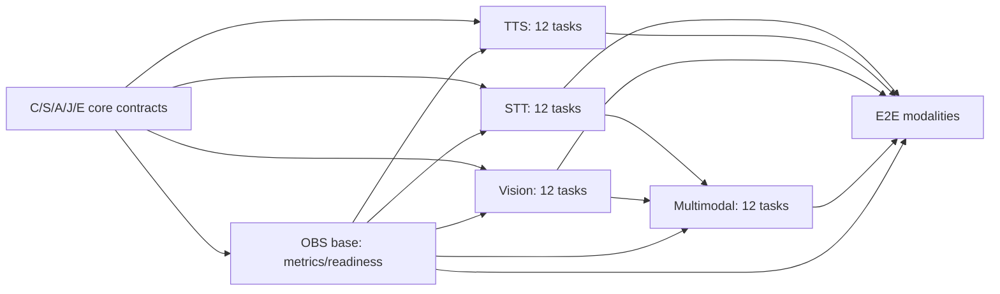

# Ghatana Media — backend modalities + observability, five-surface implementation wave

**Status:** IMPLEMENTATION-READY_PLAN / NO RUNTIME CHANGES IN THIS DOCUMENT / NOT VERIFIED_OR_CLOSED  
**Reviewed source:** `samujjwal/ghatana-media/main@6af0c62b7fbfea0af5cc7c18eda355f57af803aa` (2026-10-24); source truth is `.product-experience/pdp-0-product-truth`, `pdp-1-domain-data`, `pdp-2-design-interface-system`, `pdp-3-product-experience`. Recheck changes and plan tasks at execution.  
**Canonical Build owner:** [MEDIA-BUILD-IMPLEMENTATION-PLAN.md](MEDIA-BUILD-IMPLEMENTATION-PLAN.md), especially **F08** provider admission, **F09** headless contract grammar, **F11** temporal/codec primitives, **F12** observability, and **V03/V04/V05/V06/V16/V27** outcome journeys.  
**Foundation predecessor:** [five-core-backend-foundation plan](MEDIA-BACKEND-FOUNDATION-DEEP-IMPLEMENTATION-2026-10-24.md) C/S/A/J/E. Foundation code at latest main exists; this planning review **did not run its full tests**. Do not assume completed foundation closure or formally admitted providers.  
**Actual code owner:** **Only `ghatana-media`**; `ghatana/services/media` is read-only historical comparison. Shared/Kernel/Ghatana platform modules retain their own public contract ownership.  
**Formal Track B:** independent; no claimed gtool/PDP closed/current native receipt, KDEV stage advancement, migration cutover, CI-image qualification, deployment or release. The user-reported V009→V018 lineage fixture and 9 compose skips are residual observations, not certification of live applied DBs or production test completeness.

## Review outcome and selection

This wave selects **five already registered physical surfaces**, four modality services plus one supporting observability module. The existing source contains nontrivial code and tests, so work is **reuse + correctness/hardening + actual provider/quality conformance**, not greenfield rewrites. The Wave 2 task IDs (`STT-01..`, `TTS-01..`, `VIS-01..`, `MM-01..`, `OBS-01..`) are **local execution labels** bound to existing F/V packages, not a replacement for the source or new Lifecycle contracts.

| Surface | Physical registry identity | Implementer and reviewer | PDP meaning/consumer anchor | Work priority |
| --- | --- | --- | --- | --- |
| **STT** | `media.physical.modules-speech-stt-service` | Media speech/transcription engineer; Domain/timing/security reviewer | media.operation.transcription; media.operation.transcription-submission; media.operation.transcript-version-read; media.operation.caption-draft-write; media.operation.caption-version-write; media.operation.caption-version-read; J-03,J-07,J-16; PDP-3 grpc/service-registry.yaml STTService.* | Independent direct service hardening |
| **TTS** | `media.physical.modules-speech-tts-service` | Media synthesis/audio engineer; Voice-rights/audio DSP/security reviewer | media.operation.synthesis; media.operation.tts-request-origin-binding.v1; media.domain.artifact; media.domain.media-asset; media.domain.processing-job; J-04,J-16,J-17; PDP-3 grpc/service-registry.yaml TTSService.* | Independent direct service hardening |
| **VIS** | `media.physical.modules-vision-vision-service` | Media computer-vision engineer; Native/codec-security and model-quality reviewer | media.operation.vision-analysis; media.domain.scene-graph; media.domain.processing-job; media.value.image-video-technical-descriptor; J-05,J-06,J-28; PDP-3 grpc/service-registry.yaml VisionService.* | Independent direct service hardening |
| **MM** | `media.physical.modules-intelligence-multimodal-service` | Media multimodal/reliability engineer; STT+Vision integration, temporal and scientific-fidelity reviewer | media.operation.multimodal-analysis; media.domain.processing-job; media.domain.scene-graph; media.domain.transcript-version; J-06; PDP-3 grpc/service-registry.yaml MultimodalService.* | After STT+Vision APIs validated |
| **OBS** | `media.physical.audio-video-observability` | Media observability/performance engineer; Privacy/SRE and modality owners | media.health.readiness.inspect (PDP-0 intent), Media runtime health/readiness contracts; no invented standalone PDP-1 operation; PDP-3 existing health/status projections; no standalone OBS RPC and no new API | Cross-cutting first + validated last |

**Source populations:** The physical topology associates STT with 16 transcription intents, TTS with 17 synthesis intents, Vision with 22 vision/scene-text intents, and Multimodal with its own cross-modal intents plus reused STT and Vision obligations. Observability owns the single directly registered `media.health.readiness.inspect` capability. Full portfolio still has 54 source identities; these five are not five new services or a denominator reset. The complete per-intent and per-RPC exact mapping is appended below from existing source records.

### Confirmed code risks requiring real changes

- **STT** `PersistentSttGrpcService.java`: falls back to random `UUID` when authenticated user ID is missing; reject instead. STT README describes an external gRPC engine, while `ProductionSttGrpcService` composes local ONNX model config; reconcile via explicit provider policy, not silently assume model availability. Word/diarization/translation capability claims need actual engines.
- **TTS** `TtsSynthesisEngine.java` emits repeating `0x3C` fake audio and labels encoded output; this is never acceptable as real TTS. `SsmlProcessor.java` regex parsing of untrusted markup lacks robust XML nesting/DTD guards. Voice cloning/biometrics must be explicitly authorized and never silently activated.
- **Vision** model/OpenCV/native initialization is environment sensitive; `VideoFrameExtractor` invokes FFmpeg on untrusted media; resource/path/codec constraints need adversarial tests. A YOLO detector does not automatically implement depth, segmentation, face identity or scene-text analysis; generic OCR belongs to Document Intelligence.
- **Multimodal** `MultimodalAnalysisEngine` uses `dummyAudioFrame` and `dummyVideoFrame` while estimating sync; replace with real timestamped input or UNKNOWN. `CrossModalFusionEngine` heuristically averages vectors/confidences; cannot claim a validated calibrated joint embedding. `PersistentMultimodalService` can be constructed without engines, with unsupported paths.
- **Observability** `AudioVideoTracingService` uses a hardcoded 50ms generic SLA threshold, which is inappropriate for actual model execution. `MediaWorkflowMetrics` already has constrained tags; tests must prevent metadata/content leaks and prove cross-service propagation, resource accounting and true readiness.

## Execution controls, reuse and acceptance law

1. Work only in **Media modules** shown below; no second job store, no second model governance stack, no generic Event Plane/OCR implementation, no new gtool/receipt machinery. Reuse foundation job/attempt/consent/artifact/outbox and published platform model/DI/Shared APIs.
2. Every positive result requires actual output artifact/version, declared model and input provenance, consent and a re-readable effect, **not** mock-returned text, dummy PCM, dummy video sync or JSON "success". When the model/hardware/licensing is not admitted, implement the complete typed negative path and keep the real positive effect **NOT_VERIFIED**; do not call the capability fully implemented.
3. Every RPC keeps its existing proto method/field numbers and auth scopes. PDP-3 gRPC service registry contains **43 observed RPCs**: STT 12, TTS 11, Vision 10, Multimodal 10; **24 proposed logical bindings and 19 unresolved**. Source status is proposal-only; the explicit RPC ledger below is a coverage projection, **not** PDP approval.
4. A surface earns `LOGICALLY_BACKEND_DEV_COMPLETE` only if all in-scope PDP capabilities are either supported by real implementation+tests, or formally source-disposed as non-applicable/unsupported with **a legitimate requirement/owner decision**. Typed `NOT_ADMITTED` is safe behavior, NOT automatically development completion for an intended feature. Partial functionality is `IN_PROGRESS` with exact remaining IDs. Do not call the whole physical leaf complete based on one successful API.
5. Use a dedicated healthy local fixture model where available with legally reusable weights and an approved license; never auto-download unknown weights. In-process gRPC and in-memory provider doubles are valid unit tests, not independent real-model/quality evidence. Require container/process integration for the effects they claim, without tying ordinary coding to GH-90000.
6. Negative tests on every boundary: missing/forged principal, other tenant, unauthorized voice/face, expired consent, malformed media/SSML, frame/sample overflow, provider timeout after possible effect, cancelled and stale attempts, resource exhaustion, unavailable model, mismatched output format, and leaking diagnostic fields. Cleanup on every exception.
7. Per-family file ownership and max 2 active edited packages concurrently. STT owns STT module; TTS owns TTS; Vision owns Vision; Multimodal owns MM; OBS owns observability. Any shared `launcher/runtime-contracts/providers` change must be serialized with corresponding foundation owner. No mechanical copy of model code from Ghatana platform.
8. Performance samples require exact model version/hardware/driver/codec/fixture/tenancy/limits with latency histograms and resource counters. PDP-0 `NFR-PERF-001` control-plane budgets are only *proposed* until a reference environment is approved; model inference latency, real-time factor (RTF), image/video fps and sync error are separate measurements.
9. **No new Media backend module is inherently blocked on GH-90000, warn-only Checkstyle, formal gtool transition or the Shared build-logic bug.** They are separately tracked at the end. A missing real service-image test does mean that *that particular cross-process assertion is unverified*, not PASS.

## Dependencies and bounded implementation waves



**Wave W0 (first 4-hour pulse):** refresh current files/real tests; open STT-01/TTS-01/VIS-01/MM-01/OBS-01; begin TTS-02 dangerous synthetic-output fail-closed fix and MM-04 dummy-sync reproduction. Produce at least one code/test patch, not another proposal. **W1 (days 1–2, planning only):** auth/provider/format/model/observability foundation; STT/TTS/Vision work in parallel; MM boundary and timestamp groundwork. **W2 (days 3–6):** real positive path and result/version integration; MM waits for STT/Vision published in-repo API adapter; OBS measurements advance concurrently. **W3 (days 7–10):** 43-RPC matrix, adversarial & real-model tests, performance/failure verification and local package review. These are pulse/checkpoint timeboxes, **not promises of completion**; after two failed pulses on one dependency, isolate one reproducible test and continue independent code. No global sweep or unrelated PDP reopen.

**Workstream merge schedule:** OBS-01/02/03 + STT-01/02 + TTS-01/02 + VIS-01/02 can start without shared-file contention. MM-02/03/04 can run early using read-only fixtures; MM-05 waits for exact STT/Vision provider API. Per-service final review waits for OBS service readiness/latency wiring only where claimed. Image-backed GH-90000 testing is a separate optional real-compose qualification step; not a prerequisite to basic code compilation or in-process gRPC conformance.

## PR-sized backend tasks (one row = one actionable implementation, test and observable acceptance)

**Paths** within each table are relative to the owning module's `src/main/java` or `src/main` as appropriate; `README.md`, `src/test` and provider/contract manifests are addressed by exact paths. Newly proposed classes/fixtures are marked **NEW**. `NFR-*` and `media.*` capability identifiers in each task are source PDP-0 references; the table heading supplies PDP-1 operation and PDP-3 journey/gRPC registry anchors. Actual readiness is checked per exact source cut and owner disposition, not inferred from this plan.

### STT — media.physical.modules-speech-stt-service

**Owner:** Media speech/transcription engineer. **Independent review:** Domain/timing/security reviewer. **Code:** `modules/speech/stt-service`. **PDP-0 NFRs:** `NFR-SEC-001,NFR-PRIV-001,NFR-TIME-001,NFR-RECOVERY-001,NFR-LOC-001,NFR-FIDELITY-001`. **PDP-1:** media.operation.transcription; media.operation.transcription-submission; media.operation.transcript-version-read; media.operation.caption-draft-write; media.operation.caption-version-write; media.operation.caption-version-read. **PDP-3:** J-03,J-07,J-16; PDP-3 grpc/service-registry.yaml STTService.*. PDP-2 headless contract/error/idempotency/stream grammar references: `.product-experience/pdp-2-design-interface-system/api/` plus gRPC proto, not an invented PDP-4.

| ID / pulse | Dependencies | Exact PDP-0 capability / NFR | Where and how to implement | Executable acceptance |
| --- | --- | --- | --- | --- |
| **STT-01** (W0) | — | `media.speech.transcription.file; NFR-RECOVERY-001` | `modules/speech/stt-service/src/main/proto/stt_service.proto; grpc/SttGrpcService.java`: Inventory 12 RPCs, 16 PDP-0 STT intents, current SPI/provider/status, versions and existing tests; separate implemented, contract-only and actual provider qualification. | Saved exact capability/RPC ledger with no missing ID; test contract matches proto field numbers and live implemented statuses. |
| **STT-02** (W0) | STT-01 | `media.speech.transcription.file; NFR-COST-001` | `modules/speech/stt-service/grpc/ProductionSttGrpcService.java; README.md; config/provider-manifest.json`: Resolve README external Whisper gRPC versus local ONNX config: make provider routing explicit (GRPC/qualified local), immutable model ID/version/licence/hardware/region, readiness and fail-closed NOP/unsupported. Reuse AI Inference public adapter only for generic model execution. | Same request on configured provider returns admitted profile or exact NOT_ADMITTED; no synthetic success in production; contract tests cover mismatched configuration. |
| **STT-03** (W1) | STT-01 | `media.speech.transcription.speaker.identify-authorized; NFR-PRIV-001` | `modules/speech/stt-service/grpc/PersistentSttGrpcService.java; grpc/SttGrpcServer.java; service/PersistentSttService.java`: Remove random UUID principal fallback; require trusted authenticated principal/tenant/purpose; verify ownership at direct service and gRPC; apply bounds and min-data audit on each request/retry. | Missing caller identity is UNAUTHENTICATED with no file/DB/provider effect; impersonation and cross-tenant transcript tests green. |
| **STT-04** (W1) | STT-02,STT-03 | `media.speech.transcription.file; NFR-SEC-001` | `modules/speech/stt-service/service/PersistentSttService.java; grpc/SttGrpcService.java`: Consume governed artifact/version or bounded uploaded bytes; sniff codec/container, frame/channel/sample-rate/rational clock; reject decoded-size bombs; use bounded I/O rather than unbounded protobuf/byte-array copy. | WAV/FLAC and explicitly admitted formats roundtrip; 0, oversize, broken header, bad timestamps and sample bounds fail with stable gRPC codes. |
| **STT-05** (W2) | STT-02,STT-04 | `media.speech.transcription.stream; NFR-RECOVERY-001` | `modules/speech/stt-service/grpc/SttGrpcService.java; streaming/SttStreamingLatencyEnhancer.java`: Implement validated chunk/session identity, monotonic sequence/ack, bounded partial revisions, VAD framing, reconnect/resume, backpressure, timeout, cancel and final-result semantics; delegate transport mechanics to Media stream runtime. | Out-of-order, repeat, gap, disconnect, dropped final and revoked consent tests prove no duplicate terminal transcript or fabricated finality. |
| **STT-06** (W2) | STT-04 | `media.speech.transcription.word-timestamp.create; media.speech.transcription.confidence.provide; NFR-TIME-001` | `modules/speech/stt-service/service/PersistentSttService.java; detection/LanguageDetectionService.java; proto adapter`: Bind source-PTS/sample clock, language/alternatives, VAD, words/phonemes and confidence to versioned typed segments; validate alignment and quality provenance; absent model support is a reasoned unavailability, not invented values. | Impulse/boundary tests and gold transcript verify timebase, ordered nonoverlapping bounds and calibrated/not-calibrated confidence distinctions. |
| **STT-07** (W2) | STT-03,STT-06 | `media.speech.transcription.speaker.diarize; media.speech.transcription.speaker.identify-authorized; NFR-PRIV-001` | `modules/speech/stt-service/diarization/SpeakerDiarizationService.java; service/PersistentSttService.java`: Separate anonymous diarization from speaker identity, permission voice-biometric/diarization, overlap and speaker label stability; never infer real identity from clustering or training data. | Overlapping/multi-speaker fixture preserves anonymous speaker IDs and no biometric identity without rights; speaker accuracy evaluated with declared corpus. |
| **STT-08** (W2) | STT-06,STT-07 | `media.speech.transcription.forced-align; media.speech.transcription.subtitle.generate; NFR-FIDELITY-001` | `modules/speech/stt-service/service/PersistentSttService.java; job/AvJobLifecycleAdapter.java; transcript store SPI`: Persist immutable transcript/word-version, parent/source digest, CAS correction and caption draft vs approved version; forced alignment, translation and subtitle producer only when admitted and actually implemented. | Exact source/word/caption lineage and CAS conflict tested; unsupported alignment/translate produce typed unmet-capability with no counterfeit caption version. |
| **STT-09** (W2) | STT-03,STT-08 | `media.speech.transcription.file; NFR-AUD-001` | `modules/speech/stt-service/job/AvJobLifecycleAdapter.java; launcher Media job SPI`: Adopt foundation job idempotency, immutable artifact version, fenced provider attempt, truthful cancellation/UNKNOWN, bounded retry and secure audit; do not build another job store. | Crash after request/dispatch/receipt and replay tested; shared job status projection does not convert UNKNOWN into running/success. |
| **STT-10** (W3) | STT-06,STT-08 | `media.speech.transcription.language.detect; NFR-LOC-001` | `modules/speech/stt-service/src/test/java/.../functional; deterministic fixtures and benchmark corpus`: Validate recognized languages including Devanagari cases, silence/noise, accent/overlap, segmentation, punctuation, WER/CER/DER and fairness/unsupported language disclosure; separate model evaluation from code correctness. | Golden corpus includes language/error distributions; thresholds/real model quality are observed with model+hardware, not claimed from fixtures. |
| **STT-11** (W3) | STT-02,STT-08,OBS-01 | `media.speech.transcription.file; NFR-RECOVERY-001` | `modules/speech/stt-service/grpc/SttGrpcService.java; grpc/ProductionSttGrpcService.java; stt_service.proto`: Exercise every STT RPC: Transcribe/StreamTranscribe, model List/Load/Unload/Adapt, GetStatus/Health, Profile Create/Get/Update and SubmitCorrection. Preserve proto/wire identities; unadmitted effects return explicit codes. | 12/12 RPCs have positive real-engine or source-authorized unavailable paths and auth/invalid/unknown tests, no fabricated adaptation result. |
| **STT-12** (W3) | STT-03..STT-11 | `media.speech.transcription.file; NFR-PERF-001` | `modules/speech/stt-service/src/test; SttGrpcServiceInProcessIntegrationTest; dedicated STT runtime E2E`: Run in-process authenticated gRPC, real admitted engine isolated test, restarts, concurrent batches, 16/64 request load; record RTF/p50/p95/p99, memory, WER/CER, no cross-tenant data, budget caps. | Source-bound 12-RPC and 16-capability matrix is current; all in-scope tests pass, no skips relabeled as PASS, real provider assertions only with actual model. |

### TTS — media.physical.modules-speech-tts-service

**Owner:** Media synthesis/audio engineer. **Independent review:** Voice-rights/audio DSP/security reviewer. **Code:** `modules/speech/tts-service`. **PDP-0 NFRs:** `NFR-SEC-001,NFR-PRIV-001,NFR-TIME-001,NFR-COST-001,NFR-FIDELITY-001,NFR-LOC-001`. **PDP-1:** media.operation.synthesis; media.operation.tts-request-origin-binding.v1; media.domain.artifact; media.domain.media-asset; media.domain.processing-job. **PDP-3:** J-04,J-16,J-17; PDP-3 grpc/service-registry.yaml TTSService.*. PDP-2 headless contract/error/idempotency/stream grammar references: `.product-experience/pdp-2-design-interface-system/api/` plus gRPC proto, not an invented PDP-4.

| ID / pulse | Dependencies | Exact PDP-0 capability / NFR | Where and how to implement | Executable acceptance |
| --- | --- | --- | --- | --- |
| **TTS-01** (W0) | — | `media.speech.synthesis.text-to-speech; NFR-RECOVERY-001` | `modules/speech/tts-service/src/main/proto/tts_service.proto; grpc/TtsGrpcService.java; README.md`: Inventory 11 RPCs/17 capabilities, model/voice profiles and source→output/version/voice rights; compare hosted TtsEngine against TtsSynthesisEngine fallback and actual advertised codecs. | Every RPC/voice/capability classed IMPLEMENTED, PROVIDER_DEPENDENT, NOT_IMPLEMENTED or EXPLICITLY_NOT_ADMITTED; no fake positive. |
| **TTS-02** (W0) | TTS-01 | `media.speech.synthesis.text-to-speech; NFR-FIDELITY-001` | `modules/speech/tts-service/engine/TtsSynthesisEngine.java; grpc/TtsGrpcService.java`: Remove repeating-byte synth from any real provider result: isolate as explicitly named synthetic test fixture, or replace with real admitted synthesis SPI; forbid false PCM/MP3/OPUS claims. | Production-like profile cannot receive 0x3C fabricated bytes or wrong codec; decoder + header + duration and real speech checks required. |
| **TTS-03** (W1) | TTS-01,TTS-02 | `media.speech.synthesis.speaker.condition; NFR-COST-001` | `modules/speech/tts-service/grpc/ProductionTtsGrpcService.java; config/provider-manifest.json`: Bind actual voice model ID/version/digest/license, language, region, retention, hardware memory/compute, model health and prewarming; no implicit model download or synthetic fallback. | Unknown/unavailable model/voice/license fails cleanly before mutation; only admitted and initialized provider may synthesize. |
| **TTS-04** (W1) | TTS-01 | `media.speech.synthesis.control.prosody; NFR-SEC-001` | `modules/speech/tts-service/ssml/SsmlProcessor.java; service/PersistentTtsService.java`: Replace regex tag stripping/parser for untrusted SSML with bounded hardened XML parser (disable DTD/external entities/XInclude), canonical nesting, known tags, max input/depth/duration and escape handling. | XXE/ENTITY bomb, malformed/nested tags, huge pause and injection negatives fail; deterministic normalized phoneme/text segments test green. |
| **TTS-05** (W1) | TTS-03 | `media.speech.synthesis.speaker.clone-authorized; NFR-PRIV-001` | `modules/speech/tts-service/grpc/TtsGrpcService.java; security/EmbeddingEncryptionService.java; service/PersistentTtsService.java`: Enforce authenticated owner, voice identity, source consent, cloning/conditioning/biometrics, expiry and purpose; do not equate uploaded voice profile with legal authorization; encrypt retained embeddings. | Unauthorized clone/profile access/no consent denies before external call; deletion/revocation disables subsequent dispatch; test data never leaked. |
| **TTS-06** (W2) | TTS-03,TTS-04 | `media.speech.synthesis.control.phoneme; media.speech.synthesis.expressive; NFR-FIDELITY-001` | `modules/speech/tts-service/ssml/SsmlProcessor.java; emotion/EmotionControlService.java; mixing/VoiceMixingService.java`: Map rate/pitch/prosody/pronunciation/SSML/emotion to provider-supported parameters; validate units and finite bounded values; opt out unsupported control rather than pretend it changed output. | AB-style control fixtures prove observable effect where enabled; unsupported control returns truthful limitation; sample clocks and volume limits deterministic. |
| **TTS-07** (W2) | TTS-02,TTS-03,TTS-06 | `media.speech.synthesis.text-to-speech; NFR-TIME-001` | `modules/speech/tts-service/engine/TtsSynthesisEngine.java; service/PersistentTtsService.java`: Generate real audio through admitted engine; encode declared PCM/encoded format, sample rate/channels/frame count and loudness, verify bytes can be decoded and duration matches sample count with rational rounding. | Decoded non-empty speech on authorized reference model, playable output and exact format metadata; no label OPUS/MP3 for PCM bytes. |
| **TTS-08** (W2) | TTS-07 | `media.speech.synthesis.streaming; NFR-RECOVERY-001` | `modules/speech/tts-service/grpc/TtsGrpcService.java; proto TTSService.StreamSynthesize`: Stream bounded ordered frames/chunks, backpressure and cancel semantics; preserve output version/finality and timeout/pause/resume where protocol permits; no inferred seek/resume if not in proto. | Stream sequence/chunk count/size/cancel-after-output/partial errors tested, no duplicate final audio or unbounded buffering. |
| **TTS-09** (W2) | TTS-05,TTS-07 | `media.speech.synthesis.text-to-speech; NFR-AUD-001` | `modules/speech/tts-service/service/PersistentTtsService.java; Media artifact/job/outbox SPI`: Persist immutable authorized generated audio and provider/prosody/voice model lineage, rights and quality version; reuse foundation job engine idempotency, attempt fence and outbox. | Replay same request preserves output, different digest conflicts, consent-revoked-before-effect blocked, failure never registers complete artifact. |
| **TTS-10** (W3) | TTS-05,TTS-06,TTS-07 | `media.speech.synthesis.multilingual; media.speech.synthesis.speech.translate; NFR-LOC-001` | `modules/speech/tts-service/grpc/TtsGrpcService.java; voice manifest/qualification fixtures`: Classify supported voice-language/style combinations, cross-lingual, dubbing/voice-conversion/speech-to-speech as provider dependent with explicit output and rights; no unsupported language auto-substitute. | Locale matrix for en/ne/hi and source-declared languages: authorized real provider effects pass, unadmitted variants fail with exact capability reason. |
| **TTS-11** (W3) | TTS-03,TTS-05,TTS-08,OBS-01 | `media.speech.synthesis.speaker.clone-authorized; NFR-PRIV-001` | `modules/speech/tts-service/grpc/TtsGrpcService.java; tts_service.proto`: Exercise all 11 TTS RPCs including GetVoices, LoadVoice, GetStatus/Metrics, profile CRUD, CloneVoice and SubmitFeedback. Any unavailable operation is typed and visibly not admitted. | 11/11 methods covered by supported behavior or source-grounded unavailable response; transport version and credential/tenant negatives pass. |
| **TTS-12** (W3) | TTS-04..TTS-11 | `media.speech.synthesis.text-to-speech; NFR-PERF-001` | `modules/speech/tts-service/src/test; TtsGrpcServiceInProcessIntegrationTest; TtsFunctionalCompletenessTest`: Real reference synthesis, SSML fuzz, sample/codec validity, stream cancellation, 16/64 concurrency, RTF/memory/latency; licensed/consent-ready voice only, no real clone needed for nonadmitted scope. | All in-scope errors/positive outputs check decoded audio; voice privacy and model readiness verified; p50/p95/p99 and RTF recorded separately. |

### VIS — media.physical.modules-vision-vision-service

**Owner:** Media computer-vision engineer. **Independent review:** Native/codec-security and model-quality reviewer. **Code:** `modules/vision/vision-service`. **PDP-0 NFRs:** `NFR-SEC-001,NFR-PRIV-001,NFR-TIME-001,NFR-FIDELITY-001,NFR-COST-001`. **PDP-1:** media.operation.vision-analysis; media.domain.scene-graph; media.domain.processing-job; media.value.image-video-technical-descriptor. **PDP-3:** J-05,J-06,J-28; PDP-3 grpc/service-registry.yaml VisionService.*. PDP-2 headless contract/error/idempotency/stream grammar references: `.product-experience/pdp-2-design-interface-system/api/` plus gRPC proto, not an invented PDP-4.

| ID / pulse | Dependencies | Exact PDP-0 capability / NFR | Where and how to implement | Executable acceptance |
| --- | --- | --- | --- | --- |
| **VIS-01** (W0) | — | `media.vision.detect; NFR-FIDELITY-001` | `modules/vision/vision-service/vision-service/src/main/proto/vision_service.proto; grpc/VisionGrpcService.java`: Inventory 10 RPCs and 22 PDP vision/scene-text capabilities against provider implementation; record strict supported/unsupported model/version/format rows. | Exact 22 capabilities/10 RPC census; no implicit object-detector support for depth/segmentation/pose. |
| **VIS-02** (W0) | VIS-01 | `media.vision.detect; NFR-COST-001` | `modules/vision/vision-service/grpc/ProductionVisionGrpcService.java; yolo/YoloV8Adapter.java`: Qualify pinned signed/hashed YOLO/ONNX model file, classes/version/license, CPU/GPU native library, initialization and bounded model lifetime; handle missing OpenCV as typed unavailable without leaking stack/half-server. | No service reports ready without initialized detector; invalid model/digest/native/lib/license profile fails before traffic, no silent noop. |
| **VIS-03** (W1) | VIS-01 | `media.vision.classify; NFR-SEC-001` | `modules/vision/vision-service/video/VideoFrameExtractor.java; grpc/VisionGrpcService.java`: Reject oversize images/frames/pixels/decoded expansion, malformed codecs/containers, symlinks/traversal and unsafe media metadata before decoding; bound temp directory and native memory. | Adversarial image/video and native parser corpus stays inside CPU/memory/frame/time bounds; quarantine unsupported formats. |
| **VIS-04** (W1) | VIS-03 | `media.vision.detect.shot-boundary; NFR-SEC-001` | `modules/vision/vision-service/video/VideoFrameExtractor.java; VideoFrameExtractorProcessTest.java`: Harden FFmpeg argument allowlist/path containment, timeout/cancel & process-tree kill, diagnostic/output byte budget, isolated temp files, safe metadata; never pass unsanitized network protocols. | Process timeout/symlink/path/infinite stream and ffmpeg stderr spam tests prove no escaped paths/leaked temp bytes. |
| **VIS-05** (W1) | VIS-02,VIS-03 | `media.vision.detect; NFR-TIME-001` | `modules/vision/vision-service/yolo/YoloV8Adapter.java; model/BoundingBox.java; analysis/VideoAnalysisService.java`: Preserve rotation/color/EXIF orientation and scale transforms, normalized ROI/bbox coordinate conventions, confidence units and content version. Manage all OpenCV Mat buffers and Net lifetime. | Synthetic geometry fixtures roundtrip pixels→bbox and back within declared pixel tolerance; native leak stress bounded. |
| **VIS-06** (W2) | VIS-05 | `media.vision.detect; media.vision.classify; NFR-FIDELITY-001` | `modules/vision/vision-service/yolo/YoloV8Adapter.java; detection/VisionDetector.java`: Test ONNX output layout, class mapping, threshold/NMS, invalid/NaN scores, overlapping classes, coordinate clipping and model version changes; no heuristic label as calibrated probability. | Golden object fixture and mAP/PR metrics on licensed corpus, class list + confidence metadata reproducible; no out-of-range boxes. |
| **VIS-07** (W2) | VIS-04,VIS-06 | `media.vision.track.object; media.vision.estimate.camera-motion; NFR-TIME-001` | `modules/vision/vision-service/analysis/VideoAnalysisService.java; video/VideoFrameExtractor.java`: Link detections to exact frame PTS, track IDs, shot boundaries and source clock; bounded temporal windows and missing frame semantics. Don't treat frame index as wall-time. | Variable-frame-rate/reorder/scene-cut tests preserve frame timestamp, track version/identity, sample count and uncertainty. |
| **VIS-08** (W2) | VIS-06,VIS-07 | `media.vision.segment.image; media.vision.estimate.depth; NFR-FIDELITY-001` | `modules/vision/vision-service/grpc/VisionGrpcService.java; model/SPIs via admitted providers`: For segmentation, optical flow, depth/normals, hand/human pose, foreground matte and saliency, require real qualified capability provider/result dimension; otherwise explicitly NOT_ADMITTED, not YOLO-bbox substitution. | Every advanced intent receives provider-backed output validated by ground truth or exact unavailable, with no guessed depth/segmentation tensor. |
| **VIS-09** (W2) | VIS-04,VIS-07 | `media.vision.scene-text.observation.create; NFR-PRIV-001` | `modules/vision/vision-service/ocr/OcrService.java; ocr/KernelOcrProviderAdapter.java; scene/SceneUnderstandingService.java`: Replace legacy generic OCR execution with admitted Document Intelligence public API adapter only; keep Media temporal region tracking/scene annotations, bound text image/copy rights. | Text box/time/region evidence tied to immutable frame; no Media-owned generic OCR engine or leakage of protected text; no fake extracted text. |
| **VIS-10** (W2) | VIS-03,VIS-06 | `media.vision.estimate.face-landmarks; media.vision.analyze.gaze; NFR-PRIV-001` | `modules/vision/vision-service/recognition/FacialRecognitionService.java; StructuredFacialRecognitionAuditSink.java`: Enforce biometric purpose/consent/region/retention before face-landmark/gaze/expression/identity; reject unsafe face identification, distinguish bounding boxes from identity assertions. | Same-tenant/other-tenant, revoked consent and sensitive analytics negative fixtures dispatch zero restricted effects. |
| **VIS-11** (W3) | VIS-02,VIS-07,VIS-09,OBS-01 | `media.vision.classify.scene; NFR-RECOVERY-001` | `modules/vision/vision-service/grpc/VisionGrpcService.java; PersistentVisionService.java; Vision proto`: Run 10 Vision RPCs (Detect, AnalyzeImage, Classify, AnalyzeVideoFile, ProcessVideo, model List/Load/Unload, GetStatus, Health); wire existing Media job/artifact/version and provider status to trustworthy gRPC outcomes. | 10/10 proto RPC matrix auth/bounds/status/finality tests; legitimate derived result re-read with provenance; no wrong file metadata as audio. |
| **VIS-12** (W3) | VIS-01..VIS-11 | `media.vision.detect; NFR-PERF-001` | `modules/vision/vision-service/src/test; VisionGrpcServiceInProcessIntegrationTest; VideoFrameExtractorProcessTest`: Real model/reference image tests plus bounded ffmpeg/OpenCV stress, mAP/latency/throughput and CPU/GPU/native-memory; fault/restart/hardware absent profile tested. | All declared positive capabilities actually executable or openly NOT_ADMITTED; signed/model provenance + protected data + native resource tests pass. |

### MM — media.physical.modules-intelligence-multimodal-service

**Owner:** Media multimodal/reliability engineer. **Independent review:** STT+Vision integration, temporal and scientific-fidelity reviewer. **Code:** `modules/intelligence/multimodal-service`. **PDP-0 NFRs:** `NFR-SEC-001,NFR-PRIV-001,NFR-TIME-001,NFR-FIDELITY-001,NFR-RECOVERY-001`. **PDP-1:** media.operation.multimodal-analysis; media.domain.processing-job; media.domain.scene-graph; media.domain.transcript-version. **PDP-3:** J-06; PDP-3 grpc/service-registry.yaml MultimodalService.*. PDP-2 headless contract/error/idempotency/stream grammar references: `.product-experience/pdp-2-design-interface-system/api/` plus gRPC proto, not an invented PDP-4.

| ID / pulse | Dependencies | Exact PDP-0 capability / NFR | Where and how to implement | Executable acceptance |
| --- | --- | --- | --- | --- |
| **MM-01** (W0) | — | `media.multimodal.analyze.cross-modal; NFR-FIDELITY-001` | `modules/intelligence/multimodal-service/src/main/proto/multimodal_service.proto; grpc/MultimodalGrpcService.java`: Inventory 10 RPCs, 7 multimodal-owned intents and delegated STT/Vision intents; map input/output, partial and uncertainty semantics; no duplicated STT or vision engines. | 10 RPC/7 direct intent matrix plus exact delegated 16 STT and 22/20 Vision references; no phantom independent capabilities. |
| **MM-02** (W1) | MM-01,STT-03,VIS-03 | `media.multimodal.observe.source-grounded; NFR-PRIV-001` | `modules/intelligence/multimodal-service/grpc/MultimodalGrpcService.java; engine/MultimodalRequest.java`: Authenticate tenant/principal and inspect rights for each modality and provider egress, source immutable artifact/versions, content size and purpose; no untrusted tenant header. | Cross-tenant mixed input and revoked purpose deny before any call; signed content refs only and bounded bytes/frames. |
| **MM-03** (W1) | MM-02 | `media.multimodal.relate.scene-audio; NFR-TIME-001` | `modules/intelligence/multimodal-service/engine/TemporalAlignment.java; engine/MultimodalAnalysisEngine.java`: Adopt rational source/media clocks, frame PTS/audio samples, feature-window alignment and time bounds; distinguish t_source/t_media/t_sim/t_wall; detect clock mismatch. | Synthetic impulse/fps drift/variable frame rate test gives exact bounded offset and documented unresolvable outcome. |
| **MM-04** (W1) | MM-03 | `media.multimodal.relate.scene-audio; NFR-FIDELITY-001` | `modules/intelligence/multimodal-service/engine/MultimodalAnalysisEngine.java; AudioVideoSyncPipeline adapter`: Eliminate dummyAudioFrame/dummyVideoFrame synchronization evidence; feed real timestamped window features to qualified sync algorithm or return SYNC_UNDETERMINED. Never label fabricated drift confidence. | Sync ground truth with deliberate ±offset/clock discontinuity compared to measured value; unavailable signals yield unknown, not GOOD. |
| **MM-05** (W2) | MM-02,STT-09,VIS-06,VIS-07 | `media.multimodal.analyze.cross-modal; NFR-RECOVERY-001` | `modules/intelligence/multimodal-service/engine/PlatformMultimodalAdapter.java; adapter/GrpcSttClientAdapter.java; service/PersistentMultimodalService.java`: Compose actual allowed STT/Vision service providers through public SPI, bounded concurrency/cancellation/deadlines, stable owner job and split retries; disallow null-engine success paths. | Network partition/timeout/provider unavailable returns exact partial/unknown, not successful synthetic analysis. Cross-service context protected. |
| **MM-06** (W2) | MM-04,MM-05 | `media.multimodal.associate.speaker-face; NFR-FIDELITY-001` | `modules/intelligence/multimodal-service/engine/CrossModalFusionEngine.java; MultimodalAnalysisEngine.java`: Validate equal finite embedding dims/coordinate frames, normalize weights and no Nans; distinguish heuristic similarity from measured calibrated confidence; gate speaker-face identity behind biometric rights. | Dim mismatch, sparse embeddings, missing modalities and misleading confidence tests; no claimed scientifically validated association without labeled corpus. |
| **MM-07** (W2) | MM-06 | `media.multimodal.describe; media.multimodal.summarize; media.multimodal.extract.structured; NFR-FIDELITY-001` | `modules/intelligence/multimodal-service/engine/MultimodalResult.java; engine/MultimodalAnalysisEngine.java`: Produce typed, source-grounded description/summaries/structured outputs with references to frame/word/region/version and uncertainty; if no qualified semantics/provider return abstain. | Every asserted entity/time fact traces to actual source observation; contradictory/audio-only/video-only cases do not invent missing evidence. |
| **MM-08** (W2) | MM-05,MM-06 | `media.multimodal.observe.source-grounded; NFR-RECOVERY-001` | `modules/intelligence/multimodal-service/service/PersistentMultimodalService.java; engine/MultimodalAnalysisEngine.java`: Preserve result, quality, attempt identity and finality independently for each selected capability operation; cancellation and UNKNOWN remain scoped to the affected operation. Keep the legacy cross-modal family transport `NOT_ADMITTED` until its request/result is bound to canonical capability operations. | No family-level aggregate result or PARTIAL is emitted. A failed/ambiguous selected operation retains its own typed outcome and exact attempt/provider identity; the independently submitted capability's result remains separate; no blind retry or false combined completion. |
| **MM-09** (W3) | MM-05,MM-08 | `media.multimodal.observe.source-grounded; NFR-AUD-001` | `modules/intelligence/multimodal-service/service/PersistentMultimodalService.java; Media job/artifact/version outbox SPI`: Persist fusion result, source artifact references, selected provider/model, time mapping, provenance and privacy classification under CAS/fenced job attempt; replay only proved idempotent effects. | Read exact result bytes/version; repeated request same identity stable; no generated output when grounded data missing. |
| **MM-10** (W3) | MM-05,MM-07 | `media.multimodal.extract.structured; NFR-PRIV-001` | `modules/intelligence/multimodal-service/datacloud/DataCloudMultimodalAdapter.java; MediaSemanticObservationProjector.java`: Publish only governed typed metadata and redacted source-grounded observations to public Data Cloud/AI Inference boundaries; no direct internal DB access or generic platform engine fork. | Projection format/visibility/classification/version negative tests; disabled platform returns explicit integration unavailable but local Media result preserved. |
| **MM-11** (W3) | MM-07,MM-08,OBS-01 | `media.multimodal.analyze.cross-modal; NFR-RECOVERY-001` | `modules/intelligence/multimodal-service/grpc/MultimodalGrpcService.java; multimodal_service.proto`: Exercise 10 RPCs: Process/AnalyzeVideoWithAudio, GenerateDescription, AnalyzeCrossModal, GetInsights, model Load/Unload/List and GetStatus/Health; management only if provider admission exists. | 10/10 proto method matrix with version, auth, cancellation, unsupported branches; no body success for unsupported models. |
| **MM-12** (W3) | MM-01..MM-11 | `media.multimodal.observe.source-grounded; NFR-PERF-001` | `modules/intelligence/multimodal-service/src/test; MultimodalGrpcServiceInProcessIntegrationTest; MultimodalAnalysisEngineTest`: Run real STT+Vision composed E2E with artifact provenance, offset gold corpus, calibrated/unknown result semantics, 16/64 concurrent requests, p50/p95/p99, backpressure and fanout limits. | Actual source-grounded positive result and protected negative/unknown cases; no dummy frames or unqualified scientific confidence. |

### OBS — media.physical.audio-video-observability

**Owner:** Media observability/performance engineer. **Independent review:** Privacy/SRE and modality owners. **Code:** `audio-video-observability`. **PDP-0 NFRs:** `NFR-OBS-001,NFR-PERF-001,NFR-SEC-001,NFR-COST-001,NFR-RECOVERY-001`. **PDP-1:** media.health.readiness.inspect (PDP-0 intent), Media runtime health/readiness contracts; no invented standalone PDP-1 operation. **PDP-3:** PDP-3 existing health/status projections; no standalone OBS RPC and no new API. PDP-2 headless contract/error/idempotency/stream grammar references: `.product-experience/pdp-2-design-interface-system/api/` plus gRPC proto, not an invented PDP-4.

| ID / pulse | Dependencies | Exact PDP-0 capability / NFR | Where and how to implement | Executable acceptance |
| --- | --- | --- | --- | --- |
| **OBS-01** (W0) | — | `media.health.readiness.inspect; NFR-OBS-001` | `audio-video-observability/AudioVideoHealthService.java; modal gRPC server composition`: Define liveness/readiness/degraded/unavailable per provider and modality, startup and shutdown; empty check registry must not silently imply serving; required checks configured and registered. | 4 gRPC services expose honest SERVING/NOT_SERVING with injected provider crash/missing model; shutdown drains and stops serving. |
| **OBS-02** (W1) | OBS-01 | `media.health.readiness.inspect; NFR-PRIV-001` | `audio-video-observability/AudioVideoHealthService.java; gRPC auth/public probe policy`: Separate public liveness from privileged status/model details; no raw model path/tenant/token in unauth probes, bounded health checks, explicit timeouts. | Unauthenticated status cannot disclose protected configuration; slow dependency does not hang probe. |
| **OBS-03** (W1) | OBS-01 | `media.health.readiness.inspect; NFR-OBS-001` | `audio-video-observability/tracing/AudioVideoTracingService.java; instrumentation/AudioVideoGrpcInstrumentation.java`: Propagate permitted correlation/trace context across async child futures and gRPC STT/Vision/Multimodal; ensure span scopes close, validate permitted attributes. | Parent-child traces remain linked after cross-service async call, no leaked trace scope on exception/cancel, no protected content in spans. |
| **OBS-04** (W1) | OBS-03 | `media.health.readiness.inspect; NFR-PRIV-001` | `audio-video-observability/MediaWorkflowMetrics.java; tracing/AudioVideoTracingService.java`: Use bounded enum tag vocabulary only, no tenant/request/job/personal identifiers in metrics/MDC/events; apply retention and redaction policy to logs and spans. | High-cardinality/adversarial labels collapse to bounded vocabulary; sensitive marker fixture absent in telemetry export. |
| **OBS-05** (W2) | OBS-03,OBS-04 | `media.health.readiness.inspect; NFR-PERF-001` | `audio-video-observability/MediaWorkflowMetrics.java; AudioVideoTracingService.java`: Instrument per-modality service admission, queue/wait, provider/decode, response, success/UNKNOWN and cost durations; remove hardcoded 50ms generic SLA that mislabels model work; separate control vs model latency. | Histograms have correct scope and units; proposed PDP p95 metadata/job-ack measured only on named reference host, model RTF/time separate. |
| **OBS-06** (W2) | OBS-04 | `media.health.readiness.inspect; NFR-RECOVERY-001` | `audio-video-observability/MediaWorkflowMetrics.java; infra/monitoring/alerts/audio-video.yml`: Reconcile store-based queue/backlog/lease metrics to durable job/outbox; distinguish unknown source measurements from zero, reject stale provider status and silent error suppression. | Postgres seed + restart produces exact backlog counts, alert fires on overdue lease/outbox and absent provider, no unverified zero-value success. |
| **OBS-07** (W2) | OBS-02,OBS-05 | `media.health.readiness.inspect; NFR-SEC-001` | `audio-video-observability/AudioVideoHealthService.java; alert rules; docs/OPERATIONS.md`: Define actionable provider-specific unavailable/quality/regression alerts, secure readiness dashboard and privacy redacted diagnostic; no operational deployment claim. | Bounded no-content alert labels; false alarms evaluated on fixture; runbook lists safe operator controls without secret disclosure. |
| **OBS-08** (W3) | OBS-05,OBS-06 | `media.health.readiness.inspect; NFR-COST-001` | `audio-video-observability/src/test; MediaWorkflowMetricsTest.java; performance fixture harness`: Measure CPU/GPU/RAM/native memory/threads/connection pool/network cost for four modalities and native ffmpeg; establish hardware/model/corpus baseline, 1/16/64 concurrency, abort budgets. | Baseline p50/p95/p99, RTF, frames/s and bounded resource profiles reproducible, no fake SLO achievement or ignored runaway load. |
| **OBS-09** (W3) | OBS-02,OBS-03,OBS-07 | `media.health.readiness.inspect; NFR-OBS-001` | `audio-video-observability/instrumentation/AudioVideoGrpcInstrumentation.java; four service composition roots`: Integrate probes, spans and metrics into STT/TTS/Vision/Multimodal server startup, stream, restart and failure flows; reuse current Shared OTel APIs, no second stack. | Four gRPC smoke/in-process tests + traces/metrics assertion, child errors and provider readiness from actual service reflected truthfully. |
| **OBS-10** (W3) | OBS-01..OBS-09 | `media.health.readiness.inspect; NFR-RECOVERY-001` | `audio-video-observability/src/test; AudioVideoHealthServiceTest; MediaWorkflowAlertRulesTest; tracing integration tests`: Run all observability unit, privacy adversarial, health watch and integration tests plus snapshot alerts on actual seeded metrics, with Checkstyle warnings reported separately. | No leakage, no health false positive, finite metrics cardinality, truthful starts/stops and documented SLO source; this support-only physical leaf logically assessed separately. |

## Initial completion and scope policy

**Initial task denominator: 58** across five physical surfaces (STT=12, TTS=12, Vision=12, Multimodal=12, OBS=10), **0 verified by this planning review**. Each claimed completion must link a source diff, actual command/output and positive/negative/fault/quality evidence. Existing green tests from the latest foundation commit may be reused only for unchanged inputs; re-run affected assertions. The whole 54-surface Media campaign and gtool source closure population are unmodified.

## Exact PDP capability obligations for the five registered surfaces

This is a **generated read-only ownership projection** from the current `.product-experience/surfaces/media-physical-topology.v1.json` (not a new capability definition), covering every PDP-0 capability-intent reference of the five selected surfaces. Multimodal's STT/Vision references deliberately repeat declared dependencies; these are **not duplicate implementation engines**. **99 surface-intent memberships:** STT 16, TTS 17, Vision 22, Multimodal 43, Observability 1. For each row, implementer must attach actual test evidence or an explicit incomplete/provisional disposition. `owner task` means *work ownership*, not evidence of implementation.

| Registered surface | Exact PDP-0 capability intent | Implementation task owner | Meaning |
| --- | --- | --- | --- |
| STT | `media.speech.transcription.file` | STT-04 | Local implementation/qualification |
| STT | `media.speech.transcription.stream` | STT-05 | Local implementation/qualification |
| STT | `media.speech.transcription.language.detect` | STT-10 | Local implementation/qualification |
| STT | `media.speech.transcription.voice-activity.detect` | STT-05 | Local implementation/qualification |
| STT | `media.speech.transcription.speaker.diarize` | STT-07 | Local implementation/qualification |
| STT | `media.speech.transcription.speaker.segment` | STT-07 | Local implementation/qualification |
| STT | `media.speech.transcription.speaker.separate` | STT-07 | Local implementation/qualification |
| STT | `media.speech.transcription.speaker.identify-authorized` | STT-07 | Local implementation/qualification |
| STT | `media.speech.transcription.word-timestamp.create` | STT-06 | Local implementation/qualification |
| STT | `media.speech.transcription.phoneme-timestamp.create` | STT-06 | Local implementation/qualification |
| STT | `media.speech.transcription.forced-align` | STT-08 | Local implementation/qualification |
| STT | `media.speech.transcription.punctuate-capitalize` | STT-06 | Local implementation/qualification |
| STT | `media.speech.transcription.alternatives.provide` | STT-06 | Local implementation/qualification |
| STT | `media.speech.transcription.confidence.provide` | STT-06 | Local implementation/qualification |
| STT | `media.speech.transcription.translate` | STT-08 | Local implementation/qualification |
| STT | `media.speech.transcription.subtitle.generate` | STT-08 | Local implementation/qualification |
| TTS | `media.speech.synthesis.text-to-speech` | TTS-07 | Local implementation/qualification |
| TTS | `media.speech.synthesis.streaming` | TTS-08 | Local implementation/qualification |
| TTS | `media.speech.synthesis.multilingual` | TTS-10 | Local implementation/qualification |
| TTS | `media.speech.synthesis.cross-lingual` | TTS-10 | Local implementation/qualification |
| TTS | `media.speech.synthesis.expressive` | TTS-06 | Local implementation/qualification |
| TTS | `media.speech.synthesis.control.prosody` | TTS-06 | Local implementation/qualification |
| TTS | `media.speech.synthesis.control.rate` | TTS-06 | Local implementation/qualification |
| TTS | `media.speech.synthesis.control.pitch` | TTS-06 | Local implementation/qualification |
| TTS | `media.speech.synthesis.control.emotion-style` | TTS-06 | Local implementation/qualification |
| TTS | `media.speech.synthesis.control.pronunciation` | TTS-06 | Local implementation/qualification |
| TTS | `media.speech.synthesis.control.phoneme` | TTS-06 | Local implementation/qualification |
| TTS | `media.speech.synthesis.speaker.condition` | TTS-05 | Local implementation/qualification |
| TTS | `media.speech.synthesis.speaker.clone-authorized` | TTS-05 | Local implementation/qualification |
| TTS | `media.speech.synthesis.voice.convert` | TTS-10 | Local implementation/qualification |
| TTS | `media.speech.synthesis.speech-to-speech` | TTS-10 | Local implementation/qualification |
| TTS | `media.speech.synthesis.speech.translate` | TTS-10 | Local implementation/qualification |
| TTS | `media.speech.synthesis.dub` | TTS-10 | Local implementation/qualification |
| VIS | `media.vision.scene-text.region.track` | VIS-09 | Local implementation/qualification |
| VIS | `media.vision.scene-text.observation.create` | VIS-09 | Local implementation/qualification |
| VIS | `media.vision.detect` | VIS-06 | Local implementation/qualification |
| VIS | `media.vision.classify` | VIS-06 | Local implementation/qualification |
| VIS | `media.vision.segment.image` | VIS-08 | Local implementation/qualification |
| VIS | `media.vision.segment.video` | VIS-08 | Local implementation/qualification |
| VIS | `media.vision.track.object` | VIS-07 | Local implementation/qualification |
| VIS | `media.vision.track.point` | VIS-07 | Local implementation/qualification |
| VIS | `media.vision.estimate.optical-flow` | VIS-08 | Local implementation/qualification |
| VIS | `media.vision.estimate.depth` | VIS-08 | Local implementation/qualification |
| VIS | `media.vision.estimate.surface-normals` | VIS-10 | Local implementation/qualification |
| VIS | `media.vision.estimate.human-pose` | VIS-08 | Local implementation/qualification |
| VIS | `media.vision.estimate.hand-pose` | VIS-08 | Local implementation/qualification |
| VIS | `media.vision.estimate.face-landmarks` | VIS-10 | Local implementation/qualification |
| VIS | `media.vision.analyze.expression` | VIS-10 | Local implementation/qualification |
| VIS | `media.vision.analyze.gaze` | VIS-10 | Local implementation/qualification |
| VIS | `media.vision.matte.foreground-background` | VIS-08 | Local implementation/qualification |
| VIS | `media.vision.segment.motion` | VIS-08 | Local implementation/qualification |
| VIS | `media.vision.estimate.saliency` | VIS-08 | Local implementation/qualification |
| VIS | `media.vision.classify.scene` | VIS-06 | Local implementation/qualification |
| VIS | `media.vision.detect.shot-boundary` | VIS-07 | Local implementation/qualification |
| VIS | `media.vision.estimate.camera-motion` | VIS-07 | Local implementation/qualification |
| MM | `media.speech.transcription.file` | MM-05 (reuses STT) | Delegated exact STT contract |
| MM | `media.speech.transcription.stream` | MM-05 (reuses STT) | Delegated exact STT contract |
| MM | `media.speech.transcription.language.detect` | MM-05 (reuses STT) | Delegated exact STT contract |
| MM | `media.speech.transcription.voice-activity.detect` | MM-05 (reuses STT) | Delegated exact STT contract |
| MM | `media.speech.transcription.speaker.diarize` | MM-05 (reuses STT) | Delegated exact STT contract |
| MM | `media.speech.transcription.speaker.segment` | MM-05 (reuses STT) | Delegated exact STT contract |
| MM | `media.speech.transcription.speaker.separate` | MM-05 (reuses STT) | Delegated exact STT contract |
| MM | `media.speech.transcription.speaker.identify-authorized` | MM-05 (reuses STT) | Delegated exact STT contract |
| MM | `media.speech.transcription.word-timestamp.create` | MM-05 (reuses STT) | Delegated exact STT contract |
| MM | `media.speech.transcription.phoneme-timestamp.create` | MM-05 (reuses STT) | Delegated exact STT contract |
| MM | `media.speech.transcription.forced-align` | MM-05 (reuses STT) | Delegated exact STT contract |
| MM | `media.speech.transcription.punctuate-capitalize` | MM-05 (reuses STT) | Delegated exact STT contract |
| MM | `media.speech.transcription.alternatives.provide` | MM-05 (reuses STT) | Delegated exact STT contract |
| MM | `media.speech.transcription.confidence.provide` | MM-05 (reuses STT) | Delegated exact STT contract |
| MM | `media.speech.transcription.translate` | MM-05 (reuses STT) | Delegated exact STT contract |
| MM | `media.speech.transcription.subtitle.generate` | MM-05 (reuses STT) | Delegated exact STT contract |
| MM | `media.vision.detect` | MM-05 (reuses Vision) | Delegated exact Vision contract |
| MM | `media.vision.classify` | MM-05 (reuses Vision) | Delegated exact Vision contract |
| MM | `media.vision.segment.image` | MM-05 (reuses Vision) | Delegated exact Vision contract |
| MM | `media.vision.segment.video` | MM-05 (reuses Vision) | Delegated exact Vision contract |
| MM | `media.vision.track.object` | MM-05 (reuses Vision) | Delegated exact Vision contract |
| MM | `media.vision.track.point` | MM-05 (reuses Vision) | Delegated exact Vision contract |
| MM | `media.vision.estimate.optical-flow` | MM-05 (reuses Vision) | Delegated exact Vision contract |
| MM | `media.vision.estimate.depth` | MM-05 (reuses Vision) | Delegated exact Vision contract |
| MM | `media.vision.estimate.surface-normals` | MM-05 (reuses Vision) | Delegated exact Vision contract |
| MM | `media.vision.estimate.human-pose` | MM-05 (reuses Vision) | Delegated exact Vision contract |
| MM | `media.vision.estimate.hand-pose` | MM-05 (reuses Vision) | Delegated exact Vision contract |
| MM | `media.vision.estimate.face-landmarks` | MM-05 (reuses Vision) | Delegated exact Vision contract |
| MM | `media.vision.analyze.expression` | MM-05 (reuses Vision) | Delegated exact Vision contract |
| MM | `media.vision.analyze.gaze` | MM-05 (reuses Vision) | Delegated exact Vision contract |
| MM | `media.vision.matte.foreground-background` | MM-05 (reuses Vision) | Delegated exact Vision contract |
| MM | `media.vision.segment.motion` | MM-05 (reuses Vision) | Delegated exact Vision contract |
| MM | `media.vision.estimate.saliency` | MM-05 (reuses Vision) | Delegated exact Vision contract |
| MM | `media.vision.classify.scene` | MM-05 (reuses Vision) | Delegated exact Vision contract |
| MM | `media.vision.detect.shot-boundary` | MM-05 (reuses Vision) | Delegated exact Vision contract |
| MM | `media.vision.estimate.camera-motion` | MM-05 (reuses Vision) | Delegated exact Vision contract |
| MM | `media.multimodal.analyze.cross-modal` | MM-06 | Local implementation/qualification |
| MM | `media.multimodal.describe` | MM-07 | Local implementation/qualification |
| MM | `media.multimodal.summarize` | MM-07 | Local implementation/qualification |
| MM | `media.multimodal.extract.structured` | MM-07 | Local implementation/qualification |
| MM | `media.multimodal.associate.speaker-face` | MM-06 | Local implementation/qualification |
| MM | `media.multimodal.relate.scene-audio` | MM-04 | Local implementation/qualification |
| MM | `media.multimodal.observe.source-grounded` | MM-07 | Local implementation/qualification |
| OBS | `media.health.readiness.inspect` | OBS-01 | Local implementation/qualification |

## Exact 43-method PDP-3 gRPC registry coverage

This table binds **all source-listed RPC identities** from `.product-experience/pdp-3-product-experience/grpc/service-registry.yaml`, currently **43 observed**, of which **24 proposed logical bindings / 19 unresolved**. A code path returning `UNIMPLEMENTED` or `NOT_ADMITTED` is valid safe behavior but is **not a substitute for realizing a required capability**. Any server must prevent unauthorized request, invalid inputs and unsupported effects. No extra RPC or API owner introduced.

| Exact PDP-3 gRPC ID | Responsible implementation task(s) | Required acceptance record |
| --- | --- | --- |
| `media.grpc.STTService.Transcribe` | STT-04 | Positive effect with real qualified provider **or** exact source-grounded unavailable code; auth/bounds/error/transport wire assertions |
| `media.grpc.STTService.StreamTranscribe` | STT-05 | Positive effect with real qualified provider **or** exact source-grounded unavailable code; auth/bounds/error/transport wire assertions |
| `media.grpc.STTService.LoadModel` | STT-02 | Positive effect with real qualified provider **or** exact source-grounded unavailable code; auth/bounds/error/transport wire assertions |
| `media.grpc.STTService.UnloadModel` | STT-11 | Positive effect with real qualified provider **or** exact source-grounded unavailable code; auth/bounds/error/transport wire assertions |
| `media.grpc.STTService.ListModels` | STT-11 | Positive effect with real qualified provider **or** exact source-grounded unavailable code; auth/bounds/error/transport wire assertions |
| `media.grpc.STTService.AdaptModel` | STT-11 | Positive effect with real qualified provider **or** exact source-grounded unavailable code; auth/bounds/error/transport wire assertions |
| `media.grpc.STTService.GetStatus` | STT-11 | Positive effect with real qualified provider **or** exact source-grounded unavailable code; auth/bounds/error/transport wire assertions |
| `media.grpc.STTService.HealthCheck` | STT-11+OBS-01 | Positive effect with real qualified provider **or** exact source-grounded unavailable code; auth/bounds/error/transport wire assertions |
| `media.grpc.STTService.CreateProfile` | STT-11 | Positive effect with real qualified provider **or** exact source-grounded unavailable code; auth/bounds/error/transport wire assertions |
| `media.grpc.STTService.GetProfile` | STT-11 | Positive effect with real qualified provider **or** exact source-grounded unavailable code; auth/bounds/error/transport wire assertions |
| `media.grpc.STTService.UpdateProfile` | STT-11 | Positive effect with real qualified provider **or** exact source-grounded unavailable code; auth/bounds/error/transport wire assertions |
| `media.grpc.STTService.SubmitCorrection` | STT-08+STT-11 | Positive effect with real qualified provider **or** exact source-grounded unavailable code; auth/bounds/error/transport wire assertions |
| `media.grpc.TTSService.Synthesize` | TTS-07 | Positive effect with real qualified provider **or** exact source-grounded unavailable code; auth/bounds/error/transport wire assertions |
| `media.grpc.TTSService.StreamSynthesize` | TTS-08 | Positive effect with real qualified provider **or** exact source-grounded unavailable code; auth/bounds/error/transport wire assertions |
| `media.grpc.TTSService.GetStatus` | TTS-11 | Positive effect with real qualified provider **or** exact source-grounded unavailable code; auth/bounds/error/transport wire assertions |
| `media.grpc.TTSService.GetMetrics` | TTS-11+OBS-05 | Positive effect with real qualified provider **or** exact source-grounded unavailable code; auth/bounds/error/transport wire assertions |
| `media.grpc.TTSService.GetVoices` | TTS-03+TTS-11 | Positive effect with real qualified provider **or** exact source-grounded unavailable code; auth/bounds/error/transport wire assertions |
| `media.grpc.TTSService.LoadVoice` | TTS-03+TTS-11 | Positive effect with real qualified provider **or** exact source-grounded unavailable code; auth/bounds/error/transport wire assertions |
| `media.grpc.TTSService.CreateProfile` | TTS-05+TTS-11 | Positive effect with real qualified provider **or** exact source-grounded unavailable code; auth/bounds/error/transport wire assertions |
| `media.grpc.TTSService.GetProfile` | TTS-05+TTS-11 | Positive effect with real qualified provider **or** exact source-grounded unavailable code; auth/bounds/error/transport wire assertions |
| `media.grpc.TTSService.UpdateProfile` | TTS-05+TTS-11 | Positive effect with real qualified provider **or** exact source-grounded unavailable code; auth/bounds/error/transport wire assertions |
| `media.grpc.TTSService.CloneVoice` | TTS-05+TTS-11 | Positive effect with real qualified provider **or** exact source-grounded unavailable code; auth/bounds/error/transport wire assertions |
| `media.grpc.TTSService.SubmitFeedback` | TTS-11 | Positive effect with real qualified provider **or** exact source-grounded unavailable code; auth/bounds/error/transport wire assertions |
| `media.grpc.VisionService.DetectObjects` | VIS-06 | Positive effect with real qualified provider **or** exact source-grounded unavailable code; auth/bounds/error/transport wire assertions |
| `media.grpc.VisionService.AnalyzeImage` | VIS-06 | Positive effect with real qualified provider **or** exact source-grounded unavailable code; auth/bounds/error/transport wire assertions |
| `media.grpc.VisionService.ClassifyImage` | VIS-08+VIS-11 | Positive effect with real qualified provider **or** exact source-grounded unavailable code; auth/bounds/error/transport wire assertions |
| `media.grpc.VisionService.AnalyzeVideoFile` | VIS-07 | Positive effect with real qualified provider **or** exact source-grounded unavailable code; auth/bounds/error/transport wire assertions |
| `media.grpc.VisionService.ProcessVideo` | VIS-07 | Positive effect with real qualified provider **or** exact source-grounded unavailable code; auth/bounds/error/transport wire assertions |
| `media.grpc.VisionService.LoadModel` | VIS-02+VIS-11 | Positive effect with real qualified provider **or** exact source-grounded unavailable code; auth/bounds/error/transport wire assertions |
| `media.grpc.VisionService.UnloadModel` | VIS-11 | Positive effect with real qualified provider **or** exact source-grounded unavailable code; auth/bounds/error/transport wire assertions |
| `media.grpc.VisionService.ListModels` | VIS-11 | Positive effect with real qualified provider **or** exact source-grounded unavailable code; auth/bounds/error/transport wire assertions |
| `media.grpc.VisionService.GetStatus` | VIS-11 | Positive effect with real qualified provider **or** exact source-grounded unavailable code; auth/bounds/error/transport wire assertions |
| `media.grpc.VisionService.HealthCheck` | VIS-11+OBS-01 | Positive effect with real qualified provider **or** exact source-grounded unavailable code; auth/bounds/error/transport wire assertions |
| `media.grpc.MultimodalService.ProcessMultimodal` | MM-05 | Positive effect with real qualified provider **or** exact source-grounded unavailable code; auth/bounds/error/transport wire assertions |
| `media.grpc.MultimodalService.AnalyzeVideoWithAudio` | MM-04 | Positive effect with real qualified provider **or** exact source-grounded unavailable code; auth/bounds/error/transport wire assertions |
| `media.grpc.MultimodalService.GenerateDescription` | MM-07 | Positive effect with real qualified provider **or** exact source-grounded unavailable code; auth/bounds/error/transport wire assertions |
| `media.grpc.MultimodalService.AnalyzeCrossModal` | MM-06 | Positive effect with real qualified provider **or** exact source-grounded unavailable code; auth/bounds/error/transport wire assertions |
| `media.grpc.MultimodalService.GetInsights` | MM-07 | Positive effect with real qualified provider **or** exact source-grounded unavailable code; auth/bounds/error/transport wire assertions |
| `media.grpc.MultimodalService.LoadModel` | MM-11 | Positive effect with real qualified provider **or** exact source-grounded unavailable code; auth/bounds/error/transport wire assertions |
| `media.grpc.MultimodalService.UnloadModel` | MM-11 | Positive effect with real qualified provider **or** exact source-grounded unavailable code; auth/bounds/error/transport wire assertions |
| `media.grpc.MultimodalService.ListModels` | MM-11 | Positive effect with real qualified provider **or** exact source-grounded unavailable code; auth/bounds/error/transport wire assertions |
| `media.grpc.MultimodalService.GetStatus` | MM-11 | Positive effect with real qualified provider **or** exact source-grounded unavailable code; auth/bounds/error/transport wire assertions |
| `media.grpc.MultimodalService.HealthCheck` | MM-11+OBS-01 | Positive effect with real qualified provider **or** exact source-grounded unavailable code; auth/bounds/error/transport wire assertions |


## Integrated backend effect, quality and fault oracles

These scenarios are additional focused Module Wave 2 checks, **not** gtool closure receipts or duplicated PDP-3 definition recordings. Run against Media-built source; use synthetic fixtures for negative/deterministic tests, plus actual admitted local/remote model output for claims of real modality function. All faults must preserve exact tenant, artifact-version and attempt identity.

| Scenario | Real procedure | Required observed acceptance; owning tasks |
| --- | --- | --- |
| **W2-E01** File STT / versioned caption | Authorized exact audio artifact → real STT provider → time-aligned transcript version → permitted caption correction CAS readback | Actual words/PTS/provenance, error metrics captured, no mock utterance counted; STT-04/06/08/12 |
| **W2-E02** STT stream loss | Stream PCM chunks, revoke consent, disconnect/reorder/reconnect and issue cancel | Bounded partials, no unauthorized provider dispatch, same finality/UNKNOWN across transport; STT-03/05/09/12 |
| **W2-E03** Real TTS playback | Authorized text/SSML/voice → qualified engine → persist encoded audio → decode/read precise frames and timestamps | Non-synthetic playable audio with matching codec/duration/sample metadata; no fake 0x3C pass; TTS-02/03/04/07/09/12 |
| **W2-E04** Sensitive voice refusal | Attempt to clone/use unapproved or revoked speaker profile | Denied *before* effect; no generated bytes, cloned embedding, unauthorized provider call or audit leak; TTS-05/11/12 |
| **W2-E05** Vision video geometry | Authorized image and VFR video → actual FFmpeg frames and qualified model → detections/tracks → derived version | Bbox/PTS/source digest correct, native resources bounded, no invented depth/pose; VIS-02/04/05/06/07/11/12 |
| **W2-E06** Vision scene text / biometrics | Region-scoped OCR through Document Intelligence public API when admitted; unauthorized face/gaze operation | No local generic OCR fork; source region/text provenance or explicit provider unavailable; restricted biometric call denied; VIS-08/09/10 |
| **W2-E07** Real multimodal grounded result | STT+Vision two real sources with known offset → composed multimodal job → structured grounded typed response | Accurate relative time mapping, source-backed claims, measured/unknown quality separated, no dummy frames; MM-03/04/05/06/07/09/12 |
| **W2-E08** Independent capability outcomes under partial failure | Timeout/disconnect after a possible STT effect while an independently submitted Vision capability succeeds; cancel/reconcile/retry | Preserve STT `UNKNOWN` and Vision success as separate capability outcomes; do not return a legacy family aggregate `PARTIAL` or total-completion claim; inspect exact attempts before retry; MM-05/08/09 |
| **W2-E09** Full 43-RPC method matrix | For each STT/TTS/Vision/Multimodal RPC run valid, unauthenticated, bad payload, unsupported/missing provider and version cases | 43 distinct method rows with actual response status/behavior and canonical source mapping; STT-11/TTS-11/VIS-11/MM-11 |
| **W2-E10** Health and telemetry | Start 4 servers, kill/unload model, inject slow/failed provider and sensitive marker, inspect gRPC health, traces, metrics/alerts | No false SERVING/50ms model SLA, no secrets or tenant cardinality, parent trace propagates, alerts reflect durable state; OBS-01..10 |
| **W2-E11** Resource and adversarial inputs | Valid + malformed audio/SSML/codec/native image, 1/16/64 clients, cancellation, malformed embeddings and large video | Explicit CPU/GPU/RAM/native/frame/byte/concurrency/timeout budgets, no provider resource escape; all five owners |
| **W2-E12** Restart and dependency qualification | Restart STT/TTS/Vision/Multimodal and replay exact job attempt via foundation; optionally deploy compose from actual pinned service images | No duplicate logical effect, old output still readable, model rights/persistence preserved; image-gated compose method remains NOT_RUN until GH-90000 resolved |

### Exact test commands and result accounting

Execute from **`ghatana-media` root** using the actual Gradle source-composite profile (the current standalone root uses `:services:media:...` project paths). Do not run old `ghatana/services/media` as the implementation under test. Module unit and gRPC in-process tests are independent of external compose images:

```sh
./gradlew :services:media:modules:speech:stt-service:test --no-build-cache
./gradlew :services:media:modules:speech:tts-service:test --no-build-cache
./gradlew :services:media:modules:vision:vision-service:test --no-build-cache
./gradlew :services:media:modules:intelligence:multimodal-service:test --no-build-cache
./gradlew :services:media:audio-video-observability:test --no-build-cache
./gradlew :services:media:modules:integration-tests:test --no-build-cache
# separate integration/compose profile when Testcontainers + image prerequisites exist
./gradlew :services:media:integration-tests:test --no-build-cache
```

For docker compose smoke images, `docker/Dockerfile.stt-service` and `docker/Dockerfile.tts-service` exist in Media; `integration-tests/docker-compose.integration.yml` honors `AUDIO_VIDEO_STT_IMAGE` and `AUDIO_VIDEO_TTS_IMAGE`. A successful image inspect does not prove the image was built from the current source or includes admitted model weights; use pinned image digest, source commit, SBOM/license evidence and actual health/rpc behavior before reporting integration PASS.

**Test accountability** records every suite/task separately: actual command, git source cut, Java/OS/hardware/container/model versions, discovered/pass/fail/**skip** (exact reasons), response/error/latency trace and real sample data or fixture oracle. The plan is not a test run. A reported prior run with 9 compose skips remains 9 unresolved *image-dependent* execution assertions; do not erase these just because a different in-process suite passes.

**Performance review** keeps external model time distinct from API control latency: STT WER/CER/DER, endpoint delay, real-time factor and language distribution; TTS verified sample/codec frames, voice-likeness/real-time factor and quality calibration where a licensed corpus exists; Vision geometric accuracy/mAP, video frames/s, native memory and codec/process exit; Multimodal real temporal offset/grounding/calibration and partial success; OBS cardinality, overhead, true error and backlog counts. Set objective thresholds only after named corpus and hardware selection; never invent passes from p95 numbers. Reuse PDP-0 `NFR-SEC-001`, `NFR-PRIV-001`, `NFR-AUD-001`, `NFR-OBS-001`, `NFR-COST-001`, `NFR-TIME-001`, `NFR-FIDELITY-001`, `NFR-RECOVERY-001` and `NFR-PERF-001` according to their exact relevance.

## Residual gap and cross-repository handoff ledger — **outside this implementation task denominator**

These are deliberately NOT added to STT/TTS/VIS/MM/OBS task counts. The author-provided prior run summaries below are *reported observations*; the current review confirmed their code locations, not a new local test execution or formal independent authority.

| ID and disposition | Owner and exact location | What remains / appropriate handling | What it must NOT block or falsely prove |
| --- | --- | --- | --- |
| **R-01 / GH-90000 / CI_SERVICE_IMAGES_PENDING / operational integration test harness** | Media CI/service image owner, `integration-tests/src/test/java/com/ghatana/audio/video/integration/IntegrationImagesCondition.java`, `AudioVideoContainerBase.java`, `integration-tests/docker-compose.integration.yml`, Media `docker/Dockerfile.stt-service` and `Dockerfile.tts-service` | **9 user-reported compose-stack tests skipped** with explicit missing-image explanation. CI publishes pinned service images or user provides `AUDIO_VIDEO_STT_IMAGE`/`AUDIO_VIDEO_TTS_IMAGE` and model fixtures. Rerun just this image-dependent cohort, record actual image SHA+model admission and complete pass/fail/skip denominator. | Does not block source coding, Gradle compilation, in-process gRPC, local controlled provider tests or previous verified independent tests. Skips are **NOT PASS** for cross-process image/compose assertions, provider quality or release. |
| **R-02 / CHECKSTYLE_WARNING_BASELINE / non-blocking tooling quality** | Media module maintainers, `config/checkstyle/checkstyle.xml`, `config/checkstyle/suppressions.xml` and shared Gradle conventions | Prior report says existing violations are warn-level per conventions. Capture severity, file/line/rule, compare touched/new versus prior baseline; fix changed-line violations opportunistically. Do not suppress all rules, skip a failing compile, or misclassify security correctness as style. | Does not become a Build/task/PDP/gtool blocker solely from warning severity; also does not imply zero style issues or waive high-risk defects. |
| **R-03 / TRACK_B_UNTOUCHED / formal lifecycle and native PDP acceptance** | Kernel/Work Planner and Lifecycle gtool owners; Media canonical PDP phase/status/closure records remain their own authorities | No native PDP closure, source-current trusted receipt, formal stage advancement, release qualification, PR status or operator proof is asserted by this Wave 2. If Track B resumes, perform its own exact source/authority/receipt validation and keep independent denominator/currentness. | Not a prerequisite to implementation source edits or focused logical package testing. No fake proof or transition is written by this plan. |
| **R-04 / LEGACY_RUNTIME_CUTOVER_UNPERFORMED / production operations** | Media runtime/data/DB owner with deployment owner; Media `providers/aws-postgresql/` V009→V018 **user-reported fixture-verified**, old `ghatana/services/media` historical runtime | Preserve already-applied Flyway checksums and inspect actual production/legacy schema history and consumers before M08 operational cutover. Verify deployment ownership, queue/lease/outbox drain, one active migration/worker/publisher, rollback and rebind. Fixture V009→V018 is not actual live DB qualification. | Do not start competing writers or claim deployed Media canonicalization; do not hold standalone development/isolated test code hostage to an unapproved production cutover. |
| **R-05 / SHARED_VERIFY_PUBLIC_API_NO_SOURCE / upstream handoff** | **ghatana-shared** build-logic owner, `build-logic/conventions/src/main/kotlin/com/ghatana/buildlogic/VerifyIntentionalPublicApiTask.kt`; test-only Media `integration-tests/build.gradle.kts` has a targeted `onlyIf` guard | Source-confirmed task has unconditional `@InputDirectory` `compiledClassesDir` and fails before the task action if `compileJava` NO-SOURCE leaves no `classes/java/main`. Request owning repo decide a conditional source-set-aware registration/skip for genuinely sourceless **test-only** modules, while publishable modules with expected compiled public classes must **still fail closed**. Test both test-only NO-SOURCE and a real publishable module with missing output. No upstream code edit made here. | Does not block Media implementation or justify disabling API governance for real compiled source. Upstream owner discretion and release are separate. |

**Key policy:** "Non-blocking operational residual" means **coding and safe test progress continue**. It does not convert skipped/unrun coverage or invalid external model effects into a passing logical-completion proof. No platform/gtool states or owner signatures are changed.

## Logical readiness by actual physical surface

| Surface | Minimum affirmative result needed before claiming logical backend dev-complete | What remains separately |
| --- | --- | --- |
| STT | STT-01..12 implemented; all 16 intents source-accounted, 12 RPCs exact, actual authorized transcript and timestamped/versioned correction, streaming/failure/rights/quality tests | Model licensing/provider qualification and GH-90000 image test if needed to assert production cross-process operation |
| TTS | TTS-01..12, all 17 intents accounted, 11 RPCs exact; **real decodable speech** and safe SSML/voice governance, no repeating-byte effect; audio + stream bounds tested | Voice/clone/translation provider admission and authorized model hardware/licensing; image publish/release |
| Vision | VIS-01..12; 22 intents accountable, 10 RPCs exact; actual qualified detection/frame source evidence and bounded FFmpeg/OpenCV, scoped OCR/biometrics | Advanced model/DI OCR provider where contract NOT_ADMITTED; don't claim unavailable branches implemented |
| Multimodal | MM-01..12; all 43 surface memberships accounted (16 STT + 20 Vision delegated + 7 MM-local), 10 RPCs exact; real STT+Vision grounded fusion with actual time and uncertainty, no dummy sync | Unqualified semantic models/advanced association require further provider+ground truth evidence |
| Observability | OBS-01..10; single registered health intent, trustworthy readiness/denial/metrics/trace/alerts and bounded cardinality validated with four services | Alert delivery and operational SLO acceptance separately certified if necessary |

**Status today:** PLAN_AUTHORED / IMPLEMENTATION_NOT_VERIFIED_FOR_THIS_WAVE. Source presence, a test class, prior unrelated green foundation suite or model fake does not qualify a wave task as complete. A physical surface with required PDP-0 intents not implemented remains IN_PROGRESS even if it reports a truthful NOT_ADMITTED status. Inspect changed inputs before re-running, reuse qualified unaffected tests, and report the precise remaining IDs and blockers after each four-hour pulse.

## Ready-to-run implementation handoff

The implementer should execute **OBS-01 → STT-01/STT-02 → TTS-01/TTS-02 → VIS-01/VIS-02** (parallel with one editor per file) and **MM-03/MM-04 deterministic sync repro** immediately. Do not create another top-level plan. First commits should make fake TTS and fake sync impossible as success; next commits wire real provider and data contracts. Every patch records the corresponding source intent/RPC and actual negative/real effect test in Media, then proceeds in dependency order. The shared Rust speech-audio library, streaming modules, production editor, recorder, animation and simulation remain source-intact **future independent surfaces**, not hidden additional Wave 2 denominator.

## 2026-10-25 implementation execution record

This append-only record updates execution evidence for the existing 58-task wave. It does not change the plan denominator, source bindings, or the historical initial status above. Implementation is on local main through code cut cd9e758; these commits have not been pushed. No Track B transition, source acceptance, deployment, or release is claimed.

The ready-to-run handoff above is the pre-execution sequence. Current dispositions and remaining work are recorded below.

### Focused verification

The five selected Gradle test tasks were run with --no-build-cache --no-daemon --rerun-tasks --console=plain:

    ./gradlew :services:media:modules:speech:stt-service:test :services:media:modules:speech:tts-service:test :services:media:modules:vision:vision-service:test :services:media:modules:intelligence:multimodal-service:test :services:media:audio-video-observability:test --no-build-cache --no-daemon --rerun-tasks --console=plain

Result: BUILD SUCCESSFUL in 2m54s; all 127 actionable Gradle tasks executed. The five module XML report sets contain 1,165 test cases total, with 0 failures, 0 errors and 0 skipped: STT 241, TTS 258, Vision 323, Multimodal 234 and Observability 109. These are module test reports, not provider-quality or live-service evidence.

pnpm test:backend-modality-wave2-plan passed all 6 structural checks for task IDs/dependencies, 99 capability memberships, 43 RPC mappings and residual separation. It checks plan structure, not runtime scenarios. git diff --check passed.

### Exclusive task dispositions

LOCALLY_VERIFIED means the task's bounded local behavior or inventory acceptance is covered by implementation and passing tests. It does not mean the physical surface is complete. PARTIAL means implementation/evidence exists but one or more row acceptance conditions remain. EXTERNAL/OWNER means a required admitted provider, rights source, licensed corpus, hardware, service, or operational input is still missing. SOURCE_CONFLICT records a conflict with canonical product meaning.

| Surface | LOCALLY_VERIFIED | PARTIAL | EXTERNAL/OWNER | SOURCE_CONFLICT |
| --- | --- | --- | --- | --- |
| STT | STT-11 | STT-01, STT-03, STT-04, STT-05, STT-06, STT-08, STT-09 | STT-02, STT-07, STT-10, STT-12 | — |
| TTS | TTS-01, TTS-02, TTS-04, TTS-11 | TTS-08, TTS-09 | TTS-03, TTS-05, TTS-06, TTS-07, TTS-10, TTS-12 | — |
| Vision | VIS-01, VIS-03, VIS-04, VIS-11 | VIS-07 | VIS-02, VIS-05, VIS-06, VIS-08, VIS-09, VIS-10, VIS-12 | — |
| Multimodal | MM-01, MM-04, MM-07, MM-11 | MM-02, MM-03, MM-06, MM-09, MM-10 | MM-05, MM-12 | MM-08 |
| Observability | OBS-01, OBS-02, OBS-03, OBS-04, OBS-05, OBS-09, OBS-10 | OBS-06, OBS-07 | OBS-08 | — |
| **Total** | **20** | **17** | **20** | **1** |

Key local changes at this cut:

- STT rejects absent or malformed authenticated principal/tenant context before provider or persistence interaction; caller-supplied tenant fields do not create identity. Persistent ownership and complete transcript version authority remain partial.
- TTS no longer returns repeating synthetic bytes as generated audio. Secure bounded XML SSML parsing and the 11-RPC wire/auth/tenant boundary have negative tests. Real synthesis, voice rights and artifact persistence remain unqualified.
- Vision rejects invalid geometry and bounds FFprobe diagnostics, instruments provider outcomes and preserves FFmpeg process limits. Native leak-rate measurement and real-model quality remain external.
- Multimodal no longer treats dummy audio/video frames as a synchronization measurement. It returns unknown where source clock identity/signals are insufficient; mixed-modality authorization is checked before child calls; RPC descriptors are locked. Data Cloud projection remains unavailable without trusted artifact/version and rights/redaction authorities.
- Observability has bounded public Health Check/Watch responses and timeout tests, modality-scoped readiness alert rules, and a redacted operator runbook. No deployed alert evaluation/delivery or admitted quality metric is asserted.

### Integrated effect and failure scenarios

At the initial scenario baseline below, no W2-E scenario was complete. W2-E09 has since been completed for the local 43-RPC response-disposition matrix, as recorded in the twenty-second round. The other scenarios remain incomplete; local contract coverage does not substitute for integrated results, persistence, provider quality, resource, or operational acceptance.

| Scenario | Current disposition | Remaining evidence |
| --- | --- | --- |
| W2-E01 File STT / versioned caption | PARTIAL / EXTERNAL/OWNER | Admitted STT provider, immutable source version, persisted timestamped transcript/caption and readback. |
| W2-E02 STT stream loss | PARTIAL | Full stream reconnect/revocation/cancellation and durable finality/retry behavior across a real service boundary. |
| W2-E03 Real TTS playback | PARTIAL / EXTERNAL/OWNER | Real authorized synthesis, decodable audio, correct format/duration and persisted output version. |
| W2-E04 Sensitive voice refusal | PARTIAL | Denial paths exist; trusted owner-consent, biometric-purpose and revocation authority remain unavailable. |
| W2-E05 Vision video geometry | PARTIAL / EXTERNAL/OWNER | Admitted model and licensed reference corpus plus qualified FFmpeg/model resource evidence. |
| W2-E06 Vision scene text / biometrics | PARTIAL / EXTERNAL/OWNER | Document Intelligence adapter admission and authoritative biometric rights/consent source. |
| W2-E07 Real multimodal grounded result | PARTIAL / EXTERNAL/OWNER | Real STT+Vision providers, immutable source evidence and ground-truth offset/quality measurements. |
| W2-E08 Independent capability outcomes under partial failure | PARTIAL | Exact attempt/provider effect and cancellation/retry proof for each selected capability; no family-level aggregate result. |
| W2-E09 Full 43-RPC method matrix | COMPLETE (local contract matrix) | Multimodal request-version coverage is N/A because none of its ten request messages declares `version` or `api_version`; provider quality and deployment remain separate evidence. |
| W2-E10 Health and telemetry | PARTIAL | Four-server startup/failure/slow-provider and alert evaluation against actual service state remain unverified. |
| W2-E11 Resource and adversarial inputs | PARTIAL / EXTERNAL/OWNER | Reproducible 1/16/64-client model/native resource baselines and qualified hardware limits. |
| W2-E12 Restart and dependency qualification | PARTIAL / EXTERNAL/OWNER | Real provider/store restart and replay evidence; image-dependent compose qualification remains blocked by GH-90000. |

### Semantics and residual handoffs

**Owner disposition (2026-10-25):** Follow canonical `.product-experience/pdp-1-domain-data/operations.yaml` `media.operation.multimodal-analysis`. This legacy RPC family has no aggregate request/result/finality contract; partiality belongs to the selected capability result and source observation. The implementation plan now matches that rule. Keep the legacy family transport `NOT_ADMITTED`; implement and reconcile effects only at the canonical selected-capability/job boundary. This resolves the planning conflict without changing PDP source or fabricating a family aggregate. `PersistentMultimodalService.processAndPersist()` now returns `MULTIMODAL_FAMILY_NOT_ADMITTED` before persistence, provider dispatch, audit events, or timer recording. MM-08 remains PARTIAL until per-capability attempt, cancellation, UNKNOWN, and retry behavior is bound to the canonical request/result and verified.

The five independent residuals remain as R-01 through R-05 above: GH-90000 image-dependent compose tests, the warn-level Checkstyle baseline, Track B native lifecycle/acceptance, legacy runtime/data cutover, and the Shared VerifyIntentionalPublicApiTask NO-SOURCE owner handoff. The nine image-dependent compose tests remain NOT RUN; no release, deployment, live writer cutover or native closure is inferred. None of these residuals blocks the independent local coding and focused tests already performed.

### Incremental execution record — 2026-10-25

The following focused work was completed after the `cd9e758` code cut. Code commits through `6468c4b` are local on `main` and have not been pushed. These changes add bounded behavior and regression evidence; they do not change the task denominator or complete any physical surface.

| Task | Change and evidence | Current disposition |
| --- | --- | --- |
| STT-03 | Added a direct-service test that a missing UUID principal is rejected before persistence, inference, or audit interactions. The direct API already rejected null before work; malformed textual subjects are rejected at the gRPC boundary. `PersistentSttServiceValidationTest` passed, 18 tests. | PARTIAL: purpose, consent, ownership, retry, and cross-tenant transcript evidence remain incomplete. |
| STT-05 | The per-RPC stream sequence validator now caps accepted mono S16LE PCM to the five-minute input budget and rejects timestamps that overflow sample-clock conversion without advancing sequence state. `SttStreamSequenceValidatorTest` and `SttGrpcStreamingSemanticsTest` passed, 9 tests. | PARTIAL: the canonical `StreamTranscribe` handler still fails closed before creating a session because trusted purpose/consent admission is unavailable; reconnect, VAD, backpressure, cancellation and finality are not implemented end to end. |
| TTS-06 | Reviewed existing prosody controls and ran `SsmlProcessorTest`, `EmotionControlServiceTest`, `TtsGrpcServiceTest`, and `PersistentTtsServiceControlValidationTest`; all selected tests passed. The existing parser bounds finite rate/pitch/volume values and the service returns NOT_ADMITTED when no provider can apply controls. No code change was needed. | EXTERNAL/OWNER: provider-observable prosody/emotion effects remain unqualified. |
| MM-02 | Added a 256-byte UTF-8 limit for `artifact_id`, rejected before authorization or engine dispatch, with a regression test. `MultimodalGrpcServiceTest` and `MultimodalGrpcServiceInProcessIntegrationTest` passed; the latter ran 7 tests. | PARTIAL: production uses an unavailable-by-default authorization seam; trusted rights/consent, immutable artifact-version validation and source references for other RPCs remain unavailable. |
| OBS-06 | Added a launcher regression test for a measured queue/UNKNOWN/lease/outbox refresh followed by failing store reads. The next scrape reports NaN values and clears aggregate-query support instead of retaining stale measurements. `MediaRuntimeOutboxMetricsTest --rerun-tasks` passed, 3 tests; 129 Gradle tasks executed. | PARTIAL: PostgreSQL seed plus process restart and alert evaluation against durable store state remain unverified. |

All changed-code paths passed `git diff --check`. The STT stream validator test does not make its validator reachable from the canonical RPC, and the MM-02 test-only authorization seam does not constitute a rights decision. The 19/18/20/1 task disposition counts and all 12 W2-E scenario dispositions above remain unchanged.

### Incremental execution record — 2026-10-25 (follow-on)

This execution added five local commits on `main`: `f5a0f6d`, `12506d7`, `6993321`, `fc3121e`, and `19ec7da`. They are local and unpushed. The changes advance bounded behavior within four task rows; they do not close a registered surface, complete a W2-E scenario, or change the 58-task denominator or 19/18/20/1 disposition counts.

| Task | Change and evidence | Current disposition |
| --- | --- | --- |
| VIS-07 | Added same-class, one-frame IoU association with ephemeral within-analysis IDs. Ties create a new ID; unknown, duplicate, decreasing PTS and gaps over twice the configured sampling interval reset association. Source PTS/timebase are preserved and output is labeled `HEURISTIC_UNCALIBRATED`. `VideoAnalysisServiceTest` and `VideoFrameExtractorProcessTest` passed 38 tests. | PARTIAL: the gap cutoff is a conservative assumption; shot-boundary detection, camera-motion estimation and qualified tracking quality remain unimplemented or external. |
| MM-03 | Transcript-window matching now compares exact rational timestamps on the existing `MEDIA/media-ms` clock rather than rounded milliseconds. Tests cover variable cadence, an exact sub-millisecond boundary, and unresolved SOURCE/SIMULATION/WALL/unrelated MEDIA clocks. Included in the multimodal focused run below. | PARTIAL: source-PTS to audio-sample mapping and measured A/V synchronization remain unavailable; unresolved clocks return no alignment and `SYNC_UNDETERMINED`. |
| STT-06 | Removed fabricated equal-duration Whisper ONNX word timings and fixed confidence estimates from both Whisper adapters. `TranscriptionResult`/`StreamingTranscription` now carry explicit confidence availability while retaining existing constructor overloads. gRPC marks unavailable confidence UNKNOWN without setting the score field; HTTP and STT/multimodal persistence retain absence as null plus metadata. The mapper keeps timebase UNKNOWN and uses checked decimal duration/rounding. | PARTIAL: model word/phoneme alignment, source-sample clock, alternatives, acoustic language detection and measured confidence remain unsupported or unqualified. The result record component count changed; existing constructors remain, but record reflection/deconstruction consumers may need migration. |
| OBS-06 | Added a PostgreSQL 16 + LocalStack runtime integration test. It recreates `MediaRuntime`, scrapes durable queue/UNKNOWN/job-lease/outbox metrics and verifies exact values: queue 1, unknown backlog 2, overdue job lease 1, overdue outbox claim 1, and both aggregate-query support flags 1. The immediate fixture remains RUNNING through scrape. | PARTIAL: alert-rule source predicates are checked, but no Prometheus evaluator ran; alert firing and absent-provider evaluation are not claimed. |

Focused verification on this source cut:

- Common STT tests: `SttEngineContractTest`, `SttHttpAdapterConfidenceTest`, and `WhisperOnnxConfidenceTest` passed.
- STT service tests: `SttTranscriptionResponseMapperTest` and `PersistentSttServiceValidationTest` passed.
- Multimodal tests: `PersistentMultimodalServiceMetricPrivacyTest`, `MultimodalAnalysisEngineTest`, `MediaClockMappingTest`, and `CrossModalFusionEngineTest` passed: 71 tests, 0 skipped, 0 failures. An initial negative-test run exposed synchronous exception propagation on the ActiveJ event loop; invalid confidence now returns a failed promise before persistence, and the rerun passed.
- Vision tests: `VideoAnalysisServiceTest` and `VideoFrameExtractorProcessTest` passed: 38 tests.
- PostgreSQL integration: `MediaRuntimePostgresWorkflowMetricsIT` passed: 1 test, with Docker and cached PostgreSQL/LocalStack images.
- All focused Gradle commands used `--no-daemon --console=plain`; each affected code set passed `git diff --check`.

No model-quality corpus, licensed provider, biometric consent authority, production writer cutover, Prometheus rule evaluation, formal PDP acceptance, native lifecycle receipt, deployment or release evidence was produced. W2-E01 through W2-E12 remain incomplete. Existing GH-90000 compose skips remain unverified.
### Incremental execution record — 2026-10-25 (second round)

The following focused checks advanced two existing partial task rows and reclassified one task's bounded abstention behavior after focused tests. The task denominator remains 58: 20 LOCALLY_VERIFIED, 17 PARTIAL, 20 EXTERNAL/OWNER, and 1 SOURCE_CONFLICT. No surface or integrated W2-E scenario is closed.

| Task | Change and evidence | Current disposition |
| --- | --- | --- |
| MM-07 | Added a caller-context-only test with tempting fixture provider output. `MultimodalAnalysisEngineTest` proves `NO_MODALITY`, no audio/visual child results, no context echo, and the exact `ABSTAIN: SOURCE_REFERENCES_INCOMPLETE` result. Existing tests cover audio-only, video-only, and mixed input abstention. The engine already enforced this behavior; no runtime change was needed. | LOCALLY_VERIFIED for the bounded fail-closed abstention behavior only. Source references and qualified semantic providers remain unavailable, so no multimodal description, summary, or structured claim is produced. |
| STT-04 | Rechecked `SttAudioInputDecoder`, canonical and persistent gRPC boundaries, and focused tests. Input/decoded byte and duration limits, WAV/PCM shape, sample rate and malformed headers are rejected before provider invocation; unsupported FLAC remains explicitly NOT_ADMITTED. The persistent service returns `STT_TRANSCRIPT_VERSION_NOT_ADMITTED` before mutable persistence/provider work. | PARTIAL: local request validation is covered; governed immutable source/version persistence and the admitted positive path remain unavailable. |
| STT-08 | Added a populated `SubmitCorrection` request test proving the RPC returns `FAILED_PRECONDITION`/`STT_CORRECTION_NOT_ADMITTED` without a response value or engine lookup when immutable revision storage and expected-version CAS are absent. The current proto has no expected-version field and no forced-alignment, translation, or caption-generation handler; no wire or handler was invented. | PARTIAL: correction/version writes remain unimplemented; no fabricated caption or transcript-version success was found. |
| STT-09 | `AvJobLifecycleAdapter` no longer copies free-form job failure diagnostics into the canonical shared job record. FAILED jobs project a stable `STT_JOB_FAILED` code and generic message; other states carry no failure text. `AvJobLifecycleAdapterTest` injects transcript/token markers and verifies they do not cross the projection. | PARTIAL: the local secure projection is verified, but no admitted persistent transcript store, shared job-engine integration, fenced provider attempt, or restart/replay execution is wired. |
| MM-02 / MM-09 | `processDataCloudJob` no longer treats caller-supplied `GRANTED` or `AUTO_APPROVED` strings as authorization. It returns `DATACLOUD_MULTIMODAL_NOT_ADMITTED` until trusted consent and immutable artifact/version authorities exist. `PersistentMultimodalServiceMetricPrivacyTest` verifies no media/transcript persistence, STT/Vision calls, audit event, or Data Cloud operation timer occurs for either caller-supplied status. | PARTIAL: the missing-authority path is safe; trusted per-modality consent, source-version resolution, provider composition and durable result readback remain unavailable. |
| TTS-08 | Added gRPC tests proving a valid stream request returns the existing typed `UNAVAILABLE`/`NOT_ADMITTED` outcome without emitting partial/final audio or opening a provider session, and that input beyond the 5,000-character bound is rejected before provider lookup. `TtsGrpcServiceTest` passed. The current `AudioChunk` proto has no sequence/version/pause/resume fields and no streaming provider is admitted, so no real chunk ordering, backpressure, or finality claim is made. | PARTIAL: successful streaming and real provider cancellation/finality remain unimplemented or unqualified. |
| OBS-07 | Added runbook links and redacted, provider-specific actions to the four readiness alert annotations. Readiness fixtures cover observed zero, healthy one, missing, and NaN values; labels remain fixed and content-free. `MediaWorkflowAlertRulesTest` and `AudioVideoHealthServiceTest` passed: 20 tests. `promtool` and a Prometheus evaluator were unavailable; rule evaluation/deployment is not claimed. No quality regression alert was added because no admitted provider-quality metric exists. | PARTIAL: readiness alert contract and safe local triage are covered; quality/regression telemetry and deployed alert evaluation remain unavailable. |

MM-07 verification command: `./gradlew :services:media:modules:intelligence:multimodal-service:test --tests 'com.ghatana.audio.video.multimodal.engine.MultimodalAnalysisEngineTest' --no-daemon --console=plain` — BUILD SUCCESSFUL, 25 tests. MM-02/MM-09 verification command: `./gradlew :services:media:modules:intelligence:multimodal-service:test --tests 'com.ghatana.audio.video.multimodal.service.PersistentMultimodalServiceMetricPrivacyTest' --no-daemon --console=plain` — BUILD SUCCESSFUL, 7 tests. STT-04 verification command: `./gradlew --no-daemon --console=plain :services:media:modules:speech:stt-service:test --tests 'com.ghatana.stt.service.SttAudioInputDecoderTest' --tests 'com.ghatana.stt.grpc.SttGrpcServiceTest' --tests 'com.ghatana.stt.grpc.PersistentSttGrpcServiceTest'` — BUILD SUCCESSFUL, 62 tests, 0 skipped. STT-08 verification command: `./gradlew :services:media:modules:speech:stt-service:test --tests com.ghatana.stt.grpc.SttGrpcServiceTest --tests com.ghatana.stt.grpc.ProductionSttGrpcServiceTest --no-daemon --console=plain` — BUILD SUCCESSFUL, 52 tests, 0 skipped. STT-09 verification command: `./gradlew :services:media:modules:speech:stt-service:test --tests 'com.ghatana.stt.job.AvJobLifecycleAdapterTest' --no-daemon --console=plain` — BUILD SUCCESSFUL, 10 tests. TTS verification command: `./gradlew :services:media:modules:speech:tts-service:test --tests com.ghatana.tts.grpc.TtsGrpcServiceTest --no-daemon --console=plain` — BUILD SUCCESSFUL. OBS verification command: `./gradlew :services:media:audio-video-observability:test --tests 'com.ghatana.audiovideo.observability.MediaWorkflowAlertRulesTest' --tests 'com.ghatana.audiovideo.observability.AudioVideoHealthServiceTest' --no-daemon --console=plain` — BUILD SUCCESSFUL, 20 selected tests. `git diff --check` passed for all changed paths.

### Incremental execution record — 2026-10-25 (third round)

Five focused local commits were added on `main` after `21c47e2`: `377badf`, `eb4e8b7`, `cbd2a8a`, `06990c9`, and `e8bf6ce`. They are unpushed. The 58-task denominator is unchanged; this record updates bounded task dispositions only.

| Task | Change and evidence | Current disposition |
| --- | --- | --- |
| STT-01 | Expanded `modules/speech/stt-service/README.md` to inventory all 12 proto RPCs, all 16 exact PDP-0 intents, SPI/provider boundaries, current runtime dispositions and existing test evidence. `SttProtoContractTest` checks all generated method identities and streaming shapes plus selected request/response field numbers; 2 tests passed. | LOCALLY_VERIFIED for the inventory and wire-identity acceptance only. This does not admit a provider or complete STT. |
| STT-02 | `config/provider-manifest.json` now includes the required GRPC `host` and `port` fields. The runtime already selects `GRPC`, `LOCAL_ONNX` or `NOP` explicitly and returns fail-closed outcomes while each is `NOT_ADMITTED`. A regression test checks missing-host rejection and manifest/runtime profile parity; `ProductionSttGrpcServiceTest` passed 14 tests. | PARTIAL: explicit provider selection and profile declaration are covered; the external GRPC adapter/credentials and local-model license, hardware, region and quality admission remain absent. |
| TTS-05 | CloneVoice tests cover complete-looking and empty requests; profile create/get/update tests include caller-selected settings. The routes return `UNIMPLEMENTED`/`NOT_ADMITTED`, emit no response, and do not look up the engine without trusted consent/purpose/ownership authority. `TtsGrpcServiceTest` and `PersistentTtsGrpcServiceTest` passed. | PARTIAL: denial behavior is verified; trusted consent, biometric-purpose, retention and tenant-scoped profile/voice authority remain unavailable. |
| VIS-05 | `YoloV8Adapter` serializes mutable OpenCV `Net` `setInput`, `forward`, output parsing and release under a per-network lock. The focused Vision suite passed 15 tests; existing `LetterboxTransformTest` covers EXIF/letterbox coordinate roundtrips. A requested EXIF-specific selector did not match a test class and was ignored. | PARTIAL: concurrent network access is bounded; native leak-rate stress and real-model quality were not measured. OpenCV 4.9 Java `Net` has no deterministic release API, and source content version is unavailable under the current contract. |
| MM-06 | Audio, visual and text features can carry `embeddingSpaceId`; fusion of two nonempty vectors now requires matching, nonblank coordinate-space IDs. Existing dimension/finite checks remain, and confidence remains `HEURISTIC_UNCALIBRATED`. Legacy constructors remain source-compatible but leave the coordinate space unknown. Focused tests passed 53 cases. | PARTIAL: coordinate compatibility and heuristic confidence labeling are checked; calibrated corpus quality/provider qualification and biometric rights are absent. No speaker-face identity claim is made. |

Current exclusive dispositions: STT LOCALLY_VERIFIED=`STT-01,STT-11`; TTS LOCALLY_VERIFIED=`TTS-01,TTS-02,TTS-04,TTS-11`; Vision LOCALLY_VERIFIED=`VIS-01,VIS-03,VIS-04,VIS-11`; Multimodal LOCALLY_VERIFIED=`MM-01,MM-04,MM-07,MM-11`; Observability LOCALLY_VERIFIED=`OBS-01..05,OBS-09,OBS-10`. PARTIAL=`STT-02,STT-03,STT-04,STT-05,STT-06,STT-08,STT-09; TTS-05,TTS-08,TTS-09; VIS-05,VIS-07; MM-02,MM-03,MM-06,MM-09,MM-10; OBS-06,OBS-07`. EXTERNAL/OWNER=`STT-07,STT-10,STT-12; TTS-03,TTS-06,TTS-07,TTS-10,TTS-12; VIS-02,VIS-06,VIS-08,VIS-09,VIS-10,VIS-12; MM-05,MM-12; OBS-08`. SOURCE_CONFLICT=`MM-08`. **Total: 21 LOCALLY_VERIFIED, 19 PARTIAL, 17 EXTERNAL/OWNER, 1 SOURCE_CONFLICT (58).**

Focused commands and results: `./gradlew :services:media:modules:vision:vision-service:test --tests 'com.ghatana.audio.video.vision.yolo.YoloV8AdapterConcurrencyTest' --tests 'com.ghatana.audio.video.vision.yolo.YoloV8AdapterPreprocessingTest' --tests 'com.ghatana.audio.video.vision.yolo.LetterboxTransformTest' --tests 'com.ghatana.audio.video.vision.yolo.ExifOrientationTransformTest' --tests 'com.ghatana.audio.video.vision.yolo.YoloDetectionPostProcessorTest'` — BUILD SUCCESSFUL, 15 tests; the `ExifOrientationTransformTest` selector matched no test. `./gradlew :services:media:modules:intelligence:multimodal-service:test --tests 'com.ghatana.multimodal.engine.CrossModalFusionEngineTest' --tests 'com.ghatana.multimodal.quality.CrossModalHeuristicFusionTest'` — BUILD SUCCESSFUL, 53 tests, 0 failures/errors/skips. `./gradlew :services:media:modules:speech:stt-service:test --tests 'com.ghatana.stt.grpc.ProductionSttGrpcServiceTest' --no-build-cache` — BUILD SUCCESSFUL, 14 tests. `./gradlew :services:media:modules:speech:tts-service:test --tests com.ghatana.tts.grpc.TtsGrpcServiceTest --tests com.ghatana.tts.grpc.PersistentTtsGrpcServiceTest` — BUILD SUCCESSFUL. `./gradlew :services:media:modules:speech:stt-service:test --tests 'com.ghatana.stt.grpc.SttProtoContractTest' --no-daemon --console=plain` — BUILD SUCCESSFUL, 2 tests. All changed code passed `git diff --check`.

No integrated W2-E scenario is complete. No real provider/model quality, native leak-rate baseline, biometric rights authority, cross-process image test, production cutover, formal PDP acceptance, lifecycle receipt, deployment or release was produced. GH-90000 image-dependent compose tests remain NOT RUN.

### Incremental execution record — 2026-10-25 (fourth round)

Five local commits were added after the third-round plan record: `f57baea`, `835ba94`, `c715757`, `d118827`, and `8208b4e`. They are unpushed on `main`. No protocol schema or product source was changed.

| Task | Change and evidence | Current disposition |
| --- | --- | --- |
| TTS-03 | Production composition now rejects `MEDIA_TTS_ALLOW_SYNTHETIC_FALLBACK=true` in every runtime profile, matching `syntheticFallback: false` in the provider manifest. `ProductionTtsGrpcServiceConfigTest` passed 7 tests. | PARTIAL: no synthetic fallback can be enabled, but model/license/voice/hardware/region admission and a real provider are absent. |
| TTS-10 | The registered production wrapper is tested for omitted/default language, `en/ne/hi`, region tags, and unsupported locales. Each request fails with an exact typed NOT_ADMITTED outcome before engine lookup and returns no result; explicit voice/profile selection also fails closed. `TtsGrpcServiceTest` passed 24 tests. | PARTIAL: locale rejection and no substitution are verified; real authorized language/voice effects remain unqualified. |
| MM-05 | `PlatformMultimodalAdapter` rejects missing child dependencies during composition and treats a null STT result as an explicit failure; a non-null child `AudioResult.error` is preserved. The adapter/client focused run passed 10 tests. The full multimodal module rerun passed 249 tests, 0 failures/errors/skips; all 104 actionable tasks executed. | PARTIAL: no null-child success path remains; real STT and Vision child providers, licensed models and cross-service positive effects remain unavailable. |
| W2-E09 | Source-bound request/response outcomes were exercised for all 43 registered methods in authenticated in-process matrices. See the existing exact 43-ID mapping above and package inventories: STT `README.md`, TTS `WAVE2-RPC-CAPABILITY-MATRIX.md`, Vision `WAVE2-RPC-CAPABILITY-MATRIX.md`, and Multimodal `WAVE2-RPC-CAPABILITY-MATRIX.md`. Current valid requests return an implemented result or their exact fail-closed `UNAVAILABLE`/`UNIMPLEMENTED` behavior; applicable unauthenticated, malformed/bounds, unsupported-provider, and readiness cases are asserted. | COMPLETE for the local 43-method contract matrix at this source cut. It does not qualify real providers or close any physical surface. |

The four in-process verification commands and results were:

- STT: `./gradlew :services:media:modules:speech:stt-service:test --tests 'com.ghatana.stt.grpc.SttGrpcServiceInProcessIntegrationTest' --no-build-cache --no-daemon --console=plain` — BUILD SUCCESSFUL; 6 tests exercise all 12 RPC outcomes and unauthenticated calls for all 12.
- TTS: `./gradlew :services:media:modules:speech:tts-service:test --tests 'com.ghatana.tts.grpc.TtsGrpcServiceInProcessIntegrationTest' --no-build-cache --no-daemon --console=plain` — BUILD SUCCESSFUL; 7 tests exercise all 11 RPC dispositions, missing credentials, malformed synthesis input, tenant authority and fail-closed streaming.
- Vision: `./gradlew :services:media:modules:vision:vision-service:test --tests 'com.ghatana.audio.video.vision.grpc.ProductionVisionGrpcServiceRpcMatrixTest' --tests 'com.ghatana.audio.video.vision.grpc.VisionGrpcServiceInProcessIntegrationTest'` — BUILD SUCCESSFUL; 8 tests cover all 10 RPC outcomes, missing JWT on protected methods, malformed/bounds cases, and unavailable provider behavior.
- Multimodal: `./gradlew :services:media:modules:intelligence:multimodal-service:test --tests 'com.ghatana.audio.video.multimodal.grpc.MultimodalGrpcProductionWrapperMatrixTest' --tests 'com.ghatana.audio.video.multimodal.grpc.MultimodalGrpcServiceInProcessIntegrationTest' --no-daemon` — BUILD SUCCESSFUL; 14 tests cover all 10 RPCs, missing credentials, invalid/model bounds, requested-provider failure and no-partial-result behavior.

None of the four request protocols defines a request protocol-version field or version-negotiation RPC; model `version` fields are response metadata only. Version request cases are therefore not applicable to these source contracts. Other integrated scenarios W2-E01..08 and W2-E10..12 remain incomplete; their provider-backed effects, persisted readback, quality, resource, restart, alert-evaluation, and operational requirements are not substituted by the RPC matrix.

Current exclusive task dispositions: **21 LOCALLY_VERIFIED, 22 PARTIAL, 14 EXTERNAL/OWNER, 1 SOURCE_CONFLICT (58 total).** Partial now includes TTS-03 and TTS-10; MM-05 remains partial. STT-01 is LOCALLY_VERIFIED for inventory/wire identity only. No model-quality corpus, provider/license/voice-rights admission, native leak baseline, GH-90000 compose run, formal PDP acceptance, lifecycle receipt, deployment or release was produced.

### Incremental execution record — 2026-10-25 (fifth round)

Eighteen focused commits were added after the fourth-round cut: `3f38212`, `6cb060b`, `2ba2f3a`, `7343bcc`, `2e7455b`, `6c91da5`, `c54c873`, `78fa90d`, `e35f66a`, `0bf853a`, `9f1fe9d`, `058ca53`, `791ba5d`, `f6de15f`, `070cefe`, `6b1ca31`, `42ccd47`, and `1b1a4c8`. They are local on `main` and unpushed. The 58-task denominator, source bindings and product meanings are unchanged. The changes advance local safety, boundary and recovery behavior; they do not close a physical surface or claim real-provider quality.

| Task | Change and evidence | Current disposition |
| --- | --- | --- |
| STT-03 / STT-04 | The persistent gRPC boundary requires the authenticated tenant and subject; there is no generated-principal fallback. Request authentication and bounded input validation now precede provider/source-version admission, so malformed payload, negative sample rate, unsupported language, invalid WAV clock and over-duration input retain `UNAUTHENTICATED`/`INVALID_ARGUMENT` instead of being masked by admission failure. WAV duration inspection is bounded without decoding a second PCM copy. Regression tests cover validation order and duration limits. | PARTIAL: no trusted purpose/consent/rights or governed immutable source-version authority, admitted positive provider, or cross-tenant transcript proof. |
| STT-05 | The streaming buffer now caps chunks at 1 MiB, total retained bytes at 100 MiB/10,000 chunks, and the default pending budget at 16 MiB. It reserves bytes through in-flight emitter work, copies caller buffers, enforces byte/count backpressure, releases reservations after callback failure, and avoids content-bearing error logs. Focused tests cover each bound; the full STT suite passed. | PARTIAL: the canonical gRPC stream remains fail-closed before session creation; VAD, reconnect, sequence/ack, cancellation and terminal-result semantics are not end-to-end. |
| STT-06 | Timestamp mapping retains checked conversion, strict ordering/non-overlap, duration bounds and explicit unknown timebase/un-calibrated confidence. Added mapper tests for exact adjacency at the audio-duration boundary and rejection of backward ordered intervals. The focused mapper suite passed 12 tests. | PARTIAL: source-PTS/sample-clock binding, model word/phoneme alignment, alternatives and measured confidence remain unavailable. |
| STT-07 / STT-10 | Diarization remains anonymous and gated from identity; language detection passes Devanagari text to the configured model and returns abstention for silence/noise or unsupported/accent/overlap cases instead of fabricating calibrated confidence. Boundary tests were added; the full STT suite passed. | PARTIAL: no admitted acoustic/diarization model, licensed evaluation corpus or measured accuracy/fairness evidence. |
| TTS-06 / TTS-09 | Prosody and phoneme controls have finite, bounded parsing tests and stay NOT_ADMITTED when no provider can apply them. `SynthesisResult` now defensively copies audio bytes. Repeating the unadmitted persistence request returns NOT_ADMITTED both times and records no successful or failed artifact when provider/rights authority is missing. The focused persistence tests passed, then the full TTS suite passed. | PARTIAL: real provider-observable controls, consent/rights, stable request idempotency, digest conflict semantics, durable artifact/job CAS, attempt fencing, outbox and restart/replay remain unavailable. |
| VIS-06 | Existing tensor layout, class mapping, NMS, score/box validation and un-calibrated confidence handling remain covered. Added a production-composition regression: a missing model directory produces typed `MODEL_DIRECTORY_UNAVAILABLE` before service/provider creation. Focused admission/parser/postprocessor tests and the full Vision suite passed. | PARTIAL: trusted model digest/license/rights admission and licensed-corpus golden/mAP/PR quality evidence remain unavailable. |
| VIS-08 / VIS-09 / VIS-10 | Advanced segmentation/depth/flow/pose/matte/saliency intent requests return exact `NOT_ADMITTED` with no YOLO substitution or detector call. OCR and biometric paths return no fabricated text or identity claim without an admitted OCR provider or biometric purpose/consent. Focused negative tests and the full Vision suite passed. | PARTIAL: no qualified advanced/OCR provider, biometric rights authority, or positive model-quality evidence. |
| MM-08 / MM-10 | Provider exception/cancellation is preserved as an ambiguous outcome; it is not collapsed into a known unavailable result or retried as if no effect occurred. Public responses omit provider exception details. Data Cloud adapter failures are redacted. Focused recovery/privacy tests and the full multimodal suite passed. | MM-08 remains SOURCE_CONFLICT: the plan's aggregate PARTIAL result conflicts with canonical PDP-1 modality-level semantics; no semantics-owner reconciliation or retry-proof contract was available. MM-10 remains PARTIAL pending trusted source/visibility authority and Data Cloud integration evidence. |
| OBS-06 / OBS-08 | Durable metric snapshots preserve unknown instead of zero and clear stale values after failed reads; a recovery regression verifies a later complete snapshot restores measured values. A bounded local JVM harness records 96 fixture operations at concurrency 1/16/64, latency percentiles, throughput, CPU, heap and thread peak, with a 30-second budget and explicit `NOT_MEASURED` fields for GPU/native memory, connection pool, network, FFmpeg and model RTF/FPS. No provider or model/corpus profile was configured. | OBS-06 PARTIAL: database restart integration is covered by a prior PostgreSQL fixture run, but Prometheus firing/absent-provider evaluation is not. OBS-08 PARTIAL: this is only a local fixture profile, not a modality, provider, native-process or production baseline. |
| Integration admission tests | Stale success expectations for STT, TTS, OCR, biometrics and diarization now assert exact fail-closed status and zero provider/persistence/audit effects. Malformed STT inputs retain `INVALID_ARGUMENT`; the lazy TTS streaming test consumes the response iterator and checks the unavailable-provider branch. | PARTIAL coverage only: no fake fixture is accepted as a real provider or cross-process service effect. |

### Verification at this source cut

- `./gradlew :services:media:modules:speech:stt-service:test --no-build-cache --no-daemon --console=plain` — BUILD SUCCESSFUL; 270 tests.
- `./gradlew :services:media:modules:speech:tts-service:test :services:media:modules:vision:vision-service:test :services:media:audio-video-observability:test --no-build-cache --no-daemon --rerun-tasks --console=plain` — BUILD SUCCESSFUL; 100 actionable tasks executed.
- Full Multimodal and Integration modules passed after their latest source changes: `./gradlew :services:media:modules:intelligence:multimodal-service:test --no-build-cache --no-daemon --console=plain` and `./gradlew :services:media:modules:integration-tests:test --no-build-cache --no-daemon --console=plain`.
- Current Gradle XML reports contain 1,277 test cases total across STT 270, TTS 264, Vision 342, Multimodal 253, Observability 113 and Integration 35: 0 failures, 0 errors, 0 skipped. These module tests do not establish model/provider quality or operational cutover.
- `pnpm test:backend-modality-wave2-plan` passed all 6 structural checks for task IDs/dependencies, 99 capability memberships, 43 RPC mappings and residual separation. `git diff --check` passed.

The bounded resource fixture recorded a local-test-workload-no-provider profile (96 operations per concurrency): concurrency 1 p50/p95/p99 77.65/142.54/148.50 ms, throughput 645 ops/s, CPU 152,115,000 ns, heap peak 52,428,800 bytes, 11 threads; concurrency 16 4.40/8.58/8.62 ms, 10,273 ops/s, 13,623,000 ns CPU, 56,623,104 bytes heap and 26 threads; concurrency 64 1.79/2.81/2.83 ms, 20,204 ops/s, 12,554,000 ns CPU, 75,497,472 bytes heap and 74 threads. Model/corpus are `NOT_CONFIGURED`; GPU/native memory, pool, network, FFmpeg and model-specific RTF/FPS are `NOT_MEASURED`. These numbers describe only the test fixture and are not Media service SLOs.

### Exclusive task dispositions

| Surface | LOCALLY_VERIFIED | PARTIAL | EXTERNAL/OWNER |
| --- | --- | --- | --- |
| STT | STT-01, STT-11 | STT-02, STT-03, STT-04, STT-05, STT-06, STT-07, STT-08, STT-09, STT-10 | STT-12 |
| TTS | TTS-01, TTS-02, TTS-04, TTS-11 | TTS-03, TTS-05, TTS-06, TTS-08, TTS-09, TTS-10 | TTS-07, TTS-12 |
| Vision | VIS-01, VIS-03, VIS-04, VIS-11 | VIS-05, VIS-06, VIS-07, VIS-08, VIS-09, VIS-10 | VIS-02, VIS-12 |
| Multimodal | MM-01, MM-04, MM-07, MM-11 | MM-02, MM-03, MM-05, MM-06, MM-09, MM-10 | MM-12 |
| Observability | OBS-01, OBS-02, OBS-03, OBS-04, OBS-05, OBS-06, OBS-09, OBS-10 | OBS-07, OBS-08 | — |

MM-08 is the single SOURCE_CONFLICT. Current total: **22 LOCALLY_VERIFIED, 29 PARTIAL, 6 EXTERNAL/OWNER, 1 SOURCE_CONFLICT (58)**. LOCALLY_VERIFIED applies only to the bounded acceptance described for each task, not the physical surface. W2-E09 remains complete for the local 43-RPC contract matrix; W2-E01..08 and W2-E10..12 remain incomplete because their real effects, provider quality, durable readback, integrated failure/finality or operational conditions are not established. OBS-06 now has separate-process restart and local rule-evaluation evidence; it does not close W2-E12.

The remaining external tasks are STT-12 (admitted model, real WER/CER and runtime/performance profile), TTS-07/TTS-12 (authorized real speech output, decoding/format checks and provider performance), VIS-02/VIS-12 (trusted signed model/license admission, positive model-quality and native-resource evidence), and MM-12 (real STT+Vision composed source-grounded results with quality corpus and measured temporal alignment). No GH-90000 skipped compose test was relabeled as pass; Track B lifecycle/PDP closure, production data/worker cutover and the Shared build-logic handoff remain separately owned. No formal acceptance, deployment or release is claimed.

### Incremental execution record — 2026-10-25 (sixth round)

Eight focused commits were added after the fifth-round cut: `92e6f59`, `87d64da`, `be73abe`, `fc86e8f`, `18e47cc`, `e05e5af`, `aefc81d`, and `d580243`. They are local on `main` and unpushed. The 58-task denominator, source bindings and product meanings are unchanged. This round advances bounded streaming, timeline, clock and confidence behavior; it does not close a physical surface or claim real-provider qualification.

| Task | Change and evidence | Current disposition |
| --- | --- | --- |
| STT-02 | Rechecked production composition, README and `config/provider-manifest.json`. `GRPC`, `LOCAL_ONNX` and `NOP` selection is explicit; mismatched settings and missing immutable model profile inputs fail closed, the local model digest is checked, and provider readiness remains false. `ProductionSttGrpcServiceTest` passed 13 tests. No implementation change was needed in this round. | PARTIAL: no upstream gRPC adapter/credentials or source-admitted local model license, hardware, region and quality qualification. |
| MM-03 | Added `MediaClockTimestamp.audioSamples(...)` with rational sample rate and stable nonblank source-clock identity. Tests map 48 kHz sample positions and reject invalid declarations or mismatched stream identities. `MediaClockMappingTest` passed 10 tests. This identifies an audio source timebase; it does not assert audio/video synchronization. | PARTIAL: no authoritative audio-sample to video-PTS mapping or signal-grounded synchronization measurement is available. |
| MM-05 | Added a Vision client adapter over the public `VisionEngine` SPI and routed platform multimodal Vision calls through it. Image/video/frame and sampling bounds are checked before allocation; missing dependencies, null results and provider errors remain failures. Aggregate visual confidence stays absent. Focused adapter tests passed 8 cases; the full Multimodal suite passed 263 tests. | PARTIAL: actual admitted STT/Vision child services, trusted rights/context propagation, deadlines/cancellation and cross-service positive effects remain unqualified. |
| MM-06 | Removed the image/video `max(... default 0)` confidence merge. Individual detection scores remain source-scoped; gRPC metadata marks whether aggregate visual confidence is present. STT default/UNKNOWN confidence is absent rather than numeric zero, and deadline/cancellation statuses remain ambiguous outcomes. The full Multimodal suite passed 263 tests, including merge and loopback regressions. | PARTIAL: no common calibration binding, licensed quality corpus or biometric rights authority is admitted; the existing scalar wire default remains zero when absent, distinguished by `visual_confidence_available=false`. |
| TTS-08 | Wired the gRPC stream through `TtsEngine.startStreaming` behind a separate streaming-admission gate that defaults false in production. It applies readiness and cancellation, contiguous sequence checks, 64 KiB chunk and 50 MiB output bounds, a deadline that starts before session creation, success-only final-chunk delivery and terminal error behavior after partial output. The inventory regression now checks this gate instead of the removed inline denial. The full TTS service suite passed 273 tests, 0 failures/errors/skips. | PARTIAL: no production provider is enabled because the SPI/proto do not provide enough codec, channel and sample-clock provenance to verify mono PCM S16LE output. |
| VIS-05 | Reviewed existing EXIF orientation and letterbox coordinate transforms, model identity provenance, request-owned `Mat` cleanup and serialized `Net` access. The OpenCV 4.9.0-0 Java binding exposes no deterministic `Net` release API; the adapter drops its reference on close. These checks are included in the passing full Vision suite. | PARTIAL: native leak-rate stress and source content-version provenance remain unverified or unavailable. |
| VIS-07 | Track assignment now validates one positive unique track ID per detection and checks reported frame/track counts against the PTS timeline. Equivalent rational clocks are preserved, and a missing PTS breaks the heuristic tracking epoch. Focused timeline/process tests passed 36 cases; the full Vision suite passed 343 tests, 0 failures/errors/skips. | PARTIAL: shot-boundary detection, camera-motion estimation and qualified tracking quality remain unimplemented or unqualified. |

The first combined TTS/Vision/Multimodal run exposed one stale static assertion in `TtsWave2InventoryTest` after stream denial moved behind an explicit admission gate. The assertion was updated without weakening the fail-closed check; the final TTS suite then passed. On the combined source cut, Vision reported 343 tests and Multimodal 263 tests, both with 0 failures/errors/skips.

Focused verification commands and results:

- `./gradlew :services:media:modules:speech:stt-service:test --tests 'com.ghatana.stt.grpc.ProductionSttGrpcServiceTest' --no-build-cache --no-daemon --console=plain` — BUILD SUCCESSFUL, 13 tests.
- `./gradlew :services:media:modules:intelligence:multimodal-service:test --tests 'com.ghatana.audio.video.multimodal.engine.MediaClockMappingTest' --no-build-cache --no-daemon --console=plain` — BUILD SUCCESSFUL, 10 tests.
- `./gradlew :services:media:modules:intelligence:multimodal-service:test --tests 'com.ghatana.audio.video.multimodal.engine.PlatformMultimodalAdapterTest' --tests 'com.ghatana.audio.video.multimodal.engine.PlatformVisionClientAdapterTest'` — BUILD SUCCESSFUL, 8 tests.
- `./gradlew :services:media:modules:speech:tts-service:test --no-build-cache --no-daemon --console=plain` — BUILD SUCCESSFUL, 273 tests, 0 failures/errors/skips.
- `./gradlew :services:media:modules:vision:vision-service:test --tests 'com.ghatana.audio.video.vision.analysis.VideoAnalysisServiceTest' --tests 'com.ghatana.audio.video.vision.video.VideoFrameExtractorProcessTest' --no-build-cache --no-daemon --console=plain` — BUILD SUCCESSFUL, 36 tests.
- Full Vision and Multimodal test tasks on the combined source cut — BUILD SUCCESSFUL; 343 and 263 tests respectively, 0 failures/errors/skips. Their inputs did not change after these successful runs.
- `git diff --check` passed for committed source changes; structural-plan checks follow after running `pnpm test:backend-modality-wave2-plan`.

Current exclusive dispositions remain **21 LOCALLY_VERIFIED, 30 PARTIAL, 6 EXTERNAL/OWNER, and 1 SOURCE_CONFLICT (58 total)**. TTS-08 remains partial despite the tested local stream path because production provider framing is not verifiable. W2-E09 remains complete only for the local 43-RPC contract matrix; W2-E01..08 and W2-E10..12 remain incomplete. No real model/provider quality, native leak baseline, GH-90000 compose run, formal PDP acceptance, lifecycle receipt, deployment, operational cutover or release was produced.

Structural verification: `pnpm test:backend-modality-wave2-plan` — PASS, 6/6 tests. `git diff --check` — PASS. The combined `./gradlew :services:media:modules:speech:tts-service:test :services:media:modules:vision:vision-service:test :services:media:modules:intelligence:multimodal-service:test --no-build-cache --no-daemon --console=plain --parallel` invocation passed the Vision (343) and Multimodal (263) test tasks and initially failed the stale TTS source assertion described above. After updating that assertion and adding sequence-gap/partial-error cases, the full TTS task passed 273 tests with 0 failures/errors/skips.

### Incremental execution record — 2026-10-25 (seventh round)

Three focused commits were added after the sixth-round cut: `9693336`, `172bdc1`, and `b72eb47`. They are local on `main` and remain unpushed. The 58-task denominator, source bindings, PDP meanings, and formal lifecycle boundary are unchanged. This round strengthens TTS stream format truth and local observability alert evidence; it does not qualify a real TTS provider, close a physical surface, or establish deployed alert delivery.

| Task | Change and evidence | Current disposition |
| --- | --- | --- |
| TTS-08 | Added backward-compatible `TtsStreamSink.onAudioFormat(CanonicalAudioFormat)` metadata. `GovernedTtsEngine` reports the produced format before chunks; `TtsGrpcService` rejects missing/duplicate declarations, non-PCM output, non-mono/non-S16 output, sample-rate mismatches, and frame-misaligned chunks before returning audio. Full common and TTS test result XML contains 211 and 276 tests respectively, with 0 failures/errors/skips. | PARTIAL: production streaming remains gated off; exact source sample-clock/timestamp mapping, encoder priming/padding and provider-specific qualification remain unavailable. |
| OBS-06 / OBS-07 | Corrected `MediaPublicationAmbiguityIncreasing` and `MediaPolicyDenialRateHigh` to retain `service` through `sum by (service)`; added a regression for the service label referenced by annotations. Added a checked-in Prometheus rule fixture covering 24 scenario groups and 46 alert assertions. Official Prometheus `promtool` v3.15.1 rule validation passed for 6 general and 30 audio-video rules; the fixture passed. The full observability module suite passed 114 tests with 0 failures/errors/skips. | PARTIAL: local rule evaluation and fixture coverage pass; Postgres seed + process-restart alert evaluation and deployed Alertmanager delivery remain unverified. No provider-quality regression alert is asserted without an admitted quality metric. |

Focused verification on this round's source cut:

- `./gradlew :services:media:libs:java:common:test :services:media:modules:speech:tts-service:test --no-build-cache --no-daemon --console=plain --parallel` — BUILD SUCCESSFUL; saved XML totals are common 211 and TTS 276, each with 0 failures/errors/skips.
- `./gradlew :services:media:modules:audio-video-observability:test --no-build-cache --no-daemon --console=plain` — BUILD SUCCESSFUL; 114 tests, 0 failures/errors/skips.
- `promtool check rules monitoring/prometheus/rules/media.yml infra/monitoring/alerts/audio-video.yml` — PASS; 6 and 30 rules validated.
- `promtool test rules infra/monitoring/tests/audio-video.rules.test.yml` — PASS; fixture contains 24 scenario groups and 46 alert assertions.
- `pnpm test:backend-modality-wave2-plan` — PASS, 6/6 structural checks.
- `git diff --check` — PASS for the committed source changes.

Task dispositions remain **21 LOCALLY_VERIFIED, 30 PARTIAL, 6 EXTERNAL/OWNER, and 1 SOURCE_CONFLICT (58 total)**. The 12 integrated W2-E scenarios retain their prior dispositions; no 43-RPC, provider-quality, restart, compose-image, formal PDP/gtool, deployment, cutover or release completion is inferred from this round. `GH-90000`, Checkstyle, Track B, legacy data/worker cutover and the Shared build-logic input-validation handoff remain independently owned residuals.

### Incremental execution record — 2026-10-25 (eighth round)

Three focused commits follow the seventh-round record: `6c59b54`, `e3cfb8a`, and `4b205a0`. The TTS-04 tests cover exact parser limits and escaped XML text; the TTS-05 tests exercise missing, partial, malformed and present tenant/subject contexts for profile and clone RPCs. OBS-06 now connects the durable Postgres metric snapshot to alert evaluation. These are bounded task tests; they do not establish provider effects, trusted consent, a separate OS-process restart, or deployed alert delivery.

| Task | Change and evidence | Current disposition |
| --- | --- | --- |
| TTS-04 | The existing `SsmlProcessor` uses a bounded hardened DOM parser with DTD/external entities/XInclude disabled, secure processing, XML nesting/input limits, supported-tag and attribute allowlists, and per/total pause limits. Added exact input and pause-boundary acceptance, total-pause overflow rejection, and XML escaped-text decoding. `SsmlProcessorTest` passed 26 tests. | LOCALLY_VERIFIED for the bounded parser contract and test acceptance. Provider-specific prosody effects remain in TTS-06. |
| TTS-05 | Added an adversarial profile/clone matrix for missing context, tenant-only, malformed subject and tenant+subject context using caller-selected private profile IDs, voice settings and clone samples. All operations stay typed `UNIMPLEMENTED` / `NOT_ADMITTED`; `verifyNoInteractions` confirms no persistence, engine or audio-file dispatch. `PersistentTtsGrpcServiceTest` passed 16 tests. | PARTIAL: the protobufs lack authoritative owner, tenant, consent and purpose bindings. Trusted consent, revocation, retention, encryption, and authorized positive effects remain unimplemented/unavailable. |
| OBS-06 / OBS-07 | The existing Postgres + LocalStack integration test recreated `MediaRuntime` and asserted queue 1, unknown backlog 2, overdue job lease 1, overdue outbox claim 1, and both aggregate-query support gauges 1. It passed via `:services:media:integration-tests:test --tests 'com.ghatana.media.integration.MediaRuntimePostgresWorkflowMetricsIT'`. Added a Prometheus fixture scenario with those exact counts: overdue job/outbox lease alerts fire, queue/backlog threshold alerts stay quiet, and observed zero Vision readiness fires its provider alert. `promtool` v3.15.1 check passed for 6 + 30 rules; all 25 fixture scenarios and 51 alert assertions passed. | PARTIAL: `MediaRuntime` was recreated in one JVM; a separate OS-process restart and deployed Alertmanager delivery were not performed. |

`git diff --check` passed before the focused commits. Task dispositions remain **21 LOCALLY_VERIFIED, 30 PARTIAL, 6 EXTERNAL/OWNER, and 1 SOURCE_CONFLICT (58 total)**: TTS-04 was already within the locally verified set, while TTS-05 and OBS-06/07 remain partial. W2-E12 restart/replay and deployment evidence remain incomplete. No formal PDP acceptance, lifecycle receipt, production provider qualification, deployment, cutover or release is claimed.

### Incremental execution record — 2026-10-25 (ninth round)

Two focused code commits follow the eighth-round record: `0f7db03` and `ac9f98f`. They add rational-clock/input-boundary tests for STT and harden Vision path and image resource boundaries. The 58-task denominator, PDP meanings and formal lifecycle boundary remain unchanged.

| Task | Change and evidence | Current disposition |
| --- | --- | --- |
| STT-04 | Verified existing pre-copy size checks, RIFF/WAV validation, mono/S16LE/sample-rate/frame/duration/decoded-size bounds, and typed `NOT_ADMITTED` for unsupported compressed formats. Added a 44.1 kHz fractional-frame duration test and rejection of a WAV whose declared byte-rate disagrees with its sample clock. Focused `SttAudioInputDecoderTest` and `SttGrpcServiceTest` passed. | PARTIAL: bounded WAV/PCM upload is implemented; FLAC is signature-checked then remains `NOT_ADMITTED` because no decoder is qualified. A governed artifact/version input path is also not wired. |
| VIS-03 | `VideoFrameExtractor` now checks every existing input/output path component for symlinks, allowing only a symlink whose canonical target is an ancestor of the canonical configured temp root (preserves macOS `/var` aliasing). Added input/output symlink-ancestor tests that abort rather than pass when symlink creation is unsupported. Added a one-second-bounded tiny PNG header test rejecting an 8192x8192 advertised raster before allocation. Focused `VideoFrameExtractorProcessTest` and `BoundedImageDecoderTest` passed 35 tests, 0 skipped/failures. | LOCALLY_VERIFIED for the bounded path and image-input acceptance described here. Malicious real-codec corpus/fuzzing and native FFmpeg/OpenCV memory/load qualification remain unverified. |

Focused verification commands:

- `./gradlew :services:media:modules:speech:stt-service:test --tests com.ghatana.stt.service.SttAudioInputDecoderTest --tests com.ghatana.stt.grpc.SttGrpcServiceTest` — BUILD SUCCESSFUL.
- `./gradlew :services:media:modules:vision:vision-service:test --tests 'com.ghatana.audio.video.vision.video.VideoFrameExtractorProcessTest' --tests 'com.ghatana.audio.video.vision.image.BoundedImageDecoderTest' --no-build-cache --no-daemon --console=plain` — BUILD SUCCESSFUL, 35 tests, 0 skipped/failures.
- `git diff --check` — PASS.


Task dispositions remain **21 LOCALLY_VERIFIED, 30 PARTIAL, 6 EXTERNAL/OWNER, and 1 SOURCE_CONFLICT (58 total)**. VIS-03 was already in the locally verified set; STT-04 remains partial. No admitted model quality, native resource baseline, provider execution, formal PDP/gtool acceptance, deployment, data cutover or release is claimed.

### Incremental execution record — 2026-10-25 (tenth round)

Two code commits follow the ninth-round record: `0423d57` and `a873be6`. This round fixes a false-success case in the multimodal STT NOP adapter and extends OBS-06 from same-JVM runtime recreation to a measured separate-OS-process restart. OBS-06's exclusive disposition advances from PARTIAL to LOCALLY_VERIFIED for its declared local acceptance.

| Task | Change and evidence | Current disposition |
| --- | --- | --- |
| MM-05 | `GrpcSttClientAdapter` in NOP mode now returns `AudioResult.error` with an unavailable reason instead of a non-error empty transcript. An in-process STT server counter proves NOP makes no gRPC call; an engine regression proves the unavailable result records provider FAILURE and no SUCCESS timer. Focused adapter and engine tests passed 37 tests. | PARTIAL: the real cross-service STT/Vision providers, shared authorization context, child cancellation/deadlines and actual positive effects remain unqualified. |
| OBS-06 | Added the Gradle `postgresWorkflowProcessRestart` JavaExec integration task. It starts the Media launcher twice in distinct OS processes against the same PostgreSQL 16 and LocalStack state, seeds durable UNKNOWN/job-lease/outbox rows, and asserts distinct PIDs plus queue=1, unknown backlog=2, overdue job lease=1, overdue outbox claim=1, and both aggregate-query support gauges=1 after restart. The scrape asserts it contains no run, tenant, job or request identifiers. Prometheus fixture evaluation covers the exact metric snapshot and alert dispositions. | LOCALLY_VERIFIED for the declared Postgres/process-restart, metric and local rule-evaluation acceptance. No live Alertmanager/deployed alert-delivery claim. |

Focused verification:

- `./gradlew :services:media:modules:intelligence:multimodal-service:test --tests 'com.ghatana.audio.video.multimodal.adapter.GrpcSttClientAdapterTest' --tests 'com.ghatana.audio.video.multimodal.engine.MultimodalAnalysisEngineTest' --no-build-cache --no-daemon --console=plain` — BUILD SUCCESSFUL, 37 tests (9 adapter + 28 engine).
- `./gradlew :services:media:integration-tests:postgresWorkflowProcessRestart --no-build-cache --no-daemon --console=plain` — BUILD SUCCESSFUL; separate PIDs 16003 and 16009; exact metric counts above.
- `./gradlew :services:media:integration-tests:test --tests 'com.ghatana.media.integration.MediaRuntimePostgresWorkflowMetricsIT' --no-build-cache --no-daemon --console=plain` — BUILD SUCCESSFUL.
- `promtool test rules infra/monitoring/tests/audio-video.rules.test.yml` — PASS; the checked-in fixture has 25 scenario groups and 51 alert assertions. `promtool check rules` validated 6 general and 30 audio-video rules.
- `git diff --check` — PASS.

Current exclusive task dispositions are **22 LOCALLY_VERIFIED, 29 PARTIAL, 6 EXTERNAL/OWNER, and 1 SOURCE_CONFLICT (58 total)**. OBS-07 remains PARTIAL: provider readiness/quality signals are fixture-only where the launcher exports no modality gauge, and no deployed alert delivery was tested. W2-E12 remains incomplete because real provider/store dependency qualification and replay/finality conditions exceed this OBS-06 slice. No real STT/Vision provider quality, formal PDP/gtool acceptance, production deployment, cutover or release is claimed.

### Incremental execution record — 2026-10-25 (twelfth round)

Five focused commits follow the eleventh-round source cut: `6e05d77`, `d26c7f3`, `231cccf`, `1c2a996`, and `d84a8fa`. Each closes a bounded implementation or test-correctness gap; none qualifies a provider or advances a formal lifecycle gate.

| Task | Change and evidence | Current disposition |
| --- | --- | --- |
| STT-07 | Rechecks trusted diarization admission immediately before each embedding dispatch. A mid-batch revocation prevents the next provider call; the regression confirms one call and typed `NOT_ADMITTED`. The focused diarization and log-privacy suites passed 21 tests. | PARTIAL: no admitted diarization provider/corpus or biometric identity authority. |
| VIS-06 | The detection postprocessor rejects duplicate class labels, matching the existing unique-label invariant and preventing distinct class IDs from collapsing during class-name-based NMS. `YoloDetectionPostProcessorTest` passed 10 tests. | PARTIAL: licensed-corpus mAP/PR and admitted model qualification remain unavailable. |
| VIS-10 | The legacy `VisionModelEngine.detectFaces` path now returns typed `NOT_ADMITTED` before detector dispatch when trusted biometric rights context is absent. Engine tests assert zero provider calls; service, audit-sink, and gRPC tests preserve denied face-landmark/expression/gaze dispositions. All selected tests passed. | PARTIAL: trusted biometric purpose/consent/retention authority and an admitted provider are unavailable. |
| MM-05 | `PlatformMultimodalAdapter` preserves child `CancellationException`, gRPC `CANCELLED`, and `DEADLINE_EXCEEDED` outcomes instead of wrapping them as generic processing failures. The adapter suite passed 5 tests. | PARTIAL: real child-provider effects, trusted context propagation, split retries, and durable finality remain unqualified. |
| OBS-07 | Corrected the watcher shutdown test to accept either a `SERVING` to `NOT_SERVING` transition or an initial `NOT_SERVING` followed by completion. The focused test passed four actual executions, including three forced reruns. Production readiness behavior was unchanged. | PARTIAL: no admitted provider-quality signal or deployed alert delivery. |
| OBS-08 | The resource harness ran 96 local fixture operations at concurrency 1/16/64 and saved `build/reports/media-resource-profile-obs08.tsv`. This is a no-provider Java 21.0.9/macOS aarch64 profile with 10 reported processors; model and corpus are `NOT_CONFIGURED`. | PARTIAL: this does not establish modality-provider or SLO baselines; GPU/native memory, pool/network use, FFmpeg resource use, model RTF, and frames/s remain `NOT_MEASURED`. |

The reproducible local fixture profile reported:

| Concurrency | p50 / p95 / p99 (ms) | Throughput (ops/s) | Process CPU (ns) | Heap peak (bytes) | Thread peak |
| ---: | ---: | ---: | ---: | ---: | ---: |
| 1 | 61.274 / 116.950 / 121.977 | 783.654 | 130,603,000 | 58,720,256 | 11 |
| 16 | 3.824 / 7.044 / 7.230 | 11,479.192 | 14,759,000 | 62,914,560 | 26 |
| 64 | 1.636 / 2.009 / 2.101 | 17,769.413 | 18,897,000 | 79,691,776 | 74 |

Other reviewed task boundaries required no source change: STT-03 already rejects missing authenticated tenant/principal before persistence or provider work; TTS-06 has finite bounded control parsing but no provider-observable effects; TTS-09 defensively preserves immutable audio bytes and repeated `NOT_ADMITTED` requests do not persist output; VIS-05 geometry/EXIF transforms pass focused round trips; VIS-08 returns typed `NOT_ADMITTED` without YOLO substitution; VIS-09 remains blocked on a published, qualified Document Intelligence public API and owner-defined security/semantic mappings; MM-06 validates dimensions, finite values and embedding-space identity while marking its score `HEURISTIC_UNCALIBRATED`; MM-10 uses the public Data Cloud `MediaProcessorPort`, keeps indexing unavailable, and redacts backing-service errors. MM-02's public gRPC path requires authenticated tenant/principal and defaults source authorization to `NOT_ADMITTED`; the internal raw-byte persistence helper has no Media production caller. Its future authorization seam still lacks immutable artifact/version and consent-reference inputs, so raw-inline source semantics require owner binding before egress can be enabled.

Focused verification on this round's source cut:

- STT diarization and privacy tests, Vision postprocessor tests, and the multimodal child-outcome adapter test — BUILD SUCCESSFUL; 21, 10, and 5 tests respectively.
- Vision engine, direct service, biometric audit-sink, and gRPC disposition tests — BUILD SUCCESSFUL; denied biometric calls remain zero-dispatch.
- STT authenticated-service and persistence validation tests — BUILD SUCCESSFUL; 33 selected tests.
- TTS SSML, emotion, and mixing control tests — BUILD SUCCESSFUL.
- OBS-07 focused watcher test — PASS, four actual executions. Prometheus rule checks validated 6 general and 30 audio-video rules; the alert fixture passed.
- OBS-08 `MediaResourceProfileHarnessTest` — BUILD SUCCESSFUL; the local fixture profile is recorded above and in the ignored build report.
- MM-10 Data Cloud adapter/projector tests and VIS-09 OCR fail-closed tests — BUILD SUCCESSFUL; no source changes.
- `pnpm test:backend-modality-wave2-plan` — PASS, 6/6 structural checks. `git diff --check` — PASS.

The exclusive dispositions remain **22 LOCALLY_VERIFIED, 29 PARTIAL, 6 EXTERNAL/OWNER, and 1 SOURCE_CONFLICT (58 total)**. The new checks strengthen bounded local behavior but do not establish provider quality, trusted rights/consent, durable cross-service effects, native resource baselines, formal PDP/gtool acceptance, production cutover, deployment, or release.

### Incremental execution record — 2026-10-25 (eleventh round)

The current selected module source cut passed all four complete modality test tasks after the STT, TTS, Vision and Multimodal boundary changes:

- `./gradlew :services:media:modules:speech:stt-service:test :services:media:modules:vision:vision-service:test :services:media:modules:intelligence:multimodal-service:test --no-build-cache --no-daemon --console=plain --parallel` — BUILD SUCCESSFUL; STT 272, Vision 346, and Multimodal 264 tests, all with 0 failures/errors/skips.
- `./gradlew :services:media:modules:speech:tts-service:test --no-build-cache --no-daemon --console=plain` — BUILD SUCCESSFUL; 278 tests, 0 failures/errors/skips.
- `pnpm test:backend-modality-wave2-plan` — PASS, 6/6 structural checks.
- `git diff --check` — PASS.

These were four selected module tasks, not a full repository build. The current exclusive dispositions remain **22 LOCALLY_VERIFIED, 29 PARTIAL, 6 EXTERNAL/OWNER, and 1 SOURCE_CONFLICT (58 total)**. No status is inferred from test count alone; provider quality, live alert delivery, formal lifecycle acceptance, production cutover and release remain unclaimed.

### Incremental execution record — 2026-10-25 (thirteenth round)

Four focused fixes advance STT result integrity and streaming validation, Vision timeline behavior, and multimodal child-call cancellation. The denominator remains 58; these changes do not establish qualified modality providers, camera-motion estimates, real-model quality, or physical-surface completion.

| Task | Change and evidence | Current disposition |
| --- | --- | --- |
| STT-10 | `LanguageDetectionService.DetectionResult` now rejects candidate sequences whose confidence increases, instead of allowing `topCandidate()` to select a lower-ranked language. `LanguageCandidate` also rejects malformed IETF tags, a null locale, or a locale that does not match the tag. Ties and the 1.0/0.0 confidence boundaries remain valid. `LanguageDetectionServiceTest` passed 28 tests. | PARTIAL: these checks validate provider-result integrity only; language coverage, accuracy distributions, calibration, and fairness still require an admitted model and representative corpus. |
| STT-09 | Audited the STT job boundary. `AvJobLifecycleAdapter` only projects the legacy AV job shape; it is not connected to `MediaRuntimeContracts.MediaJobStore`. `MediaRuntime` rejects STT submission before job creation without verified rights, immutable transcript storage and an admitted provider. No code change or test rerun. | PARTIAL: connecting a production `MediaProcessingProvider` and crash/replay path requires those source, consent, transcript-store and provider authorities; a second store or synthetic adapter would not satisfy the task. |
| STT-05 | `SttStreamSequenceValidator` now validates a candidate sequence mode before mutating session state. A rejected resume request no longer locks the stream into sequenced mode; a regression verifies the corrected first chunk can then be accepted with the cursor unchanged after rejection. The exact `SttStreamSequenceValidatorTest` task passed 5 tests. The validator is not called by the canonical gRPC service, which still fails closed before session creation; this hardens the isolated helper contract only. | PARTIAL: runtime session wiring, durable resume, trusted per-stream consent, reconnect, VAD framing, transport backpressure, and real provider finality remain unavailable. |
| VIS-07 | Heuristic tracking now starts a new tracking epoch when the extractor's preserved emitted-frame ordinal has a gap, so identity is not bridged over an absent observation. The regression verifies the gap in ordinals 4→6 creates a fresh track ID even when the PTS gap is within normal sampling tolerance. `VideoAnalysisServiceTest` passed 14 tests. | PARTIAL: shot-boundary detection, camera-motion estimation and qualified tracking quality remain unimplemented or unqualified. |
| STT-06 | Audited timing and confidence boundaries. Existing mapping validates provider-supplied timings, preserves missing confidence, and reports unknown timebase/calibration when provenance is absent. No code change: the source contract lacks verified alignment units/origin, sample rate and source-clock identity, acoustic language output, alternatives, and confidence calibration provenance. | PARTIAL: emitting these values without provider/source provenance would invent timings or confidence. The prior focused mapper run remains the applicable evidence; no test was rerun. |
| MM-03 | Audited rational clock mapping. Existing `MediaClockTimestamp.audioSamples(...)` and `MediaClockMapping` preserve rational clocks and reject unknown, mismatched, or discontinuous clock identities. No code change: STT timed segments are millisecond-only and the frame contract has no mapping between audio samples and video PTS. | PARTIAL: no authoritative audio/video clock mapping or measured synchronization input exists; the engine returns `SYNC_UNDETERMINED`. Prior 10-test clock-mapping evidence remains applicable; no test was rerun. |
| TTS-06 | Audited SSML/prosody, emotion, rate/pitch, and mixing controls. Unsupported controls return `NOT_ADMITTED`; `EmotionControlService` marks SSML generation as proposed rather than evidence of audible effect. No safe code change. | PARTIAL: provider-observable rate, pitch, prosody and expressive effects remain unqualified because no provider is admitted. No tests were rerun. |
| TTS-09 | Audited durable artifact integration. The shared runtime contracts expose job/artifact/consent/outbox capabilities, but production TTS has no dependency or runtime wiring to them, and the persistent service correctly returns `NOT_ADMITTED` before engine or legacy file-store effects. No code change. | PARTIAL: owner/rights/consent authority and production runtime SPI integration are missing; do not create a second store or imply durable synthesis. Existing focused no-effect tests were not rerun. |
| VIS-05 | Audited OpenCV ownership and cleanup. Request-owned/intermediate/output `Mat` buffers are released in success/failure paths and mutable `Net` calls are serialized. No local lifecycle defect was found; OpenCV 4.9's Java `Net` has no deterministic release API. | PARTIAL: native leak-rate stress and source content-version provenance remain unverified. Existing geometry tests are prior evidence; no test was rerun. |
| MM-05 | `GrpcSttClientAdapter` now uses the generated gRPC future stub and cancels the underlying `ClientCall` when the parent worker is interrupted. It restores the interrupt flag and propagates `CancellationException` rather than returning an error-shaped success. An in-process server observed its request context cancellation. Adapter + engine tests passed 39 cases (10 + 29). | PARTIAL: real admitted STT/Vision providers, trusted context propagation, durable job finality and production cross-service effects remain unavailable. |
| OBS-07 | Reviewed readiness checks, four modality alerts, fixture coverage, and the operator runbook. No additional safe local rule or API can be added without inventing an unadmitted provider-quality signal or owner-defined dashboard semantics. No source change. | PARTIAL: provider-quality regression telemetry, owner-defined private dashboard, and deployed alert delivery remain outstanding. |

Verification on this source cut:

- `./gradlew :services:media:modules:speech:stt-service:cleanTest :services:media:modules:speech:stt-service:test --tests 'com.ghatana.stt.detection.LanguageDetectionServiceTest' --no-build-cache --no-daemon --console=plain` — BUILD SUCCESSFUL; 28 tests passed.
- `./gradlew :services:media:modules:speech:stt-service:test --tests 'com.ghatana.stt.grpc.SttStreamSequenceValidatorTest' --rerun-tasks --no-daemon --console=plain` — BUILD SUCCESSFUL; 5 tests passed. The forced run executed 78 actionable tasks across the source-composite build.
- `./gradlew :services:media:modules:vision:vision-service:cleanTest :services:media:modules:vision:vision-service:test --tests 'com.ghatana.audio.video.vision.analysis.VideoAnalysisServiceTest' --no-build-cache --no-daemon --console=plain` — BUILD SUCCESSFUL; 14 tests passed.
- `./gradlew :services:media:modules:intelligence:multimodal-service:cleanTest :services:media:modules:intelligence:multimodal-service:test --tests 'com.ghatana.audio.video.multimodal.adapter.GrpcSttClientAdapterTest' --tests 'com.ghatana.audio.video.multimodal.engine.MultimodalAnalysisEngineTest' --no-build-cache --no-daemon --console=plain` — BUILD SUCCESSFUL; 39 tests passed, 0 failures/errors/skips.
- `pnpm test:backend-modality-wave2-plan` — PASS, 6/6 structural checks: 58 task IDs, dependency order, 99 capability memberships, 43 RPC mappings and separate residual handoffs.
- `git diff --check` — PASS.

The exclusive dispositions remain **22 LOCALLY_VERIFIED, 29 PARTIAL, 6 EXTERNAL/OWNER, and 1 SOURCE_CONFLICT (58 total)**; STT-05 and VIS-07 remain partial because their positive provider/recovery/quality acceptance is not met. OBS-07 remains partial because no admitted quality signal or deployed alert path exists. No provider/model qualification, GH-90000 compose result, formal PDP/gtool acceptance, production cutover, deployment or release is claimed.

### Incremental execution record — 2026-10-25 (fourteenth round)

Two bounded local fixes advance TTS stream-buffer integrity and Vision NMS resource safety. A VIS-07 contract audit confirms the remaining shot-boundary and camera-motion outputs lack source-grounded semantics and an output contract. The 58-task denominator and exclusive dispositions are unchanged.

| Task | Change and evidence | Current disposition |
| --- | --- | --- |
| TTS-08 | `TtsGrpcService` snapshots each provider chunk's mutable byte array at callback entry, including deferred final chunks. A regression mutates the provider buffer before asynchronous session completion and verifies the emitted final bytes remain `[1, 2]`. `TtsGrpcServiceTest` passed 36 tests. | PARTIAL: buffer ownership is now bounded at the gRPC callback boundary; real-provider codec, sample-clock, cancellation/finality and output-version qualification remain unavailable. |
| VIS-06 | `YoloDetectionPostProcessor` now fails closed after 1,000,000 same-class IoU comparisons, bounding quadratic NMS work when many disjoint candidates survive. A 1,500-candidate regression asserts the typed local failure rather than partial results. `YoloDetectionPostProcessorTest` passed 11 tests. | PARTIAL: NMS resource work is bounded locally; licensed-corpus mAP/PR and admitted model qualification remain unavailable. |
| VIS-07 | Audited the current result contract and tests. Results expose source timestamps, detections and ephemeral track IDs, but no shot-boundary or camera-motion output. Bounding-box deltas cannot distinguish camera motion from object motion; no scene-cut ground-truth fixture or owner-defined threshold/provenance is present. No code change. | PARTIAL: existing missing/reordered/gapped timestamp behavior is tested; shot-boundary and camera-motion semantics need an owner decision and source-grounded output contract before implementation. |

Focused verification on this source cut:

- `./gradlew :services:media:modules:speech:tts-service:test --tests 'com.ghatana.tts.grpc.TtsGrpcServiceTest' --no-build-cache --no-daemon --console=plain` — BUILD SUCCESSFUL; 36 tests.
- `./gradlew :services:media:modules:vision:vision-service:cleanTest :services:media:modules:vision:vision-service:test --tests 'com.ghatana.audio.video.vision.yolo.YoloDetectionPostProcessorTest' --no-build-cache --no-daemon --console=plain` — BUILD SUCCESSFUL; 11 tests.
- `git diff --check` — PASS. Structural Wave 2 checks are recorded after the plan update.

The exclusive dispositions remain **22 LOCALLY_VERIFIED, 29 PARTIAL, 6 EXTERNAL/OWNER, and 1 SOURCE_CONFLICT (58 total)**. No TTS provider, Vision model quality, formal PDP/gtool acceptance, production cutover, deployment or release is claimed.

### Incremental execution record — 2026-10-25 (fifteenth round)

This round hardens Multimodal child-work cancellation and shutdown. Source and test audits rechecked STT input/stream boundaries, the Multimodal legacy-family authority, and observability alerts/resource ceilings. These audits do not alter task dispositions or provider/lifecycle acceptance.

| Task | Change and evidence | Current disposition |
| --- | --- | --- |
| MM-05 | `MultimodalAnalysisEngine.close()` now shuts down its bounded executor in a `finally` block when gateway close throws. Regressions prove interruption reaches three active child calls with caller interrupt restoration, cancellation prevents a queued third child from dispatching under the default two-worker profile, and close failure leaves the executor unable to accept provider work. `MultimodalAnalysisEngineTest` passed 32 tests. | PARTIAL: local cancellation and shutdown safety are covered; admitted STT/Vision effects, trusted context, durable finality, and cross-service execution remain unqualified. |
| MM-02 | Rechecked `.product-experience/pdp-1-domain-data/operations.yaml` for `media.operation.multimodal-analysis`: the public legacy RPC family has no canonical shared request/result/persistence/finality contract, and its default production service uses `SourceAuthorization.unavailable()`. The injected ADMITTED authorization seam is used only by tests; it supplies null source-version and consent references and cannot establish canonical admission. No code change. | PARTIAL: keep production fail-closed until a typed capability request can bind immutable source version, rights, consent, and purpose; test-only fixtures do not admit transport. |
| MM-03 | Rechecked `MediaClockMapping`: rational arithmetic uses `BigInteger`, requires positive scales, detects discontinuities, and converts overflow to UNKNOWN. No source audio-sample to video-PTS map exists in the request/result contract, so no synchronization value can be derived. No code change or test rerun. | PARTIAL: clock primitives remain locally safe; authoritative cross-modal source-clock mapping and signal-grounded synchronization remain absent. |
| MM-08 | Re-read the canonical PDP-1 operation record. It labels this as a legacy RPC family candidate, defines no aggregate multimodal result, requires partiality per selected capability result/source observation, and explicitly says the family does not combine partial outputs across modalities; runtime and transport are `NOT_ADMITTED`. The five observed legacy RPCs map to individual capability operations through the canonical job submission contract. No code change. | SOURCE_CONFLICT: the plan's aggregate family-level `PARTIAL` expectation conflicts with the canonical PDP-1 semantics; resolve the implementation acceptance against the selected capability contract before exposing aggregate partial results. |
| STT-04 | Rechecked `SttAudioInputDecoder` and its boundary tests: byte, RIFF/WAV chunk, sample-rate/channel/frame/duration and decoded-size bounds are present, and malformed/unsupported FLAC is distinct from `NOT_ADMITTED`. `TranscribeRequest` has no encoding field; the current unknown-header raw-PCM compatibility path is not changed without a source/wire decision. | PARTIAL: local bounded decoding remains covered; governed immutable source/version input and any new encoding declaration require the owning contract. No tests rerun. |
| STT-05 | Rechecked canonical `streamTranscribe`: authenticated tenant and UUID principal are required, then the handler returns `STT_STREAM_CONSENT_NOT_ADMITTED` before session creation. The isolated sequence validator is not wired to a runtime session, consent, or provider seam. No code change or test rerun. | PARTIAL: end-to-end resume, VAD, backpressure, cancellation, and finality require trusted consent plus the shared session/provider runtime. |
| OBS-07 / OBS-08 | Rechecked the alert rules and local resource harness. Rules retain bounded fixed labels and only fire readiness alerts on observed zero; no model-quality rule is invented without an admitted metric. The fixture harness caps concurrency at 1/16/64, operations at 512, and runtime at 30 seconds, reports aborts, and records worker nontermination. Focused alert and harness tests passed 7 and 3 cases respectively. | PARTIAL: owner-defined quality/dashboard semantics and deployed alert evaluation (OBS-07), plus admitted model/native-resource probes (OBS-08), remain outstanding. |

Focused verification on this source cut:

- `./gradlew :services:media:modules:intelligence:multimodal-service:test --tests 'com.ghatana.audio.video.multimodal.engine.MultimodalAnalysisEngineTest' --no-build-cache --no-daemon --console=plain` — BUILD SUCCESSFUL; 32 tests.
- `./gradlew :services:media:audio-video-observability:test --tests 'com.ghatana.audiovideo.observability.MediaWorkflowAlertRulesTest' --tests 'com.ghatana.audiovideo.observability.performance.MediaResourceProfileHarnessTest' --no-build-cache --no-daemon --console=plain` — BUILD SUCCESSFUL; 7 and 3 tests, 0 failures/errors/skips (XML reports timestamped 2026-10-25T16:26:15Z and 2026-10-25T16:26:16Z).
- `git diff --check` — PASS.

The exclusive dispositions remain **22 LOCALLY_VERIFIED, 29 PARTIAL, 6 EXTERNAL/OWNER, and 1 SOURCE_CONFLICT (58 total)**. No live provider, model-quality, formal PDP/gtool, production cutover, deployment, or release claim is made.

### Incremental execution record — 2026-10-25 (sixteenth round)

This round adds provider-result validation for STT language detection and a bounded source-timestamped shot-boundary candidate to the existing Vision Java analysis result. Both remain partial: model quality/corpus evidence, canonical source-version binding, camera-motion estimation, and production gRPC exposure are not established.

| Task | Change and evidence | Current disposition |
| --- | --- | --- |
| STT-10 | `LanguageDetectionService` validates model output before diagnostic logging; null candidate lists now fail with stable `STT_LANGUAGE_CANDIDATE_INVALID` rather than causing an incidental logging-time exception. Regressions cover null text/audio model lists and a null first candidate. `LanguageDetectionServiceTest` passed 31 tests. | PARTIAL: provider-result shape and ranking checks are locally enforced; language coverage, accuracy distributions, calibration, and fairness still require an admitted model and representative corpus. |
| VIS-07 | Added `ShotBoundaryHeuristic`, which compares 16×16 decoded-frame luminance signatures and emits only `BOUNDARY_CANDIDATE`/`NO_BOUNDARY_CANDIDATE` with `HEURISTIC_UNCALIBRATED` and qualitative uncertainty. It requires adjacent emitted ordinals and known increasing source PTS; malformed pixels, unknown/nonmonotonic PTS, or frame gaps return `UNKNOWN`. Results are exposed through `VideoAnalysisResult` only; no proto/gRPC field or immutable artifact-version join was added. `VideoAnalysisServiceTest` passed 19 tests, including invalid-pixel and reordered-PTS cases. | PARTIAL: this is a local pixel-change candidate, not calibrated shot-boundary detection; camera-motion estimation, canonical source-version provenance, production RPC reachability, and qualified tracking quality remain outstanding. |
| STT-06 | Rechecked the provider timing/confidence mapper. It preserves unknown timebase and missing confidence rather than fabricating values; no additional deterministic mapper defect was found. No code change or test rerun. | PARTIAL: source sample-clock/alignment, model alternatives, and calibrated confidence provenance remain unavailable. |

Focused verification on this source cut:

- `./gradlew :services:media:modules:speech:stt-service:cleanTest :services:media:modules:speech:stt-service:test --tests 'com.ghatana.stt.detection.LanguageDetectionServiceTest' --no-build-cache --no-daemon --console=plain` — BUILD SUCCESSFUL; 31 tests.
- `./gradlew :services:media:modules:vision:vision-service:cleanTest :services:media:modules:vision:vision-service:test --tests 'com.ghatana.audio.video.vision.analysis.VideoAnalysisServiceTest' --no-build-cache --no-daemon --console=plain` — BUILD SUCCESSFUL; 19 tests, 0 failures/errors/skips. One existing unchecked Mockito varargs warning remains in the tie-association test.
- Structural Wave 2 suite and `git diff --check` are rerun after this append.

The exclusive dispositions remain **22 LOCALLY_VERIFIED, 29 PARTIAL, 6 EXTERNAL/OWNER, and 1 SOURCE_CONFLICT (58 total)**. No real language or shot-boundary quality, admitted provider/model, canonical runtime source binding, formal PDP/gtool acceptance, production cutover, deployment, or release is claimed.

### Incremental execution record — 2026-10-25 (seventeenth round)

The source changes are recorded in focused local commits `3381943` and `d01b61e`. The 58-task denominator, source bindings and formal lifecycle boundary are unchanged. This round adds a bounded Vision camera-motion candidate and strengthens the authenticated TTS voice-cloning refusal path; neither change qualifies a model/provider or enables a real clone effect.

**Owner decision on provider admission (2026-10-25):** The user delegated the implementation choice for missing provider/rights inputs. `config/provider-manifest.json` declares STT and TTS `NOT_ADMITTED` and leaves model identity, digest, license, region and related profile data unset; this checkout contains no local model weights. PDP-1 `states.yaml` defines claimant rights as unverified and non-authorizing, and requires trusted consent for the exact tenant, principal, purpose, region and validity at each effect boundary. Therefore production provider effects remain `NOT_ADMITTED`; synthetic fixtures remain test-only. This resolves the implementation assumption without inventing provider qualification, third-party license evidence, a consent record, or immutable artifact/version authority.

| Task | Change and evidence | Current disposition |
| --- | --- | --- |
| VIS-07 | `CameraMotionHeuristic` estimates adjacent-frame optical-flow translation from downsampled grayscale source frames, with a 320-pixel maximum working side, at most 400 features, at least 12 consensus tracks across 8/16 spatial cells, and 70% support. It returns source-raster pixels per frame with `HEURISTIC_UNCALIBRATED` and qualitative uncertainty. Missing/unknown/nonmonotonic PTS, ordinal or PTS gaps, unavailable pixels/native code, dimension mismatch, small frames, or weak consensus return `UNKNOWN`. The output is available on `VideoAnalysisResult` only; no proto, gRPC, artifact-version or source-content binding was added. `CameraMotionHeuristicTest` passed 4 cases and `VideoAnalysisServiceTest` passed 19, all with 0 failures/errors/skips. | PARTIAL: this is an uncalibrated image-plane candidate, not camera pose or ground truth; coherent foreground motion can still mimic global motion, and qualified tracking quality and canonical source-version provenance remain outstanding. |
| TTS-05 / TTS-11 / W2-E04 | Added an authenticated, populated `CloneVoice` request regression. The service returns `UNIMPLEMENTED` with `NOT_ADMITTED`, excludes private voice/sample markers from the status, and performs no engine or persistence interaction. `TtsAuthenticatedIntegrationTest` passed 6 cases, 0 failures/errors/skips. | PARTIAL: this proves the current fail-closed boundary only; trusted rights/consent, revocation and authorized positive cloning remain unavailable. |
| TTS-08 | Re-audited the stream path: output format declaration, mono PCM16/sample-rate gates, bounded chunks/output, contiguous sequence, cancellation, deadlines, backpressure, terminal errors and final-chunk truth already have focused coverage. No source change. A concurrent test invocation initially exited 1 while Gradle finalized test reports (`NoSuchFileException` for `in-progress-results-generic.bin`); the serialized clean rerun below passed. | PARTIAL: local stream behavior is covered; production provider framing, sample-clock mapping, real-provider cancellation/finality and output-version qualification remain unavailable. |

Focused verification on this source cut:

- `./gradlew :services:media:modules:vision:vision-service:cleanTest :services:media:modules:vision:vision-service:test --tests 'com.ghatana.audio.video.vision.analysis.VideoAnalysisServiceTest' --tests 'com.ghatana.audio.video.vision.analysis.CameraMotionHeuristicTest' --no-build-cache --no-daemon --console=plain` — BUILD SUCCESSFUL; 23 tests, 0 failures/errors/skips.
- `./gradlew :services:media:modules:integration-tests:cleanTest :services:media:modules:integration-tests:test --tests 'com.ghatana.audio.video.integration.TtsAuthenticatedIntegrationTest' --no-build-cache --no-daemon --console=plain` — BUILD SUCCESSFUL; 6 tests, 0 failures/errors/skips.
- `./gradlew :services:media:modules:speech:tts-service:cleanTest :services:media:modules:speech:tts-service:test --no-build-cache --no-daemon --console=plain` — BUILD SUCCESSFUL; 278 tests, 0 failures/errors/skips. This serialized rerun followed the report-finalization error noted above.
- `pnpm test:backend-modality-wave2-plan` — PASS, 6/6 structural checks: exact task IDs, dependency order, 99 capability memberships, 43 RPC mappings and separate residual handoffs.
- `git diff --check` — PASS.

The exclusive dispositions remain **22 LOCALLY_VERIFIED, 29 PARTIAL, 6 EXTERNAL/OWNER, and 1 SOURCE_CONFLICT (58 total)**. No model/provider quality, biometric or voice-rights admission, formal PDP/gtool acceptance, production cutover, deployment or release is claimed.

### Incremental execution record — 2026-10-25 (eighteenth round)

One focused source/test commit follows the seventeenth-round cut: `9cece39`. This round closes a local mutability defect in MM-06 and rechecks the STT streaming denial and TTS streaming boundaries. The 58-task denominator, exclusive dispositions and provider-admission decision are unchanged.

| Task | Change and evidence | Current disposition |
| --- | --- | --- |
| MM-06 | `AudioFeatures`, `VisualFeatures` (including `boundingBoxes`) and `TextFeatures` now snapshot array components at construction and return defensive copies from accessors. Regressions mutate constructor arrays and accessor results, then verify captured values and later fusion output stay unchanged. `CrossModalFusionEngineTest` passed 38 tests with 0 failures/errors/skips. | PARTIAL: ownership is immutable at this boundary; calibrated fusion quality, a qualified corpus/provider and biometric-rights authorization remain unavailable. |
| STT-05 | Audited the canonical stream path and sequence validator. The gRPC handler requires authenticated tenant and UUID principal and then returns `STT_STREAM_CONSENT_NOT_ADMITTED` before session creation; the isolated validator covers sequence, resume, sample-rate, timestamp and duration boundaries. No safe code gap was found without trusted consent and shared session/provider runtime. | PARTIAL: end-to-end consent recheck, reconnect, VAD, transport backpressure, cancellation and terminal finality remain unavailable. The focused command below was reported `UP-TO-DATE`, not freshly executed. |
| TTS-08 | Full TTS service verification was rerun serially after the prior report-finalization error. All 278 tests passed with 0 failures/errors/skips; no additional local stream defect was found. | PARTIAL: real provider codec/sample-clock qualification, provider cancellation/finality and output-version lineage remain outstanding. |

Focused verification on this source cut:

- `./gradlew :services:media:modules:intelligence:multimodal-service:cleanTest :services:media:modules:intelligence:multimodal-service:test --tests 'com.ghatana.multimodal.engine.CrossModalFusionEngineTest' --no-build-cache --no-daemon --console=plain` — BUILD SUCCESSFUL; 38 tests, 0 failures/errors/skips.
- `./gradlew :services:media:modules:speech:stt-service:test --tests 'com.ghatana.stt.grpc.SttStreamSequenceValidatorTest' --tests 'com.ghatana.stt.grpc.SttGrpcStreamingSemanticsTest' --no-build-cache --no-daemon --console=plain` — BUILD SUCCESSFUL, but the task was `UP-TO-DATE`; no fresh test executions are claimed.
- The serialized TTS module run and six-case Wave 2 structural suite are recorded in the seventeenth-round evidence above; `git diff --check` passed for the MM-06 commit.

The exclusive dispositions remain **22 LOCALLY_VERIFIED, 29 PARTIAL, 6 EXTERNAL/OWNER, and 1 SOURCE_CONFLICT (58 total)**. No measured cross-modal calibration, provider quality, trusted rights/consent authority, formal PDP/gtool acceptance, production cutover, deployment or release is claimed.

### Incremental execution record — 2026-10-25 (nineteenth round)

This round runs the five modality/observability test tasks plus the Media in-process integration-test module on the current code cut and audits the remaining open implementation rows. The audits found no further local fix that can be made without inventing provider, license, rights, consent, source-version or owner-defined semantic authority. Existing typed fail-closed behavior remains the correct result for those rows.

| Area | Verification or audit result | Disposition |
| --- | --- | --- |
| STT | Full `stt-service:test` report contains 280 tests; 0 failures/errors/skips. The open-task audit found no safe local code gap beyond existing bounded validation and typed unavailable behavior. | Partial rows still require trusted purpose/consent and ownership, governed immutable source versions, shared transcript/job storage, or admitted model/provider/corpus. |
| TTS | Full `tts-service:test` report contains 278 tests; 0 failures/errors/skips. The clean serialized run is recorded in round 17; the combined run below reused its current successful result. The open-task audit found no additional safe local gap. | Positive synthesis, voice rights, provider controls, durable artifact lineage and real-provider quality/performance remain unqualified. |
| Vision | Full `vision-service:test` report contains 352 tests; 0 failures/errors/skips. The open-task audit found no additional safe local gap after the bounded VIS-07 candidate. | Model/license/corpus qualification, native leak-rate evidence, canonical source-version binding, admitted advanced providers, Document Intelligence and biometric authority remain outstanding. |
| Multimodal | Full `multimodal-service:test` report contains 271 tests; 0 failures/errors/skips. MM-06 input-array ownership is fixed in the prior round. | MM-02/03/05/07/09/10 remain bounded or provider/source dependent; MM-08 remains `SOURCE_CONFLICT` under PDP-1's per-capability partiality semantics. |
| Observability | Full `audio-video-observability:test` report contains 114 tests; 0 failures/errors/skips. | OBS-07 lacks admitted provider-quality signals/deployed alert delivery; OBS-08 lacks real model/native hardware measurements. |
| In-process integration | Full `modules/integration-tests:test` report contains 36 tests; 0 failures/errors/skips, including the authenticated populated CloneVoice refusal regression. | This verifies local service boundaries only; GH-90000 image-dependent compose tests remain separately unrun, and no cross-process provider effect is inferred. |

Combined module XML totals are **1,331 tests, 0 failures, 0 errors, 0 skips** (five service modules: 1,295; in-process integration module: 36). The five service tasks returned `BUILD SUCCESSFUL` in one Gradle invocation; the integration module returned `BUILD SUCCESSFUL` after a clean test rerun. These are local implementation checks, not real model quality, integrated provider effects or formal closure.

Focused verification:

- `./gradlew :services:media:modules:speech:stt-service:test :services:media:modules:speech:tts-service:test :services:media:modules:vision:vision-service:test :services:media:modules:intelligence:multimodal-service:test :services:media:audio-video-observability:test --no-build-cache --no-daemon --console=plain --parallel` — BUILD SUCCESSFUL; the six module XML totals above include all current reports.
- `./gradlew :services:media:modules:integration-tests:cleanTest :services:media:modules:integration-tests:test --no-build-cache --no-daemon --console=plain` — BUILD SUCCESSFUL; 36 tests, 0 failures/errors/skips.
- `pnpm test:backend-modality-wave2-plan` — PASS, 6/6 structural checks for task IDs, dependencies, 99 capability memberships, 43 RPC mappings and residual separation.
- `git diff --check` — PASS before this plan append.

The exclusive dispositions remain **22 LOCALLY_VERIFIED, 29 PARTIAL, 6 EXTERNAL/OWNER, and 1 SOURCE_CONFLICT (58 total)**. No admitted provider/model, real modality quality, external rights/consent authority, GH-90000 compose result, Track B acceptance, operational cutover, deployment or release is claimed.

### Incremental execution record — 2026-10-25 (twentieth round)

This round records the owner disposition for MM-08 against the canonical PDP-1 operation contract. Historical entries above preserve the status at their respective code cuts; this disposition supersedes their current `SOURCE_CONFLICT` label. No task ID or denominator changed.

| Task | Change and evidence | Current disposition |
| --- | --- | --- |
| MM-08 | Reconciled the task acceptance and W2-E08 scenario to PDP-1. `PersistentMultimodalService.processAndPersist()` now returns `MULTIMODAL_FAMILY_NOT_ADMITTED` before source persistence, STT/Vision dispatch, audit, or timer recording; regression assertions verify each boundary. The canonical selected-capability request/result and durable attempt binding are not present in this family transport. The clean multimodal module run passed 266 tests, 0 failures/errors/skips. | PARTIAL: the unsafe aggregate path is closed and the planning conflict is resolved; canonical per-capability effect/finality behavior and adverse-case integration evidence remain unfinished. |
| OBS-03 / OBS-04 | `AudioVideoTracingService` now omits non-finite/out-of-range STT and Vision confidence and negative detection counts from span attributes, while preserving valid zero measurements. `AudioVideoTracingServiceSpanAttributeTest` passed 19 tests, 0 failures/errors/skips. | PARTIAL: malformed provider values cannot be exported as telemetry measurements; cross-service trace linkage, full privacy review, and deployed evidence remain open. |

W2-E08 remains PARTIAL: the legacy family path now has a tested no-effect refusal; exact attempt/provider outcome and retry reconciliation for separately submitted canonical capabilities are still unimplemented. The current exclusive dispositions are **22 LOCALLY_VERIFIED, 30 PARTIAL, 6 EXTERNAL/OWNER, and 0 SOURCE_CONFLICT (58 total)**. MM-08 moved from the historical conflict bucket into PARTIAL; this does not claim task completion. No provider/rights/consent authority, canonical job binding, durable result lineage, integrated cross-service attempt proof, GH-90000 compose run, formal PDP/gtool acceptance, operational cutover, deployment or release is claimed.

Focused verification on this source cut:

- `./gradlew :services:media:modules:intelligence:multimodal-service:cleanTest :services:media:modules:intelligence:multimodal-service:test --no-build-cache --no-daemon --console=plain` — BUILD SUCCESSFUL; 266 tests, 0 failures/errors/skips.
- `./gradlew :services:media:audio-video-observability:test --tests 'com.ghatana.audiovideo.observability.tracing.AudioVideoTracingServiceSpanAttributeTest' --no-build-cache --no-daemon --console=plain` — BUILD SUCCESSFUL; 19 tests, 0 failures/errors/skips.
- `pnpm test:backend-modality-wave2-plan` — PASS, 6/6 structural checks for task IDs, dependencies, 99 capability memberships, 43 RPC mappings and residual separation.
- `git diff --check` — PASS.

### Incremental execution record — 2026-10-25 (twenty-first round)

This round hardens trace duration measurements against invalid negative inputs. Valid operation status remains recorded, but a negative duration is omitted from span attributes and duration-bearing logs rather than emitted as a measurement.

| Task | Change and evidence | Current disposition |
| --- | --- | --- |
| OBS-03 / OBS-05 | `AudioVideoTracingService.recordSuccess()` and `recordError()` now export `duration.ms` only for nonnegative durations; negative values use duration-free log messages. Added a regression for both success and error spans. The focused `AudioVideoTracingServiceSpanAttributeTest` passed 20 tests, 0 failures/errors/skips. | PARTIAL: invalid duration measurements are excluded locally; named control/model timing, end-to-end async trace linkage, and deployed evidence remain open. |

Focused verification on this source cut:

- `./gradlew :services:media:audio-video-observability:test --tests 'com.ghatana.audiovideo.observability.tracing.AudioVideoTracingServiceSpanAttributeTest' --no-build-cache --no-daemon --console=plain` — BUILD SUCCESSFUL; 20 tests, 0 failures/errors/skips.
- `git diff --check` — PASS.

The current exclusive dispositions remain **22 LOCALLY_VERIFIED, 30 PARTIAL, 6 EXTERNAL/OWNER, and 0 SOURCE_CONFLICT (58 total)**. The local trace fix does not claim alert deployment, provider quality, or full OBS closure.

### Incremental execution record — 2026-10-25 (twenty-second round)

This round makes the default multimodal gRPC composition start without loading placeholder or synthetic models, and adds transport-level response coverage for all ten registered Multimodal RPCs. Provider admission remains unavailable by default.

| Task / scenario | Change and evidence | Current disposition |
| --- | --- | --- |
| MM-05 / MM-11 | `PlatformMultimodalAdapter()` now composes explicit STT/Vision `NOT_ADMITTED` adapters without creating an `AudioVideoLibrary`, opening a gRPC provider channel, or attempting model loading. It reports backend `not-admitted`; `MultimodalGrpcService` can start with unavailable authorization and truthful not-ready status. The unused constructor that eagerly built placeholder providers was removed. `PlatformMultimodalAdapterTest` passed 6 tests; the full multimodal module passed 267 tests, 0 failures/errors/skips. | PARTIAL for MM-05; MM-11 remains LOCALLY_VERIFIED for its bounded RPC inventory/status behavior. No provider execution is admitted. |
| W2-E09 | Added `MultimodalRpcMatrixIntegrationTest`: all ten RPCs are exercised over in-process gRPC with the production JWT interceptor. Tests cover authenticated provider-unavailable outcomes, missing bearer rejection, applicable malformed requests, exact descriptor IDs, `NOT_ADMITTED` status, generic false readiness, and request-version absence. The complete integration module passed 39 tests, 0 failures/errors/skips; the new matrix contributed 3 tests. | COMPLETE for the local 43-RPC request/response/auth/error matrix, combined with the existing 12 STT, 11 TTS, and 10 Vision in-process matrices. No live provider, model quality, or deployment result is inferred. |

Multimodal request-version cases are explicitly N/A: the ten request messages have neither `version` nor `api_version` fields. The W2-E09 completion is limited to local transport dispositions and canonical RPC identity mapping; provider-quality and physical-surface acceptance remain open. The 58-task denominator and exclusive dispositions are unchanged at **22 LOCALLY_VERIFIED, 30 PARTIAL, 6 EXTERNAL/OWNER, and 0 SOURCE_CONFLICT**.

Focused verification on this source cut:

- `./gradlew :services:media:modules:intelligence:multimodal-service:cleanTest :services:media:modules:intelligence:multimodal-service:test --no-build-cache --no-daemon --console=plain` — BUILD SUCCESSFUL; 267 tests, 0 failures/errors/skips.
- `./gradlew :services:media:modules:intelligence:multimodal-service:test --tests 'com.ghatana.audio.video.multimodal.engine.PlatformMultimodalAdapterTest' --no-build-cache --no-daemon --console=plain` — BUILD SUCCESSFUL; 6 tests.
- `./gradlew :services:media:modules:integration-tests:cleanTest :services:media:modules:integration-tests:test --no-build-cache --no-daemon --console=plain` — BUILD SUCCESSFUL; 39 tests, 0 failures/errors/skips.
- `git diff --check` — PASS.

### Incremental execution record — 2026-10-25 (twenty-third round)

This round corrects a misleading startup message and records the owner disposition for the public Java visibility review. The default adapter reports `not-admitted`; startup logging now uses that actual adapter identity instead of claiming that the platform audio-video library was initialized.

| Task / review finding | Change and evidence | Current disposition |
| --- | --- | --- |
| MM-05 / MM-11 | `MultimodalGrpcService` now logs its actual `platformAdapter.backendName()`, so a default unavailable composition is not reported as an initialized platform library. The focused `PlatformMultimodalAdapterTest` and `MultimodalGrpcServiceTest` selection passed 46 tests, 0 failures/errors/skips. | MM-05 remains PARTIAL and MM-11 remains LOCALLY_VERIFIED; the local logging correction does not change readiness or provider admission. |
| Multimodal engine Java visibility | Owner disposition: keep `MultimodalAnalysisEngine` as an internal implementation behind the gRPC service contract. The module uses the Gradle `application` plugin without publication configuration, downstream dependencies are `implementation`, and the README identifies gRPC as the supported consumer surface. Keep current cross-package runtime composition; do not create a new public SPI or auth contract. Direct source-composite consumers remain technically possible but are not an established supported API. | No task denominator change. This is a compatibility-boundary disposition, not a new authorization mechanism or security claim. |

The current exclusive dispositions remain **22 LOCALLY_VERIFIED, 30 PARTIAL, 6 EXTERNAL/OWNER, and 0 SOURCE_CONFLICT (58 total)**. No provider admission, real modality quality, or lifecycle/deployment status is inferred.

Focused verification on this source cut:

- `./gradlew :services:media:modules:intelligence:multimodal-service:test --tests '*PlatformMultimodalAdapterTest' --tests '*MultimodalGrpcServiceTest'` — BUILD SUCCESSFUL; 46 tests, 0 failures/errors/skips.
- `pnpm test:backend-modality-wave2-plan` — PASS, 6/6 structural checks.
- `git diff --check` — PASS.

### Incremental execution record — 2026-10-25 (twenty-fourth round)

This round closes a deterministic input-validation gap in Vision result confidence values. Java range comparisons alone allow `NaN` to pass because both comparisons evaluate false; all affected records now require finite confidence before checking the existing `[0,1]` range.

| Task | Change and evidence | Current disposition |
| --- | --- | --- |
| VIS-06 | Added `Double.isFinite` guards to `ClassificationCandidate`, `DetectedFace`, `SceneUnderstandingService.SceneLabel`, and `OcrService.TextRegion`. Regressions reject `NaN` and infinities and confirm finite inclusive endpoints 0.0 and 1.0 remain accepted. The focused `ModelConfidenceValidationTest`, `SceneUnderstandingServiceTest`, `OcrServiceTest`, and `VisionModelEngineTest` selection passed 46 tests, 0 failures/errors/skips. | PARTIAL: non-finite confidence can no longer enter these result records; admitted model provenance and licensed-corpus quality/golden metrics remain unavailable. |

The current exclusive dispositions remain **22 LOCALLY_VERIFIED, 30 PARTIAL, 6 EXTERNAL/OWNER, and 0 SOURCE_CONFLICT (58 total)**. This validation hardening does not qualify a model or claim calibrated confidence.

Focused verification on this source cut:

- `./gradlew :services:media:modules:vision:vision-service:test --tests '*ModelConfidenceValidationTest' --tests '*SceneUnderstandingServiceTest' --tests '*OcrServiceTest' --tests '*VisionModelEngineTest' --no-build-cache --no-daemon --console=plain` — BUILD SUCCESSFUL; 46 tests, 0 failures/errors/skips.
- `pnpm test:backend-modality-wave2-plan` — PASS, 6/6 structural checks.
- `git diff --check` — PASS.

### Incremental execution record — 2026-10-25 (twenty-fifth round)

This round records a source-contract audit for the Wave 2 provider tasks. It does not add a provider API or change task IDs.

| Task | Owner disposition and evidence | Current disposition |
| --- | --- | --- |
| STT-02 | Keep the external `GRPC` provider profile fail-closed. The Media STT proto is the consumer service contract, and the existing Multimodal gRPC client calls that same Media service; neither is an upstream ASR provider contract. AI Inference 1.1.0 exposes LLM, embedding and completion capabilities only. Its media-modality extension is marked `PROPOSED_NOT_ADMITTED`. The safe next input is a versioned upstream ASR descriptor plus request/response, error, finality, replay/idempotency and authentication semantics, then credentials and qualified model profile. | PARTIAL: current provider mode/profile validation remains local; adapter implementation awaits an upstream-owned contract. This does not block unrelated local tasks. |
| TTS-02 / TTS-07 | Reuse the existing `TtsEngine` SPI and `PiperOnnxEngine`; do not introduce another Media provider interface. The production service routes through that SPI, but its model profile remains `NOT_ADMITTED` pending license, voice rights, hardware and quality evidence. Synthetic fallback remains rejected for production. A test double can verify transport handling but cannot count as real audio or provider quality. | TTS-02 remains LOCALLY_VERIFIED for the no-fake-result boundary; TTS-07 remains EXTERNAL/OWNER until a real profile is admitted and decoded output is verified. |

The 58-task denominator and current exclusive counts are unchanged. These provider decisions preserve truthful unavailability and leave independent code/test work active. No tests were run for this source audit.

### Incremental execution record — 2026-10-25 (twenty-sixth round)

This round adds numeric and geometry guards at the remaining local result boundaries. Non-finite values now fail before they can be serialized, scored, or converted into plausible silence. No wire contracts or provider admission states changed.

| Task | Change and evidence | Current disposition |
| --- | --- | --- |
| STT-06 | `SttHttpAdapter` now validates transcript and word confidence, nonempty strictly ordered nonoverlapping finite word intervals, decoded-audio bounds, millisecond representability, and nonnegative processing time before constructing a successful response. The focused HTTP adapter test passed 7 tests. | PARTIAL: the HTTP projection cannot turn malformed provider timings/scores into success; source-sample clock mapping, admitted model alignment and real quality remain open. |
| TTS-02 / TTS-07 | `SynthesisOptions` rejects non-finite speed/pitch/volume through both direct construction and builder paths while retaining finite builder clamping. `AudioConverter.floatSamplesToPcm16` rejects NaN and infinities instead of rounding them to valid-looking silence; finite out-of-range samples retain existing clamping. The focused converter/options tests passed 7 tests. | TTS-02 remains LOCALLY_VERIFIED for the no-fake-result boundary. TTS-07 remains EXTERNAL/OWNER until a licensed, rights-approved model is admitted and decoded output is verified. |
| VIS-06 | Finite confidence and threshold guards now cover Vision result records, OCR/scene/video thresholds, the compatibility engine, and `MapEvaluator`. Metric boxes require four finite values with nonnegative extents, finite bounds/area and defensive array snapshots; negative pixel origins remain compatible with `BoundingBox`. A clean Vision module run passed 363 tests before the final evaluator/geometry extension; the latest focused `MapEvaluatorTest` + `VisionModelEngineTest` rerun passed 43 tests after it. | PARTIAL: malformed numeric outputs/metrics fail locally; signed model provenance and licensed-corpus quality/golden evidence remain unavailable. |
| MM-03 / MM-05 / MM-06 | `VisualResult`, `DetectionResult`, the Vision SPI adapter and `FusionResult` now reject malformed confidence, box geometry, embeddings, weights and processing time before returning results. `FrameResult` and `TemporalAlignment` add `OptionalLong getRepresentableTimestampMs()` to distinguish known zero from unknown or unrepresentable values; legacy getters and gRPC wire shape remain unchanged. Adapter/fusion tests passed 47 cases; clock/analysis tests passed 43 cases. | PARTIAL: local value boundaries are guarded; source-version authority, admitted child providers, calibrated quality and measured A/V synchronization remain open. |

The current exclusive dispositions remain **22 LOCALLY_VERIFIED, 30 PARTIAL, 6 EXTERNAL/OWNER, and 0 SOURCE_CONFLICT (58 total)**. These local guards do not qualify providers or model quality.

Focused verification on these source cuts:

- `./gradlew :services:media:libs:java:common:test --tests com.ghatana.media.service.http.SttHttpAdapterConfidenceTest` — 7 tests passed.
- `./gradlew :services:media:libs:java:common:test --tests com.ghatana.media.common.AudioConverterTest --tests com.ghatana.media.tts.api.SynthesisOptionsTest` — 7 tests passed.
- `./gradlew :services:media:modules:vision:vision-service:test --tests 'com.ghatana.audio.video.vision.eval.MapEvaluatorTest' --tests 'com.ghatana.vision.engine.VisionModelEngineTest'` — 43 tests passed.
- `./gradlew :services:media:modules:intelligence:multimodal-service:test --tests 'com.ghatana.audio.video.multimodal.engine.PlatformVisionClientAdapterTest' --tests 'com.ghatana.multimodal.engine.CrossModalFusionEngineTest'` — 47 tests passed.
- `./gradlew :services:media:modules:intelligence:multimodal-service:test --tests 'com.ghatana.audio.video.multimodal.engine.MediaClockMappingTest' --tests 'com.ghatana.audio.video.multimodal.engine.MultimodalAnalysisEngineTest'` — 43 tests passed.
- `pnpm test:backend-modality-wave2-plan` — PASS, 6/6 structural checks.
- `git diff --check` — PASS.

### Incremental execution record — 2026-10-25 (twenty-seventh round)

This round adds bounded tracing to the selected modality service dispatches and corrects the current observability task dispositions. The earlier disposition table is a historical assessment; this round's count supersedes it for the current source cut.

| Task | Change and evidence | Current disposition |
| --- | --- | --- |
| OBS-03 | Shared observability now supports a bounded registered-method unary server span. STT traces the unary transcription RPC; TTS traces unary and streaming synthesis; Vision traces unary and streaming inference; Multimodal traces its four dispatched analysis RPCs, including async child work under the span context. Attributes remain bounded and omit tenant IDs and content. Focused/module tests passed: observability 120, STT 3, TTS 43, Vision 91, Multimodal service plus tracing 49; all had 0 failures/errors/skips. | PARTIAL: STT streaming is not traced, and cross-service/process trace linkage and full provider-failure coverage remain unverified. |
| OBS-09 | Service-level trace handling now records terminal success, error or unknown outcomes and closes spans across the tested unary/streaming paths. Changes are in commits `1ec27a2`, `709246d`, `92dae1b`, `65b6035`, `983b8f7`, and `8c31e47`. | PARTIAL: the four production composition roots' startup, restart and provider-readiness integration is not established by these service tests; no deployed traces or metrics are claimed. |

Current exclusive dispositions are **20 LOCALLY_VERIFIED, 32 PARTIAL, 6 EXTERNAL/OWNER, and 0 SOURCE_CONFLICT (58 total)**. OBS-03 and OBS-09 move from LOCALLY_VERIFIED to PARTIAL because their complete acceptance conditions are not met. The task denominator, 99 PDP capability memberships, 43 RPC identities, and residual handoffs are unchanged. No provider admission, measured modality quality, formal PDP acceptance, production cutover, deployment or release is inferred.

Focused verification on this source cut:

- `./gradlew :services:media:audio-video-observability:test --no-build-cache --no-daemon --console=plain` — BUILD SUCCESSFUL; 120 tests, 0 failures/errors/skips.
- `./gradlew :services:media:modules:intelligence:multimodal-service:test --tests '*MultimodalGrpcServiceTracingTest' --tests '*MultimodalGrpcServiceTest' --tests '*MultimodalGrpcServiceInProcessTest' --no-build-cache --no-daemon --console=plain` — BUILD SUCCESSFUL; 49 tests, 0 failures/errors/skips across the matching service and tracing suites.
- STT, TTS and Vision focused tracing checks are recorded in their commits: 3, 43 and 91 tests respectively, each with 0 failures/errors/skips.
- `git diff --check` — PASS.

### Incremental execution record — 2026-10-25 (twenty-eighth round)

This round closes the bounded local production-root composition portion of OBS-09. It supersedes round 27 for the current source cut; the earlier counts and residuals remain historical. The tests exercise real Media gRPC roots with deterministic authorization/provider fixtures and preserve provider admission as `NOT_ADMITTED` outside the explicitly scoped Multimodal child-failure fixture.

| Task | Change and evidence | Current disposition |
| --- | --- | --- |
| OBS-03 | STT `StreamTranscribe` now creates a bounded span for an authenticated consent-denied attempt, records the registered method and tenant-presence boolean, marks the error and ends the span; no chunk is emitted and the engine is not looked up. The focused STT composition test asserts these properties. | PARTIAL: the rejected attempt is traced; usable streaming, parent/child propagation across service boundaries, cancellation linkage and cross-process trace export remain unverified. |
| OBS-09 | Added production-root composition tests for STT, TTS, Vision and Multimodal. They cover `NOT_SERVING` health/readiness, bounded health trace metadata, representative authenticated fail-closed RPCs, no unadmitted provider effects, method/status metric deltas, failed-bind cleanup, shutdown/drain and same-port root replacement. The Multimodal suite additionally drives the real analysis engine with a fixture-only authorization decision and a child STT failure, asserting one attempt, a generic `UNAVAILABLE` without a success body, provider-failure and root counters, and truthful `NOT_SERVING`. | LOCALLY_VERIFIED for bounded local composition acceptance. This does not establish real provider readiness/effects, default environment-based provider initialization, deployed telemetry, cross-process linkage or physical-surface closure. |

The focused composition tests currently pass: STT 2, TTS 2, Vision 2 and Multimodal 3, with 0 failures/errors/skips. The final four-root command completed successfully; unchanged STT/TTS/Vision test tasks were `UP-TO-DATE`, and the Multimodal three-test class ran. Separate latest focused runs ran the changed STT class (2/2) and Multimodal class (3/3). Test JWTs use a fixed test-only secret and Gradle is invoked with `AV_JWT_SECRET` unset so host credentials do not enter these tests.

Current exclusive dispositions for the 58 tasks are **21 LOCALLY_VERIFIED, 31 PARTIAL, 6 EXTERNAL/OWNER, and 0 SOURCE_CONFLICT**:

- LOCALLY_VERIFIED: STT-01, STT-11; TTS-01, TTS-02, TTS-04, TTS-11; VIS-01, VIS-03, VIS-04, VIS-11; MM-01, MM-04, MM-07, MM-11; OBS-01, OBS-02, OBS-04, OBS-05, OBS-06, OBS-09, OBS-10.
- PARTIAL: STT-02 through STT-10; TTS-03, TTS-05, TTS-06, TTS-08, TTS-09, TTS-10; VIS-05 through VIS-10; MM-02, MM-03, MM-05, MM-06, MM-08, MM-09, MM-10; OBS-03, OBS-07, OBS-08.
- EXTERNAL/OWNER: STT-12; TTS-07, TTS-12; VIS-02, VIS-12; MM-12.

The 58-task denominator, 99 PDP capability memberships, 43 source RPC identities, and five residual handoffs are unchanged. No real model/provider output, provider qualification, PDP acceptance, gtool transition/closure, operational cutover, deployment or release is claimed. GH-90000 image-gated assertions, Checkstyle warning cleanup, Track B, legacy-writer cutover and the Shared build-logic handoff remain separate residuals.

Focused verification on this source cut:

- `env -u AV_JWT_SECRET ./gradlew --no-daemon :services:media:modules:speech:stt-service:test --tests com.ghatana.stt.grpc.SttGrpcServerCompositionTest :services:media:modules:speech:tts-service:test --tests com.ghatana.tts.grpc.TtsGrpcServerCompositionTest :services:media:modules:vision:vision-service:test --tests com.ghatana.audio.video.vision.grpc.VisionGrpcServerCompositionTest :services:media:modules:intelligence:multimodal-service:test --tests com.ghatana.audio.video.multimodal.grpc.MultimodalGrpcServerCompositionTest --no-build-cache --console=plain` — BUILD SUCCESSFUL; Multimodal class ran 3 tests, other unchanged tasks were `UP-TO-DATE`; latest separate STT and Multimodal runs passed 2 and 3 tests respectively.
- `git diff --check` — PASS.

### Incremental execution record — 2026-10-25 (twenty-ninth round)

This round implements the shared outbound gRPC trace propagation utility for OBS-03 and verifies its bounded behavior. The utility is not yet wired into a Media-owned client, so the aggregate OBS-03 task remains PARTIAL and the exclusive task counts do not change.

| Task | Change and evidence | Current disposition |
| --- | --- | --- |
| OBS-03 | Added `libs/common/.../TracingClientInterceptor.java`. It starts one client span when the call starts, scopes calls and callbacks with the captured OpenTelemetry context, injects W3C `traceparent`/`tracestate`, strips baggage, records bounded status/duration, and ends once on close, cancel or thrown callback/start path. Attributes accept only exact registered names for the 43 current STT/TTS/Vision/Multimodal RPCs; all other descriptors use fixed `grpc.unknown`. In-process tests verify caller→client→server parentage, async context wrapping, baggage/content exclusion, remote failure, cancellation, never-started and repeated-start behavior, unknown-name collapse, and exception cleanup. The exact method allowlist was compared against the four current protos. | PARTIAL: utility behavior and in-process unary propagation are locally verified; no production Media client is wired yet, and production cross-service/streaming or deployed telemetry evidence remains open. |
| STT-03 | Forced focused rerun of `PersistentSttGrpcServiceTest`, `PersistentSttServiceValidationTest`, and `SttGrpcServiceTest` passed 79 tests, 0 failures/errors/skips. Existing code rejects absent/invalid identity before service effects. | PARTIAL: source-backed purpose/consent/rights and positive transcript ownership across cross-tenant/retry paths remain absent; these paths stay fail-closed. No source change or count promotion. |

Current exclusive dispositions remain **21 LOCALLY_VERIFIED, 31 PARTIAL, 6 EXTERNAL/OWNER, and 0 SOURCE_CONFLICT (58 total)**. The 99 capability memberships, 43 source RPC identities, and five residual handoffs remain unchanged.

Focused verification on this source cut:

- `./gradlew --no-daemon :services:media:libs:common:test --tests com.ghatana.audio.video.common.observability.TracingClientInterceptorInProcessTest --no-build-cache --console=plain` — BUILD SUCCESSFUL; 8 tests, 0 failures/errors/skips (verified by the current Gradle XML report).
- `./gradlew --no-daemon --rerun-tasks :services:media:modules:speech:stt-service:test --tests com.ghatana.stt.grpc.PersistentSttGrpcServiceTest --tests com.ghatana.stt.service.PersistentSttServiceValidationTest --tests com.ghatana.stt.grpc.SttGrpcServiceTest --console=plain` with `AV_JWT_SECRET` unset — BUILD SUCCESSFUL; 79 tests, 0 failures/errors/skips.
- `pnpm test:backend-modality-wave2-plan` — PASS, 6/6 structural checks.
- `git diff --check` — PASS.

### Incremental execution record — 2026-10-25 (thirtieth round)

This round closes OBS-03 for the currently implemented Media-owned gRPC paths and adds focused boundary evidence in TTS, Vision and STT. Only OBS-03 changes disposition. Local test fixtures establish transport and code behavior; they do not admit real providers or establish model quality.

| Task | Change and evidence | Current disposition |
| --- | --- | --- |
| OBS-03 | Wired the shared bounded `TracingClientInterceptor` into the production `GrpcSttClientAdapter` channel. The repository has one Media-owned outbound gRPC client; Vision uses its in-process engine adapter, and no outbound Multimodal client exists. The loopback adapter test verifies root→client→server trace IDs and parent IDs, registered RPC attributes, caller-scope restoration and payload/tenant-marker exclusion. `MultimodalAnalysisEngineGrpcTracingTest` exercises the actual async child-future→STT client→server route for generic `UNAVAILABLE` and engine timeout/cancellation, including observed server cancellation, truthful errors, caller-scope restoration and marker absence from spans/events/links. | LOCALLY_VERIFIED for all extant Media-owned outbound gRPC paths and async child-future propagation. Future Vision/Multimodal client paths, separate-process export, deployed telemetry and provider qualification are not claimed. |
| TTS-08 | Added a per-stream nonnegative, nondecreasing timestamp guard under the existing chunk lock. Negative or decreasing timestamps fail with `FAILED_PRECONDITION`, cancel the stream session and do not emit the malformed final chunk. | PARTIAL: the boundary check is verified; production provider framing, sample-clock mapping, provider cancellation/finality and output-version qualification remain open behind TTS-07. |
| VIS-05 | Added a deterministic regression for detections wholly in letterbox padding and a box at the image edge; verified padding rejection, source pixel `y=0`, positive height, confidence units and explicit `source.content_version=NOT_PROVIDED_BY_CONTRACT`. Existing tests cover EXIF transforms, pixel-space round trips and repeated preprocessing release cycles. | PARTIAL: source content version is absent from the contract, normalized ROI semantics conflict with the pixel-space `BoundingBox` contract, and a native-memory baseline/Net release API is not established. |
| STT-04 | Re-audited the existing bounded decoder and service validation. Focused decoder, persistence-validation and gRPC suites passed 74 tests, including empty/oversize/malformed headers, forged lengths, truncated chunks, supported WAV bounds and stable rejection paths. No redundant source change was made. | PARTIAL: FLAC is header-validated but has no admitted decoder; provider/codec admission and identity admission depend on STT-02/03, and durable source-version transcript persistence remains unavailable. |

Current exclusive dispositions for the 58 tasks are **22 LOCALLY_VERIFIED, 30 PARTIAL, 6 EXTERNAL/OWNER, and 0 SOURCE_CONFLICT**:

- LOCALLY_VERIFIED: STT-01, STT-11; TTS-01, TTS-02, TTS-04, TTS-11; VIS-01, VIS-03, VIS-04, VIS-11; MM-01, MM-04, MM-07, MM-11; OBS-01, OBS-02, OBS-03, OBS-04, OBS-05, OBS-06, OBS-09, OBS-10.
- PARTIAL: STT-02 through STT-10; TTS-03, TTS-05, TTS-06, TTS-08, TTS-09, TTS-10; VIS-05 through VIS-10; MM-02, MM-03, MM-05, MM-06, MM-08, MM-09, MM-10; OBS-07, OBS-08.
- EXTERNAL/OWNER: STT-12; TTS-07, TTS-12; VIS-02, VIS-12; MM-12.

The 58-task denominator, 99 PDP capability memberships, 43 source RPC identities and five residual handoffs are unchanged. No provider admission, model-quality qualification, formal PDP acceptance, gtool transition/closure, operational cutover, deployment or release is claimed.

Focused verification on this source cut:

- `env -u AV_JWT_SECRET ./gradlew --no-daemon :services:media:modules:intelligence:multimodal-service:test --tests com.ghatana.audio.video.multimodal.adapter.GrpcSttClientAdapterTest --tests com.ghatana.audio.video.multimodal.engine.MultimodalAnalysisEngineGrpcTracingTest --no-build-cache --console=plain` — BUILD SUCCESSFUL; 13 tests, 0 failures/errors/skips.
- `env -u AV_JWT_SECRET ./gradlew --no-daemon :services:media:modules:speech:tts-service:test --tests com.ghatana.tts.grpc.TtsGrpcServiceTest --no-build-cache --console=plain` — BUILD SUCCESSFUL; 44 tests, 0 failures/errors/skips.
- `./gradlew --no-daemon :services:media:modules:vision:vision-service:test --tests com.ghatana.audio.video.vision.yolo.YoloDetectionPostProcessorTest --tests com.ghatana.audio.video.vision.yolo.LetterboxTransformTest --tests com.ghatana.audio.video.vision.yolo.YoloV8AdapterPreprocessingTest --no-build-cache --console=plain` — BUILD SUCCESSFUL; 17 tests, 0 failures/errors/skips.
- `env -u AV_JWT_SECRET ./gradlew --no-daemon :services:media:modules:speech:stt-service:test --tests com.ghatana.stt.service.SttAudioInputDecoderTest --tests com.ghatana.stt.service.PersistentSttServiceValidationTest --tests com.ghatana.stt.grpc.SttGrpcServiceTest --console=plain` — BUILD SUCCESSFUL; 74 tests, 0 failures/errors/skips.
- `pnpm test:backend-modality-wave2-plan` — PASS, 6/6 structural checks.
- `git diff --check` — PASS.

### Incremental execution record — 2026-10-25 (thirty-first round)

This round adds deterministic temporal and fusion evidence and validates the readiness alert rules against the pinned Prometheus evaluator. None of these increments meets full task acceptance; the exclusive task count does not change.

| Task | Change and evidence | Current disposition |
| --- | --- | --- |
| OBS-07 | Added a Java guard that checks the Prometheus fixture retains observed-zero firing plus healthy, missing and NaN no-data cases for the four modalities, with no identity/content markers. Prometheus `promtool` v3.15.1 validated 6 general and 30 audio-video rules and passed the checked-in fixture: 25 scenario groups and 51 alert assertions. Focused alert/health and common metric tests passed 24 and 12 tests respectively. | PARTIAL: readiness rules, labels, false-alarm fixtures and safe triage are locally verified; no provider-quality metric is admitted for quality-regression alerting, and no Alertmanager deployment/delivery is claimed. |
| MM-03 | Added a fixture with a PCM impulse at sample 72,048/48 kHz and a video PTS at 135,000/90 kHz; mapped clocks yield an exact +1 ms fixture offset within 2 ms while `TemporalAlignment` remains `SYNC_UNDETERMINED`. Simulation and wall clocks remain typed unresolvable outcomes. Existing tests cover irregular rational PTS, drift bounds and clock mismatch. | PARTIAL: `MediaClockMapping` is not wired into production request/source-clock or feature-window alignment; no measured synchronization is claimed. |
| MM-06 | Re-ran the existing fusion suites: 39 `CrossModalFusionEngineTest` and 17 `CrossModalHeuristicFusionTest` cases pass for dimensions, coordinate-space IDs, finite normalized weights, sparse/missing modalities and `HEURISTIC_UNCALIBRATED` confidence. | PARTIAL: the canonical analysis engine does not use this fusion utility and abstains with incomplete source references; source-grounded production fusion, rights-backed identity and labeled-corpus evidence remain absent. No redundant code was added. |

Current exclusive dispositions remain **22 LOCALLY_VERIFIED, 30 PARTIAL, 6 EXTERNAL/OWNER, and 0 SOURCE_CONFLICT (58 total)**. The 99 PDP capability memberships, 43 source RPC identities and five residual handoffs are unchanged. No provider admission, quality qualification, formal PDP acceptance, lifecycle transition/closure, cutover, deployment or release is claimed.

Focused verification on this source cut:

- `./gradlew :services:media:audio-video-observability:test --tests 'com.ghatana.audiovideo.observability.MediaWorkflowAlertRulesTest' --tests 'com.ghatana.audiovideo.observability.AudioVideoHealthServiceTest' --console=plain` — 24 tests, 0 failures/errors/skips.
- `./gradlew :services:media:libs:common:test --tests 'com.ghatana.audio.video.common.observability.MetricsServerInterceptorTest' --tests 'com.ghatana.audio.video.common.AudioVideoGrpcServerBaseTest' --no-daemon --console=plain` — 12 tests, 0 failures/errors/skips.
- `docker run --rm -v /Users/samujjwal/Development/ghatana-media:/workspace -w /workspace --entrypoint /bin/promtool prom/prometheus:v3.15.1 check rules monitoring/prometheus/rules/media.yml infra/monitoring/alerts/audio-video.yml` — PASS; 6 and 30 rules validated.
- `docker run --rm -v /Users/samujjwal/Development/ghatana-media:/workspace -w /workspace --entrypoint /bin/promtool prom/prometheus:v3.15.1 test rules infra/monitoring/tests/audio-video.rules.test.yml` — PASS; 25 scenarios and 51 alert assertions.
- `env -u AV_JWT_SECRET ./gradlew --no-daemon :services:media:modules:intelligence:multimodal-service:test --tests com.ghatana.audio.video.multimodal.engine.MediaClockMappingTest --no-build-cache --console=plain` — BUILD SUCCESSFUL; 13 tests, 0 failures/errors/skips.
- `env -u AV_JWT_SECRET ./gradlew --no-daemon :services:media:modules:intelligence:multimodal-service:test --tests com.ghatana.multimodal.engine.CrossModalFusionEngineTest --tests com.ghatana.multimodal.quality.CrossModalHeuristicFusionTest --no-build-cache --console=plain` — BUILD SUCCESSFUL; 56 tests, 0 failures/errors/skips.
- `pnpm test:backend-modality-wave2-plan` — PASS, 6/6 structural checks.
- `git diff --check` — PASS.
