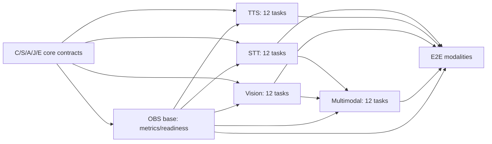

# Ghatana Media — backend modalities + observability, five-surface implementation wave

**Status:** IMPLEMENTATION-READY_PLAN / NO RUNTIME CHANGES IN THIS DOCUMENT / NOT VERIFIED_OR_CLOSED  
**Reviewed source:** `samujjwal/ghatana-media/main@6af0c62b7fbfea0af5cc7c18eda355f57af803aa` (2026-10-24); source truth is `.product-experience/pdp-0-product-truth`, `pdp-1-domain-data`, `pdp-2-design-interface-system`, `pdp-3-product-experience`. Recheck changes and plan tasks at execution.  
**Canonical Build owner:** [MEDIA-BUILD-IMPLEMENTATION-PLAN.md](MEDIA-BUILD-IMPLEMENTATION-PLAN.md), especially **F08** provider admission, **F09** headless contract grammar, **F11** temporal/codec primitives, **F12** observability, and **V03/V04/V05/V06/V16/V27** outcome journeys.  
**Foundation predecessor:** [five-core-backend-foundation plan](MEDIA-BACKEND-FOUNDATION-DEEP-IMPLEMENTATION-2026-10-24.md) C/S/A/J/E. Foundation code at latest main exists; this planning review **did not run its full tests**. Do not assume completed foundation closure or formally admitted providers.  
**Actual code owner:** **Only `ghatana-media`**; `ghatana/services/media` is read-only historical comparison. Shared/Kernel/Ghatana platform modules retain their own public contract ownership.  
**Formal Track B:** independent; no claimed gtool/PDP closed/current native receipt, KDEV stage advancement, migration cutover, CI-image qualification, deployment or release. The user-reported V009→V018 lineage fixture and 9 compose skips are residual observations, not certification of live applied DBs or production test completeness.

## Review outcome and selection

This wave selects **five already registered physical surfaces**, four modality services plus one supporting observability module. The existing source contains nontrivial code and tests, so work is **reuse + correctness/hardening + actual provider/quality conformance**, not greenfield rewrites. The Wave 2 task IDs (`STT-01..`, `TTS-01..`, `VIS-01..`, `MM-01..`, `OBS-01..`) are **local execution labels** bound to existing F/V packages, not a replacement for the source or new Lifecycle contracts.

| Surface | Physical registry identity | Implementer and reviewer | PDP meaning/consumer anchor | Work priority |
| --- | --- | --- | --- | --- |
| **STT** | `media.physical.modules-speech-stt-service` | Media speech/transcription engineer; Domain/timing/security reviewer | media.operation.transcription; media.operation.transcription-submission; media.operation.transcript-version-read; media.operation.caption-draft-write; media.operation.caption-version-write; media.operation.caption-version-read; J-03,J-07,J-16; PDP-3 grpc/service-registry.yaml STTService.* | Independent direct service hardening |
| **TTS** | `media.physical.modules-speech-tts-service` | Media synthesis/audio engineer; Voice-rights/audio DSP/security reviewer | media.operation.synthesis; media.operation.tts-request-origin-binding.v1; media.domain.artifact; media.domain.media-asset; media.domain.processing-job; J-04,J-16,J-17; PDP-3 grpc/service-registry.yaml TTSService.* | Independent direct service hardening |
| **VIS** | `media.physical.modules-vision-vision-service` | Media computer-vision engineer; Native/codec-security and model-quality reviewer | media.operation.vision-analysis; media.domain.scene-graph; media.domain.processing-job; media.value.image-video-technical-descriptor; J-05,J-06,J-28; PDP-3 grpc/service-registry.yaml VisionService.* | Independent direct service hardening |
| **MM** | `media.physical.modules-intelligence-multimodal-service` | Media multimodal/reliability engineer; STT+Vision integration, temporal and scientific-fidelity reviewer | media.operation.multimodal-analysis; media.domain.processing-job; media.domain.scene-graph; media.domain.transcript-version; J-06; PDP-3 grpc/service-registry.yaml MultimodalService.* | After STT+Vision APIs validated |
| **OBS** | `media.physical.audio-video-observability` | Media observability/performance engineer; Privacy/SRE and modality owners | media.health.readiness.inspect (PDP-0 intent), Media runtime health/readiness contracts; no invented standalone PDP-1 operation; PDP-3 existing health/status projections; no standalone OBS RPC and no new API | Cross-cutting first + validated last |

**Source populations:** The physical topology associates STT with 16 transcription intents, TTS with 17 synthesis intents, Vision with 22 vision/scene-text intents, and Multimodal with its own cross-modal intents plus reused STT and Vision obligations. Observability owns the single directly registered `media.health.readiness.inspect` capability. Full portfolio still has 54 source identities; these five are not five new services or a denominator reset. The complete per-intent and per-RPC exact mapping is appended below from existing source records.

### Confirmed code risks requiring real changes

- **STT** `PersistentSttGrpcService.java`: falls back to random `UUID` when authenticated user ID is missing; reject instead. STT README describes an external gRPC engine, while `ProductionSttGrpcService` composes local ONNX model config; reconcile via explicit provider policy, not silently assume model availability. Word/diarization/translation capability claims need actual engines.
- **TTS** `TtsSynthesisEngine.java` emits repeating `0x3C` fake audio and labels encoded output; this is never acceptable as real TTS. `SsmlProcessor.java` regex parsing of untrusted markup lacks robust XML nesting/DTD guards. Voice cloning/biometrics must be explicitly authorized and never silently activated.
- **Vision** model/OpenCV/native initialization is environment sensitive; `VideoFrameExtractor` invokes FFmpeg on untrusted media; resource/path/codec constraints need adversarial tests. A YOLO detector does not automatically implement depth, segmentation, face identity or scene-text analysis; generic OCR belongs to Document Intelligence.
- **Multimodal** `MultimodalAnalysisEngine` uses `dummyAudioFrame` and `dummyVideoFrame` while estimating sync; replace with real timestamped input or UNKNOWN. `CrossModalFusionEngine` heuristically averages vectors/confidences; cannot claim a validated calibrated joint embedding. `PersistentMultimodalService` can be constructed without engines, with unsupported paths.
- **Observability** `AudioVideoTracingService` uses a hardcoded 50ms generic SLA threshold, which is inappropriate for actual model execution. `MediaWorkflowMetrics` already has constrained tags; tests must prevent metadata/content leaks and prove cross-service propagation, resource accounting and true readiness.

## Execution controls, reuse and acceptance law

1. Work only in **Media modules** shown below; no second job store, no second model governance stack, no generic Event Plane/OCR implementation, no new gtool/receipt machinery. Reuse foundation job/attempt/consent/artifact/outbox and published platform model/DI/Shared APIs.
2. Every positive result requires actual output artifact/version, declared model and input provenance, consent and a re-readable effect, **not** mock-returned text, dummy PCM, dummy video sync or JSON "success". When the model/hardware/licensing is not admitted, implement the complete typed negative path and keep the real positive effect **NOT_VERIFIED**; do not call the capability fully implemented.
3. Every RPC keeps its existing proto method/field numbers and auth scopes. PDP-3 gRPC service registry contains **43 observed RPCs**: STT 12, TTS 11, Vision 10, Multimodal 10; **24 proposed logical bindings and 19 unresolved**. Source status is proposal-only; the explicit RPC ledger below is a coverage projection, **not** PDP approval.
4. A surface earns `LOGICALLY_BACKEND_DEV_COMPLETE` only if all in-scope PDP capabilities are either supported by real implementation+tests, or formally source-disposed as non-applicable/unsupported with **a legitimate requirement/owner decision**. Typed `NOT_ADMITTED` is safe behavior, NOT automatically development completion for an intended feature. Partial functionality is `IN_PROGRESS` with exact remaining IDs. Do not call the whole physical leaf complete based on one successful API.
5. Use a dedicated healthy local fixture model where available with legally reusable weights and an approved license; never auto-download unknown weights. In-process gRPC and in-memory provider doubles are valid unit tests, not independent real-model/quality evidence. Require container/process integration for the effects they claim, without tying ordinary coding to GH-90000.
6. Negative tests on every boundary: missing/forged principal, other tenant, unauthorized voice/face, expired consent, malformed media/SSML, frame/sample overflow, provider timeout after possible effect, cancelled and stale attempts, resource exhaustion, unavailable model, mismatched output format, and leaking diagnostic fields. Cleanup on every exception.
7. Per-family file ownership and max 2 active edited packages concurrently. STT owns STT module; TTS owns TTS; Vision owns Vision; Multimodal owns MM; OBS owns observability. Any shared `launcher/runtime-contracts/providers` change must be serialized with corresponding foundation owner. No mechanical copy of model code from Ghatana platform.
8. Performance samples require exact model version/hardware/driver/codec/fixture/tenancy/limits with latency histograms and resource counters. PDP-0 `NFR-PERF-001` control-plane budgets are only *proposed* until a reference environment is approved; model inference latency, real-time factor (RTF), image/video fps and sync error are separate measurements.
9. **No new Media backend module is inherently blocked on GH-90000, warn-only Checkstyle, formal gtool transition or the Shared build-logic bug.** They are separately tracked at the end. A missing real service-image test does mean that *that particular cross-process assertion is unverified*, not PASS.

## Dependencies and bounded implementation waves

**Wave W0 (first 4-hour pulse):** refresh current files/real tests; open STT-01/TTS-01/VIS-01/MM-01/OBS-01; begin TTS-02 dangerous synthetic-output fail-closed fix and MM-04 dummy-sync reproduction. Produce at least one code/test patch, not another proposal. **W1 (days 1–2, planning only):** auth/provider/format/model/observability foundation; STT/TTS/Vision work in parallel; MM boundary and timestamp groundwork. **W2 (days 3–6):** real positive path and result/version integration; MM waits for STT/Vision published in-repo API adapter; OBS measurements advance concurrently. **W3 (days 7–10):** 43-RPC matrix, adversarial & real-model tests, performance/failure verification and local package review. These are pulse/checkpoint timeboxes, **not promises of completion**; after two failed pulses on one dependency, isolate one reproducible test and continue independent code. No global sweep or unrelated PDP reopen.

**Workstream merge schedule:** OBS-01/02/03 + STT-01/02 + TTS-01/02 + VIS-01/02 can start without shared-file contention. MM-02/03/04 can run early using read-only fixtures; MM-05 waits for exact STT/Vision provider API. Per-service final review waits for OBS service readiness/latency wiring only where claimed. Image-backed GH-90000 testing is a separate optional real-compose qualification step; not a prerequisite to basic code compilation or in-process gRPC conformance.

## PR-sized backend tasks (one row = one actionable implementation, test and observable acceptance)

**Paths** within each table are relative to the owning module's `src/main/java` or `src/main` as appropriate; `README.md`, `src/test` and provider/contract manifests are addressed by exact paths. Newly proposed classes/fixtures are marked **NEW**. `NFR-*` and `media.*` capability identifiers in each task are source PDP-0 references; the table heading supplies PDP-1 operation and PDP-3 journey/gRPC registry anchors. Actual readiness is checked per exact source cut and owner disposition, not inferred from this plan.

### STT — media.physical.modules-speech-stt-service

**Owner:** Media speech/transcription engineer. **Independent review:** Domain/timing/security reviewer. **Code:** `modules/speech/stt-service`. **PDP-0 NFRs:** `NFR-SEC-001,NFR-PRIV-001,NFR-TIME-001,NFR-RECOVERY-001,NFR-LOC-001,NFR-FIDELITY-001`. **PDP-1:** media.operation.transcription; media.operation.transcription-submission; media.operation.transcript-version-read; media.operation.caption-draft-write; media.operation.caption-version-write; media.operation.caption-version-read. **PDP-3:** J-03,J-07,J-16; PDP-3 grpc/service-registry.yaml STTService.*. PDP-2 headless contract/error/idempotency/stream grammar references: `.product-experience/pdp-2-design-interface-system/api/` plus gRPC proto, not an invented PDP-4.

| ID / pulse | Dependencies | Exact PDP-0 capability / NFR | Where and how to implement | Executable acceptance |
| --- | --- | --- | --- | --- |
| **STT-01** (W0) | — | `media.speech.transcription.file; NFR-RECOVERY-001` | `modules/speech/stt-service/src/main/proto/stt_service.proto; grpc/SttGrpcService.java`: Inventory 12 RPCs, 16 PDP-0 STT intents, current SPI/provider/status, versions and existing tests; separate implemented, contract-only and actual provider qualification. | Saved exact capability/RPC ledger with no missing ID; test contract matches proto field numbers and live implemented statuses. |
| **STT-02** (W0) | STT-01 | `media.speech.transcription.file; NFR-COST-001` | `modules/speech/stt-service/grpc/ProductionSttGrpcService.java; README.md; config/provider-manifest.json`: Resolve README external Whisper gRPC versus local ONNX config: make provider routing explicit (GRPC/qualified local), immutable model ID/version/licence/hardware/region, readiness and fail-closed NOP/unsupported. Reuse AI Inference public adapter only for generic model execution. | Same request on configured provider returns admitted profile or exact NOT_ADMITTED; no synthetic success in production; contract tests cover mismatched configuration. |
| **STT-03** (W1) | STT-01 | `media.speech.transcription.speaker.identify-authorized; NFR-PRIV-001` | `modules/speech/stt-service/grpc/PersistentSttGrpcService.java; grpc/SttGrpcServer.java; service/PersistentSttService.java`: Remove random UUID principal fallback; require trusted authenticated principal/tenant/purpose; verify ownership at direct service and gRPC; apply bounds and min-data audit on each request/retry. | Missing caller identity is UNAUTHENTICATED with no file/DB/provider effect; impersonation and cross-tenant transcript tests green. |
| **STT-04** (W1) | STT-02,STT-03 | `media.speech.transcription.file; NFR-SEC-001` | `modules/speech/stt-service/service/PersistentSttService.java; grpc/SttGrpcService.java`: Consume governed artifact/version or bounded uploaded bytes; sniff codec/container, frame/channel/sample-rate/rational clock; reject decoded-size bombs; use bounded I/O rather than unbounded protobuf/byte-array copy. | WAV/FLAC and explicitly admitted formats roundtrip; 0, oversize, broken header, bad timestamps and sample bounds fail with stable gRPC codes. |
| **STT-05** (W2) | STT-02,STT-04 | `media.speech.transcription.stream; NFR-RECOVERY-001` | `modules/speech/stt-service/grpc/SttGrpcService.java; streaming/SttStreamingLatencyEnhancer.java`: Implement validated chunk/session identity, monotonic sequence/ack, bounded partial revisions, VAD framing, reconnect/resume, backpressure, timeout, cancel and final-result semantics; delegate transport mechanics to Media stream runtime. | Out-of-order, repeat, gap, disconnect, dropped final and revoked consent tests prove no duplicate terminal transcript or fabricated finality. |
| **STT-06** (W2) | STT-04 | `media.speech.transcription.word-timestamp.create; media.speech.transcription.confidence.provide; NFR-TIME-001` | `modules/speech/stt-service/service/PersistentSttService.java; detection/LanguageDetectionService.java; proto adapter`: Bind source-PTS/sample clock, language/alternatives, VAD, words/phonemes and confidence to versioned typed segments; validate alignment and quality provenance; absent model support is a reasoned unavailability, not invented values. | Impulse/boundary tests and gold transcript verify timebase, ordered nonoverlapping bounds and calibrated/not-calibrated confidence distinctions. |
| **STT-07** (W2) | STT-03,STT-06 | `media.speech.transcription.speaker.diarize; media.speech.transcription.speaker.identify-authorized; NFR-PRIV-001` | `modules/speech/stt-service/diarization/SpeakerDiarizationService.java; service/PersistentSttService.java`: Separate anonymous diarization from speaker identity, permission voice-biometric/diarization, overlap and speaker label stability; never infer real identity from clustering or training data. | Overlapping/multi-speaker fixture preserves anonymous speaker IDs and no biometric identity without rights; speaker accuracy evaluated with declared corpus. |
| **STT-08** (W2) | STT-06,STT-07 | `media.speech.transcription.forced-align; media.speech.transcription.subtitle.generate; NFR-FIDELITY-001` | `modules/speech/stt-service/service/PersistentSttService.java; job/AvJobLifecycleAdapter.java; transcript store SPI`: Persist immutable transcript/word-version, parent/source digest, CAS correction and caption draft vs approved version; forced alignment, translation and subtitle producer only when admitted and actually implemented. | Exact source/word/caption lineage and CAS conflict tested; unsupported alignment/translate produce typed unmet-capability with no counterfeit caption version. |
| **STT-09** (W2) | STT-03,STT-08 | `media.speech.transcription.file; NFR-AUD-001` | `modules/speech/stt-service/job/AvJobLifecycleAdapter.java; launcher Media job SPI`: Adopt foundation job idempotency, immutable artifact version, fenced provider attempt, truthful cancellation/UNKNOWN, bounded retry and secure audit; do not build another job store. | Crash after request/dispatch/receipt and replay tested; shared job status projection does not convert UNKNOWN into running/success. |
| **STT-10** (W3) | STT-06,STT-08 | `media.speech.transcription.language.detect; NFR-LOC-001` | `modules/speech/stt-service/src/test/java/.../functional; deterministic fixtures and benchmark corpus`: Validate recognized languages including Devanagari cases, silence/noise, accent/overlap, segmentation, punctuation, WER/CER/DER and fairness/unsupported language disclosure; separate model evaluation from code correctness. | Golden corpus includes language/error distributions; thresholds/real model quality are observed with model+hardware, not claimed from fixtures. |
| **STT-11** (W3) | STT-02,STT-08,OBS-01 | `media.speech.transcription.file; NFR-RECOVERY-001` | `modules/speech/stt-service/grpc/SttGrpcService.java; grpc/ProductionSttGrpcService.java; stt_service.proto`: Exercise every STT RPC: Transcribe/StreamTranscribe, model List/Load/Unload/Adapt, GetStatus/Health, Profile Create/Get/Update and SubmitCorrection. Preserve proto/wire identities; unadmitted effects return explicit codes. | 12/12 RPCs have positive real-engine or source-authorized unavailable paths and auth/invalid/unknown tests, no fabricated adaptation result. |
| **STT-12** (W3) | STT-03..STT-11 | `media.speech.transcription.file; NFR-PERF-001` | `modules/speech/stt-service/src/test; SttGrpcServiceInProcessIntegrationTest; dedicated STT runtime E2E`: Run in-process authenticated gRPC, real admitted engine isolated test, restarts, concurrent batches, 16/64 request load; record RTF/p50/p95/p99, memory, WER/CER, no cross-tenant data, budget caps. | Source-bound 12-RPC and 16-capability matrix is current; all in-scope tests pass, no skips relabeled as PASS, real provider assertions only with actual model. |

### TTS — media.physical.modules-speech-tts-service

**Owner:** Media synthesis/audio engineer. **Independent review:** Voice-rights/audio DSP/security reviewer. **Code:** `modules/speech/tts-service`. **PDP-0 NFRs:** `NFR-SEC-001,NFR-PRIV-001,NFR-TIME-001,NFR-COST-001,NFR-FIDELITY-001,NFR-LOC-001`. **PDP-1:** media.operation.synthesis; media.operation.tts-request-origin-binding.v1; media.domain.artifact; media.domain.media-asset; media.domain.processing-job. **PDP-3:** J-04,J-16,J-17; PDP-3 grpc/service-registry.yaml TTSService.*. PDP-2 headless contract/error/idempotency/stream grammar references: `.product-experience/pdp-2-design-interface-system/api/` plus gRPC proto, not an invented PDP-4.

| ID / pulse | Dependencies | Exact PDP-0 capability / NFR | Where and how to implement | Executable acceptance |
| --- | --- | --- | --- | --- |
| **TTS-01** (W0) | — | `media.speech.synthesis.text-to-speech; NFR-RECOVERY-001` | `modules/speech/tts-service/src/main/proto/tts_service.proto; grpc/TtsGrpcService.java; README.md`: Inventory 11 RPCs/17 capabilities, model/voice profiles and source→output/version/voice rights; compare hosted TtsEngine against TtsSynthesisEngine fallback and actual advertised codecs. | Every RPC/voice/capability classed IMPLEMENTED, PROVIDER_DEPENDENT, NOT_IMPLEMENTED or EXPLICITLY_NOT_ADMITTED; no fake positive. |
| **TTS-02** (W0) | TTS-01 | `media.speech.synthesis.text-to-speech; NFR-FIDELITY-001` | `modules/speech/tts-service/engine/TtsSynthesisEngine.java; grpc/TtsGrpcService.java`: Remove repeating-byte synth from any real provider result: isolate as explicitly named synthetic test fixture, or replace with real admitted synthesis SPI; forbid false PCM/MP3/OPUS claims. | Production-like profile cannot receive 0x3C fabricated bytes or wrong codec; decoder + header + duration and real speech checks required. |
| **TTS-03** (W1) | TTS-01,TTS-02 | `media.speech.synthesis.speaker.condition; NFR-COST-001` | `modules/speech/tts-service/grpc/ProductionTtsGrpcService.java; config/provider-manifest.json`: Bind actual voice model ID/version/digest/license, language, region, retention, hardware memory/compute, model health and prewarming; no implicit model download or synthetic fallback. | Unknown/unavailable model/voice/license fails cleanly before mutation; only admitted and initialized provider may synthesize. |
| **TTS-04** (W1) | TTS-01 | `media.speech.synthesis.control.prosody; NFR-SEC-001` | `modules/speech/tts-service/ssml/SsmlProcessor.java; service/PersistentTtsService.java`: Replace regex tag stripping/parser for untrusted SSML with bounded hardened XML parser (disable DTD/external entities/XInclude), canonical nesting, known tags, max input/depth/duration and escape handling. | XXE/ENTITY bomb, malformed/nested tags, huge pause and injection negatives fail; deterministic normalized phoneme/text segments test green. |
| **TTS-05** (W1) | TTS-03 | `media.speech.synthesis.speaker.clone-authorized; NFR-PRIV-001` | `modules/speech/tts-service/grpc/TtsGrpcService.java; security/EmbeddingEncryptionService.java; service/PersistentTtsService.java`: Enforce authenticated owner, voice identity, source consent, cloning/conditioning/biometrics, expiry and purpose; do not equate uploaded voice profile with legal authorization; encrypt retained embeddings. | Unauthorized clone/profile access/no consent denies before external call; deletion/revocation disables subsequent dispatch; test data never leaked. |
| **TTS-06** (W2) | TTS-03,TTS-04 | `media.speech.synthesis.control.phoneme; media.speech.synthesis.expressive; NFR-FIDELITY-001` | `modules/speech/tts-service/ssml/SsmlProcessor.java; emotion/EmotionControlService.java; mixing/VoiceMixingService.java`: Map rate/pitch/prosody/pronunciation/SSML/emotion to provider-supported parameters; validate units and finite bounded values; opt out unsupported control rather than pretend it changed output. | AB-style control fixtures prove observable effect where enabled; unsupported control returns truthful limitation; sample clocks and volume limits deterministic. |
| **TTS-07** (W2) | TTS-02,TTS-03,TTS-06 | `media.speech.synthesis.text-to-speech; NFR-TIME-001` | `modules/speech/tts-service/engine/TtsSynthesisEngine.java; service/PersistentTtsService.java`: Generate real audio through admitted engine; encode declared PCM/encoded format, sample rate/channels/frame count and loudness, verify bytes can be decoded and duration matches sample count with rational rounding. | Decoded non-empty speech on authorized reference model, playable output and exact format metadata; no label OPUS/MP3 for PCM bytes. |
| **TTS-08** (W2) | TTS-07 | `media.speech.synthesis.streaming; NFR-RECOVERY-001` | `modules/speech/tts-service/grpc/TtsGrpcService.java; proto TTSService.StreamSynthesize`: Stream bounded ordered frames/chunks, backpressure and cancel semantics; preserve output version/finality and timeout/pause/resume where protocol permits; no inferred seek/resume if not in proto. | Stream sequence/chunk count/size/cancel-after-output/partial errors tested, no duplicate final audio or unbounded buffering. |
| **TTS-09** (W2) | TTS-05,TTS-07 | `media.speech.synthesis.text-to-speech; NFR-AUD-001` | `modules/speech/tts-service/service/PersistentTtsService.java; Media artifact/job/outbox SPI`: Persist immutable authorized generated audio and provider/prosody/voice model lineage, rights and quality version; reuse foundation job engine idempotency, attempt fence and outbox. | Replay same request preserves output, different digest conflicts, consent-revoked-before-effect blocked, failure never registers complete artifact. |
| **TTS-10** (W3) | TTS-05,TTS-06,TTS-07 | `media.speech.synthesis.multilingual; media.speech.synthesis.speech.translate; NFR-LOC-001` | `modules/speech/tts-service/grpc/TtsGrpcService.java; voice manifest/qualification fixtures`: Classify supported voice-language/style combinations, cross-lingual, dubbing/voice-conversion/speech-to-speech as provider dependent with explicit output and rights; no unsupported language auto-substitute. | Locale matrix for en/ne/hi and source-declared languages: authorized real provider effects pass, unadmitted variants fail with exact capability reason. |
| **TTS-11** (W3) | TTS-03,TTS-05,TTS-08,OBS-01 | `media.speech.synthesis.speaker.clone-authorized; NFR-PRIV-001` | `modules/speech/tts-service/grpc/TtsGrpcService.java; tts_service.proto`: Exercise all 11 TTS RPCs including GetVoices, LoadVoice, GetStatus/Metrics, profile CRUD, CloneVoice and SubmitFeedback. Any unavailable operation is typed and visibly not admitted. | 11/11 methods covered by supported behavior or source-grounded unavailable response; transport version and credential/tenant negatives pass. |
| **TTS-12** (W3) | TTS-04..TTS-11 | `media.speech.synthesis.text-to-speech; NFR-PERF-001` | `modules/speech/tts-service/src/test; TtsGrpcServiceInProcessIntegrationTest; TtsFunctionalCompletenessTest`: Real reference synthesis, SSML fuzz, sample/codec validity, stream cancellation, 16/64 concurrency, RTF/memory/latency; licensed/consent-ready voice only, no real clone needed for nonadmitted scope. | All in-scope errors/positive outputs check decoded audio; voice privacy and model readiness verified; p50/p95/p99 and RTF recorded separately. |

### VIS — media.physical.modules-vision-vision-service

**Owner:** Media computer-vision engineer. **Independent review:** Native/codec-security and model-quality reviewer. **Code:** `modules/vision/vision-service`. **PDP-0 NFRs:** `NFR-SEC-001,NFR-PRIV-001,NFR-TIME-001,NFR-FIDELITY-001,NFR-COST-001`. **PDP-1:** media.operation.vision-analysis; media.domain.scene-graph; media.domain.processing-job; media.value.image-video-technical-descriptor. **PDP-3:** J-05,J-06,J-28; PDP-3 grpc/service-registry.yaml VisionService.*. PDP-2 headless contract/error/idempotency/stream grammar references: `.product-experience/pdp-2-design-interface-system/api/` plus gRPC proto, not an invented PDP-4.

| ID / pulse | Dependencies | Exact PDP-0 capability / NFR | Where and how to implement | Executable acceptance |
| --- | --- | --- | --- | --- |
| **VIS-01** (W0) | — | `media.vision.detect; NFR-FIDELITY-001` | `modules/vision/vision-service/vision-service/src/main/proto/vision_service.proto; grpc/VisionGrpcService.java`: Inventory 10 RPCs and 22 PDP vision/scene-text capabilities against provider implementation; record strict supported/unsupported model/version/format rows. | Exact 22 capabilities/10 RPC census; no implicit object-detector support for depth/segmentation/pose. |
| **VIS-02** (W0) | VIS-01 | `media.vision.detect; NFR-COST-001` | `modules/vision/vision-service/grpc/ProductionVisionGrpcService.java; yolo/YoloV8Adapter.java`: Qualify pinned signed/hashed YOLO/ONNX model file, classes/version/license, CPU/GPU native library, initialization and bounded model lifetime; handle missing OpenCV as typed unavailable without leaking stack/half-server. | No service reports ready without initialized detector; invalid model/digest/native/lib/license profile fails before traffic, no silent noop. |
| **VIS-03** (W1) | VIS-01 | `media.vision.classify; NFR-SEC-001` | `modules/vision/vision-service/video/VideoFrameExtractor.java; grpc/VisionGrpcService.java`: Reject oversize images/frames/pixels/decoded expansion, malformed codecs/containers, symlinks/traversal and unsafe media metadata before decoding; bound temp directory and native memory. | Adversarial image/video and native parser corpus stays inside CPU/memory/frame/time bounds; quarantine unsupported formats. |
| **VIS-04** (W1) | VIS-03 | `media.vision.detect.shot-boundary; NFR-SEC-001` | `modules/vision/vision-service/video/VideoFrameExtractor.java; VideoFrameExtractorProcessTest.java`: Harden FFmpeg argument allowlist/path containment, timeout/cancel & process-tree kill, diagnostic/output byte budget, isolated temp files, safe metadata; never pass unsanitized network protocols. | Process timeout/symlink/path/infinite stream and ffmpeg stderr spam tests prove no escaped paths/leaked temp bytes. |
| **VIS-05** (W1) | VIS-02,VIS-03 | `media.vision.detect; NFR-TIME-001` | `modules/vision/vision-service/yolo/YoloV8Adapter.java; model/BoundingBox.java; analysis/VideoAnalysisService.java`: Preserve rotation/color/EXIF orientation and scale transforms, normalized ROI/bbox coordinate conventions, confidence units and content version. Manage all OpenCV Mat buffers and Net lifetime. | Synthetic geometry fixtures roundtrip pixels→bbox and back within declared pixel tolerance; native leak stress bounded. |
| **VIS-06** (W2) | VIS-05 | `media.vision.detect; media.vision.classify; NFR-FIDELITY-001` | `modules/vision/vision-service/yolo/YoloV8Adapter.java; detection/VisionDetector.java`: Test ONNX output layout, class mapping, threshold/NMS, invalid/NaN scores, overlapping classes, coordinate clipping and model version changes; no heuristic label as calibrated probability. | Golden object fixture and mAP/PR metrics on licensed corpus, class list + confidence metadata reproducible; no out-of-range boxes. |
| **VIS-07** (W2) | VIS-04,VIS-06 | `media.vision.track.object; media.vision.estimate.camera-motion; NFR-TIME-001` | `modules/vision/vision-service/analysis/VideoAnalysisService.java; video/VideoFrameExtractor.java`: Link detections to exact frame PTS, track IDs, shot boundaries and source clock; bounded temporal windows and missing frame semantics. Don't treat frame index as wall-time. | Variable-frame-rate/reorder/scene-cut tests preserve frame timestamp, track version/identity, sample count and uncertainty. |
| **VIS-08** (W2) | VIS-06,VIS-07 | `media.vision.segment.image; media.vision.estimate.depth; NFR-FIDELITY-001` | `modules/vision/vision-service/grpc/VisionGrpcService.java; model/SPIs via admitted providers`: For segmentation, optical flow, depth/normals, hand/human pose, foreground matte and saliency, require real qualified capability provider/result dimension; otherwise explicitly NOT_ADMITTED, not YOLO-bbox substitution. | Every advanced intent receives provider-backed output validated by ground truth or exact unavailable, with no guessed depth/segmentation tensor. |
| **VIS-09** (W2) | VIS-04,VIS-07 | `media.vision.scene-text.observation.create; NFR-PRIV-001` | `modules/vision/vision-service/ocr/OcrService.java; ocr/KernelOcrProviderAdapter.java; scene/SceneUnderstandingService.java`: Replace legacy generic OCR execution with admitted Document Intelligence public API adapter only; keep Media temporal region tracking/scene annotations, bound text image/copy rights. | Text box/time/region evidence tied to immutable frame; no Media-owned generic OCR engine or leakage of protected text; no fake extracted text. |
| **VIS-10** (W2) | VIS-03,VIS-06 | `media.vision.estimate.face-landmarks; media.vision.analyze.gaze; NFR-PRIV-001` | `modules/vision/vision-service/recognition/FacialRecognitionService.java; StructuredFacialRecognitionAuditSink.java`: Enforce biometric purpose/consent/region/retention before face-landmark/gaze/expression/identity; reject unsafe face identification, distinguish bounding boxes from identity assertions. | Same-tenant/other-tenant, revoked consent and sensitive analytics negative fixtures dispatch zero restricted effects. |
| **VIS-11** (W3) | VIS-02,VIS-07,VIS-09,OBS-01 | `media.vision.classify.scene; NFR-RECOVERY-001` | `modules/vision/vision-service/grpc/VisionGrpcService.java; PersistentVisionService.java; Vision proto`: Run 10 Vision RPCs (Detect, AnalyzeImage, Classify, AnalyzeVideoFile, ProcessVideo, model List/Load/Unload, GetStatus, Health); wire existing Media job/artifact/version and provider status to trustworthy gRPC outcomes. | 10/10 proto RPC matrix auth/bounds/status/finality tests; legitimate derived result re-read with provenance; no wrong file metadata as audio. |
| **VIS-12** (W3) | VIS-01..VIS-11 | `media.vision.detect; NFR-PERF-001` | `modules/vision/vision-service/src/test; VisionGrpcServiceInProcessIntegrationTest; VideoFrameExtractorProcessTest`: Real model/reference image tests plus bounded ffmpeg/OpenCV stress, mAP/latency/throughput and CPU/GPU/native-memory; fault/restart/hardware absent profile tested. | All declared positive capabilities actually executable or openly NOT_ADMITTED; signed/model provenance + protected data + native resource tests pass. |

### MM — media.physical.modules-intelligence-multimodal-service

**Owner:** Media multimodal/reliability engineer. **Independent review:** STT+Vision integration, temporal and scientific-fidelity reviewer. **Code:** `modules/intelligence/multimodal-service`. **PDP-0 NFRs:** `NFR-SEC-001,NFR-PRIV-001,NFR-TIME-001,NFR-FIDELITY-001,NFR-RECOVERY-001`. **PDP-1:** media.operation.multimodal-analysis; media.domain.processing-job; media.domain.scene-graph; media.domain.transcript-version. **PDP-3:** J-06; PDP-3 grpc/service-registry.yaml MultimodalService.*. PDP-2 headless contract/error/idempotency/stream grammar references: `.product-experience/pdp-2-design-interface-system/api/` plus gRPC proto, not an invented PDP-4.

| ID / pulse | Dependencies | Exact PDP-0 capability / NFR | Where and how to implement | Executable acceptance |
| --- | --- | --- | --- | --- |
| **MM-01** (W0) | — | `media.multimodal.analyze.cross-modal; NFR-FIDELITY-001` | `modules/intelligence/multimodal-service/src/main/proto/multimodal_service.proto; grpc/MultimodalGrpcService.java`: Inventory 10 RPCs, 7 multimodal-owned intents and delegated STT/Vision intents; map input/output, partial and uncertainty semantics; no duplicated STT or vision engines. | 10 RPC/7 direct intent matrix plus exact delegated 16 STT and 22/20 Vision references; no phantom independent capabilities. |
| **MM-02** (W1) | MM-01,STT-03,VIS-03 | `media.multimodal.observe.source-grounded; NFR-PRIV-001` | `modules/intelligence/multimodal-service/grpc/MultimodalGrpcService.java; engine/MultimodalRequest.java`: Authenticate tenant/principal and inspect rights for each modality and provider egress, source immutable artifact/versions, content size and purpose; no untrusted tenant header. | Cross-tenant mixed input and revoked purpose deny before any call; signed content refs only and bounded bytes/frames. |
| **MM-03** (W1) | MM-02 | `media.multimodal.relate.scene-audio; NFR-TIME-001` | `modules/intelligence/multimodal-service/engine/TemporalAlignment.java; engine/MultimodalAnalysisEngine.java`: Adopt rational source/media clocks, frame PTS/audio samples, feature-window alignment and time bounds; distinguish t_source/t_media/t_sim/t_wall; detect clock mismatch. | Synthetic impulse/fps drift/variable frame rate test gives exact bounded offset and documented unresolvable outcome. |
| **MM-04** (W1) | MM-03 | `media.multimodal.relate.scene-audio; NFR-FIDELITY-001` | `modules/intelligence/multimodal-service/engine/MultimodalAnalysisEngine.java; AudioVideoSyncPipeline adapter`: Eliminate dummyAudioFrame/dummyVideoFrame synchronization evidence; feed real timestamped window features to qualified sync algorithm or return SYNC_UNDETERMINED. Never label fabricated drift confidence. | Sync ground truth with deliberate ±offset/clock discontinuity compared to measured value; unavailable signals yield unknown, not GOOD. |
| **MM-05** (W2) | MM-02,STT-09,VIS-11 | `media.multimodal.analyze.cross-modal; NFR-RECOVERY-001` | `modules/intelligence/multimodal-service/engine/PlatformMultimodalAdapter.java; adapter/GrpcSttClientAdapter.java; service/PersistentMultimodalService.java`: Compose actual allowed STT/Vision service providers through public SPI, bounded concurrency/cancellation/deadlines, stable owner job and split retries; disallow null-engine success paths. | Network partition/timeout/provider unavailable returns exact partial/unknown, not successful synthetic analysis. Cross-service context protected. |
| **MM-06** (W2) | MM-04,MM-05 | `media.multimodal.associate.speaker-face; NFR-FIDELITY-001` | `modules/intelligence/multimodal-service/engine/CrossModalFusionEngine.java; MultimodalAnalysisEngine.java`: Validate equal finite embedding dims/coordinate frames, normalize weights and no Nans; distinguish heuristic similarity from measured calibrated confidence; gate speaker-face identity behind biometric rights. | Dim mismatch, sparse embeddings, missing modalities and misleading confidence tests; no claimed scientifically validated association without labeled corpus. |
| **MM-07** (W2) | MM-06 | `media.multimodal.describe; media.multimodal.summarize; media.multimodal.extract.structured; NFR-FIDELITY-001` | `modules/intelligence/multimodal-service/engine/MultimodalResult.java; engine/MultimodalAnalysisEngine.java`: Produce typed, source-grounded description/summaries/structured outputs with references to frame/word/region/version and uncertainty; if no qualified semantics/provider return abstain. | Every asserted entity/time fact traces to actual source observation; contradictory/audio-only/video-only cases do not invent missing evidence. |
| **MM-08** (W2) | MM-05,MM-06 | `media.multimodal.observe.source-grounded; NFR-RECOVERY-001` | `modules/intelligence/multimodal-service/service/PersistentMultimodalService.java; engine/MultimodalAnalysisEngine.java`: Separate modality-level result, partial success, quality and domain finality, manage cancellation at each child, no swallowed errors or blocked worker threads/unbounded fanout. | Partial audio success/video failure returns typed PARTIAL with provenance and retry safety; cancel child/parent preserves exact effect truth. |
| **MM-09** (W3) | MM-05,MM-08 | `media.multimodal.observe.source-grounded; NFR-AUD-001` | `modules/intelligence/multimodal-service/service/PersistentMultimodalService.java; Media job/artifact/version outbox SPI`: Persist fusion result, source artifact references, selected provider/model, time mapping, provenance and privacy classification under CAS/fenced job attempt; replay only proved idempotent effects. | Read exact result bytes/version; repeated request same identity stable; no generated output when grounded data missing. |
| **MM-10** (W3) | MM-05,MM-07 | `media.multimodal.extract.structured; NFR-PRIV-001` | `modules/intelligence/multimodal-service/datacloud/DataCloudMultimodalAdapter.java; MediaSemanticObservationProjector.java`: Publish only governed typed metadata and redacted source-grounded observations to public Data Cloud/AI Inference boundaries; no direct internal DB access or generic platform engine fork. | Projection format/visibility/classification/version negative tests; disabled platform returns explicit integration unavailable but local Media result preserved. |
| **MM-11** (W3) | MM-07,MM-08,OBS-01 | `media.multimodal.analyze.cross-modal; NFR-RECOVERY-001` | `modules/intelligence/multimodal-service/grpc/MultimodalGrpcService.java; multimodal_service.proto`: Exercise 10 RPCs: Process/AnalyzeVideoWithAudio, GenerateDescription, AnalyzeCrossModal, GetInsights, model Load/Unload/List and GetStatus/Health; management only if provider admission exists. | 10/10 proto method matrix with version, auth, cancellation, unsupported branches; no body success for unsupported models. |
| **MM-12** (W3) | MM-01..MM-11 | `media.multimodal.observe.source-grounded; NFR-PERF-001` | `modules/intelligence/multimodal-service/src/test; MultimodalGrpcServiceInProcessIntegrationTest; MultimodalAnalysisEngineTest`: Run real STT+Vision composed E2E with artifact provenance, offset gold corpus, calibrated/unknown result semantics, 16/64 concurrent requests, p50/p95/p99, backpressure and fanout limits. | Actual source-grounded positive result and protected negative/unknown cases; no dummy frames or unqualified scientific confidence. |

### OBS — media.physical.audio-video-observability

**Owner:** Media observability/performance engineer. **Independent review:** Privacy/SRE and modality owners. **Code:** `audio-video-observability`. **PDP-0 NFRs:** `NFR-OBS-001,NFR-PERF-001,NFR-SEC-001,NFR-COST-001,NFR-RECOVERY-001`. **PDP-1:** media.health.readiness.inspect (PDP-0 intent), Media runtime health/readiness contracts; no invented standalone PDP-1 operation. **PDP-3:** PDP-3 existing health/status projections; no standalone OBS RPC and no new API. PDP-2 headless contract/error/idempotency/stream grammar references: `.product-experience/pdp-2-design-interface-system/api/` plus gRPC proto, not an invented PDP-4.

| ID / pulse | Dependencies | Exact PDP-0 capability / NFR | Where and how to implement | Executable acceptance |
| --- | --- | --- | --- | --- |
| **OBS-01** (W0) | — | `media.health.readiness.inspect; NFR-OBS-001` | `audio-video-observability/AudioVideoHealthService.java; modal gRPC server composition`: Define liveness/readiness/degraded/unavailable per provider and modality, startup and shutdown; empty check registry must not silently imply serving; required checks configured and registered. | 4 gRPC services expose honest SERVING/NOT_SERVING with injected provider crash/missing model; shutdown drains and stops serving. |
| **OBS-02** (W1) | OBS-01 | `media.health.readiness.inspect; NFR-PRIV-001` | `audio-video-observability/AudioVideoHealthService.java; gRPC auth/public probe policy`: Separate public liveness from privileged status/model details; no raw model path/tenant/token in unauth probes, bounded health checks, explicit timeouts. | Unauthenticated status cannot disclose protected configuration; slow dependency does not hang probe. |
| **OBS-03** (W1) | OBS-01 | `media.health.readiness.inspect; NFR-OBS-001` | `audio-video-observability/tracing/AudioVideoTracingService.java; instrumentation/AudioVideoGrpcInstrumentation.java`: Propagate permitted correlation/trace context across async child futures and gRPC STT/Vision/Multimodal; ensure span scopes close, validate permitted attributes. | Parent-child traces remain linked after cross-service async call, no leaked trace scope on exception/cancel, no protected content in spans. |
| **OBS-04** (W1) | OBS-03 | `media.health.readiness.inspect; NFR-PRIV-001` | `audio-video-observability/MediaWorkflowMetrics.java; tracing/AudioVideoTracingService.java`: Use bounded enum tag vocabulary only, no tenant/request/job/personal identifiers in metrics/MDC/events; apply retention and redaction policy to logs and spans. | High-cardinality/adversarial labels collapse to bounded vocabulary; sensitive marker fixture absent in telemetry export. |
| **OBS-05** (W2) | OBS-03,OBS-04 | `media.health.readiness.inspect; NFR-PERF-001` | `audio-video-observability/MediaWorkflowMetrics.java; AudioVideoTracingService.java`: Instrument per-modality service admission, queue/wait, provider/decode, response, success/UNKNOWN and cost durations; remove hardcoded 50ms generic SLA that mislabels model work; separate control vs model latency. | Histograms have correct scope and units; proposed PDP p95 metadata/job-ack measured only on named reference host, model RTF/time separate. |
| **OBS-06** (W2) | OBS-04 | `media.health.readiness.inspect; NFR-RECOVERY-001` | `audio-video-observability/MediaWorkflowMetrics.java; infra/monitoring/alerts/audio-video.yml`: Reconcile store-based queue/backlog/lease metrics to durable job/outbox; distinguish unknown source measurements from zero, reject stale provider status and silent error suppression. | Postgres seed + restart produces exact backlog counts, alert fires on overdue lease/outbox and absent provider, no unverified zero-value success. |
| **OBS-07** (W2) | OBS-02,OBS-05 | `media.health.readiness.inspect; NFR-SEC-001` | `audio-video-observability/AudioVideoHealthService.java; alert rules; docs/OPERATIONS.md`: Define actionable provider-specific unavailable/quality/regression alerts, secure readiness dashboard and privacy redacted diagnostic; no operational deployment claim. | Bounded no-content alert labels; false alarms evaluated on fixture; runbook lists safe operator controls without secret disclosure. |
| **OBS-08** (W3) | OBS-05,OBS-06 | `media.health.readiness.inspect; NFR-COST-001` | `audio-video-observability/src/test; MediaWorkflowMetricsTest.java; performance fixture harness`: Measure CPU/GPU/RAM/native memory/threads/connection pool/network cost for four modalities and native ffmpeg; establish hardware/model/corpus baseline, 1/16/64 concurrency, abort budgets. | Baseline p50/p95/p99, RTF, frames/s and bounded resource profiles reproducible, no fake SLO achievement or ignored runaway load. |
| **OBS-09** (W3) | OBS-02,OBS-03,OBS-07 | `media.health.readiness.inspect; NFR-OBS-001` | `audio-video-observability/instrumentation/AudioVideoGrpcInstrumentation.java; four service composition roots`: Integrate probes, spans and metrics into STT/TTS/Vision/Multimodal server startup, stream, restart and failure flows; reuse current Shared OTel APIs, no second stack. | Four gRPC smoke/in-process tests + traces/metrics assertion, child errors and provider readiness from actual service reflected truthfully. |
| **OBS-10** (W3) | OBS-01..OBS-09 | `media.health.readiness.inspect; NFR-RECOVERY-001` | `audio-video-observability/src/test; AudioVideoHealthServiceTest; MediaWorkflowAlertRulesTest; tracing integration tests`: Run all observability unit, privacy adversarial, health watch and integration tests plus snapshot alerts on actual seeded metrics, with Checkstyle warnings reported separately. | No leakage, no health false positive, finite metrics cardinality, truthful starts/stops and documented SLO source; this support-only physical leaf logically assessed separately. |

## Initial completion and scope policy

**Initial task denominator: 58** across five physical surfaces (STT=12, TTS=12, Vision=12, Multimodal=12, OBS=10), **0 verified by this planning review**. Each claimed completion must link a source diff, actual command/output and positive/negative/fault/quality evidence. Existing green tests from the latest foundation commit may be reused only for unchanged inputs; re-run affected assertions. The whole 54-surface Media campaign and gtool source closure population are unmodified.

## Exact PDP capability obligations for the five registered surfaces

This is a **generated read-only ownership projection** from the current `.product-experience/surfaces/media-physical-topology.v1.json` (not a new capability definition), covering every PDP-0 capability-intent reference of the five selected surfaces. Multimodal's STT/Vision references deliberately repeat declared dependencies; these are **not duplicate implementation engines**. **99 surface-intent memberships:** STT 16, TTS 17, Vision 22, Multimodal 43, Observability 1. For each row, implementer must attach actual test evidence or an explicit incomplete/provisional disposition. `owner task` means *work ownership*, not evidence of implementation.

| Registered surface | Exact PDP-0 capability intent | Implementation task owner | Meaning |
| --- | --- | --- | --- |
| STT | `media.speech.transcription.file` | STT-04 | Local implementation/qualification |
| STT | `media.speech.transcription.stream` | STT-05 | Local implementation/qualification |
| STT | `media.speech.transcription.language.detect` | STT-10 | Local implementation/qualification |
| STT | `media.speech.transcription.voice-activity.detect` | STT-05 | Local implementation/qualification |
| STT | `media.speech.transcription.speaker.diarize` | STT-07 | Local implementation/qualification |
| STT | `media.speech.transcription.speaker.segment` | STT-07 | Local implementation/qualification |
| STT | `media.speech.transcription.speaker.separate` | STT-07 | Local implementation/qualification |
| STT | `media.speech.transcription.speaker.identify-authorized` | STT-07 | Local implementation/qualification |
| STT | `media.speech.transcription.word-timestamp.create` | STT-06 | Local implementation/qualification |
| STT | `media.speech.transcription.phoneme-timestamp.create` | STT-06 | Local implementation/qualification |
| STT | `media.speech.transcription.forced-align` | STT-08 | Local implementation/qualification |
| STT | `media.speech.transcription.punctuate-capitalize` | STT-06 | Local implementation/qualification |
| STT | `media.speech.transcription.alternatives.provide` | STT-06 | Local implementation/qualification |
| STT | `media.speech.transcription.confidence.provide` | STT-06 | Local implementation/qualification |
| STT | `media.speech.transcription.translate` | STT-08 | Local implementation/qualification |
| STT | `media.speech.transcription.subtitle.generate` | STT-08 | Local implementation/qualification |
| TTS | `media.speech.synthesis.text-to-speech` | TTS-07 | Local implementation/qualification |
| TTS | `media.speech.synthesis.streaming` | TTS-08 | Local implementation/qualification |
| TTS | `media.speech.synthesis.multilingual` | TTS-10 | Local implementation/qualification |
| TTS | `media.speech.synthesis.cross-lingual` | TTS-10 | Local implementation/qualification |
| TTS | `media.speech.synthesis.expressive` | TTS-06 | Local implementation/qualification |
| TTS | `media.speech.synthesis.control.prosody` | TTS-06 | Local implementation/qualification |
| TTS | `media.speech.synthesis.control.rate` | TTS-06 | Local implementation/qualification |
| TTS | `media.speech.synthesis.control.pitch` | TTS-06 | Local implementation/qualification |
| TTS | `media.speech.synthesis.control.emotion-style` | TTS-06 | Local implementation/qualification |
| TTS | `media.speech.synthesis.control.pronunciation` | TTS-06 | Local implementation/qualification |
| TTS | `media.speech.synthesis.control.phoneme` | TTS-06 | Local implementation/qualification |
| TTS | `media.speech.synthesis.speaker.condition` | TTS-05 | Local implementation/qualification |
| TTS | `media.speech.synthesis.speaker.clone-authorized` | TTS-05 | Local implementation/qualification |
| TTS | `media.speech.synthesis.voice.convert` | TTS-10 | Local implementation/qualification |
| TTS | `media.speech.synthesis.speech-to-speech` | TTS-10 | Local implementation/qualification |
| TTS | `media.speech.synthesis.speech.translate` | TTS-10 | Local implementation/qualification |
| TTS | `media.speech.synthesis.dub` | TTS-10 | Local implementation/qualification |
| VIS | `media.vision.scene-text.region.track` | VIS-09 | Local implementation/qualification |
| VIS | `media.vision.scene-text.observation.create` | VIS-09 | Local implementation/qualification |
| VIS | `media.vision.detect` | VIS-06 | Local implementation/qualification |
| VIS | `media.vision.classify` | VIS-06 | Local implementation/qualification |
| VIS | `media.vision.segment.image` | VIS-08 | Local implementation/qualification |
| VIS | `media.vision.segment.video` | VIS-08 | Local implementation/qualification |
| VIS | `media.vision.track.object` | VIS-07 | Local implementation/qualification |
| VIS | `media.vision.track.point` | VIS-07 | Local implementation/qualification |
| VIS | `media.vision.estimate.optical-flow` | VIS-08 | Local implementation/qualification |
| VIS | `media.vision.estimate.depth` | VIS-08 | Local implementation/qualification |
| VIS | `media.vision.estimate.surface-normals` | VIS-10 | Local implementation/qualification |
| VIS | `media.vision.estimate.human-pose` | VIS-08 | Local implementation/qualification |
| VIS | `media.vision.estimate.hand-pose` | VIS-08 | Local implementation/qualification |
| VIS | `media.vision.estimate.face-landmarks` | VIS-10 | Local implementation/qualification |
| VIS | `media.vision.analyze.expression` | VIS-10 | Local implementation/qualification |
| VIS | `media.vision.analyze.gaze` | VIS-10 | Local implementation/qualification |
| VIS | `media.vision.matte.foreground-background` | VIS-08 | Local implementation/qualification |
| VIS | `media.vision.segment.motion` | VIS-08 | Local implementation/qualification |
| VIS | `media.vision.estimate.saliency` | VIS-08 | Local implementation/qualification |
| VIS | `media.vision.classify.scene` | VIS-06 | Local implementation/qualification |
| VIS | `media.vision.detect.shot-boundary` | VIS-07 | Local implementation/qualification |
| VIS | `media.vision.estimate.camera-motion` | VIS-07 | Local implementation/qualification |
| MM | `media.speech.transcription.file` | MM-05 (reuses STT) | Delegated exact STT contract |
| MM | `media.speech.transcription.stream` | MM-05 (reuses STT) | Delegated exact STT contract |
| MM | `media.speech.transcription.language.detect` | MM-05 (reuses STT) | Delegated exact STT contract |
| MM | `media.speech.transcription.voice-activity.detect` | MM-05 (reuses STT) | Delegated exact STT contract |
| MM | `media.speech.transcription.speaker.diarize` | MM-05 (reuses STT) | Delegated exact STT contract |
| MM | `media.speech.transcription.speaker.segment` | MM-05 (reuses STT) | Delegated exact STT contract |
| MM | `media.speech.transcription.speaker.separate` | MM-05 (reuses STT) | Delegated exact STT contract |
| MM | `media.speech.transcription.speaker.identify-authorized` | MM-05 (reuses STT) | Delegated exact STT contract |
| MM | `media.speech.transcription.word-timestamp.create` | MM-05 (reuses STT) | Delegated exact STT contract |
| MM | `media.speech.transcription.phoneme-timestamp.create` | MM-05 (reuses STT) | Delegated exact STT contract |
| MM | `media.speech.transcription.forced-align` | MM-05 (reuses STT) | Delegated exact STT contract |
| MM | `media.speech.transcription.punctuate-capitalize` | MM-05 (reuses STT) | Delegated exact STT contract |
| MM | `media.speech.transcription.alternatives.provide` | MM-05 (reuses STT) | Delegated exact STT contract |
| MM | `media.speech.transcription.confidence.provide` | MM-05 (reuses STT) | Delegated exact STT contract |
| MM | `media.speech.transcription.translate` | MM-05 (reuses STT) | Delegated exact STT contract |
| MM | `media.speech.transcription.subtitle.generate` | MM-05 (reuses STT) | Delegated exact STT contract |
| MM | `media.vision.detect` | MM-05 (reuses Vision) | Delegated exact Vision contract |
| MM | `media.vision.classify` | MM-05 (reuses Vision) | Delegated exact Vision contract |
| MM | `media.vision.segment.image` | MM-05 (reuses Vision) | Delegated exact Vision contract |
| MM | `media.vision.segment.video` | MM-05 (reuses Vision) | Delegated exact Vision contract |
| MM | `media.vision.track.object` | MM-05 (reuses Vision) | Delegated exact Vision contract |
| MM | `media.vision.track.point` | MM-05 (reuses Vision) | Delegated exact Vision contract |
| MM | `media.vision.estimate.optical-flow` | MM-05 (reuses Vision) | Delegated exact Vision contract |
| MM | `media.vision.estimate.depth` | MM-05 (reuses Vision) | Delegated exact Vision contract |
| MM | `media.vision.estimate.surface-normals` | MM-05 (reuses Vision) | Delegated exact Vision contract |
| MM | `media.vision.estimate.human-pose` | MM-05 (reuses Vision) | Delegated exact Vision contract |
| MM | `media.vision.estimate.hand-pose` | MM-05 (reuses Vision) | Delegated exact Vision contract |
| MM | `media.vision.estimate.face-landmarks` | MM-05 (reuses Vision) | Delegated exact Vision contract |
| MM | `media.vision.analyze.expression` | MM-05 (reuses Vision) | Delegated exact Vision contract |
| MM | `media.vision.analyze.gaze` | MM-05 (reuses Vision) | Delegated exact Vision contract |
| MM | `media.vision.matte.foreground-background` | MM-05 (reuses Vision) | Delegated exact Vision contract |
| MM | `media.vision.segment.motion` | MM-05 (reuses Vision) | Delegated exact Vision contract |
| MM | `media.vision.estimate.saliency` | MM-05 (reuses Vision) | Delegated exact Vision contract |
| MM | `media.vision.classify.scene` | MM-05 (reuses Vision) | Delegated exact Vision contract |
| MM | `media.vision.detect.shot-boundary` | MM-05 (reuses Vision) | Delegated exact Vision contract |
| MM | `media.vision.estimate.camera-motion` | MM-05 (reuses Vision) | Delegated exact Vision contract |
| MM | `media.multimodal.analyze.cross-modal` | MM-06 | Local implementation/qualification |
| MM | `media.multimodal.describe` | MM-07 | Local implementation/qualification |
| MM | `media.multimodal.summarize` | MM-07 | Local implementation/qualification |
| MM | `media.multimodal.extract.structured` | MM-07 | Local implementation/qualification |
| MM | `media.multimodal.associate.speaker-face` | MM-06 | Local implementation/qualification |
| MM | `media.multimodal.relate.scene-audio` | MM-04 | Local implementation/qualification |
| MM | `media.multimodal.observe.source-grounded` | MM-07 | Local implementation/qualification |
| OBS | `media.health.readiness.inspect` | OBS-01 | Local implementation/qualification |

## Exact 43-method PDP-3 gRPC registry coverage

This table binds **all source-listed RPC identities** from `.product-experience/pdp-3-product-experience/grpc/service-registry.yaml`, currently **43 observed**, of which **24 proposed logical bindings / 19 unresolved**. A code path returning `UNIMPLEMENTED` or `NOT_ADMITTED` is valid safe behavior but is **not a substitute for realizing a required capability**. Any server must prevent unauthorized request, invalid inputs and unsupported effects. No extra RPC or API owner introduced.

| Exact PDP-3 gRPC ID | Responsible implementation task(s) | Required acceptance record |
| --- | --- | --- |
| `media.grpc.STTService.Transcribe` | STT-04 | Positive effect with real qualified provider **or** exact source-grounded unavailable code; auth/bounds/error/transport wire assertions |
| `media.grpc.STTService.StreamTranscribe` | STT-05 | Positive effect with real qualified provider **or** exact source-grounded unavailable code; auth/bounds/error/transport wire assertions |
| `media.grpc.STTService.LoadModel` | STT-02 | Positive effect with real qualified provider **or** exact source-grounded unavailable code; auth/bounds/error/transport wire assertions |
| `media.grpc.STTService.UnloadModel` | STT-11 | Positive effect with real qualified provider **or** exact source-grounded unavailable code; auth/bounds/error/transport wire assertions |
| `media.grpc.STTService.ListModels` | STT-11 | Positive effect with real qualified provider **or** exact source-grounded unavailable code; auth/bounds/error/transport wire assertions |
| `media.grpc.STTService.AdaptModel` | STT-11 | Positive effect with real qualified provider **or** exact source-grounded unavailable code; auth/bounds/error/transport wire assertions |
| `media.grpc.STTService.GetStatus` | STT-11 | Positive effect with real qualified provider **or** exact source-grounded unavailable code; auth/bounds/error/transport wire assertions |
| `media.grpc.STTService.HealthCheck` | STT-11+OBS-01 | Positive effect with real qualified provider **or** exact source-grounded unavailable code; auth/bounds/error/transport wire assertions |
| `media.grpc.STTService.CreateProfile` | STT-11 | Positive effect with real qualified provider **or** exact source-grounded unavailable code; auth/bounds/error/transport wire assertions |
| `media.grpc.STTService.GetProfile` | STT-11 | Positive effect with real qualified provider **or** exact source-grounded unavailable code; auth/bounds/error/transport wire assertions |
| `media.grpc.STTService.UpdateProfile` | STT-11 | Positive effect with real qualified provider **or** exact source-grounded unavailable code; auth/bounds/error/transport wire assertions |
| `media.grpc.STTService.SubmitCorrection` | STT-08+STT-11 | Positive effect with real qualified provider **or** exact source-grounded unavailable code; auth/bounds/error/transport wire assertions |
| `media.grpc.TTSService.Synthesize` | TTS-07 | Positive effect with real qualified provider **or** exact source-grounded unavailable code; auth/bounds/error/transport wire assertions |
| `media.grpc.TTSService.StreamSynthesize` | TTS-08 | Positive effect with real qualified provider **or** exact source-grounded unavailable code; auth/bounds/error/transport wire assertions |
| `media.grpc.TTSService.GetStatus` | TTS-11 | Positive effect with real qualified provider **or** exact source-grounded unavailable code; auth/bounds/error/transport wire assertions |
| `media.grpc.TTSService.GetMetrics` | TTS-11+OBS-05 | Positive effect with real qualified provider **or** exact source-grounded unavailable code; auth/bounds/error/transport wire assertions |
| `media.grpc.TTSService.GetVoices` | TTS-03+TTS-11 | Positive effect with real qualified provider **or** exact source-grounded unavailable code; auth/bounds/error/transport wire assertions |
| `media.grpc.TTSService.LoadVoice` | TTS-03+TTS-11 | Positive effect with real qualified provider **or** exact source-grounded unavailable code; auth/bounds/error/transport wire assertions |
| `media.grpc.TTSService.CreateProfile` | TTS-05+TTS-11 | Positive effect with real qualified provider **or** exact source-grounded unavailable code; auth/bounds/error/transport wire assertions |
| `media.grpc.TTSService.GetProfile` | TTS-05+TTS-11 | Positive effect with real qualified provider **or** exact source-grounded unavailable code; auth/bounds/error/transport wire assertions |
| `media.grpc.TTSService.UpdateProfile` | TTS-05+TTS-11 | Positive effect with real qualified provider **or** exact source-grounded unavailable code; auth/bounds/error/transport wire assertions |
| `media.grpc.TTSService.CloneVoice` | TTS-05+TTS-11 | Positive effect with real qualified provider **or** exact source-grounded unavailable code; auth/bounds/error/transport wire assertions |
| `media.grpc.TTSService.SubmitFeedback` | TTS-11 | Positive effect with real qualified provider **or** exact source-grounded unavailable code; auth/bounds/error/transport wire assertions |
| `media.grpc.VisionService.DetectObjects` | VIS-06 | Positive effect with real qualified provider **or** exact source-grounded unavailable code; auth/bounds/error/transport wire assertions |
| `media.grpc.VisionService.AnalyzeImage` | VIS-06 | Positive effect with real qualified provider **or** exact source-grounded unavailable code; auth/bounds/error/transport wire assertions |
| `media.grpc.VisionService.ClassifyImage` | VIS-08+VIS-11 | Positive effect with real qualified provider **or** exact source-grounded unavailable code; auth/bounds/error/transport wire assertions |
| `media.grpc.VisionService.AnalyzeVideoFile` | VIS-07 | Positive effect with real qualified provider **or** exact source-grounded unavailable code; auth/bounds/error/transport wire assertions |
| `media.grpc.VisionService.ProcessVideo` | VIS-07 | Positive effect with real qualified provider **or** exact source-grounded unavailable code; auth/bounds/error/transport wire assertions |
| `media.grpc.VisionService.LoadModel` | VIS-02+VIS-11 | Positive effect with real qualified provider **or** exact source-grounded unavailable code; auth/bounds/error/transport wire assertions |
| `media.grpc.VisionService.UnloadModel` | VIS-11 | Positive effect with real qualified provider **or** exact source-grounded unavailable code; auth/bounds/error/transport wire assertions |
| `media.grpc.VisionService.ListModels` | VIS-11 | Positive effect with real qualified provider **or** exact source-grounded unavailable code; auth/bounds/error/transport wire assertions |
| `media.grpc.VisionService.GetStatus` | VIS-11 | Positive effect with real qualified provider **or** exact source-grounded unavailable code; auth/bounds/error/transport wire assertions |
| `media.grpc.VisionService.HealthCheck` | VIS-11+OBS-01 | Positive effect with real qualified provider **or** exact source-grounded unavailable code; auth/bounds/error/transport wire assertions |
| `media.grpc.MultimodalService.ProcessMultimodal` | MM-05 | Positive effect with real qualified provider **or** exact source-grounded unavailable code; auth/bounds/error/transport wire assertions |
| `media.grpc.MultimodalService.AnalyzeVideoWithAudio` | MM-04 | Positive effect with real qualified provider **or** exact source-grounded unavailable code; auth/bounds/error/transport wire assertions |
| `media.grpc.MultimodalService.GenerateDescription` | MM-07 | Positive effect with real qualified provider **or** exact source-grounded unavailable code; auth/bounds/error/transport wire assertions |
| `media.grpc.MultimodalService.AnalyzeCrossModal` | MM-06 | Positive effect with real qualified provider **or** exact source-grounded unavailable code; auth/bounds/error/transport wire assertions |
| `media.grpc.MultimodalService.GetInsights` | MM-07 | Positive effect with real qualified provider **or** exact source-grounded unavailable code; auth/bounds/error/transport wire assertions |
| `media.grpc.MultimodalService.LoadModel` | MM-11 | Positive effect with real qualified provider **or** exact source-grounded unavailable code; auth/bounds/error/transport wire assertions |
| `media.grpc.MultimodalService.UnloadModel` | MM-11 | Positive effect with real qualified provider **or** exact source-grounded unavailable code; auth/bounds/error/transport wire assertions |
| `media.grpc.MultimodalService.ListModels` | MM-11 | Positive effect with real qualified provider **or** exact source-grounded unavailable code; auth/bounds/error/transport wire assertions |
| `media.grpc.MultimodalService.GetStatus` | MM-11 | Positive effect with real qualified provider **or** exact source-grounded unavailable code; auth/bounds/error/transport wire assertions |
| `media.grpc.MultimodalService.HealthCheck` | MM-11+OBS-01 | Positive effect with real qualified provider **or** exact source-grounded unavailable code; auth/bounds/error/transport wire assertions |

