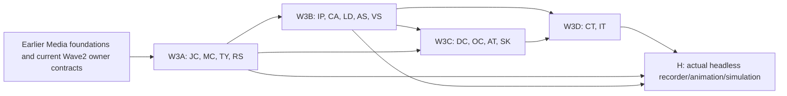

# Ghatana Media — remaining physical surfaces, backend-only implementation plan

> **CURRENT REVIEW:** 2026-10-30. Inspected `samujjwal/ghatana-media/main@b4b32692e7163dd011888379408e960617295d31` and `.product-experience/surfaces/media-physical-topology.v1.json` blob `6bf6e813323b7f7b545b63c9e9f6a911fb07d6e0`. These are observations, not fresh local acceptance or a status record. Refresh source HEAD before implementation.
>
> **AUTHORITY & NON-COMPETITION:** This is a **third engineering implementation slice**, not a replacement for the current [Wave 2 completion execution plan](MEDIA-WAVE2-COMPLETION-EXECUTION-2026-10-29.md) or its **22 locally verified / 30 partial / 6 external-owner** original task ledger. Keep Wave 2's 36 unfinished rows, R8 criteria and current owner decisions intact. No reimplementation of completed Wave 1 foundations, no reopened PDP, gtool transitions, release, PR or production runtime cutover. The canonical product meaning remains PDP-0→3 under `.product-experience/`. ALL new Media code is authored in `ghatana-media`; `ghatana/services/media` is historical read-only comparison.
>
> **USER SCOPE:** Review **every remaining physical Media surface** after the first two groups of five, implement **backend/headless engine, machine-channel and supporting infrastructure** only, explicitly hand off UI/Explorer-only surfaces. A supporting, SUBSUMED, or NOT_APPLICABLE leaf is NOT promoted to fully independent product capability. A local unit may become logically ready only when its actual implementation and tests meet its source contracts.

## 1. Exact census, scope and decision

- Topology enumerates **29** physical candidates, 6 non-root semantic compositions plus the repository-root aggregate, and **21** logical consumers; *actual live source* is authoritative for counts and applicability. **10** prior selections: `runtime-contracts`, `launcher`, `providers/aws-postgresql`, `modules/infrastructure/security`, `modules/infrastructure/messaging`, `modules/speech/stt-service`, `modules/speech/tts-service`, `modules/vision/vision-service`, `modules/intelligence/multimodal-service`, `audio-video-observability`.
- **19 other registered physical candidates**: **15** are backend/headless/support or legacy/subsumed technical sources with real review/test work; **4** are UI/Explorer/source-fixture-only and intentionally *not* executable backend implementation targets.
- The 15 target backend/support surfaces are `libs/common`, `libs/java/common`, `libs/audio-video-types`, `modules/intelligence/speech/libs/speech-audio-rust`, `modules/infrastructure/persistence`, `modules/infrastructure/cache`, `adapters/ledger`, `modules/audio-streaming`, `modules/video-streaming`, `adapters/data-cloud-media`, `adapters/ocr-compat`, `adapters/agent-tools-media`, `libs/audio-video-client`, `modules/integration-tests`, `integration-tests`. Every one appears in the per-surface register below; no inferred physical leaves.
- Deferred out of this **backend** engineering lane: `apps/media-experience-explorer` (source-linked Explorer host), `libs/audio-video-ui` (GUI library/Studio), `modules/intelligence/ai-voice/libs/ai-voice-ui-react` (GUI/voice UX), `libs/media-experience-simulation` (PDP-3 curated fixture simulator, **not** executable physics engine).
- Backend logical consumers including CLI, SDK, Agent Tools, Data Cloud integrations, capture-adapters and recorder-orchestrator are cross-walked to **existing registered physical hosts** and the existing F09/F13/L01 packages. No extra fake physical count, redundant job DB, Media-owned generic OCR, or synthetic business finality.

**Interpretation of "remaining":** not yet deeply selected in earlier two backend-wave plans, **not** proven unimplemented. Review/verify existing code before adding features; a correct current implementation becomes a regression-preservation task, not a duplicate rewrite. The current Wave 2 authority retains all STT/TTS/Vision/Multimodal/OBS development decisions and real model-quality gates.

### Key code findings from this source cut

1. `modules/audio-streaming/AudioStreamSession.java` and `modules/video-streaming/VideoStreamSession.java` are tiny byte-wire/order helpers. Their `decodeFrame` methods allocate using an untrusted encoded length without structural, overflow or budget validation; neither is a full tenant-scoped streaming session host. Correct this and reuse `MediaRuntime` stream authority rather than building a second one.
2. `modules/infrastructure/persistence/` has legacy JPA audio/transcript tables and per-instance virtual-thread executors; reconcile against the canonically migrated Postgres artifact/job/transcript version history. The JPA `V1__init_schema.sql` is NOT an independent canonical Media runtime schema.
3. `modules/infrastructure/cache/AudioVideoCache.java` currently logs generic cache keys and `TranscriptionCacheService` serializes cached transcription entities. Review identity scope, rights, source version, revocation/erasure invalidation and redacted telemetry, and reuse Shared `DistributedCachePort`.
4. `modules/intelligence/speech/libs/speech-audio-rust/src/lib.rs` supports decode/resample/mix/WAV primitives; linear resampling and whole-file decoding require fidelity qualification and byte/CPU budgets before being advertised as high-quality or streaming.
5. `adapters/data-cloud-media/MediaSemanticObservationProjector.java` is explicit that its locally validated projection **does not authenticate source/rights/provider evidence or itself authorize publication**. Data Cloud publication needs actual admitted policy/owner receipts, not a wrapper that treats nonblank strings as authority.
6. `adapters/ocr-compat/KernelOcrProviderAdapter.java` is already fail-closed `NOT_ADMITTED`; do not revive a generic OCR engine. Separate Media scene-text region/time semantics from Document Intelligence's generic text extraction.
7. `libs/audio-video-client/src/cli.ts` currently has **one source-bound production-like read-only command** (`media.cli.artifact.inspect`), while `libs/media-experience-simulation/src/cli.ts` exposes 11 *fixture-only* commands. Do not claim the latter are production CLI operations.
8. `libs/java/common` owns currently used Whisper/Piper/vision runtime engine implementations but is topologically **SUBSUMED**, and Wave 2 still has active proof work. Prevent simultaneous edits with Wave 2 in the same engine files; this plan owns only previously unselected common/compatibility responsibilities and waits for release of shared files.
9. The PDP-1 declarative production/recorder contracts are **source-authored, not runtime admission**. Build backend spec compiler, capture/orchestration, deterministic animation/simulation from existing domain types; never treat Explorer fixtures as a qualified solver or real product operation.

## 2. Work rules, parallel lanes and no blocker dead ends

**Development authority:** Code/test/doc improvements in Media may proceed even if formal PDP-0–3 source gates or gtool closure remain pending. Real cross-product effects, restricted voice/biometric capture, provider licenses, model-quality, private asset publication, irreversible DB schema cutover and release still fail closed without true owner authority. The old deployed Media worker and DataCloud/Event Plane remain separate writers; local tests need isolated DB/queues/endpoint.

**Existing dependency owners:** Shared: identity/authorization/cache/audit/observability fundamentals; Kernel: product capability/runtime; Ghatana Event Plane/Data Cloud/AI Inference/Document Intelligence: generic platform; Media: exact product artifact/job/stream/scene/rights/recorder/typed results. Consume public or approved local composite imports only. Never duplicate generic framework, Version-2 contract or proprietary model inside Media.

**Parallel lanes:** W3A compatibility/domain/byte tools (JC, MC, TY, RS) → W3B persistence/cache/ledger and audio/video streaming (IP, CA, LD, AS, VS) → W3C external adapters and CLI/SDK (DC, OC, AT, SK) → W3D actual integration tests (CT, IT). A/B can proceed in disjoint files; do NOT steal active Wave 2 STT/TTS/Vision/MM/OBS owner files. If a task references them, implement a conformance fixture first; schedule a single coordinated owner edit only when the Wave 2 writer releases the file.

**Resource posture:** cheap changed-package tests first, bounded Testcontainers and fixed synthetic fixtures, ephemeral scratch, fixed CPU/memory/process counts, no download of unapproved weights or 100GB test datasets; benchmark only after work is correct. Every 90-minute engineering pulse names the exact code/test change, tests discovered/pass/fail/skip, source/host/provider rights fingerprints when used, and next two tasks. After two pulses stalled on a truly external prerequisite, record an explicit typed `NOT_ADMITTED` path and continue a disjoint task; never manufacture a pass. Formal stage progression does not block engineering.

**Completion semantics:** `LOCAL_IMPLEMENTED` means executable code and unit/negative tests exist; `LOGICALLY_BACKEND_DEV_COMPLETE` requires changed-unit and genuine integrated behavior/compatibility/fault/resource assertions, and all applicable source intent support (or a genuine source-owned N/A/retirement disposition). Support-only/SUBSUMED leaves can be verified as compatible/decommissioned without pretending a new independent service is COMPLETE. These are **not** Kernel/gtool phase states.

## 3. Concrete local work packages (not new gtool/PDP task identities)

**Task ID convention:** `<prefix>-01..NN` is a locally scoped engineering work unit; canonical Build mapping is F02/F08/F09/F11/F12/F13 and V/L/X packages; PDP sources remain in the original root. All file paths are relative to `ghatana-media`, and every task requires positive, boundary, wrong-tenant/rights, invalid input, timeout/cancel/retry/UNKNOWN as applicable. `NONE` means no prior task and allows immediate work. Source paths in tasks are exact existing files or directory scopes; `new` classes are proposed, not claimed present.

### JC — media.physical.libs-common (libs/common)

**Owner:** Media gRPC/transport engineer. **Scope:** SUBSUMED supporting code; no new domain or independent service. **PDP anchors:** NFR-SEC-001; NFR-PRIV-001; NFR-OBS-001; PDP-2 headless API/error security; PDP-3 media.surface.service-grpc. **Physical disposition:** read topology; developer work is independent of formal PDP closure.

| Task | Dependencies | Exact Media code location | What/how (reusing existing authority) | Executable expected result |
| --- | --- | --- | --- | --- |
| **JC-01** | — | `libs/common/src/main/java/.../GrpcTransportSecurityPolicy.java; AudioVideoGrpcServerBase.java` | Inspect all actual transport profile/TLS/mTLS/peer identities and inherited interceptors. Reuse Shared identity/TLS primitives and stop duplicated transport default configuration. | Cross-profile tests: local loopback plaintext only where allowed; staging/production absent/mismatched key denies before bind; no hidden port/listener. |
| **JC-02** | JC-01 | `libs/common/src/main/java/.../security/AudioVideoRequestContextInterceptor.java; JwtServerInterceptor.java; AudioVideoMethodRbacRegistry.java` | Verify principal/tenant from trusted auth context only, operation-level RBAC and stream reauthorization; classify absent delegation separately from provider failure. | In-process 4-service interceptor tests prove forged metadata/cross-tenant and revoked principal cause zero backend effect; no random principal fallback. |
| **JC-03** | JC-01 | `libs/common/src/main/java/.../resilience/TenantAwareRateLimitingInterceptor.java; RetryPolicy.java; model/FileSystemModelStore.java` | Bound per-tenant concurrency/timeouts, TLS rotation and model registry descriptors. Do not add a second quota, circuit breaker, or generic model-governance authority. | Saturation/timeout tests show finite queues and deterministic rejection; model source+version/readiness results never imply qualified engine effect. |
| **JC-04** | JC-01,JC-02,JC-03 | `libs/common/src/test/java/.../GrpcTransportSecurityPolicyTest.java; common source Gradle project` | Prove compatibility of current STT/TTS/Vision/Multimodal consumers and relocate/subsume any duplicated helper only after exact public API compatibility review. | Source-only Media build and in-process 4-provider tests pass; no duplicate types, third-party code copied, or independent SUBSUMED leaf completion claim. |

### MC — media.physical.libs-java-common (libs/java/common)

**Owner:** Media common engine/SPI engineer. **Scope:** SUBSUMED reusable implementation; preserve Wave2 modality ownership. **PDP anchors:** NFR-SEC-001; NFR-COST-001; NFR-FIDELITY-001; NFR-RECOVERY-001; PDP-1 versioning/value-objects; PDP-3 modality gRPC consumer. **Physical disposition:** read topology; developer work is independent of formal PDP closure.

| Task | Dependencies | Exact Media code location | What/how (reusing existing authority) | Executable expected result |
| --- | --- | --- | --- | --- |
| **MC-01** | — | `libs/java/common/src/main/java/com/ghatana/media/AudioVideoLibrary.java; capability/MediaCapabilityInventory.java; service/AudioVideoServiceRegistry.java` | Inventory actual consumer classes, duplicate engine/provider factories and exported statuses; reuse Wave2 provider SPI and canonical model admission; no unconditional synthetic fallback. | Exact class/API use table and source-free consumer test; no unqualified engine exposed as ready or a second Media runtime. |
| **MC-02** | MC-01 | `libs/java/common/common/AudioConverter.java; common/AudioMetadataExtractor.java; common/validation/MediaFormatValidator.java` | Bound media parsing, decoded samples/pixels, unsigned arithmetic, rational sample/frame clocks and codec sniffing before allocating or processing untrusted source. | Malformed/huge audio & image fixtures, overflow, endianness and clip boundary tests fail safely; all real output formats decoded against advertised MIME. |
| **MC-03** | MC-01 | `libs/java/common/common/pool/EnginePool.java; resilience/CircuitBreakerSttEngine.java; resilience/CircuitBreakerTtsEngine.java; resilience/CircuitBreakerVisionEngine.java` | Unify bounded model lease/close, retry/no-effect proof, expiry and failure state with existing foundation; avoid a second Media job retry owner. | Pool stress, interrupted acquisition, provider close and recovery tests show no leaked engine/native handle, duplicate side effect or endless thread. |
| **MC-04** | MC-02,MC-03 | `libs/java/common/stt/engine/onnx/*; tts/engine/onnx/*; vision/api/*; sync/AudioVideoSyncPipeline.java` | Route engine-specific codecs, Whisper/Piper/vision and sync through Wave2 owner-reviewed adapters; eliminate test-only/synthetic outputs from production admission and false measured quality. | Current Wave2 licensed-model/quality tests and source-only engine contract vectors remain unchanged; no silent fallback or guessed scientific measurement. |
| **MC-05** | MC-01..MC-04 | `libs/java/common/src/test/java/.../AudioVideoLibraryTest.java; SttEngineContractTest.java; VisionEngineContractTest.java; build.gradle.kts` | Verify Java public API against real consumers; classify source-only legacy exports KEEP/COMPAT/DEPRECATE (never mechanical deletion or new V2). | All affected engine/source-free client compatibility, modeled timeout, resource and positive-output tests pass; no duplicate SUBSUMED module status promoted. |

### TY — media.physical.libs-audio-video-types (libs/audio-video-types)

**Owner:** Media TypeScript contract engineer. **Scope:** 118 PDP-0 intent memberships are declarations/interfaces, not 118 implemented engines. **PDP anchors:** PDP-1 domain-objects.yaml/value-objects.yaml/versioning.yaml; PDP-2 api/; PDP-3 SDK/CLI/consumer contract. **Physical disposition:** read topology; developer work is independent of formal PDP closure.

| Task | Dependencies | Exact Media code location | What/how (reusing existing authority) | Executable expected result |
| --- | --- | --- | --- | --- |
| **TY-01** | — | `libs/audio-video-types/src/contracts.ts; src/index.ts; src/index.d.ts` | Audit exported Zod objects against PDP-1 canonical job states, attempts, artifact versions, rights, request/finality and source PTS; classify already stable and missing consumer-facing fields. | Golden Java/JSON/OpenAPI/TS fixtures roundtrip; nine logical job states/legacy spelling remain losslessly observable. |
| **TY-02** | TY-01 | `libs/audio-video-types/src/contracts.ts; src/__tests__/types.contract.test.ts` | Enforce strict request limits, decimal-int64 time/tick/byte semantics, immutable revision IDs, provenance and normalized typed errors; reject invalid numeric rounding and unknown enum coalescing. | Overflow, precision, cross-tenant, stale revision, unknown effect and hostile payload tests fail closed; no data shape invented by client. |
| **TY-03** | TY-01,TY-02 | `libs/audio-video-types/src/contracts.ts; service/OpenAPI/proto adapter tests` | Reconcile 27 HTTP and 43 gRPC observed operation fields as schema projections without regenerating a new semantic source; tag absent PDP binding UNBOUND, not admitted. | Stable field/route/proto identity snapshot and backward client fixture suite; no silent wire breaking change. |
| **TY-04** | TY-01 | `libs/audio-video-types/src/index.ts; src/contracts.ts; sdk JSON value tests` | Introduce/reuse typed headless ProductionSpec/Scene/Capture/Animation/Simulation/Run/RenderOutcome parsers from PDP-1 declared values; use closed formats and exact units. | Malformed schema, unknown fields, unbounded recursion, wrong clock or wrong immutable source version rejected before any effect. |
| **TY-05** | TY-02,TY-04 | `libs/audio-video-types/src/contracts.test.ts; src/__tests__/types.contract.test.ts` | Validate public package exports/subpaths, classify sample/mock fixtures versus actual result, negative/cancellation/idempotency, and backward compatibility for existing consumers. | Current published package surface builds/installs source-free, with exact existing consumer fixtures and no second contract registry. |
| **TY-06** | TY-03,TY-05 | `libs/audio-video-types/package.json; tsconfig.build.json; src/index.d.ts` | Consolidate generated/handwritten type ownership only where safe; ensure D.TS/Zod runtime schemas and ESM/CJS import behavior match and no internal monorepo-only module imports. | pnpm workspace build and isolated installed-package smoke pass; 118 topology intent memberships each mapped to an existing supported/delegated/definition-only type, not fake API. |

### RS — media.physical.modules-intelligence-speech-libs-speech-audio-rust (modules/intelligence/speech/libs/speech-audio-rust)

**Owner:** Media Rust/DSP engineer. **Scope:** Support-only Rust crate; 63 capability memberships span delegated stream/STT/TTS/audio-analysis duties. **PDP anchors:** NFR-TIME-001; NFR-SEC-001; NFR-FIDELITY-001; PDP-1 value-objects.yaml; P3 transcript/voice J-03/J-04/J-07/J-17. **Physical disposition:** read topology; developer work is independent of formal PDP closure.

| Task | Dependencies | Exact Media code location | What/how (reusing existing authority) | Executable expected result |
| --- | --- | --- | --- | --- |
| **RS-01** | — | `modules/intelligence/speech/libs/speech-audio-rust/src/lib.rs; Cargo.toml` | Inventory bounded decoding/encoding/resampler/mixer/slicing/waveform APIs and 63 inherited PDP capabilities; partition local DSP vs delegated STT/TTS/stream duties; no second provider/solver. | Exact Rust export/consumer/capability matrix; all 63 source intents have owned local primitive or delegated provider and no invented feature claims. |
| **RS-02** | RS-01 | `modules/intelligence/speech/libs/speech-audio-rust/src/lib.rs decode_audio/load_audio_buffer` | Harden channels/sample-rate/duration/sample-count multiplication, malformed codec and decoded-memory bombs; bound bytes/frames/process time with a finite resource budget; prefer chunk iterator over full materialization when possible. | Fuzz truncated/corrupt/large containers; no panic, overcommit, invalid float or escaped path; bounded peak RSS measured. |
| **RS-03** | RS-02 | `modules/intelligence/speech/libs/speech-audio-rust/src/lib.rs Resampler::resample` | Replace simple linear interpolation as a claimed high-fidelity resampler with qualified bandlimited polyphase/windowed-sinc or explicit fidelity restriction; track rational source-to-target sample offsets. | 1k/8k/44.1k/48k impulse, alias rejection, channel isolation and long-duration drift tests versus reference tolerance. |
| **RS-04** | RS-02 | `modules/intelligence/speech/libs/speech-audio-rust/src/lib.rs slice_audio_buffer; extract_waveform; mix_audio` | Apply half-open sample windows, bounded lookahead and unit checks; prevent clipping/NaNs and unrealistic normalization on speech/audio; preserve multichannel timing. | Boundary sample, large negative/overflow, silence, interleaved stereo, pan and loudness fixtures exact or explicitly approximate. |
| **RS-05** | RS-03,RS-04 | `modules/intelligence/speech/libs/speech-audio-rust/src/lib.rs write_wav; decode_audio; DSP test corpus` | Verify RIFF/WAV metadata, sample range, dither/bit depth/channel layout, provenance & replay; output bytes must be real decodable audio, not synthetic provider result. | Roundtrip hash/PCM tolerance and codec metadata measured on licensed synthetic fixtures; malformed output rejected. |
| **RS-06** | RS-03,RS-04 | `modules/intelligence/speech/libs/speech-audio-rust/Cargo.toml; parent Cargo.lock; Java bridge/consumer test harness` | Define explicitly owned FFI/public interface if consumed by STT/TTS; avoid JNI duplication or unbounded copies; configure deterministic offline build and low-disk artifact cleanup. | Rust cargo test/clippy/format and actual Media Java consumer vectors; supported platform triple/architecture recorded with no model auto-download. |
| **RS-07** | RS-01..RS-06 | `modules/intelligence/speech/libs/speech-audio-rust/src/lib.rs tests; benchmarks; cargo profiles` | Measure resample RTF, memory overhead, decode throughput and CPU SIMD determinism across seeded data; fault injection and nonfinite-value security audit. | Reproducible p50/p95, max RSS and format/test coverage under bounded scratch; no performance baseline asserted without run. |

### IP — media.physical.modules-infrastructure-persistence (modules/infrastructure/persistence)

**Owner:** Media persistence adapter engineer. **Scope:** Supporting/JPA compatibility; no parallel migration owner versus providers/aws-postgresql. **PDP anchors:** media.domain.artifact, media.domain.transcript-version, media.domain.processing-job, media.domain.provenance-manifest; NFR-PRIV-001/NFR-RECOVERY-001; J-02/J-03/J-26. **Physical disposition:** read topology; developer work is independent of formal PDP closure.

| Task | Dependencies | Exact Media code location | What/how (reusing existing authority) | Executable expected result |
| --- | --- | --- | --- | --- |
| **IP-01** | — | `modules/infrastructure/persistence/src/main/resources/db/migration/V1__init_schema.sql; entities/AudioFileEntity.java; TranscriptionEntity.java` | Classify JPA source tables against Media canonical PostgreSQL V009→V018 and prior applied Flyway histories; choose adapter/dual-read or deprecate, never new authoritative database. | Schema lineage crosswalk includes exact table/column/tenant/immutable-version owner and no collision/duplicate migration runner. |
| **IP-02** | IP-01 | `modules/infrastructure/persistence/repository/JpaAudioFileRepository.java; repository/JpaTranscriptionRepository.java` | Enforce tenant/principal/source-version predicates on each read/write/delete, closed transactions, CAS revisions and immutable result semantics; no unconstrained tenant lists. | PostgreSQL two-tenant/stale revision tests: zero wrong-tenant rows, no stale overwrite, no silent version mutation. |
| **IP-03** | IP-01,IP-02 | `modules/infrastructure/persistence/service/AudioFileService.java; service/TranscriptionService.java` | Bound injected ExecutorService and eventloop execution, provide deterministic ownership/shutdown and cancellation; avoid per-service unbounded virtual thread creation. | Repeated create/close/crash test has zero leaked executors/connections and bounded DB concurrency; eventloop never blocked by sync DAO. |
| **IP-04** | IP-02 | `modules/infrastructure/persistence/repository/*; service/*; entity/*` | Persist same canonical transcription/caption/artifact-version IDs and source lineage as foundation; source/content finality remains authoritative in providers/aws-postgresql, no second successful transcript claim. | Exact STT original/result and revision joins survive restart; cross-store mismatch yields reconciliation/UNKNOWN instead of fabricated complete. |
| **IP-05** | IP-01,IP-04 | `modules/infrastructure/persistence/src/main/resources/db/migration; repository/*` | Add compatibility reads or forward migration only through the one Media canonical migration owner with real applied-history agreement; handle tombstones, backup/replica, legal hold and aged data separately. | Migration old populated fixture is non-destructive, crash-resumable and checksum-safe; no JPA ddl-auto destructive schema effect. |
| **IP-06** | IP-03,IP-04,IP-05 | `modules/infrastructure/persistence/src/test/java/.../integration/PersistenceIntegrationTest.java; repository tests` | Exercise valid, unauthorized, stale, crash, concurrent commit, readback and erasure cases against PostgreSQL with controlled S3 when applicable. | All durable integration assertions source-bound and genuinely executed; no in-memory-only pass for persistence completion. |
| **IP-07** | IP-01..IP-06 | `modules/infrastructure/persistence/README.md; build.gradle.kts; consumer dependency graph` | Reconcile/remove duplicate JPA DAL in favor of provider SPI if source proven equivalent; preserve legacy interfaces through adapters until every consumer moved. | One effective writer, source-free compiled dependency parity with STT/TTS/MM and DataCloud; no premature physical leaf closure. |

### CA — media.physical.modules-infrastructure-cache (modules/infrastructure/cache)

**Owner:** Media caching/security engineer. **PDP anchors:** PDP-1 privacy/versioning, NFR-PRIV-001/NFR-RECOVERY-001; support-only, no direct PDP-0 capability. No separate source-of-truth or external release status is inferred.

| Task | Dependencies | Exact Media code location | What/how | Executable expected result |
| --- | --- | --- | --- | --- |
| **CA-01** | NONE | `modules/infrastructure/cache/src/main/java/.../AudioVideoCache.java; TranscriptionCacheService.java` | Inventory Shared DistributedCachePort semantics and every caller, cache value/source provenance, mutable user scope and current TTL. Preserve one platform cache contract; never let cache decide rights. | Compatibility + cache disabled/read-through tests; stale cache not mistaken for job/consent truth. |
| **CA-02** | CA-01 | `modules/infrastructure/cache/src/main/java/.../AudioVideoCache.java` | Replace key log output with bounded redacted identifiers and enforce tenant, authenticated principal, rights/purpose/classification, immutable artifact/transcript revision and source fingerprint in effective cache scope. | Two-tenant/equal-audio hash tests yield zero cross-scope hits; adversarial key/secret markers absent in logs/metrics. |
| **CA-03** | CA-01,CA-02 | `modules/infrastructure/cache/src/main/java/.../TranscriptionCacheService.java` | Check cache-hit still passes current scope/consent/retention, source-version and transcription revision validation; never return stale protected transcript after revocation or erasure. | Revocation/revision/retention race returns MISS/DENIED before protected data; tested with Shared cache adapter. |
| **CA-04** | CA-02,CA-03 | `modules/infrastructure/cache/src/main/java/.../AudioVideoCache.java; TranscriptionCacheService.java` | Bound TTL, serialization, entry size/cardinality, concurrent getOrLoad stampede, timeout and failure handling; fail safe when distributed cache unavailable without fabricating source result. | 64-contender same-version load bounded, corrupt JSON quarantined, provider timeout and cache failure explicitly classified; no unbounded memory. |
| **CA-05** | CA-02..CA-04 | `modules/infrastructure/cache/src/test/java/.../AudioVideoCacheTest.java; TranscriptionCacheIT.java; README.md` | Integrate Redis/Testcontainers where available, source version and erasure invalidations into actual Media read path; test read after process restart and compare uncached result. | Cache-on/cache-off equivalence, privacy, stale invalidation, latency/heap observations and no independent cache source of truth. |

### LD — media.physical.adapters-ledger (adapters/ledger)

**Owner:** Media ledger/accountability adapter engineer. **PDP anchors:** PDP-1 states/events/provenance and NFR-AUD-001; support-only, no direct PDP-0 intent. No separate source-of-truth or external release status is inferred.

| Task | Dependencies | Exact Media code location | What/how | Executable expected result |
| --- | --- | --- | --- | --- |
| **LD-01** | NONE | `adapters/ledger/src/main/java/.../AudioVideoRunLedgerAdapter.java` | Compare RunLedger and Media job/attempt/quality/delivery source states; classify submitted/transcoding/processing/storing vs nine Media logical states and ten attempt states. | Explicit exhaustive mapping matrix and fallback UNKNOWN, no silent unknown→RUNNING/FAILED or success projection. |
| **LD-02** | LD-01 | `adapters/ledger/src/main/java/.../AudioVideoRunLedgerAdapter.java` | Map exact immutable tenant/job/attempt/request/source version, source digest, actor/rights, cancellation request vs confirmed, partial output and effect-UNKNOWN without claiming queue completion. | Golden ledger fixture for terminal, partial, retry, cancelled and uncertain outcomes; no privileged status inferred from provider string. |
| **LD-03** | LD-02 | `adapters/ledger/src/main/java/.../AudioVideoRunLedgerAdapter.java` | Sanitize serialized inputParams, source tokens, provider job ID and metrics; separate audit/ledger/telemetry retention; allow only typed whitelist with bounded lengths. | PII/token/biometric fixture fails disclosure scan; output is bounded, classification/rights provenance preserved. |
| **LD-04** | LD-02,LD-03 | `adapters/ledger/src/test/java/.../AudioVideoRunLedgerAdapterTest.java; Media job/outbox SPI fixture` | Verify replay/ordering/idempotent ledger projection and honest store acknowledgment through existing Data Cloud RunLedger API; no second ledger writer/DB invented. | Duplicate/out-of-order/stale attempt and Event Plane outage cases do not overwrite more recent truth; unavailable ledger remains explicit. |
| **LD-05** | LD-01..LD-04 | `adapters/ledger/build.gradle.kts; src/test; consumer compatibility guide` | Prove public RunLedger version/profile compatibility and performance on seeded 10k records, with actual consumer readback if admitted. | One canonical owner for ledger persistence, source-free adapter tests green, no false production/ledger-delivery claim. |

### AS — media.physical.modules-audio-streaming (modules/audio-streaming)

**Owner:** Media streaming/audio engineer. **PDP anchors:** PDP-0 17 media.stream.* intents; PDP-1 media.operation.stream-session; PDP-3 J-03/J-04/J-29; current NO_IMPLEMENTATION_ADMITTED. No separate source-of-truth or external release status is inferred.

| Task | Dependencies | Exact Media code location | What/how | Executable expected result |
| --- | --- | --- | --- | --- |
| **AS-01** | NONE | `modules/audio-streaming/src/main/java/com/ghatana/audio/streaming/AudioStreamSession.java` | Reconcile current tiny frame helper with canonical MediaRuntime stream-session FSM, lease/reconnect/rights and OpenAPI stream routes. Identify exact format compatibility and owner of buffer/ack. | 17 stream intent and API field disposition matrix; no second session store, no public stream success claim from byte frame helper. |
| **AS-02** | AS-01 | `modules/audio-streaming/src/main/java/.../AudioStreamSession.java` | Fix decodeFrame untrusted 4+8+4 byte header, signed/overflowed length, short payload, trailing garbage, oversize and 32-bit sequence wrap; add explicit bounded error/result. | Fuzz/corpus negative framing tests no exception type leak, allocation bomb or implicit acceptance; valid legacy frame roundtrips. |
| **AS-03** | AS-01,AS-02 | `modules/audio-streaming/src/main/java/.../AudioStreamSession.java; MediaRuntime stream SPI adapter` | Bind trusted stream ID, tenant/principal/purpose/session revision and ordered sequence/ACK to existing canonical stream store with lease fence and idempotent reconnect. | Duplicate/dropped/reordered chunks and reconnect after process loss yield one logical frame each, proper next-ACK and no cross-tenant resume. |
| **AS-04** | AS-02,AS-03 | `modules/audio-streaming/new bounded source-frame adapter under module; Rust audio codec/public bridge` | Decode actual PCM/Opus only under declared codec/timebase, rational sample positions, VAD/caption partial revision and backpressure with explicit max frames/bytes. | Sample boundary/VFR+audio sync tests, producer-faster-than-consumer load bounded, frame subtype unsupported returns UNAVAILABLE. |
| **AS-05** | AS-03,AS-04 | `modules/audio-streaming/MediaRuntime stream provider SPI; module client adapter` | Apply current consent at connect, frame, provider dispatch and reconnect; expired token or revoked purpose forbids new frames and external processing; separate detach from true server cancel. | Revocation during stream, unauthorized reconnect and stale-generation retry tests prove no further provider effect. |
| **AS-06** | AS-03..AS-05 | `modules/audio-streaming/module adapter; provider/capability/manifest` | Distinguish actual WebRTC/adaptive-HTTP/HLS/DASH transport qualification from abstract stream semantics; integrate only published, eligible public transport, no hidden local media relay clone. | Each of 17 PDP stream intents supported by real test, delegated owner or NOT_ADMITTED with source-owned follow-up; no HTTP/WebRTC route fabricated. |
| **AS-07** | AS-02..AS-06 | `modules/audio-streaming/src/test/java/.../RealTimeAudioTest.java; AudioStreamingPerformanceTierTest.java` | Full property, process-restart, timebase, 1/16/64-session, queue/drop/liveness, cancellation and codec invalid-input tests on actual Media host/adapter. | Frame/ack invariants, PTS drift tolerance, p95/p99, memory/CPU/RTF and honest unfinished transport coverage documented. |

### VS — media.physical.modules-video-streaming (modules/video-streaming)

**Owner:** Media streaming/video engineer. **PDP anchors:** Same 17 PDP-0 media.stream.* intents; PDP-1 media.operation.stream-session; PDP-3 J-05/J-16/J-29; current NO_IMPLEMENTATION_ADMITTED. No separate source-of-truth or external release status is inferred.

| Task | Dependencies | Exact Media code location | What/how | Executable expected result |
| --- | --- | --- | --- | --- |
| **VS-01** | NONE | `modules/video-streaming/src/main/java/com/ghatana/video/streaming/VideoStreamSession.java` | Reconcile helper with foundation stream-session owner, source VFR/frame PTS/timebase and actual transport/capture adapters; no new job/stream database. | Exact 17 capability/route/transport source matrix; duplicate canonical stream implementation prohibited. |
| **VS-02** | VS-01 | `modules/video-streaming/src/main/java/.../VideoStreamSession.java` | Validate 4+1+8+4 frame header/boolean/length, signed overflow, unknown keyframe flag, payload/trailer, maximum frame/codec/width/height and sequence rollover before any copy. | Malformed/oversized/truncated frame fuzz no huge allocation/unsafe decode; valid current framing roundtrip. |
| **VS-03** | VS-02 | `modules/video-streaming/src/main/java/.../VideoStreamSession.java; media timebase adapter` | Track keyframe identity, source capture PTS vs presentation frame time, discontinuity/variable frame rate and codec changes with exact clock and frame mapping. | Synthetic VFR/scene-cut tests preserve source PTS, frame ordering and uncertainty; cannot use wall clock as media PTS. |
| **VS-04** | VS-01,VS-02,VS-03 | `modules/video-streaming/MediaRuntime stream provider and capture adapter hooks` | Implement tenant-scoped claim/lease/backpressure/ACK/buffer/resumable reconnect preserving frame ID/keyframe dependencies; protect consent on every actual egress. | Two-worker stale lease and out-of-order missing keyframe, denied tenant and disconnect cases produce correct gap/UNKNOWN vs false success. |
| **VS-05** | VS-02,VS-04 | `modules/video-streaming/video capture/transcode public provider adapter; no internal FFmpeg spawn from raw caller string` | Support only qualified HLS/DASH/adaptive/WebRTC profiles and bounded codec process; capture to owned immutable artifact version with exact source/provenance. | Real supported one transport smoke with decoded frame readback; missing transport/pinned codec unavailable with no fabricated accessible stream. |
| **VS-06** | VS-04,VS-05 | `modules/video-streaming/stream/session SPI; privacy and observability hooks` | Apply restricted media redaction, tenant/principal, rights, budget and retention to frame/cache/preview/replay; headless capture reuse without exposing camera tokens. | No unauthorized captured frame/cache leak, no unbounded process/RSS on stalls, safe temp deletion and cancel. |
| **VS-07** | VS-02..VS-06 | `modules/video-streaming/src/test/java/.../VideoStreamingTest.java; VideoStreamingPerformanceTierTest.java` | Run deterministic VFR/frame order, source-time, frame-gap, loss, 1/16/64 sessions and actual codec/integration tests with isolated Media runtime. | Real frame vs fixture distinctions recorded; bounded frame memory/latency plus exact disabled transports and unqualified provider disclosures. |

### DC — media.physical.adapters-data-cloud-media (adapters/data-cloud-media)

**Owner:** Media–Data Cloud integration engineer. **PDP anchors:** PDP-0 APPLICABLE but topology has no direct capability IDs; PDP-1 authority/privacy/provenance, PDP-2 HEADLESS_CONTRACT, PDP-3 media.surface.integrations. No separate source-of-truth or external release status is inferred.

| Task | Dependencies | Exact Media code location | What/how | Executable expected result |
| --- | --- | --- | --- | --- |
| **DC-01** | NONE | `adapters/data-cloud-media/src/main/java/.../DataCloudMultimodalAdapter.java; DataCloudVisionAdapter.java; DataCloudSttAdapter.java` | Inventory exact public Data Cloud read/write APIs, existing projections and ownership. Note PDP-0 applicable with zero mapped capability IDs; do not fabricate one. | One source/consumer/parity table with explicit no-direct-capability disposition and no private cross-repo imports. |
| **DC-02** | DC-01 | `adapters/data-cloud-media/src/main/java/.../MediaSemanticObservationProjector.java` | Retain immutable source artifact/version/tenant/classification/purpose, provenance and actual policy/consent/redaction decisions; projection validation is NOT source authentication. | Equal-digest cross-tenant, stale revision, classification downgrade, fake consent ref denied before any Data Cloud publication. |
| **DC-03** | DC-01,DC-02 | `adapters/data-cloud-media/src/main/java/.../DataCloudSttAdapter.java; DataCloudVisionAdapter.java` | Project actual transcript/region/frame observations with exact source PTS, bounded metadata and rights-protected snippets; no source media bytes or raw transcript where disallowed. | Semantic output schema/clock fixtures pass and no source bytes, face/voice biometrics or credentials leave Media. |
| **DC-04** | DC-02,DC-03 | `adapters/data-cloud-media/src/main/java/.../DataCloudMultimodalAdapter.java; MediaSemanticObservationProjector.java` | Require live source owner/readback authority and destination publication receipts through admitted Data Cloud public clients. Integrate shared idempotent outbox, not direct synchronous double write. | Missing/ambiguous receipt remains OUTCOME_UNKNOWN; same event/version replay results one logical downstream projection. |
| **DC-05** | DC-03,DC-04 | `adapters/data-cloud-media/src/test/java/.../DataCloudMultimodalAdapterTest.java; MediaSemanticObservationProjectorTest.java; privacy log tests` | Test tenant isolation, source redaction, model/data provenance, malformed observation, replay/ordering, Data Cloud unavailable and reaccess after revocation. | Admitted integration test reports consumer readback and version; local-only fixtures honestly marked UNVERIFIED_EXTERNAL. |
| **DC-06** | DC-01..DC-05 | `adapters/data-cloud-media/build.gradle.kts; README/runbook` | Reconcile client/source-free dependency and cross-repository owner contract; verify latency and no accidental DataCloud ownership over Media job finality. | Full Media adapter compile/test, zero raw content in Data Cloud, preserved source-of-truth and exact external handoff status. |

### OC — media.physical.adapters-ocr-compat (adapters/ocr-compat)

**Owner:** Media legacy-compatibility engineer. **PDP anchors:** Support-only compatibility; generic OCR owned by Document Intelligence, Media owns scene-text temporal region only. No separate source-of-truth or external release status is inferred.

| Task | Dependencies | Exact Media code location | What/how | Executable expected result |
| --- | --- | --- | --- | --- |
| **OC-01** | NONE | `adapters/ocr-compat/src/main/java/.../KernelOcrProviderAdapter.java; media.vision scene-text public consumer binding` | Inventory historical provider compatibility and exact published DI public API; verify current adapter remains NOT_ADMITTED when absent, without retaining generic model execution. | No disabled OCR code path returns OCR text or touches payload, model, remote endpoint, or storage. |
| **OC-02** | OC-01 | `adapters/ocr-compat/src/main/java/.../KernelOcrProviderAdapter.java; facade service SPI` | Provide compatible typed status/health/cancel semantics while provider unavailable. If admitted DI API later available, compose thin external client only with rights, tenancy and time/region correlation. | Missing DI contract/credentials/rights yields NOT_ADMITTED; no second OCR model, arbitrary context, untrusted reference execution. |
| **OC-03** | OC-01,OC-02 | `adapters/ocr-compat/src/test/java/.../KernelOcrProviderAdapterTest.java; Vision scene-text contract tests` | Prove legacy constructor/API compatibility, failed external receipt, revocation, source version, text region→frame timestamp and no generic OCR execution in Media. | Malformed media and outside-tenant negative cases leak zero text; exact error reason and identity stable. |
| **OC-04** | OC-01..OC-03 | `adapters/ocr-compat/build.gradle.kts; service registration and retirement crosswalk` | After exact DI owner adoption, retire stale Kernel adapter source with migration/consumer proof; otherwise keep safe nonadmitted compatibility and record missing public contract as external owner work. | No unqualified OCR claim or premature consumer break; compatible source-only tests green, closure limited to fail-closed compatibility. |

### AT — media.physical.adapters-agent-tools-media (adapters/agent-tools-media)

**Owner:** Media agent tool/Action Plane integration engineer. **PDP anchors:** PDP-3 media.surface.agent-tools; canonical four tool descriptors; support-only with no separate PDP-0 capability. No independent gtool/phase/runtime authority is claimed.

| Task | Dependencies | Exact Media code location | What/how | Executable expected result |
| --- | --- | --- | --- | --- |
| **AT-01** | NONE | `adapters/agent-tools-media/src/main/resources/capabilities/*.yaml; src/main/java/.../AudioVideoToolHandlerFactory.java` | Audit all four actual Media handler IDs and fifth Data Cloud read-model descriptor against Tools/Action Plane published registry/permissions. Do not treat a YAML enabled:true flag as authenticated execution authority. | Every declared tool ID has exact implementation/contract/owner, status SUPPORTED/NOT_ADMITTED, and no duplicate public tool registry. |
| **AT-02** | AT-01 | `adapters/agent-tools-media/src/main/java/.../AgentToolInput.java` | Require schema-bound bounded input/result depth, character/byte limits, stable idempotency and exact authorization principal; prohibit remote $ref fetching and malicious tool-induced egress. | Adversarial schema refs, nested JSON, oversized base64, cross-tenant principal and malformed tool args fail before effect; output safe and bounded. |
| **AT-03** | AT-01,AT-02 | `adapters/agent-tools-media/src/main/java/.../SpeechToTextToolHandler.java; TextToSpeechToolHandler.java` | Use qualified Media STT/TTS public operations with real job receipt and immutable output; enforce voice/biometric, consent, model and source version; no fake model output. | Authorized test provider yields bounded real/fixture-labeled result, denied wrong-tenant or voice produces zero provider call; missing model typed unavailable. |
| **AT-04** | AT-01,AT-02 | `adapters/agent-tools-media/src/main/java/.../VisionAnalysisToolHandler.java; MultimodalInferenceToolHandler.java` | Integrate actual published Vision/MM capability eligibility, temporal provenance, source grounding, privacy and cancellation/finality; no independent generic OCR or AI inference model. | Bad source version/region, unsupported tensor, cross-tenant and revoked-consent tests abstain/deny without raw frame disclosure. |
| **AT-05** | AT-02..AT-04 | `adapters/agent-tools-media/src/main/java/.../AudioVideoToolHandlerFactory.java; Java Agent Tool implementation` | Bind Tools runtime tool execution envelope and existing Media job/attempt/UNKNOWN readback to one public operation; timeout after unknown effect never triggers blind replay. | Same-key replay and failed Action Plane transport preserve one logical action, exact outcome/UNKNOWN, correlation, sanitized errors and cancellation semantics. |
| **AT-06** | AT-01..AT-05 | `adapters/agent-tools-media/src/test/java/.../AudioVideoToolHandlersTest.java; AvAgentsTest.java; descriptors` | Test installed/source-free consumer compatibility, all declared tools and exact negative/real provider paths against current Types/SDK and public Action Plane descriptors. | Every registered tool has positive or safe explicit unavailable + auth/error tests; no registered-but-missing handler and bounded execution time. |

### SK — media.physical.libs-audio-video-client (libs/audio-video-client)

**Owner:** Media headless SDK/CLI engineer. **PDP anchors:** PDP-0 118 capability memberships; PDP-1 six operation families; PDP-2 API conventions; PDP-3 J-02/03/04/05/06/20/23/24/25, 1 actual production CLI read. No independent gtool/phase/runtime authority is claimed.

| Task | Dependencies | Exact Media code location | What/how | Executable expected result |
| --- | --- | --- | --- | --- |
| **SK-01** | NONE | `libs/audio-video-client/src/operations.ts; src/canonical-routes.ts; contracts/openapi/media.yaml` | Compare every exported SDK operation and real route/response to current 27 OpenAPI operations, 43 gRPC providers (different channels), PDP-1 operation identity and source dispositions. | Exact route/use-case parity table; unsupported PDP capability not advertised as a live API or another contract version. |
| **SK-02** | SK-01,TY-02 | `libs/audio-video-client/src/operations.ts; src/index.ts` | Implement stable per-request identity/digest/timeout/AbortSignal, canonical error envelopes, retry only for admitted no-effect reads, and preserve OUTCOME_UNKNOWN for post-dispatch ambiguity. | Network abort/timeout/5xx, 401/403, changed payload same-key, idempotent retry and corrupted JSON tests produce documented safe outcomes. |
| **SK-03** | SK-01,SK-02 | `libs/audio-video-client/src/operations.ts; src/canonical-routes.ts` | Complete source-authorized immutable upload/inspect/job read/cancel/status clients using actual Media host and scoped auth; do not allow caller principal header to act as authentication. | Five bounded PDP-1 artifact operations plus admitted job calls roundtrip in-process and HTTP with exact 403/404/409/UNKNOWN. |
| **SK-04** | SK-02,SK-03 | `libs/audio-video-client/src/cli.ts; .product-experience/pdp-3-product-experience/cli/production-command-registry.yaml` | Keep currently admitted `media.cli.artifact.inspect` read-only command correct. Extend actual CLI only once matching PDP-1 operation/route/owner exists; never expose 11 Explorer simulator commands as real. | CLI exit JSON/human output deterministic, token env-only and credentials absent in args/logs; new command unavailable until source-bound. |
| **SK-05** | SK-01,SK-03 | `libs/audio-video-client/src/operations.ts; src/index.ts` | Implement SDK method identity, version/cursor pagination and stream/reconnect/watch where a genuinely bound server operation exists; no invented HTTP watch/check-outcome or raw byte download. | Supported stream/cancel/unavailable API paths distinct; schema-validated status read never mutates job or claims remote provider result. |
| **SK-06** | SK-03,SK-04,TY-04 | `libs/audio-video-client/src/operations.ts; src/cli.ts; headless capture/ProductionSpec adapter` | Expose typed local dry-run/plan-compile/recorder/capture commands from PDP1 source using current artifact/job SPI; do not dispatch browser/user actions without host proof. | Deterministic dry-run and no-effect plan hash on same inputs, protected capture source rejected, one existing immutable source revision. |
| **SK-07** | SK-02..SK-06 | `libs/audio-video-client/src/__tests__/AudioVideoClient.integration.test.ts; operations.test.ts; cli.test.ts` | Cross-language installed SDK, old client fixtures, semver export/route compatibility, cancellation/UNKNOWN/tenant/revocation and malformed response tests; preserve null/no-operation behavior. | Same source-cut request produces SDK/CLI/HTTP semantically equivalent result; no unqualified provider/data claim. |
| **SK-08** | SK-01..SK-07 | `libs/audio-video-client/package.json; src/index.ts; src/canonical-routes.ts; source-free install fixture` | Build ESM/CJS/types and installed CLI against isolated Media root; no monorepo private imports, no bundling model weights, no token/PII, bounded perf and backward contract matrix. | Artifact/package exports verified from installed consumer, correct trusted URL policy, no duplicated contract authority; remaining capabilities transparently UNBOUND. |

### CT — media.physical.modules-integration-tests (modules/integration-tests)

**Owner:** Media contract/conformance QA engineer. **PDP anchors:** Support-only, PDP-1 REFERENCED_ONLY, no new product capability; F09/X01 and headless service RPC/route parity. No independent gtool/phase/runtime authority is claimed.

| Task | Dependencies | Exact Media code location | What/how | Executable expected result |
| --- | --- | --- | --- | --- |
| **CT-01** | NONE | `modules/integration-tests/src/test/java/.../MediaOpenApiContractConsumptionTest.java; MultimodalRpcMatrixIntegrationTest.java` | Validate present OpenAPI + route manifest 27 operations and proto service registry 43 RPCs, public enum/version/errors, current producer modules and provided SDK. | Bidirectional existing operation/field/route mapping, no phantom or duplicate names; allow source-declared UNBOUND without claiming admission. |
| **CT-02** | CT-01 | `modules/integration-tests/src/test/java/.../SttAuthenticatedIntegrationTest.java; TtsAuthenticatedIntegrationTest.java` | Negative auth/permission/context, consent and bad input tests through real gRPC interceptors; do not repeat unchanged Wave2 package acceptance work. | Missing/forged principal and unauthorized purpose perform no provider/network/storage writes; same errors across direct/transport. |
| **CT-03** | CT-01 | `modules/integration-tests/src/test/java/.../MediaPipelineIntegrationTest.java; AudioVideoAdvancedServicesIntegrationTest.java` | Exercise actual backend stream, cache, DSP, ledger and DataCloud adapter contracts including timebase and version/provenance, with synthetic fixtures and isolated stores. | Success/failure/UNKNOWN and static fixture labeling exact, no fake scientific or media output counted as real provider test. |
| **CT-04** | CT-01,CT-02,CT-03 | `modules/integration-tests/src/test/java/.../MultimodalContractTest.java; Integration service fixtures` | Assert SDK/CLI, Agent Tools, REST and gRPC semantic equivalence only for source-authorized operations; preserve absent adapter typed errors and source owner constraints. | Source-free consumer field/temporal/rights/parity tests pass, no new aggregate service-contract.yaml. |
| **CT-05** | CT-01..CT-04 | `modules/integration-tests/build.gradle.kts; src/test; JUnit XML aggregate` | Prevent `verifyIntentionalPublicApi` input failure on truly sourceless test-only module via current narrow opt-out; leave Shared upstream bug/verification authority with Shared owner. | Tests run on Media root and fail on real mismatch, skip only accurately absent provider; NOT a formal gtool receipt. |

### IT — media.physical.integration-tests (integration-tests)

**Owner:** Media integration/reliability QA engineer. **PDP anchors:** Support-only; F12/X01/X02 real integrated oracles, no independent PDP-0 feature. No independent gtool/phase/runtime authority is claimed.

| Task | Dependencies | Exact Media code location | What/how | Executable expected result |
| --- | --- | --- | --- | --- |
| **IT-01** | NONE | `integration-tests/src/test/java/com/ghatana/media/integration/MediaTestHarness.java; build.gradle.kts` | Inventory reusable active Postgres/S3, JUnit, H2, Docker/Compose, synthetic and licensed model fixtures, and exact test selection profile; preserve active Wave2 test outcomes. | One test harness registry with sources, prerequisites, safety, 3 tiers and no external customer/private data copied. |
| **IT-02** | IT-01,IP-06,CA-05,LD-04 | `integration-tests/src/test/java/com/ghatana/media/integration/MediaLauncherEndToEndIT.java; MediaProviderJobLifecycleE2ETest.java` | Exercise real persisted artifact, transcript/caption version, tenant/consent, outbox/ledger/cache and Data Cloud public result through isolated Media-bounded Postgres/S3. | Actual byte/hash/version readback and customer-neutral source proof, safe cancellation/replay/UNKNOWN before and after process kill. |
| **IT-03** | IT-01,AS-07,VS-07,RS-07 | `integration-tests/src/test/java/com/ghatana/audio/video/integration/EndToEndWorkflowTest.java; PerformanceIntegrationTest.java` | Integrate audio/video frame buffers, actual source clock VFR/PCM, stream reconnect/cancel/backpressure and qualified codec profiles with bounded 1/16/64 clients. | Measured p50/p95/p99, CPU/RSS, frames/s/RTF, finite timeouts and no cross-tenant byte leakage; absent codec marked UNVERIFIED. |
| **IT-04** | IT-01,DC-05,AT-06,SK-07 | `integration-tests/src/test/java/.../AudioVideoDataCloudAepAgentE2ETest.java; MediaProviderLifecycle.test.ts` | Exercise Action Plane tool→Media job→event/outbox→Data Cloud consumer readback, exact source credential auth and secret-free errors, protected failure recovery. | One authorized real provider effect with source rights and receipt where available; unavailable platform returns exact missing external dependency. |
| **IT-05** | IT-01,IT-02,IT-03 | `integration-tests/src/test/java/com/ghatana/audio/video/integration/IntegrationImagesCondition.java; AudioVideoContainerBase.java; docker-compose.integration.yml` | Resolve GH-90000 as separate ops lane: CI-pinned service images or `AUDIO_VIDEO_STT_IMAGE`/`AUDIO_VIDEO_TTS_IMAGE` with digest/host/version proof; rerun only nine previously skipped compose cases. | 9 image-dependent test statuses observed as true PASS/FAIL/SKIP with documented reason; never rewrite skip totals or turn test absence into PASS. |
| **IT-06** | IT-02..IT-05,CT-05 | `integration-tests/src/test/java/com/ghatana/media/integration/*; docs/TESTING.md; resource/fixture profile` | Run incremental affected suites, then single correct whole-backend suite for selected 15 physical targets, including mixed workload, terminal/partial, provider ambiguity, cross-product and resource-bound tests. | Every selected backend surface has real test IDs/commands/observed counts, negative/fault and compatibility; Track B/PDP/production cutover remain untouched. |

## 4. Cross-surface headless production outcomes (H01–H08; no new physical surface)

These are **backend product behavior packages** under canonical `M-BLD-F13`, `M-BLD-L01`, `M-BLD-V12..V15`, and `M-BLD-X01`. They bind the existing **logical** recorder/capture/animation/simulation contracts to actual Media physical code owners; they do **not** create a 20th remaining physical surface, new product definition, another job/artifact writer or second engine architecture. They may be developed in parallel where the owning physical files are unlocked; shared `runtime-contracts` and `launcher` mutations require Wave 1 owner coordination.

**Normative source:** `.product-experience/pdp-1-domain-data/declarative-production-contracts.yaml` (typed production value schemas, no new canonical domain objects), `recorder-studio-contracts.yaml` (one project revision/MediaRun/JobAttempt), `pdp-2-design-interface-system/animation-simulation-grammar.yaml` (distinct rational story/media/simulation/wall clocks), `pdp-3-product-experience/declarative-production-experience.yaml` and `demo-recording-standard.yaml`. The latter's one curated Explorer film is **EXPLORER_SIMULATED**, not runtime, scientific or publication proof.

| Task | Dependencies | Exact existing Media host / planned source | Implementation and expected test |
| --- | --- | --- | --- |
| **H-01** | TY-04,TY-05 | `libs/audio-video-types/src/contracts.ts`; PDP-1 JSON Schema compiled validator | Compile versioned ProductionSpec/CaptureSceneSpec/AnimationSpec/SimulationSpec with exact bigint/rational/custom formats and closed parameters. Invalid units, unbounded recursion, missing source digest, and unsafe code/shader block before job admission; schema fixture roundtrips. |
| **H-02** | H-01,IP-04 | `runtime-contracts/src/main/java/com/ghatana/media/runtime/MediaProductionSpecCompiler.java` (new) + existing `launcher/src/main/java/com/ghatana/media/launcher/MediaRuntime.java` (serialized owner edit) | Compile typed specs into a deterministic DAG of existing Media commands with one canonical project revision, manual operation locks, source/rights decisions, bounded cost and plan fingerprint. Same input/rights/engine hashes yield same plan; source change invalidates affected descendants only. |
| **H-03** | H-02,SK-06 | `libs/audio-video-client/src/recorder-orchestrator.ts` (new), `src/operations.ts`, `src/cli.ts`; `media.surface.recorder-orchestrator` logical consumer | Data-driven unattended scenario runner: typed actors/scenes/source refs, capture orchestration, timed narration/captions/track refs, noninteractive bounded recapture and dry-run; no hidden business action or production provider enabled from fixture. Test two identical runs + selective changed scene with stable output lineage. |
| **H-04** | H-02,AS-05,VS-06 | `runtime-contracts/src/main/java/com/ghatana/media/runtime/MediaCaptureSourceContracts.java` (new) and `libs/audio-video-client/src/capture-adapters.ts` (new); existing public device/product adapters only | Exact browser/desktop/mobile/terminal/http-api/grpc-api/camera/media-file **adapter eligibility** through existing public device/product interfaces. Requires source identity, rights/purpose/version, controlled secrets, frame clock and actual captured bytes. Disabled adapters return NOT_ADMITTED; never fabricate screen pixels, device availability or product success. |
| **H-05** | H-01,RS-03 | `libs/java/common/src/main/java/com/ghatana/media/production/AnimationSpecCompiler.java` (new) + existing Media `launcher` job/provider SPI (owner lock) | Compile declarative 2D/3D keyframe/scene/animation graph with typed easing, dimensions, time and assets; reuse selected renderer/codec, source and quality policies. Rendered frames must be actual outputs with exact version; unsupported rigs/physics/3D model ⇒ typed unavailable, not placeholder video. |
| **H-06** | H-01,RS-03 | `libs/java/common/src/main/java/com/ghatana/media/simulation/MediaDeterministicSimulator.java` (new), integrated through existing `launcher` job SPI; no physical-surface claim without registry authority | Implement deterministic seeded stepper, model IR, solver identity, units/boundary/initial state, checkpoints, adaptive-step error/uncertainty and reproducible observables. Analytical PDP-3 Newton constant-force fixture (mass 2 kg, force 6 N, t=2 s ⇒ a=3 m/s², v=6 m/s, x=6 m) validates solver, not just animation; mismatched units/unstable solver ABSTAIN. |
| **H-07** | H-03,H-04,H-05,H-06 | `launcher/src/main/java/com/ghatana/media/launcher/MediaProductionRunCoordinator.java` (new), existing canonical job/attempt/outbox | Produce qualified real-capture/animation/simulation outputs with origin class REAL_CAPTURE/DECLARATIVE_ANIMATION/MODEL_SIMULATION, immutable source/version + plan fingerprint, verifiable checksum, sealed result provenance, effective rights and process-fence. Crash/UNKNOWN cannot cause duplicate external effect or fake scientific validation. |
| **H-08** | H-03,H-07,IT-06 | `integration-tests/src/test/java/com/ghatana/media/integration/MediaPdp3BusinessRecordingIT.java` (new), `libs/audio-video-client`, PDP-3 `media.demo.j03.corrected-captions.v1` | Run one end-to-end **real product** business scenario against authorized synthetic/curated data, capture genuine source-derived video with narration and captions and verify exact terminal artifact/version. Keep Explorer static counterpart visibly labeled and same scenario source; no actual customer recording or external publication, Track B PDP-3 closure untouched. |

**Scientific/provenance rule:** a declared animation frame is NOT a simulation proof; a synthetic PDP Explorer state is NOT a production Media completion. Keep source class, solver/fidelity unit, qualified provider/model, quality estimates, caption alignment and human-authored edit locks separate and verifiable. No mass "new module" registration just to satisfy task counting.

## 5. Whole-remaining physical applicability and explicit non-backend handoff

The remainder has **19 registered physical candidates**, not nineteen new backend services. All 19 are accounted for exactly; the four outside backend scope remain real product work, not silent N/A:

| Physical surface | This plan's disposition | Owner handoff and why |
| --- | --- | --- |
| `media.physical.apps-media-experience-explorer` | **UI/Explorer tooling only** | PDP/Explorer owner; static curated scenarios J-14 and source-linked review. Keep fake state, fake screenshots and narration clearly simulated; no backend readiness or runtime source. |
| `media.physical.libs-audio-video-ui` | **GUI library / Studio** | Media UI owner; F10/L02, 202 exact PDP-0 intent memberships, 27 PDP-3 journey links. Needs real host, accessibility, editor/project revisions; explicitly outside this backend-only implementation slice. |
| `media.physical.modules-intelligence-ai-voice-libs-ai-voice-ui-react` | **Voice GUI / UX** | Media UI owner; J-04/J-16, one mapped `media.speech.synthesis.text-to-speech` intent; do not confuse React voice controls with qualified TTS provider or voice consent. |
| `media.physical.libs-media-experience-simulation` | **Source-owned Explorer simulator / fixture tooling** | Media product-experience owner; J-14/J-15 local fixture simulations and CLI proof remain nonproduction. Headless actual scientific solver is H-06; preserve separation. |

**The other 15 exact physical identities** are the JC, MC, TY, RS, IP, CA, LD, AS, VS, DC, OC, AT, SK, CT and IT sections above. SU​BSUMED leaves `libs/common` and `libs/java/common` are supporting implementation code with existing consumers; do not create a parallel self-standing service or closure claim. `adapters/data-cloud-media` is PDP-0 APPLICABLE but currently has **zero directly mapped capabilityIntentIds**; address exact consumer contract and Media/Data Cloud authority under DC tasks, not by fabricating a capability ref. Streaming modules currently say `NO_IMPLEMENTATION_ADMITTED`; real transport/source proof is needed before anyone calls them complete.

## 6. Dependency and concurrency plan

| Pulse window (guidance only) | Parallel, nonoverlapping work | Observable exit |
| --- | --- | --- |
| **W3A — first two engineering pulses** | JC-01, MC-01, TY-01, RS-01 and independent AS-02/VS-02 frame-decoder negative tests | At least one concrete code/test patch with exact failing/green repro; current Wave2 source ownership reconciled. |
| **W3B — subsequent scoped 2–4 days** | IP-01/02/03, CA-01/02, LD-01/02, AS/VS domain and temporal streaming tests, Rust resample/fuzz | One writer for storage, correct frame bounds, class/codec/tenant/security invariants, no invisible duplicate platform mechanism. |
| **W3C — following 2–4 days** | TY/SDK wire/client parity, DC public semantic/read boundary, OCR compatibility, bounded Agent Tools | Current consumer API/Tool/CLI readback with truthful UNBOUND/NOT_ADMITTED, no unsafe external effect. |
| **W3D — one focused final integration pulse per group** | CT + IT actual Postgres/S3/process tests; H01..H08 independent headless product outcomes when prerequisites established | Exact real/fixture status, latency/resource, negative + restart/replay/UNKNOWN, ready only if actual output and source authority exist. |

Timeboxes set a **pulse/checkpoint**, not promise of wall-time delivery. A stalled legal/provider/model/hardware dependency must produce a named owner/fallback and progress on independent local tests; do not self-approve a rights grant or alter Wave2 R8 status. Highest-impact immediate bug fixes are AS-02 and VS-02, but serialize any shared MediaRuntime source edits with Wave2's active writer.

## 7. Actual acceptance oracles and resource limits

| Oracle | Cross-surface procedure | Required observable result |
| --- | --- | --- |
| **W3-E01** | Untrusted audio/video frame short/negative/overflow length into existing codec helper | No unbounded allocation or native decode, typed invalid-frame, legitimate legacy frame roundtrip |
| **W3-E02** | One tenant starts audio+video stream, drops frames, revokes consent, disconnects and reconnects under two contender workers | Single sequenced current lease, bounded queue, correct PTS/ACK/partial, no unauthorized replay or cross-tenant frame |
| **W3-E03** | Ingest source WAV → Rust decode/resample → authorized STT segment → immutable transcript readback | Real valid audio sample/time/quantization, stable provenance, no aliasing/clipping or invented transcript |
| **W3-E04** | Old JPA transcript + canonical PostgreSQL artifact/job/attempt through versioned adapter and cache | Same immutable source/version, tenant isolation, no second schema writer or stale cache after revocation |
| **W3-E05** | Job attempt → Media ledger projection → Data Cloud read model/event observation | Unknown/partial/cancel finality preserved, no fake ledger ACK or raw data disclosure |
| **W3-E06** | Authorized Agent Tool → typed Media job → qualified provider → SDK status | One actual effect and version, safe idempotency, forged/invalid tool denied before dispatch |
| **W3-E07** | CLI artifact inspect against authentic isolated Media server | Existing production-bound read-only CLI returns stable JSON, token never in arg/log, 404 not conflated with absolute absence |
| **W3-E08** | Legacy generic OCR compatibility call without admitted DI public client | NOT_ADMITTED, no copied OCR model or user image exfiltration, stable status and fallback |
| **W3-E09** | ProductionSpec same inputs twice then changed one source scene, with selective recapture | Same plan hash and unchanged scene outputs, affected descendants regenerated; manual locks and rights enforced |
| **W3-E10** | Newton constant-force deterministic simulation + animation + narration source | a=3 m/s², v=6 m/s, x=6 m from solver, unit/fidelity independently checked; animation alone not scientific proof |
| **W3-E11** | Real media business scenario J-03 through authorized project/job/artifact + recorder source | Verified source and terminal output version, actual recorded video/narration/captions, distinct EXPLORER_SIMULATED counterpart |
| **W3-E12** | Real source-free SDK/Agent Tools/DataCloud clients, service process restart and broker/network loss | No duplicate external effect or falsely final success, all contract status/UNKNOWN and identity preserved |
| **W3-E13** | 1/16/64-stream, cache, SDK and tool mixed workload with hostile payload and privacy marker | p50/p95/p99 + CPU/RSS/scratch/network, bounded queue/threads, no secret or payload in logs/metrics |
| **W3-E14** | Restart old/public client fixtures against reconciled Media with image-gated compose cohort available | Current real tests run under pinned images; missing GH-90000 images remain explicit SKIPPED, not PASS |

**Benchmark discipline:** pin source SHA, JVM/Rust/Node, hardware, CPU/GPU, DB/object-store image, codec/model digest, fixture, tenant mix and cost/retention policy. Test cheap affected paths first; no full rerun of closed Wave2 suites unless a changed input invalidates them. PDP-0 NFR-PERF-001 metadata/job-ack budgets remain proposed until reference environment is approved; no invented latency claim. Keep all applicable finite budget dimensions, deterministic clock/units, and temporary-source cleanup.

**Per-physical disposition:** Only physical surfaces with actual code + negative/boundary tests + integrated consumer readback + claimed feature implementation may be `LOGICALLY_BACKEND_DEV_COMPLETE`. A truthful NOT_ADMITTED is the correct safe response for an unqualified optional provider, but **not completion** of a required PDP capability. For SUPPORT_ONLY or SUBSUMED, record TESTED_COMPATIBLE / RETAINED / DEPRECATED / RECONCILED rather than pretending a new deployed service exists.

## 8. Residual operational / Track B / upstream handoff — explicitly not the Wave 3 task denominator

- **GH-90000:** previously reported nine compose tests are image-gated; real pinned service images or `AUDIO_VIDEO_STT_IMAGE` and `AUDIO_VIDEO_TTS_IMAGE` plus provider admission are required to execute them. Their skip remains a skip, not a backend code blocker or proof of passing integrated behavior.
- **Checkstyle:** warning-level violations are nonblocking under current convention; distinguish genuine correctness/security failure (blocking) from style warning. Fix touched source violations incrementally; don't silence governance globally.
- **Wave2 active:** 22/30/6 last accepted classifications as of inspected plan; Wave3 may implement **disjoint files only**, no automatic promotion/reopen of 36 open R8 rows or unlicensed FLEURS/Whisper/TTS/Vision success. Current STT source-rights and model-quality changes are Wave2 work.
- **Track B:** no PDP0–3 phase closure, gtool, Kernel stage transition, independent receipts, release or deployment performed here. Use exact current phase owner process when subsequently requested; no fake phase transition to mark local code complete.
- **Legacy operational cutover:** Media V009→V018 was fixture-reconciled in prior work; actual applied legacy DB, queues, leases, outbox publisher, other consumers and one active writer remain independently authorized operational checks. Never run duplicate runtime/DB migrators.
- **Shared convention latent issue:** `VerifyIntentionalPublicApiTask` `@InputDirectory` fails Gradle input validation when a test-only module has `compileJava NO-SOURCE`; owner is `ghatana-shared`. Preserve Media's narrow sourceless-test guard; publishable modules with missing classes MUST still fail closed.
- **External producer/consumer:** Data Cloud append authority, Action Plane tool enrollment, Document Intelligence client, model/codec/voice license and product-specific capture adapters remain owning-service/rights gates. Code can progress locally; qualified real effect claims require real owner/client/receipt.
- **Large-file/privacy:** `ghatana-media` is a public repository; importing from private Ghatana repos requires ownership/license/secret provenance review. Never upload test model weights, private audio/video or person-identifiable fixtures to git. No massive data caches or 100GB testing.

**Next safe tasks:** JC-01 and TY-01 source parity; AS-02/VS-02 untrusted-size parser regression; IP-01 legacy-vs-canonical DB census; CA-02 cache-key privacy; RS-02 decoder bounds; all can progress without changing any active Wave2 owner file. This plan is a review and implementation worklist, not evidence of executing those tasks.
