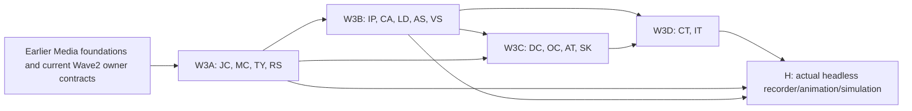

# Ghatana Media — remaining physical surfaces, backend-only implementation plan

> **CURRENT REVIEW:** 2026-10-30. Inspected `samujjwal/ghatana-media/main@b4b32692e7163dd011888379408e960617295d31` and `.product-experience/surfaces/media-physical-topology.v1.json` blob `6bf6e813323b7f7b545b63c9e9f6a911fb07d6e0`. These are observations, not fresh local acceptance or a status record. Refresh source HEAD before implementation.
>
> **AUTHORITY & NON-COMPETITION:** This is a **third engineering implementation slice**, not a replacement for the current [Wave 2 completion execution plan](MEDIA-WAVE2-COMPLETION-EXECUTION-2026-10-29.md) or its **22 locally verified / 30 partial / 6 external-owner** original task ledger. Keep Wave 2's 36 unfinished rows, R8 criteria and current owner decisions intact. No reimplementation of completed Wave 1 foundations, no reopened PDP, gtool transitions, release, PR or production runtime cutover. The canonical product meaning remains PDP-0→3 under `.product-experience/`. ALL new Media code is authored in `ghatana-media`; `ghatana/services/media` is historical read-only comparison.
>
> **USER SCOPE:** Review **every remaining physical Media surface** after the first two groups of five, implement **backend/headless engine, machine-channel and supporting infrastructure** only, explicitly hand off UI/Explorer-only surfaces. A supporting, SUBSUMED, or NOT_APPLICABLE leaf is NOT promoted to fully independent product capability. A local unit may become logically ready only when its actual implementation and tests meet its source contracts.

## 1. Exact census, scope and decision

- Topology enumerates **29** physical candidates, 6 non-root semantic compositions plus the repository-root aggregate, and **21** logical consumers; *actual live source* is authoritative for counts and applicability. **10** prior selections: `runtime-contracts`, `launcher`, `providers/aws-postgresql`, `modules/infrastructure/security`, `modules/infrastructure/messaging`, `modules/speech/stt-service`, `modules/speech/tts-service`, `modules/vision/vision-service`, `modules/intelligence/multimodal-service`, `audio-video-observability`.
- **19 other registered physical candidates**: **15** are backend/headless/support or legacy/subsumed technical sources with real review/test work; **4** are UI/Explorer/source-fixture-only and intentionally *not* executable backend implementation targets.
- The 15 target backend/support surfaces are `libs/common`, `libs/java/common`, `libs/audio-video-types`, `modules/intelligence/speech/libs/speech-audio-rust`, `modules/infrastructure/persistence`, `modules/infrastructure/cache`, `adapters/ledger`, `modules/audio-streaming`, `modules/video-streaming`, `adapters/data-cloud-media`, `adapters/ocr-compat`, `adapters/agent-tools-media`, `libs/audio-video-client`, `modules/integration-tests`, `integration-tests`. Every one appears in the per-surface register below; no inferred physical leaves.
- Deferred out of this **backend** engineering lane: `apps/media-experience-explorer` (source-linked Explorer host), `libs/audio-video-ui` (GUI library/Studio), `modules/intelligence/ai-voice/libs/ai-voice-ui-react` (GUI/voice UX), `libs/media-experience-simulation` (PDP-3 curated fixture simulator, **not** executable physics engine).
- Backend logical consumers including CLI, SDK, Agent Tools, Data Cloud integrations, capture-adapters and recorder-orchestrator are cross-walked to **existing registered physical hosts** and the existing F09/F13/L01 packages. No extra fake physical count, redundant job DB, Media-owned generic OCR, or synthetic business finality.

**Interpretation of "remaining":** not yet deeply selected in earlier two backend-wave plans, **not** proven unimplemented. Review/verify existing code before adding features; a correct current implementation becomes a regression-preservation task, not a duplicate rewrite. The current Wave 2 authority retains all STT/TTS/Vision/Multimodal/OBS development decisions and real model-quality gates.

### Key code findings from this source cut

1. `modules/audio-streaming/AudioStreamSession.java` and `modules/video-streaming/VideoStreamSession.java` are tiny byte-wire/order helpers. Their `decodeFrame` methods allocate using an untrusted encoded length without structural, overflow or budget validation; neither is a full tenant-scoped streaming session host. Correct this and reuse `MediaRuntime` stream authority rather than building a second one.
2. `modules/infrastructure/persistence/` has legacy JPA audio/transcript tables and per-instance virtual-thread executors; reconcile against the canonically migrated Postgres artifact/job/transcript version history. The JPA `V1__init_schema.sql` is NOT an independent canonical Media runtime schema.
3. `modules/infrastructure/cache/AudioVideoCache.java` currently logs generic cache keys and `TranscriptionCacheService` serializes cached transcription entities. Review identity scope, rights, source version, revocation/erasure invalidation and redacted telemetry, and reuse Shared `DistributedCachePort`.
4. `modules/intelligence/speech/libs/speech-audio-rust/src/lib.rs` supports decode/resample/mix/WAV primitives; linear resampling and whole-file decoding require fidelity qualification and byte/CPU budgets before being advertised as high-quality or streaming.
5. `adapters/data-cloud-media/MediaSemanticObservationProjector.java` is explicit that its locally validated projection **does not authenticate source/rights/provider evidence or itself authorize publication**. Data Cloud publication needs actual admitted policy/owner receipts, not a wrapper that treats nonblank strings as authority.
6. `adapters/ocr-compat/KernelOcrProviderAdapter.java` is already fail-closed `NOT_ADMITTED`; do not revive a generic OCR engine. Separate Media scene-text region/time semantics from Document Intelligence's generic text extraction.
7. `libs/audio-video-client/src/cli.ts` currently has **one source-bound production-like read-only command** (`media.cli.artifact.inspect`), while `libs/media-experience-simulation/src/cli.ts` exposes 11 *fixture-only* commands. Do not claim the latter are production CLI operations.
8. `libs/java/common` owns currently used Whisper/Piper/vision runtime engine implementations but is topologically **SUBSUMED**, and Wave 2 still has active proof work. Prevent simultaneous edits with Wave 2 in the same engine files; this plan owns only previously unselected common/compatibility responsibilities and waits for release of shared files.
9. The PDP-1 declarative production/recorder contracts are **source-authored, not runtime admission**. Build backend spec compiler, capture/orchestration, deterministic animation/simulation from existing domain types; never treat Explorer fixtures as a qualified solver or real product operation.

## 2. Work rules, parallel lanes and no blocker dead ends

**Development authority:** Code/test/doc improvements in Media may proceed even if formal PDP-0–3 source gates or gtool closure remain pending. Real cross-product effects, restricted voice/biometric capture, provider licenses, model-quality, private asset publication, irreversible DB schema cutover and release still fail closed without true owner authority. The old deployed Media worker and DataCloud/Event Plane remain separate writers; local tests need isolated DB/queues/endpoint.

**Existing dependency owners:** Shared: identity/authorization/cache/audit/observability fundamentals; Kernel: product capability/runtime; Ghatana Event Plane/Data Cloud/AI Inference/Document Intelligence: generic platform; Media: exact product artifact/job/stream/scene/rights/recorder/typed results. Consume public or approved local composite imports only. Never duplicate generic framework, Version-2 contract or proprietary model inside Media.

**Parallel lanes:** W3A compatibility/domain/byte tools (JC, MC, TY, RS) → W3B persistence/cache/ledger and audio/video streaming (IP, CA, LD, AS, VS) → W3C external adapters and CLI/SDK (DC, OC, AT, SK) → W3D actual integration tests (CT, IT). A/B can proceed in disjoint files; do NOT steal active Wave 2 STT/TTS/Vision/MM/OBS owner files. If a task references them, implement a conformance fixture first; schedule a single coordinated owner edit only when the Wave 2 writer releases the file.

**Resource posture:** cheap changed-package tests first, bounded Testcontainers and fixed synthetic fixtures, ephemeral scratch, fixed CPU/memory/process counts, no download of unapproved weights or 100GB test datasets; benchmark only after work is correct. Every 90-minute engineering pulse names the exact code/test change, tests discovered/pass/fail/skip, source/host/provider rights fingerprints when used, and next two tasks. After two pulses stalled on a truly external prerequisite, record an explicit typed `NOT_ADMITTED` path and continue a disjoint task; never manufacture a pass. Formal stage progression does not block engineering.

**Completion semantics:** `LOCAL_IMPLEMENTED` means executable code and unit/negative tests exist; `LOGICALLY_BACKEND_DEV_COMPLETE` requires changed-unit and genuine integrated behavior/compatibility/fault/resource assertions, and all applicable source intent support (or a genuine source-owned N/A/retirement disposition). Support-only/SUBSUMED leaves can be verified as compatible/decommissioned without pretending a new independent service is COMPLETE. These are **not** Kernel/gtool phase states.

## 3. Concrete local work packages (not new gtool/PDP task identities)

**Task ID convention:** `<prefix>-01..NN` is a locally scoped engineering work unit; canonical Build mapping is F02/F08/F09/F11/F12/F13 and V/L/X packages; PDP sources remain in the original root. All file paths are relative to `ghatana-media`, and every task requires positive, boundary, wrong-tenant/rights, invalid input, timeout/cancel/retry/UNKNOWN as applicable. `NONE` means no prior task and allows immediate work. Source paths in tasks are exact existing files or directory scopes; `new` classes are proposed, not claimed present.

### JC — media.physical.libs-common (libs/common)

**Owner:** Media gRPC/transport engineer. **Scope:** SUBSUMED supporting code; no new domain or independent service. **PDP anchors:** NFR-SEC-001; NFR-PRIV-001; NFR-OBS-001; PDP-2 headless API/error security; PDP-3 media.surface.service-grpc. **Physical disposition:** read topology; developer work is independent of formal PDP closure.

| Task | Dependencies | Exact Media code location | What/how (reusing existing authority) | Executable expected result |
| --- | --- | --- | --- | --- |
| **JC-01** | — | `libs/common/src/main/java/.../GrpcTransportSecurityPolicy.java; AudioVideoGrpcServerBase.java` | Inspect all actual transport profile/TLS/mTLS/peer identities and inherited interceptors. Reuse Shared identity/TLS primitives and stop duplicated transport default configuration. | Cross-profile tests: local loopback plaintext only where allowed; staging/production absent/mismatched key denies before bind; no hidden port/listener. |
| **JC-02** | JC-01 | `libs/common/src/main/java/.../security/AudioVideoRequestContextInterceptor.java; JwtServerInterceptor.java; AudioVideoMethodRbacRegistry.java` | Verify principal/tenant from trusted auth context only, operation-level RBAC and stream reauthorization; classify absent delegation separately from provider failure. | In-process 4-service interceptor tests prove forged metadata/cross-tenant and revoked principal cause zero backend effect; no random principal fallback. |
| **JC-03** | JC-01 | `libs/common/src/main/java/.../resilience/TenantAwareRateLimitingInterceptor.java; RetryPolicy.java; model/FileSystemModelStore.java` | Bound per-tenant concurrency/timeouts, TLS rotation and model registry descriptors. Do not add a second quota, circuit breaker, or generic model-governance authority. | Saturation/timeout tests show finite queues and deterministic rejection; model source+version/readiness results never imply qualified engine effect. |
| **JC-04** | JC-01,JC-02,JC-03 | `libs/common/src/test/java/.../GrpcTransportSecurityPolicyTest.java; common source Gradle project` | Prove compatibility of current STT/TTS/Vision/Multimodal consumers and relocate/subsume any duplicated helper only after exact public API compatibility review. | Source-only Media build and in-process 4-provider tests pass; no duplicate types, third-party code copied, or independent SUBSUMED leaf completion claim. |

### MC — media.physical.libs-java-common (libs/java/common)

**Owner:** Media common engine/SPI engineer. **Scope:** SUBSUMED reusable implementation; preserve Wave2 modality ownership. **PDP anchors:** NFR-SEC-001; NFR-COST-001; NFR-FIDELITY-001; NFR-RECOVERY-001; PDP-1 versioning/value-objects; PDP-3 modality gRPC consumer. **Physical disposition:** read topology; developer work is independent of formal PDP closure.

| Task | Dependencies | Exact Media code location | What/how (reusing existing authority) | Executable expected result |
| --- | --- | --- | --- | --- |
| **MC-01** | — | `libs/java/common/src/main/java/com/ghatana/media/AudioVideoLibrary.java; capability/MediaCapabilityInventory.java; service/AudioVideoServiceRegistry.java` | Inventory actual consumer classes, duplicate engine/provider factories and exported statuses; reuse Wave2 provider SPI and canonical model admission; no unconditional synthetic fallback. | Exact class/API use table and source-free consumer test; no unqualified engine exposed as ready or a second Media runtime. |
| **MC-02** | MC-01 | `libs/java/common/common/AudioConverter.java; common/AudioMetadataExtractor.java; common/validation/MediaFormatValidator.java` | Bound media parsing, decoded samples/pixels, unsigned arithmetic, rational sample/frame clocks and codec sniffing before allocating or processing untrusted source. | Malformed/huge audio & image fixtures, overflow, endianness and clip boundary tests fail safely; all real output formats decoded against advertised MIME. |
| **MC-03** | MC-01 | `libs/java/common/common/pool/EnginePool.java; resilience/CircuitBreakerSttEngine.java; resilience/CircuitBreakerTtsEngine.java; resilience/CircuitBreakerVisionEngine.java` | Unify bounded model lease/close, retry/no-effect proof, expiry and failure state with existing foundation; avoid a second Media job retry owner. | Pool stress, interrupted acquisition, provider close and recovery tests show no leaked engine/native handle, duplicate side effect or endless thread. |
| **MC-04** | MC-02,MC-03 | `libs/java/common/stt/engine/onnx/*; tts/engine/onnx/*; vision/api/*; sync/AudioVideoSyncPipeline.java` | Route engine-specific codecs, Whisper/Piper/vision and sync through Wave2 owner-reviewed adapters; eliminate test-only/synthetic outputs from production admission and false measured quality. | Current Wave2 licensed-model/quality tests and source-only engine contract vectors remain unchanged; no silent fallback or guessed scientific measurement. |
| **MC-05** | MC-01..MC-04 | `libs/java/common/src/test/java/.../AudioVideoLibraryTest.java; SttEngineContractTest.java; VisionEngineContractTest.java; build.gradle.kts` | Verify Java public API against real consumers; classify source-only legacy exports KEEP/COMPAT/DEPRECATE (never mechanical deletion or new V2). | All affected engine/source-free client compatibility, modeled timeout, resource and positive-output tests pass; no duplicate SUBSUMED module status promoted. |

### TY — media.physical.libs-audio-video-types (libs/audio-video-types)

**Owner:** Media TypeScript contract engineer. **Scope:** 118 PDP-0 intent memberships are declarations/interfaces, not 118 implemented engines. **PDP anchors:** PDP-1 domain-objects.yaml/value-objects.yaml/versioning.yaml; PDP-2 api/; PDP-3 SDK/CLI/consumer contract. **Physical disposition:** read topology; developer work is independent of formal PDP closure.

| Task | Dependencies | Exact Media code location | What/how (reusing existing authority) | Executable expected result |
| --- | --- | --- | --- | --- |
| **TY-01** | — | `libs/audio-video-types/src/contracts.ts; src/index.ts; src/index.d.ts` | Audit exported Zod objects against PDP-1 canonical job states, attempts, artifact versions, rights, request/finality and source PTS; classify already stable and missing consumer-facing fields. | Golden Java/JSON/OpenAPI/TS fixtures roundtrip; nine logical job states/legacy spelling remain losslessly observable. |
| **TY-02** | TY-01 | `libs/audio-video-types/src/contracts.ts; src/__tests__/types.contract.test.ts` | Enforce strict request limits, decimal-int64 time/tick/byte semantics, immutable revision IDs, provenance and normalized typed errors; reject invalid numeric rounding and unknown enum coalescing. | Overflow, precision, cross-tenant, stale revision, unknown effect and hostile payload tests fail closed; no data shape invented by client. |
| **TY-03** | TY-01,TY-02 | `libs/audio-video-types/src/contracts.ts; service/OpenAPI/proto adapter tests` | Reconcile 27 HTTP and 43 gRPC observed operation fields as schema projections without regenerating a new semantic source; tag absent PDP binding UNBOUND, not admitted. | Stable field/route/proto identity snapshot and backward client fixture suite; no silent wire breaking change. |
| **TY-04** | TY-01 | `libs/audio-video-types/src/index.ts; src/contracts.ts; sdk JSON value tests` | Introduce/reuse typed headless ProductionSpec/Scene/Capture/Animation/Simulation/Run/RenderOutcome parsers from PDP-1 declared values; use closed formats and exact units. | Malformed schema, unknown fields, unbounded recursion, wrong clock or wrong immutable source version rejected before any effect. |
| **TY-05** | TY-02,TY-04 | `libs/audio-video-types/src/contracts.test.ts; src/__tests__/types.contract.test.ts` | Validate public package exports/subpaths, classify sample/mock fixtures versus actual result, negative/cancellation/idempotency, and backward compatibility for existing consumers. | Current published package surface builds/installs source-free, with exact existing consumer fixtures and no second contract registry. |
| **TY-06** | TY-03,TY-05 | `libs/audio-video-types/package.json; tsconfig.build.json; src/index.d.ts` | Consolidate generated/handwritten type ownership only where safe; ensure D.TS/Zod runtime schemas and ESM/CJS import behavior match and no internal monorepo-only module imports. | pnpm workspace build and isolated installed-package smoke pass; 118 topology intent memberships each mapped to an existing supported/delegated/definition-only type, not fake API. |

### RS — media.physical.modules-intelligence-speech-libs-speech-audio-rust (modules/intelligence/speech/libs/speech-audio-rust)

**Owner:** Media Rust/DSP engineer. **Scope:** Support-only Rust crate; 63 capability memberships span delegated stream/STT/TTS/audio-analysis duties. **PDP anchors:** NFR-TIME-001; NFR-SEC-001; NFR-FIDELITY-001; PDP-1 value-objects.yaml; P3 transcript/voice J-03/J-04/J-07/J-17. **Physical disposition:** read topology; developer work is independent of formal PDP closure.

| Task | Dependencies | Exact Media code location | What/how (reusing existing authority) | Executable expected result |
| --- | --- | --- | --- | --- |
| **RS-01** | — | `modules/intelligence/speech/libs/speech-audio-rust/src/lib.rs; Cargo.toml` | Inventory bounded decoding/encoding/resampler/mixer/slicing/waveform APIs and 63 inherited PDP capabilities; partition local DSP vs delegated STT/TTS/stream duties; no second provider/solver. | Exact Rust export/consumer/capability matrix; all 63 source intents have owned local primitive or delegated provider and no invented feature claims. |
| **RS-02** | RS-01 | `modules/intelligence/speech/libs/speech-audio-rust/src/lib.rs decode_audio/load_audio_buffer` | Harden channels/sample-rate/duration/sample-count multiplication, malformed codec and decoded-memory bombs; bound bytes/frames/process time with a finite resource budget; prefer chunk iterator over full materialization when possible. | Fuzz truncated/corrupt/large containers; no panic, overcommit, invalid float or escaped path; bounded peak RSS measured. |
| **RS-03** | RS-02 | `modules/intelligence/speech/libs/speech-audio-rust/src/lib.rs Resampler::resample` | Replace simple linear interpolation as a claimed high-fidelity resampler with qualified bandlimited polyphase/windowed-sinc or explicit fidelity restriction; track rational source-to-target sample offsets. | 1k/8k/44.1k/48k impulse, alias rejection, channel isolation and long-duration drift tests versus reference tolerance. |
| **RS-04** | RS-02 | `modules/intelligence/speech/libs/speech-audio-rust/src/lib.rs slice_audio_buffer; extract_waveform; mix_audio` | Apply half-open sample windows, bounded lookahead and unit checks; prevent clipping/NaNs and unrealistic normalization on speech/audio; preserve multichannel timing. | Boundary sample, large negative/overflow, silence, interleaved stereo, pan and loudness fixtures exact or explicitly approximate. |
| **RS-05** | RS-03,RS-04 | `modules/intelligence/speech/libs/speech-audio-rust/src/lib.rs write_wav; decode_audio; DSP test corpus` | Verify RIFF/WAV metadata, sample range, dither/bit depth/channel layout, provenance & replay; output bytes must be real decodable audio, not synthetic provider result. | Roundtrip hash/PCM tolerance and codec metadata measured on licensed synthetic fixtures; malformed output rejected. |
| **RS-06** | RS-03,RS-04 | `modules/intelligence/speech/libs/speech-audio-rust/Cargo.toml; parent Cargo.lock; Java bridge/consumer test harness` | Define explicitly owned FFI/public interface if consumed by STT/TTS; avoid JNI duplication or unbounded copies; configure deterministic offline build and low-disk artifact cleanup. | Rust cargo test/clippy/format and actual Media Java consumer vectors; supported platform triple/architecture recorded with no model auto-download. |
| **RS-07** | RS-01..RS-06 | `modules/intelligence/speech/libs/speech-audio-rust/src/lib.rs tests; benchmarks; cargo profiles` | Measure resample RTF, memory overhead, decode throughput and CPU SIMD determinism across seeded data; fault injection and nonfinite-value security audit. | Reproducible p50/p95, max RSS and format/test coverage under bounded scratch; no performance baseline asserted without run. |

### IP — media.physical.modules-infrastructure-persistence (modules/infrastructure/persistence)

**Owner:** Media persistence adapter engineer. **Scope:** Supporting/JPA compatibility; no parallel migration owner versus providers/aws-postgresql. **PDP anchors:** media.domain.artifact, media.domain.transcript-version, media.domain.processing-job, media.domain.provenance-manifest; NFR-PRIV-001/NFR-RECOVERY-001; J-02/J-03/J-26. **Physical disposition:** read topology; developer work is independent of formal PDP closure.

| Task | Dependencies | Exact Media code location | What/how (reusing existing authority) | Executable expected result |
| --- | --- | --- | --- | --- |
| **IP-01** | — | `modules/infrastructure/persistence/src/main/resources/db/migration/V1__init_schema.sql; entities/AudioFileEntity.java; TranscriptionEntity.java` | Classify JPA source tables against Media canonical PostgreSQL V009→V018 and prior applied Flyway histories; choose adapter/dual-read or deprecate, never new authoritative database. | Schema lineage crosswalk includes exact table/column/tenant/immutable-version owner and no collision/duplicate migration runner. |
| **IP-02** | IP-01 | `modules/infrastructure/persistence/repository/JpaAudioFileRepository.java; repository/JpaTranscriptionRepository.java` | Enforce tenant/principal/source-version predicates on each read/write/delete, closed transactions, CAS revisions and immutable result semantics; no unconstrained tenant lists. | PostgreSQL two-tenant/stale revision tests: zero wrong-tenant rows, no stale overwrite, no silent version mutation. |
| **IP-03** | IP-01,IP-02 | `modules/infrastructure/persistence/service/AudioFileService.java; service/TranscriptionService.java` | Bound injected ExecutorService and eventloop execution, provide deterministic ownership/shutdown and cancellation; avoid per-service unbounded virtual thread creation. | Repeated create/close/crash test has zero leaked executors/connections and bounded DB concurrency; eventloop never blocked by sync DAO. |
| **IP-04** | IP-02 | `modules/infrastructure/persistence/repository/*; service/*; entity/*` | Persist same canonical transcription/caption/artifact-version IDs and source lineage as foundation; source/content finality remains authoritative in providers/aws-postgresql, no second successful transcript claim. | Exact STT original/result and revision joins survive restart; cross-store mismatch yields reconciliation/UNKNOWN instead of fabricated complete. |
| **IP-05** | IP-01,IP-04 | `modules/infrastructure/persistence/src/main/resources/db/migration; repository/*` | Add compatibility reads or forward migration only through the one Media canonical migration owner with real applied-history agreement; handle tombstones, backup/replica, legal hold and aged data separately. | Migration old populated fixture is non-destructive, crash-resumable and checksum-safe; no JPA ddl-auto destructive schema effect. |
| **IP-06** | IP-03,IP-04,IP-05 | `modules/infrastructure/persistence/src/test/java/.../integration/PersistenceIntegrationTest.java; repository tests` | Exercise valid, unauthorized, stale, crash, concurrent commit, readback and erasure cases against PostgreSQL with controlled S3 when applicable. | All durable integration assertions source-bound and genuinely executed; no in-memory-only pass for persistence completion. |
| **IP-07** | IP-01..IP-06 | `modules/infrastructure/persistence/README.md; build.gradle.kts; consumer dependency graph` | Reconcile/remove duplicate JPA DAL in favor of provider SPI if source proven equivalent; preserve legacy interfaces through adapters until every consumer moved. | One effective writer, source-free compiled dependency parity with STT/TTS/MM and DataCloud; no premature physical leaf closure. |

### CA — media.physical.modules-infrastructure-cache (modules/infrastructure/cache)

**Owner:** Media caching/security engineer. **PDP anchors:** PDP-1 privacy/versioning, NFR-PRIV-001/NFR-RECOVERY-001; support-only, no direct PDP-0 capability. No separate source-of-truth or external release status is inferred.

| Task | Dependencies | Exact Media code location | What/how | Executable expected result |
| --- | --- | --- | --- | --- |
| **CA-01** | NONE | `modules/infrastructure/cache/src/main/java/.../AudioVideoCache.java; TranscriptionCacheService.java` | Inventory Shared DistributedCachePort semantics and every caller, cache value/source provenance, mutable user scope and current TTL. Preserve one platform cache contract; never let cache decide rights. | Compatibility + cache disabled/read-through tests; stale cache not mistaken for job/consent truth. |
| **CA-02** | CA-01 | `modules/infrastructure/cache/src/main/java/.../AudioVideoCache.java` | Replace key log output with bounded redacted identifiers and enforce tenant, authenticated principal, rights/purpose/classification, immutable artifact/transcript revision and source fingerprint in effective cache scope. | Two-tenant/equal-audio hash tests yield zero cross-scope hits; adversarial key/secret markers absent in logs/metrics. |
| **CA-03** | CA-01,CA-02 | `modules/infrastructure/cache/src/main/java/.../TranscriptionCacheService.java` | Check cache-hit still passes current scope/consent/retention, source-version and transcription revision validation; never return stale protected transcript after revocation or erasure. | Revocation/revision/retention race returns MISS/DENIED before protected data; tested with Shared cache adapter. |
| **CA-04** | CA-02,CA-03 | `modules/infrastructure/cache/src/main/java/.../AudioVideoCache.java; TranscriptionCacheService.java` | Bound TTL, serialization, entry size/cardinality, concurrent getOrLoad stampede, timeout and failure handling; fail safe when distributed cache unavailable without fabricating source result. | 64-contender same-version load bounded, corrupt JSON quarantined, provider timeout and cache failure explicitly classified; no unbounded memory. |
| **CA-05** | CA-02..CA-04 | `modules/infrastructure/cache/src/test/java/.../AudioVideoCacheTest.java; TranscriptionCacheIT.java; README.md` | Integrate Redis/Testcontainers where available, source version and erasure invalidations into actual Media read path; test read after process restart and compare uncached result. | Cache-on/cache-off equivalence, privacy, stale invalidation, latency/heap observations and no independent cache source of truth. |

### LD — media.physical.adapters-ledger (adapters/ledger)

**Owner:** Media ledger/accountability adapter engineer. **PDP anchors:** PDP-1 states/events/provenance and NFR-AUD-001; support-only, no direct PDP-0 intent. No separate source-of-truth or external release status is inferred.

| Task | Dependencies | Exact Media code location | What/how | Executable expected result |
| --- | --- | --- | --- | --- |
| **LD-01** | NONE | `adapters/ledger/src/main/java/.../AudioVideoRunLedgerAdapter.java` | Compare RunLedger and Media job/attempt/quality/delivery source states; classify submitted/transcoding/processing/storing vs nine Media logical states and ten attempt states. | Explicit exhaustive mapping matrix and fallback UNKNOWN, no silent unknown→RUNNING/FAILED or success projection. |
| **LD-02** | LD-01 | `adapters/ledger/src/main/java/.../AudioVideoRunLedgerAdapter.java` | Map exact immutable tenant/job/attempt/request/source version, source digest, actor/rights, cancellation request vs confirmed, partial output and effect-UNKNOWN without claiming queue completion. | Golden ledger fixture for terminal, partial, retry, cancelled and uncertain outcomes; no privileged status inferred from provider string. |
| **LD-03** | LD-02 | `adapters/ledger/src/main/java/.../AudioVideoRunLedgerAdapter.java` | Sanitize serialized inputParams, source tokens, provider job ID and metrics; separate audit/ledger/telemetry retention; allow only typed whitelist with bounded lengths. | PII/token/biometric fixture fails disclosure scan; output is bounded, classification/rights provenance preserved. |
| **LD-04** | LD-02,LD-03 | `adapters/ledger/src/test/java/.../AudioVideoRunLedgerAdapterTest.java; Media job/outbox SPI fixture` | Verify replay/ordering/idempotent ledger projection and honest store acknowledgment through existing Data Cloud RunLedger API; no second ledger writer/DB invented. | Duplicate/out-of-order/stale attempt and Event Plane outage cases do not overwrite more recent truth; unavailable ledger remains explicit. |
| **LD-05** | LD-01..LD-04 | `adapters/ledger/build.gradle.kts; src/test; consumer compatibility guide` | Prove public RunLedger version/profile compatibility and performance on seeded 10k records, with actual consumer readback if admitted. | One canonical owner for ledger persistence, source-free adapter tests green, no false production/ledger-delivery claim. |

### AS — media.physical.modules-audio-streaming (modules/audio-streaming)

**Owner:** Media streaming/audio engineer. **PDP anchors:** PDP-0 17 media.stream.* intents; PDP-1 media.operation.stream-session; PDP-3 J-03/J-04/J-29; current NO_IMPLEMENTATION_ADMITTED. No separate source-of-truth or external release status is inferred.

| Task | Dependencies | Exact Media code location | What/how | Executable expected result |
| --- | --- | --- | --- | --- |
| **AS-01** | NONE | `modules/audio-streaming/src/main/java/com/ghatana/audio/streaming/AudioStreamSession.java` | Reconcile current tiny frame helper with canonical MediaRuntime stream-session FSM, lease/reconnect/rights and OpenAPI stream routes. Identify exact format compatibility and owner of buffer/ack. | 17 stream intent and API field disposition matrix; no second session store, no public stream success claim from byte frame helper. |
| **AS-02** | AS-01 | `modules/audio-streaming/src/main/java/.../AudioStreamSession.java` | Fix decodeFrame untrusted 4+8+4 byte header, signed/overflowed length, short payload, trailing garbage, oversize and 32-bit sequence wrap; add explicit bounded error/result. | Fuzz/corpus negative framing tests no exception type leak, allocation bomb or implicit acceptance; valid legacy frame roundtrips. |
| **AS-03** | AS-01,AS-02 | `modules/audio-streaming/src/main/java/.../AudioStreamSession.java; MediaRuntime stream SPI adapter` | Bind trusted stream ID, tenant/principal/purpose/session revision and ordered sequence/ACK to existing canonical stream store with lease fence and idempotent reconnect. | Duplicate/dropped/reordered chunks and reconnect after process loss yield one logical frame each, proper next-ACK and no cross-tenant resume. |
| **AS-04** | AS-02,AS-03 | `modules/audio-streaming/new bounded source-frame adapter under module; Rust audio codec/public bridge` | Decode actual PCM/Opus only under declared codec/timebase, rational sample positions, VAD/caption partial revision and backpressure with explicit max frames/bytes. | Sample boundary/VFR+audio sync tests, producer-faster-than-consumer load bounded, frame subtype unsupported returns UNAVAILABLE. |
| **AS-05** | AS-03,AS-04 | `modules/audio-streaming/MediaRuntime stream provider SPI; module client adapter` | Apply current consent at connect, frame, provider dispatch and reconnect; expired token or revoked purpose forbids new frames and external processing; separate detach from true server cancel. | Revocation during stream, unauthorized reconnect and stale-generation retry tests prove no further provider effect. |
| **AS-06** | AS-03..AS-05 | `modules/audio-streaming/module adapter; provider/capability/manifest` | Distinguish actual WebRTC/adaptive-HTTP/HLS/DASH transport qualification from abstract stream semantics; integrate only published, eligible public transport, no hidden local media relay clone. | Each of 17 PDP stream intents supported by real test, delegated owner or NOT_ADMITTED with source-owned follow-up; no HTTP/WebRTC route fabricated. |
| **AS-07** | AS-02..AS-06 | `modules/audio-streaming/src/test/java/.../RealTimeAudioTest.java; AudioStreamingPerformanceTierTest.java` | Full property, process-restart, timebase, 1/16/64-session, queue/drop/liveness, cancellation and codec invalid-input tests on actual Media host/adapter. | Frame/ack invariants, PTS drift tolerance, p95/p99, memory/CPU/RTF and honest unfinished transport coverage documented. |

### VS — media.physical.modules-video-streaming (modules/video-streaming)

**Owner:** Media streaming/video engineer. **PDP anchors:** Same 17 PDP-0 media.stream.* intents; PDP-1 media.operation.stream-session; PDP-3 J-05/J-16/J-29; current NO_IMPLEMENTATION_ADMITTED. No separate source-of-truth or external release status is inferred.

| Task | Dependencies | Exact Media code location | What/how | Executable expected result |
| --- | --- | --- | --- | --- |
| **VS-01** | NONE | `modules/video-streaming/src/main/java/com/ghatana/video/streaming/VideoStreamSession.java` | Reconcile helper with foundation stream-session owner, source VFR/frame PTS/timebase and actual transport/capture adapters; no new job/stream database. | Exact 17 capability/route/transport source matrix; duplicate canonical stream implementation prohibited. |
| **VS-02** | VS-01 | `modules/video-streaming/src/main/java/.../VideoStreamSession.java` | Validate 4+1+8+4 frame header/boolean/length, signed overflow, unknown keyframe flag, payload/trailer, maximum frame/codec/width/height and sequence rollover before any copy. | Malformed/oversized/truncated frame fuzz no huge allocation/unsafe decode; valid current framing roundtrip. |
| **VS-03** | VS-02 | `modules/video-streaming/src/main/java/.../VideoStreamSession.java; media timebase adapter` | Track keyframe identity, source capture PTS vs presentation frame time, discontinuity/variable frame rate and codec changes with exact clock and frame mapping. | Synthetic VFR/scene-cut tests preserve source PTS, frame ordering and uncertainty; cannot use wall clock as media PTS. |
| **VS-04** | VS-01,VS-02,VS-03 | `modules/video-streaming/MediaRuntime stream provider and capture adapter hooks` | Implement tenant-scoped claim/lease/backpressure/ACK/buffer/resumable reconnect preserving frame ID/keyframe dependencies; protect consent on every actual egress. | Two-worker stale lease and out-of-order missing keyframe, denied tenant and disconnect cases produce correct gap/UNKNOWN vs false success. |
| **VS-05** | VS-02,VS-04 | `modules/video-streaming/video capture/transcode public provider adapter; no internal FFmpeg spawn from raw caller string` | Support only qualified HLS/DASH/adaptive/WebRTC profiles and bounded codec process; capture to owned immutable artifact version with exact source/provenance. | Real supported one transport smoke with decoded frame readback; missing transport/pinned codec unavailable with no fabricated accessible stream. |
| **VS-06** | VS-04,VS-05 | `modules/video-streaming/stream/session SPI; privacy and observability hooks` | Apply restricted media redaction, tenant/principal, rights, budget and retention to frame/cache/preview/replay; headless capture reuse without exposing camera tokens. | No unauthorized captured frame/cache leak, no unbounded process/RSS on stalls, safe temp deletion and cancel. |
| **VS-07** | VS-02..VS-06 | `modules/video-streaming/src/test/java/.../VideoStreamingTest.java; VideoStreamingPerformanceTierTest.java` | Run deterministic VFR/frame order, source-time, frame-gap, loss, 1/16/64 sessions and actual codec/integration tests with isolated Media runtime. | Real frame vs fixture distinctions recorded; bounded frame memory/latency plus exact disabled transports and unqualified provider disclosures. |

### DC — media.physical.adapters-data-cloud-media (adapters/data-cloud-media)

**Owner:** Media–Data Cloud integration engineer. **PDP anchors:** PDP-0 APPLICABLE but topology has no direct capability IDs; PDP-1 authority/privacy/provenance, PDP-2 HEADLESS_CONTRACT, PDP-3 media.surface.integrations. No separate source-of-truth or external release status is inferred.

| Task | Dependencies | Exact Media code location | What/how | Executable expected result |
| --- | --- | --- | --- | --- |
| **DC-01** | NONE | `adapters/data-cloud-media/src/main/java/.../DataCloudMultimodalAdapter.java; DataCloudVisionAdapter.java; DataCloudSttAdapter.java` | Inventory exact public Data Cloud read/write APIs, existing projections and ownership. Note PDP-0 applicable with zero mapped capability IDs; do not fabricate one. | One source/consumer/parity table with explicit no-direct-capability disposition and no private cross-repo imports. |
| **DC-02** | DC-01 | `adapters/data-cloud-media/src/main/java/.../MediaSemanticObservationProjector.java` | Retain immutable source artifact/version/tenant/classification/purpose, provenance and actual policy/consent/redaction decisions; projection validation is NOT source authentication. | Equal-digest cross-tenant, stale revision, classification downgrade, fake consent ref denied before any Data Cloud publication. |
| **DC-03** | DC-01,DC-02 | `adapters/data-cloud-media/src/main/java/.../DataCloudSttAdapter.java; DataCloudVisionAdapter.java` | Project actual transcript/region/frame observations with exact source PTS, bounded metadata and rights-protected snippets; no source media bytes or raw transcript where disallowed. | Semantic output schema/clock fixtures pass and no source bytes, face/voice biometrics or credentials leave Media. |
| **DC-04** | DC-02,DC-03 | `adapters/data-cloud-media/src/main/java/.../DataCloudMultimodalAdapter.java; MediaSemanticObservationProjector.java` | Require live source owner/readback authority and destination publication receipts through admitted Data Cloud public clients. Integrate shared idempotent outbox, not direct synchronous double write. | Missing/ambiguous receipt remains OUTCOME_UNKNOWN; same event/version replay results one logical downstream projection. |
| **DC-05** | DC-03,DC-04 | `adapters/data-cloud-media/src/test/java/.../DataCloudMultimodalAdapterTest.java; MediaSemanticObservationProjectorTest.java; privacy log tests` | Test tenant isolation, source redaction, model/data provenance, malformed observation, replay/ordering, Data Cloud unavailable and reaccess after revocation. | Admitted integration test reports consumer readback and version; local-only fixtures honestly marked UNVERIFIED_EXTERNAL. |
| **DC-06** | DC-01..DC-05 | `adapters/data-cloud-media/build.gradle.kts; README/runbook` | Reconcile client/source-free dependency and cross-repository owner contract; verify latency and no accidental DataCloud ownership over Media job finality. | Full Media adapter compile/test, zero raw content in Data Cloud, preserved source-of-truth and exact external handoff status. |

### OC — media.physical.adapters-ocr-compat (adapters/ocr-compat)

**Owner:** Media legacy-compatibility engineer. **PDP anchors:** Support-only compatibility; generic OCR owned by Document Intelligence, Media owns scene-text temporal region only. No separate source-of-truth or external release status is inferred.

| Task | Dependencies | Exact Media code location | What/how | Executable expected result |
| --- | --- | --- | --- | --- |
| **OC-01** | NONE | `adapters/ocr-compat/src/main/java/.../KernelOcrProviderAdapter.java; media.vision scene-text public consumer binding` | Inventory historical provider compatibility and exact published DI public API; verify current adapter remains NOT_ADMITTED when absent, without retaining generic model execution. | No disabled OCR code path returns OCR text or touches payload, model, remote endpoint, or storage. |
| **OC-02** | OC-01 | `adapters/ocr-compat/src/main/java/.../KernelOcrProviderAdapter.java; facade service SPI` | Provide compatible typed status/health/cancel semantics while provider unavailable. If admitted DI API later available, compose thin external client only with rights, tenancy and time/region correlation. | Missing DI contract/credentials/rights yields NOT_ADMITTED; no second OCR model, arbitrary context, untrusted reference execution. |
| **OC-03** | OC-01,OC-02 | `adapters/ocr-compat/src/test/java/.../KernelOcrProviderAdapterTest.java; Vision scene-text contract tests` | Prove legacy constructor/API compatibility, failed external receipt, revocation, source version, text region→frame timestamp and no generic OCR execution in Media. | Malformed media and outside-tenant negative cases leak zero text; exact error reason and identity stable. |
| **OC-04** | OC-01..OC-03 | `adapters/ocr-compat/build.gradle.kts; service registration and retirement crosswalk` | After exact DI owner adoption, retire stale Kernel adapter source with migration/consumer proof; otherwise keep safe nonadmitted compatibility and record missing public contract as external owner work. | No unqualified OCR claim or premature consumer break; compatible source-only tests green, closure limited to fail-closed compatibility. |

### AT — media.physical.adapters-agent-tools-media (adapters/agent-tools-media)

**Owner:** Media agent tool/Action Plane integration engineer. **PDP anchors:** PDP-3 media.surface.agent-tools; canonical four tool descriptors; support-only with no separate PDP-0 capability. No independent gtool/phase/runtime authority is claimed.

| Task | Dependencies | Exact Media code location | What/how | Executable expected result |
| --- | --- | --- | --- | --- |
| **AT-01** | NONE | `adapters/agent-tools-media/src/main/resources/capabilities/*.yaml; src/main/java/.../AudioVideoToolHandlerFactory.java` | Audit all four actual Media handler IDs and fifth Data Cloud read-model descriptor against Tools/Action Plane published registry/permissions. Do not treat a YAML enabled:true flag as authenticated execution authority. | Every declared tool ID has exact implementation/contract/owner, status SUPPORTED/NOT_ADMITTED, and no duplicate public tool registry. |
| **AT-02** | AT-01 | `adapters/agent-tools-media/src/main/java/.../AgentToolInput.java` | Require schema-bound bounded input/result depth, character/byte limits, stable idempotency and exact authorization principal; prohibit remote $ref fetching and malicious tool-induced egress. | Adversarial schema refs, nested JSON, oversized base64, cross-tenant principal and malformed tool args fail before effect; output safe and bounded. |
| **AT-03** | AT-01,AT-02 | `adapters/agent-tools-media/src/main/java/.../SpeechToTextToolHandler.java; TextToSpeechToolHandler.java` | Use qualified Media STT/TTS public operations with real job receipt and immutable output; enforce voice/biometric, consent, model and source version; no fake model output. | Authorized test provider yields bounded real/fixture-labeled result, denied wrong-tenant or voice produces zero provider call; missing model typed unavailable. |
| **AT-04** | AT-01,AT-02 | `adapters/agent-tools-media/src/main/java/.../VisionAnalysisToolHandler.java; MultimodalInferenceToolHandler.java` | Integrate actual published Vision/MM capability eligibility, temporal provenance, source grounding, privacy and cancellation/finality; no independent generic OCR or AI inference model. | Bad source version/region, unsupported tensor, cross-tenant and revoked-consent tests abstain/deny without raw frame disclosure. |
| **AT-05** | AT-02..AT-04 | `adapters/agent-tools-media/src/main/java/.../AudioVideoToolHandlerFactory.java; Java Agent Tool implementation` | Bind Tools runtime tool execution envelope and existing Media job/attempt/UNKNOWN readback to one public operation; timeout after unknown effect never triggers blind replay. | Same-key replay and failed Action Plane transport preserve one logical action, exact outcome/UNKNOWN, correlation, sanitized errors and cancellation semantics. |
| **AT-06** | AT-01..AT-05 | `adapters/agent-tools-media/src/test/java/.../AudioVideoToolHandlersTest.java; AvAgentsTest.java; descriptors` | Test installed/source-free consumer compatibility, all declared tools and exact negative/real provider paths against current Types/SDK and public Action Plane descriptors. | Every registered tool has positive or safe explicit unavailable + auth/error tests; no registered-but-missing handler and bounded execution time. |

### SK — media.physical.libs-audio-video-client (libs/audio-video-client)

**Owner:** Media headless SDK/CLI engineer. **PDP anchors:** PDP-0 118 capability memberships; PDP-1 six operation families; PDP-2 API conventions; PDP-3 J-02/03/04/05/06/20/23/24/25, 1 actual production CLI read. No independent gtool/phase/runtime authority is claimed.

| Task | Dependencies | Exact Media code location | What/how | Executable expected result |
| --- | --- | --- | --- | --- |
| **SK-01** | NONE | `libs/audio-video-client/src/operations.ts; src/canonical-routes.ts; contracts/openapi/media.yaml` | Compare every exported SDK operation and real route/response to current 27 OpenAPI operations, 43 gRPC providers (different channels), PDP-1 operation identity and source dispositions. | Exact route/use-case parity table; unsupported PDP capability not advertised as a live API or another contract version. |
| **SK-02** | SK-01,TY-02 | `libs/audio-video-client/src/operations.ts; src/index.ts` | Implement stable per-request identity/digest/timeout/AbortSignal, canonical error envelopes, retry only for admitted no-effect reads, and preserve OUTCOME_UNKNOWN for post-dispatch ambiguity. | Network abort/timeout/5xx, 401/403, changed payload same-key, idempotent retry and corrupted JSON tests produce documented safe outcomes. |
| **SK-03** | SK-01,SK-02 | `libs/audio-video-client/src/operations.ts; src/canonical-routes.ts` | Complete source-authorized immutable upload/inspect/job read/cancel/status clients using actual Media host and scoped auth; do not allow caller principal header to act as authentication. | Five bounded PDP-1 artifact operations plus admitted job calls roundtrip in-process and HTTP with exact 403/404/409/UNKNOWN. |
| **SK-04** | SK-02,SK-03 | `libs/audio-video-client/src/cli.ts; .product-experience/pdp-3-product-experience/cli/production-command-registry.yaml` | Keep currently admitted `media.cli.artifact.inspect` read-only command correct. Extend actual CLI only once matching PDP-1 operation/route/owner exists; never expose 11 Explorer simulator commands as real. | CLI exit JSON/human output deterministic, token env-only and credentials absent in args/logs; new command unavailable until source-bound. |
| **SK-05** | SK-01,SK-03 | `libs/audio-video-client/src/operations.ts; src/index.ts` | Implement SDK method identity, version/cursor pagination and stream/reconnect/watch where a genuinely bound server operation exists; no invented HTTP watch/check-outcome or raw byte download. | Supported stream/cancel/unavailable API paths distinct; schema-validated status read never mutates job or claims remote provider result. |
| **SK-06** | SK-03,SK-04,TY-04 | `libs/audio-video-client/src/operations.ts; src/cli.ts; headless capture/ProductionSpec adapter` | Expose typed local dry-run/plan-compile/recorder/capture commands from PDP1 source using current artifact/job SPI; do not dispatch browser/user actions without host proof. | Deterministic dry-run and no-effect plan hash on same inputs, protected capture source rejected, one existing immutable source revision. |
| **SK-07** | SK-02..SK-06 | `libs/audio-video-client/src/__tests__/AudioVideoClient.integration.test.ts; operations.test.ts; cli.test.ts` | Cross-language installed SDK, old client fixtures, semver export/route compatibility, cancellation/UNKNOWN/tenant/revocation and malformed response tests; preserve null/no-operation behavior. | Same source-cut request produces SDK/CLI/HTTP semantically equivalent result; no unqualified provider/data claim. |
| **SK-08** | SK-01..SK-07 | `libs/audio-video-client/package.json; src/index.ts; src/canonical-routes.ts; source-free install fixture` | Build ESM/CJS/types and installed CLI against isolated Media root; no monorepo private imports, no bundling model weights, no token/PII, bounded perf and backward contract matrix. | Artifact/package exports verified from installed consumer, correct trusted URL policy, no duplicated contract authority; remaining capabilities transparently UNBOUND. |

### CT — media.physical.modules-integration-tests (modules/integration-tests)

**Owner:** Media contract/conformance QA engineer. **PDP anchors:** Support-only, PDP-1 REFERENCED_ONLY, no new product capability; F09/X01 and headless service RPC/route parity. No independent gtool/phase/runtime authority is claimed.

| Task | Dependencies | Exact Media code location | What/how | Executable expected result |
| --- | --- | --- | --- | --- |
| **CT-01** | NONE | `modules/integration-tests/src/test/java/.../MediaOpenApiContractConsumptionTest.java; MultimodalRpcMatrixIntegrationTest.java` | Validate present OpenAPI + route manifest 27 operations and proto service registry 43 RPCs, public enum/version/errors, current producer modules and provided SDK. | Bidirectional existing operation/field/route mapping, no phantom or duplicate names; allow source-declared UNBOUND without claiming admission. |
| **CT-02** | CT-01 | `modules/integration-tests/src/test/java/.../SttAuthenticatedIntegrationTest.java; TtsAuthenticatedIntegrationTest.java` | Negative auth/permission/context, consent and bad input tests through real gRPC interceptors; do not repeat unchanged Wave2 package acceptance work. | Missing/forged principal and unauthorized purpose perform no provider/network/storage writes; same errors across direct/transport. |
| **CT-03** | CT-01 | `modules/integration-tests/src/test/java/.../MediaPipelineIntegrationTest.java; AudioVideoAdvancedServicesIntegrationTest.java` | Exercise actual backend stream, cache, DSP, ledger and DataCloud adapter contracts including timebase and version/provenance, with synthetic fixtures and isolated stores. | Success/failure/UNKNOWN and static fixture labeling exact, no fake scientific or media output counted as real provider test. |
| **CT-04** | CT-01,CT-02,CT-03 | `modules/integration-tests/src/test/java/.../MultimodalContractTest.java; Integration service fixtures` | Assert SDK/CLI, Agent Tools, REST and gRPC semantic equivalence only for source-authorized operations; preserve absent adapter typed errors and source owner constraints. | Source-free consumer field/temporal/rights/parity tests pass, no new aggregate service-contract.yaml. |
| **CT-05** | CT-01..CT-04 | `modules/integration-tests/build.gradle.kts; src/test; JUnit XML aggregate` | Prevent `verifyIntentionalPublicApi` input failure on truly sourceless test-only module via current narrow opt-out; leave Shared upstream bug/verification authority with Shared owner. | Tests run on Media root and fail on real mismatch, skip only accurately absent provider; NOT a formal gtool receipt. |

### IT — media.physical.integration-tests (integration-tests)

**Owner:** Media integration/reliability QA engineer. **PDP anchors:** Support-only; F12/X01/X02 real integrated oracles, no independent PDP-0 feature. No independent gtool/phase/runtime authority is claimed.

| Task | Dependencies | Exact Media code location | What/how | Executable expected result |
| --- | --- | --- | --- | --- |
| **IT-01** | NONE | `integration-tests/src/test/java/com/ghatana/media/integration/MediaTestHarness.java; build.gradle.kts` | Inventory reusable active Postgres/S3, JUnit, H2, Docker/Compose, synthetic and licensed model fixtures, and exact test selection profile; preserve active Wave2 test outcomes. | One test harness registry with sources, prerequisites, safety, 3 tiers and no external customer/private data copied. |
| **IT-02** | IT-01,IP-06,CA-05,LD-04 | `integration-tests/src/test/java/com/ghatana/media/integration/MediaLauncherEndToEndIT.java; MediaProviderJobLifecycleE2ETest.java` | Exercise real persisted artifact, transcript/caption version, tenant/consent, outbox/ledger/cache and Data Cloud public result through isolated Media-bounded Postgres/S3. | Actual byte/hash/version readback and customer-neutral source proof, safe cancellation/replay/UNKNOWN before and after process kill. |
| **IT-03** | IT-01,AS-07,VS-07,RS-07 | `integration-tests/src/test/java/com/ghatana/audio/video/integration/EndToEndWorkflowTest.java; PerformanceIntegrationTest.java` | Integrate audio/video frame buffers, actual source clock VFR/PCM, stream reconnect/cancel/backpressure and qualified codec profiles with bounded 1/16/64 clients. | Measured p50/p95/p99, CPU/RSS, frames/s/RTF, finite timeouts and no cross-tenant byte leakage; absent codec marked UNVERIFIED. |
| **IT-04** | IT-01,DC-05,AT-06,SK-07 | `integration-tests/src/test/java/.../AudioVideoDataCloudAepAgentE2ETest.java; MediaProviderLifecycle.test.ts` | Exercise Action Plane tool→Media job→event/outbox→Data Cloud consumer readback, exact source credential auth and secret-free errors, protected failure recovery. | One authorized real provider effect with source rights and receipt where available; unavailable platform returns exact missing external dependency. |
| **IT-05** | IT-01,IT-02,IT-03 | `integration-tests/src/test/java/com/ghatana/audio/video/integration/IntegrationImagesCondition.java; AudioVideoContainerBase.java; docker-compose.integration.yml` | Resolve GH-90000 as separate ops lane: CI-pinned service images or `AUDIO_VIDEO_STT_IMAGE`/`AUDIO_VIDEO_TTS_IMAGE` with digest/host/version proof; rerun only nine previously skipped compose cases. | 9 image-dependent test statuses observed as true PASS/FAIL/SKIP with documented reason; never rewrite skip totals or turn test absence into PASS. |
| **IT-06** | IT-02..IT-05,CT-05 | `integration-tests/src/test/java/com/ghatana/media/integration/*; docs/TESTING.md; resource/fixture profile` | Run incremental affected suites, then single correct whole-backend suite for selected 15 physical targets, including mixed workload, terminal/partial, provider ambiguity, cross-product and resource-bound tests. | Every selected backend surface has real test IDs/commands/observed counts, negative/fault and compatibility; Track B/PDP/production cutover remain untouched. |

## 4. Cross-surface headless production outcomes (H01–H08; no new physical surface)

These are **backend product behavior packages** under canonical `M-BLD-F13`, `M-BLD-L01`, `M-BLD-V12..V15`, and `M-BLD-X01`. They bind the existing **logical** recorder/capture/animation/simulation contracts to actual Media physical code owners; they do **not** create a 20th remaining physical surface, new product definition, another job/artifact writer or second engine architecture. They may be developed in parallel where the owning physical files are unlocked; shared `runtime-contracts` and `launcher` mutations require Wave 1 owner coordination.

**Normative source:** `.product-experience/pdp-1-domain-data/declarative-production-contracts.yaml` (typed production value schemas, no new canonical domain objects), `recorder-studio-contracts.yaml` (one project revision/MediaRun/JobAttempt), `pdp-2-design-interface-system/animation-simulation-grammar.yaml` (distinct rational story/media/simulation/wall clocks), `pdp-3-product-experience/declarative-production-experience.yaml` and `demo-recording-standard.yaml`. The latter's one curated Explorer film is **EXPLORER_SIMULATED**, not runtime, scientific or publication proof.

| Task | Dependencies | Exact existing Media host / planned source | Implementation and expected test |
| --- | --- | --- | --- |
| **H-01** | TY-04,TY-05 | `libs/audio-video-types/src/contracts.ts`; PDP-1 JSON Schema compiled validator | Compile versioned ProductionSpec/CaptureSceneSpec/AnimationSpec/SimulationSpec with exact bigint/rational/custom formats and closed parameters. Invalid units, unbounded recursion, missing source digest, and unsafe code/shader block before job admission; schema fixture roundtrips. |
| **H-02** | H-01,IP-04 | `runtime-contracts/src/main/java/com/ghatana/media/runtime/MediaProductionSpecCompiler.java` (new) + existing `launcher/src/main/java/com/ghatana/media/launcher/MediaRuntime.java` (serialized owner edit) | Compile typed specs into a deterministic DAG of existing Media commands with one canonical project revision, manual operation locks, source/rights decisions, bounded cost and plan fingerprint. Same input/rights/engine hashes yield same plan; source change invalidates affected descendants only. |
| **H-03** | H-02,SK-06 | `libs/audio-video-client/src/recorder-orchestrator.ts` (new), `src/operations.ts`, `src/cli.ts`; `media.surface.recorder-orchestrator` logical consumer | Data-driven unattended scenario runner: typed actors/scenes/source refs, capture orchestration, timed narration/captions/track refs, noninteractive bounded recapture and dry-run; no hidden business action or production provider enabled from fixture. Test two identical runs + selective changed scene with stable output lineage. |
| **H-04** | H-02,AS-05,VS-06 | `runtime-contracts/src/main/java/com/ghatana/media/runtime/MediaCaptureSourceContracts.java` (new) and `libs/audio-video-client/src/capture-adapters.ts` (new); existing public device/product adapters only | Exact browser/desktop/mobile/terminal/http-api/grpc-api/camera/media-file **adapter eligibility** through existing public device/product interfaces. Requires source identity, rights/purpose/version, controlled secrets, frame clock and actual captured bytes. Disabled adapters return NOT_ADMITTED; never fabricate screen pixels, device availability or product success. |
| **H-05** | H-01,RS-03 | `libs/java/common/src/main/java/com/ghatana/media/production/AnimationSpecCompiler.java` (new) + existing Media `launcher` job/provider SPI (owner lock) | Compile declarative 2D/3D keyframe/scene/animation graph with typed easing, dimensions, time and assets; reuse selected renderer/codec, source and quality policies. Rendered frames must be actual outputs with exact version; unsupported rigs/physics/3D model ⇒ typed unavailable, not placeholder video. |
| **H-06** | H-01,RS-03 | `libs/java/common/src/main/java/com/ghatana/media/simulation/MediaDeterministicSimulator.java` (new), integrated through existing `launcher` job SPI; no physical-surface claim without registry authority | Implement deterministic seeded stepper, model IR, solver identity, units/boundary/initial state, checkpoints, adaptive-step error/uncertainty and reproducible observables. Analytical PDP-3 Newton constant-force fixture (mass 2 kg, force 6 N, t=2 s ⇒ a=3 m/s², v=6 m/s, x=6 m) validates solver, not just animation; mismatched units/unstable solver ABSTAIN. |
| **H-07** | H-03,H-04,H-05,H-06 | `launcher/src/main/java/com/ghatana/media/launcher/MediaProductionRunCoordinator.java` (new), existing canonical job/attempt/outbox | Produce qualified real-capture/animation/simulation outputs with origin class REAL_CAPTURE/DECLARATIVE_ANIMATION/MODEL_SIMULATION, immutable source/version + plan fingerprint, verifiable checksum, sealed result provenance, effective rights and process-fence. Crash/UNKNOWN cannot cause duplicate external effect or fake scientific validation. |
| **H-08** | H-03,H-07,IT-06 | `integration-tests/src/test/java/com/ghatana/media/integration/MediaPdp3BusinessRecordingIT.java` (new), `libs/audio-video-client`, PDP-3 `media.demo.j03.corrected-captions.v1` | Run one end-to-end **real product** business scenario against authorized synthetic/curated data, capture genuine source-derived video with narration and captions and verify exact terminal artifact/version. Keep Explorer static counterpart visibly labeled and same scenario source; no actual customer recording or external publication, Track B PDP-3 closure untouched. |

**Scientific/provenance rule:** a declared animation frame is NOT a simulation proof; a synthetic PDP Explorer state is NOT a production Media completion. Keep source class, solver/fidelity unit, qualified provider/model, quality estimates, caption alignment and human-authored edit locks separate and verifiable. No mass "new module" registration just to satisfy task counting.

## 5. Whole-remaining physical applicability and explicit non-backend handoff

The remainder has **19 registered physical candidates**, not nineteen new backend services. All 19 are accounted for exactly; the four outside backend scope remain real product work, not silent N/A:

| Physical surface | This plan's disposition | Owner handoff and why |
| --- | --- | --- |
| `media.physical.apps-media-experience-explorer` | **UI/Explorer tooling only** | PDP/Explorer owner; static curated scenarios J-14 and source-linked review. Keep fake state, fake screenshots and narration clearly simulated; no backend readiness or runtime source. |
| `media.physical.libs-audio-video-ui` | **GUI library / Studio** | Media UI owner; F10/L02, 202 exact PDP-0 intent memberships, 27 PDP-3 journey links. Needs real host, accessibility, editor/project revisions; explicitly outside this backend-only implementation slice. |
| `media.physical.modules-intelligence-ai-voice-libs-ai-voice-ui-react` | **Voice GUI / UX** | Media UI owner; J-04/J-16, one mapped `media.speech.synthesis.text-to-speech` intent; do not confuse React voice controls with qualified TTS provider or voice consent. |
| `media.physical.libs-media-experience-simulation` | **Source-owned Explorer simulator / fixture tooling** | Media product-experience owner; J-14/J-15 local fixture simulations and CLI proof remain nonproduction. Headless actual scientific solver is H-06; preserve separation. |

**The other 15 exact physical identities** are the JC, MC, TY, RS, IP, CA, LD, AS, VS, DC, OC, AT, SK, CT and IT sections above. SU​BSUMED leaves `libs/common` and `libs/java/common` are supporting implementation code with existing consumers; do not create a parallel self-standing service or closure claim. `adapters/data-cloud-media` is PDP-0 APPLICABLE but currently has **zero directly mapped capabilityIntentIds**; address exact consumer contract and Media/Data Cloud authority under DC tasks, not by fabricating a capability ref. Streaming modules currently say `NO_IMPLEMENTATION_ADMITTED`; real transport/source proof is needed before anyone calls them complete.

## 6. Dependency and concurrency plan



| Pulse window (guidance only) | Parallel, nonoverlapping work | Observable exit |
| --- | --- | --- |
| **W3A — first two engineering pulses** | JC-01, MC-01, TY-01, RS-01 and independent AS-02/VS-02 frame-decoder negative tests | At least one concrete code/test patch with exact failing/green repro; current Wave2 source ownership reconciled. |
| **W3B — subsequent scoped 2–4 days** | IP-01/02/03, CA-01/02, LD-01/02, AS/VS domain and temporal streaming tests, Rust resample/fuzz | One writer for storage, correct frame bounds, class/codec/tenant/security invariants, no invisible duplicate platform mechanism. |
| **W3C — following 2–4 days** | TY/SDK wire/client parity, DC public semantic/read boundary, OCR compatibility, bounded Agent Tools | Current consumer API/Tool/CLI readback with truthful UNBOUND/NOT_ADMITTED, no unsafe external effect. |
| **W3D — one focused final integration pulse per group** | CT + IT actual Postgres/S3/process tests; H01..H08 independent headless product outcomes when prerequisites established | Exact real/fixture status, latency/resource, negative + restart/replay/UNKNOWN, ready only if actual output and source authority exist. |

Timeboxes set a **pulse/checkpoint**, not promise of wall-time delivery. A stalled legal/provider/model/hardware dependency must produce a named owner/fallback and progress on independent local tests; do not self-approve a rights grant or alter Wave2 R8 status. Highest-impact immediate bug fixes are AS-02 and VS-02, but serialize any shared MediaRuntime source edits with Wave2's active writer.

## 7. Actual acceptance oracles and resource limits

| Oracle | Cross-surface procedure | Required observable result |
| --- | --- | --- |
| **W3-E01** | Untrusted audio/video frame short/negative/overflow length into existing codec helper | No unbounded allocation or native decode, typed invalid-frame, legitimate legacy frame roundtrip |
| **W3-E02** | One tenant starts audio+video stream, drops frames, revokes consent, disconnects and reconnects under two contender workers | Single sequenced current lease, bounded queue, correct PTS/ACK/partial, no unauthorized replay or cross-tenant frame |
| **W3-E03** | Ingest source WAV → Rust decode/resample → authorized STT segment → immutable transcript readback | Real valid audio sample/time/quantization, stable provenance, no aliasing/clipping or invented transcript |
| **W3-E04** | Old JPA transcript + canonical PostgreSQL artifact/job/attempt through versioned adapter and cache | Same immutable source/version, tenant isolation, no second schema writer or stale cache after revocation |
| **W3-E05** | Job attempt → Media ledger projection → Data Cloud read model/event observation | Unknown/partial/cancel finality preserved, no fake ledger ACK or raw data disclosure |
| **W3-E06** | Authorized Agent Tool → typed Media job → qualified provider → SDK status | One actual effect and version, safe idempotency, forged/invalid tool denied before dispatch |
| **W3-E07** | CLI artifact inspect against authentic isolated Media server | Existing production-bound read-only CLI returns stable JSON, token never in arg/log, 404 not conflated with absolute absence |
| **W3-E08** | Legacy generic OCR compatibility call without admitted DI public client | NOT_ADMITTED, no copied OCR model or user image exfiltration, stable status and fallback |
| **W3-E09** | ProductionSpec same inputs twice then changed one source scene, with selective recapture | Same plan hash and unchanged scene outputs, affected descendants regenerated; manual locks and rights enforced |
| **W3-E10** | Newton constant-force deterministic simulation + animation + narration source | a=3 m/s², v=6 m/s, x=6 m from solver, unit/fidelity independently checked; animation alone not scientific proof |
| **W3-E11** | Real media business scenario J-03 through authorized project/job/artifact + recorder source | Verified source and terminal output version, actual recorded video/narration/captions, distinct EXPLORER_SIMULATED counterpart |
| **W3-E12** | Real source-free SDK/Agent Tools/DataCloud clients, service process restart and broker/network loss | No duplicate external effect or falsely final success, all contract status/UNKNOWN and identity preserved |
| **W3-E13** | 1/16/64-stream, cache, SDK and tool mixed workload with hostile payload and privacy marker | p50/p95/p99 + CPU/RSS/scratch/network, bounded queue/threads, no secret or payload in logs/metrics |
| **W3-E14** | Restart old/public client fixtures against reconciled Media with image-gated compose cohort available | Current real tests run under pinned images; missing GH-90000 images remain explicit SKIPPED, not PASS |

**Benchmark discipline:** pin source SHA, JVM/Rust/Node, hardware, CPU/GPU, DB/object-store image, codec/model digest, fixture, tenant mix and cost/retention policy. Test cheap affected paths first; no full rerun of closed Wave2 suites unless a changed input invalidates them. PDP-0 NFR-PERF-001 metadata/job-ack budgets remain proposed until reference environment is approved; no invented latency claim. Keep all applicable finite budget dimensions, deterministic clock/units, and temporary-source cleanup.

**Per-physical disposition:** Only physical surfaces with actual code + negative/boundary tests + integrated consumer readback + claimed feature implementation may be `LOGICALLY_BACKEND_DEV_COMPLETE`. A truthful NOT_ADMITTED is the correct safe response for an unqualified optional provider, but **not completion** of a required PDP capability. For SUPPORT_ONLY or SUBSUMED, record TESTED_COMPATIBLE / RETAINED / DEPRECATED / RECONCILED rather than pretending a new deployed service exists.

## 8. Residual operational / Track B / upstream handoff — explicitly not the Wave 3 task denominator

- **GH-90000:** previously reported nine compose tests are image-gated; real pinned service images or `AUDIO_VIDEO_STT_IMAGE` and `AUDIO_VIDEO_TTS_IMAGE` plus provider admission are required to execute them. Their skip remains a skip, not a backend code blocker or proof of passing integrated behavior.
- **Checkstyle:** warning-level violations are nonblocking under current convention; distinguish genuine correctness/security failure (blocking) from style warning. Fix touched source violations incrementally; don't silence governance globally.
- **Wave2 active:** 22/30/6 last accepted classifications as of inspected plan; Wave3 may implement **disjoint files only**, no automatic promotion/reopen of 36 open R8 rows or unlicensed FLEURS/Whisper/TTS/Vision success. Current STT source-rights and model-quality changes are Wave2 work.
- **Track B:** no PDP0–3 phase closure, gtool, Kernel stage transition, independent receipts, release or deployment performed here. Use exact current phase owner process when subsequently requested; no fake phase transition to mark local code complete.
- **Legacy operational cutover:** Media V009→V018 was fixture-reconciled in prior work; actual applied legacy DB, queues, leases, outbox publisher, other consumers and one active writer remain independently authorized operational checks. Never run duplicate runtime/DB migrators.
- **Shared convention latent issue:** `VerifyIntentionalPublicApiTask` `@InputDirectory` fails Gradle input validation when a test-only module has `compileJava NO-SOURCE`; owner is `ghatana-shared`. Preserve Media's narrow sourceless-test guard; publishable modules with missing classes MUST still fail closed.
- **External producer/consumer:** Data Cloud append authority, Action Plane tool enrollment, Document Intelligence client, model/codec/voice license and product-specific capture adapters remain owning-service/rights gates. Code can progress locally; qualified real effect claims require real owner/client/receipt.
- **Large-file/privacy:** `ghatana-media` is a public repository; importing from private Ghatana repos requires ownership/license/secret provenance review. Never upload test model weights, private audio/video or person-identifiable fixtures to git. No massive data caches or 100GB testing.

**Next safe tasks:** JC-01 and TY-01 source parity; AS-02/VS-02 untrusted-size parser regression; IP-01 legacy-vs-canonical DB census; CA-02 cache-key privacy; RS-02 decoder bounds; all can progress without changing any active Wave2 owner file. This plan is a review and implementation worklist, not evidence of executing those tasks.

## 9. All 21 logical consumers — no omitted or double-counted implementers

The topology has **21 logical consumer identities**. These are requirements/contract channels cross-walked to their **existing physical packages**, NOT additional physical services or hidden backend work units. The [source-derived coverage index](MEDIA-BACKEND-REMAINDER-SOURCE-COVERAGE.v1.json) copies exact `consumerCrosswalk` physical references and records which lane owns subsequent proof. A headless tool/SDK may be implemented and tested without proving its GUI host or release.

| Exact logical consumer | Physical implementation hosts | Current plan lane | Acceptance handoff |
| --- | --- | --- | --- |
| `media.surface.web` | `libs/audio-video-ui` | NONBACKEND_HANDOFF | GUI/Explorer owner; backend-only scope excludes host |
| `media.surface.embedded` | `libs/audio-video-ui` | NONBACKEND_HANDOFF | GUI/Explorer owner; backend-only scope excludes host |
| `media.surface.public-http` | `launcher`, `runtime-contracts` | PREVIOUS_WAVES_STATUS_NOT_REEVALUATED | Foundation/Wave2 existing owner; no reopen |
| `media.surface.service-grpc` | `runtime-contracts`, `modules/speech/stt-service`, `modules/speech/tts-service`, `modules/vision/vision-service`, `modules/intelligence/multimodal-service` | PREVIOUS_WAVES_STATUS_NOT_REEVALUATED | Foundation/Wave2 existing owner; no reopen |
| `media.surface.grpc.stt` | `modules/speech/stt-service` | PREVIOUS_WAVES_STATUS_NOT_REEVALUATED | Foundation/Wave2 existing owner; no reopen |
| `media.surface.grpc.tts` | `modules/speech/tts-service` | PREVIOUS_WAVES_STATUS_NOT_REEVALUATED | Foundation/Wave2 existing owner; no reopen |
| `media.surface.grpc.vision` | `modules/vision/vision-service` | PREVIOUS_WAVES_STATUS_NOT_REEVALUATED | Foundation/Wave2 existing owner; no reopen |
| `media.surface.grpc.multimodal` | `modules/intelligence/multimodal-service` | PREVIOUS_WAVES_STATUS_NOT_REEVALUATED | Foundation/Wave2 existing owner; no reopen |
| `media.surface.sdk` | `libs/audio-video-client`, `libs/audio-video-types` | W3_PARTIAL_OR_BACKEND_CONSUMER | W3 linked physical tasks; do not claim all PDP intents implemented |
| `media.surface.cli` | `libs/audio-video-client`, `libs/media-experience-simulation` | W3_PARTIAL_OR_BACKEND_CONSUMER | W3 linked physical tasks; do not claim all PDP intents implemented |
| `media.surface.agent-tools` | `runtime-contracts`, `adapters/agent-tools-media` | W3_PARTIAL_OR_BACKEND_CONSUMER | W3 linked physical tasks; do not claim all PDP intents implemented |
| `media.surface.events` | `modules/infrastructure/messaging`, `runtime-contracts` | PREVIOUS_WAVES_STATUS_NOT_REEVALUATED | Foundation/Wave2 existing owner; no reopen |
| `media.surface.integrations` | `adapters/data-cloud-media`, `adapters/ledger`, `modules/infrastructure/cache`, `modules/infrastructure/messaging`, `modules/infrastructure/persistence`, `modules/infrastructure/security`, `providers/aws-postgresql` | W3_PARTIAL_OR_BACKEND_CONSUMER | W3 linked physical tasks; do not claim all PDP intents implemented |
| `media.surface.types-library` | `libs/audio-video-types` | W3_PARTIAL_OR_BACKEND_CONSUMER | W3 linked physical tasks; do not claim all PDP intents implemented |
| `media.surface.ui-library` | `libs/audio-video-ui`, `modules/intelligence/ai-voice/libs/ai-voice-ui-react` | NONBACKEND_HANDOFF | GUI/Explorer owner; backend-only scope excludes host |
| `media.surface.explorer` | `apps/media-experience-explorer`, `libs/media-experience-simulation` | NONBACKEND_HANDOFF | GUI/Explorer owner; backend-only scope excludes host |
| `media.surface.desktop-archive` | None (archive) | ARCHIVED_NOT_ACTIVE | Archived N/A; no executable implementation |
| `media.surface.recorder-orchestrator` | `libs/audio-video-client`, `libs/media-experience-simulation` | H_CROSS_SURFACE_BACKEND | H-01,H-02,H-03,H-07,H-08 |
| `media.surface.capture-adapters` | `runtime-contracts` | H_CROSS_SURFACE_BACKEND | H-04,H-07,AS-07,VS-07 |
| `media.surface.production-studio` | `libs/audio-video-ui` | NONBACKEND_HANDOFF | GUI/Explorer owner; backend-only scope excludes host |
| `media.surface.interactive-demo-player` | `libs/audio-video-ui` | NONBACKEND_HANDOFF | GUI/Explorer owner; backend-only scope excludes host |

**Compositions:** The six semantic compositions + repository root remain governed by existing PDP surface definitions. Source membership and code-path review allow local leaf work; composition/root acceptance requires actual cross-child business outcomes and contract parity. The earliest unfinished applicable source phase still owns formal status, independently of implementation. A backend pass cannot close `media.composition.creation-composition-and-delivery` while UI/Studio is unimplemented.

## 10. Exact selected task and source-currentness accounting

The canonical local task list is **only the Markdown task tables in §3 and §4**: **88** backend-physical tasks across fifteen groups and **8** additional *logical* headless production tasks. The [source coverage JSON](MEDIA-BACKEND-REMAINDER-SOURCE-COVERAGE.v1.json) is a **generated read-only join index**, NOT a new lifecycle task registry, new PDP authority, duplicate contracts or independent acceptance record. It enumerates **29 physical** dispositions (10 earlier, 15 this backend scope, 4 explicit non-backend handoffs), **21 logical** consumer references, and **602 remaining physical-to-PDP0 capability memberships**: 399 technical/backend package responsibilities plus 203 deferred GUI/voice UI memberships.

For each task implementation handoff record: local task ID, exact source/PDP owner reference, Media code file(s), owning agent/reviewer, predecessor proofs, compile+contract+negative/fault/test selector, runtime/model/host/rights identity if real, observed success/failure/skip and benchmark, and next remaining task. For capability memberships, the JSON `workOwnerTaskId` is *a responsible code/conformance reviewer*, **not** implementation evidence, a gtool task identifier or authorization for an unqualified provider. Do not use the count as evidence of 399 implemented features; many are repeated/interface/delegated intents.

**Track B, deployment and external qualifications** are independent. No PDP0–3 DEV_COMPLETE claim is asserted anew, no source-currentness receipt, signed model/codec/license approval, lifecycle phase/Kernel transition, Ghatana producer adoption, release, PR state, and no operational writer cutover are performed by this plan. The current [Wave2 execution owner](MEDIA-WAVE2-COMPLETION-EXECUTION-2026-10-29.md) continues executing its original 36 unfinished R8 tasks and current source-rights/model/host/quality gates. Only disjoint-file Wave3 work starts in parallel.

**Next exact engineering order:** As soon as existing owner checkout is clean, perform `AS-02` and `VS-02` negative frame parser tests and fixes; `IP-01` exact schema/JPA compatibility audit; `TY-01` and `JC-01` contract/transport currentness; `CA-02` private-cache-key redaction; `RS-02` bounded codec test. Re-run only changed-package tests; reserve W3D full integration for real integrated commits and authenticated sources. Every 90-minute pulse reports a code/test result, not a new plan.

## 11. Source folders without their own registered physical identity

The inspected Media Git tree includes **unregistered relative source directories**. The topology—not a directory name—defines the physical denominator. These files still need source ownership/consumer coverage, but may not be silently added as new PDP surfaces or mistakenly lost:

| Source folder | Observed actual contents | Implementation disposition and owner |
| --- | --- | --- |
| `adapters/outbox/` | `AudioVideoOutboxStoreImpl.java` plus tests | Existing **C/S/A/J/E foundation messaging/outbox** adapter; reconcile with one canonical PostgreSQL/outbox publisher during LD/IP/IT consumer tests. No second active event bus or new leaf ID. |
| `modules/common/` | `GrpcCorrelationInterceptors.java` and focused test, package under `com.ghatana.platform.observability` | JC/OBS/Shared boundary audit: prefer Shared-owned reusable tracing; Media code may keep a narrowly scoped compatibility adaptor only after proving public API use. Do not fork Shared instrumentation. |
| `modules/audio-processing/`, `modules/video-processing/` | Only source tests in reviewed Git tree | Link those tests to existing Rust/codec/stream or Wave2 model owner as applicable; they are not deployed audio/video processing engines or independent implementation-ready surfaces. |
| `modules/format-compatibility/`, `modules/session-management/` | Only source tests in reviewed Git tree | CT/IT contract and wire-session validation owners; ensure they run under actual Gradle test selection or classify as detached historical tests. Do not infer active production codec/session code from filenames. |

**Unregistered code check:** W3's CT-01/IT-01 review must include these path families in source/compiled test inventory. If a code path truly implements an independently meaningful capability absent the registered topology, record a precise source-owner applicability/handoff request rather than silently inventing another physical leaf or ignoring its tests. An observed test file does not establish that it executed.


## 12. Wave 2 unfinished task integration — original 36, no duplicate task authority

**Controlling execution authority remains unchanged:** [MEDIA-WAVE2-COMPLETION-EXECUTION-2026-10-29.md §10](MEDIA-WAVE2-COMPLETION-EXECUTION-2026-10-29.md#10-owner-authorization-and-zero-approval-stall-completion-protocol-2026-10-29-2019-pdt), with the **58 original requirement IDs/acceptance oracles** in [MEDIA-BACKEND-MODALITY-WAVE2-EXECUTION.md](MEDIA-BACKEND-MODALITY-WAVE2-EXECUTION.md), exact **36 unaccepted task rows** in [MEDIA-WAVE2-R8-FULL-ACCEPTANCE-MATRIX.json](MEDIA-WAVE2-R8-FULL-ACCEPTANCE-MATRIX.json), and R10 owner/gate mapping [MEDIA-WAVE2-R10-OWNER-BLOCKER-RESOLUTION.json](MEDIA-WAVE2-R10-OWNER-BLOCKER-RESOLUTION.json). This section and the machine-readable index are **read-only projections** of those existing requirements/status records, NOT replacement ledgers, acceptance changes or new gtool task identities.

**Source fingerprint at this review:** Media main \`28f64075cbf56dd614ef7e7ae0473abf8cd35163\` before these plan edits; R8 Git blob \`e881a03535214b16864e97cd5d7047dbd84cebd4\`, R10 Git blob \`ba80677057d6556cb0643cd220fff889ea224aaf\`. **Last accepted R8 classification:** 58 original = 22 \`LOCALLY_VERIFIED\` (preserved) + **30 \`PARTIAL\`** + **6 \`OWNER_EXTERNAL\`**. The following **36** have \`taskAccepted=false\`. Source commits can implement portions without promoting a whole row. In particular, recent STT source-rights implementation, OCI, Piper, Postgres/MM code, metric/quality read-side and test additions must be **reused**, not reimplemented; verify the remaining original positive/negative/recovery/provider/quality criteria. Neither the old tiny Whisper model (failed reported English/Hindi/Nepali reference thresholds), fixture-only webhooks, real model weight/voice rights, Ghatana #252/#254, nor source-only Docker/OCI tests may be silently promoted to PASS.

**Read this table as a live handoff snapshot:** \`Owner\`, \`R8 dependencies\`, \`R10 gates\`, \`source file target\`, \`next action\` and \`original independent proof\` are reproduced or conservatively abbreviated from the existing R8/R10 owner records. If an action has already received a partial patch, **run its remaining proof rather than writing the code again**. R8 original full acceptance and the current §10 decisions override any abbreviated text in this review.

| Original Wave 2 task ID | Last status (not accepted) | Accountable owner | Original prerequisites | R10 gates | Media code area (R8) | Next implement-or-prove action (R10) | Original independent result required (R8) |
| --- | --- | --- | --- | --- | --- | --- | --- |
| **VIS-03** | PARTIAL / NOT_ACCEPTED | Media Vision Native and Model Quality | VIS-01 | G06 | `modules/vision/vision-service/video/VideoFrameExtractor.java; grpc/VisionGrpcService.java` | Finish broker source owner/version/auth binding and hard native OCI adversarial corpus, zero leaked processes | hard memory/CPU/PIDs/disk/time bounds and zero leaked processes |
| **STT-03** | PARTIAL / NOT_ACCEPTED | Media STT and Runtime Security | STT-01 | G02 | `modules/speech/stt-service/grpc/PersistentSttGrpcService.java; grpc/SttGrpcServer.java; service/PersistentSttService.java` | Verified identity and source rights, current Shared policy, wrong-actor/tenant/expiry/revoke no effects | JWT wrong principal/tenant, revoked/stale, no provider/outbox effects |
| **TTS-05** | PARTIAL / NOT_ACCEPTED | Media TTS and Voice Governance | TTS-03 | G02, G04, G11 | `modules/speech/tts-service/grpc/TtsGrpcService.java; security/EmbeddingEncryptionService.java; service/PersistentTtsService.java` | Voice profile, clone and biometric owner consent denied before effect, revoked profile no reused embedding | clone denied before effect, revoke/delete later prohibits reuse |
| **VIS-10** | PARTIAL / NOT_ACCEPTED | Media Vision Native and Model Quality | VIS-03, VIS-06 | G02, G11 | `modules/vision/vision-service/recognition/FacialRecognitionService.java; StructuredFacialRecognitionAuditSink.java` | No face/gaze/identity effect without biometric purpose/region/retention/consent, tenant isolation | cross-tenant and revoked effect-free, real authorized capability if in scope |
| **MM-02** | PARTIAL / NOT_ACCEPTED | Media Multimodal Integration | MM-01, STT-03, VIS-03 | G02 | `modules/intelligence/multimodal-service/grpc/MultimodalGrpcService.java; engine/MultimodalRequest.java` | Per-child tenant/principal/immutable version/current rights and policy before fanout | deny mixed-tenant or revoked inputs before fanout |
| **STT-04** | PARTIAL / NOT_ACCEPTED | Media STT and Runtime Security | STT-02, STT-03 | G01, G02, G03 | `modules/speech/stt-service/service/PersistentSttService.java; grpc/SttGrpcService.java` | Real source WAV and advertised FLAC, codec headers/frame bounds/clock negatives | real source WAV/FLAC roundtrip and bounds, invalid header/timebase |
| **STT-08** | PARTIAL / NOT_ACCEPTED | Media STT and Runtime Security | STT-06, STT-07 | G03 | `modules/speech/stt-service/service/PersistentSttService.java; job/AvJobLifecycleAdapter.java; transcript store SPI` | CAS immutable transcript/captions/word lineage, typed unsupported align/translation | CAS conflict, caption draft session-local, forced-align/translation capability proofs |
| **STT-09** | PARTIAL / NOT_ACCEPTED | Media STT and Runtime Security | STT-03, STT-08 | G03 | `modules/speech/stt-service/job/AvJobLifecycleAdapter.java; launcher Media job SPI` | Crash before/after provider receipt; reconcile UNKNOWN and idempotent transcript/outbox | kill/restart before receipt, after receipt, UNKNOWN no duplicate |
| **STT-05** | PARTIAL / NOT_ACCEPTED | Media STT and Runtime Security | STT-02, STT-04 | G01, G03 | `modules/speech/stt-service/grpc/SttGrpcService.java; streaming/SttStreamingLatencyEnhancer.java` | True streaming ack/gap/reconnect/backpressure/cancel/EOS provider-finality | restart during frame, lost ACK, EOS without provider-final result |
| **STT-06** | PARTIAL / NOT_ACCEPTED | Media STT and Runtime Security | STT-04 | G01, G07 | `modules/speech/stt-service/service/PersistentSttService.java; detection/LanguageDetectionService.java; proto adapter` | Source timebase, word/phoneme gold, ordered timings and unknown confidence when unqualified | gold phoneme/word timing and explicit unknown confidence |
| **STT-07** | PARTIAL / NOT_ACCEPTED | Media STT and Runtime Security | STT-03, STT-06 | G07, G11 | `modules/speech/stt-service/diarization/SpeakerDiarizationService.java; service/PersistentSttService.java` | Anonymous overlap diarization, lawful DER; speaker identity remains consent gated | DER on licensed corpus, revocation and dimension drift |
| **TTS-02** | PARTIAL / NOT_ACCEPTED | Media TTS and Voice Governance | TTS-01 | G04 | `modules/speech/tts-service/engine/TtsSynthesisEngine.java; grpc/TtsGrpcService.java` | Decoded genuine speech, exact PCM/codec/duration metadata and no synthetic fake bytes | audio decodes; speech intelligibility/format/metadata crosschecked |
| **TTS-03** | PARTIAL / NOT_ACCEPTED | Media TTS and Voice Governance | TTS-01, TTS-02 | G04, G11 | `modules/speech/tts-service/grpc/ProductionTtsGrpcService.java; config/provider-manifest.json` | Pinned voice model/sidecar/phonemizer rights, health, wrong pin not ready | real model initializes, broken sidecar/license/rights precludes serving |
| **TTS-06** | PARTIAL / NOT_ACCEPTED | Media TTS and Voice Governance | TTS-03, TTS-04 | G04 | `modules/speech/tts-service/ssml/SsmlProcessor.java; emotion/EmotionControlService.java; mixing/VoiceMixingService.java` | Supported SSML/prosody A/B actual audio, unsupported typed instead of simulated controls | matched A/B audio proves each enabled control, unsupported typed |
| **TTS-07** | OWNER_EXTERNAL / NOT_ACCEPTED | Media TTS and Voice Governance | TTS-02, TTS-03, TTS-06 | G04, G11 | `modules/speech/tts-service/engine/TtsSynthesisEngine.java; service/PersistentTtsService.java` | Verified permitted voice+phonemes and real decoded exact sample frames | decoded speech on named qualified model and exact sample duration |
| **TTS-08** | PARTIAL / NOT_ACCEPTED | Media TTS and Voice Governance | TTS-07 | G04 | `modules/speech/tts-service/grpc/TtsGrpcService.java; proto TTSService.StreamSynthesize` | Streaming chunk/backpressure/cancel and no false final after provider loss | partial cancel, slow-reader and no false final under provider outage |
| **TTS-09** | PARTIAL / NOT_ACCEPTED | Media TTS and Voice Governance | TTS-05, TTS-07 | G03, G04 | `modules/speech/tts-service/service/PersistentTtsService.java; Media artifact/job/outbox SPI` | Durable audio artifact CAS/outbox, receipt idempotency and real restart readback | restart readback exact bytes and no duplicate finalized effect |
| **VIS-02** | OWNER_EXTERNAL / NOT_ACCEPTED | Media Vision Native and Model Quality | VIS-01 | G05, G11 | `modules/vision/vision-service/grpc/ProductionVisionGrpcService.java; yolo/YoloV8Adapter.java` | Exact weight/export/classes/license model readiness and negative bad pin | real detector ready, wrong digest/format model rejected |
| **VIS-05** | PARTIAL / NOT_ACCEPTED | Media Vision Native and Model Quality | VIS-02, VIS-03 | G05, G06 | `modules/vision/vision-service/yolo/YoloV8Adapter.java; model/BoundingBox.java; analysis/VideoAnalysisService.java` | BGR/EXIF/rotation/letterbox inverse bbox, ROI exact version and native Mat bounds | ROI pixel roundtrip, native stress and source-version readback |
| **VIS-06** | PARTIAL / NOT_ACCEPTED | Media Vision Native and Model Quality | VIS-05 | G05, G07 | `modules/vision/vision-service/yolo/YoloV8Adapter.java; detection/VisionDetector.java` | Multiple classes/NMS/NaN/bbox and heldout mAP/PR with independent rights cleared gold | gold detection output, mAP/PR, invalid boxes/nans rejected |
| **VIS-07** | PARTIAL / NOT_ACCEPTED | Media Vision Native and Model Quality | VIS-04, VIS-06 | G05, G06 | `modules/vision/vision-service/analysis/VideoAnalysisService.java; video/VideoFrameExtractor.java` | VFR/reorder/scene cut timestamp tracking, source PTS/epoch uncertainty and accuracy | VFR, reordering, discontinuities and labeled tracking accuracy |
| **MM-03** | PARTIAL / NOT_ACCEPTED | Media Multimodal Integration | MM-02 | G12 | `modules/intelligence/multimodal-service/engine/TemporalAlignment.java; engine/MultimodalAnalysisEngine.java` | Actual source audio/visual clock/rational mapping, offset gold and unknown when not comparable | VFR and offset with bounded uncertainty and UNKNOWN when noncomparable |
| **MM-05** | PARTIAL / NOT_ACCEPTED | Media Multimodal Integration | MM-02, STT-09, VIS-06, VIS-07 | G03, G12 | `modules/intelligence/multimodal-service/engine/PlatformMultimodalAdapter.java; adapter/GrpcSttClientAdapter.java; service/PersistentMultimodalService.java` | Durable canonical per-operation executor, child STT/Vision attempts and no blind replay | network loss and duplicate child replay preserve UNKNOWN |
| **MM-06** | PARTIAL / NOT_ACCEPTED | Media Multimodal Integration | MM-04, MM-05 | G11, G12 | `modules/intelligence/multimodal-service/engine/CrossModalFusionEngine.java; MultimodalAnalysisEngine.java` | Finite grounded source association with calibrated or heuristic-only confidence, no unconsented ID | calibrated confidence or explicit heuristic, no speaker/face claim without authority |
| **MM-08** | PARTIAL / NOT_ACCEPTED | Media Multimodal Integration | MM-05, MM-06 | G12 | `modules/intelligence/multimodal-service/service/PersistentMultimodalService.java; engine/MultimodalAnalysisEngine.java` | Separate successful/UNKNOWN child and operation outcomes, no family PARTIAL as success | no family aggregate false success, correct cancellation split |
| **MM-09** | PARTIAL / NOT_ACCEPTED | Media Multimodal Integration | MM-05, MM-08 | G03, G12 | `modules/intelligence/multimodal-service/service/PersistentMultimodalService.java; Media job/artifact/version outbox SPI` | Fenced durable MM result, causal source-child references, compare-and-set/restart exact readback | restart exact result and idempotent compare-and-set |
| **MM-10** | PARTIAL / NOT_ACCEPTED | Media Multimodal Integration | MM-05, MM-07 | G10 | `adapters/data-cloud-media/src/main/java/com/ghatana/audio/video/multimodal/datacloud/{DataCloudMultimodalAdapter,MediaSemanticObservationProjector}.java` | Ghatana Data Cloud owner versioned projection public API 202/commit/UNKNOWN and installed consumer | 202/pending/commit/UNKNOWN, source-free Java21/27 parity |
| **VIS-09** | PARTIAL / NOT_ACCEPTED | Media Vision Native and Model Quality | VIS-04, VIS-07 | G09 | `modules/vision/vision-service/src/main/java/com/ghatana/audio/video/vision/ocr/OcrService.java; modules/vision/vision-service/src/main/java/com/ghatana/audio/video/vision/scene/SceneUnderstandingService.java; place any future Document Intelligence adapter under modules/vision/vision-service/src/main/java/com/ghatana/audio/video/vision/ocr/ only after its public owner API contract is available (no adapter source currently exists)` | Ghatana Document Intelligence owner public region OCR source/box/time and rights negatives | source-provenant text/time/ROI and tenant/retention negative cases |
| **STT-10** | PARTIAL / NOT_ACCEPTED | Media STT and Runtime Security | STT-06, STT-08 | G07, G08 | `modules/speech/stt-service/src/test/java/.../functional; deterministic fixtures and benchmark corpus` | Actual corpus WER/CER/DER per language and capped attempts; failed tiny stays review only | gold corpus, language/noise/accent distributions, reproducible scores |
| **STT-12** | OWNER_EXTERNAL / NOT_ACCEPTED | Media STT and Runtime Security | STT-03..STT-11 | G01, G02, G03, G07, G08, G11 | `modules/speech/stt-service/src/test; SttGrpcServiceInProcessIntegrationTest; dedicated STT runtime E2E` | Qualified locale-specific real STT 12-RPC and 1/16/64; all privacy/fault/restart cases | real model transcript, 1/16/64 bounded latency/load, privacy, restarts |
| **TTS-10** | PARTIAL / NOT_ACCEPTED | Media TTS and Voice Governance | TTS-05, TTS-06, TTS-07 | G04, G07 | `modules/speech/tts-service/grpc/TtsGrpcService.java; voice manifest/qualification fixtures` | Truthful voice-locale en/hi/ne support; no unsupported auto substitution or implicit clone | no unsupported substitution, real measured supported locales |
| **TTS-12** | OWNER_EXTERNAL / NOT_ACCEPTED | Media TTS and Voice Governance | TTS-04..TTS-11 | G04, G07, G08, G11 | `modules/speech/tts-service/src/test; TtsGrpcServiceInProcessIntegrationTest; TtsFunctionalCompletenessTest` | Real TTS 1/16/64 and decoded quality/load/rights plus fault/restart | p50/p95/p99, RTF and 1/16/64 model load with no fake audio |
| **VIS-12** | OWNER_EXTERNAL / NOT_ACCEPTED | Media Vision Native and Model Quality | VIS-01..VIS-11 | G05, G06, G07, G08, G11 | `modules/vision/vision-service/src/test; VisionGrpcServiceInProcessIntegrationTest; VideoFrameExtractorProcessTest` | Full declared Vision RPC, real mAP/native codec limits and measured load/restart | mAP/latency/native memory/fps/CPU/GPU and faults, exact receipts |
| **MM-12** | OWNER_EXTERNAL / NOT_ACCEPTED | Media Multimodal Integration | MM-01..MM-11 | G03, G05, G07, G08, G10, G11, G12 | `modules/intelligence/multimodal-service/src/test; MultimodalGrpcServiceInProcessIntegrationTest; MultimodalAnalysisEngineTest` | Real authorized STT+Vision grounded fused business outcome, optional TTS narration and load | source-grounded fused result and latency/RTF/fps, fault/readback |
| **OBS-07** | PARTIAL / NOT_ACCEPTED | Media Observability and Performance | OBS-02, OBS-05 | G08 | `audio-video-observability/AudioVideoHealthService.java; alert rules; docs/OPERATIONS.md` | Actual profile health/quality exporter-Prometheus-Alertmanager named receiver fire/clear | real model health and quality regression delivery, redacted labels |
| **OBS-08** | PARTIAL / NOT_ACCEPTED | Media Observability and Performance | OBS-05, OBS-06 | G06, G08 | `audio-video-observability/src/test; MediaWorkflowMetricsTest.java; performance fixture harness` | Real STT/TTS/Vision/MM plus OCI c1/16/64 resource/latency under bounded abort | 1/16/64 p50/p95/p99, bounded budget/abort, real provider RTF/fps |

### Preserved previously verified Wave 2 tasks — do not reopen mechanically

The original **22** verified IDs are \`STT-01`, `STT-02`, `STT-11`, `TTS-01`, `TTS-04`, `TTS-11`, `VIS-01`, `VIS-04`, `VIS-08`, `VIS-11`, `MM-01`, `MM-04`, `MM-07`, `MM-11`, `OBS-01`, `OBS-02`, `OBS-03`, `OBS-04`, `OBS-05`, `OBS-06`, `OBS-09`, `OBS-10\`. Their source-scoped evidence remains the prior acceptance baseline; a changed public contract/model/rights/test input requires **targeted regression only**, not resetting every task to unverified. The [machine index](MEDIA-BACKEND-REMAINDER-SOURCE-COVERAGE.v1.json) records all 58 IDs (22 preserved and 36 remaining) with their exact owner selection, status and R8/R10 references. Changes to this snapshot must follow current R8 authority; this is not a second writable task ledger.

### Wave 2 gate ownership and no-approval-stall disposition

The twelve **existing** R10 gates are reused, not renamed or duplicated:

| Existing gate | Existing responsible owner / dependency | Current action, acceptance and non-blocking fallback |
| --- | --- | --- |
| **G01 — Gold-aligned Whisper inference and bounded CPU A/B** | ghatana-media | Full normalized transcript or real typed incomplete error, no EOT-limit success, CPU/RSS/RTF/p50-p95-p99 and output semantics measured, no regression Missing real source/legal/model/host qualification leaves the affected positive **not admitted**, while independent code and negative tests proceed. |
| **G02 — Authenticated source rights and consent for true Media dispatch** | ghatana-shared + ghatana-media | Wrong tenant, stale version, expired consent, missing signed owner, revoked rights produce zero job/provider/outbox; approved source allows version-bound dispatch Missing real source/legal/model/host qualification leaves the affected positive **not admitted**, while independent code and negative tests proceed. |
| **G03 — Real provider to canonical job/attempt/outbox/transcript** | ghatana-media | One true source audio -> actual model -> verified provider receipt -> immutable transcript revision after restart; UNKNOWN and replay do not double-write Missing real source/legal/model/host qualification leaves the affected positive **not admitted**, while independent code and negative tests proceed. |
| **G04 — Production phonemizer, voice and likeness rights** | ghatana-media | Genuine decodable speech, corrected pronunciations and actual output rights/locale/model hash; revoked voice/generic clone denied before model Missing real source/legal/model/host qualification leaves the affected positive **not admitted**, while independent code and negative tests proceed. |
| **G05 — YOLOX model provenance and real positive Vision** | ghatana-media | Nonzero source-correct detections on true positive and correct negative/no-box test; mAP/PR and native memory later measured Missing real source/legal/model/host qualification leaves the affected positive **not admitted**, while independent code and negative tests proceed. |
| **G06 — Host-owned per-invocation OCI Vision isolation** | ghatana-media | Adversarial request dies inside hard per-worker CPU/RAM/PID/tmp bounds on Docker Desktop and Linux; no service socket, process leak, output overrun, partial success or hidden global privileged access The present HostOciVisionWorkerSupervisor runs Docker CLI inside the Media JVM; it qualifies only trusted local host testing until a separate authenticated narrow host broker is implemented. Production Media JVM must have no general Docker/CRI daemon authority. Missing real source/legal/model/host qualification leaves the affected positive **not admitted**, while independent code and negative tests proceed. |
| **G07 — Evaluation corpus and frozen gold** | ghatana-media | Nonempty per-clip hashes, attribution, frozen splits, real model text, reproducible WER/CER, domain/locale limitations and threshold outcome Missing real source/legal/model/host qualification leaves the affected positive **not admitted**, while independent code and negative tests proceed. |
| **G08 — True provider capacities and measured quality alerts** | ghatana-media | Bounded p50/p95/p99, throughput/RTF/fps/RSS/CPU and real alert delivery; unadmitted overload reports typed RESOURCE_EXHAUSTED Missing real source/legal/model/host qualification leaves the affected positive **not admitted**, while independent code and negative tests proceed. |
| **G09 — Document Intelligence public OCR integration** | ghatana | Grounded OCR box/text/time/source/version with denied/stale/retry/UNKNOWN and Java27 installed consumer Missing real source/legal/model/host qualification leaves the affected positive **not admitted**, while independent code and negative tests proceed. |
| **G10 — Data Cloud public governed Media projection** | ghatana | Successful real source-bound observation readback, duplicate/revoked/false receipt tests, source-free Java21 server/Java27 Media client Missing real source/legal/model/host qualification leaves the affected positive **not admitted**, while independent code and negative tests proceed. |
| **G11 — Genuine voice/biometric and third-party licenses** | actual rights-holder + media governance | Signed provenance+review, authentic subject agreement for identity/clone processing, valid nonexpired permissions and negative revocation tests Missing real source/legal/model/host qualification leaves the affected positive **not admitted**, while independent code and negative tests proceed. |
| **G12 — Real multimodal child execution and separate finality** | ghatana-media | Readback of each real child and fused observation, truthful drift/UNKNOWN and exact source provenance under cancellation Missing real source/legal/model/host qualification leaves the affected positive **not admitted**, while independent code and negative tests proceed. |

**Critical truthful outcomes:** G02 (source/rights) and G03 (fenced real STT result), G06 (host OCI adversarial) and G01/G07 (gold scientific quality) continue on Wave 2's current selected path. G05/G04 are model/voice rights and actual effect. G12 requires exact child-specific multimodal finality and source-clock identity; no family-level \`PARTIAL\` success invented. G08 measures true provider telemetry, per-locale numeric quality report and **actual** firing+resolved HTTP alert delivery with named host c1/c16/c64. G09/G10 depend on Ghatana-owned published DI OCR (#252) and Data Cloud (#254) contracts; implement Media adapters independently, but real public admission remains external. G11 genuine independent grants/voice/biometric reviewer authority is never self-approved.

**Implementation owner approvals:** existing §10 owner decisions OD-29-10A–G authorize **all routine 36-row backend engineering and focused tests now**, including bounded nonhuman original fixtures, host-source testing and disjoint external API work. Do not request another generic engineering approval; do not infer rights-holder/model trust, independent reviewer signatures, production deployment or gtool phase approval.

## 13. Combined non-duplicating execution graph — 36 existing Wave 2 + 88 Wave 3 + 8 headless

**Implementation selection count = 132 unfinished or not-yet-verified local work items (36 + 88 + 8).** These are *disjoint named engineering tasks*, not 132 product physical surfaces, 132 new gtool tasks or 132 accepted tasks. Prior 22 Wave 2 verified IDs stay protected; no current Wave 3 task is marked implemented merely by this scheduling projection.

The [source coverage JSON](MEDIA-BACKEND-REMAINDER-SOURCE-COVERAGE.v1.json) includes the 36 unchanged Wave 2 continuation rows and typed **cross-wave acceptance edges**. An edge of \`REAL_EFFECT_PROOF\` gates only that downstream **positive integrated acceptance**, not the ability to code the downstream module or run its negative/contract fixtures; \`CONTRACT_PARITY\` and \`FILE_OWNER_LOCK\` indicate compatibility/serialization, **not a mandatory wait for complete Wave 2 closure**.

| Parallel execution lane | Existing Wave 2 owner work (same task IDs) | Independent Wave 3 backend work, no colliding files | Advance when |
| --- | --- | --- | --- |
| **0 — immediate security/data bounds** | STT-03 source rights/JWT/consent; VIS-03 OCI codec OOM/PID/path; TTS-05 voice denial; OBS-07 actual quality+webhook negative cases | AS-02 + VS-02 untrusted frame length, CA-02 cache key redaction, IP-01 legacy vs canonical schema, TY-01 type contract, JC-01 TLS baseline, RS-02 decode budget | Concrete focused code/test patches, source-independent deny and bounds tests. No legal model data needed for negative cases. |
| **1 — real provider/source and host** | STT-04/06/08/09 real source/job/transcript readback; VIS-02/05/06/07 qualified detector; TTS-02/03/06/07 actual voice; OBS-08 named c1/16/64 host | MC-02/03 and RS-03/04 DSP; IP-02/03/04 and CA-03/04; AS-03/04 and VS-03/04 bounded stream; TY-02/03 client parity | Use named model/source profile only for lawful positive. Failed tiny Whisper is REVIEW_ONLY; no source-changing alternative promoted without actual blind holdout. |
| **2 — modality composition and public adapters** | MM-02/03/05/06/08/09/10; VIS-09 owner DI #252; STT-05/07, TTS-08/09/10; actual qualified source and cancellation truth | DC-01..06, OC-01..04, AT-01..06, SK-01..08, LD-01..05, AS/VS final transport qualifications; H-01..04 design/compiler dry-run | First independent, bounded typed negative+schema tests; only claim external or real effect after authoritative source-public API/rights/receipts. |
| **3 — exact source/quality/backend E2E** | STT-10/12, TTS-12, VIS-10/12, MM-12, OBS-07/08 (some continue from earlier lanes); all original 43 RPC/12 W2-E scenario positive/fault/quality cases | CT-01..05, IT-01..06, H-05..08 when their specific source/renderer/solver/capture dependencies exist | Individually prove whole original R8 rows; independently test remaining physical backend leaves and actual output bytes/versions/rights. |
| **Formal/ops (not implementation lane)** | Track B PDP/gtool/Kernel native transitions, production release; independent rights and real deployment trust | No extra gtool/source status tasks created | Only authorized original lifecycle/ops owners may advance these after genuine source/receipt verification. |

**File locks:** Wave 2 owns all active STT/TTS/Vision/MM/OBS service, \`launcher/MediaRuntime.java\`, \`runtime-contracts\`, provider version/migrations, \`libs/java/common\` model and their host test files until its current selected work commits. Wave 3 JC/MC/RS/TY/IP/CA/AS/VS can edit **disjoint** source files; changes to the same \`libs/java/common\` engine or shared runtime/provider path require a reviewed one-writer handoff. \`ghatana-shared\` and Ghatana #252/#254 are external API owners; do not copy source into Media or block unrelated code.

**Cross-wave integration qualification:** A Wave 3 package like Agent Tools, SDK, Data Cloud, streams or Recorder may pass local source/negative conformance *before* real Wave 2 model qualification. However the corresponding **real positive effect**, derived artifact, quality/performance, cross-process notification and approved external handoff remain \`UNVERIFIED\` until the specific source-authenticated Wave 2 provider and actual downstream receipt pass. Do not turn \`NOT_ADMITTED\` into an implementation-done result for a PDP-required feature, and do not require **every** Wave 2 model as a global prerequisite for every independent Wave 3 task.

### Combined 90-minute implementation pulses and acceptance check

**Per 90-minute pulse:** for each active disjoint lane identify: existing R8 task ID or W3/H ID, source cut (and affected Shared/Ghatana API commit), actual changed code, focused test discovered/pass/fail/skip with reproducible command, real/fixture/owner provenance, first failing assertion, next independent action. **Four-hour checkpoint** accepts an R8 task only after all original positive+negative+restart/privacy/quality requirements and external owner proofs pass. Wave3 accepts a physical package only after its own code/consumer/fault/performance proof; neither count changes the other.

**Resource budget and skip truth:** Use JDK27 Mac ARM64/Linux ARM64 scoped test selectors, real Postgres/S3 when durability matters, 1/16/64 **bounded** model workloads on a named host, and low-storage fixtures. Nine GH-90000 Compose tests remain reported SKIPPED without pinned source-qualified images; Checkstyle warn-only; Shared NO-SOURCE build-logic issue remains its owner repo; V009→V018 fixture lineage is not an operational cutover; no source-qualified alert delivery/voice/license/FLEURS proof may be invented. No repo-wide gtool stage/closure, deployment, release or PR claim.


## 14. Current engineering residual readback after the reported 19-commit run (October 30, 2026)

> **CURRENT CONTROLLING STATUS AND WORK SELECTION — this section supersedes stale W3 entry-point ordering, NOT the source and original acceptance requirements in §§1–13.** All requested feature development is to remain in `ghatana-media`. The user reports **all remaining local source tasks implemented and green, with 19 commits on `main` and a clean worktree**, while explicitly identifying unexecuted real FLEURS, live Data Cloud source readback, real OCI isolation, capacity, and AS-07/VS-07 performance-tier tests. This is a **reported engineering outcome**, not a formal R8/PDP/gtool/release acceptance claim.

### 14.1 Source-state discrepancy, conservative decision and immediate correction

At this review, the GitHub-connected `samujjwal/ghatana-media/main` resolves to **`23938ad0b83ad7d9506245b5083393b4235bb455`**. The user supplied **18 distinct abbreviated commit hashes** accompanying the 19-commit claim; all 18 individual commit lookups returned **"No commit found"** through the connected GitHub API. The **nineteenth hash was not supplied**. The reported new `GuardedAudioStreamSession`, `MediaCanonicalClient`, `MediaObservationPublicationCoordinator`, `MediaToolExecutionBinder`, `MediaProductionSpecCompiler`, headless production files and recording IT are also not yet visible in that connected Git tree. This **does not prove the user's local `main` is wrong or dirty**: the GitHub source inspected here may lag or the local commits may not have been pushed. It does mean **the assistant cannot independently confirm these 19 commits or green test runs**.

**Disposition:** Preserve all user-reported code as **REPORTED_COMPLETED_PENDING_GIT_AND_TEST_READBACK**; **do not reimplement it**. First reconcile local/remote ancestry and the actual 19 commit IDs. Only after authentic Git ancestry, source files, test selections/output and any legal-provider constraints are checked may implementation/readiness statuses be promoted by their existing owner. Avoid destructive pulls, force pushes, stashing/discarding changes or asking for generic engineering approval. This readback is engineering coordination, **not a new source-current PDP/gtool receipt**.

The pre-report remote already contains `c353df29` bounded audio/video `decodeFrame` patches (AS-02/VS-02) and `50a9c265`/later `2e946326` cache diagnostic/key privacy patches (CA-02), plus bounded provider quality metrics. **Do not repeat those changes** simply because older Wave 3 tasks still look incomplete in dated plans. Source presence alone does not certify full job/capability acceptance.

### 14.2 All specifically reported changes: exact original task IDs, no work duplication

| Reported hash prefix | Existing work IDs | Reported code/test behavior | Current independent source verification |
| --- | --- | --- | --- |
| `e5b9cc63` | AS-05 | guarded audio stream consent rechecks | USER_REPORTED, NOT_RETRIEVABLE_FROM_CONNECTED_MAIN |
| `40be165b` | AS-06 | 17 stream intent matrix: 9 implemented, 3 delegated, 5 NOT_ADMITTED | USER_REPORTED, NOT_RETRIEVABLE_FROM_CONNECTED_MAIN |
| `03d491bb` | VS-04 | guarded video stream fencing, gaps and reconnect | USER_REPORTED, NOT_RETRIEVABLE_FROM_CONNECTED_MAIN |
| `18423dcc` | VS-05 | in-process video codec and sealed artifact | USER_REPORTED, NOT_RETRIEVABLE_FROM_CONNECTED_MAIN |
| `bba8e955` | VS-06 | privacy/redaction/retention guard | USER_REPORTED, NOT_RETRIEVABLE_FROM_CONNECTED_MAIN |
| `15f13b7d` | SK-03, SK-05 | MediaCanonicalClient real HTTP routes and http-core | USER_REPORTED, NOT_RETRIEVABLE_FROM_CONNECTED_MAIN |
| `1d09c38d` | SK-04 | unregistered and Explorer commands fail INVALID_INVOCATION | USER_REPORTED, NOT_RETRIEVABLE_FROM_CONNECTED_MAIN |
| `ca408751` | SK-06 | deterministic compileProductionPlan | USER_REPORTED, NOT_RETRIEVABLE_FROM_CONNECTED_MAIN |
| `1fc72e1a` | SK-07 | real HTTP SDK negative/unknown roundtrip | USER_REPORTED, NOT_RETRIEVABLE_FROM_CONNECTED_MAIN |
| `defd5d53` | SK-08 | ESM/CJS package exports and CLI types | USER_REPORTED, NOT_RETRIEVABLE_FROM_CONNECTED_MAIN |
| `e44dea02` | DC-04, DC-05, DC-06 | Data Cloud live source read and outbox candidate, ambiguous receipt UNKNOWN | USER_REPORTED, NOT_RETRIEVABLE_FROM_CONNECTED_MAIN |
| `f082efa5` | OC-04 | OCR retain-compat-shim migration guard | USER_REPORTED, NOT_RETRIEVABLE_FROM_CONNECTED_MAIN |
| `97a133ef` | AT-05, AT-06 | Media Tool execution binder idempotent unknown replay | USER_REPORTED, NOT_RETRIEVABLE_FROM_CONNECTED_MAIN |
| `cc4bcff3` | H-02 | deterministic production DAG compiler | USER_REPORTED, NOT_RETRIEVABLE_FROM_CONNECTED_MAIN |
| `2fcffa53` | H-03 | recorder orchestrator selective scene recapture | USER_REPORTED, NOT_RETRIEVABLE_FROM_CONNECTED_MAIN |
| `29eb3583` | H-04, H-05, H-06 | capture source contracts, animation spec and bounded simulation Newton fixture | USER_REPORTED, NOT_RETRIEVABLE_FROM_CONNECTED_MAIN |
| `64b1315f` | H-07 | sealed production run coordinator | USER_REPORTED, NOT_RETRIEVABLE_FROM_CONNECTED_MAIN |
| `f5864c0b` | H-08 | synthetic-only seven-scene J03 integration test | USER_REPORTED, NOT_RETRIEVABLE_FROM_CONNECTED_MAIN |

**Coverage of this handoff:** **18 supplied hash prefixes / 24 named existing task IDs**. The user also states all other work completed, but supplied no per-task hashes, test XML or current source evidence for the other **72** of the existing **96 Wave 3/H tasks**. Those 72 are **UNRECONCILED_FROM_THIS_REPORT**, **not automatically unimplemented**. Three of them already have visible earlier source patches as noted above. User-reported "green" may support local component correctness, but a qualified external effect, actual runtime readback, rights/source approval, model metrics, cross-transport performance and complete PDP intent coverage require their distinct original proof.

| Scope | Prior W3/H total | Named implementation IDs in report | Other original IDs needing source/test readback | Specifically reported IDs |
| --- | ---: | ---: | ---: | --- |
| JC | 4 | 0 | 4 | — |
| MC | 5 | 0 | 5 | — |
| TY | 6 | 0 | 6 | — |
| RS | 7 | 0 | 7 | — |
| IP | 7 | 0 | 7 | — |
| CA | 5 | 0 | 5 | — |
| LD | 5 | 0 | 5 | — |
| AS | 7 | 2 | 5 | AS-05, AS-06 |
| VS | 7 | 3 | 4 | VS-04, VS-05, VS-06 |
| DC | 6 | 3 | 3 | DC-04, DC-05, DC-06 |
| OC | 4 | 1 | 3 | OC-04 |
| AT | 6 | 2 | 4 | AT-05, AT-06 |
| SK | 8 | 6 | 2 | SK-03, SK-04, SK-05, SK-06, SK-07, SK-08 |
| CT | 5 | 0 | 5 | — |
| IT | 6 | 0 | 6 | — |
| H | 8 | 7 | 1 | H-02, H-03, H-04, H-05, H-06, H-07, H-08 |
| **Total** | **96** | **24** | **72** | — |

### 14.3 Remaining work is evidence- and effect-driven, not a repeat of 132 code tasks

| Priority / original IDs | Accountable owner and exact work location | Executable action (do not start by rewriting reported code) | Completion oracle and permissible fallback |
| --- | --- | --- | --- |
| **P0 — Git ancestry and source readback; all 96 W3/H task IDs, 36 Wave 2 unfinished IDs** | Media source/implementation integrator; checkout `ghatana-media/main`, both read-only plan/index files, source and tests | Fetch current remote, compare local/remote HEAD and clean worktree, enumerate all actual local commits and 18 named hashes plus missing nineteenth, map touched files/test reports to 96 original W3/H IDs and 36 existing R8 IDs. Integrate without overwrite or force; skip already implemented work. | Exact tested source SHA and per-task `SOURCE_PRESENT/TESTED/UNRUN` classification. If local commits are not reachable remotely, **publication/ancestry reconciliation** is the sole first gap for reported code, not new implementation. |
| **P0 — AS-07, VS-07; real transport and performance** | Media streaming/audio+video engineers; `modules/audio-streaming`, `modules/video-streaming`, existing Media stream runtime, transport profiles | Run original streaming perf-tier, reconnect, backpressure, keyframe/PTS, privacy, real codec/transport and c1/c16/c64 resource tests. AS-06 reports five `NOT_ADMITTED` stream leaves; VS-05 reports only `IN_PROCESS` transport. Do not call WebRTC/HLS/DASH/adaptive HTTP or lease-renew implemented from a matrix or helper. | Actual supported transport/frame/receipt, bounded RSS/queue/latency/loss and source clock, correct negative/revoked gaps. Unavailable real target ⇒ preserve `UNVERIFIED_REAL_TRANSPORT`, complete negative tests and escalate eligible transport owner; do **not** call full PDP stream leaf complete. |
| **P0 — VIS-03 / R10 G06; real OCI codec isolation** | Media Vision/native host owner; `modules/vision/vision-service/video`, `scripts/qualification/run-wave2-vision-oci-checks.sh` | Use exact pinned, owner-authorized real FFmpeg/PNG native worker images on Mac Docker/Linux ARM64, prove kernel OOM/PID/cgroup/CPU/scratch/timeout, no network, readonly mounts, no escape or leaked processes. The stub/BMP fixture and Docker policy source are not the real native qualification. | Actual host/process/limits/exit and cleanup artifacts on selected runtime; absence of compliant pinned image/host ⇒ typed qualification unavailable, no VIS-03 whole-row promotion. |
| **P0 — STT-10/12 / R10 G01/G07; FLEURS and model quality** | Media STT science/evaluation owner; `config/qualification/fleurs-asr-evaluation.v1.json`, Whisper eval scripts, provider verified-quality reader | Reconcile 380 reported clips vs previously frozen 372 selection and 89 token-capped empty predictions; verify lawful per-clip immutable source/gold/partition/model fingerprint. Run independent speaker-disjoint en/hi/ne holdout and WER/CER/CI at registered original thresholds. **Previously reported quantized tiny WER failed** (en .3996, hi 1.0938, ne 1.0448). No auto-promotion from metrics parser. | Actual source-linked, reproducible positive with passing original threshold or an explicit `REFERENCE_ONLY_FAILED_QUALITY`. Never lower thresholds, relabel unlicensed corpus or fabricate human consent. |
| **P0 — OBS-07/08 / R10 G08; alert and capacity** | Media observability/QA owner; `audio-video-observability`, `infra/monitoring/tests/alert-delivery-smoke.sh` | Read actual approved, immutable quality report; verify per-locale numeric WER/CER freshness/CI and `NaN` on absence. Run pinned local Prometheus→Alertmanager **HTTP POST firing AND resolved**, then actual owner-operated HTTPS/durable ACK if needed. On named JDK27 host perform real provider sequential c1/c16/c64 with abort budgets. | Real source-linked metrics, 2-way webhook receipts and actual provider p50/p95/p99, RTF/fps, CPU/RSS/GPU/FD/PID/scratch; partial or skipped workloads remain incomplete, no phantom 64 successful jobs. |
| **P1 — STT-03/04/05/06/07/08/09 and TTS-02/03/05/06/07/08/09/10/12** | Existing Wave 2 STT/TTS owners, Media services/providers/runtime rights and source SPI | Do **readback first** of code/test changes (including reported STT source rights and Piper integration), then finish original denied/revoked/fenced transcript version/caption, real waveform/phoneme/locale/voice/SSML/stream, restart/cancel and licensed audio proof. | Each original R8 row independently passes positive+negative/rights/restart/quality; unapproved voice cloning remains denied and no real speech is fabricated. Preserve 22 prior locally verified rows. |
| **P1 — VIS-02/05/06/07/09/10/12, MM-02/03/05/06/08/09/10/12, R10 G05/G09/G10/G12** | Vision/MM Media owner and external Ghatana #252/#254 published client owners; `modules/vision`, `modules/intelligence/multimodal`, `adapters/data-cloud-media`, `adapters/ocr-compat` | Verify source-bound detector/frame PTS/mAP, rights-protected scene text, exact per-operation MM result and parent-child durable receipt/UNKNOWN after restart. Distinguish Media projection coordinator candidate from actual Ghatana Data Cloud readback; DI OCR and Data Cloud APIs are still open owner issues. | Actual lawful source/qualifier, two child result versions, ROI/text/scene time or exactly UNAVAILABLE, Ghatana owner receipt/source-free installed Media consumer; no in-process fake as remote finality. |
| **P1 — DC-04/05/06, OC-04, AT-05/06, SK-03/04/05/06/07/08 and H-02..H-08 reported** | W3 Data Cloud/Tool/SDK/production owners and Media CI; exact files named in original task sections | Once reports become reachable, perform **targeted existing real/negative integration** for `http-core.ts`, Tool binder, identity/UNKNOWN, outbox dedup, ESM+CJS install, deterministic plan DAG and recorder/capture/animation/simulation fixture outcomes. No edits merely to inflate task count. | Reproducible source-free consumers, correct consent/rights, exact artifacts/versions, no silent replay. Reported H-08 is **synthetic seven-scene J-03**, not a real product recording or formal PDP-3 film. |
| **P2 — all other 72 W3/H IDs (per-id readback)** | The 15 original package owners; task source paths and prerequisites in §§3–4 and `reportedEngineeringPulse.perLocalTaskReadback` | For each ID, locate current local commit/source file and actual test XML, compare its original acceptance; mark `VERIFIED_EXISTING`, `SOURCE_PRESENT_MORE_TEST_NEEDED`, `EXTERNAL_PROOF_PENDING` or `REAL_CODE_GAP`. **Implement only a proven real gap.** | Zero unclassified original IDs. No speculative missing implementation, duplicate library, new V2 schema or previously closed task rerun. |
| **P2 — GH-90000 and cross-process composition** | Media CI/compose owner; `integration-tests` and image pipeline | Publish/use source-digest-pinned service images or supply admitted `AUDIO_VIDEO_STT_IMAGE`/`AUDIO_VIDEO_TTS_IMAGE`; run the nine previously skipped image-dependent cases with actual service weights/host and correct counts. | Selected tests PASS/FAIL/SKIP individually with trusted image/run receipt; do not count skips as passing production integration. |
| **P3 — four UI/Explorer physical handoffs** | Media GUI and Explorer owners; §5 register | No backend work or fake "ready" status from this review. They still require separate editor/host/Explorer accessibility and product experience acceptance. | Explicit unchanged nonbackend owner/handoff, independent source gate and future tests; backend cannot close them. |
| **Track B and operational — independent** | Lifecycle/Kernel/Tools and Media deployment owners | No native PDP closure, gtool transition, release, PR-status claim or live deployment cutover. Old `ghatana/services/media` writer and schema history require authentic operational one-writer/drain/rollback authority. Shared NO-SOURCE build bug remains Shared-owned, Checkstyle warning-only. | Never alter the 58 Wave2 original statuses or 29-surface PDP source states via prose. Prior V009→V018 fixture migration is not active legacy DB qualification. |

**Rights/public platform check (reviewed GitHub issues):** [Ghatana DI #252](https://github.com/samujjwal/ghatana/issues/252) and [Ghatana Data/Action/Event Plane #254](https://github.com/samujjwal/ghatana/issues/254) both remain **OPEN** at their October 29 updates. Treat Media `MediaObservationPublicationCoordinator` code as potentially correct **source-side preparation**, not proof of real Data Cloud authorized `202→COMMITTED/UNKNOWN` consumer readback. No automatic reopen of the correctly fail-closed OCR compatibility shim.

### 14.4 Exact implementation/test/readback commands — do not run the entire ecosystem repeatedly

```bash
# Reconcile local and connected remote source; NEVER force push or discard other work
git fetch --no-tags origin main
git status --porcelain=v1 -uall
git rev-parse HEAD main origin/main
git log --format='%H %ct %s' --reverse origin/main..main
# For each of the 18 supplied prefixes plus the unnamed 19th: git show --stat <commit>
# Compare actual test XML and per-commit changed source before marking work complete.

# Cheap structural source/plan parity, not runtime proof
pnpm test:backend-remaining-surfaces-plan
pnpm test:backend-modality-wave2-plan
pnpm test:wave2-r10-owner-resolution

# Affected source-only tests (select modules actually modified after Git reconciliation)
./gradlew :services:media:modules:audio-streaming:test :services:media:modules:video-streaming:test --no-daemon --max-workers=2
./gradlew :services:media:modules:infrastructure:cache:test :services:media:modules:infrastructure:persistence:test --no-daemon --max-workers=2
# SDK source-free consumer, exact current package scripts
pnpm --filter @audio-video/client test

# Separate real OCI/native test on qualified host with pinned codec images and no raw private data
bash scripts/qualification/run-wave2-vision-oci-checks.sh real "${MEDIA_LINUX_CODECS_DIR}"
# Actual opt-in Prometheus/Alertmanager delivery on host with pinned images
RUN_MEDIA_ALERT_DELIVERY_TEST=1 bash infra/monitoring/tests/alert-delivery-smoke.sh

# Other provider/real-hardware/corpus tests: use original Wave2 §10 selective commands
# and preserved R8 per-row runnableBaseTestCommand only with actual lawful input.
```

If current `settings.gradle.kts` or pnpm package names differ at tested SHA, resolve against the project itself; only claim commands actually run. Do not assume source-tree presence equals a passed JUnit or source-free installed-consumer test. For real quality and performance, pin model+voice/corpus/rights SHA, source/clock/unit, Java/Rust/Node, hardware and isolation. Run c1→c16→c64 **bounded** with explicit stop budgets, not 64 unbounded providers.

### 14.5 Terminal logical readiness and exact owner status semantics

A task may be **CODE_PRESENT** or **FOCUSED_TESTS_GREEN_REPORTED** without being `LOGICALLY_BACKEND_DEV_COMPLETE`. In particular:
- `AS-06` has 9 implemented, 3 delegated, **5 NOT_ADMITTED** PDP leaves (WebRTC/adaptive-HTTP/HLS/DASH/lease renew); these remain unimplemented/owner-dependent if required by source, even though its matrix logic is correct.
- `VS-05` is only admitted `IN_PROCESS`; true external transport and the AS-07/VS-07 perf-tier tests are still separate.
- `H-05` reports 3D rig/physics unavailability, and `H-06` proves a **bounded Newton analytical fixture**, not all scientific domain solvers. `H-08` is synthetic-only and cannot substitute for real product-host/capture/scientific or PDP-3 closure proof.
- `DC-04/05/06` code may keep correct OUTCOME_UNKNOWN/one-logical-projection without a real Ghatana #254 public consumer; `OC-04` compatibility retirement must await Ghatana #252 public owner.
- Original Wave 2 36 unaccepted rows and external voice/model/biometric/license, real OCI and real FLEURS baseline are **not waived** by user-reported green tests. Previously verified 22 original rows remain preserved.

**Required status fields for every code owner pulse:** exact *original* ID, `repo@SHA` (remote and local if different), source/status `REPORTED_ONLY | SOURCE_PRESENT | TESTED | REAL_EFFECT_QUALIFIED | EXTERNAL_OWNER_REQUIRED`, original positive/negative/restart/rights/quality oracle, actual test discovered/pass/fail/skip and JUnit/CI report location, provider/model/asset/license/host identity when relevant, permitted effects/UNKNOWN and next first failing proof. Do not store secrets, private audio or model weights in public Git. No acceptance status in this review changes an original R8 row, PDP phase or gtool transition.

**Current result of this review:** The owner report has been preserved without reopening its 24 specifically named task implementations; **all original 36 unfinished Wave 2 IDs and all 96 Wave3/H IDs remain accountably represented**. The real next move is **readback and selective external qualification**, not another broad source rewrite or a fresh 132-task plan.
