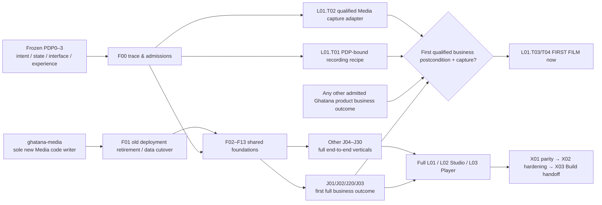
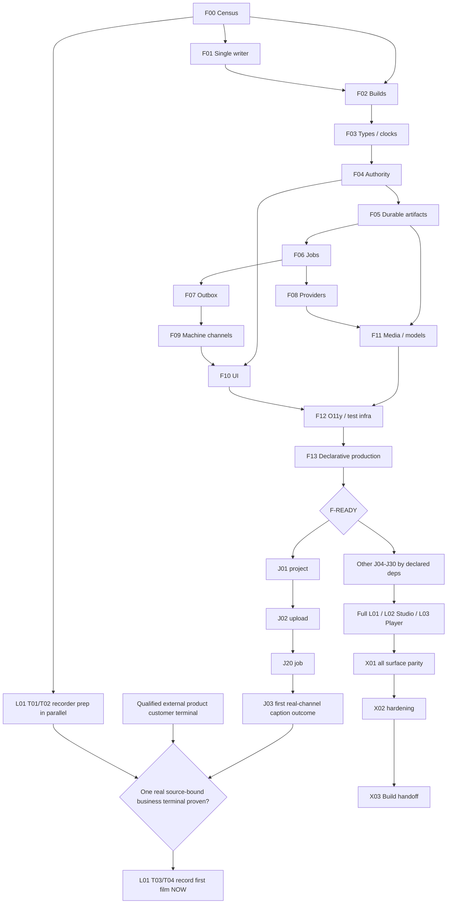

# Ghatana Media — canonical BUILD / Plan Implementation

> **Active real-modality unblock:** [Wave 2 R10 owner execution](MEDIA-WAVE2-R10-OWNER-UNBLOCKED-EXECUTION.md), with exactly 36 open tasks and 12 owned implementation gates. The source-owned 50-package Build plan is otherwise unchanged. Do not mistake local model output, Docker wrapper syntax or reviewer signatures for licensed and durable customer effects.

> **Media-wide external candidate decision inventory, 2026-10-28:** [Consolidated owner technology and research-candidate register](MEDIA-CANDIDATE-DECISIONS-CONSOLIDATED-2026-10-28.md) and its [source-linked 22-domain crosswalk](observations/media-candidate-decision-crosswalk-2026-10-28.json). Existing PDP-0 technical selection decisions are primary; R9 six reference assets are narrow evaluation candidates, not replacements for full-product video/image/audio/animation/simulation technology research. Verify future changes with `pnpm check:candidate-decision-crosswalk`.

> **ACTIVE OWNER EXECUTION CORRECTION — 2026-10-24.** All NEW Media-specific backend source changes, contracts, migrations, tests, fixtures, launcher and provider wiring are implemented in **samujjwal/ghatana-media on main**, even while gtool and PDP formalization are incomplete. The old `ghatana/services/media` implementation is READ-ONLY migration input, not an editable canonical source. Existing deployed state/database/worker/publisher remains singular and unchanged until M08 operational cutover. The previous dated writer baseline and old "plan-only" language below are HISTORICAL observations, not current instructions. The exact five-backend-unit + eight import/lineage tasks and 56-row PDP trace are in [the active focused implementation slice](MEDIA-BACKEND-FOUNDATION-DEEP-IMPLEMENTATION-2026-10-24.md). The complete product scope and this plan's remaining packages still apply; no native gtool status or public contract admission is inferred.

**Next focused backend wave (source-inspected 2026-10-24):** [five modality and observability physical surfaces](MEDIA-BACKEND-MODALITY-WAVE2-EXECUTION.md) implements F08/F09/F11/F12 and journeys J-03/J-04/J-05/J-06 plus linked speech outcomes. 58 exact local implementation tasks, 99 source-registered PDP-0 capability memberships, all 43 observed STT/TTS/Vision/Multimodal gRPC methods, 12 end-to-end oracles. GH-90000 compose images (9 previously reported skipped tests), warn-only Checkstyle, formal PDP/gtool Track B, legacy active-writer cutover, and the Shared source-free task bug are **separate residual/handoff entries**, not this implementation denominator. Real provider/model qualification and code/tests remain unverified by the plan. These labels are local work tracking, not new Build/PDP/gtool contract records; the repository-wide population is unchanged.

**Campaign scope | Source baseline | Macro stage | Exact substage | Physical/composite surface denominator | Prerequisite state | Permitted work**

| Field | Current planning cut |
| --- | --- |
| Campaign | Every applicable Media PDP-0..3 definition, 26 physical candidates, 6 semantic compositions, repository root, 21 logical consumers |
| Source baseline | `samujjwal/ghatana-media@83395e52664c7323dd155b1eb4895c995dfd1fa0` (2026-10-21 14:13:44 UTC); source tree `bd2fddcaa2892d8f94fba0280db1e3808c015200` |
| Runtime writer baseline | `samujjwal/ghatana@ca4a5124539afd2a032cd806eb4a9fc0ec577b2b` (remote main observed 2026-10-21); original `services/media` remains canonical until authorized transfer |
| Macro / exact stage | BUILD / `KDEV-STAGE-PLAN-IMPLEMENTATION` |
| Source status | Four PDP status records recorded DEV_COMPLETE and 0 outstanding definition tasks (38/38 direct development criteria recorded PASS); these are definition development statuses, not implementation/acceptance |
| Worktree | Remote Git main tree inspected; local checkout at `/home/samujjwal/Developments/ghatana-media` not accessible here; local modifications/validator rerun unobserved |
| Permitted | Historical planning snapshot only. **Current owner directive permits backend engineering in ghatana-media now**; formal Kernel/gtool state/closure and active runtime cutover remain independent. |
| Plan status | **PLAN AUTHORED for BUILD**; Build Implement entry is subsequent exact-source ownership/trace admission, not granted by this document. |

## 1. Authority, source fingerprints and non-negotiable distinctions

- Media product meaning: `.product-experience/pdp-0-product-truth/`, `pdp-1-domain-data/`, `pdp-2-design-interface-system/`, `pdp-3-product-experience/`; no rewriting closed PDP meaning to fit code. `AGENTS.md`, Kernel `KDEV-STAGE-PLAN-IMPLEMENTATION`, and Lifecycle `PhaseProgram` govern the stage; `PHASE-*` is not a PDP.
- Physical topology SHA (Git blob): `f8a02ddc1505306ee8fe2a9d44e7d6155eb3afdd`; surface registry blob `dec599b257e074e908e70fb5f77d5ee8a7132ec8`; source-manifest blob `7b66a559d97765b72101f455d140f843374f0382`. PDP-0/1/2/3 status blobs: `585dc9f21d81c2efb728ae4db75c08c24eea7fbf`, `f0327eec5fbf36b31638d2e0d0d6bdccb974b437`, `4bfabc621b79bf45c097767e5536da5e1a4b837c`, `750b9b52714f47c9b7fde7ce4e34f57a0d4cb9b9`. These and the full Git tree are immutable baseline locators; phase `sourceShaSet` values remain the normative material-content pins, not commit SHA truth.
- PDP source coverage: **462** adjudicated capability leaves and **7** definition-extension operation mappings; **38** requirement groups; PDP-1 **2040** recorded identity entries, including 108 owner operation records, 27 HTTP, 43 gRPC, 33 SDK, 11 CLI, 4 Agent Tool, 9 events, 148 UI actions; PDP-2 **31** component families plus 122 typed values, 9 token aliases, 24 public CSS bindings, 20 media CSS projections, 13 templates, 11 layouts, 13 recipes, 43 composition rules, 19 interaction patterns and 12 machine invariants; PDP-3 **47** screens, **30** journeys, **130** steps, **61** intended channel edges and **31** scenario source definitions.
- Three independent levels must not be conflated: **authored product definition** (`DEV_COMPLETE`), **actual tested implementation** (Build), and **independent acceptance/PDP closure/release** (other lanes). A UI mock, queued job, proposal, generated client, local provider or source validator is not product behavior. No Media app is released.
- Evidence caveat: recorded 38 development criteria and representative current source SHA-256 pins reviewed; native full source-current/phase validators could not be reexecuted in this remote-only review. **No actual semantic mismatch established.** F00 reconciles exact pins locally without reopening completed PDPs for superficial commit drift.
- Single master: **this file** governs Build package ordering and dispositions. Companion `MEDIA-BUILD-IDENTITY-TRACE.v1.json` is a generated/indexed *appendix*, not a separate authoring source or competing plan. Existing `MEDIA-BUILD-COMPLETE-PRODUCT-PLAN-2026-10-15.md` and dated post-PDP plans are historical leads only (50/17 denominators superseded by current 54/21). Do not silently delete them while links/provenance remain.

## 2. Scope census and applicability

| Source population | Count | Authority | Build treatment |
| --- | ---: | --- | --- |
| Physical manifest candidates | 26 | `.product-experience/surfaces/media-physical-topology.v1.json#manifestCandidates` | 15 PDP-0 applicable, 8 support-only N/A, 3 no admitted runtime; support still receives owned Build prerequisite where used |
| Semantic compositions | 6 | topology `#compositions` | Direct cross-child semantics; no double-counting shared leaves |
| Repository root | 1 | `media.composition.repository-root` | Integrated coverage and overall Build gate |
| Logical consumers | 21 | topology `#consumerCrosswalk` and `surface-registry.yaml` | 20 active logical targets; `media.surface.desktop-archive` is explicit archived N/A |
| Unique surface identities | 54 | current topology | 54 × PDP-0..3 applicability is differentiated per phase; not 54 executable services |

**Applicability law:** N/A is only sourced from the physical phaseApplicability record or `NOT_ACTIVE_ARCHIVED` consumer disposition. A headless interface still has PDP-2/3 contracts. Gaps in host publication/provider admission remain **applicable but blocked**, not N/A.

**Implementation classifications:** observed prepared source exists for launcher, runtime-contracts, provider, JVM services and UI/SDK; some source tests exist; actual running/authoritative end-to-end product behavior is **UNVERIFIED**, with many consumers `CONTRACT_ONLY`, `HOST_DEPENDENT`, or `NOT_ADMITTED`. Source presence and source-level tests never earn `COMPLETE`. The Ghatana writer must be inspected in parallel in F01 before assigning editable Java paths.

## 3. Implementation architecture and ownership

**Semantic owner = Media** for artifacts, versions, recipes, scenes, Media run/job semantics, media-specific access, temporal analysis, quality, rendering, captions and producer/output identities. **Mechanism owner = published Shared/Kernel/Data Cloud/Event Plane/AI Inference/Document Intelligence/Action Plane as appropriate** for generic identity, audit, governance, event bus, model routing, document OCR and external privileged effects. No direct private cross-repo imports in releasable runtime. **Implementation code authoring now belongs in `ghatana-media`**; the former `ghatana/services/media` is read-only historical source, while any active legacy binary remains the sole deployed state writer until authorized cutover. Shared physical implementations serve many surface contracts without duplicate writers or databases.

### Existing implementation and reusability disposition

| Area | Observed source | Classification / action |
| --- | --- | --- |
| Runtime HTTP and domain SPIs | `ghatana-media/launcher/`, `runtime-contracts/`; old `ghatana/services/media/` read-only comparison | Existing artifact/job/stream sources require **import/merge and isolated Media-root build proof**; full PDP realization unverified |
| Persistence and schema | Destination Media `providers/aws-postgresql/` V001–V009 versus historical Ghatana Media V001–V016 (**V007–V009 divergent**); `modules/infrastructure/persistence/` | Two source histories are **not equivalent**; F01/F05 own ordered schema/data reconciliation; never start two writers |
| JVM modalities | `modules/speech/{stt-service,tts-service}`, `modules/vision/vision-service`, `modules/intelligence/multimodal-service` | Source/proto/test present; provider capability and exact PDP endpoint admission unverified |
| Native and streams | `modules/intelligence/speech/libs/speech-audio-rust/`, `modules/{audio-streaming,video-streaming}/` | Utility/candidate; codec/stream/solver completeness unverified |
| Public channels | `contracts/openapi/media.yaml`, `config/route-manifest.json`, proto, `libs/audio-video-{types,client}/` | Contracts/candidates present; exact operation parity and publish admission pending |
| UI and Explorer | `libs/audio-video-ui/`, `modules/intelligence/ai-voice/libs/ai-voice-ui-react/`, `apps/media-experience-explorer/` | UI packages and source-linked mocked Explorer; **no admitted product web host** |
| Capture and declarative production | Gharbatai private `@ghatana/experience-recorder` and TutorPutor AEF semantic contracts, Media P1/P2 definitions | Reuse only after owner/public ABI tests; no Playwright host or scientific solver invented from fixture code |
| Infra and deployment | `infra/helm`, `infra/kubernetes`, `docker/`, `config/` | Disabled/unadmitted deployment candidates; do not activate while planning |

## 3A. Ghatana ecosystem reuse and admission ledger

**Implementation default: reuse the canonical public Ghatana mechanism, add only Media-specific domain behavior.** No duplicate identity, auth/policy runtime, event bus, model router, document extractor, product-definition validator, general agent engine, scientific learning authority, media writer, recorder core, database or evidence platform. An implementation package must first inspect the current owner API and decide `REUSE_PUBLIC`, `ADAPT_PUBLIC`, `OWNER_REQUEST`, `MEDIA_OWN_DOMAIN` or `NOT_ADMITTED`. Source presence does not equal a built, published, licensed, tested or authorized dependency. Dev source-composite results are `TEST_ONLY` and never release artifact qualification.

**External repository inspection cuts (provenance, not publication/acceptance):** Ghatana `ca4a5124539afd2a032cd806eb4a9fc0ec577b2b`; Shared `db5b65e566e8b02040648e7b90112121be329769`; Tools `e2a63235a53884ffa314c3c1430782e11b08afd3`; Kernel `d2632fd4900364021f30e8c430b290adb08420d2`; Lifecycle `6f697c7c54cab127b9d97533a457723b897e4d2b`; Gharbatai `87b653da9e3e0a120aff9e1534ebb4d3d7c0f57e`; Products/TutorPutor `7ce99ff183250d104247ccdc45e8201c06532adc`. Each owner/implementer must recheck exposed ABI, source/content fingerprint, license and consumer compatibility before Build acceptance.

| Shared foundation or vertical | Reuse from authoritative Ghatana owner | Media-specific implementation and admission/negative test | Package IDs |
| --- | --- | --- | --- |
| Identity, authorization, security, governance | `ghatana-shared/platform/java/{core,security,governance,runtime,http}/`; Shared TS `api,state,platform-utils` | Adapt tenant/principal/rights/consent/biometric/region to Media operations. Deny forged/expired/cross-tenant or stale-authority effects; no local generic identity service. | F03 F04; V01 V21 V26 |
| Audit, O11y, privacy, testing | Shared Java `audit,observability,testing,testing-integration,testing-activej` and TS `audit,accessibility`; Media `audio-video-observability/` | Media event/job/version/clock correlation with no raw frames, transcripts, credential or voice-identity leakage; measure before inventing SLO; hermetic/real test separation. | F02 F12 X01 X02 |
| Durable events/outbox | Shared `platform/java/messaging` public `OutboxPublicationSource` and `ClaimedOutboxPublisher`, `platform/java/database` outbox API; Ghatana `services/event-plane/` public ingress | Media transactional lifecycle outbox source and consumer reconciliation. Fail publication closed, preserve identity/order, never ACK ambiguous broker/outbox state or duplicate an Event Plane. | F05 F06 F07; V20 V22 V26 |
| Product definition, interfaces and handoff | Tools `libs/product-development/{product-definition,experience-language,experience-specification,experience-package,implementation-handoff}/`; public `validateImplementationHandoff` | Media-only source-derived package/identity mapping and experience fixtures. Trace 3,186 identity rows and 61 channel edges; no alternative schema, Explorer authority or implementation scheduler. | F00 F02 F09 X01 |
| Lifecycle and PhaseProgram | Kernel `docs/spec-driven-development/kernel-development-lifecycle.yaml` and Lifecycle `docs/architecture/PHASE_PROGRAM.md` | Record exact Build implementation evidence; native PDP closure separate; do not equate `PHASE-*`, `PDP-*` or release. | F00 X03 |
| Reusable browser/embedded UI and a11y | Shared TS `design-system,ds-headless,ds-registry,ds-schema,tokens,theme,product-shell,accessibility,i18n` | Media waveform, timeline, captions, Studio, simulation instruments, accessible finality/unknown states in a real product host. Test packed consumer, keyboard, reflow, reduced motion, localization and denials. | F10, GUI verticals, L02 L03 |
| Existing Media runtime and local provider SPIs | **Source code destination:** `ghatana-media/{launcher,runtime-contracts,providers,modules}/`, `MediaLauncher`/`MediaRuntime`; legacy equivalent is read-only | Extend **only the Media repository** for Media semantics; preserve REST/proto/DB compatibility. A present local provider or passing module test is not admitted end-to-end production functionality. | F01–F09; V01–V30 |
| Data Cloud and governed projections | Ghatana `services/data-cloud/` public metadata/read-model contract | Project approved Media asset/provenance/quality metadata by exact subject/version; projection may never declare job completion. | F07 F09; V06 V21 |
| AI/model inference and provider policy | Ghatana `services/ai-inference/` public model/provider boundary | Media modality/profile/rights/time/region/cost guards and typed result mapping. Missing profile/license/credentials/region = `NOT_ADMITTED`; timeout UNKNOWN prevents unsafe replay. | F08; V03–V19 V30 |
| Document extraction/OCR | Ghatana `services/document-intelligence/` public API; MDI-001 | Only scene/frame/track/time-bound text observations; old Media OCR compatibility removed **after** published client and consumer parity. Do not fork OCR or claim accuracy without measured evidence. | F08; V05 V06 |
| Privileged external delivery | Ghatana `services/action-plane/` published effect and receipt contract | Media exact version/destination intent, rights scope, receipt/readback; queued/accepted != delivered, missing remote receipt remains UNKNOWN. | F04 F07; V22 |
| Agent/tool execution | Ghatana `services/agents/` public invocation/policy surface and Media's four exact Agent Tool contracts | Typed bounded Media tool adapter, quota/timeout, least privilege; no self-authorizing generic agent runtime or bypass of Action Plane. | F09 V25 |
| Recorder/capture/presentation | Gharbatai `tooling/experience-recorder/` private `@ghatana/experience-recorder`: `capture-core,capture-selection,scenario-director,story-intelligence,narration,quality,presentation` | **Reuse as candidate, not published dependency:** package is private `0.0.0` and retains some Playwright dependencies; qualify dependency closure/packed consumer, then owner-approved neutral core extraction. Gharbatai product stories/drivers remain in Gharbatai. | F13 L01 L02 |
| Domain simulation and educational experience | Products `products/tutorputor/contracts/v1/experience/{model-ir,scene-ir,experience-ir,schemas,validation,replay}.ts`; `libs/tutorputor-simulation/` | Consume versioned AEF Model/Scene/Experience IR through public adapter; Media owns rendering, clocks, artifacts and instrument views. Numerical/solver/scientific truth remains separately validated by domain owner; Explorer fixture simulator is **not** solver. | F03 F11 F13; V12–V15 L03 |

### Mandatory reuse-before-new-code receipt for every F/V/L/X package

The implementing owner records **(1)** exact existing owner/source and admissible public export (or witnessed absence), **(2)** version/fingerprint and dependency/rights/ABI decision, **(3)** adaptation versus new genuinely Media-specific logic with rationale, **(4)** replay/denial/timeout/cancellation/UNKNOWN/retention/erasure/privacy/accessibility and perf tests as source requires, **(5)** irreversible migrations and cutover/rollback boundary, **(6)** exact behavior and result/effect proof. Shared implementation is counted **once**, but each active consumer gets its own channel/host parity test. No original Media capability is downgraded to mock, preview or generic “unsupported” just because a provider is unadmitted: retain the intended obligation and its precise external blocker.

**The recorder and TutorPutor are especially important reuse boundaries:** the Gharbatai product-neutral recorder code may be extracted only with accepted ownership and public package tests; do not copy its private Playwright host or demos into Media. TutorPutor AEF does not transfer learner/pedagogy/evidence ownership to Media; bind semantic IR/model/solver through declared contracts and treat media render, scientific validation and actual product effect as distinct finalities.

## 3B. Material source/writer migration gap — repair within Build, never PDP

**Observed source histories differ:** canonical `ghatana/services/media/providers/aws-postgresql/src/main/resources/db/media-runtime/` contains **V001–V016** at `ghatana@ca4a5124539afd2a032cd806eb4a9fc0ec577b2b`, while prepared `ghatana-media/providers/aws-postgresql/src/main/resources/db/media-runtime/` contains **V001–V009** at `ghatana-media@83395e52664c7323dd155b1eb4895c995dfd1fa0`. The latter's **V007–V009 have different names and meaning**: mirror `V007__media_job_unknown_outcome`, `V008__media_job_request_fingerprint` and `V009__media_upload_idempotency` versus canonical `V007__media_job_unknown_provider_outcome`, `V008__media_job_artifact_content_version` and `V009__media_job_attempts_and_outbox`. Canonical V010–V016 also cover artifact formats, submission digest, outbox delivery, quarantine/lineage, attempt finality, transcript revisions and outbox leases.

**F01 and F05 required Build decision:** compare ordered SQL *content* and applied Flyway histories, schemas/indexes/data transformations, leases/outbox/transcripts/retention, REST/proto route owners and consumer versions. Prepare exactly one admitted migration/upcaster path and dry-run on both old/current data snapshots, then obtain the genuine runtime/migration owner decision. **Never apply the mirror's V007–V009 to a canonical-writer database, run two writers on the same queue/DB, or silently renumber scripts.** F-READY requires a source-pinned one-writer and schema-compatibility plan; actual cutover, DB migration and rollback execution are **not** authorized in this planning task. This is a Build implementation seam, not unfinished PDP definition.

## 3C. Foundation-first end-to-end reuse coverage

| Vertical groups (all 30 source journeys) | Reusable ecosystem | Media output and real test target |
| --- | --- | --- |
| J01/J02/J20/J21/J23/J26/J27/J30 | Shared identity, security, outbox, database, UI, Data Cloud projection | Authorized project→source/version→durable job/readback, review, offline/unknown, erasure and eligibility |
| J03/J04/J07/J16/J17/J29 | Canonical Media speech/stream provider, AI Inference, Shared O11y/messaging | Real STT/TTS, caption versions, audio cleanup, mixing/dubbing, stream recovery |
| J05/J06/J08/J11 | Media vision/multimodal, AI Inference, Document Intelligence | Real time/frame/geometry/region-grounded observations, measured repair, undo |
| J09/J10/J12/J13/J18/J19/J28 | Media creation/render/model SPI, Shared UI/governance, admitted model/codec providers | Composed/rendered reviewed version; 2D/3D and spatial export with explicit loss/quality/finality |
| J14/J15 | TutorPutor versioned AEF contracts and domain-validated solver adapters | Reproducible model run, typed simulation clocks/units/fidelity/instruments; not mere animation |
| J22/J24/J25 | Action Plane, Shared messaging/outbox, Agents, typed machine contracts | Exact destination ACK, CLI JSON/exit, delegated Agent Tools without privilege invention |
| Recorder/Studio/Player | Gharbatai neutral recorder candidate, Shared DS, TutorPutor AEF, canonical Media jobs/versions | Actual source-grounded recording/recapture, full manual edits, provenance-safe interactive playback |

**Execution rule:** F00/F01 freeze writer/trace; prepare read-only PDP-source-bound recording specs and qualify the Gharbatai recorder as early as the scoped prerequisites allow; independent F02–F13 work can proceed concurrently with disjoint files; F-READY gates vertical implementation; J01→J02→J20→J03 then establishes the first real business outcome and triggers early capture at §5A's actual proof gate. J04–J30 run in bounded independent lanes **after their named prerequisites**. Do not duplicate Shared work per vertical or convert local fixture output into runtime proof. No runtime implementation, PDP closure or Delivery is performed by updating this plan.

## 3D. Independent plan-quality review and mandatory implementation admission

**Observed review baseline:** GitHub main at `cabbdedc73056bea4dbf5447b94e5edfb06e68b3` (21 October 2026), inspected against the frozen source cut stated in §1, the 3,186-row companion trace, the actual Media `package.json` scripts, `AGENTS.md`, `BOUNDARY.md`, live provider manifest and the two physical Flyway directories. The 50-package dependency graph was checked for duplicate IDs, dangling package dependency IDs and cycles (none observed). These are **review observations, not native local validator runs or runtime evidence**.

**Readiness verdict:** architecture and package *plan* are authored; all 50 packages are **not yet individually READY_TO_IMPLEMENT**. F00 exact semantic joins, F01 one-writer decision and the package-specific entry contracts below must be satisfied before the affected implementation. The program must not call a row or surface implemented because the trace gives it a package owner.

| Review ID / severity | Verified gap or unresolved execution condition | Prescriptive correction and proof owner |
| --- | --- | --- |
| PR-01 / critical | 3,186 trace identities have primary packages, but required P0→P1 operation/guard→P3 step/edge→actual route/handler/code and response/readback joins are still `ASSIGNED_UNVERIFIED`. Row count alone is not a semantic bijection. | F00 generates and tests the exact contract bridge (§4A); F09/vertical owners bind real exported code symbols and tests. No V package is code-admitted with a classifier-only binding. |
| PR-02 / critical | Two incompatible Flyway V007–V009 histories and the canonical V010–V016 remain; a planned mirror path was mistaken for the migration authority. | F01/F05 preserve canonical V001–V016 and actual applied histories, freeze old writers/leases, dry-run migration/upcasters and prove no same-DB dual writer. Use only additive ordered canonical migrations after owner approval (§3B). |
| PR-03 / high | F10 formerly required completion of 47 feature screens before the 30 vertical packages that implement those features. | F10 only admits the production shell/adapters/common UI + minimal live proof. V/L own every source screen's real data/action states and X01 checks all 47. |
| PR-04 / high | F13 formerly required working project, rendering/simulation and recapture before V01/V09/V14/L01. | F13 admits typed spec compilation and the durable job substrate. Real effect oracles belong to the named later packages. |
| PR-05 / high | No actual production web/embedded host exists in `apps/` (Explorer only), and no admitted host artifact is evidenced. | F10 records explicit product host ADR and authenticated Shared shell route, or creates a governed new host target; adding a physical leaf requires the normal topology/change-impact decision, never an unregistered app or Explorer promotion. |
| PR-06 / high | Shared, Event Plane, Data Cloud, AI Inference, Document Intelligence, Action Plane, Agents, Gharbatai recorder and TutorPutor contracts are reuse candidates, not proven published release artifacts. | F02/F04/F07/F08/F09/F13 keep owner-issued public ABI/version/license/dependency/consumer-test receipts. Allow pinned `DEV_SOURCE_COMPOSITE` for development only; never assume `RELEASE_ARTIFACT_ONLY` admitted. |
| PR-07 / high | Generic repeated V-package test prose does not itself define the 30 journey-specific pass/fail oracles or 61 intended-edge proofs. | §6A supplies one concrete minimal oracle per journey; F00/F09 must bind every source step and edge to a source-pinned test ID, negative branch and actual outcome. |
| PR-08 / medium | **Resolved documentation drift:** the active provider metadata is `config/provider-manifest.json`; no YAML manifest is used. | F08 uses the existing JSON registry and evidence/eligibility policy; no shadow manifest. |
| PR-09 / high | Candidate codec/model/render/solver engines, host/device permissions, accuracy targets, hardware and model-weight licensing have no uniformly admitted concrete profile. | F08/F11 and V owners maintain per-capability admission cells (exact engine/version, license/weights, profile, supported hardware, workload, cost/latency, failure/fallback, owner decision and real test). A named unadmitted candidate is not completion. |
| PR-10 / high | Resilience, erasure and performance could otherwise be accepted by successful-case fixtures only. | F05–F07/F12 and X02 require crash points, stale leases, lost ACK, replay, provider UNKNOWN, tenant denial, retention/holds/replicas, native parser isolation and agreed real workload thresholds; no fabricated SLOs. |
| PR-11 / high | Recorder package is private `0.0.0` with a Playwright dependency; Studio/Player have incomplete runtime owners. | F13/L01–L03 require packed neutral-core license/dependency closure and qualified capture adapters, source-action versus screen-frame receipts, editor operation matrix, signed/sandboxed embed controls and truthful unadmitted-mode disclosures. |
| PR-12 / medium | The identity trace's `GENERATED_READ_ONLY` status has no observed dedicated Build trace regeneration/check command among Media `package.json` scripts. | F00 supplies a deterministic generator and a separate non-mutating checker with negative fixtures; new command names below are **deliverables**, not commands asserted runnable today. |
| PR-13 / critical | Kernel `KDEV-STAGE-PLAN-IMPLEMENTATION` exit requires actual task-level trace, capacity-aware independent work packages and engineering/product/quality approval, none established by a 50-section narrative or provisional identity trace alone. | §11B defines the required machine handoff/tasks, plan validator, owner decisions and explicit approval receipt; keep exact Plan exit `PENDING` until checked. |

**Per-package admission record (mandatory, minimal and bounded):** unique package ID; accountable runtime/semantic owner; source baseline/material fingerprints; all applicable source IDs and source-authorized N/A; canonical repository and editable module files; exact public ABI/interface and dependency versions; upstream decisions/rights/permissions; prerequisite status; PR-sized task list; deterministic representative and adversarial fixture; executable command(s) with expected result; observable real effect/denial/retry/UNKNOWN/version evidence; compatibility/migration/rollback/fencing; service/resource limits and license; reviewer decision; and one of `READY_TO_IMPLEMENT`, `READY_LOCAL_SUBSTRATE_ONLY`, `BLOCKED_EXTERNAL`, `NEEDS_EXACT_BINDING`, or `N/A_SOURCE_AUTHORIZED`. All fields are required before taking *that package* into Implement. An absent owner consent or unpublished API must be marked blocked, not silently assumed approved.

**Provider selection rule:** per modality, test local permissively licensed options against real format/output/finality contracts first, then owner-approved external engines if needed; pin exact package/model/weights licenses and their commercial restrictions before use. Do not infer algorithm quality from install success. Record a demonstrably deterministic development engine separately from a qualified production-quality engine. GPU unavailable blocks only dependent execution, never unrelated code or contracts.

**Build parallelism:** the common foundation is built once, not reinvented by each vertical. Each F package can have an early harness/contract subtask and a later feature-independent conformance subtask, but F-READY includes only substrate semantics that can actually be proven before V01. Never promote a partial F package to complete; retain outstanding work as named package subtasks, not false green.

### F01 migration/cutover go/no-go sequence (mandatory to implement, not executed by this plan)

1. Inspect both SHA-pinned directory trees, each SQL statement/checksum and **actual applied Flyway schema history** on representative supported old/current DB states. Treat an inaccessible real history as `UNKNOWN`.
2. Build an executable compatibility inventory: schema objects/constraints/indexes, API/proto/SDK consumers, content/version keys, in-flight jobs, leases/fences, provider requests, outbox rows, transcript/caption revisions and encrypted object references.
3. Name a single owner-authorized writer location. All new Media code changes are implemented in `ghatana-media` immediately; older source is comparison-only, and live service/data writer cutover is separate. Never overwrite a database with the mirror's colliding V007–V009.
4. Draft canonical forward-only expand/upcaster/contract migrations and canonical-versioned compatibility shims. Reconcile rows/foreign keys/tenant keys, uploads, outbox offsets, object hashes and erasure holds with dry-run counts and source-digest comparisons.
5. Rehearse under paused dispatch, fenced workers and source-pinned backup/snapshot; compare query/API answers and queued/ambiguous side effects. Any unaccounted in-flight external request is an explicit cutover stop.
6. Switch routing/deployment ownership exactly once, with lease and outbox single-writer checks and canary readbacks; preserve rollback by restoring *application ownership* and compatible readers, not blindly reversing irreversible SQL.
7. Produce signed-off go/no-go, reconciliation, replay/duplicate suppression and rollback receipts with the appropriate Ghatana/Media/storage owner. Cutover work remains a separately authorized future Build activity; this plan changes no production writer or schema.

## 4. Work ordering: foundational surfaces before any vertical implementation

**Hard policy for execution:** finish the minimum functional/contract-safe Build foundation for **all F00–F13** before starting vertical runtime implementation. Independent foundations may proceed concurrently after their prerequisites, but no J-slice may use mock-only, fake effects or competing runtime writer. F-READY is internal engineering readiness, not production admission. Individual external provider/hardware restrictions block their dependent vertical, not unrelated ones.

Each foundation package below includes exact paths, ownership, dependency, contract and observable tests; all commands are **future recommendations only**, not execution evidence. Each requires source-bound unit/contract/negative tests, idempotency, privacy/security and migration notes. For each package implementers record baseline fingerprints, source diff, test command/pass summary, fixtures and review disposition without claiming PDP closure.

### M-BLD-F00 — Frozen contract census, implementation bridge and build admission

**Owner / exclusive write boundary:** Media Build coordinator / source-trace owner. **Dependencies:** None. Avoid concurrent mutations in the same paths; the cross-repo writer rule in F01 overrides a target path mention.

**Outcome & scope:** Pin current definitions and source fingerprints; enumerate 469 capability intents (462 adjudicated and seven extensions), 38 requirement groups, PDP-1 identities, P2 interface families, P3 screens/journeys/steps/edges and 54 surface obligations. For each record bind a primary Build package and real code/contract target; preserve explicit N/A, unsupported and external owner decisions.

**Canonical source/target paths:** `.product-experience/{source-manifest.yaml,surface-registry.yaml,traceability.yaml,surfaces/media-physical-topology.v1.json}`, `docs/implementation/pdp-*-phase-dev-status.json`, `docs/implementation/MEDIA-BUILD-IDENTITY-TRACE.v1.json`. All new Media source implementation and tests belong in `ghatana-media`; former `ghatana/services/media` is read-only compatibility input while actual live deployment cutover is still pending.

**Test layers / commands (plan only):** `pnpm check:physical-topology`; `pnpm check:product-experience-local`; `pnpm test:product-experience-local`; phase-specific source-pin checks.

**Observable acceptance / completion evidence:** Exact-set bijection (no missing/duplicate IDs), 26/7/21 denominator, zero silent excluded surfaces, decision and fingerprint provenance. Any material PDP defect is a separate owning-phase return, not Build repair. Save exact source SHA-256, owned commit, unit + negative and integration observations with environment/provider identity, and reviewer disposition.

**Security/privacy/performance & external risk:** Stale source and ID drift; reconcile only changed semantic fingerprint, never global HEAD as proof.

**Rollback/migration:** This package is read-only inventory; regenerate trace from frozen authorities rather than editing PDP sources.

### M-BLD-F01 — One canonical runtime writer and reversible source cutover

**Owner / exclusive write boundary:** Media runtime owner + Ghatana source owner. **Dependencies:** M-BLD-F00. Avoid concurrent mutations in the same paths; the cross-repo writer rule in F01 overrides a target path mention.

**Outcome & scope:** Compare the historical `ghatana/services/media` runtime READ-ONLY against the now-designated `ghatana-media` implementation repository at exact commits and directory/build coordinates. Enumerate runtime sources, registry ownership, migrations, deployment manifests, routes, consumer imports and overlapping writers. Prepare reviewed migration/cutover sequence with one write freeze, data/lease/outbox reconciliation and rollback; the sole source-code implementation destination is `ghatana-media` now, while the old active runtime stays untouched until a safe operational cutover.

**Source/target paths:** Implement exclusively in Media `{launcher,runtime-contracts,modules,providers}` plus `migration/`, `.ghatana/repository.json`, `BOUNDARY.md`, and owner/consumer source adapters; legacy `ghatana/services/media/` is read-only comparison evidence. All new Media source implementation and tests belong in `ghatana-media`; former `ghatana/services/media` is read-only compatibility input while actual live deployment cutover is still pending.

**Test layers / commands:**
pnpm report:media-source-target-tree
pnpm test:source-target-tree-crosswalk
pnpm test:compatibility-cutover-observation

**Positive test IDs:**
- M-BLD-F01.T01.POSITIVE.TREE_PARSE_MODES — tests/media-source-target-tree-crosswalk.test.mjs::parses NUL-delimited git tree records, including executable and symlink modes.
- M-BLD-F01.T01.POSITIVE.EXACT_PATH_MODE_BLOB_DENOMINATOR — tests/media-source-target-tree-crosswalk.test.mjs::compares exact relative paths, modes, and blobs with a reconciled denominator.
- M-BLD-F01.T01.POSITIVE.TREE_OBJECT_PINS — tests/media-source-target-tree-crosswalk.test.mjs::reads the commit tree object instead of mistaking the commit ID for the tree ID.
- M-BLD-F01.T01.POSITIVE.REMOTE_CUT_EVIDENCE — tests/media-source-target-tree-crosswalk.test.mjs::current source-cut evidence pins both remote-tracking trees and keeps checkout drift separate. This test fixture is historical 2026-10-12 evidence; the dated report command generates the current observation.
- M-BLD-F01.T01.POSITIVE.CANONICAL_WRITER_BOUNDARY — tests/media-compatibility-cutover-observation.test.mjs::compatibility ledger preserves canonical-source and unverified-cutover boundary.
- M-BLD-F01.T01.POSITIVE.CONSUMER_LEDGER_LIMITATIONS — tests/media-compatibility-cutover-observation.test.mjs::local consumer evidence and external gates cannot silently disappear.

**Adversarial test IDs:**
- M-BLD-F01.T01.ADVERSARIAL.MISSING_REMOTE_CUT — tests/media-source-target-tree-crosswalk.test.mjs::marks missing remote source cuts UNVERIFIABLE instead of emitting an empty comparison.
- M-BLD-F01.T01.ADVERSARIAL.HEAD_MISMATCH — tests/media-source-target-tree-crosswalk.test.mjs::flags a main branch and remote-cut head mismatch as UNVERIFIABLE.
- M-BLD-F01.T01.ADVERSARIAL.NO_UNAUTHORIZED_CUTOVER — tests/media-compatibility-cutover-observation.test.mjs::compatibility ledger preserves canonical-source and unverified-cutover boundary.
- M-BLD-F01.T01.ADVERSARIAL.NO_FALSE_EXHAUSTIVE_CONSUMER_CLAIM — tests/media-compatibility-cutover-observation.test.mjs::local consumer evidence and external gates cannot silently disappear.

These IDs and commands define planning checks only. Passing them validates tree-observation mechanics and safe boundary reporting; it does not prove current Flyway history on a live database, exhaustive consumer parity, external source-owner approval, or rollback/no-double-writer behavior.

**Observable acceptance / completion evidence:** Byte/path-level two-repo crosswalk; sole writer and destination selected with owner decision; route/proto/schema/consumer compatibility proof; rollback with no double workers/outboxes. Media source consolidation may be actively implemented now; no activation of the second runtime or operational cutover in a planning step. Save exact source SHA-256, owned commit, unit + negative and integration observations with environment/provider identity, and reviewer disposition.

**Security/privacy/performance & external risk:** Two canonical writers, stale mirror, cross-repo imports, queued work and schema divergence.

**Rollback/migration:** Keep original writer running; rollback via previously pinned source, consumer and schema adapter; never reverse an irreversible migration blindly.

### M-BLD-F02 — Polyglot build, dependency and toolchain admission

**Owner / exclusive write boundary:** Media build tooling owner. **Dependencies:** M-BLD-F00, M-BLD-F01. Avoid concurrent mutations in the same paths; the cross-repo writer rule in F01 overrides a target path mention.

**Outcome & scope:** Reconcile Gradle JVM 21 modules/version catalog, pnpm workspaces/lock, Rust 2021 Cargo lock, source-composite dependencies and release-artifact-only policy; verify generated OpenAPI/protobuf/TS identity/version parity and module builds with no skipped essential tasks. Distinguish local-source composite from published admissible artifacts.

**Canonical source/target paths:** `settings.gradle.kts`, `build.gradle.kts`, `gradle/libs.versions.toml`, `gradle.properties`, `package.json`, `pnpm-workspace.yaml`, `pnpm-lock.yaml`, `Cargo.toml`, `Cargo.lock`, `config/dependency-admission/`. All new Media source implementation and tests belong in `ghatana-media`; former `ghatana/services/media` is read-only compatibility input while actual live deployment cutover is still pending.

**Test layers / commands (plan only):** `./gradlew buildFull`; `pnpm test:dependency-inventory`; `pnpm test:tools-media-consumer`; `pnpm test:shared-media-consumer`; `cargo test --workspace` (verify actual Cargo workspace).

**Observable acceptance / completion evidence:** Every 26 physical candidate classified built/subsumed/support-only; full runnable local toolchain with reproducible fixed locks and no accidental sibling/full-repo builds; unavailable published dependency remains explicit. Save exact source SHA-256, owned commit, unit + negative and integration observations with environment/provider identity, and reviewer disposition.

**Security/privacy/performance & external risk:** Source-composite leakage into releasable binary; mismatched JVM/TS/Rust and generated clients.

**Rollback/migration:** Pinned dependency/profile rollback, no silent SNAPSHOT production artifact admission.

### M-BLD-F03 — Canonical domain identity, revisions, clocks and typed outcomes

**Owner / exclusive write boundary:** Media domain/contracts owner. **Dependencies:** M-BLD-F02. Avoid concurrent mutations in the same paths; the cross-repo writer rule in F01 overrides a target path mention.

**Outcome & scope:** Implement product-owned project, artifact, immutable version, transcript/caption, recipe, scene/animation/simulation, job and delivery records; typed request/result/error envelopes, CAS/version constraints, strict timebase/unit conversions and producer/output joins. No duplicate domain definition under SDK or Studio.

**Canonical source/target paths:** `.product-experience/pdp-1-domain-data/{domain-objects.yaml,operations.yaml,states.yaml,transitions.yaml,versioning.yaml,action-contracts.yaml}`, `runtime-contracts/src/main/java/com/ghatana/media/runtime/`, `libs/audio-video-types/src/contracts.ts`. All new Media source implementation and tests belong in `ghatana-media`; former `ghatana/services/media` is read-only compatibility input while actual live deployment cutover is still pending.

**Test layers / commands (plan only):** `./gradlew :services:media:runtime-contracts:test`; `pnpm test:typed-contract-bindings`; state/transition property tests.

**Observable acceptance / completion evidence:** Exact IDs and state transitions serialize and roundtrip across Java/TS/JSON; ambiguous/missing provenance yields UNKNOWN, version conflict rejects; source and t_source/t_media/t_sim/t_wall semantics stay distinct. Save exact source SHA-256, owned commit, unit + negative and integration observations with environment/provider identity, and reviewer disposition.

**Security/privacy/performance & external risk:** Cross-language drift, non-immutable IDs, invented finality, time precision loss.

**Rollback/migration:** Schema upcasters and backwards-compatible contract versions; no destructive rename of old wire IDs.

### M-BLD-F04 — Identity, tenant authority, rights, consent and policy enforcement

**Owner / exclusive write boundary:** Media security/governance owner + external identity/policy owner. **Dependencies:** M-BLD-F03. Avoid concurrent mutations in the same paths; the cross-repo writer rule in F01 overrides a target path mention.

**Outcome & scope:** Bind Shared identity; tenant/workspace scopes, principal roles/delegation, operation-purpose consent/biometric rights/residency/retention and provider availability; enforce authorization on reads, queue admission, provider egress, repeated lease dispatch, render/export and erasure, not merely UI. Fail closed for missing/expired authority.

**Canonical source/target paths:** `.product-experience/pdp-0-product-truth/{policy-authority-model.yaml,requirements.yaml}`, `.product-experience/pdp-1-domain-data/authority.yaml`, `modules/infrastructure/security/`, `launcher/`, `runtime-contracts/`, `config/`. All new Media source implementation and tests belong in `ghatana-media`; former `ghatana/services/media` is read-only compatibility input while actual live deployment cutover is still pending.

**Test layers / commands (plan only):** `./gradlew :services:media:launcher:test --tests 'com.ghatana.media.launcher.MediaConsentRevocationTest'`; negative tenant/rights/provider egress tests.

**Observable acceptance / completion evidence:** Cross-tenant selectors blocked, revoked consent blocks new work, unauthorized voice/face/model use not dispatched; purpose/authority survive retries and events; scoped UNKNOWN not mistaken for global absence. Save exact source SHA-256, owned commit, unit + negative and integration observations with environment/provider identity, and reviewer disposition.

**Security/privacy/performance & external risk:** Unpublished Shared contract, policy-owner decisions, implicit broad roles.

**Rollback/migration:** Revoke credentials/roles and halt dispatch; no privilege-bearing compatibility fallback.

### M-BLD-F05 — Artifact ingestion, durable stores, integrity, version and erasure primitives

**Owner / exclusive write boundary:** Media storage/runtime owner. **Dependencies:** M-BLD-F03, M-BLD-F04. Avoid concurrent mutations in the same paths; the cross-repo writer rule in F01 overrides a target path mention.

**Outcome & scope:** Implement immutable source/object versions, resumable bounded chunk upload, full digest/size finality, tenant/principal-qualified dedup, encrypted S3-backed bytes, Postgres metadata, forward-only Flyway expand/compatibility/contract migrations (no speculative SQL down scripts), retain/hold/tombstone and physical purge hooks. Keep legacy audio/transcription tables under planned dual-read/upcaster only.

**Source/target paths:** Implement in `ghatana-media/providers/aws-postgresql/`, `modules/infrastructure/persistence/`, and `launcher/`. Reconcile historical `ghatana/services/media` V001–V016 with destination V001–V009, where V007–V009 have conflicting meanings. Inspect real applied `flyway_schema_history`; only adopt an explicit non-destructive collision-resolution path before executable migration. All genuinely new migration scripts live in Media. All new Media source implementation and tests belong in `ghatana-media`; former `ghatana/services/media` is read-only compatibility input while actual live deployment cutover is still pending.

**Test layers / commands (plan only):** `./gradlew :services:media:providers:aws-postgresql:check --no-build-cache`; Testcontainers PostgreSQL/S3-compatible integration.

**Observable acceptance / completion evidence:** Crash/restart uploads resume without corruption; mismatch never finalizes; storage data and index reconcile; version and retention/hold status return precisely; encryption/key references and privacy isolation verified. Save exact source SHA-256, owned commit, unit + negative and integration observations with environment/provider identity, and reviewer disposition.

**Security/privacy/performance & external risk:** Schema incompatibility, orphan objects, encrypted key provenance, erasure obligations.

**Rollback/migration:** Expand/dual-read/contract migration; retain old storage and reversible backfill until checksum parity.

### M-BLD-F06 — Durable command/job/attempt engine, cancellation and UNKNOWN reconciliation

**Owner / exclusive write boundary:** Media runtime/reliability owner. **Dependencies:** M-BLD-F04, M-BLD-F05. Avoid concurrent mutations in the same paths; the cross-repo writer rule in F01 overrides a target path mention.

**Outcome & scope:** One idempotent durable job planner and worker lease/fencing engine for every modality/recorder/render/simulation job. Explicit request fingerprint, attempt owner, timeout, provider status, restart recovery, cancellation REQUESTED vs CONFIRMED vs UNKNOWN, no blind replay after ambiguous remote side effect.

**Canonical source/target paths:** `launcher/src/main/java/com/ghatana/media/launcher/{MediaRuntime.java,MediaRuntimeConfig.java}`, `runtime-contracts/`, `providers/aws-postgresql/`, `modules/infrastructure/cache/`. All new Media source implementation and tests belong in `ghatana-media`; former `ghatana/services/media` is read-only compatibility input while actual live deployment cutover is still pending.

**Test layers / commands (plan only):** `./gradlew :services:media:launcher:test --tests 'com.ghatana.media.launcher.MediaRuntimeRestartReconciliationTest'`; lease/fence/recovery and container restart tests.

**Observable acceptance / completion evidence:** Worker kill between acceptance/dispatch/result recovers without duplicate effect; conflicting payload with reused request ID rejects; stale fence cannot complete; UNKNOWN remains unknown until same-identity query/owner receipt. Save exact source SHA-256, owned commit, unit + negative and integration observations with environment/provider identity, and reviewer disposition.

**Security/privacy/performance & external risk:** Duplicated external effects, unverifiable provider cancellation, transaction boundaries.

**Rollback/migration:** Stop new dispatch; drain/park uncertain work and preserve original request/attempt evidence.

### M-BLD-F07 — Transactional lifecycle events, outbox and consumer idempotency

**Owner / exclusive write boundary:** Media messaging owner + Event Plane public API owner. **Dependencies:** M-BLD-F05, M-BLD-F06. Avoid concurrent mutations in the same paths; the cross-repo writer rule in F01 overrides a target path mention.

**Outcome & scope:** Atomic state/outbox joins for accepted/completed/cancel requested/cancel confirmed/failure/artifact/session lifecycle; durable publisher with retry and idempotent consumers. Reuse Shared/Event Plane published interfaces; preserve subscriber cursor, event contract versions, authority/least-data redaction.

**Canonical source/target paths:** `modules/infrastructure/messaging/`, `launcher/src/main/java/com/ghatana/media/launcher/MediaLifecyclePublisher.java`, `.product-experience/pdp-1-domain-data/events.yaml`, `runtime-contracts/`. All new Media source implementation and tests belong in `ghatana-media`; former `ghatana/services/media` is read-only compatibility input while actual live deployment cutover is still pending.

**Test layers / commands (plan only):** Outbox failure injection, lost ACK/dedup, schema compatibility, privacy snapshots; `./gradlew :services:media:launcher:test` (focused).

**Observable acceptance / completion evidence:** Commit is atomic with outbox; duplicate event delivery does not duplicate materialization; crash after DB commit before ACK eventually publishes; event has exact source/job/version/correlation and no raw biometric secrets. Save exact source SHA-256, owned commit, unit + negative and integration observations with environment/provider identity, and reviewer disposition.

**Security/privacy/performance & external risk:** Published Shared/Event Plane boundary may not be admitted; never build parallel event bus.

**Rollback/migration:** Replay immutable outbox with stable IDs; keep canonical store authoritative if downstream unavailable.

### M-BLD-F08 — Provider/model eligibility and modality runtime adapter substrate

**Owner / exclusive write boundary:** Media provider owner + AI Inference/specialist owners. **Dependencies:** M-BLD-F04, M-BLD-F06. Avoid concurrent mutations in the same paths; the cross-repo writer rule in F01 overrides a target path mention.

**Outcome & scope:** Define common capability profiles and adapters for STT/TTS/vision/multimodal/render/capture/encoder/solver; version/permissions/residency/retention/hardware/cost limits and readiness; deterministic local nonfake test engines where source admits them, explicit UNAVAILABLE elsewhere; never assume arbitrary external OSS or model deployment.

**Canonical source/target paths:** `config/provider-manifest.json` (the present canonical Media manifest; do not create a parallel YAML authority), `modules/{speech,vision,intelligence,audio-streaming,video-streaming}/`, `runtime-contracts/`, `launcher/`, `.product-experience/pdp-1-domain-data/operations.yaml`. All new Media source implementation and tests belong in `ghatana-media`; former `ghatana/services/media` is read-only compatibility input while actual live deployment cutover is still pending.

**Test layers / commands (plan only):** Provider SPI contract matrix, simulated outage and ambiguous remote timeout, actual engine integration only with hardware/license approval.

**Observable acceptance / completion evidence:** Unsupported/missing/ineligible provider is typed and observable; no unauthorized fallback; external execution returns provenance/model/version and actual receipts; policy denies egress before dispatch. Save exact source SHA-256, owned commit, unit + negative and integration observations with environment/provider identity, and reviewer disposition.

**Security/privacy/performance & external risk:** Provider licensing, model weight rights, GPU acceleration, physical media/source permissions.

**Rollback/migration:** Disable unhealthy adapter by versioned profile; retain job/attempt/plan identity; do not reinterpret failed remote effect.

### M-BLD-F09 — Public machine channels and compatibility grammar

**Owner / exclusive write boundary:** Media API/SDK/CLI/Agent integration owner. **Dependencies:** M-BLD-F03, M-BLD-F04, M-BLD-F06, M-BLD-F07. Avoid concurrent mutations in the same paths; the cross-repo writer rule in F01 overrides a target path mention.

**Outcome & scope:** Map 27 observed HTTP operations, 43 RPCs, 33 SDK records, 11 CLI command contracts, 4 Agent Tools, event/read-only channels and 79 owner action-wire contracts to canonical product operation IDs; implement schema validation, auth, versioning, pagination, idempotency/error/UNKNOWN/cancel/retry, parity and generated typed clients. Keep one command engine, not channel-owned business logic.

**Canonical source/target paths:** `contracts/openapi/media.yaml`, `config/route-manifest.json`, `modules/{speech,vision,intelligence}/**/src/main/proto/`, `libs/audio-video-client/src/operations.ts`, `libs/audio-video-types/`, `.product-experience/pdp-3-product-experience/{api,grpc,sdk,cli,agent-tools,events}/`. All new Media source implementation and tests belong in `ghatana-media`; former `ghatana/services/media` is read-only compatibility input while actual live deployment cutover is still pending.

**Test layers / commands (plan only):** `pnpm check:contract-parity`; `pnpm test:typed-contract-bindings`; protocol descriptor/SDK/CLI parity and integration tests.

**Observable acceptance / completion evidence:** Exact coverage of declared machine operations and channel edges; no invented endpoint; client and server agree on request/response/error/version; denied/UNKNOWN identical across channels. Save exact source SHA-256, owned commit, unit + negative and integration observations with environment/provider identity, and reviewer disposition.

**Security/privacy/performance & external risk:** Existing gRPC RPCs include transport-only/provider administration; don't treat 43 as 43 admitted business operations.

**Rollback/migration:** Compatibility shims with sunset contracts; no breaking renames without consumer proof.

### M-BLD-F10 — Accessible GUI/embedded host and reusable Studio components

**Owner / exclusive write boundary:** Media UX/UI owner + Shared design-system/host owners. **Dependencies:** M-BLD-F03, M-BLD-F04, M-BLD-F09. Avoid concurrent mutations in the same paths; the cross-repo writer rule in F01 overrides a target path mention.

**Outcome & scope:** Provide an admitted production host *boundary*, authenticated shell/router, real API client integration and reusable UI/embedded components capable of supporting the 47 source screens and 31 P2 component families; **full screen-specific feature execution is implemented by V01–V30 and L01–L03, not prerequired in F10**; Shared tokens/a11y, keyboard/focus/screen-reader semantics, loading/empty/unauthorized/UNKNOWN/recovery and responsive layouts. Explorer remains frontend-mocked PDP inspection, never the production host or backend.

**Canonical source/target paths:** `libs/audio-video-ui/`, `modules/intelligence/ai-voice/libs/ai-voice-ui-react/`, `apps/media-experience-explorer/` (read-only projection), `.product-experience/pdp-2-design-interface-system/`, `.product-experience/pdp-3-product-experience/screen-contracts/`. All new Media source implementation and tests belong in `ghatana-media`; former `ghatana/services/media` is read-only compatibility input while actual live deployment cutover is still pending.

**Test layers / commands (plan only):** `pnpm test:presentation-architecture`; `pnpm check:presentation-architecture`; Playwright + axe/manual semantic review (where available).

**Observable acceptance / completion evidence:** Host-mounted shell and one minimal real request/readback/denial path compile and pass route, accessible focus, responsive and localization tests. Screen-by-screen live effects, all 47 screen-specific states and actions are independently accepted in their owning V/L packages and X01; no Explorer fixture substitutes. Save exact source SHA-256, owned commit, unit + negative and integration observations with environment/provider identity, and reviewer disposition.

**Security/privacy/performance & external risk:** Web/embedded host not yet admitted, Shared design tokens/package publication, mock leakage.

**Rollback/migration:** Feature-flag host routes and preserve safe read-only UI while mutations are withheld.

### M-BLD-F11 — Shared time/media processing, scene/render and reproducible model primitives

**Owner / exclusive write boundary:** Media signal/renderer/animation/simulation platform owner. **Dependencies:** M-BLD-F03, M-BLD-F05, M-BLD-F06, M-BLD-F08. Avoid concurrent mutations in the same paths; the cross-repo writer rule in F01 overrides a target path mention.

**Outcome & scope:** Reuse typed timeline, audio sample/media/physical simulation clocks, frame timestamp/VFR, streaming bounds, scene/animation/model IR binding, immutable recipe/composition/revision graph, deterministic seed/fidelity profiles, binary/native engine isolation and quality/provenance; provide one substrate used by manual Studio, recorder, animation, render and simulation.

**Canonical source/target paths:** `.product-experience/pdp-1-domain-data/{declarative-production-contracts.yaml,recorder-studio-contracts.yaml}`, `.product-experience/pdp-2-design-interface-system/animation-simulation-grammar.yaml`, `modules/{audio-streaming,video-streaming}/`, `modules/intelligence/speech/libs/speech-audio-rust/`, `runtime-contracts/`. All new Media source implementation and tests belong in `ghatana-media`; former `ghatana/services/media` is read-only compatibility input while actual live deployment cutover is still pending.

**Test layers / commands (plan only):** `cargo test --workspace`; math/timebase property tests; reference solver and loss/format compatibility matrices.

**Observable acceptance / completion evidence:** Clock joins deterministic with rounding/loss; t_sim independent of playback; identical seed/solver/profile gives specified determinism class; formats/loss/errors explicit; no scientific truth inferred from rendered pixels. Save exact source SHA-256, owned commit, unit + negative and integration observations with environment/provider identity, and reviewer disposition.

**Security/privacy/performance & external risk:** CPU/GPU differences, native codec/OSS license rights, scientific model qualification.

**Rollback/migration:** Retain exact source/model/recipe versions; disable unqualified plugins and preserve renderable prior outputs.

### M-BLD-F12 — Observability, privacy, performance, environments and evidence fixtures

**Owner / exclusive write boundary:** Media SRE/security/quality owner. **Dependencies:** M-BLD-F02, M-BLD-F04, M-BLD-F05, M-BLD-F06, M-BLD-F07, M-BLD-F08, M-BLD-F09, M-BLD-F10, M-BLD-F11. Avoid concurrent mutations in the same paths; the cross-repo writer rule in F01 overrides a target path mention.

**Outcome & scope:** Build the cross-cutting OpenTelemetry, golden-fixture, load/fault, resource, security and privacy test *harnesses* with tenant-safe correlation and low-cardinality tags; capture SLO/profile owner-decision requirements without fabricating values. Full product load, modality-specific quantitative qualification, accessibility and security signoff occur during each V/L and X02, not as prerequisites for implementing V01; non-deployable candidates stay disabled.

**Canonical source/target paths:** `audio-video-observability/`, `docs/{OPERATIONS.md,TESTING.md,REPOSITORY-HYGIENE.md}`, `integration-tests/`, `modules/integration-tests/`, `infra/helm/`, `infra/kubernetes/`, `config/`. All new Media source implementation and tests belong in `ghatana-media`; former `ghatana/services/media` is read-only compatibility input while actual live deployment cutover is still pending.

**Test layers / commands (plan only):** `./gradlew :services:media:integration-tests:test`; `pnpm audit:repository-hygiene`; `./gradlew buildFull`; load/fault/privacy checks with recorded environment.

**Observable acceptance / completion evidence:** Each already-implemented foundation route has traceable authority/outcome without leaked source bytes/biometrics; usable scoped DB/object/queue/host/codec test harnesses survive representative forced failures. Modality-wide service-level targets and full-product load proof are later V/L/X02 gates, with owner-approved thresholds. Save exact source SHA-256, owned commit, unit + negative and integration observations with environment/provider identity, and reviewer disposition.

**Security/privacy/performance & external risk:** GPU/codec/DB resource isolation, absent hardware, credential/SSO/telemetry contracts.

**Rollback/migration:** Keep deployment candidates replicas=0; revert config with nonproduction credentials and no implicit activation.

### M-BLD-F13 — Declarative recorder/animation/simulation shared production contracts

**Owner / exclusive write boundary:** Media Studio/recorder architect + consumer owners. **Dependencies:** M-BLD-F03, M-BLD-F04, M-BLD-F05, M-BLD-F06, M-BLD-F09, M-BLD-F10, M-BLD-F11, M-BLD-F12. Avoid concurrent mutations in the same paths; the cross-repo writer rule in F01 overrides a target path mention.

**Outcome & scope:** Share versioned ProductionSpec, CaptureSceneSpec, AnimationSpec and SimulationSpec as typed *views* onto existing Media recipe/project/job/scene/run/clock/rights objects. Reuse Gharbatai `@ghatana/experience-recorder` capture qualification/storyboard/narration and TutorPutor AEF Model/Scene/Experience IR adapters through contracts; no duplicate recorder database, simulation engine, scientific source authority, generic capture runtime or hidden AI-only editor.

**Canonical source/target paths:** `.product-experience/pdp-1-domain-data/recorder-studio-contracts.yaml`, `.product-experience/pdp-2-design-interface-system/recorder-studio-interface.yaml`, `libs/audio-video-{client,types,ui}/`, `runtime-contracts/`, `gharbatai/tooling/experience-recorder/` (product-neutral reusable source), `gharbatai/tooling/demo-recording/` (Gharbatai-specific adapters, remain product-owned; read-only until approved transfer). All new Media source implementation and tests belong in `ghatana-media`; former `ghatana/services/media` is read-only compatibility input while actual live deployment cutover is still pending.

**Test layers / commands (plan only):** ProductionSpec fixtures, source receipt readback, animation determinism, model unit/numeric invariants, manual/CLI schema parity.

**Observable acceptance / completion evidence:** Versioned ProductionSpec/CaptureSceneSpec/AnimationSpec/SimulationSpec compile deterministically to typed Media domain commands and F06 job *substrate* contracts using test-owned canonical IDs. This gate does **not** require V01 project creation, V09 real rendering, V14 solver execution or L01 actual capture, which are later packages. Validate separate provenance types and dependency-graph invalidation on a minimal fixture; selective recapture effect is qualified by L01. Save exact source SHA-256, owned commit, unit + negative and integration observations with environment/provider identity, and reviewer disposition.

**Security/privacy/performance & external risk:** Recorder reuse transfer, platform capture permissions, model/solver scientific qualification, external host contracts.

**Rollback/migration:** Versioned spec upcasters, no independent Studio or solver state store.

### F-READY common-foundation gate

Proceed to vertical implementations only when every F00–F13 has a current owner and verified source-selected runtime write boundary; necessary common contracts/build/test slices actually work; the capability→operation→transport→version/error mapping is checked for the vertical to be implemented; and all missing external providers are explicit **UNAVAILABLE/BLOCKED**, not counterfeit success. This is a Build internal sequencing gate, **not** independent PDP closure or release qualification.

## 4A. Foundation executable subtask contract (PR-sized acceptance)

The foundation packages in §4 retain the **same 14 IDs and dependency graph**. For each, build a smallest demonstrably working substrate and one explicit negative or recovery test, then extend it only through its source obligations. The named files are proposed new artifacts unless already present. **No runtime implementation is performed while authoring this plan.**

| Package | Exact first implementation subtasks and prescribed artifact | Observable foundation gate |
| --- | --- | --- |
| F00 | Add `scripts/generate-media-build-contract-bridge.mjs` and `scripts/check-media-build-contract-bridge.mjs`, plus `docs/implementation/MEDIA-BUILD-CONTRACT-BRIDGE.v1.json`. Resolve **every** capability (including seven extensions), requirement, P1 operation/guard/input/output/state/authority, P2 component/value/interaction and P3 screen/journey/step/channel/surface via source-declared keys; record owners and a separate code-symbol/evidence slot. | Regenerate from pinned source and compare exact IDs and **edge joins**, not just row counts; negative fixtures with removed edge, duplicate owner, mismatched operation, missing archived N/A and illegal cycle each fail. The 3,186-row trace stays provisional until bridged. |
| F01 | Create source+schema cutover manifest/decision with *canonical* V001–V016 applied history and mirror V007–V009 collision table; inventory write paths, worker leases, outbox, routes, generated contracts and producer consumers. | Two-repo parity diff and in-flight replay/quiescence decision recorded; only one writer selected; no migration can apply with conflicting history. All irreversible operations have a stop/backup/compensate plan. |
| F02 | Test local pinned JVM/TS/Rust builds in `DEV_SOURCE_COMPOSITE`; inventory every direct/transitive cross-repo compile dependency, generated descriptor and release coordinate; reject undeclared sibling/private imports. | Targeted build/test passes with exact environment; a packed consumer of each available public artifact passes, and missing published artifacts are explicit NOT_ADMITTED rather than shadow substitutes. |
| F03 | Define one source-bound canonical Java/JSON/TS operation envelope and strict typed ID, revision CAS, monotone attempt identity and rational clock/unit serializers; generate downstream types, no manually forked SDK shapes. | Golden cross-language roundtrip, overflow/rounding/VFR unit property tests and conflicting revision/ambiguous provenance denials pass. |
| F04 | Attach Shared-issued principal/tenant/workspace identity and Media purpose/consent/rights decisions at route, queue, lease dispatch, provider egress and export; reject caller-authored authority fields. | Cross-tenant, stale role, revoked consent between enqueue/dispatch, biometric voice/face denial and unadmitted region egress are rejected *before* side effects, with redacted receipt. |
| F05 | Read canonical Postgres Flyway history; add resumable object-chunk verification and immutable version registration against configured encrypted object storage, with idempotency/dedup scope and legal-hold isolation. | Worker restart during chunk/finalization preserves digest and no orphan finality; mismatched hash, malware/decompression-bomb/quarantine and held-object purge attempts fail safely. No mirror V007–V009 ever applied. |
| F06 | Implement request fingerprint, transactionally persisted job/attempt, lease fencing, acknowledgement distinctions, expiry and same-ID owner reconciliation; preserve cancelled/UNKNOWN attempts. | Crash at accepted-before-dispatch, effect-before-ACK and finality-before-readback; stolen fence and conflicting same-key payload cannot double-complete or erase uncertainty. |
| F07 | Reuse Shared outbox publisher API with canonical transaction/event ID, sequence, consumer dedup and Event Plane ingestion adapter; never run two event writers. | Kill publisher after DB commit and before broker ACK; event eventually visible once logically, invalid schema/tenant stays quarantined, no full payload/voice identity in logs. |
| F08 | Use present `config/provider-manifest.json` and an immutable per-modality capability/admission matrix: engine/model/weights/version/license/hardware/secret/residency/region/output/provenance/cancel/reconcile. | Absent/unlicensed/expired/disallowed provider returns typed NOT_ADMITTED before network dispatch; timeout produces UNKNOWN; at least one actually executable admitted test adapter demonstrates exact provenance. |
| F09 | Build P1 operation→HTTP/gRPC/SDK/CLI/Agent/event projection grammar and parity oracle for 27 HTTP, 43 transport RPC, 33 SDK, 11 CLI and 4 Agent Tool records; classify internal RPCs honestly. | Contract-generated clients match authoritative handlers and error envelopes; invalid versions/privileges/unknown outcomes and one real roundtrip agree; all 61 P3 intended edges have explicit owner/test slots. |
| F10 | Publish a real mountable authenticated Shared-shell UI adapter (or record host ADR and governed new-host decision), scoped API client, navigation, focus/state/locale hooks and reusable Media timeline/viewer primitives; keep Explorer mocked. | One actual subject/version readback and a denied/UNKNOWN path traverse host+API with keyboard and responsive assertions; remaining 47 screen functional tests stay in V/L and X01. |
| F11 | Implement exact timeline/timebase/geometry interchange, immutable scene recipe/revision graph, bounded native codec execution and deterministic model-run adapter interface; version the TutorPutor IR adapter. | Rational-clock/VFR tests, unit/coordinate conversion, no unbounded parser input, graph invalidation, deterministic fixture and explicit scientific-truth/visualization separation pass. |
| F12 | Create bounded scoped integration harnesses for Postgres/object/event/provider/test host, fault injection, zero-secret O11y, fixture checksums and benchmark profiles; separate development from release credentials. | Repeatable worker-kill, provider-outage and low-cardinality telemetry tests pass with exact environment; production performance and specialist signoff remain X02 work. |
| F13 | Compile one shared ProductionSpec/CaptureSceneSpec/AnimationSpec/SimulationSpec into typed Media domain commands with versioned upcast/graph invalidation. Qualify the Gharbatai neutral recorder's **actual exported subpaths** through packed consumer checks and pinned license closure; interface TutorPutor AEF via versioned public contracts. | Fixtures prove lossless supported fields, explicit unsupported fields, source/action/render/model provenance separation, data-driven spec parity with CLI/manual operations and safe no-op selective invalidation; **real capture/render/solver occurs in L/V**, not F13. |

**Foundation gate F-READY = minimum runnable common substrate, not feature completeness:** F00 generated/checked semantic joins, F01 sole writer and migration plan, F02 reproducible builds, F03/F04 type and authority proof, F05 verified source versions/storage, F06/F07 worker/outbox crash proof, F08 typed provider admission with executable test profile, F09 one live channel, F10 authenticated host adapter, F11 clock/recipe/model contract tests, F12 fault/telemetry fixture infrastructure, F13 spec compiler. Every package records accepted and remaining subtask scopes; a lack of external credential/provider/host-owner ABI blocks only dependent effects while preventing unjustified Build-complete claims. All 54 surfaces remain tracked.

## 5. First real thin end-to-end slice

**First path:** **M-BLD-V01 → M-BLD-V02 → M-BLD-V20 → M-BLD-V03**. It must exercise a real configured identity/tenant/workspace, real project revision, real resumable upload and checksum-verifiable durable artifact, actual authorized STT provider or owner-approved deterministic engine (not mocked response), durable job state with fenced attempt and lifecycle outbox, exact transcript/caption output registration and readback through real HTTP/SDK/UI. A missing licensed/admitted provider makes only the provider execution step blocked; no green fixture substitutes. Prove retries at accepted vs uncertain boundaries, cancellation requested vs final, scoped missing/denied/unavailable and restart before claiming the slice functional.

**System acceptance:** Given approved test credentials and fixtures, a fresh authorized user can complete this flow and see the exact output version with source/producer/rights/provenance; all stage transitions and negative cases are observable, durable and reproducible. This is **first working product slice**, not first released app. Its PDP-3 J03 terminal is a **reviewable caption version**, not final approval/export. Immediately run the qualified §5A early recording task when business and capture proof are real; neither L01 full completion nor later verticals are prerequisites.

## 5A. Early, PDP-source-derived recording of the first complete business outcome

**Scheduling directive:** Prepare the reusable recorder and its data/configuration-driven scenario in parallel with common foundations; capture the **first actual, source-defined customer business outcome** immediately when it works end-to-end and the relevant recorder adapter is qualified. Recording must **not** wait for V24, V29, full L01, the full manual Studio L02, Interactive Player L03, all 30 journeys, X01–X03, PDP closure or release. A successful API call, a mock Explorer screen, a queued job, a demo fixture posing as product behavior, a partial clip or a synthetic UI result is **not** a complete business-outcome recording.

**First selected story:** An authorized creator imports actual audio and corrects its transcription into reviewable, versioned timed captions. The smallest applicable product flow is `J-01 → J-02 → J-20 → J-03` (`V01 → V02 → V20 → V03`). Its real terminal result is **the reviewable caption version with exact original source, language, timing, edit revision, provenance, uncertainty and authoritative result receipt**. For recording admission, completion means **every source-defined step and terminal postcondition on one real, PDP-authorized channel**, including applicable negative/UNKNOWN recovery; it does **not** require all other declared J03 channel adapters to be complete. Full V03 acceptance and X01 still cover every declared channel separately. This is the PDP-0 `J-03 completion` and PDP-3 `J-03 terminalSuccess` (not an invented contract). A caption being reviewable is *not* J21 approval, J22 exported delivery, third-party publishing, or product release. The first film must claim only what J03 proves. If another genuinely customer-valued, PDP-authorized *terminal* business journey is completed earlier, it may be chosen with explicit source/currentness and owner decision; an infrastructure-only checkpoint may not be relabeled to win the race.

**Cross-product dogfooding can start earlier:** J03 is the first *Media self-demo* candidate, **not** a global prerequisite for using the recorder. The same source-grounded L01.T01–T04 workflow can record an independently completed Gharbatai, TutorPutor or other Ghatana product business outcome earlier, as soon as that target has an authoritative customer-goal/terminal definition, a live real host/channel and reliable owner-issued before/after/effect receipts. For such a film, **Media PDP-0..3 remain the source of truth for recorder/capture/production contracts**, while the **target product's own current normative requirements/operations/interfaces/journey contracts** (its PDP-0..3 when present) own the business behavior. If the target product lacks a trustworthy source-to-effect mapping or real finality, mark that candidate blocked; a Gharbatai demo checklist or Explorer fixture alone never supplies a false customer result. Keep Gharbatai product drivers/seeds/credentials and TutorPutor pedagogy/model authority with their product owners; use the reusable neutral recorder exports and only thin authorized target adapters. **Do not gate a ready external-product film on Media V03 or any unneeded Media modality/provider.** The earliest fully qualified real customer outcome in *any* admitted consumer wins the first recording slot; maintain distinct evidence for target-product readiness versus Media recorder readiness.

### Normative source hierarchy for every business film

| Authority | Required source files and enforced meaning |
| --- | --- |
| PDP-0 Product Truth | `.product-experience/pdp-0-product-truth/capabilities.yaml`, `journey-catalog.yaml#journeys/@id=J-03`, `recorder-studio-extension.yaml` and `requirements.yaml#recorderStudioProfile` define business outcome, target actor, source permission, negative paths and recorder acceptance cases. |
| PDP-1 Domain/Data | `.product-experience/pdp-1-domain-data/operations.yaml`, `states.yaml`, `authority.yaml`, `recorder-studio-contracts.yaml` define request IDs, actual commands, source/transcript/caption version, rights, guards, known/unknown finality, run/scene/effect receipts and safe retry. |
| PDP-2 Design/Interface | `.product-experience/pdp-2-design-interface-system/interface-grammar.yaml`, `recorder-studio-interface.yaml` and source-bound UI/component contracts define actual host, keyboard/accessibility and machine-readable headless interactions, not ad hoc hardcoded DOM/CLI behavior. |
| PDP-3 Product Experience | `.product-experience/pdp-3-product-experience/journey-registry.yaml`, `journey-purpose-bindings.yaml`, `journey-channel-contract-bindings.yaml`, `journey-contracts/transcribe-and-correct-captions.yaml`, `recorder-studio-experience.yaml` define real journey steps, supported channels, observations, recovery, business postcondition and recorder experience. |

**Authority law:** PDP-0 through PDP-3 *authored source* and source-current material fingerprints are the product truth. The four `pdp-*-phase-dev-status.json` files describe current definition-development status, **not implemented behavior**. The 3,186-row Build identity trace is a generated provisional index, never an alternative semantic authority. The recording recipe compiles exact PDP-0 outcome → PDP-1 operation/guard/result → PDP-2 channel/interface → PDP-3 step/channel/scenario → actual code/host → real effect/receipt joins. Reject stale/unbound selectors, missing operations, changed terminal semantics or inapplicable source surfaces. An actual definition error returns to the owning PDP under controlled change; filming/Build cannot silently amend the meaning. Regenerate affected scenes when normative source fingerprints change; do not reopen unrelated completed PDPs.

**Data-driven planning profile:** [`MEDIA-EARLY-BUSINESS-DEMO-RECORDING.v1.json`](MEDIA-EARLY-BUSINESS-DEMO-RECORDING.v1.json) supplies editorial story beats and capture policy, not product authority. Its status is `PLANNED_NOT_CAPTURED_NOT_IMPLEMENTED_NOT_REVIEWED`. At Build implementation time generate a typed, versioned Media `ProductionSpec/CaptureSceneSpec` from **current PDP** source references plus this non-normative recording metadata; resolve runtime IDs, scene semantic anchors and capture actions only from admitted code. Never store copied secrets, speculative route/CSS names, fabricated job receipts, a second Media project store or a second recorder runtime.

### L01 early subtasks: PR-sized work before the full L01 package is finished

| Task / own admission | Implementation action | Required evidence |
| --- | --- | --- |
| `M-BLD-L01.T01` — begin during F00/early F02 source work | Build coordinator + Media recorder owner: derive first business journey and all storyboard/action requirements from PDP0–3 and F00 exact bridge; implement schema+generator for the declarative source-pinned scenario: actor, customer goal, tenant context, safe fixture/seed, ordered source steps, semantic anchors, expected owner result, uncertainty/denial branches, narrative, scene/style/narration config and retained human edits. | Currentness/ID/contract-join validator rejects a missing P1 result, mismatched PDP3 edge, unadmitted channel, duplicate story identity or stale material hash. Never claim a compiled mock is a product action. |
| `M-BLD-L01.T02` — parallel with F10/F13 and external host/provider admission | Media host/recorder owners: **reuse** Gharbatai private `@ghatana/experience-recorder` product-neutral `capture-core`, `scenario-director`, `pacing`, `presentation`, `narration`, `quality` exports, qualify a packed/local-source dev consumer with license/dependency tests, add a thin Media-specific browser capture adapter first; support an actual PDP-authorized CLI/terminal channel when admitted without inventing GUI frames. Bind real tenant/auth via opaque credential references; cap resource use and isolate Playwright/device permissions. | Capability/probe and source-action-to-actual-frame or terminal-receipt matching; no unauthorized effect, fake host, invalid source, secret logging, unsafe media, unlicensed TTS or nonexistent playback. Local-source dev reuse is not published production acceptance. |
| `M-BLD-L01.T03` — after the first **single-channel business-outcome implementation subtask** is actually functioning (not the whole V03 package) | Media vertical + QA owners: with genuine tenant rights and an isolated seeded audio recording, run J01/J02/J20/J03 through **one canonical writer**, real provider and source-admitted real channel; verify real project/source digest and asset version, admitted STT job/attempt, full result/cancellation/UNKNOWN semantics, transcript source/time readback, corrected caption draft CAS and immutable caption version inspection. Test source-required denials/recovery. | `BUSINESS-OUTCOME-READY`: actual customer postcondition and negative/recovery verified with exact source/result/version/effect receipts. Absence/UNAVAILABLE/UNKNOWN, fake STT or screenshot-only UI remains blocked. |
| `M-BLD-L01.T04` — immediately after T01–T03 and capture qualification | Recorder operator: seed isolated demo-only data with lease-scoped teardown; execute unattended configured semantic actions, capture **real** browser/terminal pixels, actual provenance and durable receipt readback; narrate only observed facts, edit/caption/annotate without altering proof, measure sound/pacing/readability/security/privacy against admitted quality policy, preserve source and scene hashes and selectively recapture changed scenes. | `FIRST-FILM-RECORDED` requires a real playable file with scene/receipt joins, transcript/captions, checksum/digest manifest, license/privacy inspection and actual seeded cleanup. `FIRST-FILM-APPROVED` requires a distinct real film reviewer decision; neither implies L01/Media Build/PDP/release closure. |
| `M-BLD-L01.T05+` — full-package remainder | Build desktop/mobile/API/gRPC/camera/media-file/live capture, V24/V29 integration, long-running/interactive and advanced production, full source-required recorder cases and all relevant channels without duplicating Gharbatai's product-specific adapters or the canonical Media job/artifact state. | The *full* L01 package stays incomplete until all applicable recorder capabilities/cases pass. A film is one accepted scoped task, not the full recorder product. |

**Demonstration admission:** `DEMO-READY = CURRENT_PDP_SOURCE ∧ BUSINESS-OUTCOME-READY ∧ CAPTURE-READY ∧ RIGHTS_FIXTURE_READY`. The last two require qualified original video/audio capture, a reliable real host or source-authorized CLI, actual consented/licensed synthetic sample audio (real bytes processed by an admitted real STT engine, **not** a precomputed fake transcript), an idempotent isolated demo tenant/project seed with exact ownership/lease cleanup, model/provider rights, no customer PII, safe narration, output codec/audio readiness and approved quality criteria. A missing provider or live host only blocks that required channel/outcome; other development continues. Use source-defined actual safe state outcomes, not recorded fake success; account for long job times without playback deception.

**No false full-package gate:** A vertical may have a source-authorized complete business postcondition proven on the first real browser or headless channel while its SDK/gRPC/other-channel tasks remain pending. Treat that as `BUSINESS-OUTCOME-READY` **for this qualified channel only** and keep the V03 package, other channels and the 61-edge matrix open until independently verified. Business-outcome evidence cannot be downgraded to mock or technical-only success. **Start rule:** as soon as all four terms hold, execute `L01.T04` **in the same implementation iteration**, rather than place recording at the end of the backlog. Capture real before/after evidence and terminal value, not only mechanics; link actual output file digest to source/code/fixture/provider versions and reviewer decision. Statuses are `NOT_RECORDED`, `RECORDED_UNREVIEWED`, `APPROVED_FILM`; provisional storyboards, demos with no terminal result, unusable partial clips and redacted-error gaps do not count. Selectively recapture only affected scenes after semantic/visual source changes while preserving manual edits and prior immutable film. Large media, private recordings and secrets stay in controlled artifact storage, not in Git. Each later independently completed business vertical becomes another source-derived recording candidate rather than waiting for X03.

**No hidden feature prerequisites:** PDP0/3 J03 terminates in *reviewable* captions. The subsequent J21 approved version and J22 governed download/export/publish receive their **own** source-defined films as those journeys become real; they are not necessary to begin filming J03. V24 is the full product CLI journey, not a prerequisite for a recorder's internal config orchestration; V29 is live capture/recovery, not a prerequisite for browser or admissible terminal capture. Full L01 package dependencies remain unchanged and must be verified separately.

## 5B. Two-pass PDP-3 Explorer → Build product recording standard

**Selected product design:** Author **one source-owned PDP-3 demo scenario** and record it **twice**, with narration in both passes: (A) **during PDP-3**, record the actual frontend-only Experience Explorer executing *realistic, centrally mocked static data*; (B) **during BUILD**, replay the *same scenario* through an admitted real product/CLI/API/embedded channel and record its actual business flow. The two films share a stable scenario identity and semantic storyboard but have **separate recording provenance, evidence classes, run identifiers and approval**. This clarifies and supersedes the earlier §5B suggestion that PDP-3 needs only a recipe and no actual film.

**Media v1 adoption:** PXD-224 adopts `media.pdp3.demo-recording.v1` as a Media-local PDP-3 criterion. P3-11 requires one actual narrated Explorer capture of the source-owned J-03 corrected-captions scenario, with its J-01/J-02/J-20 support beats, seven ordered scenes, synchronized captions, visible simulated-data disclosure and source-bound artifact digests. The current r2 capture is the selected evidence. The other 26 journeys without rich exact simulation seeds, a reusable recorder harness and external film approval are explicitly deferred to later versions or separate review; they are not N/A and do not invalidate this scenario edition. The prior 10-criterion Media status did not satisfy P3-11 and must be regenerated against current sources.

**Cross-repository admission:** The Media-local source criterion is adopted. Its enforcement in generic Tools/Kernel/Lifecycle and impact review of other products still requires their own accepted, versioned owner changes, exact source-current checks, applicable evidence and dispositions. This Media decision does not assert cross-repository adoption or gtool closure. Do not retroactively reopen unrelated completed PDP definitions or suspend independent Build work.

### Single semantic scenario, two capture targets

`PDP-0 outcome → PDP-1 state/operation/finality → PDP-2 UI/headless interaction → PDP-3 scenario + fixture + narrated storyboard`
 
`                                     ├─ EXPLORER_SIMULATED → PDP3_EXPLORER_FILM`
 
`                                     └─ PRODUCT_EXECUTED  → BUILD_PRODUCT_FILM → SEMANTIC_PARITY_REPORT`

| Property | PDP-3 — narrated Explorer recording | BUILD — narrated real-product recording |
| --- | --- | --- |
| **Purpose** | Demonstrate the intended, complete user/machine experience **before implementation** | Demonstrate that the intended business outcome **actually works** |
| **Target** | Real running Experience Explorer frontend in Product/Explore mode, or Explorer's honest headless terminal/API projection | Real registered product GUI, CLI, SDK/API, service, embedded surface or integration through a qualified adapter |
| **Data** | Central, reproducible, realistic **static/mock fixtures** plus deterministic simulated state transitions; no connected backend | Isolated, safely seeded **real persisted data**, actual service operations, provider effects and version/readback receipts |
| **Actions** | Render and step through *source-defined* proposed actions without executing product effects | Invoke actual source-authorized operations, observe authoritative state, handle timeout/UNKNOWN/recovery |
| **Narration** | Actual voice track (or legally admissible locally generated narration), human-readable captions and editorial storyboard **clearly saying it is simulated** | A matching narrative with mode-specific truthful wording, actual observed business results, captions, and uncertainty |
| **Capture/evidence** | Playable video plus verified audio/captions, Explorer scenario/fixture/viewport/semantic anchors, source fingerprints, checksum, accessible equivalent | Playable video or qualified structured/headless capture plus source/run/result/owner receipts, capture clock, checksum, privacy/quality check |
| **Acceptance** | The **Explorer really ran** the complete mock scenario on deterministic frontend state; film is readable/accurate, narration present, source current. No live outcome or runtime acceptance claimed | The **product really reached** the source-defined terminal result and relevant denial/recovery states; independently evidenced and captured |
| **Lifecycle** | A **new PDP-3 definition/Explorer-demo gate**, after owner admission. Does not require Media runtime/production provider | Incremental **BUILD demo/verification gate**, as soon as each complete outcome works. Does not wait for unrelated journeys or release |

**Not one copied video:** recordings must be two independently captured runs, not an Explorer video rebranded as real or a real product video used to bypass PDP-3. The common contract is **behavioral/semantic**, not pixel, wall-clock or runtime-ID equality. A product may change implementation details, request IDs, speeds, host URLs and design refinements without violating scenario identity when the source-defined actor, goal, preconditions, journey steps, rights, finality and recovery are preserved. Record material differences and require governed PDP change if meaning has changed.

### Source-owned dual-target DemoScenarioSpec v1

Define one **immutable, owner-versioned** scenario in PDP-3 referencing its original PDP-0 business goal/actor/terminal outcome, PDP-1 entity/version/operation/guard/authority/result, PDP-2 representation/interaction and PDP-3 journey/steps/scenarios/channels. It is an **additive extension** of `@ghatana/experience-specification` `JourneyDefinition/ScenarioDefinition/FixtureDefinition` and the existing product-owned PDP-3 registries, not another requirements/operations store. Build the following *projection* from those canonical sources:

| Field group | Required values and invariant |
| --- | --- |
| Identity | `productId, demoScenarioId, scenarioRevision, journeyId, variantId, surfaceId, sourcePhaseMaterialFingerprints`; no ad hoc scene/run identity substituted for normative journey identity |
| Source coverage | Exact references to P0 intent/outcome/actor, P1 operations and observed state/finality, P2 component/view/headless grammar, P3 screen/step/scenario/channel and supported negative/UNKNOWN/recovery paths |
| Fixture and state | `fixtureId, fixtureSeed, fixtureDigest, locale, viewport, accessibilityMode, startingState, sourceDataClass, rights/consent`; frontend-only central fixture resolver in Explorer, not duplicate handwritten scene data |
| Scenario beats | Ordered semantic beat IDs, `stepRef, actionIntentRef, expectedObservationRef, evidencePredicateRef, sceneDependencyRefs`; link all material user-value states and business terminal result |
| Narration | Shared `narrationIntentId, narrationTemplateRef, narrationLocale` with two **mode-correct** renderings: `EXPLORER_SIMULATED` says illustrative/simulated; `PRODUCT_EXECUTED` describes **only an observed** real effect. Audio track, caption track and sync required for both modes |
| Targets | `captureTargets:[EXPLORER_SIMULATED, PRODUCT_EXECUTED]`; each has its own host/adapter, output rights, presentable UI or structured-headless rendering, recording profile and provenance. Never invent a GUI for API/CLI-only products |
| Safety and negative paths | Fixture privacy, consent, accessible navigation, real-world representative values, protected fields/redaction, policy denial, stale/unknown/retry semantics. PDP-3 demonstrations must **display mock/simulation clearly** |
| Dual output receipts | Separate `explorerRecordingRef` and `productRecordingRef`, video/audio/caption checksum, tool/env fingerprints, scene/step coverage, source revision, reviewer, recordedAt, semantic comparison, stale flags. Before capture: `NOT_RECORDED`; no fabricated file/approval |

**Narration sharing is intentional, not deceptive:** the **business story, chapter/beat identities, terminology, goals and visual intent** are shared. Words asserting real state differ by mode. Example J-03: PDP-3 says *“This simulated job illustrates how captions will be reviewed”*; Build may say *“The processing job completed and the corrected caption version is now available”* **only after** matching actual readback. Both voice assets must be audibly checked and accurately captioned. Optional voice provider must be admitted/rights-safe; if not, use a recorded licensed narration file. A script/voice provider manifest alone is **not** a narrated recording.

### PDP-3 completion: actual Explorer footage and narration, not only a storyboard

Once the revised phase criteria are admitted, an applicable demoable scenario passes **PDP3_EXPLORER_RECORDED** only with:

1. **Complete authored scenario:** exact source-linked goal, actor, meaningful success and failure/UNKNOWN recovery, ordered steps, correct GUI or headless channel, stable deterministic example data, semantic action/observation anchors, privacy/accessibility and storyboard/narration texts.
2. **Working Explorer projection:** product/business steps are rendered or expressed through the *actual running* frontend-only Explorer/terminal host, using **centrally mocked data**, no real service, model inference, permissions or provider effects. Mock status is always discernible in the film itself. Product/Explore view navigation, dimensions, captions and dynamic state transitions must follow source definitions, not free-form animation.
3. **Actual narration and capture:** a qualified source-only recorder captures that running Explorer scenario into playable video; audio narration **and** synchronized subtitles are present, aligned with beat/step timings, quality checked, privacy cleared, reproducible and source-current. A silent storyboard, screenshot gallery, arbitrary slideshow, step-oracle fixture alone or locally generated mock video disconnected from Explorer **fails** the new gate.
4. **Source-bound film manifest:** digest and controlled artifact URI, named scenario+revision, each semantic beat and source state, fixture ID/seed, viewport, audio/caption refs, recorder/Explorer build fingerprint, recording quality report, reviewer disposition, recordedAt and invalidation policy. Do not put large videos or sensitive raw media in Git; store safe fingerprints and controlled links in source-owned records.
5. **Versioned applicable coverage:** each adopted edition names its exact scenario and journey coverage. Media v1 covers the J-03 scenario and support beats recorded in PXD-224; its other 26 unseeded journeys remain explicitly deferred to later versions, not N/A. Later editions may add more scenarios and film-chapter mappings. A film may demonstrate multiple cases; positive, denial and recovery scenes may be chapters or companion films. Any adopted CLI/API-only business scenario requires a realistic simulated headless demonstration with narration, not blanket N/A.

These are **definition-stage Explorer evidence only**, verifying that the *intended experience* can be demonstrated. They do **not** require running the future product/backend, production hardware, published model, real provider, actual authorization or film release.

**Avoid a PDP→Build circular dependency:** The PDP-3 capture path is a small **Explorer-owned dev recorder harness**, capable of recording the frontend-only simulation; it is **not** dependent on full Media L01 runtime, F-READY, V01–V30, production Studio, a live processing job or the canonical Media database. Reuse the product-neutral Gharbatai `@ghatana/experience-recorder` `capture-core/scenario-director/pacing/presentation/narration/quality` public exports through *qualified local source-composite/packed dev tests*, or a compatible existing approved Explorer capture mechanism, with Playwright/codec/voice licensing isolated to tooling. Gharbatai stories, adapters and product permissions stay with Gharbatai. This is **Explorer tooling**, not a second Media runtime/owner or new product surface.

### BUILD: record the *same* scenario against an actual product

Once the appropriate V/L subset (or an independently ready Gharbatai/TutorPutor consumer) has a **complete, source-defined, genuinely working business terminal** through one admitted channel:

1. Load the **same scenario ID and revision, storyboard beat IDs and source references**; supply real fixture provisioning, stable *semantic* entity aliases (not the mock record IDs), real host/route/operation adapters and safe credentials via owner-authorized boundary. Do **not** call Explorer fixture reducers as if they were backend effects.
2. Execute source-bound operations through the canonical runtime, reconcile original idempotency/job/result identities, verify the actual final business state and denial/UNKNOWN paths. Ensure the scene represents what **really happened**, not what the storyboard predicted.
3. Render **mode-correct real-product narration**, preserve its aligned transcript/subtitles, capture actual browser/terminal/authorized output and retain exact source+effect/video checksums. No fake status bar, accelerated provider result, tampered before/after or unsupported product claim.
4. Compare product recording against its PDP-3 Explorer twin by **scenario + beat + required state/outcome/negative/recovery identity**, recording legitimate visual/channel/timing differences, missing or changed behaviors, and the product result/receipt proof. A runtime effect missing its PDP-3 counterpart is a trace gap; a changed business contract is escalated to the owning PDP.
5. Emit `PRODUCT_RECORDED_VERIFIED` only on observed business-success and reviewed captured media. A file that exists but is not playable/quality-checked is `RECORDED_UNREVIEWED`. Real-product film approval is separate from PDP-3 Explorer approval and any independent PDP closure/release gate.

**Record at the first completed business outcome**, without waiting for all 30 journeys, every declared channel adapter, full L01/L02/L03 or X03. Prefer the paired Explorer twin first, but **do not suppress an already functioning real business demo** solely because the new PDP-3 recording standard is awaiting retrofit; capture the real film with an explicit `EXPLORER_TWIN_PENDING` parity status and finish its source-owned twin under the controlled adoption workstream. Another Ghatana product with an earlier ready terminal may use the recorder: **its PDP-3 owns business story; Media PDP-0–3 own recorder capabilities**.

### Coverage, acceptance, incremental recapture and ownership

| Gate or owner | Enforcement and artifact | No false claim |
| --- | --- | --- |
| PDP-3 source/product owner | Add all applicable DemoScenarioSpecs; source-derived simulation seeds, narration, scenario steps and target channel contracts with current fingerprints | Fixture declaration alone is not a recorded Explorer run |
| Explorer/capture tooling owner | Run synthetic Explorer scenarios, record and verify audible narrated film plus captions; link every required variant/beat to an actual current film, negative and recovery cases | Explorer film is explicitly **SIMULATED**, never a real product proof |
| Tools (`@ghatana/experience-specification`) | Own additive versioned source-defined demo/twin contract and validators; reuse existing scenario and fixture model | No duplicate product business semantics or own backends |
| Kernel/PDP-3 and Lifecycle | Adopt new source/film coverage gate and independently fingerprinted Explorer evidence, keeping actual product Build evidence in a distinct class | No retroactive mass reopening of older `DEV_COMPLETE` or accepted per-surface closures |
| Media recorder + Gharbatai neutral core | Provide reusable capture orchestration, narration, secure sandboxing, annotation, quality, artifact manifest and selective recapture across both targets | Source-only Explorer uses **dev capture harness**, not prohibited Build runtime |
| BUILD product/quality owner | Implement real outcome, replay corresponding scenario and record genuine effect receipts/film; review semantic equivalence and product correctness | An Explorer video cannot pass product-runtime verification |
| Change impact | Recompute scene-level source fixture/narration/operation/host fingerprints; rebuild/recapture **only affected twin scenes** while retaining authorized manual edits | Unaffected closed leaves/scenes/films are not needlessly reopened |

**Current Media denominator and adoption delta:** 30 PDP-3 journeys, 130 steps, 61 intended channel edges. The existing `scenario-fixture-registry.yaml` declares **31 rich seeded synthetic scenarios across four journeys (J01/J02/J03/J20)**; the other **26 journeys have bounded step-definition oracles, not equivalently seeded Explorer experiences**. The current Explorer is a **subset runtime** and does not automatically render 30 complete recorded stories. The revised PDP-3 narrated film requirement is **NOT PROVEN for any counted journey in this review** (not a claim that no files exist outside inspected sources). First close the realistic scenario/Explorer coverage gaps, then record and review the footage. Each scenario's current readiness and film actual evidence must be **enumerated**, not inferred from 31 synthetic fixtures or four historical `DEV_COMPLETE` records.

**Implementation sequence and small independent gates:**
1. **P3-DEMO-01:** Tools/Kernel/product owners ratify the versioned two-target source contract and a new **opt-in until migration** PDP-3 `pdp3.explorer-narrated-recording` gate. Define required coverage by source identities (no hand-copied denominator), voice/caption/quality/profile contract, stage-local evidence and N/A law. Mark unadmitted status truthfully.
2. **P3-DEMO-02:** Extend the *existing* Explorer, central frontend fixture registry and Tools experience package for all applicable Media cases, starting with J01/J02/J20/J03; add realistic samples and complete source-accurate denial/UNKNOWN/recovery, then backfill the other 26 journeys in dependency groups. Do not make Explorer call production Media providers.
3. **P3-DEMO-03:** Integrate the Gharbatai neutral dev recorder with Explorer playback for **deterministic seeded front-end capture** and **actual narration audio + captions**. Test source identity consistency, stop/retry safety, no raw secrets, output checksums and source-only labeling. A source mock that shows a result is not an owner-issued proof.
4. **P3-DEMO-04:** Record and review the first **PDP-3 Explorer film** from one complete scenario including narration and actual app mock-state transitions; store verified artifact manifest and chapter/step coverage; repeat incrementally until all applicable journeys/variants are covered. A partial film remains explicitly incomplete.
5. **BUILD-DEMO-01:** The earliest *real* product outcome triggers L01.T03/T04, using **the same** scenario with real adapters and mode-correct narration, plus outcome receipts. Generate paired semantic equivalence/coverage report and preserve two separate film statuses. Do not block other Build slices on the rest of the Explorer catalog.
6. **IMPACT-RECAPTURE:** Refresh only affected twin scenes on changes, preserving canonical IDs and immutable history. Reuse approved existing artifacts when content hashes and semantic contracts remain current; no commit-SHA-only evidence, no blanket rerun of expensive tests.

**Lifecycle disposition:** This is a **concrete, owner-selected design / proposed new normative PDP-3 criterion**. No source-owned PDP-3 contract, new Kernel/Tools gate, recorded audio/video, approved film, Build implementation, PDP closure or Delivery is implied by updating this plan. Once the appropriate owners adopt the new criteria, **PDP-3 development complete for that adopted version requires the narrated Explorer recording and coverage proof**. The old development status is evidence only of the old version's criteria; a new obligation needs its own impact/revalidation decision. Meanwhile complete source-derived early real recordings under §5A whenever actual product evidence qualifies.

## 6. Every current PDP-3 journey — end-to-end vertical packages

Each `M-BLD-Vxx` covers its full source journey and *all* declared target channels, from auth/admission to exact outcome, UI/machine readback, negative/unknown/retry/cancel/recovery and immutable version finality. The journey contract owns steps/purposes; the source files stay frozen during Build. The companion exact trace supplies stable P0 leaf/P1 operation/P2 component, component-value, token/CSS, composition-rule, machine-invariant/P3 step and channel identities. Workstream role is accountable for the vertical; F09 and F10 retain common transport and UI file ownership and supply bounded adapters only. Passes require observed product effects, not explorer simulation.

### M-BLD-V01 — First-use identity and versioned project (`J-01`)

**Surface/journey/PDP identities:** `J-01`, `.product-experience/pdp-3-product-experience/journey-contracts/first-use-and-project-creation.yaml` (exact source), P0 capability intents and P1 operation IDs selected by matching source journey/step-purpose bindings; P2 headless/GUI grammar on declared channels; 5 linked screen IDs: `media.view.resume-work`, `media.view.find-projects`, `media.view.work-in-project`, `media.view.create-media`, `media.view.authenticate-and-select-context`. **Dependencies:** `M-BLD-F03`, `M-BLD-F04`, `M-BLD-F05`, `M-BLD-F09`, `M-BLD-F10`, `M-BLD-F12`. **Owner:** media-app/backend and UX owners.

**Implementation paths and write boundary:** `launcher/`, `libs/audio-video-ui/`, `libs/audio-video-client/`. All Java runtime changes target authorized `ghatana/services/media` until F01-approved cutover; F09 owns shared channel files and F10 owns shared UI framework, with per-vertical adapter changes coordinated.

**Real end-to-end acceptance:** Authenticated tenant/workspace resolves; create project with same-request idempotency, return exact initial revision, authorized project list/readback, denied/empty/unknown distinct; UI/SDK against real host.

**Required tests/evidence:** unit + state/property/negative contract tests; durable adapter/provider integration (or exact blocked reason); live route/SDK/UI or applicable CLI/gRPC/Agent/effect channel tests; source-pinned transcript/log/artifact checks; unauthorized/unknown/unavailable/cancellation/retry/version assertions; accessibility for user-facing flows; performance/cost measurements without invented thresholds. Test recommendation: `./gradlew :services:media:launcher:test`, affected service `:test`, `pnpm test:typed-contract-bindings`, browser/CLI/integration suite scoped to `J-01`.

**External prerequisite/risk:** Shared identity publication and approved tenant/workspace binding. **Rollback/migration:** preserve exact source/output version, idempotency keys and schema upcasters, allow graceful disable of unfinished provider/host route, reconcile external UNKNOWN before replay. **Completion evidence:** runnable authoritative request→output receipts, exact tested version/source pin and per-channel disposition; no unsupported execution admitted.

### M-BLD-V02 — Resumable artifact upload, import and inspection (`J-02`)

**Surface/journey/PDP identities:** `J-02`, `.product-experience/pdp-3-product-experience/journey-contracts/upload-import-and-verify-artifact.yaml` (exact source), P0 capability intents and P1 operation IDs selected by matching source journey/step-purpose bindings; P2 headless/GUI grammar on declared channels; 5 linked screen IDs: `media.view.browse-media`, `media.view.inspect-media`, `media.view.import-media`, `media.view.review-activity`, `media.view.job-status`. **Dependencies:** `M-BLD-V01`, `M-BLD-F05`, `M-BLD-F09`, `M-BLD-F10`. **Owner:** artifact/storage owner.

**Implementation paths and write boundary:** `launcher/`, `providers/aws-postgresql/`, `libs/audio-video-ui/`. All Java runtime changes target authorized `ghatana/services/media` until F01-approved cutover; F09 owns shared channel files and F10 owns shared UI framework, with per-vertical adapter changes coordinated.

**Real end-to-end acceptance:** Chunked upload with exact content hash and version registration, crash/resume, quarantine/checksum reject, explicit duplicate scope, inspect source bytes/version and provenance in UI/SDK.

**Required tests/evidence:** unit + state/property/negative contract tests; durable adapter/provider integration (or exact blocked reason); live route/SDK/UI or applicable CLI/gRPC/Agent/effect channel tests; source-pinned transcript/log/artifact checks; unauthorized/unknown/unavailable/cancellation/retry/version assertions; accessibility for user-facing flows; performance/cost measurements without invented thresholds. Test recommendation: `./gradlew :services:media:launcher:test`, affected service `:test`, `pnpm test:typed-contract-bindings`, browser/CLI/integration suite scoped to `J-02`.

**External prerequisite/risk:** Admitted storage encryption/key authority. **Rollback/migration:** preserve exact source/output version, idempotency keys and schema upcasters, allow graceful disable of unfinished provider/host route, reconcile external UNKNOWN before replay. **Completion evidence:** runnable authoritative request→output receipts, exact tested version/source pin and per-channel disposition; no unsupported execution admitted.

### M-BLD-V03 — Transcription, draft correction, immutable captions (`J-03`)

**Surface/journey/PDP identities:** `J-03`, `.product-experience/pdp-3-product-experience/journey-contracts/transcribe-and-correct-captions.yaml` (exact source), P0 capability intents and P1 operation IDs selected by matching source journey/step-purpose bindings; P2 headless/GUI grammar on declared channels; 11 linked screen IDs: `media.view.create-video`, `media.view.create-audio`, `media.view.work-with-speech`, `media.view.edit-captions`, `media.view.compare-results`, `media.view.select-source`, `media.view.monitor-transcription`, `media.view.review-transcript`, `media.view.correct-captions`, `media.view.compare-caption-versions`, `media.view.check-job-outcome`. **Dependencies:** `M-BLD-V02`, `M-BLD-V20`, `M-BLD-F08`, `M-BLD-F11`, `M-BLD-F09`, `M-BLD-F10`. **Owner:** speech and caption owner.

**Implementation paths and write boundary:** `modules/speech/stt-service/`, `launcher/`, `libs/audio-video-ui/`. All Java runtime changes target authorized `ghatana/services/media` until F01-approved cutover; F09 owns shared channel files and F10 owns shared UI framework, with per-vertical adapter changes coordinated.

**Real end-to-end acceptance:** Authorized STT job emits exact transcript version; editing drafts requires source/parent CAS; immutable caption version and exact comparison available; UNKNOWN job/submission does not imply transcript existence.

**Required tests/evidence:** unit + state/property/negative contract tests; durable adapter/provider integration (or exact blocked reason); live route/SDK/UI or applicable CLI/gRPC/Agent/effect channel tests; source-pinned transcript/log/artifact checks; unauthorized/unknown/unavailable/cancellation/retry/version assertions; accessibility for user-facing flows; performance/cost measurements without invented thresholds. Test recommendation: `./gradlew :services:media:launcher:test`, affected service `:test`, `pnpm test:typed-contract-bindings`, browser/CLI/integration suite scoped to `J-03`.

**External prerequisite/risk:** STT model/provider license + supported language/compute. **Rollback/migration:** preserve exact source/output version, idempotency keys and schema upcasters, allow graceful disable of unfinished provider/host route, reconcile external UNKNOWN before replay. **Completion evidence:** runnable authoritative request→output receipts, exact tested version/source pin and per-channel disposition; no unsupported execution admitted.

### M-BLD-V04 — Rights-scoped text-to-speech and approved audio (`J-04`)

**Surface/journey/PDP identities:** `J-04`, `.product-experience/pdp-3-product-experience/journey-contracts/authorized-text-to-speech-to-approved-audio.yaml` (exact source), P0 capability intents and P1 operation IDs selected by matching source journey/step-purpose bindings; P2 headless/GUI grammar on declared channels; 4 linked screen IDs: `media.view.work-with-speech`, `media.view.use-authorized-voice`, `media.view.compare-results`, `media.view.inspect-output`. **Dependencies:** `M-BLD-V01`, `M-BLD-V20`, `M-BLD-F08`, `M-BLD-F11`. **Owner:** speech/voice and privacy owners.

**Implementation paths and write boundary:** `modules/speech/tts-service/`, `modules/intelligence/ai-voice/`, `libs/audio-video-ui/`. All Java runtime changes target authorized `ghatana/services/media` until F01-approved cutover; F09 owns shared channel files and F10 owns shared UI framework, with per-vertical adapter changes coordinated.

**Real end-to-end acceptance:** Consent/voice identity and purpose enforce provider eligibility; generated output version, prosody settings and review disclosed; unauthorized cloning/voice conversion rejected before dispatch.

**Required tests/evidence:** unit + state/property/negative contract tests; durable adapter/provider integration (or exact blocked reason); live route/SDK/UI or applicable CLI/gRPC/Agent/effect channel tests; source-pinned transcript/log/artifact checks; unauthorized/unknown/unavailable/cancellation/retry/version assertions; accessibility for user-facing flows; performance/cost measurements without invented thresholds. Test recommendation: `./gradlew :services:media:launcher:test`, affected service `:test`, `pnpm test:typed-contract-bindings`, browser/CLI/integration suite scoped to `J-04`.

**External prerequisite/risk:** Admitted voice models, biometric/voice rights and consent policy. **Rollback/migration:** preserve exact source/output version, idempotency keys and schema upcasters, allow graceful disable of unfinished provider/host route, reconcile external UNKNOWN before replay. **Completion evidence:** runnable authoritative request→output receipts, exact tested version/source pin and per-channel disposition; no unsupported execution admitted.

### M-BLD-V05 — Image/video geometry, detection and tracks (`J-05`)

**Surface/journey/PDP identities:** `J-05`, `.product-experience/pdp-3-product-experience/journey-contracts/analyze-image-video-geometry-and-tracks.yaml` (exact source), P0 capability intents and P1 operation IDs selected by matching source journey/step-purpose bindings; P2 headless/GUI grammar on declared channels; 4 linked screen IDs: `media.view.create-image`, `media.view.create-video`, `media.view.compare-results`, `media.view.review-quality`. **Dependencies:** `M-BLD-V02`, `M-BLD-V20`, `M-BLD-F08`, `M-BLD-F11`. **Owner:** vision and media analysis owner.

**Implementation paths and write boundary:** `modules/vision/vision-service/`, `launcher/`. All Java runtime changes target authorized `ghatana/services/media` until F01-approved cutover; F09 owns shared channel files and F10 owns shared UI framework, with per-vertical adapter changes coordinated.

**Real end-to-end acceptance:** Typed regions, track/time/coordinate frames, confidences and source version; invalid image, unsupported detector and uncertain result reported without invented facts.

**Required tests/evidence:** unit + state/property/negative contract tests; durable adapter/provider integration (or exact blocked reason); live route/SDK/UI or applicable CLI/gRPC/Agent/effect channel tests; source-pinned transcript/log/artifact checks; unauthorized/unknown/unavailable/cancellation/retry/version assertions; accessibility for user-facing flows; performance/cost measurements without invented thresholds. Test recommendation: `./gradlew :services:media:launcher:test`, affected service `:test`, `pnpm test:typed-contract-bindings`, browser/CLI/integration suite scoped to `J-05`.

**External prerequisite/risk:** Vision model weights and GPU/CPU profile. **Rollback/migration:** preserve exact source/output version, idempotency keys and schema upcasters, allow graceful disable of unfinished provider/host route, reconcile external UNKNOWN before replay. **Completion evidence:** runnable authoritative request→output receipts, exact tested version/source pin and per-channel disposition; no unsupported execution admitted.

### M-BLD-V06 — Grounded multimodal and document-consumer response (`J-06`)

**Surface/journey/PDP identities:** `J-06`, `.product-experience/pdp-3-product-experience/journey-contracts/return-grounded-typed-consumer-results.yaml` (exact source), P0 capability intents and P1 operation IDs selected by matching source journey/step-purpose bindings; P2 headless/GUI grammar on declared channels; 3 linked screen IDs: `media.view.inspect-output`, `media.view.inspect-provenance`, `media.view.find-task-guidance`. **Dependencies:** `M-BLD-V02`, `M-BLD-V05`, `M-BLD-F08`, `M-BLD-F09`. **Owner:** multimodal integration + Document Intelligence API owner.

**Implementation paths and write boundary:** `modules/intelligence/multimodal-service/`, `runtime-contracts/`. All Java runtime changes target authorized `ghatana/services/media` until F01-approved cutover; F09 owns shared channel files and F10 owns shared UI framework, with per-vertical adapter changes coordinated.

**Real end-to-end acceptance:** Cross-modal exact source/version/citation/uncertainty and typed result; document OCR through admitted DI public client only; missing public DI dependency returns typed unavailable.

**Required tests/evidence:** unit + state/property/negative contract tests; durable adapter/provider integration (or exact blocked reason); live route/SDK/UI or applicable CLI/gRPC/Agent/effect channel tests; source-pinned transcript/log/artifact checks; unauthorized/unknown/unavailable/cancellation/retry/version assertions; accessibility for user-facing flows; performance/cost measurements without invented thresholds. Test recommendation: `./gradlew :services:media:launcher:test`, affected service `:test`, `pnpm test:typed-contract-bindings`, browser/CLI/integration suite scoped to `J-06`.

**External prerequisite/risk:** Document Intelligence public client and model service versions. **Rollback/migration:** preserve exact source/output version, idempotency keys and schema upcasters, allow graceful disable of unfinished provider/host route, reconcile external UNKNOWN before replay. **Completion evidence:** runnable authoritative request→output receipts, exact tested version/source pin and per-channel disposition; no unsupported execution admitted.

### M-BLD-V07 — Preserving source in noise and clipping repair (`J-07`)

**Surface/journey/PDP identities:** `J-07`, `.product-experience/pdp-3-product-experience/journey-contracts/clean-noisy-interview-audio.yaml` (exact source), P0 capability intents and P1 operation IDs selected by matching source journey/step-purpose bindings; P2 headless/GUI grammar on declared channels; 4 linked screen IDs: `media.view.create-audio`, `media.view.improve-media`, `media.view.compare-results`, `media.view.inspect-output`. **Dependencies:** `M-BLD-V02`, `M-BLD-V20`, `M-BLD-F11`. **Owner:** audio DSP owner.

**Implementation paths and write boundary:** `modules/intelligence/speech/libs/speech-audio-rust/`, `modules/audio-streaming/`. All Java runtime changes target authorized `ghatana/services/media` until F01-approved cutover; F09 owns shared channel files and F10 owns shared UI framework, with per-vertical adapter changes coordinated.

**Real end-to-end acceptance:** Source/preserved revision, candidate denoise/declipping, perceptual/metric comparison and artifact version, negative impossible/reconstruction-limit disclosed.

**Required tests/evidence:** unit + state/property/negative contract tests; durable adapter/provider integration (or exact blocked reason); live route/SDK/UI or applicable CLI/gRPC/Agent/effect channel tests; source-pinned transcript/log/artifact checks; unauthorized/unknown/unavailable/cancellation/retry/version assertions; accessibility for user-facing flows; performance/cost measurements without invented thresholds. Test recommendation: `./gradlew :services:media:launcher:test`, affected service `:test`, `pnpm test:typed-contract-bindings`, browser/CLI/integration suite scoped to `J-07`.

**External prerequisite/risk:** Native codec, supported engines, compute/benchmark fixtures. **Rollback/migration:** preserve exact source/output version, idempotency keys and schema upcasters, allow graceful disable of unfinished provider/host route, reconcile external UNKNOWN before replay. **Completion evidence:** runnable authoritative request→output receipts, exact tested version/source pin and per-channel disposition; no unsupported execution admitted.

### M-BLD-V08 — Video enhancement with measured comparison (`J-08`)

**Surface/journey/PDP identities:** `J-08`, `.product-experience/pdp-3-product-experience/journey-contracts/repair-video-with-measured-quality.yaml` (exact source), P0 capability intents and P1 operation IDs selected by matching source journey/step-purpose bindings; P2 headless/GUI grammar on declared channels; 4 linked screen IDs: `media.view.create-video`, `media.view.improve-media`, `media.view.compare-results`, `media.view.review-quality`. **Dependencies:** `M-BLD-V02`, `M-BLD-V05`, `M-BLD-V20`, `M-BLD-F11`. **Owner:** video DSP/restoration owner.

**Implementation paths and write boundary:** `modules/video-streaming/`, `launcher/`. All Java runtime changes target authorized `ghatana/services/media` until F01-approved cutover; F09 owns shared channel files and F10 owns shared UI framework, with per-vertical adapter changes coordinated.

**Real end-to-end acceptance:** Candidate stabilization/upscale/repair remains traceable, compare per-frame measured results and uncertainty; no quality or truth guarantee from a visually pleasing preview.

**Required tests/evidence:** unit + state/property/negative contract tests; durable adapter/provider integration (or exact blocked reason); live route/SDK/UI or applicable CLI/gRPC/Agent/effect channel tests; source-pinned transcript/log/artifact checks; unauthorized/unknown/unavailable/cancellation/retry/version assertions; accessibility for user-facing flows; performance/cost measurements without invented thresholds. Test recommendation: `./gradlew :services:media:launcher:test`, affected service `:test`, `pnpm test:typed-contract-bindings`, browser/CLI/integration suite scoped to `J-08`.

**External prerequisite/risk:** GPU, decoder, model/license and metric owner. **Rollback/migration:** preserve exact source/output version, idempotency keys and schema upcasters, allow graceful disable of unfinished provider/host route, reconcile external UNKNOWN before replay. **Completion evidence:** runnable authoritative request→output receipts, exact tested version/source pin and per-channel disposition; no unsupported execution admitted.

### M-BLD-V09 — Brief to storyboard, composition, render and review (`J-09`)

**Surface/journey/PDP identities:** `J-09`, `.product-experience/pdp-3-product-experience/journey-contracts/create-review-and-deliver-from-a-brief.yaml` (exact source), P0 capability intents and P1 operation IDs selected by matching source journey/step-purpose bindings; P2 headless/GUI grammar on declared channels; 9 linked screen IDs: `media.view.create-media`, `media.view.review-creation-plan`, `media.view.arrange-scenes`, `media.view.create-video`, `media.view.create-audio`, `media.view.compose-media`, `media.view.prepare-render`, `media.view.deliver-output`, `media.view.review-exact-version`. **Dependencies:** `M-BLD-V01`, `M-BLD-V02`, `M-BLD-V20`, `M-BLD-F13`. **Owner:** production/renderer owner.

**Implementation paths and write boundary:** `runtime-contracts/`, `launcher/`, `libs/audio-video-ui/`. All Java runtime changes target authorized `ghatana/services/media` until F01-approved cutover; F09 owns shared channel files and F10 owns shared UI framework, with per-vertical adapter changes coordinated.

**Real end-to-end acceptance:** A versioned brief/recipe creates typed storyboard/plan, queue/submit render, verify each expected output slot and producer/job join, show reviewable exact versions; publication belongs to later authorized effect.

**Required tests/evidence:** unit + state/property/negative contract tests; durable adapter/provider integration (or exact blocked reason); live route/SDK/UI or applicable CLI/gRPC/Agent/effect channel tests; source-pinned transcript/log/artifact checks; unauthorized/unknown/unavailable/cancellation/retry/version assertions; accessibility for user-facing flows; performance/cost measurements without invented thresholds. Test recommendation: `./gradlew :services:media:launcher:test`, affected service `:test`, `pnpm test:typed-contract-bindings`, browser/CLI/integration suite scoped to `J-09`.

**External prerequisite/risk:** Renderer and permitted assets/fonts/synthesis profiles. **Rollback/migration:** preserve exact source/output version, idempotency keys and schema upcasters, allow graceful disable of unfinished provider/host route, reconcile external UNKNOWN before replay. **Completion evidence:** runnable authoritative request→output receipts, exact tested version/source pin and per-channel disposition; no unsupported execution admitted.

### M-BLD-V10 — Reference-conditioned creation and continuity (`J-10`)

**Surface/journey/PDP identities:** `J-10`, `.product-experience/pdp-3-product-experience/journey-contracts/generate-from-references-and-review-continuity.yaml` (exact source), P0 capability intents and P1 operation IDs selected by matching source journey/step-purpose bindings; P2 headless/GUI grammar on declared channels; 5 linked screen IDs: `media.view.review-creation-plan`, `media.view.create-video`, `media.view.compare-results`, `media.view.animate-media`, `media.view.review-quality`. **Dependencies:** `M-BLD-V09`, `M-BLD-F08`. **Owner:** generative media owner.

**Implementation paths and write boundary:** `runtime-contracts/`, `launcher/`, `libs/audio-video-ui/`. All Java runtime changes target authorized `ghatana/services/media` until F01-approved cutover; F09 owns shared channel files and F10 owns shared UI framework, with per-vertical adapter changes coordinated.

**Real end-to-end acceptance:** Reference rights checked; pinned model/prompt/seed/source and continuity constraints; candidate output registered with limitation, safety/uncertainty and no forged source likeness.

**Required tests/evidence:** unit + state/property/negative contract tests; durable adapter/provider integration (or exact blocked reason); live route/SDK/UI or applicable CLI/gRPC/Agent/effect channel tests; source-pinned transcript/log/artifact checks; unauthorized/unknown/unavailable/cancellation/retry/version assertions; accessibility for user-facing flows; performance/cost measurements without invented thresholds. Test recommendation: `./gradlew :services:media:launcher:test`, affected service `:test`, `pnpm test:typed-contract-bindings`, browser/CLI/integration suite scoped to `J-10`.

**External prerequisite/risk:** Admitted image/video generation models and asset rights. **Rollback/migration:** preserve exact source/output version, idempotency keys and schema upcasters, allow graceful disable of unfinished provider/host route, reconcile external UNKNOWN before replay. **Completion evidence:** runnable authoritative request→output receipts, exact tested version/source pin and per-channel disposition; no unsupported execution admitted.

### M-BLD-V11 — Tracked region edit and reversible undo (`J-11`)

**Surface/journey/PDP identities:** `J-11`, `.product-experience/pdp-3-product-experience/journey-contracts/edit-tracked-media-region-with-undo.yaml` (exact source), P0 capability intents and P1 operation IDs selected by matching source journey/step-purpose bindings; P2 headless/GUI grammar on declared channels; 3 linked screen IDs: `media.view.compare-results`, `media.view.edit-media`, `media.view.edit-media-region`. **Dependencies:** `M-BLD-V05`, `M-BLD-V09`, `M-BLD-F13`. **Owner:** timeline/video editing owner.

**Implementation paths and write boundary:** `libs/audio-video-ui/`, `runtime-contracts/`. All Java runtime changes target authorized `ghatana/services/media` until F01-approved cutover; F09 owns shared channel files and F10 owns shared UI framework, with per-vertical adapter changes coordinated.

**Real end-to-end acceptance:** Mask/keyframe/track edit performed against exact base revision; protected region not edited; undo/redo yields versioned non-destructive history; conflict requires explicit resolution.

**Required tests/evidence:** unit + state/property/negative contract tests; durable adapter/provider integration (or exact blocked reason); live route/SDK/UI or applicable CLI/gRPC/Agent/effect channel tests; source-pinned transcript/log/artifact checks; unauthorized/unknown/unavailable/cancellation/retry/version assertions; accessibility for user-facing flows; performance/cost measurements without invented thresholds. Test recommendation: `./gradlew :services:media:launcher:test`, affected service `:test`, `pnpm test:typed-contract-bindings`, browser/CLI/integration suite scoped to `J-11`.

**External prerequisite/risk:** Tracker/renderer and protection policy. **Rollback/migration:** preserve exact source/output version, idempotency keys and schema upcasters, allow graceful disable of unfinished provider/host route, reconcile external UNKNOWN before replay. **Completion evidence:** runnable authoritative request→output receipts, exact tested version/source pin and per-channel disposition; no unsupported execution admitted.

### M-BLD-V12 — Parameterized 2D/procedural animation (`J-12`)

**Surface/journey/PDP identities:** `J-12`, `.product-experience/pdp-3-product-experience/journey-contracts/animate-vector-or-procedural-scenes.yaml` (exact source), P0 capability intents and P1 operation IDs selected by matching source journey/step-purpose bindings; P2 headless/GUI grammar on declared channels; 3 linked screen IDs: `media.view.compare-results`, `media.view.animate-media`, `media.view.inspect-output`. **Dependencies:** `M-BLD-V09`, `M-BLD-F13`. **Owner:** animation engine/UI owner.

**Implementation paths and write boundary:** `runtime-contracts/`, `libs/audio-video-ui/`. All Java runtime changes target authorized `ghatana/services/media` until F01-approved cutover; F09 owns shared channel files and F10 owns shared UI framework, with per-vertical adapter changes coordinated.

**Real end-to-end acceptance:** Typed scene graph, keyframes/rational clocks, reusable parameters/easing produce reproducible 2D animation and exact frames/asset versions with accessibility semantic shadow.

**Required tests/evidence:** unit + state/property/negative contract tests; durable adapter/provider integration (or exact blocked reason); live route/SDK/UI or applicable CLI/gRPC/Agent/effect channel tests; source-pinned transcript/log/artifact checks; unauthorized/unknown/unavailable/cancellation/retry/version assertions; accessibility for user-facing flows; performance/cost measurements without invented thresholds. Test recommendation: `./gradlew :services:media:launcher:test`, affected service `:test`, `pnpm test:typed-contract-bindings`, browser/CLI/integration suite scoped to `J-12`.

**External prerequisite/risk:** 2D renderer/native component admission. **Rollback/migration:** preserve exact source/output version, idempotency keys and schema upcasters, allow graceful disable of unfinished provider/host route, reconcile external UNKNOWN before replay. **Completion evidence:** runnable authoritative request→output receipts, exact tested version/source pin and per-channel disposition; no unsupported execution admitted.

### M-BLD-V13 — Rigged 3D animation and spatial export semantics (`J-13`)

**Surface/journey/PDP identities:** `J-13`, `.product-experience/pdp-3-product-experience/journey-contracts/animate-3d-scenes-and-characters.yaml` (exact source), P0 capability intents and P1 operation IDs selected by matching source journey/step-purpose bindings; P2 headless/GUI grammar on declared channels; 4 linked screen IDs: `media.view.animate-media`, `media.view.compose-scene`, `media.view.prepare-render`, `media.view.inspect-output`. **Dependencies:** `M-BLD-V09`, `M-BLD-V12`, `M-BLD-F13`. **Owner:** 3D/rig/render owner.

**Implementation paths and write boundary:** `runtime-contracts/`, `libs/audio-video-ui/`. All Java runtime changes target authorized `ghatana/services/media` until F01-approved cutover; F09 owns shared channel files and F10 owns shared UI framework, with per-vertical adapter changes coordinated.

**Real end-to-end acceptance:** Rig, camera/path transforms, coordinate systems and immutable scene/animation versions preserve fidelity; export loss report field-by-field and bounded unsupported output.

**Required tests/evidence:** unit + state/property/negative contract tests; durable adapter/provider integration (or exact blocked reason); live route/SDK/UI or applicable CLI/gRPC/Agent/effect channel tests; source-pinned transcript/log/artifact checks; unauthorized/unknown/unavailable/cancellation/retry/version assertions; accessibility for user-facing flows; performance/cost measurements without invented thresholds. Test recommendation: `./gradlew :services:media:launcher:test`, affected service `:test`, `pnpm test:typed-contract-bindings`, browser/CLI/integration suite scoped to `J-13`.

**External prerequisite/risk:** 3D renderer/license and GPU/format capability. **Rollback/migration:** preserve exact source/output version, idempotency keys and schema upcasters, allow graceful disable of unfinished provider/host route, reconcile external UNKNOWN before replay. **Completion evidence:** runnable authoritative request→output receipts, exact tested version/source pin and per-channel disposition; no unsupported execution admitted.

### M-BLD-V14 — Executable domain simulation with instruments (`J-14`)

**Surface/journey/PDP identities:** `J-14`, `.product-experience/pdp-3-product-experience/journey-contracts/explore-domain-simulation-and-review-measurements.yaml` (exact source), P0 capability intents and P1 operation IDs selected by matching source journey/step-purpose bindings; P2 headless/GUI grammar on declared channels; 4 linked screen IDs: `media.view.compose-scene`, `media.view.explore-simulation`, `media.view.review-quality`, `media.view.prepare-render`. **Dependencies:** `M-BLD-V01`, `M-BLD-F13`. **Owner:** simulation core owner + TutorPutor model owner.

**Implementation paths and write boundary:** `runtime-contracts/`, `libs/audio-video-ui/`. All Java runtime changes target authorized `ghatana/services/media` until F01-approved cutover; F09 owns shared channel files and F10 owns shared UI framework, with per-vertical adapter changes coordinated.

**Real end-to-end acceptance:** Versioned model/solver/parameter/units, t_sim independent of media playback, checkpoint/replay and measured run with determinism/fidelity F0–F4; domain proof never inferred from visual render.

**Required tests/evidence:** unit + state/property/negative contract tests; durable adapter/provider integration (or exact blocked reason); live route/SDK/UI or applicable CLI/gRPC/Agent/effect channel tests; source-pinned transcript/log/artifact checks; unauthorized/unknown/unavailable/cancellation/retry/version assertions; accessibility for user-facing flows; performance/cost measurements without invented thresholds. Test recommendation: `./gradlew :services:media:launcher:test`, affected service `:test`, `pnpm test:typed-contract-bindings`, browser/CLI/integration suite scoped to `J-14`.

**External prerequisite/risk:** Qualified solver/model/domain evidence and TutorPutor AEF contract. **Rollback/migration:** preserve exact source/output version, idempotency keys and schema upcasters, allow graceful disable of unfinished provider/host route, reconcile external UNKNOWN before replay. **Completion evidence:** runnable authoritative request→output receipts, exact tested version/source pin and per-channel disposition; no unsupported execution admitted.

### M-BLD-V15 — Semantic-validation guarded simulation passes (`J-15`)

**Surface/journey/PDP identities:** `J-15`, `.product-experience/pdp-3-product-experience/journey-contracts/refine-simulation-passes-with-semantic-validation.yaml` (exact source), P0 capability intents and P1 operation IDs selected by matching source journey/step-purpose bindings; P2 headless/GUI grammar on declared channels; 4 linked screen IDs: `media.view.review-creation-plan`, `media.view.compare-results`, `media.view.explore-simulation`, `media.view.review-quality`. **Dependencies:** `M-BLD-V14`, `M-BLD-V12`, `M-BLD-F13`. **Owner:** simulation validation owner.

**Implementation paths and write boundary:** `runtime-contracts/`, `libs/audio-video-ui/`. All Java runtime changes target authorized `ghatana/services/media` until F01-approved cutover; F09 owns shared channel files and F10 owns shared UI framework, with per-vertical adapter changes coordinated.

**Real end-to-end acceptance:** Run controlled parameter passes; compare measured outcomes to declared reference/invariant and numeric tolerance; invariant failure blocks promotion and output receives explicit qualification grade.

**Required tests/evidence:** unit + state/property/negative contract tests; durable adapter/provider integration (or exact blocked reason); live route/SDK/UI or applicable CLI/gRPC/Agent/effect channel tests; source-pinned transcript/log/artifact checks; unauthorized/unknown/unavailable/cancellation/retry/version assertions; accessibility for user-facing flows; performance/cost measurements without invented thresholds. Test recommendation: `./gradlew :services:media:launcher:test`, affected service `:test`, `pnpm test:typed-contract-bindings`, browser/CLI/integration suite scoped to `J-15`.

**External prerequisite/risk:** Reference datasets and domain specialist signoff. **Rollback/migration:** preserve exact source/output version, idempotency keys and schema upcasters, allow graceful disable of unfinished provider/host route, reconcile external UNKNOWN before replay. **Completion evidence:** runnable authoritative request→output receipts, exact tested version/source pin and per-channel disposition; no unsupported execution admitted.

### M-BLD-V16 — Translation, dubbing, lip and timing review (`J-16`)

**Surface/journey/PDP identities:** `J-16`, `.product-experience/pdp-3-product-experience/journey-contracts/translate-and-dub-existing-video.yaml` (exact source), P0 capability intents and P1 operation IDs selected by matching source journey/step-purpose bindings; P2 headless/GUI grammar on declared channels; 5 linked screen IDs: `media.view.create-audio`, `media.view.work-with-speech`, `media.view.edit-captions`, `media.view.review-dubbing`, `media.view.compare-results`. **Dependencies:** `M-BLD-V03`, `M-BLD-V04`, `M-BLD-V18`. **Owner:** speech localization/dubbing owner.

**Implementation paths and write boundary:** `modules/speech/{stt-service,tts-service}/`, `libs/audio-video-ui/`. All Java runtime changes target authorized `ghatana/services/media` until F01-approved cutover; F09 owns shared channel files and F10 owns shared UI framework, with per-vertical adapter changes coordinated.

**Real end-to-end acceptance:** Exact source timing and translated transcript binding, per-language voice rights, dubbing alignment, preserved provenance and mismatched/unsupported language outcomes.

**Required tests/evidence:** unit + state/property/negative contract tests; durable adapter/provider integration (or exact blocked reason); live route/SDK/UI or applicable CLI/gRPC/Agent/effect channel tests; source-pinned transcript/log/artifact checks; unauthorized/unknown/unavailable/cancellation/retry/version assertions; accessibility for user-facing flows; performance/cost measurements without invented thresholds. Test recommendation: `./gradlew :services:media:launcher:test`, affected service `:test`, `pnpm test:typed-contract-bindings`, browser/CLI/integration suite scoped to `J-16`.

**External prerequisite/risk:** Translation and alignment provider eligibility. **Rollback/migration:** preserve exact source/output version, idempotency keys and schema upcasters, allow graceful disable of unfinished provider/host route, reconcile external UNKNOWN before replay. **Completion evidence:** runnable authoritative request→output receipts, exact tested version/source pin and per-channel disposition; no unsupported execution admitted.

### M-BLD-V17 — Music, Foley, stems, mix and audio mastering (`J-17`)

**Surface/journey/PDP identities:** `J-17`, `.product-experience/pdp-3-product-experience/journey-contracts/mix-and-master-music-and-effects.yaml` (exact source), P0 capability intents and P1 operation IDs selected by matching source journey/step-purpose bindings; P2 headless/GUI grammar on declared channels; 4 linked screen IDs: `media.view.create-audio`, `media.view.compose-media`, `media.view.review-quality`, `media.view.inspect-output`. **Dependencies:** `M-BLD-V04`, `M-BLD-V07`, `M-BLD-F11`. **Owner:** audio composition owner.

**Implementation paths and write boundary:** `modules/intelligence/speech/libs/speech-audio-rust/`, `libs/audio-video-ui/`. All Java runtime changes target authorized `ghatana/services/media` until F01-approved cutover; F09 owns shared channel files and F10 owns shared UI framework, with per-vertical adapter changes coordinated.

**Real end-to-end acceptance:** Stem track mute/solo/mix automation, versioned effects/foley, true-peak/loudness readouts as defined, audible before/after and loss/provenance receipts.

**Required tests/evidence:** unit + state/property/negative contract tests; durable adapter/provider integration (or exact blocked reason); live route/SDK/UI or applicable CLI/gRPC/Agent/effect channel tests; source-pinned transcript/log/artifact checks; unauthorized/unknown/unavailable/cancellation/retry/version assertions; accessibility for user-facing flows; performance/cost measurements without invented thresholds. Test recommendation: `./gradlew :services:media:launcher:test`, affected service `:test`, `pnpm test:typed-contract-bindings`, browser/CLI/integration suite scoped to `J-17`.

**External prerequisite/risk:** License for music/samples/codecs; audio measurement reference. **Rollback/migration:** preserve exact source/output version, idempotency keys and schema upcasters, allow graceful disable of unfinished provider/host route, reconcile external UNKNOWN before replay. **Completion evidence:** runnable authoritative request→output receipts, exact tested version/source pin and per-channel disposition; no unsupported execution admitted.

### M-BLD-V18 — Multitrack video composition, captions, color and master (`J-18`)

**Surface/journey/PDP identities:** `J-18`, `.product-experience/pdp-3-product-experience/journey-contracts/compose-and-render-reviewed-media.yaml` (exact source), P0 capability intents and P1 operation IDs selected by matching source journey/step-purpose bindings; P2 headless/GUI grammar on declared channels; 6 linked screen IDs: `media.view.edit-captions`, `media.view.edit-media`, `media.view.compose-media`, `media.view.adjust-color`, `media.view.prepare-render`, `media.view.inspect-output`. **Dependencies:** `M-BLD-V09`, `M-BLD-V11`, `M-BLD-V17`, `M-BLD-F13`. **Owner:** production timeline owner.

**Implementation paths and write boundary:** `libs/audio-video-ui/`, `launcher/`, `runtime-contracts/`. All Java runtime changes target authorized `ghatana/services/media` until F01-approved cutover; F09 owns shared channel files and F10 owns shared UI framework, with per-vertical adapter changes coordinated.

**Real end-to-end acceptance:** Nondestructive timeline versions for video/audio/captions/color, protected cropping and speed ramps; exact plan/render output joins and editable recovery on failure.

**Required tests/evidence:** unit + state/property/negative contract tests; durable adapter/provider integration (or exact blocked reason); live route/SDK/UI or applicable CLI/gRPC/Agent/effect channel tests; source-pinned transcript/log/artifact checks; unauthorized/unknown/unavailable/cancellation/retry/version assertions; accessibility for user-facing flows; performance/cost measurements without invented thresholds. Test recommendation: `./gradlew :services:media:launcher:test`, affected service `:test`, `pnpm test:typed-contract-bindings`, browser/CLI/integration suite scoped to `J-18`.

**External prerequisite/risk:** Composer renderer/encoders and format support. **Rollback/migration:** preserve exact source/output version, idempotency keys and schema upcasters, allow graceful disable of unfinished provider/host route, reconcile external UNKNOWN before replay. **Completion evidence:** runnable authoritative request→output receipts, exact tested version/source pin and per-channel disposition; no unsupported execution admitted.

### M-BLD-V19 — Measured quality optimization inside declared bounds (`J-19`)

**Surface/journey/PDP identities:** `J-19`, `.product-experience/pdp-3-product-experience/journey-contracts/inspect-quality-and-optimize-within-bounds.yaml` (exact source), P0 capability intents and P1 operation IDs selected by matching source journey/step-purpose bindings; P2 headless/GUI grammar on declared channels; 4 linked screen IDs: `media.view.review-creation-plan`, `media.view.compare-results`, `media.view.review-quality`, `media.view.prepare-render`. **Dependencies:** `M-BLD-V07`, `M-BLD-V08`, `M-BLD-V18`. **Owner:** quality science/media owner.

**Implementation paths and write boundary:** `runtime-contracts/`, `libs/audio-video-ui/`. All Java runtime changes target authorized `ghatana/services/media` until F01-approved cutover; F09 owns shared channel files and F10 owns shared UI framework, with per-vertical adapter changes coordinated.

**Real end-to-end acceptance:** Metric applicability, uncertainty, per-version comparison and optimization decision show trade-offs; missing measurements do not become PASS and quality cannot override consent.

**Required tests/evidence:** unit + state/property/negative contract tests; durable adapter/provider integration (or exact blocked reason); live route/SDK/UI or applicable CLI/gRPC/Agent/effect channel tests; source-pinned transcript/log/artifact checks; unauthorized/unknown/unavailable/cancellation/retry/version assertions; accessibility for user-facing flows; performance/cost measurements without invented thresholds. Test recommendation: `./gradlew :services:media:launcher:test`, affected service `:test`, `pnpm test:typed-contract-bindings`, browser/CLI/integration suite scoped to `J-19`.

**External prerequisite/risk:** Qualified metrics/reference conditions. **Rollback/migration:** preserve exact source/output version, idempotency keys and schema upcasters, allow graceful disable of unfinished provider/host route, reconcile external UNKNOWN before replay. **Completion evidence:** runnable authoritative request→output receipts, exact tested version/source pin and per-channel disposition; no unsupported execution admitted.

### M-BLD-V20 — Long-job status, cancellation and same-request reconciliation (`J-20`)

**Surface/journey/PDP identities:** `J-20`, `.product-experience/pdp-3-product-experience/journey-contracts/long-running-job-observation-and-recovery.yaml` (exact source), P0 capability intents and P1 operation IDs selected by matching source journey/step-purpose bindings; P2 headless/GUI grammar on declared channels; 5 linked screen IDs: `media.view.work-in-project`, `media.view.review-activity`, `media.view.job-status`, `media.view.review-outputs`, `media.view.check-job-outcome`. **Dependencies:** `M-BLD-V02`, `M-BLD-F06`, `M-BLD-F07`, `M-BLD-F09`, `M-BLD-F10`. **Owner:** runtime jobs/UX owner.

**Implementation paths and write boundary:** `launcher/`, `providers/aws-postgresql/`, `libs/audio-video-ui/`. All Java runtime changes target authorized `ghatana/services/media` until F01-approved cutover; F09 owns shared channel files and F10 owns shared UI framework, with per-vertical adapter changes coordinated.

**Real end-to-end acceptance:** Real provider/job submission, status/attempt lifecycle, cancellation REQUESTED vs confirmed vs unsupported, UNKNOWN readback, retry only when verified allowed; kill/restart and duplicate-submission matrix.

**Required tests/evidence:** unit + state/property/negative contract tests; durable adapter/provider integration (or exact blocked reason); live route/SDK/UI or applicable CLI/gRPC/Agent/effect channel tests; source-pinned transcript/log/artifact checks; unauthorized/unknown/unavailable/cancellation/retry/version assertions; accessibility for user-facing flows; performance/cost measurements without invented thresholds. Test recommendation: `./gradlew :services:media:launcher:test`, affected service `:test`, `pnpm test:typed-contract-bindings`, browser/CLI/integration suite scoped to `J-20`.

**External prerequisite/risk:** At least one admitted end-to-end provider/test harness. **Rollback/migration:** preserve exact source/output version, idempotency keys and schema upcasters, allow graceful disable of unfinished provider/host route, reconcile external UNKNOWN before replay. **Completion evidence:** runnable authoritative request→output receipts, exact tested version/source pin and per-channel disposition; no unsupported execution admitted.

### M-BLD-V21 — Review, comments and approvals on exact immutable version (`J-21`)

**Surface/journey/PDP identities:** `J-21`, `.product-experience/pdp-3-product-experience/journey-contracts/review-exact-version-and-recheck-changes.yaml` (exact source), P0 capability intents and P1 operation IDs selected by matching source journey/step-purpose bindings; P2 headless/GUI grammar on declared channels; 3 linked screen IDs: `media.view.inspect-output`, `media.view.review-exact-version`, `media.view.inspect-provenance`. **Dependencies:** `M-BLD-V02`, `M-BLD-V18`, `M-BLD-F04`, `M-BLD-F07`. **Owner:** review/collaboration owner.

**Implementation paths and write boundary:** `runtime-contracts/`, `libs/audio-video-ui/`. All Java runtime changes target authorized `ghatana/services/media` until F01-approved cutover; F09 owns shared channel files and F10 owns shared UI framework, with per-vertical adapter changes coordinated.

**Real end-to-end acceptance:** Review/comments tied to exact digest and approved rights; changed material invalidates applicable approval; reviewer scope and no mutation from read action.

**Required tests/evidence:** unit + state/property/negative contract tests; durable adapter/provider integration (or exact blocked reason); live route/SDK/UI or applicable CLI/gRPC/Agent/effect channel tests; source-pinned transcript/log/artifact checks; unauthorized/unknown/unavailable/cancellation/retry/version assertions; accessibility for user-facing flows; performance/cost measurements without invented thresholds. Test recommendation: `./gradlew :services:media:launcher:test`, affected service `:test`, `pnpm test:typed-contract-bindings`, browser/CLI/integration suite scoped to `J-21`.

**External prerequisite/risk:** Organization review policy/approver roles. **Rollback/migration:** preserve exact source/output version, idempotency keys and schema upcasters, allow graceful disable of unfinished provider/host route, reconcile external UNKNOWN before replay. **Completion evidence:** runnable authoritative request→output receipts, exact tested version/source pin and per-channel disposition; no unsupported execution admitted.

### M-BLD-V22 — Export/download/publish with destination ACK (`J-22`)

**Surface/journey/PDP identities:** `J-22`, `.product-experience/pdp-3-product-experience/journey-contracts/deliver-export-with-destination-acknowledgement.yaml` (exact source), P0 capability intents and P1 operation IDs selected by matching source journey/step-purpose bindings; P2 headless/GUI grammar on declared channels; 3 linked screen IDs: `media.view.job-status`, `media.view.inspect-output`, `media.view.deliver-output`. **Dependencies:** `M-BLD-V18`, `M-BLD-V21`, `M-BLD-F07`, `M-BLD-F09`. **Owner:** delivery/effect-boundary owner.

**Implementation paths and write boundary:** `launcher/`, `providers/aws-postgresql/`, `libs/audio-video-client/`. All Java runtime changes target authorized `ghatana/services/media` until F01-approved cutover; F09 owns shared channel files and F10 owns shared UI framework, with per-vertical adapter changes coordinated.

**Real end-to-end acceptance:** Signed/versioned export manifest, destination effects through correct Action Plane boundary, exact ACK/readback; queued/accepted is not delivered, missing remote receipt is UNKNOWN.

**Required tests/evidence:** unit + state/property/negative contract tests; durable adapter/provider integration (or exact blocked reason); live route/SDK/UI or applicable CLI/gRPC/Agent/effect channel tests; source-pinned transcript/log/artifact checks; unauthorized/unknown/unavailable/cancellation/retry/version assertions; accessibility for user-facing flows; performance/cost measurements without invented thresholds. Test recommendation: `./gradlew :services:media:launcher:test`, affected service `:test`, `pnpm test:typed-contract-bindings`, browser/CLI/integration suite scoped to `J-22`.

**External prerequisite/risk:** Destination/API credentials and Action Plane effect owner. **Rollback/migration:** preserve exact source/output version, idempotency keys and schema upcasters, allow graceful disable of unfinished provider/host route, reconcile external UNKNOWN before replay. **Completion evidence:** runnable authoritative request→output receipts, exact tested version/source pin and per-channel disposition; no unsupported execution admitted.

### M-BLD-V23 — Private/local offline workflow and safe reconnect (`J-23`)

**Surface/journey/PDP identities:** `J-23`, `.product-experience/pdp-3-product-experience/journey-contracts/work-locally-and-reconcile-after-reconnect.yaml` (exact source), P0 capability intents and P1 operation IDs selected by matching source journey/step-purpose bindings; P2 headless/GUI grammar on declared channels; 4 linked screen IDs: `media.view.work-in-project`, `media.view.inspect-media`, `media.view.review-activity`, `media.view.job-status`. **Dependencies:** `M-BLD-V01`, `M-BLD-V02`, `M-BLD-V21`, `M-BLD-F10`. **Owner:** offline/UX data owner.

**Implementation paths and write boundary:** `libs/audio-video-client/`, `libs/audio-video-ui/`, `runtime-contracts/`. All Java runtime changes target authorized `ghatana/services/media` until F01-approved cutover; F09 owns shared channel files and F10 owns shared UI framework, with per-vertical adapter changes coordinated.

**Real end-to-end acceptance:** Encrypted local exact-version edits and scoped queued operations; offline is not server acceptance; reconnect reauthorizes, CAS conflicts surfaced, no blind replay.

**Required tests/evidence:** unit + state/property/negative contract tests; durable adapter/provider integration (or exact blocked reason); live route/SDK/UI or applicable CLI/gRPC/Agent/effect channel tests; source-pinned transcript/log/artifact checks; unauthorized/unknown/unavailable/cancellation/retry/version assertions; accessibility for user-facing flows; performance/cost measurements without invented thresholds. Test recommendation: `./gradlew :services:media:launcher:test`, affected service `:test`, `pnpm test:typed-contract-bindings`, browser/CLI/integration suite scoped to `J-23`.

**External prerequisite/risk:** Device secret/local-storage policy and offline availability. **Rollback/migration:** preserve exact source/output version, idempotency keys and schema upcasters, allow graceful disable of unfinished provider/host route, reconcile external UNKNOWN before replay. **Completion evidence:** runnable authoritative request→output receipts, exact tested version/source pin and per-channel disposition; no unsupported execution admitted.

### M-BLD-V24 — CLI batch/JSON command-to-verified-result (`J-24`)

**Surface/journey/PDP identities:** `J-24`, `.product-experience/pdp-3-product-experience/journey-contracts/run-cli-batch-and-review-verified-outputs.yaml` (exact source), P0 capability intents and P1 operation IDs selected by matching source journey/step-purpose bindings; P2 headless/GUI grammar on declared channels; 4 linked screen IDs: `media.view.create-media`, `media.view.review-creation-plan`, `media.view.job-status`, `media.view.review-outputs`. **Dependencies:** `M-BLD-V01`, `M-BLD-V02`, `M-BLD-V20`, `M-BLD-F09`. **Owner:** CLI/SDK owner.

**Implementation paths and write boundary:** `libs/audio-video-client/`, `.product-experience/pdp-3-product-experience/cli/`. All Java runtime changes target authorized `ghatana/services/media` until F01-approved cutover; F09 owns shared channel files and F10 owns shared UI framework, with per-vertical adapter changes coordinated.

**Real end-to-end acceptance:** 11 declared commands and versioned JSON plan execute through real API; stdout/errors/status correlate with same request/version; do not call fixture CLI a production binary.

**Required tests/evidence:** unit + state/property/negative contract tests; durable adapter/provider integration (or exact blocked reason); live route/SDK/UI or applicable CLI/gRPC/Agent/effect channel tests; source-pinned transcript/log/artifact checks; unauthorized/unknown/unavailable/cancellation/retry/version assertions; accessibility for user-facing flows; performance/cost measurements without invented thresholds. Test recommendation: `./gradlew :services:media:launcher:test`, affected service `:test`, `pnpm test:typed-contract-bindings`, browser/CLI/integration suite scoped to `J-24`.

**External prerequisite/risk:** Public API/SDK host and packaging owner. **Rollback/migration:** preserve exact source/output version, idempotency keys and schema upcasters, allow graceful disable of unfinished provider/host route, reconcile external UNKNOWN before replay. **Completion evidence:** runnable authoritative request→output receipts, exact tested version/source pin and per-channel disposition; no unsupported execution admitted.

### M-BLD-V25 — Bounded Agent Tool and product integration (`J-25`)

**Surface/journey/PDP identities:** `J-25`, `.product-experience/pdp-3-product-experience/journey-contracts/return-bounded-results-to-integrating-products.yaml` (exact source), P0 capability intents and P1 operation IDs selected by matching source journey/step-purpose bindings; P2 headless/GUI grammar on declared channels; 3 linked screen IDs: `media.view.review-creation-plan`, `media.view.job-status`, `media.view.inspect-output`. **Dependencies:** `M-BLD-V03`, `M-BLD-V04`, `M-BLD-V05`, `M-BLD-V06`, `M-BLD-F09`. **Owner:** Agents/Media integration owner.

**Implementation paths and write boundary:** `runtime-contracts/`, `libs/audio-video-client/`, `.product-experience/pdp-3-product-experience/agent-tools/`. All Java runtime changes target authorized `ghatana/services/media` until F01-approved cutover; F09 owns shared channel files and F10 owns shared UI framework, with per-vertical adapter changes coordinated.

**Real end-to-end acceptance:** Four tool handlers share admitted public operation contracts, delegated bounded credentials, dry-run proposal vs effect; denied/timeout/UNKNOWN never misreported as success.

**Required tests/evidence:** unit + state/property/negative contract tests; durable adapter/provider integration (or exact blocked reason); live route/SDK/UI or applicable CLI/gRPC/Agent/effect channel tests; source-pinned transcript/log/artifact checks; unauthorized/unknown/unavailable/cancellation/retry/version assertions; accessibility for user-facing flows; performance/cost measurements without invented thresholds. Test recommendation: `./gradlew :services:media:launcher:test`, affected service `:test`, `pnpm test:typed-contract-bindings`, browser/CLI/integration suite scoped to `J-25`.

**External prerequisite/risk:** Agents contract/credential delegation and service publication. **Rollback/migration:** preserve exact source/output version, idempotency keys and schema upcasters, allow graceful disable of unfinished provider/host route, reconcile external UNKNOWN before replay. **Completion evidence:** runnable authoritative request→output receipts, exact tested version/source pin and per-channel disposition; no unsupported execution admitted.

### M-BLD-V26 — Retention/revocation/holds and physical erasure (`J-26`)

**Surface/journey/PDP identities:** `J-26`, `.product-experience/pdp-3-product-experience/journey-contracts/delete-or-revoke-media-with-visible-lifecycle.yaml` (exact source), P0 capability intents and P1 operation IDs selected by matching source journey/step-purpose bindings; P2 headless/GUI grammar on declared channels; 3 linked screen IDs: `media.view.inspect-media`, `media.view.review-activity`, `media.view.review-rights-and-consent`. **Dependencies:** `M-BLD-V02`, `M-BLD-V04`, `M-BLD-V22`, `M-BLD-F05`. **Owner:** Media privacy/retention owner.

**Implementation paths and write boundary:** `providers/aws-postgresql/`, `launcher/`, `modules/infrastructure/security/`. All Java runtime changes target authorized `ghatana/services/media` until F01-approved cutover; F09 owns shared channel files and F10 owns shared UI framework, with per-vertical adapter changes coordinated.

**Real end-to-end acceptance:** Policy-aware hold/revoke/erase across versions, replicas, outbox, provider copies where possible; prove local physical removal and represent unconfirmed external deletion as UNKNOWN.

**Required tests/evidence:** unit + state/property/negative contract tests; durable adapter/provider integration (or exact blocked reason); live route/SDK/UI or applicable CLI/gRPC/Agent/effect channel tests; source-pinned transcript/log/artifact checks; unauthorized/unknown/unavailable/cancellation/retry/version assertions; accessibility for user-facing flows; performance/cost measurements without invented thresholds. Test recommendation: `./gradlew :services:media:launcher:test`, affected service `:test`, `pnpm test:typed-contract-bindings`, browser/CLI/integration suite scoped to `J-26`.

**External prerequisite/risk:** Retention policy owner/legal holds and provider deletion attestations. **Rollback/migration:** preserve exact source/output version, idempotency keys and schema upcasters, allow graceful disable of unfinished provider/host route, reconcile external UNKNOWN before replay. **Completion evidence:** runnable authoritative request→output receipts, exact tested version/source pin and per-channel disposition; no unsupported execution admitted.

### M-BLD-V27 — Unavailable/degraded processing and safe alternatives (`J-27`)

**Surface/journey/PDP identities:** `J-27`, `.product-experience/pdp-3-product-experience/journey-contracts/continue-safely-when-processing-is-unavailable.yaml` (exact source), P0 capability intents and P1 operation IDs selected by matching source journey/step-purpose bindings; P2 headless/GUI grammar on declared channels; 5 linked screen IDs: `media.view.review-creation-plan`, `media.view.review-quality`, `media.view.review-activity`, `media.view.job-status`, `media.view.check-job-outcome`. **Dependencies:** `M-BLD-V20`, `M-BLD-V30`, `M-BLD-F08`, `M-BLD-F10`. **Owner:** service reliability/UX owner.

**Implementation paths and write boundary:** `launcher/`, `libs/audio-video-ui/`, `libs/audio-video-client/`. All Java runtime changes target authorized `ghatana/services/media` until F01-approved cutover; F09 owns shared channel files and F10 owns shared UI framework, with per-vertical adapter changes coordinated.

**Real end-to-end acceptance:** Eligibility failure, partial upstream evidence, denied auth, timeout, unknown outcome and explicit safe alternatives across UI/API/SDK; no silent fallback that changes rights or modality.

**Required tests/evidence:** unit + state/property/negative contract tests; durable adapter/provider integration (or exact blocked reason); live route/SDK/UI or applicable CLI/gRPC/Agent/effect channel tests; source-pinned transcript/log/artifact checks; unauthorized/unknown/unavailable/cancellation/retry/version assertions; accessibility for user-facing flows; performance/cost measurements without invented thresholds. Test recommendation: `./gradlew :services:media:launcher:test`, affected service `:test`, `pnpm test:typed-contract-bindings`, browser/CLI/integration suite scoped to `J-27`.

**External prerequisite/risk:** Provider capabilities and authoritative outcome read API. **Rollback/migration:** preserve exact source/output version, idempotency keys and schema upcasters, allow graceful disable of unfinished provider/host route, reconcile external UNKNOWN before replay. **Completion evidence:** runnable authoritative request→output receipts, exact tested version/source pin and per-channel disposition; no unsupported execution admitted.

### M-BLD-V28 — Spatial/360/synthetic/interactive export integrity (`J-28`)

**Surface/journey/PDP identities:** `J-28`, `.product-experience/pdp-3-product-experience/journey-contracts/export-spatial-media-with-format-loss-reporting.yaml` (exact source), P0 capability intents and P1 operation IDs selected by matching source journey/step-purpose bindings; P2 headless/GUI grammar on declared channels; 4 linked screen IDs: `media.view.animate-media`, `media.view.compose-scene`, `media.view.prepare-render`, `media.view.deliver-output`. **Dependencies:** `M-BLD-V13`, `M-BLD-V14`, `M-BLD-V22`. **Owner:** spatial/content export owner.

**Implementation paths and write boundary:** `runtime-contracts/`, `libs/audio-video-client/`. All Java runtime changes target authorized `ghatana/services/media` until F01-approved cutover; F09 owns shared channel files and F10 owns shared UI framework, with per-vertical adapter changes coordinated.

**Real end-to-end acceptance:** Declare target format and field-level transform/omit/reject loss dispositions; exact source coordinates/units/version and provenance preserved; unsupported output explicit.

**Required tests/evidence:** unit + state/property/negative contract tests; durable adapter/provider integration (or exact blocked reason); live route/SDK/UI or applicable CLI/gRPC/Agent/effect channel tests; source-pinned transcript/log/artifact checks; unauthorized/unknown/unavailable/cancellation/retry/version assertions; accessibility for user-facing flows; performance/cost measurements without invented thresholds. Test recommendation: `./gradlew :services:media:launcher:test`, affected service `:test`, `pnpm test:typed-contract-bindings`, browser/CLI/integration suite scoped to `J-28`.

**External prerequisite/risk:** Approved spatial format codecs and rights. **Rollback/migration:** preserve exact source/output version, idempotency keys and schema upcasters, allow graceful disable of unfinished provider/host route, reconcile external UNKNOWN before replay. **Completion evidence:** runnable authoritative request→output receipts, exact tested version/source pin and per-channel disposition; no unsupported execution admitted.

### M-BLD-V29 — Live capture/stream loss, consent change and recovery (`J-29`)

**Surface/journey/PDP identities:** `J-29`, `.product-experience/pdp-3-product-experience/journey-contracts/live-session-loss-consent-change-and-bounded-recovery.yaml` (exact source), P0 capability intents and P1 operation IDs selected by matching source journey/step-purpose bindings; P2 headless/GUI grammar on declared channels; 3 linked screen IDs: `media.view.create-video`, `media.view.review-activity`, `media.view.job-status`. **Dependencies:** `M-BLD-V01`, `M-BLD-V20`, `M-BLD-F08`, `M-BLD-F11`. **Owner:** streaming/runtime owner.

**Implementation paths and write boundary:** `modules/{audio-streaming,video-streaming}/`, `launcher/`. All Java runtime changes target authorized `ghatana/services/media` until F01-approved cutover; F09 owns shared channel files and F10 owns shared UI framework, with per-vertical adapter changes coordinated.

**Real end-to-end acceptance:** Authenticated live session lease/token, ordered frame ACK and bounded buffering/reconnect, drop/restart/consent revoke protection; only confirmed continuation advances media state.

**Required tests/evidence:** unit + state/property/negative contract tests; durable adapter/provider integration (or exact blocked reason); live route/SDK/UI or applicable CLI/gRPC/Agent/effect channel tests; source-pinned transcript/log/artifact checks; unauthorized/unknown/unavailable/cancellation/retry/version assertions; accessibility for user-facing flows; performance/cost measurements without invented thresholds. Test recommendation: `./gradlew :services:media:launcher:test`, affected service `:test`, `pnpm test:typed-contract-bindings`, browser/CLI/integration suite scoped to `J-29`.

**External prerequisite/risk:** Capture hardware/browser/microphone permissions. **Rollback/migration:** preserve exact source/output version, idempotency keys and schema upcasters, allow graceful disable of unfinished provider/host route, reconcile external UNKNOWN before replay. **Completion evidence:** runnable authoritative request→output receipts, exact tested version/source pin and per-channel disposition; no unsupported execution admitted.

### M-BLD-V30 — Discover currently eligible processing options (`J-30`)

**Surface/journey/PDP identities:** `J-30`, `.product-experience/pdp-3-product-experience/journey-contracts/check-which-processing-options-are-eligible.yaml` (exact source), P0 capability intents and P1 operation IDs selected by matching source journey/step-purpose bindings; P2 headless/GUI grammar on declared channels; 4 linked screen IDs: `media.view.review-activity`, `media.view.choose-eligible-processing-option`, `media.view.check-processing-options`, `media.view.check-processing-readiness`. **Dependencies:** `M-BLD-V01`, `M-BLD-F04`, `M-BLD-F08`, `M-BLD-F09`, `M-BLD-F10`. **Owner:** provider readiness/UX owner.

**Implementation paths and write boundary:** `config/provider-manifest.json`, `launcher/`, `libs/audio-video-ui/`. New Media implementation remains in `ghatana-media`; the owner correction at the top of this plan supersedes the historical per-package writer wording below it. F09 owns shared channel files and F10 owns shared UI framework, with per-vertical adapter changes coordinated.

**Real end-to-end acceptance:** Tenant/purpose/residency/model/version/resource capability check returns eligible, ineligible or UNKNOWN with reasons; no off-platform guesses and no dispatch before current admission.

**Required tests/evidence:** unit + state/property/negative contract tests; durable adapter/provider integration (or exact blocked reason); live route/SDK/UI or applicable CLI/gRPC/Agent/effect channel tests; source-pinned transcript/log/artifact checks; unauthorized/unknown/unavailable/cancellation/retry/version assertions; accessibility for user-facing flows; performance/cost measurements without invented thresholds. Test recommendation: `./gradlew :services:media:launcher:test`, affected service `:test`, `pnpm test:typed-contract-bindings`, browser/CLI/integration suite scoped to `J-30`.

**External prerequisite/risk:** Provider catalog policy, quotas/hardware and readiness owner. **Rollback/migration:** preserve exact source/output version, idempotency keys and schema upcasters, allow graceful disable of unfinished provider/host route, reconcile external UNKNOWN before replay. **Completion evidence:** runnable authoritative request→output receipts, exact tested version/source pin and per-channel disposition; no unsupported execution admitted.

## 6A. Mandatory per-journey effect, denial and replay oracles

The source journey contracts and current P3 step/edge bindings remain normative; this table is an **implementation test plan**, not a second experience definition. Each V package must deliver a compact executable task/fixture file listing: stable source journey/step IDs; exact P0 capability and P1 operation/input/output/state/authority/guard IDs from F00; P2 screen/action/state bindings; each of the 61 relevant source-intended P3 channel-edge IDs; the exported code symbol/route/adapter and public ABI; positive/negative/uncertain test IDs; source/material fingerprints; requested provider/hardware/profile; observed result and exact receipt. No semantic-name guessing or green mock is permitted.

**Per-step exit rule:** test each source-declared step and negative branch, not only the examples below. The minimally required success/recovery oracles below make the package actionable; they never replace additional frozen product-defined cases. An unadmitted external engine can yield tested NOT_ADMITTED behavior but **does not** satisfy a source journey's successful processing requirement. Record it as a named dependency-blocked test with owner and unblock condition. For a screen with several journey consumers, shared UI code may be reused but each relevant source channel edge gets its own actual readback test.

| Package | Minimal real success / material evidence fixture | Mandatory adversarial or recovery oracle |
| --- | --- | --- |
| V01 / J-01 | Authenticated fixture tenant creates a project, reads exact stable ID/initial version over source-declared host/operation, repeats same request idempotently. | Foreign tenant/workspace, forged context and competing base revision denied with exact error; no cross-tenant existence disclosure. |
| V02 / J-02 | Multi-chunk artifact survives restart; inspect byte count, cryptographic digest, quarantine, object identity and committed source version. | Duplicate/conflicting chunk/finalize, digest mismatch, truncated upload and presigned-URL misuse cannot create a verified version. |
| V03 / J-03 | Real admitted STT execution binds verified source to transcript revision, correction CAS, time-aligned immutable caption version and job/provider evidence. | Revoked speech authority, unsupported language, provider timeout/UNKNOWN and conflicting correction do not fabricate captions or replay effects. |
| V04 / J-04 | Approved text and eligible voice profile generate source-linked audio with model/voice/consent/version/usage provenance and human review result. | Voice-clone identity mismatch, expired biometric consent, disallowed region and lost provider ACK deny or remain UNKNOWN as required. |
| V05 / J-05 | Known image+VFR clip yields time- and coordinate-qualified boxes/tracks with source version, confidence and transform mapping. | Out-of-range coordinates, drift, invalid geometry and unavailable detector never return silent verified geometry. |
| V06 / J-06 | A multimodal response cites bounded frame/time/asset and Document Intelligence text observation via an admitted public client, preserving typed uncertainty. | Uncited claim, poisoned document instruction, wrong-tenant document and unavailable DI are rejected/degraded without inventing evidence. |
| V07 / J-07 | Audio with a recorded noise/clipping profile yields immutable preserved source and measured candidate, with before/after sample-accurate playback. | Irrecoverable clipping, overflow, unacceptable source alteration and missing measurement disclose limits; never overwrite original bytes. |
| V08 / J-08 | Stabilization/repair output has precise source/codec/model/quality-metric references and per-frame before/after provenance. | Missing GPU/unsupported media, frame-time corruption and subjective-only improvement cannot count as measured success. |
| V09 / J-09 | Typed brief and pinned recipe produce a storyboard, compositional revision, rendered version for every declared expected output slot and exact producer/job joins. | Partially written render, missing output slot, stale rights or version and unacknowledged effect do not become completed production. |
| V10 / J-10 | Authorized references, model prompt/version/seed and continuity constraints produce a versioned candidate with explicit safety/uncertainty. | Rights loss, disallowed likeness, cross-tenant reference, unsafe provider or continuity failure prevents approval without masquerading as success. |
| V11 / J-11 | Track-bound protected-region edit creates a reversible revision, mask/keyframe readback and versioned undo/redo with visible comparison. | Edits outside scoped region, immutable/protected pixels and stale revision/CAS conflict are denied. |
| V12 / J-12 | Parameterized 2D scene with rational keyframes/easing produces repeatable frames plus semantic alternative representation under pinned engine. | Invalid timebase, broken easing, unsupported format or nondeterminism exceeding declared class is detected, not waved through. |
| V13 / J-13 | Rigged 3D pose/camera/spatial scene replays, serializes units/transforms and exports with field-level fidelity/loss report. | Broken skeleton, coordinate-hand mismatch, missing textures and unsupported spatial format cause bounded explicit reject or recorded loss. |
| V14 / J-14 | Versioned TutorPutor-compatible model IR and domain-owner-qualified reference solver run seeded states, checkpoints and unit-labelled instruments independent of playback time. | Solver instability, illegal unit/parameter, wrong determinism class and seek-driven t_sim mutation fail numerical invariants. |
| V15 / J-15 | Multiple parameter passes create exact run IDs and measured comparison against owner-approved analytic/reference invariants and numerical tolerances. | Failed invariant, confidence/numeric bound breach or stale model version remains failed/uncertain, not a positive scientific claim. |
| V16 / J-16 | Translation and voice-authorized dubbing bind exact source transcript/caption timing, target language, lipsync review and reviewed output revision. | Region/voice-rights denial, timeline desynchronization and hallucinated translated content remain flagged with human-review path. |
| V17 / J-17 | Source-auditable music/Foley/stems edit with mute/solo/mix automation emits measured level/true-peak profile and reversible master. | Clipping, unauthorized sample/rights, silent loss of a stem and profile exceedance cannot be approved as mastered. |
| V18 / J-18 | Two video/audio tracks plus captions/color/annotations, protected crop and speed ramp render from one immutable timeline/recipe with segment-level provenance. | Revision conflict, track lock violation, reversed/nonmonotone timeline and missing segment output do not replace the approved master. |
| V19 / J-19 | At least two measured candidates use declared metrics, target bounds and uncertainty to choose a traceable optimized version. | Missing/inapplicable metric, unverifiable improvement or policy violation cannot lead to automatic quality approval. |
| V20 / J-20 | Kill/restart durable job after dispatch; read exact request/attempt/status/cancel transitions and final owner receipt without duplicate external action. | Lost ACK, expired lease, stale fence, request-fingerprint conflict and cancellation UNKNOWN preserve uncertainty until same-ID reconciliation. |
| V21 / J-21 | Comments and scoped approvals reference an immutable exact digest/version and are queryable only by authorized reviewer/tenant. | Any material revision invalidates affected approvals; unauthorized reviewer and orphaned stale comment cannot approve a different version. |
| V22 / J-22 | Versioned signed export manifest and authorized Action Plane destination effect are read back against exact remote destination ACK/identifier. | Accepted/queued-but-unconfirmed or timeout remains UNKNOWN, no duplicate publish; revoked destination authority blocks external side effect. |
| V23 / J-23 | Offline encrypted versioned edit/queue survives restart and reconnects through server authorization, exact source-version CAS and explicit conflict resolution. | Expired tenant/rights, rotated key, stale base and unsupported offline effect cannot silently sync or claim server acceptance. |
| V24 / J-24 | Execute all 11 declared CLI contracts with structured input/JSON output/exit mappings and same request/version receipts as source API. | Invalid payload, missing token, process interruption, ambiguous provider result and stdout secret leakage fail machine-equivalence assertions. |
| V25 / J-25 | All four registered Agent Tools call bounded source-authorized operations through existing Agents/Action Plane with token scope and dry-run/effect distinction. | Delegation escalation, invented tool identity, recursive unbounded invocation and non-idempotent blind retry are denied. |
| V26 / J-26 | Retention/revocation/hold decisions reconcile original and derived versions, object store/CDN/cache, outbox/read models and available provider copies, with deletion attestation where permitted. | Legal hold prevents purge; eventual replica and provider unknowns retain truthful pending status; no false global erasure assertion. |
| V27 / J-27 | Simulate missing and degraded providers; user/API sees eligible safe alternative, typed reason, preserved source/version and resumable bounded outcome. | Unsupported automatic fallback, unsafe egress or same-request replay under UNKNOWN must not occur. |
| V28 / J-28 | Export 360/spatial/synthetic/interactivity from a scene/model with pinned units, axes, timing and exhaustive supported/omitted/converted-field manifest. | Format incompatibility, field loss, untrusted embedded script and missing model rights reject or explicitly downgrade, never silent success. |
| V29 / J-29 | Real admitted live input transmits bounded, authenticated ordered frames with source/time mapping, session leases, reconnection and consent-status readback. | Lost frames/ACK, mid-session revoked consent, device permission removal, clock skew and buffer pressure stop or degrade without leakage. |
| V30 / J-30 | Enumerate tenant/intent/region/version/resource-eligible capabilities from the actual admitted provider registry with reasoned statuses. | Unsupported hardware, expired credential/rights, region mismatch and provider health uncertainty do not appear as eligible. |

**Cross-journey reviewer sampling is not a substitute for full coverage.** X01 runs the generated F00 bridge plus every source P3 step and channel edge. X02 additionally executes mixed-concurrency and long-runtime workloads, multi-tenant denial, content/codec fuzzing, hardware profiles, security/privacy/a11y and end-to-end recovery. Persist compact receipt references/hashes/metadata rather than duplicating sensitive media or large raw logs. X03 marks a Build package complete only with exact current source/code+test evidence and owner-reviewed external dispositions.

## 7. Three additional cross-journey product consumers and final Build integration

### M-BLD-L01 — Autonomous Recorder Orchestrator and capture-adapter integration

**Owner/write isolation:** Media recorder owner + Gharbatai recorder package owner. **Dependencies:** M-BLD-F13, M-BLD-V01, M-BLD-V02, M-BLD-V20, M-BLD-V24, M-BLD-V29 (**for full L01 acceptance**). **Early source-derived film subtasks L01.T01–T04:** execute under their **distinct §5A prerequisites**, before V24/V29/full L01 acceptance; never claim that this waives the full recorder requirements. **Paths:** `gharbatai/tooling/experience-recorder/` `@ghatana/experience-recorder` reusable source; `gharbatai/tooling/demo-recording/` consumer-specific code retained; Media `libs/audio-video-client/`, `runtime-contracts/`, `launcher/`; logical `media.surface.recorder-orchestrator`, `media.surface.capture-adapters`.

**Outcome/implementation:** Start with a PDP-0..3-derived **real-business-outcome browser/terminal recording** using a single config/data-driven recipe and actual owner receipts; expand to config/metadata-driven authenticated browser, desktop, mobile, terminal, API/gRPC and allowed A/V capture; reuse product-neutral Gharbatai recorder, storyboard and narration contracts. Real source effects require exact upstream outcome readback, source capture clock/camera/mic permissions, evidence classification and selective scene recapture. Integrate voice/subtitle/animation/simulation attachments; never treat static Explorer mock as an actual journey.

**Acceptance/test/evidence:** §5A <code>DEMO-READY</code> plus a complete real business terminal and film-specific independent review are mandatory for the first accepted film; early scoped recording does not mark L01 fully complete. Given pinned config and authorized fixture project, recording executes reproducible actions, captures actual frames + receipts, narrates/annotates and recaptures one changed scene; denied/timeout/source-unknown produce bounded report without manufactured success. Tests: contract+unit+headless/browser/device/provider where meaningful, source receipt readback, privacy/isolation and fault injection; exact fixtures and source/object fingerprints. **Risks/external decisions:** External capture permissions, host/device security, gRPC tooling, recorder migration authority; only qualified drivers permitted.. **Rollback:** preserve immutable project/scene/spec revisions and disable unadmitted channel/provider; never delete older source or claim external effect when UNKNOWN.

### M-BLD-L02 — Professional manual Studio over one canonical revision engine

**Owner/write isolation:** Media Studio UI/UX and production owner. **Dependencies:** M-BLD-F13, M-BLD-V09, M-BLD-V11, M-BLD-V12, M-BLD-V14, M-BLD-V17, M-BLD-V18, M-BLD-V21. **Paths:** `libs/audio-video-ui/`, `modules/intelligence/ai-voice/libs/ai-voice-ui-react/`; logical `media.surface.production-studio`.

**Outcome/implementation:** Implement timeline/keyframe tools, cut/trim/merge, layer lock/mute/solo, noise cleanup, backgrounds, smart/protected cropping, speed ramps, overlays, masks, annotations, 2D/3D and simulation inspectors, guided AI proposals and manual override using same versioned operations as CLI/SDK; never fork a Studio-only project DB.

**Acceptance/test/evidence:** After an auto-produced project, acceptance covers **every source-declared manual editing operation**, including cut/trim/merge, layer lock/mute/solo, protected crop, speed ramp, annotation/background, denoise, captions, undo/redo, revision conflict, 2D/3D and simulation inspectors where applicable; each test observes operation receipt, before/after version, changed render segment and accessible keyboard/focus semantics. One demonstration adjustment is a smoke test, never completion of the full Studio package. Tests: contract+unit+headless/browser/device/provider where meaningful, source receipt readback, privacy/isolation and fault injection; exact fixtures and source/object fingerprints. **Risks/external decisions:** GPU/editor native dependencies, Shared UI admission, manual-lock merge semantics.. **Rollback:** preserve immutable project/scene/spec revisions and disable unadmitted channel/provider; never delete older source or claim external effect when UNKNOWN.

### M-BLD-L03 — Interactive Demo Player and simulation-aware embedding

**Owner/write isolation:** Media embedded player + TutorPutor/Gharbatai integration owner. **Dependencies:** M-BLD-F10, M-BLD-F13, M-BLD-V12, M-BLD-V14, M-BLD-V22, M-BLD-L01. **Paths:** `libs/audio-video-ui/`, `libs/audio-video-client/`; logical `media.surface.interactive-demo-player` and `media.surface.embedded`.

**Outcome/implementation:** Implement branchable governed playback of exact media versions and observable simulation states, interactive controls/measurements, captions, narration, semantic alternative content and offline-safe viewer. Never let player interaction secretly invoke privileged product changes or advance t_sim merely due to media seek.

**Acceptance/test/evidence:** Published/embed-authorized version plays with branching, source/time/measurement provenance, accessible keyboard/announcement, offline/unavailable state and model-state separation; effectful controls require separately authorized API. Tests: contract+unit+headless/browser/device/provider where meaningful, source receipt readback, privacy/isolation and fault injection; exact fixtures and source/object fingerprints. **Risks/external decisions:** Host identity/navigation API and TutorPutor simulation model owner.. **Rollback:** preserve immutable project/scene/spec revisions and disable unadmitted channel/provider; never delete older source or claim external effect when UNKNOWN.

### M-BLD-X01 — Exact cross-surface contract parity and integrated test matrix

**Owner/write isolation:** Media integration/test owner. **Dependencies:** M-BLD-F12, M-BLD-V01, M-BLD-V02, M-BLD-V03, M-BLD-V04, M-BLD-V05, M-BLD-V06, M-BLD-V07, M-BLD-V08, M-BLD-V09, M-BLD-V10, M-BLD-V11, M-BLD-V12, M-BLD-V13, M-BLD-V14, M-BLD-V15, M-BLD-V16, M-BLD-V17, M-BLD-V18, M-BLD-V19, M-BLD-V20, M-BLD-V21, M-BLD-V22, M-BLD-V23, M-BLD-V24, M-BLD-V25, M-BLD-V26, M-BLD-V27, M-BLD-V28, M-BLD-V29, M-BLD-V30, M-BLD-L01, M-BLD-L02, M-BLD-L03. **Paths:** `integration-tests/`, `modules/integration-tests/`, `tests/`, `docs/implementation/MEDIA-BUILD-IDENTITY-TRACE.v1.json`.

**Outcome/implementation:** Crosswalk every PDP identity/operation/request/result/step/channel to actual integration evidence, desktop archive N/A preserved. Verify 27 HTTP, 43 RPC transport dispositions, 33 SDK method records, 11 CLI contracts, four Agent Tools, nine event contracts, 148 UI actions, 61 channel edges and 47 screen bindings; reject admitted vs fixture conflation.

**Acceptance/test/evidence:** Exact source/current proof table has no uncovered applicable ID; route/error/unknown/permissions/cancellation/version parity; no missing test layer; provider N/A owner-backed. Tests: contract+unit+headless/browser/device/provider where meaningful, source receipt readback, privacy/isolation and fault injection; exact fixtures and source/object fingerprints. **Risks/external decisions:** Cross-repository test environment and real provider provisioning.. **Rollback:** preserve immutable project/scene/spec revisions and disable unadmitted channel/provider; never delete older source or claim external effect when UNKNOWN.

### M-BLD-X02 — Whole-product security, privacy, performance, fault and accessibility verification

**Owner/write isolation:** Independent Media quality/security/performance/a11y roles. **Dependencies:** M-BLD-X01. **Paths:** `docs/TESTING.md`, `docs/OPERATIONS.md`, `audio-video-observability/`, `integration-tests/`, `libs/audio-video-ui/`.

**Outcome/implementation:** Plan cross-domain load, queue/outbox resilience, worker kill, provider outage, data erasure, cross-tenant isolation, fuzz/native decoder sandbox, OSS/SBOM/model rights, GUI accessibility/responsiveness. Obtain actual SLO thresholds from owners; don't invent numerical targets or certificates.

**Acceptance/test/evidence:** Source-pinned tests with reproducible environment and zero unresolved critical findings or named owned exceptions; measures compared only to owner-adopted thresholds. Tests: contract+unit+headless/browser/device/provider where meaningful, source receipt readback, privacy/isolation and fault injection; exact fixtures and source/object fingerprints. **Risks/external decisions:** Hardware/retention/legal specialist availability; specialist approvals are never self-certified.. **Rollback:** preserve immutable project/scene/spec revisions and disable unadmitted channel/provider; never delete older source or claim external effect when UNKNOWN.

### M-BLD-X03 — Build Development Complete handoff (not closure/release)

**Owner/write isolation:** Media Build owner and designated reviewers. **Dependencies:** M-BLD-X02. **Paths:** `docs/implementation/`, active readiness/test output references, no edits to frozen PDP meaning.

**Outcome/implementation:** Assemble implementation evidence, actual source/code revision, trace exact-set, per-surface Build completeness, migrations/rollback proofs and explicit blockers. Progress from Plan Implementation to Implement/Verify/Development Complete only by native Kernel stage rules. PDP closure remains independent and Delivery separately gated.

**Acceptance/test/evidence:** Every required implementation deliverable is coded/tested/reviewed on exact source, every surface has owner disposition, external unavailable remains a visible blocker; this package plans the future gate, never declares it passed here. Tests: contract+unit+headless/browser/device/provider where meaningful, source receipt readback, privacy/isolation and fault injection; exact fixtures and source/object fingerprints. **Risks/external decisions:** Premature production/release claims and confusing PDP DEV_COMPLETE with Build completion.. **Rollback:** preserve immutable project/scene/spec revisions and disable unadmitted channel/provider; never delete older source or claim external effect when UNKNOWN.

## 8. Acyclic dependency DAG and implementation scheduling

This is the **summary DAG**, with an **early scoped recording task/milestone overlay** (RP/BR/RF); it adds no 51st package and no prerequisite for other verticals. L01's full-package dependencies include V24/V29, but its earlier §5A source-qualified T01–T04 may execute without them; an independently source-verified Gharbatai/TutorPutor outcome also triggers an early film without requiring Media V03; first-film acceptance is not full-L01 acceptance. Other verticals follow only their own source-defined prerequisites; the first real business outcome is prioritized for recording but is not an artificial prerequisite for independent verticals. The exact acyclic package edges are the `Dependencies` fields on F00–F13, V01–V30 and L01–L03/X01–X03 above. No cycle or implicit prerequisite from a later journey to its predecessor may be added. F00 is read-only source trace; F01 is owner decision/cutover **plan**, not an executed release. No vertical runs before F-READY. After first thin slice, independent execution lanes can run in parallel with exclusive file ownership:

| Lane | Journey/scope | Key common owner |
| --- | --- | --- |
| Speech/localization | J04, J16, J17 | Speech, DSP, privacy, audio pipeline |
| Vision/multimodal | J05, J06, J08 | Vision, DI, AI Inference/renderer |
| Creation/edit | J09, J10, J11, J18, J19 | Media compositor, rendering and quality |
| Declarative 2D/3D/model | J12, J13, J14, J15, J28 | Scene/solver/time/fidelity and Editor |
| Public machine channels | J24, J25, J30 | F09 common channel owner |
| Governed lifecycle | J21, J22, J23, J26, J27, J29 | F04/F05/F06/F07; authorization and version finality |
| Studio/recorder/embed | L01, L02, L03 | F13; integrating host/consumer owners |

**Write contention law:** vertical teams change per-domain implementation only, while F09 owns OpenAPI/protobuf/SDK shared envelopes, F10 owns global UI, F03 canonical types, F05 schema migrations, F07 event schema. Cross-cutting changes are sequenced through these package owners; never concurrently write the same migrated mirror and canonical writer.

## 9. Required tests, verification layers and Build evidence

Every package specifies its focused tests above. Central matrix: (a) schema/stable-identity currentness; (b) pure function/domain/property and contract denial; (c) persisted DB/object/queue/restart/lease; (d) public endpoint/auth version/error parity; (e) real UI/browser/device/accessibility; (f) codec/model/solver numeric/reference/quality/hardware; (g) privacy/security/retention/erasure/secret scanning; (h) performance/failure/backpressure with owner-adopted SLO; (i) migrations/rollback; (j) end-to-end per journey×intended channel. Run in deterministic dev/test environments without production effects; no synthetic fixture stands in for production provider validation. Keep no blanket CI dependency: local/headless source-bound gates are admissible where repo policy allows. `./gradlew buildFull` is the full Java/TS/Rust aggregate and must not be called passed if selective tasks excluded.

**Unknown-outcome/finality checklist per consequential operation:** exact request/tenant/principal/purpose/fingerprint; before-dispatch denial; admission receipt is not final output; accepted≠succeeded; observedAt/owner receipt and exact subject/version; optimistic revision checks; rollback only if effect proven reversible; cancellation requested≠confirmed; provider unavailable≠unsupported; timeout/unknown does not authorize replay; redaction/retention/erasure/ack are separately proven. Record channel differences rather than overriding P1 meaning.

**Data and binary migration:** versioned schema expansion, read/dual-read comparison, exact key/clock/tenant migration, object checksum parity and lineage preservation, outbox/lease quiescence, remote provider job reconciliation, conservative compatibility aliases, rollback/drain rehearsal. Never run two active producer writers; do not rename published identifiers solely for Media branding. Full release artifact lock, image signoff and deployment remain DELIVER lane, not achieved here.

## 10. Risk and external-decision register

| ID | Seam or uncertainty | Required decision/owner | Blocks |
| --- | --- | --- | --- |
| R01 | Runtime writer still in Ghatana; mirror and source-cut differences | Media & Ghatana source owners: exact F01 migration/cutover authority | Actual write-path transfer; do not block read-only planning |
| R02 | Shared/Tools/Lifecycle package publishing and admission | Publishing owners: immutable coordinates/hash/license/SBOM + consumer tests | Release artifact use; allow source composite for local DEV where policy allows |
| R03 | Identity, rights, policy, biometric consent/residency | Shared identity / Media policy owner, specialist where regulated | External effect/voice/face/provider lanes |
| R04 | Durable Postgres/S3 encryption, legal holds, data migration | Storage/security/legal owner | Persistent artifact and erasure acceptance |
| R05 | Event Plane, AI Inference, Action Plane, Document Intelligence public contract readiness | Respective public API owners | Only specific integrations; never build copies of external engine |
| R06 | GPU/codec/model/solver/3D engine rights/performance/hardware | Provider, OSS/license, platform and domain owner | Engine-specific vertical execution/admission |
| R07 | Real web/embedded host and integration context | Product host and Shared UI owners | Host-bound UI effects, Studio/player publication |
| R08 | Gharbatai recorder reuse, capture drivers, owner rights | Gharbatai + Media recorder owner | L01 real capture; reuse source until approved migration |
| R09 | TutorPutor scientific/educational Model/Scene/Experience IR bindings | TutorPutor AEF/domain owner | Scientific correctness and L03 model-aware interaction; does not block independent animation |
| R10 | Retention/erasure attestation, external destination acknowledgement | Privacy/policy and provider/destination owner | Corresponding finality claim, not full product planning |
| R11 | SLO numbers, qualified benchmarks and target deployment resources absent | SRE/performance and product owners | X02 qualification; do not fabricate thresholds |
| R12 | Unreleased product + source-only Explorer may masquerade as runtime | Media UI/Build owner | User-visible completeness assertions; never claim production-ready |
| R13 | Detailed source ID routing and 61 channel transport-equivalence still `UNBOUND` | F00/F09, per-vertical owners | Exact affected channel admission until transport code/evidence exists |
| R14 | First business-outcome film is accidentally deferred behind all recorder modalities, later verticals or Studio, or falsely claims approval from a partial/Explorer-based clip | Media Build, host, QA and recorder owners: execute §5A L01.T01–T04 from actual PDP-0–3 and verified product receipts as soon as its local gates pass | Only first qualified recording; other independent Build work continues |
| R15 | Media's new P3-11 is source-current locally, but the generic Kernel/Tools gate and Lifecycle gtool admission do not yet recognize the criterion; 26 journeys lack rich seeds | Kernel/Tools/Lifecycle owners: review the Media v1 contract for their own versioned gate/proof-producer admission. Media Explorer owner: preserve the explicit later-edition deferral for J-04–J-19 and J-21–J-30 and later assess broader capture coverage | The Media P3-11 native criterion is validated only by its current Media PDP-3 gate. Do not claim cross-repository admission, gtool closure, Build recording, or semantic equivalence; do not block independent Build-ready work |

**Definition defect vs Build uncertainty:** If an actual missing semantic rule contradicts frozen PDP-0..3, record exact ID/path and return to earliest owning PDP with downstream impact. Missing implementation, provider, auth, venue, engine/hardware/license, test result or deployable host is a Build/external prerequisite and must never be misreported as a remaining PDP development task.

## 11. Canonical coverage trace, identity owner contract and completeness gates

- Companion machine appendix: [`MEDIA-BUILD-IDENTITY-TRACE.v1.json`](MEDIA-BUILD-IDENTITY-TRACE.v1.json) with **3,186 exact source and topology rows**, every row assigned a primary implementation owner but still UNVERIFIED. It enumerates exact P0 capability/requirement, P1 identity, P2 component, P3 screen/journey/step/channel, physical/composite/consumer IDs and assigns a provisional primary Build owner package. **It is a planning index only; code path and behavioral equivalence are unverified until the package passes implementation tests.**
- Source selectors: P0 `capabilities.yaml#/...capabilityIntentId`, `requirements.yaml`; P1 `operations.yaml` plus companion domain/guard/identity registries (status `sourceIdentityIds`); P2 `component-contracts.yaml`/phase status `sourceFamilyIds`; P3 `screen-registry.yaml`, `journey-registry.yaml`, `journey-purpose-bindings.yaml`, `journey-channel-contract-bindings.yaml`; surface topology. Each package must resolve exact request/result/state/version/authority and primary runtime path before coding; a semantic-name classifier alone is *not* binding evidence.
- Completeness invariant: `source_set == trace_set` for each category, stable unique ID, exactly one primary implementation owner (possibly shared F package), zero unspecified consumer/applicable leaves. Missing identity is a **Build planning blocker F00**; source meaning defect escalates to owning PDP, never silently N/A. Each trace row carries `planningDisposition=ASSIGNED_UNVERIFIED`, not completion.
- Same semantic capability can be consumed by several channels and journeys: implement once in F/vertical; retain **all** consumer obligations and channel tests, not duplicate code. P1 provider-administration RPCs and fixture CLI identities require explicit compatibility interpretation before public admission.

## 11B. Native Kernel Plan Implementation exit and executable task handoff

**Normative source:** `ghatana-kernel/docs/spec-driven-development/kernel-development-lifecycle.yaml#KDEV-STAGE-PLAN-IMPLEMENTATION` (inspected 2026-10-21). Kernel explicitly requires `ImplementationPlan`, `WorkPackage`, `Task`, `TaskDependency`, `TestPlan`, `EvidencePlan`, `RollbackPlan` and `ChangeSetPlan`. Its blocking exit criteria are `KCRIT-PLAN-TASK-CLOSURE` and `KCRIT-PLAN-READY`. **The present plan plus identity appendix alone do not prove these exit criteria.** Do not synthesize an approval receipt or call Plan exit PASS without their current evidence.

**F00 deliverable — deterministic task-level execution handoff:** generate `docs/implementation/MEDIA-BUILD-WORK-PACKAGES.v1.json` (generated planning projection, not new product authority) with all 50 package IDs, their current dependencies and explicit `Task` IDs `M-BLD-F00.T01`, etc. The generator reads this canonical plan and the frozen-source trace; its output must be reproducible (stable sort, content hash, no author-only values or timestamp drift). Each Task must name:
- A precise outcome, requirement/P0 capability ID, exact P1 operation/guard/state and relevant P2/P3 step/edge IDs or an explicit shared-foundation source selector; **a bag of unjoined IDs is invalid**.
- Owning repository/module/file or approved new-file boundary; responsible engineering role and external owner dependency; source and binary ABI fingerprints; priority and named predecessor task IDs.
- PR-sized code/config/schema/review actions, deterministic fixtures and exact positive/adversarial tests, expected result/finality, environmental prerequisite and blocker with actionable unblock condition.
- Migration/rollback/fencing/cleanup boundary; privacy/security/a11y/performance/OSS constraints where relevant; concise evidence reference, immutable content/version fingerprints and required reviewer/approver roles.

**Task sizing and capacity-aware scheduling:** target tasks small enough for a single independently reviewable change set; split tasks that mix canonical writers, schema owner, security approval and UI host changes. Assign WIP budgets per lane (initial maximum **two simultaneously edited packages per lane and one active change writer for each shared file/schema owner**; an owner can lower these after observing capacity). Use explicit engineering/quality/specialist capacity and available dependency readiness, not invented person names, dates or durations. Keep 50 package IDs stable; splitting produces child `.Tnn` tasks, not new pseudo-packages or duplicate trace owners. Expensive integration/codec tests run once for affected fingerprints, not blanket reruns of closed PDPs.

**First four executable planning tasks (work may proceed without Build runtime implementation):**
| Task | Source target and exact action | Pass condition and output |
| --- | --- | --- |
| `M-BLD-F00.T01` | Read-only current-source pin and 26+7+21 topology/applicability census, four PDP DEV_COMPLETE statuses; compare material SHA set. | Exact category set/size match, no stale applicable definition; currentness receipt. |
| `M-BLD-F00.T02` | Generate relational F00 contract bridge via P3 `journey-purpose-bindings.yaml#records[].capabilityRefs/operationRefs/actionExactOperationRefs/viewRef`, P1 operation/slice/guard registries, P0 capability/requirement registries and P3 `journey-channel-contract-bindings.yaml` edges. | Every join valid with source authority; negative join/edge duplicate fixtures fail, no unbound active consequence. |
| `M-BLD-F00.T03` | Resolve P2 shared component/source UI action joins and code symbol slots, all 54 surface consumers and archive N/A; generate 50-package handoff. | All 3,186 trace identities match source and projected Task ownership, with explicit unimplemented code slots rather than invented symbols. |
| `M-BLD-F01.T01` | Inspect canonical and mirror source trees, Flyway history, writer/consumer boundaries at pinned owner commits; record collision/admissibility. | One-writer source selection, substantive migration plan and external source-owner decision; absent permission blocks only the transfer, not development in the existing canonical writer. |

**Before declaring Plan exit (mandatory; do not infer from documentation publication):**
1. Run source-current validators on the actual implementer worktree and the newly delivered Build bridge/task generator checker, including mutation tests for duplicate/missing ownership, wrong cross-layer joins, cycles, invalid N/A and stale source hashes. File presence or this GitHub-only review is not proof.
2. Enforce exact trace: every Task ties to intent/outcome, requirement, design, source path, test, evidence, risk, rollback and role; every applicable surface is covered; no orphan/dangling Task dependency; generate an acyclic, WIP-bounded dependency graph with independent accepted units.
3. Get engineering lead and product/quality owner approvals under the authentic lifecycle authority, with exact fingerprinted `implementation-plan-approval` and `plan-task-validator` evidence. A model-authored paragraph or user preference cannot impersonate a native gate receipt.
4. Mark `KCRIT-PLAN-TASK-CLOSURE` and `KCRIT-PLAN-READY` separately, then permit `KDEV-STAGE-IMPLEMENT` only for a package with a ready Task, correct owner/agent authorization, and resolved *blocking* prerequisites. Do not wait for unrelated external release artifact or PDP closure if a local authorized task is genuinely ready.

**Current disposition (review as of 2026-10-21):** plan authored, 50-package DAG syntactically consistent, 3,186 identity rows provisionally assigned; **task-level validator and approval evidence not observed; formal Plan exit PENDING**. This is a BUILD planning obligation, not an outstanding PDP-0–3 development task.

### Stage transition rule

**BUILD Plan Implementation authored** now. Entry into IMPLEMENT requires current F00 trace/exact-set, runtime writer ownership and package-ready prerequisites. Entry into VERIFY requires real code/test evidence. `Development Complete` requires all applicable implementation/test obligations after integration; independent PDP closure/acceptance/receipt/convergence is separate and can run per source-bound unit without delaying unrelated Build, and DELIVER requires its own gates. Neither this file nor its trace upgrades a surface to `VERIFIED`, `PRODUCTION_QUALIFIED` or `RELEASE_READY`.

### Per-surface Build eligibility and campaign accounting

The Build gate is evaluated independently for each exact source-bound physical or composite unit in the complete **54-identity** campaign denominator. A unit may enter its applicable Build work only when every applicable PDP-0 through PDP-3 definition for that unit is source-current and validated `DEV_COMPLETE`, its phase-local task inventories are known-zero, and all explicitly declared predecessor/dependency obligations for that unit pass. The unit must also satisfy its package-specific F00/F01, writer/resource, and implementation-admission prerequisites. Missing, stale, contradictory, partial, or unknown evidence blocks that unit and its declared dependents only; do not infer an undeclared cross-surface dependency.

Report aggregate Discovery status and all 54 identities independently from per-unit scheduling eligibility. Aggregate `FAIL` or `UNKNOWN`, or an unrelated incomplete unit, is not a global Build lock and does not reduce the denominator. Conversely, an eligible leaf does not make an ineligible child, composition, or root eligible: composite/root integration requires each child and dependency actually declared for that unit. This rule changes scheduling eligibility only; it does not assert that any unit currently qualifies, publish a stage transition, establish PDP acceptance/native closure, or authorize Delivery/release. Delivery continues to require its actual declared composition/dependency set, current required PDP closure, Build verification/Development Complete, approvals, and environment/release gates.

## 12. Per-surface BUILD planning matrix (entire current denominator)

| Surface ID/type | Applicable PDP identities or authoritative selector | Implementation owner / package | Current implementation state | Remaining BUILD IDs | Dependency / blocker | Acceptance criteria |
| --- | --- | --- | --- | --- | --- | --- |
| `media.physical.adapters-ledger` / physical (SUPPORT_ONLY) | PDP-0:NOT_APPLICABLE_SUPPORT; PDP-1:REFERENCED_ONLY; PDP-2:NOT_APPLICABLE; PDP-3:TOOLING_OR_SUPPORT | media-platform — M-BLD-F07 | SUPPORT SOURCE / UNVERIFIED | M-BLD-F07 | F01 writer and consumer admission; phase N/A per topology | Source-backed tests and real consumer parity; no runtime admission by inventory |
| `media.physical.apps-media-experience-explorer` / physical (PHYSICAL) | PDP-0:NO_IMPLEMENTATION_ADMITTED; PDP-1:REFERENCED_ONLY; PDP-2:GUI_TOOLING_CONSUMER; PDP-3:TOOLING_OR_SUPPORT | media-product-engineering — M-BLD-F00, M-BLD-F10 | SOURCE_PRESENT / IMPLEMENTATION_UNVERIFIED | M-BLD-F00, M-BLD-F10 | F01 writer and consumer admission; phase N/A per topology | Source-backed tests and real consumer parity; no runtime admission by inventory |
| `media.physical.audio-video-observability` / physical (SUPPORT_ONLY) | PDP-0:APPLICABLE [1 P0 IDs]; PDP-1:APPLICABLE; PDP-2:NOT_APPLICABLE; PDP-3:CONSUMER_CONTRACT | media-platform — M-BLD-F12 | SUPPORT SOURCE / UNVERIFIED | M-BLD-F12 | F01 writer and consumer admission; phase N/A per topology | Source-backed tests and real consumer parity; no runtime admission by inventory |
| `media.physical.integration-tests` / physical (SUPPORT_ONLY) | PDP-0:NOT_APPLICABLE_SUPPORT; PDP-1:REFERENCED_ONLY; PDP-2:NOT_APPLICABLE; PDP-3:TOOLING_OR_SUPPORT | media-platform — M-BLD-X01 | SUPPORT SOURCE / UNVERIFIED | M-BLD-X01 | F01 writer and consumer admission; phase N/A per topology | Source-backed tests and real consumer parity; no runtime admission by inventory |
| `media.physical.launcher` / physical (PHYSICAL) | PDP-0:APPLICABLE [59 P0 IDs]; PDP-1:APPLICABLE; PDP-2:HEADLESS_CONTRACT; PDP-3:CONSUMER_CONTRACT | media-runtime — M-BLD-F01, M-BLD-F04, M-BLD-F06, M-BLD-F09, M-BLD-V01, M-BLD-V20 | SOURCE_PRESENT / IMPLEMENTATION_UNVERIFIED | M-BLD-F01, M-BLD-F04, M-BLD-F06, M-BLD-F09, M-BLD-V01, M-BLD-V20 | F01 writer and consumer admission; phase N/A per topology | Source-backed tests and real consumer parity; no runtime admission by inventory |
| `media.physical.libs-audio-video-client` / physical (PHYSICAL) | PDP-0:APPLICABLE [118 P0 IDs]; PDP-1:APPLICABLE; PDP-2:HEADLESS_CONTRACT; PDP-3:CONSUMER_CONTRACT | media-client-owner — M-BLD-F09, M-BLD-V24 | SOURCE_PRESENT / IMPLEMENTATION_UNVERIFIED | M-BLD-F09, M-BLD-V24 | F01 writer and consumer admission; phase N/A per topology | Source-backed tests and real consumer parity; no runtime admission by inventory |
| `media.physical.libs-audio-video-types` / physical (PHYSICAL) | PDP-0:APPLICABLE [118 P0 IDs]; PDP-1:APPLICABLE; PDP-2:HEADLESS_CONTRACT; PDP-3:CONSUMER_CONTRACT | media-types-owner — M-BLD-F03, M-BLD-F09 | SOURCE_PRESENT / IMPLEMENTATION_UNVERIFIED | M-BLD-F03, M-BLD-F09 | F01 writer and consumer admission; phase N/A per topology | Source-backed tests and real consumer parity; no runtime admission by inventory |
| `media.physical.libs-audio-video-ui` / physical (PHYSICAL) | PDP-0:APPLICABLE [202 P0 IDs]; PDP-1:APPLICABLE; PDP-2:GUI_LIBRARY; PDP-3:CONSUMER_CONTRACT | media-ui-owner — M-BLD-F10, M-BLD-L02 | SOURCE_PRESENT / IMPLEMENTATION_UNVERIFIED | M-BLD-F10, M-BLD-L02 | F01 writer and consumer admission; phase N/A per topology | Source-backed tests and real consumer parity; no runtime admission by inventory |
| `media.physical.libs-common` / physical (SUBSUMED) | PDP-0:NOT_APPLICABLE_SUPPORT; PDP-1:REFERENCED_ONLY; PDP-2:NOT_APPLICABLE; PDP-3:TOOLING_OR_SUPPORT | media-runtime — M-BLD-F02 | SUBSUMED SUPPORT (not independent runtime) | M-BLD-F02 | F01 writer and consumer admission; phase N/A per topology | Source-backed tests and real consumer parity; no runtime admission by inventory |
| `media.physical.libs-java-common` / physical (SUBSUMED) | PDP-0:NOT_APPLICABLE_SUPPORT; PDP-1:REFERENCED_ONLY; PDP-2:NOT_APPLICABLE; PDP-3:TOOLING_OR_SUPPORT | media-runtime — M-BLD-F02 | SUBSUMED SUPPORT (not independent runtime) | M-BLD-F02 | F01 writer and consumer admission; phase N/A per topology | Source-backed tests and real consumer parity; no runtime admission by inventory |
| `media.physical.libs-media-experience-simulation` / physical (SUPPORT_ONLY) | PDP-0:NOT_APPLICABLE_SUPPORT; PDP-1:REFERENCED_ONLY; PDP-2:NOT_APPLICABLE; PDP-3:TOOLING_OR_SUPPORT | media-product-engineering — M-BLD-F00 | SUPPORT SOURCE / UNVERIFIED | M-BLD-F00 | F01 writer and consumer admission; phase N/A per topology | Source-backed tests and real consumer parity; no runtime admission by inventory |
| `media.physical.modules-audio-streaming` / physical (SUPPORT_ONLY) | PDP-0:NO_IMPLEMENTATION_ADMITTED [17 P0 IDs]; PDP-1:REFERENCED_ONLY; PDP-2:HEADLESS_CONTRACT; PDP-3:CONSUMER_CONTRACT | media-runtime — M-BLD-F11, M-BLD-V29 | SUPPORT SOURCE / UNVERIFIED | M-BLD-F11, M-BLD-V29 | F01 writer and consumer admission; phase N/A per topology | Source-backed tests and real consumer parity; no runtime admission by inventory |
| `media.physical.modules-infrastructure-cache` / physical (SUPPORT_ONLY) | PDP-0:NOT_APPLICABLE_SUPPORT; PDP-1:REFERENCED_ONLY; PDP-2:NOT_APPLICABLE; PDP-3:TOOLING_OR_SUPPORT | media-platform — M-BLD-F06 | SUPPORT SOURCE / UNVERIFIED | M-BLD-F06 | F01 writer and consumer admission; phase N/A per topology | Source-backed tests and real consumer parity; no runtime admission by inventory |
| `media.physical.modules-infrastructure-messaging` / physical (SUPPORT_ONLY) | PDP-0:NOT_APPLICABLE_SUPPORT; PDP-1:REFERENCED_ONLY; PDP-2:NOT_APPLICABLE; PDP-3:TOOLING_OR_SUPPORT | media-platform — M-BLD-F07 | SUPPORT SOURCE / UNVERIFIED | M-BLD-F07 | F01 writer and consumer admission; phase N/A per topology | Source-backed tests and real consumer parity; no runtime admission by inventory |
| `media.physical.modules-infrastructure-persistence` / physical (SUPPORT_ONLY) | PDP-0:APPLICABLE [66 P0 IDs]; PDP-1:APPLICABLE; PDP-2:NOT_APPLICABLE; PDP-3:CONSUMER_CONTRACT | media-platform — M-BLD-F05 | SUPPORT SOURCE / UNVERIFIED | M-BLD-F05 | F01 writer and consumer admission; phase N/A per topology | Source-backed tests and real consumer parity; no runtime admission by inventory |
| `media.physical.modules-infrastructure-security` / physical (SUPPORT_ONLY) | PDP-0:APPLICABLE [3 P0 IDs]; PDP-1:APPLICABLE; PDP-2:NOT_APPLICABLE; PDP-3:CONSUMER_CONTRACT | media-platform — M-BLD-F04 | SUPPORT SOURCE / UNVERIFIED | M-BLD-F04 | F01 writer and consumer admission; phase N/A per topology | Source-backed tests and real consumer parity; no runtime admission by inventory |
| `media.physical.modules-integration-tests` / physical (SUPPORT_ONLY) | PDP-0:NOT_APPLICABLE_SUPPORT; PDP-1:REFERENCED_ONLY; PDP-2:NOT_APPLICABLE; PDP-3:TOOLING_OR_SUPPORT | media-platform — M-BLD-X01 | SUPPORT SOURCE / UNVERIFIED | M-BLD-X01 | F01 writer and consumer admission; phase N/A per topology | Source-backed tests and real consumer parity; no runtime admission by inventory |
| `media.physical.modules-intelligence-ai-voice-libs-ai-voice-ui-react` / physical (PHYSICAL) | PDP-0:APPLICABLE [1 P0 IDs]; PDP-1:APPLICABLE; PDP-2:GUI_LIBRARY_HOST_DEPENDENT; PDP-3:HOST_DEPENDENT_EXPERIENCE | media-ui-owner — M-BLD-F10, M-BLD-V04 | SOURCE_PRESENT / IMPLEMENTATION_UNVERIFIED | M-BLD-F10, M-BLD-V04 | F01 writer and consumer admission; phase N/A per topology | Source-backed tests and real consumer parity; no runtime admission by inventory |
| `media.physical.modules-intelligence-multimodal-service` / physical (PHYSICAL) | PDP-0:APPLICABLE [43 P0 IDs]; PDP-1:APPLICABLE; PDP-2:HEADLESS_CONTRACT; PDP-3:CONSUMER_CONTRACT | media-runtime — M-BLD-F08, M-BLD-V06 | SOURCE_PRESENT / IMPLEMENTATION_UNVERIFIED | M-BLD-F08, M-BLD-V06 | F01 writer and consumer admission; phase N/A per topology | Source-backed tests and real consumer parity; no runtime admission by inventory |
| `media.physical.modules-intelligence-speech-libs-speech-audio-rust` / physical (SUPPORT_ONLY) | PDP-0:APPLICABLE [63 P0 IDs]; PDP-1:APPLICABLE; PDP-2:NOT_APPLICABLE; PDP-3:CONSUMER_CONTRACT | media-runtime — M-BLD-F11, M-BLD-V07, M-BLD-V17 | SUPPORT SOURCE / UNVERIFIED | M-BLD-F11, M-BLD-V07, M-BLD-V17 | F01 writer and consumer admission; phase N/A per topology | Source-backed tests and real consumer parity; no runtime admission by inventory |
| `media.physical.modules-speech-stt-service` / physical (PHYSICAL) | PDP-0:APPLICABLE [16 P0 IDs]; PDP-1:APPLICABLE; PDP-2:HEADLESS_CONTRACT; PDP-3:CONSUMER_CONTRACT | media-runtime — M-BLD-F08, M-BLD-V03 | SOURCE_PRESENT / IMPLEMENTATION_UNVERIFIED | M-BLD-F08, M-BLD-V03 | F01 writer and consumer admission; phase N/A per topology | Source-backed tests and real consumer parity; no runtime admission by inventory |
| `media.physical.modules-speech-tts-service` / physical (PHYSICAL) | PDP-0:APPLICABLE [17 P0 IDs]; PDP-1:APPLICABLE; PDP-2:HEADLESS_CONTRACT; PDP-3:CONSUMER_CONTRACT | media-runtime — M-BLD-F08, M-BLD-V04 | SOURCE_PRESENT / IMPLEMENTATION_UNVERIFIED | M-BLD-F08, M-BLD-V04 | F01 writer and consumer admission; phase N/A per topology | Source-backed tests and real consumer parity; no runtime admission by inventory |
| `media.physical.modules-video-streaming` / physical (SUPPORT_ONLY) | PDP-0:NO_IMPLEMENTATION_ADMITTED [17 P0 IDs]; PDP-1:REFERENCED_ONLY; PDP-2:HEADLESS_CONTRACT; PDP-3:CONSUMER_CONTRACT | media-runtime — M-BLD-F11, M-BLD-V29 | SUPPORT SOURCE / UNVERIFIED | M-BLD-F11, M-BLD-V29 | F01 writer and consumer admission; phase N/A per topology | Source-backed tests and real consumer parity; no runtime admission by inventory |
| `media.physical.modules-vision-vision-service` / physical (PHYSICAL) | PDP-0:APPLICABLE [22 P0 IDs]; PDP-1:APPLICABLE; PDP-2:HEADLESS_CONTRACT; PDP-3:CONSUMER_CONTRACT | media-runtime — M-BLD-F08, M-BLD-V05 | SOURCE_PRESENT / IMPLEMENTATION_UNVERIFIED | M-BLD-F08, M-BLD-V05 | F01 writer and consumer admission; phase N/A per topology | Source-backed tests and real consumer parity; no runtime admission by inventory |
| `media.physical.providers-aws-postgresql` / physical (PHYSICAL) | PDP-0:APPLICABLE [58 P0 IDs]; PDP-1:APPLICABLE; PDP-2:NOT_APPLICABLE; PDP-3:HOST_DEPENDENT_EXPERIENCE | media-runtime — M-BLD-F05, M-BLD-V02 | SOURCE_PRESENT / IMPLEMENTATION_UNVERIFIED | M-BLD-F05, M-BLD-V02 | F01 writer and consumer admission; phase N/A per topology | Source-backed tests and real consumer parity; no runtime admission by inventory |
| `media.physical.runtime-contracts` / physical (PHYSICAL) | PDP-0:APPLICABLE [66 P0 IDs]; PDP-1:APPLICABLE; PDP-2:HEADLESS_CONTRACT; PDP-3:CONSUMER_CONTRACT | media-runtime — M-BLD-F03, M-BLD-F09, M-BLD-F11 | SOURCE_PRESENT / IMPLEMENTATION_UNVERIFIED | M-BLD-F03, M-BLD-F09, M-BLD-F11 | F01 writer and consumer admission; phase N/A per topology | Source-backed tests and real consumer parity; no runtime admission by inventory |
| `media.composition.repository-root` / REPOSITORY_ROOT | PDP-0 ROOT_AUTHORITY_REFERENCE; PDP-1–3 composed source refs | media — M-BLD-X03 | PROVISIONAL COMPOSITION / contract-only | M-BLD-X03 | Child prerequisites; lifecycle schema pending | Child identity/effect joins plus direct cross-child obligation tests |
| `media.composition.ingestion-and-versioned-artifacts` / SEMANTIC_COMPOSITION | PDP-0 DIRECT_CROSS_CHILD_MEANING; PDP-1–3 composed source refs | media — M-BLD-F05, M-BLD-V02 | PROVISIONAL COMPOSITION / contract-only | M-BLD-F05, M-BLD-V02 | Child prerequisites; lifecycle schema pending | Child identity/effect joins plus direct cross-child obligation tests |
| `media.composition.governed-job-execution` / SEMANTIC_COMPOSITION | PDP-0 DIRECT_CROSS_CHILD_MEANING; PDP-1–3 composed source refs | media — M-BLD-F06, M-BLD-V20 | PROVISIONAL COMPOSITION / contract-only | M-BLD-F06, M-BLD-V20 | Child prerequisites; lifecycle schema pending | Child identity/effect joins plus direct cross-child obligation tests |
| `media.composition.speech-and-caption-workflows` / SEMANTIC_COMPOSITION | PDP-0 DIRECT_CROSS_CHILD_MEANING; PDP-1–3 composed source refs | media — M-BLD-F08, M-BLD-V03, M-BLD-V04, M-BLD-V16 | PROVISIONAL COMPOSITION / contract-only | M-BLD-F08, M-BLD-V03, M-BLD-V04, M-BLD-V16 | Child prerequisites; lifecycle schema pending | Child identity/effect joins plus direct cross-child obligation tests |
| `media.composition.vision-and-multimodal-analysis` / SEMANTIC_COMPOSITION | PDP-0 DIRECT_CROSS_CHILD_MEANING; PDP-1–3 composed source refs | media — M-BLD-F08, M-BLD-V05, M-BLD-V06 | PROVISIONAL COMPOSITION / contract-only | M-BLD-F08, M-BLD-V05, M-BLD-V06 | Child prerequisites; lifecycle schema pending | Child identity/effect joins plus direct cross-child obligation tests |
| `media.composition.creation-composition-and-delivery` / SEMANTIC_COMPOSITION | PDP-0 DIRECT_CROSS_CHILD_MEANING; PDP-1–3 composed source refs | media — M-BLD-F11, M-BLD-F13, M-BLD-V09, M-BLD-V12, M-BLD-V14, M-BLD-V18, M-BLD-V22 | PROVISIONAL COMPOSITION / contract-only | M-BLD-F11, M-BLD-F13, M-BLD-V09, M-BLD-V12, M-BLD-V14, M-BLD-V18, M-BLD-V22 | Child prerequisites; lifecycle schema pending | Child identity/effect joins plus direct cross-child obligation tests |
| `media.composition.client-and-machine-interfaces` / SEMANTIC_COMPOSITION | PDP-0 DIRECT_CROSS_CHILD_MEANING; PDP-1–3 composed source refs | media — M-BLD-F09, M-BLD-F10, M-BLD-V24, M-BLD-V25 | PROVISIONAL COMPOSITION / contract-only | M-BLD-F09, M-BLD-F10, M-BLD-V24, M-BLD-V25 | Child prerequisites; lifecycle schema pending | Child identity/effect joins plus direct cross-child obligation tests |
| `media.surface.web` / consumer | PDP-0/1/2/3 via registry; 27 exact channel edges: J-01, J-02, J-03, J-04, J-05, J-07, J-08, J-09, J-10, J-11, J-12, J-13, J-14, J-15, J-16, J-17, J-18, J-19, J-20, J-21, J-22, J-23, J-26, J-27, J-28, J-29, J-30 | Media consumer owner — M-BLD-F10, M-BLD-V01, M-BLD-V02, M-BLD-L02, M-BLD-V03, M-BLD-V04, M-BLD-V05, M-BLD-V07, M-BLD-V08, M-BLD-V09, M-BLD-V10, M-BLD-V11, M-BLD-V12, M-BLD-V13, M-BLD-V14, M-BLD-V15, M-BLD-V16, M-BLD-V17, M-BLD-V18, M-BLD-V19, M-BLD-V20, M-BLD-V21, M-BLD-V22, M-BLD-V23, M-BLD-V26, M-BLD-V27, M-BLD-V28, M-BLD-V29, M-BLD-V30 | HOST_DEPENDENT / NOT_ADMITTED | M-BLD-F10, M-BLD-V01, M-BLD-V02, M-BLD-L02, M-BLD-V03, M-BLD-V04, M-BLD-V05, M-BLD-V07, M-BLD-V08, M-BLD-V09, M-BLD-V10, M-BLD-V11, M-BLD-V12, M-BLD-V13, M-BLD-V14, M-BLD-V15, M-BLD-V16, M-BLD-V17, M-BLD-V18, M-BLD-V19, M-BLD-V20, M-BLD-V21, M-BLD-V22, M-BLD-V23, M-BLD-V26, M-BLD-V27, M-BLD-V28, M-BLD-V29, M-BLD-V30 | No production web host admitted; target GUI contract is host-dependent, and the Explorer remains a distinct developer consumer. | Channel end-to-end denial/UNKNOWN/recovery and exact shared effect result; archive only N/A |
| `media.surface.embedded` / consumer | PDP-0/1/2/3 via registry; exact intended channel + physical crosswalk | Media consumer owner — M-BLD-F10, M-BLD-L03 | HOST_DEPENDENT / NOT_ADMITTED | M-BLD-F10, M-BLD-L03 | Embed host contract and publication remain pending. | Channel end-to-end denial/UNKNOWN/recovery and exact shared effect result; archive only N/A |
| `media.surface.public-http` / consumer | PDP-0/1/2/3 via registry; 8 exact channel edges: J-02, J-06, J-22, J-24, J-25, J-26, J-27, J-30 | Media consumer owner — M-BLD-F09, M-BLD-V02, M-BLD-V20, M-BLD-V06, M-BLD-V22, M-BLD-V24, M-BLD-V25, M-BLD-V26, M-BLD-V27, M-BLD-V30 | HOST_DEPENDENT / NOT_ADMITTED | M-BLD-F09, M-BLD-V02, M-BLD-V20, M-BLD-V06, M-BLD-V22, M-BLD-V24, M-BLD-V25, M-BLD-V26, M-BLD-V27, M-BLD-V30 | OpenAPI contract is source-only; deployed host/route admission is not established. | Channel end-to-end denial/UNKNOWN/recovery and exact shared effect result; archive only N/A |
| `media.surface.service-grpc` / consumer | PDP-0/1/2/3 via registry; 6 exact channel edges: J-03, J-04, J-05, J-06, J-16, J-29 | Media consumer owner — M-BLD-F09, M-BLD-V03, M-BLD-V04, M-BLD-V05, M-BLD-V06, M-BLD-V16, M-BLD-V29 | CONTRACT_ONLY / NOT_ADMITTED | M-BLD-F09, M-BLD-V03, M-BLD-V04, M-BLD-V05, M-BLD-V06, M-BLD-V16, M-BLD-V29 | Logical aggregate of four service RPC contracts; host/runtime qualification remains separate. | Channel end-to-end denial/UNKNOWN/recovery and exact shared effect result; archive only N/A |
| `media.surface.grpc.stt` / consumer | PDP-0/1/2/3 via registry; exact intended channel + physical crosswalk | Media consumer owner — M-BLD-V03 | CONTRACT_ONLY / NOT_ADMITTED | M-BLD-V03 | Proto contract and service module are present; endpoint availability is not asserted. | Channel end-to-end denial/UNKNOWN/recovery and exact shared effect result; archive only N/A |
| `media.surface.grpc.tts` / consumer | PDP-0/1/2/3 via registry; exact intended channel + physical crosswalk | Media consumer owner — M-BLD-V04 | CONTRACT_ONLY / NOT_ADMITTED | M-BLD-V04 | Proto contract and service module are present; endpoint availability is not asserted. | Channel end-to-end denial/UNKNOWN/recovery and exact shared effect result; archive only N/A |
| `media.surface.grpc.vision` / consumer | PDP-0/1/2/3 via registry; exact intended channel + physical crosswalk | Media consumer owner — M-BLD-V05 | CONTRACT_ONLY / NOT_ADMITTED | M-BLD-V05 | Proto contract and service module are present; endpoint availability is not asserted. | Channel end-to-end denial/UNKNOWN/recovery and exact shared effect result; archive only N/A |
| `media.surface.grpc.multimodal` / consumer | PDP-0/1/2/3 via registry; exact intended channel + physical crosswalk | Media consumer owner — M-BLD-V06 | CONTRACT_ONLY / NOT_ADMITTED | M-BLD-V06 | Proto contract and service module are present; endpoint availability is not asserted. | Channel end-to-end denial/UNKNOWN/recovery and exact shared effect result; archive only N/A |
| `media.surface.sdk` / consumer | PDP-0/1/2/3 via registry; 4 exact channel edges: J-02, J-03, J-04, J-05 | Media consumer owner — M-BLD-F09, M-BLD-V24, M-BLD-V02, M-BLD-V03, M-BLD-V04, M-BLD-V05 | PACKAGE SOURCE / RUNTIME UNVERIFIED | M-BLD-F09, M-BLD-V24, M-BLD-V02, M-BLD-V03, M-BLD-V04, M-BLD-V05 | SDK consumer remains source/local pending publication and compatibility consolidation. | Channel end-to-end denial/UNKNOWN/recovery and exact shared effect result; archive only N/A |
| `media.surface.cli` / consumer | PDP-0/1/2/3 via registry; 7 exact channel edges: J-03, J-20, J-22, J-23, J-24, J-27, J-30 | Media consumer owner — M-BLD-F09, M-BLD-V24, M-BLD-V03, M-BLD-V20, M-BLD-V22, M-BLD-V23, M-BLD-V27, M-BLD-V30 | HOST_DEPENDENT / NOT_ADMITTED | M-BLD-F09, M-BLD-V24, M-BLD-V03, M-BLD-V20, M-BLD-V22, M-BLD-V23, M-BLD-V27, M-BLD-V30 | The installed package exposes one host-configured, GET-only artifact-inspection command; the separate 11-command simulation CLI remains fixture-only. Runtime host qualification remains open. | Channel end-to-end denial/UNKNOWN/recovery and exact shared effect result; archive only N/A |
| `media.surface.agent-tools` / consumer | PDP-0/1/2/3 via registry; exact intended channel + physical crosswalk | Media consumer owner — M-BLD-F09, M-BLD-V25 | CONTRACT_ONLY / NOT_ADMITTED | M-BLD-F09, M-BLD-V25 | Tool definitions are source-owned; execution/owner boundary remains pending. | Channel end-to-end denial/UNKNOWN/recovery and exact shared effect result; archive only N/A |
| `media.surface.events` / consumer | PDP-0/1/2/3 via registry; exact intended channel + physical crosswalk | Media consumer owner — M-BLD-F07 | CONTRACT_ONLY / NOT_ADMITTED | M-BLD-F07 | Event interface definitions do not prove a deployed event host. | Channel end-to-end denial/UNKNOWN/recovery and exact shared effect result; archive only N/A |
| `media.surface.integrations` / consumer | PDP-0/1/2/3 via registry; 9 exact channel edges: J-06, J-09, J-14, J-15, J-21, J-22, J-25, J-26, J-28 | Media consumer owner — M-BLD-F01, M-BLD-F04, M-BLD-F08, M-BLD-V06, M-BLD-V09, M-BLD-V14, M-BLD-V15, M-BLD-V21, M-BLD-V22, M-BLD-V25, M-BLD-V26, M-BLD-V28 | HOST_DEPENDENT / NOT_ADMITTED | M-BLD-F01, M-BLD-F04, M-BLD-F08, M-BLD-V06, M-BLD-V09, M-BLD-V14, M-BLD-V15, M-BLD-V21, M-BLD-V22, M-BLD-V25, M-BLD-V26, M-BLD-V28 | Integration contracts are source records; provider/identity/storage hosts require their owner/runtime admission. | Channel end-to-end denial/UNKNOWN/recovery and exact shared effect result; archive only N/A |
| `media.surface.types-library` / consumer | PDP-0/1/2/3 via registry; exact intended channel + physical crosswalk | Media consumer owner — M-BLD-F03 | PACKAGE SOURCE / RUNTIME UNVERIFIED | M-BLD-F03 | Typed contract library has a distinct consumer identity; public package acceptance remains pending. | Channel end-to-end denial/UNKNOWN/recovery and exact shared effect result; archive only N/A |
| `media.surface.ui-library` / consumer | PDP-0/1/2/3 via registry; exact intended channel + physical crosswalk | Media consumer owner — M-BLD-F10, M-BLD-L02 | HOST_DEPENDENT / NOT_ADMITTED | M-BLD-F10, M-BLD-L02 | UI libraries are physical packages; Shared acceptance and actual product host remain pending. | Channel end-to-end denial/UNKNOWN/recovery and exact shared effect result; archive only N/A |
| `media.surface.explorer` / consumer | PDP-0/1/2/3 via registry; exact intended channel + physical crosswalk | Media consumer owner — M-BLD-F00 | PACKAGE SOURCE / RUNTIME UNVERIFIED | M-BLD-F00 | Developer tooling consumer, read-only; not a product runtime surface. | Channel end-to-end denial/UNKNOWN/recovery and exact shared effect result; archive only N/A |
| `media.surface.desktop-archive` / consumer | N/A archived (all PDPs) | Media consumer owner — N/A | ARCHIVED N/A | N/A | Archived desktop source is inactive and excluded from active physical candidates. | Channel end-to-end denial/UNKNOWN/recovery and exact shared effect result; archive only N/A |
| `media.surface.recorder-orchestrator` / consumer | PDP-0/1/2/3 via registry; exact intended channel + physical crosswalk | Media consumer owner — M-BLD-F13, M-BLD-L01 | HOST_DEPENDENT / NOT_ADMITTED | M-BLD-F13, M-BLD-L01 | Unattended Recorder orchestration is a new source-defined CLI/API/SDK product sub-surface. Existing client and simulation packages are bound as contract/consumer hosts only; no production recorder implementation, runtime command, or qualified capture is claimed. | Channel end-to-end denial/UNKNOWN/recovery and exact shared effect result; archive only N/A |
| `media.surface.capture-adapters` / consumer | PDP-0/1/2/3 via registry; exact intended channel + physical crosswalk | Media consumer owner — M-BLD-F13, M-BLD-L01 | CONTRACT_ONLY / NOT_ADMITTED | M-BLD-F13, M-BLD-L01 | Existing runtime-contracts is the Media-facing contract host candidate; new browser, desktop, mobile, terminal, API, camera and file capture adapter implementations are not registered or qualified. Business actions remain with product-owned authorized adapters. | Channel end-to-end denial/UNKNOWN/recovery and exact shared effect result; archive only N/A |
| `media.surface.production-studio` / consumer | PDP-0/1/2/3 via registry; exact intended channel + physical crosswalk | Media consumer owner — M-BLD-F13, M-BLD-L02 | HOST_DEPENDENT / NOT_ADMITTED | M-BLD-F13, M-BLD-L02 | Studio experience uses the existing Media UI package as an integration boundary. Full multitrack editor implementation, UI host, accessibility qualification, and canonical mutation/admission remain pending. | Channel end-to-end denial/UNKNOWN/recovery and exact shared effect result; archive only N/A |
| `media.surface.interactive-demo-player` / consumer | PDP-0/1/2/3 via registry; exact intended channel + physical crosswalk | Media consumer owner — M-BLD-F13, M-BLD-L03 | HOST_DEPENDENT / NOT_ADMITTED | M-BLD-F13, M-BLD-L03 | Interactive embedded player is a planned governed projection of accepted Media assets; existing UI library hosts only common primitives, not a deployed signed, sandboxed or network-qualified interactive player. | Channel end-to-end denial/UNKNOWN/recovery and exact shared effect result; archive only N/A |

**Root and scope closure of planning:** 26 physical rows + 7 composition/root rows + 21 consumer rows = **54**. A row with phase N/A is a source-authorized definition disposition, not an exemption from shared Build dependencies or lifecycle ownership. All current identities are retained in the companion exact trace. Shared packages above cover cross-child implementation once, and each consumer row retains its own distinct contract test.

## 13. Required ending disposition

1. **Per-surface Build planning matrix:** §12, **54** identities; companion exact trace appendix.
2. **Discovery barrier status:** **PASS at recorded source-development level / local independent revalidation pending**. See four current `docs/implementation/pdp-{0,1,2,3}-phase-dev-status.json` status records, all `DEV_COMPLETE`, outstanding definition IDs 0; material source pins must be compared on the implementer checkout before F00 code admission. No PDP reopened by this plan.
3. **Build lane:** **PLANNED — Plan Implementation document authored**; no runtime package entered IMPLEMENT or received runtime acceptance in this work.
4. **PDP closure lane:** **SEPARATE / NOT PERFORMED**.
5. **Delivery gate:** **BLOCKED / NOT ENTERED**, pending independent closure, Build verification/development completion, release/operational prerequisites.
6. **Next allowed action:** establish F00 current trace and F01 one-writer decision; concurrently prepare §5A source-derived L01.T01 recorder recipe, then implement **M-BLD-F02** build/toolchain and remaining common foundations F03–F13. Once the real business-outcome and capture gates pass, run L01.T04 immediately, not after other verticals. **First legal implementation package:** **M-BLD-F02**, only in the owner-authorized writer/workspace after F00/F01 planning checks; first vertical **M-BLD-V01** only after F-READY, followed by V02→V20→V03.
