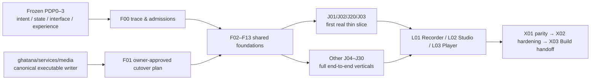
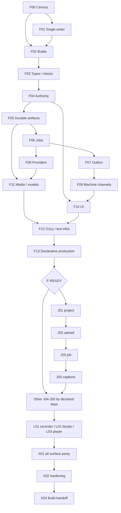

# Ghatana Media — canonical BUILD / Plan Implementation

**Campaign scope | Source baseline | Macro stage | Exact substage | Physical/composite surface denominator | Prerequisite state | Permitted work**

| Field | Current planning cut |
| --- | --- |
| Campaign | Every applicable Media PDP-0..3 definition, 26 physical candidates, 6 semantic compositions, repository root, 21 logical consumers |
| Source baseline | `samujjwal/ghatana-media@83395e52664c7323dd155b1eb4895c995dfd1fa0` (2026-10-21 14:13:44 UTC); source tree `bd2fddcaa2892d8f94fba0280db1e3808c015200` |
| Runtime writer baseline | `samujjwal/ghatana@ca4a5124539afd2a032cd806eb4a9fc0ec577b2b` (remote main observed 2026-10-21); original `services/media` remains canonical until authorized transfer |
| Macro / exact stage | BUILD / `KDEV-STAGE-PLAN-IMPLEMENTATION` |
| Source status | Four PDP status records recorded DEV_COMPLETE and 0 outstanding definition tasks (38/38 direct development criteria recorded PASS); these are definition development statuses, not implementation/acceptance |
| Worktree | Remote Git main tree inspected; local checkout at `/home/samujjwal/Developments/ghatana-media` not accessible here; local modifications/validator rerun unobserved |
| Permitted | Plan only. No runtime implementation, independent PDP closure/receipt, production qualification, cutover, release or delivery. |
| Plan status | **PLAN AUTHORED for BUILD**; Build Implement entry is subsequent exact-source ownership/trace admission, not granted by this document. |

## 1. Authority, source fingerprints and non-negotiable distinctions

- Media product meaning: `.product-experience/pdp-0-product-truth/`, `pdp-1-domain-data/`, `pdp-2-design-interface-system/`, `pdp-3-product-experience/`; no rewriting closed PDP meaning to fit code. `AGENTS.md`, Kernel `KDEV-STAGE-PLAN-IMPLEMENTATION`, and Lifecycle `PhaseProgram` govern the stage; `PHASE-*` is not a PDP.
- Physical topology SHA (Git blob): `f8a02ddc1505306ee8fe2a9d44e7d6155eb3afdd`; surface registry blob `dec599b257e074e908e70fb5f77d5ee8a7132ec8`; source-manifest blob `7b66a559d97765b72101f455d140f843374f0382`. PDP-0/1/2/3 status blobs: `585dc9f21d81c2efb728ae4db75c08c24eea7fbf`, `f0327eec5fbf36b31638d2e0d0d6bdccb974b437`, `4bfabc621b79bf45c097767e5536da5e1a4b837c`, `750b9b52714f47c9b7fde7ce4e34f57a0d4cb9b9`. These and the full Git tree are immutable baseline locators; phase `sourceShaSet` values remain the normative material-content pins, not commit SHA truth.
- PDP source coverage: **462** adjudicated capability leaves and **7** definition-extension operation mappings; **38** requirement groups; PDP-1 **2040** recorded identity entries, including 108 owner operation records, 27 HTTP, 43 gRPC, 33 SDK, 11 CLI, 4 Agent Tool, 9 events, 148 UI actions; PDP-2 **31** component families plus 122 typed values, 9 token aliases, 24 public CSS bindings, 20 media CSS projections, 13 templates, 11 layouts, 13 recipes, 43 composition rules, 19 interaction patterns and 12 machine invariants; PDP-3 **47** screens, **30** journeys, **130** steps, **61** intended channel edges and **31** scenario source definitions.
- Three independent levels must not be conflated: **authored product definition** (`DEV_COMPLETE`), **actual tested implementation** (Build), and **independent acceptance/PDP closure/release** (other lanes). A UI mock, queued job, proposal, generated client, local provider or source validator is not product behavior. No Media app is released.
- Evidence caveat: recorded 38 development criteria and representative current source SHA-256 pins reviewed; native full source-current/phase validators could not be reexecuted in this remote-only review. **No actual semantic mismatch established.** F00 reconciles exact pins locally without reopening completed PDPs for superficial commit drift.
- Single master: **this file** governs Build package ordering and dispositions. Companion `MEDIA-BUILD-IDENTITY-TRACE.v1.json` is a generated/indexed *appendix*, not a separate authoring source or competing plan. Existing `MEDIA-BUILD-COMPLETE-PRODUCT-PLAN-2026-10-15.md` and dated post-PDP plans are historical leads only (50/17 denominators superseded by current 54/21). Do not silently delete them while links/provenance remain.

## 2. Scope census and applicability

| Source population | Count | Authority | Build treatment |
| --- | ---: | --- | --- |
| Physical manifest candidates | 26 | `.product-experience/surfaces/media-physical-topology.v1.json#manifestCandidates` | 15 PDP-0 applicable, 8 support-only N/A, 3 no admitted runtime; support still receives owned Build prerequisite where used |
| Semantic compositions | 6 | topology `#compositions` | Direct cross-child semantics; no double-counting shared leaves |
| Repository root | 1 | `media.composition.repository-root` | Integrated coverage and overall Build gate |
| Logical consumers | 21 | topology `#consumerCrosswalk` and `surface-registry.yaml` | 20 active logical targets; `media.surface.desktop-archive` is explicit archived N/A |
| Unique surface identities | 54 | current topology | 54 × PDP-0..3 applicability is differentiated per phase; not 54 executable services |

**Applicability law:** N/A is only sourced from the physical phaseApplicability record or `NOT_ACTIVE_ARCHIVED` consumer disposition. A headless interface still has PDP-2/3 contracts. Gaps in host publication/provider admission remain **applicable but blocked**, not N/A.

**Implementation classifications:** observed prepared source exists for launcher, runtime-contracts, provider, JVM services and UI/SDK; some source tests exist; actual running/authoritative end-to-end product behavior is **UNVERIFIED**, with many consumers `CONTRACT_ONLY`, `HOST_DEPENDENT`, or `NOT_ADMITTED`. Source presence and source-level tests never earn `COMPLETE`. The Ghatana writer must be inspected in parallel in F01 before assigning editable Java paths.

## 3. Implementation architecture and ownership

**Semantic owner = Media** for artifacts, versions, recipes, scenes, Media run/job semantics, media-specific access, temporal analysis, quality, rendering, captions and producer/output identities. **Mechanism owner = published Shared/Kernel/Data Cloud/Event Plane/AI Inference/Document Intelligence/Action Plane as appropriate** for generic identity, audit, governance, event bus, model routing, document OCR and external privileged effects. No direct private cross-repo imports in releasable runtime. **Execution writer = `ghatana/services/media` until approved `MIG-04` transfer**; prepared `ghatana-media` modules are target/compatibility comparison sources only. Shared physical implementations serve many surface contracts without duplicate writers or databases.

### Existing implementation and reusability disposition

| Area | Observed source | Classification / action |
| --- | --- | --- |
| Runtime HTTP and domain SPIs | `ghatana/services/media/launcher/` and `runtime-contracts/`; mirrored `launcher/`, `runtime-contracts/` | Existing internal-preview artifact/job/stream runtime, **reuse after exact two-repo parity**; full PDP realization unverified |
| Persistence and schema | `providers/aws-postgresql/`, Flyway V001–V009, `modules/infrastructure/persistence/` | Partial/reusable candidate; durable restart/erasure/cutover need evidence |
| JVM modalities | `modules/speech/{stt-service,tts-service}`, `modules/vision/vision-service`, `modules/intelligence/multimodal-service` | Source/proto/test present; provider capability and exact PDP endpoint admission unverified |
| Native and streams | `modules/intelligence/speech/libs/speech-audio-rust/`, `modules/{audio-streaming,video-streaming}/` | Utility/candidate; codec/stream/solver completeness unverified |
| Public channels | `contracts/openapi/media.yaml`, `config/route-manifest.json`, proto, `libs/audio-video-{types,client}/` | Contracts/candidates present; exact operation parity and publish admission pending |
| UI and Explorer | `libs/audio-video-ui/`, `modules/intelligence/ai-voice/libs/ai-voice-ui-react/`, `apps/media-experience-explorer/` | UI packages and source-linked mocked Explorer; **no admitted product web host** |
| Capture and declarative production | Existing Gharbatai product-neutral recorder; Media P1/P2 declarative contracts | Reuse/adapt through owner-approved source selection; recorder/3D/simulation products not inferred from fixture library |
| Infra and deployment | `infra/helm`, `infra/kubernetes`, `docker/`, `config/` | Disabled/unadmitted deployment candidates; do not activate while planning |

## 4. Work ordering: foundational surfaces before any vertical implementation

**Hard policy for execution:** finish the minimum functional/contract-safe Build foundation for **all F00–F13** before starting vertical runtime implementation. Independent foundations may proceed concurrently after their prerequisites, but no J-slice may use mock-only, fake effects or competing runtime writer. F-READY is internal engineering readiness, not production admission. Individual external provider/hardware restrictions block their dependent vertical, not unrelated ones.

Each foundation package below includes exact paths, ownership, dependency, contract and observable tests; all commands are **future recommendations only**, not execution evidence. Each requires source-bound unit/contract/negative tests, idempotency, privacy/security and migration notes. For each package implementers record baseline fingerprints, source diff, test command/pass summary, fixtures and review disposition without claiming PDP closure.

### M-BLD-F00 — Frozen contract census, implementation bridge and build admission

**Owner / exclusive write boundary:** Media Build coordinator / source-trace owner. **Dependencies:** None. Avoid concurrent mutations in the same paths; the cross-repo writer rule in F01 overrides a target path mention.

**Outcome & scope:** Pin current definitions and source fingerprints; enumerate 469 capability intents (462 adjudicated and seven extensions), 38 requirement groups, PDP-1 identities, P2 interface families, P3 screens/journeys/steps/edges and 54 surface obligations. For each record bind a primary Build package and real code/contract target; preserve explicit N/A, unsupported and external owner decisions.

**Canonical source/target paths:** `.product-experience/{source-manifest.yaml,surface-registry.yaml,traceability.yaml,surfaces/media-physical-topology.v1.json}`, `docs/implementation/pdp-*-phase-dev-status.json`, `docs/implementation/MEDIA-BUILD-IDENTITY-TRACE.v1.json`. Product meaning remains referenced (read-only); selected executable writer is `ghatana/services/media` until approved transfer.

**Test layers / commands (plan only):** `pnpm check:physical-topology`; `pnpm check:product-experience-local`; `pnpm test:product-experience-local`; phase-specific source-pin checks.

**Observable acceptance / completion evidence:** Exact-set bijection (no missing/duplicate IDs), 26/7/21 denominator, zero silent excluded surfaces, decision and fingerprint provenance. Any material PDP defect is a separate owning-phase return, not Build repair. Save exact source SHA-256, owned commit, unit + negative and integration observations with environment/provider identity, and reviewer disposition.

**Security/privacy/performance & external risk:** Stale source and ID drift; reconcile only changed semantic fingerprint, never global HEAD as proof.

**Rollback/migration:** This package is read-only inventory; regenerate trace from frozen authorities rather than editing PDP sources.

### M-BLD-F01 — One canonical runtime writer and reversible source cutover

**Owner / exclusive write boundary:** Media runtime owner + Ghatana source owner. **Dependencies:** M-BLD-F00. Avoid concurrent mutations in the same paths; the cross-repo writer rule in F01 overrides a target path mention.

**Outcome & scope:** Compare `ghatana/services/media` writer against `ghatana-media` prepared mirror at exact commits and directory/build coordinates. Enumerate runtime sources, registry ownership, migrations, deployment manifests, routes, consumer imports and overlapping writers. Prepare reviewed migration/cutover sequence with one write freeze, data/lease/outbox reconciliation and rollback; until authorized migration, implementations of the executable runtime belong to Ghatana's `services/media`.

**Canonical source/target paths:** `ghatana/services/media/{launcher,runtime-contracts,modules,providers}`, Media `{launcher,runtime-contracts,modules,providers}`, `migration/transfer-receipt.yaml`, `docs/migration/`, `config/repo-boundary.json`, `BOUNDARY.md`. Product meaning remains referenced (read-only); selected executable writer is `ghatana/services/media` until approved transfer.

**Test layers / commands (plan only):** `pnpm report:media-source-target-tree`; `pnpm test:source-target-tree-crosswalk`; `pnpm test:compatibility-cutover-observation`.

**Observable acceptance / completion evidence:** Byte/path-level two-repo crosswalk; sole writer and destination selected with owner decision; route/proto/schema/consumer compatibility proof; rollback with no double workers/outboxes. No activate/cutover in planning. Save exact source SHA-256, owned commit, unit + negative and integration observations with environment/provider identity, and reviewer disposition.

**Security/privacy/performance & external risk:** Two canonical writers, stale mirror, cross-repo imports, queued work and schema divergence.

**Rollback/migration:** Keep original writer running; rollback via previously pinned source, consumer and schema adapter; never reverse an irreversible migration blindly.

### M-BLD-F02 — Polyglot build, dependency and toolchain admission

**Owner / exclusive write boundary:** Media build tooling owner. **Dependencies:** M-BLD-F00, M-BLD-F01. Avoid concurrent mutations in the same paths; the cross-repo writer rule in F01 overrides a target path mention.

**Outcome & scope:** Reconcile Gradle JVM 21 modules/version catalog, pnpm workspaces/lock, Rust 2021 Cargo lock, source-composite dependencies and release-artifact-only policy; verify generated OpenAPI/protobuf/TS identity/version parity and module builds with no skipped essential tasks. Distinguish local-source composite from published admissible artifacts.

**Canonical source/target paths:** `settings.gradle.kts`, `build.gradle.kts`, `gradle/libs.versions.toml`, `gradle.properties`, `package.json`, `pnpm-workspace.yaml`, `pnpm-lock.yaml`, `Cargo.toml`, `Cargo.lock`, `config/dependency-admission/`. Product meaning remains referenced (read-only); selected executable writer is `ghatana/services/media` until approved transfer.

**Test layers / commands (plan only):** `./gradlew buildFull`; `pnpm test:dependency-inventory`; `pnpm test:tools-media-consumer`; `pnpm test:shared-media-consumer`; `cargo test --workspace` (verify actual Cargo workspace).

**Observable acceptance / completion evidence:** Every 26 physical candidate classified built/subsumed/support-only; full runnable local toolchain with reproducible fixed locks and no accidental sibling/full-repo builds; unavailable published dependency remains explicit. Save exact source SHA-256, owned commit, unit + negative and integration observations with environment/provider identity, and reviewer disposition.

**Security/privacy/performance & external risk:** Source-composite leakage into releasable binary; mismatched JVM/TS/Rust and generated clients.

**Rollback/migration:** Pinned dependency/profile rollback, no silent SNAPSHOT production artifact admission.

### M-BLD-F03 — Canonical domain identity, revisions, clocks and typed outcomes

**Owner / exclusive write boundary:** Media domain/contracts owner. **Dependencies:** M-BLD-F02. Avoid concurrent mutations in the same paths; the cross-repo writer rule in F01 overrides a target path mention.

**Outcome & scope:** Implement product-owned project, artifact, immutable version, transcript/caption, recipe, scene/animation/simulation, job and delivery records; typed request/result/error envelopes, CAS/version constraints, strict timebase/unit conversions and producer/output joins. No duplicate domain definition under SDK or Studio.

**Canonical source/target paths:** `.product-experience/pdp-1-domain-data/{domain-objects.yaml,operations.yaml,states.yaml,transitions.yaml,versioning.yaml,action-contracts.yaml}`, `runtime-contracts/src/main/java/com/ghatana/media/runtime/`, `libs/audio-video-types/src/contracts.ts`. Product meaning remains referenced (read-only); selected executable writer is `ghatana/services/media` until approved transfer.

**Test layers / commands (plan only):** `./gradlew :services:media:runtime-contracts:test`; `pnpm test:typed-contract-bindings`; state/transition property tests.

**Observable acceptance / completion evidence:** Exact IDs and state transitions serialize and roundtrip across Java/TS/JSON; ambiguous/missing provenance yields UNKNOWN, version conflict rejects; source and t_source/t_media/t_sim/t_wall semantics stay distinct. Save exact source SHA-256, owned commit, unit + negative and integration observations with environment/provider identity, and reviewer disposition.

**Security/privacy/performance & external risk:** Cross-language drift, non-immutable IDs, invented finality, time precision loss.

**Rollback/migration:** Schema upcasters and backwards-compatible contract versions; no destructive rename of old wire IDs.

### M-BLD-F04 — Identity, tenant authority, rights, consent and policy enforcement

**Owner / exclusive write boundary:** Media security/governance owner + external identity/policy owner. **Dependencies:** M-BLD-F03. Avoid concurrent mutations in the same paths; the cross-repo writer rule in F01 overrides a target path mention.

**Outcome & scope:** Bind Shared identity; tenant/workspace scopes, principal roles/delegation, operation-purpose consent/biometric rights/residency/retention and provider availability; enforce authorization on reads, queue admission, provider egress, repeated lease dispatch, render/export and erasure, not merely UI. Fail closed for missing/expired authority.

**Canonical source/target paths:** `.product-experience/pdp-0-product-truth/{policy-authority-model.yaml,requirements.yaml}`, `.product-experience/pdp-1-domain-data/authority.yaml`, `modules/infrastructure/security/`, `launcher/`, `runtime-contracts/`, `config/`. Product meaning remains referenced (read-only); selected executable writer is `ghatana/services/media` until approved transfer.

**Test layers / commands (plan only):** `./gradlew :services:media:launcher:test --tests 'com.ghatana.media.launcher.MediaConsentRevocationTest'`; negative tenant/rights/provider egress tests.

**Observable acceptance / completion evidence:** Cross-tenant selectors blocked, revoked consent blocks new work, unauthorized voice/face/model use not dispatched; purpose/authority survive retries and events; scoped UNKNOWN not mistaken for global absence. Save exact source SHA-256, owned commit, unit + negative and integration observations with environment/provider identity, and reviewer disposition.

**Security/privacy/performance & external risk:** Unpublished Shared contract, policy-owner decisions, implicit broad roles.

**Rollback/migration:** Revoke credentials/roles and halt dispatch; no privilege-bearing compatibility fallback.

### M-BLD-F05 — Artifact ingestion, durable stores, integrity, version and erasure primitives

**Owner / exclusive write boundary:** Media storage/runtime owner. **Dependencies:** M-BLD-F03, M-BLD-F04. Avoid concurrent mutations in the same paths; the cross-repo writer rule in F01 overrides a target path mention.

**Outcome & scope:** Implement immutable source/object versions, resumable bounded chunk upload, full digest/size finality, tenant/principal-qualified dedup, encrypted S3-backed bytes, Postgres metadata, Flyway up/down strategy, retain/hold/tombstone and physical purge hooks. Keep legacy audio/transcription tables under planned dual-read/upcaster only.

**Canonical source/target paths:** `providers/aws-postgresql/`, `providers/aws-postgresql/src/main/resources/db/media-runtime/V001__media_runtime_state.sql`–`V009__media_upload_idempotency.sql`, `modules/infrastructure/persistence/`, `launcher/`. Product meaning remains referenced (read-only); selected executable writer is `ghatana/services/media` until approved transfer.

**Test layers / commands (plan only):** `./gradlew :services:media:providers:aws-postgresql:check --no-build-cache`; Testcontainers PostgreSQL/S3-compatible integration.

**Observable acceptance / completion evidence:** Crash/restart uploads resume without corruption; mismatch never finalizes; storage data and index reconcile; version and retention/hold status return precisely; encryption/key references and privacy isolation verified. Save exact source SHA-256, owned commit, unit + negative and integration observations with environment/provider identity, and reviewer disposition.

**Security/privacy/performance & external risk:** Schema incompatibility, orphan objects, encrypted key provenance, erasure obligations.

**Rollback/migration:** Expand/dual-read/contract migration; retain old storage and reversible backfill until checksum parity.

### M-BLD-F06 — Durable command/job/attempt engine, cancellation and UNKNOWN reconciliation

**Owner / exclusive write boundary:** Media runtime/reliability owner. **Dependencies:** M-BLD-F04, M-BLD-F05. Avoid concurrent mutations in the same paths; the cross-repo writer rule in F01 overrides a target path mention.

**Outcome & scope:** One idempotent durable job planner and worker lease/fencing engine for every modality/recorder/render/simulation job. Explicit request fingerprint, attempt owner, timeout, provider status, restart recovery, cancellation REQUESTED vs CONFIRMED vs UNKNOWN, no blind replay after ambiguous remote side effect.

**Canonical source/target paths:** `launcher/src/main/java/com/ghatana/media/launcher/{MediaRuntime.java,MediaRuntimeConfig.java}`, `runtime-contracts/`, `providers/aws-postgresql/`, `modules/infrastructure/cache/`. Product meaning remains referenced (read-only); selected executable writer is `ghatana/services/media` until approved transfer.

**Test layers / commands (plan only):** `./gradlew :services:media:launcher:test --tests 'com.ghatana.media.launcher.MediaRuntimeRestartReconciliationTest'`; lease/fence/recovery and container restart tests.

**Observable acceptance / completion evidence:** Worker kill between acceptance/dispatch/result recovers without duplicate effect; conflicting payload with reused request ID rejects; stale fence cannot complete; UNKNOWN remains unknown until same-identity query/owner receipt. Save exact source SHA-256, owned commit, unit + negative and integration observations with environment/provider identity, and reviewer disposition.

**Security/privacy/performance & external risk:** Duplicated external effects, unverifiable provider cancellation, transaction boundaries.

**Rollback/migration:** Stop new dispatch; drain/park uncertain work and preserve original request/attempt evidence.

### M-BLD-F07 — Transactional lifecycle events, outbox and consumer idempotency

**Owner / exclusive write boundary:** Media messaging owner + Event Plane public API owner. **Dependencies:** M-BLD-F05, M-BLD-F06. Avoid concurrent mutations in the same paths; the cross-repo writer rule in F01 overrides a target path mention.

**Outcome & scope:** Atomic state/outbox joins for accepted/completed/cancel requested/cancel confirmed/failure/artifact/session lifecycle; durable publisher with retry and idempotent consumers. Reuse Shared/Event Plane published interfaces; preserve subscriber cursor, event contract versions, authority/least-data redaction.

**Canonical source/target paths:** `modules/infrastructure/messaging/`, `launcher/src/main/java/com/ghatana/media/launcher/MediaLifecyclePublisher.java`, `.product-experience/pdp-1-domain-data/events.yaml`, `runtime-contracts/`. Product meaning remains referenced (read-only); selected executable writer is `ghatana/services/media` until approved transfer.

**Test layers / commands (plan only):** Outbox failure injection, lost ACK/dedup, schema compatibility, privacy snapshots; `./gradlew :services:media:launcher:test` (focused).

**Observable acceptance / completion evidence:** Commit is atomic with outbox; duplicate event delivery does not duplicate materialization; crash after DB commit before ACK eventually publishes; event has exact source/job/version/correlation and no raw biometric secrets. Save exact source SHA-256, owned commit, unit + negative and integration observations with environment/provider identity, and reviewer disposition.

**Security/privacy/performance & external risk:** Published Shared/Event Plane boundary may not be admitted; never build parallel event bus.

**Rollback/migration:** Replay immutable outbox with stable IDs; keep canonical store authoritative if downstream unavailable.

### M-BLD-F08 — Provider/model eligibility and modality runtime adapter substrate

**Owner / exclusive write boundary:** Media provider owner + AI Inference/specialist owners. **Dependencies:** M-BLD-F04, M-BLD-F06. Avoid concurrent mutations in the same paths; the cross-repo writer rule in F01 overrides a target path mention.

**Outcome & scope:** Define common capability profiles and adapters for STT/TTS/vision/multimodal/render/capture/encoder/solver; version/permissions/residency/retention/hardware/cost limits and readiness; deterministic local nonfake test engines where source admits them, explicit UNAVAILABLE elsewhere; never assume arbitrary external OSS or model deployment.

**Canonical source/target paths:** `config/provider-manifest.yaml`, `modules/{speech,vision,intelligence,audio-streaming,video-streaming}/`, `runtime-contracts/`, `launcher/`, `.product-experience/pdp-1-domain-data/operations.yaml`. Product meaning remains referenced (read-only); selected executable writer is `ghatana/services/media` until approved transfer.

**Test layers / commands (plan only):** Provider SPI contract matrix, simulated outage and ambiguous remote timeout, actual engine integration only with hardware/license approval.

**Observable acceptance / completion evidence:** Unsupported/missing/ineligible provider is typed and observable; no unauthorized fallback; external execution returns provenance/model/version and actual receipts; policy denies egress before dispatch. Save exact source SHA-256, owned commit, unit + negative and integration observations with environment/provider identity, and reviewer disposition.

**Security/privacy/performance & external risk:** Provider licensing, model weight rights, GPU acceleration, physical media/source permissions.

**Rollback/migration:** Disable unhealthy adapter by versioned profile; retain job/attempt/plan identity; do not reinterpret failed remote effect.

### M-BLD-F09 — Public machine channels and compatibility grammar

**Owner / exclusive write boundary:** Media API/SDK/CLI/Agent integration owner. **Dependencies:** M-BLD-F03, M-BLD-F04, M-BLD-F06, M-BLD-F07. Avoid concurrent mutations in the same paths; the cross-repo writer rule in F01 overrides a target path mention.

**Outcome & scope:** Map 27 observed HTTP operations, 43 RPCs, 33 SDK records, 11 CLI command contracts, 4 Agent Tools, event/read-only channels and 79 owner action-wire contracts to canonical product operation IDs; implement schema validation, auth, versioning, pagination, idempotency/error/UNKNOWN/cancel/retry, parity and generated typed clients. Keep one command engine, not channel-owned business logic.

**Canonical source/target paths:** `contracts/openapi/media.yaml`, `config/route-manifest.json`, `modules/{speech,vision,intelligence}/**/src/main/proto/`, `libs/audio-video-client/src/operations.ts`, `libs/audio-video-types/`, `.product-experience/pdp-3-product-experience/{api,grpc,sdk,cli,agent-tools,events}/`. Product meaning remains referenced (read-only); selected executable writer is `ghatana/services/media` until approved transfer.

**Test layers / commands (plan only):** `pnpm check:contract-parity`; `pnpm test:typed-contract-bindings`; protocol descriptor/SDK/CLI parity and integration tests.

**Observable acceptance / completion evidence:** Exact coverage of declared machine operations and channel edges; no invented endpoint; client and server agree on request/response/error/version; denied/UNKNOWN identical across channels. Save exact source SHA-256, owned commit, unit + negative and integration observations with environment/provider identity, and reviewer disposition.

**Security/privacy/performance & external risk:** Existing gRPC RPCs include transport-only/provider administration; don't treat 43 as 43 admitted business operations.

**Rollback/migration:** Compatibility shims with sunset contracts; no breaking renames without consumer proof.

### M-BLD-F10 — Accessible GUI/embedded host and reusable Studio components

**Owner / exclusive write boundary:** Media UX/UI owner + Shared design-system/host owners. **Dependencies:** M-BLD-F03, M-BLD-F04, M-BLD-F09. Avoid concurrent mutations in the same paths; the cross-repo writer rule in F01 overrides a target path mention.

**Outcome & scope:** Ship actual host-bound React UI and embedded contracts for 47 screens, 31 P2 component families, timeline/workbench and machine-readable state; Shared tokens/a11y, keyboard/focus/screen-reader semantics, loading/empty/unauthorized/UNKNOWN/recovery and responsive layouts. Explorer remains frontend-mocked PDP inspection, never the production host or backend.

**Canonical source/target paths:** `libs/audio-video-ui/`, `modules/intelligence/ai-voice/libs/ai-voice-ui-react/`, `apps/media-experience-explorer/` (read-only projection), `.product-experience/pdp-2-design-interface-system/`, `.product-experience/pdp-3-product-experience/screen-contracts/`. Product meaning remains referenced (read-only); selected executable writer is `ghatana/services/media` until approved transfer.

**Test layers / commands (plan only):** `pnpm test:presentation-architecture`; `pnpm check:presentation-architecture`; Playwright + axe/manual semantic review (where available).

**Observable acceptance / completion evidence:** Real-host navigation opens scoped versioned data; action effects bind actual operation receipts; denial and unavailable visible; keyboard/a11y/RTL/viewport obligations pass for relevant screens. Save exact source SHA-256, owned commit, unit + negative and integration observations with environment/provider identity, and reviewer disposition.

**Security/privacy/performance & external risk:** Web/embedded host not yet admitted, Shared design tokens/package publication, mock leakage.

**Rollback/migration:** Feature-flag host routes and preserve safe read-only UI while mutations are withheld.

### M-BLD-F11 — Shared time/media processing, scene/render and reproducible model primitives

**Owner / exclusive write boundary:** Media signal/renderer/animation/simulation platform owner. **Dependencies:** M-BLD-F03, M-BLD-F05, M-BLD-F06, M-BLD-F08. Avoid concurrent mutations in the same paths; the cross-repo writer rule in F01 overrides a target path mention.

**Outcome & scope:** Reuse typed timeline, audio sample/media/physical simulation clocks, frame timestamp/VFR, streaming bounds, scene/animation/model IR binding, immutable recipe/composition/revision graph, deterministic seed/fidelity profiles, binary/native engine isolation and quality/provenance; provide one substrate used by manual Studio, recorder, animation, render and simulation.

**Canonical source/target paths:** `.product-experience/pdp-1-domain-data/{declarative-production-contracts.yaml,recorder-studio-contracts.yaml}`, `.product-experience/pdp-2-design-interface-system/animation-simulation-grammar.yaml`, `modules/{audio-streaming,video-streaming}/`, `modules/intelligence/speech/libs/speech-audio-rust/`, `runtime-contracts/`. Product meaning remains referenced (read-only); selected executable writer is `ghatana/services/media` until approved transfer.

**Test layers / commands (plan only):** `cargo test --workspace`; math/timebase property tests; reference solver and loss/format compatibility matrices.

**Observable acceptance / completion evidence:** Clock joins deterministic with rounding/loss; t_sim independent of playback; identical seed/solver/profile gives specified determinism class; formats/loss/errors explicit; no scientific truth inferred from rendered pixels. Save exact source SHA-256, owned commit, unit + negative and integration observations with environment/provider identity, and reviewer disposition.

**Security/privacy/performance & external risk:** CPU/GPU differences, native codec/OSS license rights, scientific model qualification.

**Rollback/migration:** Retain exact source/model/recipe versions; disable unqualified plugins and preserve renderable prior outputs.

### M-BLD-F12 — Observability, privacy, performance, environments and evidence fixtures

**Owner / exclusive write boundary:** Media SRE/security/quality owner. **Dependencies:** M-BLD-F02, M-BLD-F04, M-BLD-F05, M-BLD-F06, M-BLD-F07, M-BLD-F08, M-BLD-F09, M-BLD-F10, M-BLD-F11. Avoid concurrent mutations in the same paths; the cross-repo writer rule in F01 overrides a target path mention.

**Outcome & scope:** Instrument OpenTelemetry traces/metrics/logs with tenant-safe correlation and low-cardinality tags; golden test media and negative conditions; SLO/profile owner decision (not invented), performance/resource bounds, load, queue-backpressure, fault injection, entitlement/secret audit and diagnostics; non-deployable candidates stay disabled.

**Canonical source/target paths:** `audio-video-observability/`, `docs/{OPERATIONS.md,TESTING.md,REPOSITORY-HYGIENE.md}`, `integration-tests/`, `modules/integration-tests/`, `infra/helm/`, `infra/kubernetes/`, `config/`. Product meaning remains referenced (read-only); selected executable writer is `ghatana/services/media` until approved transfer.

**Test layers / commands (plan only):** `./gradlew :services:media:integration-tests:test`; `pnpm audit:repository-hygiene`; `./gradlew buildFull`; load/fault/privacy checks with recorded environment.

**Observable acceptance / completion evidence:** Each foundation route has observable authority/outcome and timing without leaking source bytes/biometrics; development profile survives forced failures; test outcomes include exact fingerprints, environment, bounds and unsupported statuses. Save exact source SHA-256, owned commit, unit + negative and integration observations with environment/provider identity, and reviewer disposition.

**Security/privacy/performance & external risk:** GPU/codec/DB resource isolation, absent hardware, credential/SSO/telemetry contracts.

**Rollback/migration:** Keep deployment candidates replicas=0; revert config with nonproduction credentials and no implicit activation.

### M-BLD-F13 — Declarative recorder/animation/simulation shared production contracts

**Owner / exclusive write boundary:** Media Studio/recorder architect + consumer owners. **Dependencies:** M-BLD-F03, M-BLD-F04, M-BLD-F05, M-BLD-F06, M-BLD-F09, M-BLD-F10, M-BLD-F11, M-BLD-F12. Avoid concurrent mutations in the same paths; the cross-repo writer rule in F01 overrides a target path mention.

**Outcome & scope:** Share versioned ProductionSpec, CaptureSceneSpec, AnimationSpec and SimulationSpec as typed *views* onto existing Media recipe/project/job/scene/run/clock/rights objects. Reuse Gharbatai `@ghatana/experience-recorder` capture qualification/storyboard/narration and TutorPutor AEF Model/Scene/Experience IR adapters through contracts; no duplicate recorder database, simulation engine, scientific source authority, generic capture runtime or hidden AI-only editor.

**Canonical source/target paths:** `.product-experience/pdp-1-domain-data/recorder-studio-contracts.yaml`, `.product-experience/pdp-2-design-interface-system/recorder-studio-interface.yaml`, `libs/audio-video-{client,types,ui}/`, `runtime-contracts/`, `gharbatai/tooling/experience-recorder/` (product-neutral reusable source), `gharbatai/tooling/demo-recording/` (Gharbatai-specific adapters, remain product-owned; read-only until approved transfer). Product meaning remains referenced (read-only); selected executable writer is `ghatana/services/media` until approved transfer.

**Test layers / commands (plan only):** ProductionSpec fixtures, source receipt readback, animation determinism, model unit/numeric invariants, manual/CLI schema parity.

**Observable acceptance / completion evidence:** Common spec compiles to one project revision and one governed job; source action vs captured frame vs generated media vs scientific measurement carry distinct provenance; precise recapture only recomputes affected scene. Save exact source SHA-256, owned commit, unit + negative and integration observations with environment/provider identity, and reviewer disposition.

**Security/privacy/performance & external risk:** Recorder reuse transfer, platform capture permissions, model/solver scientific qualification, external host contracts.

**Rollback/migration:** Versioned spec upcasters, no independent Studio or solver state store.

### F-READY common-foundation gate

Proceed to vertical implementations only when every F00–F13 has a current owner and verified source-selected runtime write boundary; necessary common contracts/build/test slices actually work; the capability→operation→transport→version/error mapping is checked for the vertical to be implemented; and all missing external providers are explicit **UNAVAILABLE/BLOCKED**, not counterfeit success. This is a Build internal sequencing gate, **not** independent PDP closure or release qualification.

## 5. First real thin end-to-end slice

**First path:** **M-BLD-V01 → M-BLD-V02 → M-BLD-V20 → M-BLD-V03**. It must exercise a real configured identity/tenant/workspace, real project revision, real resumable upload and checksum-verifiable durable artifact, actual authorized STT provider or owner-approved deterministic engine (not mocked response), durable job state with fenced attempt and lifecycle outbox, exact transcript/caption output registration and readback through real HTTP/SDK/UI. A missing licensed/admitted provider makes only the provider execution step blocked; no green fixture substitutes. Prove retries at accepted vs uncertain boundaries, cancellation requested vs final, scoped missing/denied/unavailable and restart before claiming the slice functional.

**System acceptance:** Given approved test credentials and fixtures, a fresh authorized user can complete this flow and see the exact output version with source/producer/rights/provenance; all stage transitions and negative cases are observable, durable and reproducible. This is **first working product slice**, not first released app.

## 6. Every current PDP-3 journey — end-to-end vertical packages

Each `M-BLD-Vxx` covers its full source journey and *all* declared target channels, from auth/admission to exact outcome, UI/machine readback, negative/unknown/retry/cancel/recovery and immutable version finality. The journey contract owns steps/purposes; the source files stay frozen during Build. The companion exact trace supplies stable P0 leaf/P1 operation/P2 component, component-value, token/CSS, composition-rule, machine-invariant/P3 step and channel identities. Workstream role is accountable for the vertical; F09 and F10 retain common transport and UI file ownership and supply bounded adapters only. Passes require observed product effects, not explorer simulation.

### M-BLD-V01 — First-use identity and versioned project (`J-01`)

**Surface/journey/PDP identities:** `J-01`, `.product-experience/pdp-3-product-experience/journey-contracts/first-use-and-project-creation.yaml` (exact source), P0 capability intents and P1 operation IDs selected by matching source journey/step-purpose bindings; P2 headless/GUI grammar on declared channels; 5 linked screen IDs: `media.view.resume-work`, `media.view.find-projects`, `media.view.work-in-project`, `media.view.create-media`, `media.view.authenticate-and-select-context`. **Dependencies:** `M-BLD-F03`, `M-BLD-F04`, `M-BLD-F05`, `M-BLD-F09`, `M-BLD-F10`, `M-BLD-F12`. **Owner:** media-app/backend and UX owners.

**Implementation paths and write boundary:** `launcher/`, `libs/audio-video-ui/`, `libs/audio-video-client/`. All Java runtime changes target authorized `ghatana/services/media` until F01-approved cutover; F09 owns shared channel files and F10 owns shared UI framework, with per-vertical adapter changes coordinated.

**Real end-to-end acceptance:** Authenticated tenant/workspace resolves; create project with same-request idempotency, return exact initial revision, authorized project list/readback, denied/empty/unknown distinct; UI/SDK against real host.

**Required tests/evidence:** unit + state/property/negative contract tests; durable adapter/provider integration (or exact blocked reason); live route/SDK/UI or applicable CLI/gRPC/Agent/effect channel tests; source-pinned transcript/log/artifact checks; unauthorized/unknown/unavailable/cancellation/retry/version assertions; accessibility for user-facing flows; performance/cost measurements without invented thresholds. Test recommendation: `./gradlew :services:media:launcher:test`, affected service `:test`, `pnpm test:typed-contract-bindings`, browser/CLI/integration suite scoped to `J-01`.

**External prerequisite/risk:** Shared identity publication and approved tenant/workspace binding. **Rollback/migration:** preserve exact source/output version, idempotency keys and schema upcasters, allow graceful disable of unfinished provider/host route, reconcile external UNKNOWN before replay. **Completion evidence:** runnable authoritative request→output receipts, exact tested version/source pin and per-channel disposition; no unsupported execution admitted.

### M-BLD-V02 — Resumable artifact upload, import and inspection (`J-02`)

**Surface/journey/PDP identities:** `J-02`, `.product-experience/pdp-3-product-experience/journey-contracts/upload-import-and-verify-artifact.yaml` (exact source), P0 capability intents and P1 operation IDs selected by matching source journey/step-purpose bindings; P2 headless/GUI grammar on declared channels; 5 linked screen IDs: `media.view.browse-media`, `media.view.inspect-media`, `media.view.import-media`, `media.view.review-activity`, `media.view.job-status`. **Dependencies:** `M-BLD-V01`, `M-BLD-F05`, `M-BLD-F09`, `M-BLD-F10`. **Owner:** artifact/storage owner.

**Implementation paths and write boundary:** `launcher/`, `providers/aws-postgresql/`, `libs/audio-video-ui/`. All Java runtime changes target authorized `ghatana/services/media` until F01-approved cutover; F09 owns shared channel files and F10 owns shared UI framework, with per-vertical adapter changes coordinated.

**Real end-to-end acceptance:** Chunked upload with exact content hash and version registration, crash/resume, quarantine/checksum reject, explicit duplicate scope, inspect source bytes/version and provenance in UI/SDK.

**Required tests/evidence:** unit + state/property/negative contract tests; durable adapter/provider integration (or exact blocked reason); live route/SDK/UI or applicable CLI/gRPC/Agent/effect channel tests; source-pinned transcript/log/artifact checks; unauthorized/unknown/unavailable/cancellation/retry/version assertions; accessibility for user-facing flows; performance/cost measurements without invented thresholds. Test recommendation: `./gradlew :services:media:launcher:test`, affected service `:test`, `pnpm test:typed-contract-bindings`, browser/CLI/integration suite scoped to `J-02`.

**External prerequisite/risk:** Admitted storage encryption/key authority. **Rollback/migration:** preserve exact source/output version, idempotency keys and schema upcasters, allow graceful disable of unfinished provider/host route, reconcile external UNKNOWN before replay. **Completion evidence:** runnable authoritative request→output receipts, exact tested version/source pin and per-channel disposition; no unsupported execution admitted.

### M-BLD-V03 — Transcription, draft correction, immutable captions (`J-03`)

**Surface/journey/PDP identities:** `J-03`, `.product-experience/pdp-3-product-experience/journey-contracts/transcribe-and-correct-captions.yaml` (exact source), P0 capability intents and P1 operation IDs selected by matching source journey/step-purpose bindings; P2 headless/GUI grammar on declared channels; 11 linked screen IDs: `media.view.create-video`, `media.view.create-audio`, `media.view.work-with-speech`, `media.view.edit-captions`, `media.view.compare-results`, `media.view.select-source`, `media.view.monitor-transcription`, `media.view.review-transcript`, `media.view.correct-captions`, `media.view.compare-caption-versions`, `media.view.check-job-outcome`. **Dependencies:** `M-BLD-V02`, `M-BLD-V20`, `M-BLD-F08`, `M-BLD-F11`, `M-BLD-F09`, `M-BLD-F10`. **Owner:** speech and caption owner.

**Implementation paths and write boundary:** `modules/speech/stt-service/`, `launcher/`, `libs/audio-video-ui/`. All Java runtime changes target authorized `ghatana/services/media` until F01-approved cutover; F09 owns shared channel files and F10 owns shared UI framework, with per-vertical adapter changes coordinated.

**Real end-to-end acceptance:** Authorized STT job emits exact transcript version; editing drafts requires source/parent CAS; immutable caption version and exact comparison available; UNKNOWN job/submission does not imply transcript existence.

**Required tests/evidence:** unit + state/property/negative contract tests; durable adapter/provider integration (or exact blocked reason); live route/SDK/UI or applicable CLI/gRPC/Agent/effect channel tests; source-pinned transcript/log/artifact checks; unauthorized/unknown/unavailable/cancellation/retry/version assertions; accessibility for user-facing flows; performance/cost measurements without invented thresholds. Test recommendation: `./gradlew :services:media:launcher:test`, affected service `:test`, `pnpm test:typed-contract-bindings`, browser/CLI/integration suite scoped to `J-03`.

**External prerequisite/risk:** STT model/provider license + supported language/compute. **Rollback/migration:** preserve exact source/output version, idempotency keys and schema upcasters, allow graceful disable of unfinished provider/host route, reconcile external UNKNOWN before replay. **Completion evidence:** runnable authoritative request→output receipts, exact tested version/source pin and per-channel disposition; no unsupported execution admitted.

### M-BLD-V04 — Rights-scoped text-to-speech and approved audio (`J-04`)

**Surface/journey/PDP identities:** `J-04`, `.product-experience/pdp-3-product-experience/journey-contracts/authorized-text-to-speech-to-approved-audio.yaml` (exact source), P0 capability intents and P1 operation IDs selected by matching source journey/step-purpose bindings; P2 headless/GUI grammar on declared channels; 4 linked screen IDs: `media.view.work-with-speech`, `media.view.use-authorized-voice`, `media.view.compare-results`, `media.view.inspect-output`. **Dependencies:** `M-BLD-V01`, `M-BLD-V20`, `M-BLD-F08`, `M-BLD-F11`. **Owner:** speech/voice and privacy owners.

**Implementation paths and write boundary:** `modules/speech/tts-service/`, `modules/intelligence/ai-voice/`, `libs/audio-video-ui/`. All Java runtime changes target authorized `ghatana/services/media` until F01-approved cutover; F09 owns shared channel files and F10 owns shared UI framework, with per-vertical adapter changes coordinated.

**Real end-to-end acceptance:** Consent/voice identity and purpose enforce provider eligibility; generated output version, prosody settings and review disclosed; unauthorized cloning/voice conversion rejected before dispatch.

**Required tests/evidence:** unit + state/property/negative contract tests; durable adapter/provider integration (or exact blocked reason); live route/SDK/UI or applicable CLI/gRPC/Agent/effect channel tests; source-pinned transcript/log/artifact checks; unauthorized/unknown/unavailable/cancellation/retry/version assertions; accessibility for user-facing flows; performance/cost measurements without invented thresholds. Test recommendation: `./gradlew :services:media:launcher:test`, affected service `:test`, `pnpm test:typed-contract-bindings`, browser/CLI/integration suite scoped to `J-04`.

**External prerequisite/risk:** Admitted voice models, biometric/voice rights and consent policy. **Rollback/migration:** preserve exact source/output version, idempotency keys and schema upcasters, allow graceful disable of unfinished provider/host route, reconcile external UNKNOWN before replay. **Completion evidence:** runnable authoritative request→output receipts, exact tested version/source pin and per-channel disposition; no unsupported execution admitted.

### M-BLD-V05 — Image/video geometry, detection and tracks (`J-05`)

**Surface/journey/PDP identities:** `J-05`, `.product-experience/pdp-3-product-experience/journey-contracts/analyze-image-video-geometry-and-tracks.yaml` (exact source), P0 capability intents and P1 operation IDs selected by matching source journey/step-purpose bindings; P2 headless/GUI grammar on declared channels; 4 linked screen IDs: `media.view.create-image`, `media.view.create-video`, `media.view.compare-results`, `media.view.review-quality`. **Dependencies:** `M-BLD-V02`, `M-BLD-V20`, `M-BLD-F08`, `M-BLD-F11`. **Owner:** vision and media analysis owner.

**Implementation paths and write boundary:** `modules/vision/vision-service/`, `launcher/`. All Java runtime changes target authorized `ghatana/services/media` until F01-approved cutover; F09 owns shared channel files and F10 owns shared UI framework, with per-vertical adapter changes coordinated.

**Real end-to-end acceptance:** Typed regions, track/time/coordinate frames, confidences and source version; invalid image, unsupported detector and uncertain result reported without invented facts.

**Required tests/evidence:** unit + state/property/negative contract tests; durable adapter/provider integration (or exact blocked reason); live route/SDK/UI or applicable CLI/gRPC/Agent/effect channel tests; source-pinned transcript/log/artifact checks; unauthorized/unknown/unavailable/cancellation/retry/version assertions; accessibility for user-facing flows; performance/cost measurements without invented thresholds. Test recommendation: `./gradlew :services:media:launcher:test`, affected service `:test`, `pnpm test:typed-contract-bindings`, browser/CLI/integration suite scoped to `J-05`.

**External prerequisite/risk:** Vision model weights and GPU/CPU profile. **Rollback/migration:** preserve exact source/output version, idempotency keys and schema upcasters, allow graceful disable of unfinished provider/host route, reconcile external UNKNOWN before replay. **Completion evidence:** runnable authoritative request→output receipts, exact tested version/source pin and per-channel disposition; no unsupported execution admitted.

### M-BLD-V06 — Grounded multimodal and document-consumer response (`J-06`)

**Surface/journey/PDP identities:** `J-06`, `.product-experience/pdp-3-product-experience/journey-contracts/return-grounded-typed-consumer-results.yaml` (exact source), P0 capability intents and P1 operation IDs selected by matching source journey/step-purpose bindings; P2 headless/GUI grammar on declared channels; 3 linked screen IDs: `media.view.inspect-output`, `media.view.inspect-provenance`, `media.view.find-task-guidance`. **Dependencies:** `M-BLD-V02`, `M-BLD-V05`, `M-BLD-F08`, `M-BLD-F09`. **Owner:** multimodal integration + Document Intelligence API owner.

**Implementation paths and write boundary:** `modules/intelligence/multimodal-service/`, `runtime-contracts/`. All Java runtime changes target authorized `ghatana/services/media` until F01-approved cutover; F09 owns shared channel files and F10 owns shared UI framework, with per-vertical adapter changes coordinated.

**Real end-to-end acceptance:** Cross-modal exact source/version/citation/uncertainty and typed result; document OCR through admitted DI public client only; missing public DI dependency returns typed unavailable.

**Required tests/evidence:** unit + state/property/negative contract tests; durable adapter/provider integration (or exact blocked reason); live route/SDK/UI or applicable CLI/gRPC/Agent/effect channel tests; source-pinned transcript/log/artifact checks; unauthorized/unknown/unavailable/cancellation/retry/version assertions; accessibility for user-facing flows; performance/cost measurements without invented thresholds. Test recommendation: `./gradlew :services:media:launcher:test`, affected service `:test`, `pnpm test:typed-contract-bindings`, browser/CLI/integration suite scoped to `J-06`.

**External prerequisite/risk:** Document Intelligence public client and model service versions. **Rollback/migration:** preserve exact source/output version, idempotency keys and schema upcasters, allow graceful disable of unfinished provider/host route, reconcile external UNKNOWN before replay. **Completion evidence:** runnable authoritative request→output receipts, exact tested version/source pin and per-channel disposition; no unsupported execution admitted.

### M-BLD-V07 — Preserving source in noise and clipping repair (`J-07`)

**Surface/journey/PDP identities:** `J-07`, `.product-experience/pdp-3-product-experience/journey-contracts/clean-noisy-interview-audio.yaml` (exact source), P0 capability intents and P1 operation IDs selected by matching source journey/step-purpose bindings; P2 headless/GUI grammar on declared channels; 4 linked screen IDs: `media.view.create-audio`, `media.view.improve-media`, `media.view.compare-results`, `media.view.inspect-output`. **Dependencies:** `M-BLD-V02`, `M-BLD-V20`, `M-BLD-F11`. **Owner:** audio DSP owner.

**Implementation paths and write boundary:** `modules/intelligence/speech/libs/speech-audio-rust/`, `modules/audio-streaming/`. All Java runtime changes target authorized `ghatana/services/media` until F01-approved cutover; F09 owns shared channel files and F10 owns shared UI framework, with per-vertical adapter changes coordinated.

**Real end-to-end acceptance:** Source/preserved revision, candidate denoise/declipping, perceptual/metric comparison and artifact version, negative impossible/reconstruction-limit disclosed.

**Required tests/evidence:** unit + state/property/negative contract tests; durable adapter/provider integration (or exact blocked reason); live route/SDK/UI or applicable CLI/gRPC/Agent/effect channel tests; source-pinned transcript/log/artifact checks; unauthorized/unknown/unavailable/cancellation/retry/version assertions; accessibility for user-facing flows; performance/cost measurements without invented thresholds. Test recommendation: `./gradlew :services:media:launcher:test`, affected service `:test`, `pnpm test:typed-contract-bindings`, browser/CLI/integration suite scoped to `J-07`.

**External prerequisite/risk:** Native codec, supported engines, compute/benchmark fixtures. **Rollback/migration:** preserve exact source/output version, idempotency keys and schema upcasters, allow graceful disable of unfinished provider/host route, reconcile external UNKNOWN before replay. **Completion evidence:** runnable authoritative request→output receipts, exact tested version/source pin and per-channel disposition; no unsupported execution admitted.

### M-BLD-V08 — Video enhancement with measured comparison (`J-08`)

**Surface/journey/PDP identities:** `J-08`, `.product-experience/pdp-3-product-experience/journey-contracts/repair-video-with-measured-quality.yaml` (exact source), P0 capability intents and P1 operation IDs selected by matching source journey/step-purpose bindings; P2 headless/GUI grammar on declared channels; 4 linked screen IDs: `media.view.create-video`, `media.view.improve-media`, `media.view.compare-results`, `media.view.review-quality`. **Dependencies:** `M-BLD-V02`, `M-BLD-V05`, `M-BLD-V20`, `M-BLD-F11`. **Owner:** video DSP/restoration owner.

**Implementation paths and write boundary:** `modules/video-streaming/`, `launcher/`. All Java runtime changes target authorized `ghatana/services/media` until F01-approved cutover; F09 owns shared channel files and F10 owns shared UI framework, with per-vertical adapter changes coordinated.

**Real end-to-end acceptance:** Candidate stabilization/upscale/repair remains traceable, compare per-frame measured results and uncertainty; no quality or truth guarantee from a visually pleasing preview.

**Required tests/evidence:** unit + state/property/negative contract tests; durable adapter/provider integration (or exact blocked reason); live route/SDK/UI or applicable CLI/gRPC/Agent/effect channel tests; source-pinned transcript/log/artifact checks; unauthorized/unknown/unavailable/cancellation/retry/version assertions; accessibility for user-facing flows; performance/cost measurements without invented thresholds. Test recommendation: `./gradlew :services:media:launcher:test`, affected service `:test`, `pnpm test:typed-contract-bindings`, browser/CLI/integration suite scoped to `J-08`.

**External prerequisite/risk:** GPU, decoder, model/license and metric owner. **Rollback/migration:** preserve exact source/output version, idempotency keys and schema upcasters, allow graceful disable of unfinished provider/host route, reconcile external UNKNOWN before replay. **Completion evidence:** runnable authoritative request→output receipts, exact tested version/source pin and per-channel disposition; no unsupported execution admitted.

### M-BLD-V09 — Brief to storyboard, composition, render and review (`J-09`)

**Surface/journey/PDP identities:** `J-09`, `.product-experience/pdp-3-product-experience/journey-contracts/create-review-and-deliver-from-a-brief.yaml` (exact source), P0 capability intents and P1 operation IDs selected by matching source journey/step-purpose bindings; P2 headless/GUI grammar on declared channels; 9 linked screen IDs: `media.view.create-media`, `media.view.review-creation-plan`, `media.view.arrange-scenes`, `media.view.create-video`, `media.view.create-audio`, `media.view.compose-media`, `media.view.prepare-render`, `media.view.deliver-output`, `media.view.review-exact-version`. **Dependencies:** `M-BLD-V01`, `M-BLD-V02`, `M-BLD-V20`, `M-BLD-F13`. **Owner:** production/renderer owner.

**Implementation paths and write boundary:** `runtime-contracts/`, `launcher/`, `libs/audio-video-ui/`. All Java runtime changes target authorized `ghatana/services/media` until F01-approved cutover; F09 owns shared channel files and F10 owns shared UI framework, with per-vertical adapter changes coordinated.

**Real end-to-end acceptance:** A versioned brief/recipe creates typed storyboard/plan, queue/submit render, verify each expected output slot and producer/job join, show reviewable exact versions; publication belongs to later authorized effect.

**Required tests/evidence:** unit + state/property/negative contract tests; durable adapter/provider integration (or exact blocked reason); live route/SDK/UI or applicable CLI/gRPC/Agent/effect channel tests; source-pinned transcript/log/artifact checks; unauthorized/unknown/unavailable/cancellation/retry/version assertions; accessibility for user-facing flows; performance/cost measurements without invented thresholds. Test recommendation: `./gradlew :services:media:launcher:test`, affected service `:test`, `pnpm test:typed-contract-bindings`, browser/CLI/integration suite scoped to `J-09`.

**External prerequisite/risk:** Renderer and permitted assets/fonts/synthesis profiles. **Rollback/migration:** preserve exact source/output version, idempotency keys and schema upcasters, allow graceful disable of unfinished provider/host route, reconcile external UNKNOWN before replay. **Completion evidence:** runnable authoritative request→output receipts, exact tested version/source pin and per-channel disposition; no unsupported execution admitted.

### M-BLD-V10 — Reference-conditioned creation and continuity (`J-10`)

**Surface/journey/PDP identities:** `J-10`, `.product-experience/pdp-3-product-experience/journey-contracts/generate-from-references-and-review-continuity.yaml` (exact source), P0 capability intents and P1 operation IDs selected by matching source journey/step-purpose bindings; P2 headless/GUI grammar on declared channels; 5 linked screen IDs: `media.view.review-creation-plan`, `media.view.create-video`, `media.view.compare-results`, `media.view.animate-media`, `media.view.review-quality`. **Dependencies:** `M-BLD-V09`, `M-BLD-F08`. **Owner:** generative media owner.

**Implementation paths and write boundary:** `runtime-contracts/`, `launcher/`, `libs/audio-video-ui/`. All Java runtime changes target authorized `ghatana/services/media` until F01-approved cutover; F09 owns shared channel files and F10 owns shared UI framework, with per-vertical adapter changes coordinated.

**Real end-to-end acceptance:** Reference rights checked; pinned model/prompt/seed/source and continuity constraints; candidate output registered with limitation, safety/uncertainty and no forged source likeness.

**Required tests/evidence:** unit + state/property/negative contract tests; durable adapter/provider integration (or exact blocked reason); live route/SDK/UI or applicable CLI/gRPC/Agent/effect channel tests; source-pinned transcript/log/artifact checks; unauthorized/unknown/unavailable/cancellation/retry/version assertions; accessibility for user-facing flows; performance/cost measurements without invented thresholds. Test recommendation: `./gradlew :services:media:launcher:test`, affected service `:test`, `pnpm test:typed-contract-bindings`, browser/CLI/integration suite scoped to `J-10`.

**External prerequisite/risk:** Admitted image/video generation models and asset rights. **Rollback/migration:** preserve exact source/output version, idempotency keys and schema upcasters, allow graceful disable of unfinished provider/host route, reconcile external UNKNOWN before replay. **Completion evidence:** runnable authoritative request→output receipts, exact tested version/source pin and per-channel disposition; no unsupported execution admitted.

### M-BLD-V11 — Tracked region edit and reversible undo (`J-11`)

**Surface/journey/PDP identities:** `J-11`, `.product-experience/pdp-3-product-experience/journey-contracts/edit-tracked-media-region-with-undo.yaml` (exact source), P0 capability intents and P1 operation IDs selected by matching source journey/step-purpose bindings; P2 headless/GUI grammar on declared channels; 3 linked screen IDs: `media.view.compare-results`, `media.view.edit-media`, `media.view.edit-media-region`. **Dependencies:** `M-BLD-V05`, `M-BLD-V09`, `M-BLD-F13`. **Owner:** timeline/video editing owner.

**Implementation paths and write boundary:** `libs/audio-video-ui/`, `runtime-contracts/`. All Java runtime changes target authorized `ghatana/services/media` until F01-approved cutover; F09 owns shared channel files and F10 owns shared UI framework, with per-vertical adapter changes coordinated.

**Real end-to-end acceptance:** Mask/keyframe/track edit performed against exact base revision; protected region not edited; undo/redo yields versioned non-destructive history; conflict requires explicit resolution.

**Required tests/evidence:** unit + state/property/negative contract tests; durable adapter/provider integration (or exact blocked reason); live route/SDK/UI or applicable CLI/gRPC/Agent/effect channel tests; source-pinned transcript/log/artifact checks; unauthorized/unknown/unavailable/cancellation/retry/version assertions; accessibility for user-facing flows; performance/cost measurements without invented thresholds. Test recommendation: `./gradlew :services:media:launcher:test`, affected service `:test`, `pnpm test:typed-contract-bindings`, browser/CLI/integration suite scoped to `J-11`.

**External prerequisite/risk:** Tracker/renderer and protection policy. **Rollback/migration:** preserve exact source/output version, idempotency keys and schema upcasters, allow graceful disable of unfinished provider/host route, reconcile external UNKNOWN before replay. **Completion evidence:** runnable authoritative request→output receipts, exact tested version/source pin and per-channel disposition; no unsupported execution admitted.

### M-BLD-V12 — Parameterized 2D/procedural animation (`J-12`)

**Surface/journey/PDP identities:** `J-12`, `.product-experience/pdp-3-product-experience/journey-contracts/animate-vector-or-procedural-scenes.yaml` (exact source), P0 capability intents and P1 operation IDs selected by matching source journey/step-purpose bindings; P2 headless/GUI grammar on declared channels; 3 linked screen IDs: `media.view.compare-results`, `media.view.animate-media`, `media.view.inspect-output`. **Dependencies:** `M-BLD-V09`, `M-BLD-F13`. **Owner:** animation engine/UI owner.

**Implementation paths and write boundary:** `runtime-contracts/`, `libs/audio-video-ui/`. All Java runtime changes target authorized `ghatana/services/media` until F01-approved cutover; F09 owns shared channel files and F10 owns shared UI framework, with per-vertical adapter changes coordinated.

**Real end-to-end acceptance:** Typed scene graph, keyframes/rational clocks, reusable parameters/easing produce reproducible 2D animation and exact frames/asset versions with accessibility semantic shadow.

**Required tests/evidence:** unit + state/property/negative contract tests; durable adapter/provider integration (or exact blocked reason); live route/SDK/UI or applicable CLI/gRPC/Agent/effect channel tests; source-pinned transcript/log/artifact checks; unauthorized/unknown/unavailable/cancellation/retry/version assertions; accessibility for user-facing flows; performance/cost measurements without invented thresholds. Test recommendation: `./gradlew :services:media:launcher:test`, affected service `:test`, `pnpm test:typed-contract-bindings`, browser/CLI/integration suite scoped to `J-12`.

**External prerequisite/risk:** 2D renderer/native component admission. **Rollback/migration:** preserve exact source/output version, idempotency keys and schema upcasters, allow graceful disable of unfinished provider/host route, reconcile external UNKNOWN before replay. **Completion evidence:** runnable authoritative request→output receipts, exact tested version/source pin and per-channel disposition; no unsupported execution admitted.

### M-BLD-V13 — Rigged 3D animation and spatial export semantics (`J-13`)

**Surface/journey/PDP identities:** `J-13`, `.product-experience/pdp-3-product-experience/journey-contracts/animate-3d-scenes-and-characters.yaml` (exact source), P0 capability intents and P1 operation IDs selected by matching source journey/step-purpose bindings; P2 headless/GUI grammar on declared channels; 4 linked screen IDs: `media.view.animate-media`, `media.view.compose-scene`, `media.view.prepare-render`, `media.view.inspect-output`. **Dependencies:** `M-BLD-V09`, `M-BLD-V12`, `M-BLD-F13`. **Owner:** 3D/rig/render owner.

**Implementation paths and write boundary:** `runtime-contracts/`, `libs/audio-video-ui/`. All Java runtime changes target authorized `ghatana/services/media` until F01-approved cutover; F09 owns shared channel files and F10 owns shared UI framework, with per-vertical adapter changes coordinated.

**Real end-to-end acceptance:** Rig, camera/path transforms, coordinate systems and immutable scene/animation versions preserve fidelity; export loss report field-by-field and bounded unsupported output.

**Required tests/evidence:** unit + state/property/negative contract tests; durable adapter/provider integration (or exact blocked reason); live route/SDK/UI or applicable CLI/gRPC/Agent/effect channel tests; source-pinned transcript/log/artifact checks; unauthorized/unknown/unavailable/cancellation/retry/version assertions; accessibility for user-facing flows; performance/cost measurements without invented thresholds. Test recommendation: `./gradlew :services:media:launcher:test`, affected service `:test`, `pnpm test:typed-contract-bindings`, browser/CLI/integration suite scoped to `J-13`.

**External prerequisite/risk:** 3D renderer/license and GPU/format capability. **Rollback/migration:** preserve exact source/output version, idempotency keys and schema upcasters, allow graceful disable of unfinished provider/host route, reconcile external UNKNOWN before replay. **Completion evidence:** runnable authoritative request→output receipts, exact tested version/source pin and per-channel disposition; no unsupported execution admitted.

### M-BLD-V14 — Executable domain simulation with instruments (`J-14`)

**Surface/journey/PDP identities:** `J-14`, `.product-experience/pdp-3-product-experience/journey-contracts/explore-domain-simulation-and-review-measurements.yaml` (exact source), P0 capability intents and P1 operation IDs selected by matching source journey/step-purpose bindings; P2 headless/GUI grammar on declared channels; 4 linked screen IDs: `media.view.compose-scene`, `media.view.explore-simulation`, `media.view.review-quality`, `media.view.prepare-render`. **Dependencies:** `M-BLD-V01`, `M-BLD-F13`. **Owner:** simulation core owner + TutorPutor model owner.

**Implementation paths and write boundary:** `runtime-contracts/`, `libs/audio-video-ui/`. All Java runtime changes target authorized `ghatana/services/media` until F01-approved cutover; F09 owns shared channel files and F10 owns shared UI framework, with per-vertical adapter changes coordinated.

**Real end-to-end acceptance:** Versioned model/solver/parameter/units, t_sim independent of media playback, checkpoint/replay and measured run with determinism/fidelity F0–F4; domain proof never inferred from visual render.

**Required tests/evidence:** unit + state/property/negative contract tests; durable adapter/provider integration (or exact blocked reason); live route/SDK/UI or applicable CLI/gRPC/Agent/effect channel tests; source-pinned transcript/log/artifact checks; unauthorized/unknown/unavailable/cancellation/retry/version assertions; accessibility for user-facing flows; performance/cost measurements without invented thresholds. Test recommendation: `./gradlew :services:media:launcher:test`, affected service `:test`, `pnpm test:typed-contract-bindings`, browser/CLI/integration suite scoped to `J-14`.

**External prerequisite/risk:** Qualified solver/model/domain evidence and TutorPutor AEF contract. **Rollback/migration:** preserve exact source/output version, idempotency keys and schema upcasters, allow graceful disable of unfinished provider/host route, reconcile external UNKNOWN before replay. **Completion evidence:** runnable authoritative request→output receipts, exact tested version/source pin and per-channel disposition; no unsupported execution admitted.

### M-BLD-V15 — Semantic-validation guarded simulation passes (`J-15`)

**Surface/journey/PDP identities:** `J-15`, `.product-experience/pdp-3-product-experience/journey-contracts/refine-simulation-passes-with-semantic-validation.yaml` (exact source), P0 capability intents and P1 operation IDs selected by matching source journey/step-purpose bindings; P2 headless/GUI grammar on declared channels; 4 linked screen IDs: `media.view.review-creation-plan`, `media.view.compare-results`, `media.view.explore-simulation`, `media.view.review-quality`. **Dependencies:** `M-BLD-V14`, `M-BLD-V12`, `M-BLD-F13`. **Owner:** simulation validation owner.

**Implementation paths and write boundary:** `runtime-contracts/`, `libs/audio-video-ui/`. All Java runtime changes target authorized `ghatana/services/media` until F01-approved cutover; F09 owns shared channel files and F10 owns shared UI framework, with per-vertical adapter changes coordinated.

**Real end-to-end acceptance:** Run controlled parameter passes; compare measured outcomes to declared reference/invariant and numeric tolerance; invariant failure blocks promotion and output receives explicit qualification grade.

**Required tests/evidence:** unit + state/property/negative contract tests; durable adapter/provider integration (or exact blocked reason); live route/SDK/UI or applicable CLI/gRPC/Agent/effect channel tests; source-pinned transcript/log/artifact checks; unauthorized/unknown/unavailable/cancellation/retry/version assertions; accessibility for user-facing flows; performance/cost measurements without invented thresholds. Test recommendation: `./gradlew :services:media:launcher:test`, affected service `:test`, `pnpm test:typed-contract-bindings`, browser/CLI/integration suite scoped to `J-15`.

**External prerequisite/risk:** Reference datasets and domain specialist signoff. **Rollback/migration:** preserve exact source/output version, idempotency keys and schema upcasters, allow graceful disable of unfinished provider/host route, reconcile external UNKNOWN before replay. **Completion evidence:** runnable authoritative request→output receipts, exact tested version/source pin and per-channel disposition; no unsupported execution admitted.

### M-BLD-V16 — Translation, dubbing, lip and timing review (`J-16`)

**Surface/journey/PDP identities:** `J-16`, `.product-experience/pdp-3-product-experience/journey-contracts/translate-and-dub-existing-video.yaml` (exact source), P0 capability intents and P1 operation IDs selected by matching source journey/step-purpose bindings; P2 headless/GUI grammar on declared channels; 5 linked screen IDs: `media.view.create-audio`, `media.view.work-with-speech`, `media.view.edit-captions`, `media.view.review-dubbing`, `media.view.compare-results`. **Dependencies:** `M-BLD-V03`, `M-BLD-V04`, `M-BLD-V18`. **Owner:** speech localization/dubbing owner.

**Implementation paths and write boundary:** `modules/speech/{stt-service,tts-service}/`, `libs/audio-video-ui/`. All Java runtime changes target authorized `ghatana/services/media` until F01-approved cutover; F09 owns shared channel files and F10 owns shared UI framework, with per-vertical adapter changes coordinated.

**Real end-to-end acceptance:** Exact source timing and translated transcript binding, per-language voice rights, dubbing alignment, preserved provenance and mismatched/unsupported language outcomes.

**Required tests/evidence:** unit + state/property/negative contract tests; durable adapter/provider integration (or exact blocked reason); live route/SDK/UI or applicable CLI/gRPC/Agent/effect channel tests; source-pinned transcript/log/artifact checks; unauthorized/unknown/unavailable/cancellation/retry/version assertions; accessibility for user-facing flows; performance/cost measurements without invented thresholds. Test recommendation: `./gradlew :services:media:launcher:test`, affected service `:test`, `pnpm test:typed-contract-bindings`, browser/CLI/integration suite scoped to `J-16`.

**External prerequisite/risk:** Translation and alignment provider eligibility. **Rollback/migration:** preserve exact source/output version, idempotency keys and schema upcasters, allow graceful disable of unfinished provider/host route, reconcile external UNKNOWN before replay. **Completion evidence:** runnable authoritative request→output receipts, exact tested version/source pin and per-channel disposition; no unsupported execution admitted.

### M-BLD-V17 — Music, Foley, stems, mix and audio mastering (`J-17`)

**Surface/journey/PDP identities:** `J-17`, `.product-experience/pdp-3-product-experience/journey-contracts/mix-and-master-music-and-effects.yaml` (exact source), P0 capability intents and P1 operation IDs selected by matching source journey/step-purpose bindings; P2 headless/GUI grammar on declared channels; 4 linked screen IDs: `media.view.create-audio`, `media.view.compose-media`, `media.view.review-quality`, `media.view.inspect-output`. **Dependencies:** `M-BLD-V04`, `M-BLD-V07`, `M-BLD-F11`. **Owner:** audio composition owner.

**Implementation paths and write boundary:** `modules/intelligence/speech/libs/speech-audio-rust/`, `libs/audio-video-ui/`. All Java runtime changes target authorized `ghatana/services/media` until F01-approved cutover; F09 owns shared channel files and F10 owns shared UI framework, with per-vertical adapter changes coordinated.

**Real end-to-end acceptance:** Stem track mute/solo/mix automation, versioned effects/foley, true-peak/loudness readouts as defined, audible before/after and loss/provenance receipts.

**Required tests/evidence:** unit + state/property/negative contract tests; durable adapter/provider integration (or exact blocked reason); live route/SDK/UI or applicable CLI/gRPC/Agent/effect channel tests; source-pinned transcript/log/artifact checks; unauthorized/unknown/unavailable/cancellation/retry/version assertions; accessibility for user-facing flows; performance/cost measurements without invented thresholds. Test recommendation: `./gradlew :services:media:launcher:test`, affected service `:test`, `pnpm test:typed-contract-bindings`, browser/CLI/integration suite scoped to `J-17`.

**External prerequisite/risk:** License for music/samples/codecs; audio measurement reference. **Rollback/migration:** preserve exact source/output version, idempotency keys and schema upcasters, allow graceful disable of unfinished provider/host route, reconcile external UNKNOWN before replay. **Completion evidence:** runnable authoritative request→output receipts, exact tested version/source pin and per-channel disposition; no unsupported execution admitted.

### M-BLD-V18 — Multitrack video composition, captions, color and master (`J-18`)

**Surface/journey/PDP identities:** `J-18`, `.product-experience/pdp-3-product-experience/journey-contracts/compose-and-render-reviewed-media.yaml` (exact source), P0 capability intents and P1 operation IDs selected by matching source journey/step-purpose bindings; P2 headless/GUI grammar on declared channels; 6 linked screen IDs: `media.view.edit-captions`, `media.view.edit-media`, `media.view.compose-media`, `media.view.adjust-color`, `media.view.prepare-render`, `media.view.inspect-output`. **Dependencies:** `M-BLD-V09`, `M-BLD-V11`, `M-BLD-V17`, `M-BLD-F13`. **Owner:** production timeline owner.

**Implementation paths and write boundary:** `libs/audio-video-ui/`, `launcher/`, `runtime-contracts/`. All Java runtime changes target authorized `ghatana/services/media` until F01-approved cutover; F09 owns shared channel files and F10 owns shared UI framework, with per-vertical adapter changes coordinated.

**Real end-to-end acceptance:** Nondestructive timeline versions for video/audio/captions/color, protected cropping and speed ramps; exact plan/render output joins and editable recovery on failure.

**Required tests/evidence:** unit + state/property/negative contract tests; durable adapter/provider integration (or exact blocked reason); live route/SDK/UI or applicable CLI/gRPC/Agent/effect channel tests; source-pinned transcript/log/artifact checks; unauthorized/unknown/unavailable/cancellation/retry/version assertions; accessibility for user-facing flows; performance/cost measurements without invented thresholds. Test recommendation: `./gradlew :services:media:launcher:test`, affected service `:test`, `pnpm test:typed-contract-bindings`, browser/CLI/integration suite scoped to `J-18`.

**External prerequisite/risk:** Composer renderer/encoders and format support. **Rollback/migration:** preserve exact source/output version, idempotency keys and schema upcasters, allow graceful disable of unfinished provider/host route, reconcile external UNKNOWN before replay. **Completion evidence:** runnable authoritative request→output receipts, exact tested version/source pin and per-channel disposition; no unsupported execution admitted.

### M-BLD-V19 — Measured quality optimization inside declared bounds (`J-19`)

**Surface/journey/PDP identities:** `J-19`, `.product-experience/pdp-3-product-experience/journey-contracts/inspect-quality-and-optimize-within-bounds.yaml` (exact source), P0 capability intents and P1 operation IDs selected by matching source journey/step-purpose bindings; P2 headless/GUI grammar on declared channels; 4 linked screen IDs: `media.view.review-creation-plan`, `media.view.compare-results`, `media.view.review-quality`, `media.view.prepare-render`. **Dependencies:** `M-BLD-V07`, `M-BLD-V08`, `M-BLD-V18`. **Owner:** quality science/media owner.

**Implementation paths and write boundary:** `runtime-contracts/`, `libs/audio-video-ui/`. All Java runtime changes target authorized `ghatana/services/media` until F01-approved cutover; F09 owns shared channel files and F10 owns shared UI framework, with per-vertical adapter changes coordinated.

**Real end-to-end acceptance:** Metric applicability, uncertainty, per-version comparison and optimization decision show trade-offs; missing measurements do not become PASS and quality cannot override consent.

**Required tests/evidence:** unit + state/property/negative contract tests; durable adapter/provider integration (or exact blocked reason); live route/SDK/UI or applicable CLI/gRPC/Agent/effect channel tests; source-pinned transcript/log/artifact checks; unauthorized/unknown/unavailable/cancellation/retry/version assertions; accessibility for user-facing flows; performance/cost measurements without invented thresholds. Test recommendation: `./gradlew :services:media:launcher:test`, affected service `:test`, `pnpm test:typed-contract-bindings`, browser/CLI/integration suite scoped to `J-19`.

**External prerequisite/risk:** Qualified metrics/reference conditions. **Rollback/migration:** preserve exact source/output version, idempotency keys and schema upcasters, allow graceful disable of unfinished provider/host route, reconcile external UNKNOWN before replay. **Completion evidence:** runnable authoritative request→output receipts, exact tested version/source pin and per-channel disposition; no unsupported execution admitted.

### M-BLD-V20 — Long-job status, cancellation and same-request reconciliation (`J-20`)

**Surface/journey/PDP identities:** `J-20`, `.product-experience/pdp-3-product-experience/journey-contracts/long-running-job-observation-and-recovery.yaml` (exact source), P0 capability intents and P1 operation IDs selected by matching source journey/step-purpose bindings; P2 headless/GUI grammar on declared channels; 5 linked screen IDs: `media.view.work-in-project`, `media.view.review-activity`, `media.view.job-status`, `media.view.review-outputs`, `media.view.check-job-outcome`. **Dependencies:** `M-BLD-V02`, `M-BLD-F06`, `M-BLD-F07`, `M-BLD-F09`, `M-BLD-F10`. **Owner:** runtime jobs/UX owner.

**Implementation paths and write boundary:** `launcher/`, `providers/aws-postgresql/`, `libs/audio-video-ui/`. All Java runtime changes target authorized `ghatana/services/media` until F01-approved cutover; F09 owns shared channel files and F10 owns shared UI framework, with per-vertical adapter changes coordinated.

**Real end-to-end acceptance:** Real provider/job submission, status/attempt lifecycle, cancellation REQUESTED vs confirmed vs unsupported, UNKNOWN readback, retry only when verified allowed; kill/restart and duplicate-submission matrix.

**Required tests/evidence:** unit + state/property/negative contract tests; durable adapter/provider integration (or exact blocked reason); live route/SDK/UI or applicable CLI/gRPC/Agent/effect channel tests; source-pinned transcript/log/artifact checks; unauthorized/unknown/unavailable/cancellation/retry/version assertions; accessibility for user-facing flows; performance/cost measurements without invented thresholds. Test recommendation: `./gradlew :services:media:launcher:test`, affected service `:test`, `pnpm test:typed-contract-bindings`, browser/CLI/integration suite scoped to `J-20`.

**External prerequisite/risk:** At least one admitted end-to-end provider/test harness. **Rollback/migration:** preserve exact source/output version, idempotency keys and schema upcasters, allow graceful disable of unfinished provider/host route, reconcile external UNKNOWN before replay. **Completion evidence:** runnable authoritative request→output receipts, exact tested version/source pin and per-channel disposition; no unsupported execution admitted.

### M-BLD-V21 — Review, comments and approvals on exact immutable version (`J-21`)

**Surface/journey/PDP identities:** `J-21`, `.product-experience/pdp-3-product-experience/journey-contracts/review-exact-version-and-recheck-changes.yaml` (exact source), P0 capability intents and P1 operation IDs selected by matching source journey/step-purpose bindings; P2 headless/GUI grammar on declared channels; 3 linked screen IDs: `media.view.inspect-output`, `media.view.review-exact-version`, `media.view.inspect-provenance`. **Dependencies:** `M-BLD-V02`, `M-BLD-V18`, `M-BLD-F04`, `M-BLD-F07`. **Owner:** review/collaboration owner.

**Implementation paths and write boundary:** `runtime-contracts/`, `libs/audio-video-ui/`. All Java runtime changes target authorized `ghatana/services/media` until F01-approved cutover; F09 owns shared channel files and F10 owns shared UI framework, with per-vertical adapter changes coordinated.

**Real end-to-end acceptance:** Review/comments tied to exact digest and approved rights; changed material invalidates applicable approval; reviewer scope and no mutation from read action.

**Required tests/evidence:** unit + state/property/negative contract tests; durable adapter/provider integration (or exact blocked reason); live route/SDK/UI or applicable CLI/gRPC/Agent/effect channel tests; source-pinned transcript/log/artifact checks; unauthorized/unknown/unavailable/cancellation/retry/version assertions; accessibility for user-facing flows; performance/cost measurements without invented thresholds. Test recommendation: `./gradlew :services:media:launcher:test`, affected service `:test`, `pnpm test:typed-contract-bindings`, browser/CLI/integration suite scoped to `J-21`.

**External prerequisite/risk:** Organization review policy/approver roles. **Rollback/migration:** preserve exact source/output version, idempotency keys and schema upcasters, allow graceful disable of unfinished provider/host route, reconcile external UNKNOWN before replay. **Completion evidence:** runnable authoritative request→output receipts, exact tested version/source pin and per-channel disposition; no unsupported execution admitted.

### M-BLD-V22 — Export/download/publish with destination ACK (`J-22`)

**Surface/journey/PDP identities:** `J-22`, `.product-experience/pdp-3-product-experience/journey-contracts/deliver-export-with-destination-acknowledgement.yaml` (exact source), P0 capability intents and P1 operation IDs selected by matching source journey/step-purpose bindings; P2 headless/GUI grammar on declared channels; 3 linked screen IDs: `media.view.job-status`, `media.view.inspect-output`, `media.view.deliver-output`. **Dependencies:** `M-BLD-V18`, `M-BLD-V21`, `M-BLD-F07`, `M-BLD-F09`. **Owner:** delivery/effect-boundary owner.

**Implementation paths and write boundary:** `launcher/`, `providers/aws-postgresql/`, `libs/audio-video-client/`. All Java runtime changes target authorized `ghatana/services/media` until F01-approved cutover; F09 owns shared channel files and F10 owns shared UI framework, with per-vertical adapter changes coordinated.

**Real end-to-end acceptance:** Signed/versioned export manifest, destination effects through correct Action Plane boundary, exact ACK/readback; queued/accepted is not delivered, missing remote receipt is UNKNOWN.

**Required tests/evidence:** unit + state/property/negative contract tests; durable adapter/provider integration (or exact blocked reason); live route/SDK/UI or applicable CLI/gRPC/Agent/effect channel tests; source-pinned transcript/log/artifact checks; unauthorized/unknown/unavailable/cancellation/retry/version assertions; accessibility for user-facing flows; performance/cost measurements without invented thresholds. Test recommendation: `./gradlew :services:media:launcher:test`, affected service `:test`, `pnpm test:typed-contract-bindings`, browser/CLI/integration suite scoped to `J-22`.

**External prerequisite/risk:** Destination/API credentials and Action Plane effect owner. **Rollback/migration:** preserve exact source/output version, idempotency keys and schema upcasters, allow graceful disable of unfinished provider/host route, reconcile external UNKNOWN before replay. **Completion evidence:** runnable authoritative request→output receipts, exact tested version/source pin and per-channel disposition; no unsupported execution admitted.

### M-BLD-V23 — Private/local offline workflow and safe reconnect (`J-23`)

**Surface/journey/PDP identities:** `J-23`, `.product-experience/pdp-3-product-experience/journey-contracts/work-locally-and-reconcile-after-reconnect.yaml` (exact source), P0 capability intents and P1 operation IDs selected by matching source journey/step-purpose bindings; P2 headless/GUI grammar on declared channels; 4 linked screen IDs: `media.view.work-in-project`, `media.view.inspect-media`, `media.view.review-activity`, `media.view.job-status`. **Dependencies:** `M-BLD-V01`, `M-BLD-V02`, `M-BLD-V21`, `M-BLD-F10`. **Owner:** offline/UX data owner.

**Implementation paths and write boundary:** `libs/audio-video-client/`, `libs/audio-video-ui/`, `runtime-contracts/`. All Java runtime changes target authorized `ghatana/services/media` until F01-approved cutover; F09 owns shared channel files and F10 owns shared UI framework, with per-vertical adapter changes coordinated.

**Real end-to-end acceptance:** Encrypted local exact-version edits and scoped queued operations; offline is not server acceptance; reconnect reauthorizes, CAS conflicts surfaced, no blind replay.

**Required tests/evidence:** unit + state/property/negative contract tests; durable adapter/provider integration (or exact blocked reason); live route/SDK/UI or applicable CLI/gRPC/Agent/effect channel tests; source-pinned transcript/log/artifact checks; unauthorized/unknown/unavailable/cancellation/retry/version assertions; accessibility for user-facing flows; performance/cost measurements without invented thresholds. Test recommendation: `./gradlew :services:media:launcher:test`, affected service `:test`, `pnpm test:typed-contract-bindings`, browser/CLI/integration suite scoped to `J-23`.

**External prerequisite/risk:** Device secret/local-storage policy and offline availability. **Rollback/migration:** preserve exact source/output version, idempotency keys and schema upcasters, allow graceful disable of unfinished provider/host route, reconcile external UNKNOWN before replay. **Completion evidence:** runnable authoritative request→output receipts, exact tested version/source pin and per-channel disposition; no unsupported execution admitted.

### M-BLD-V24 — CLI batch/JSON command-to-verified-result (`J-24`)

**Surface/journey/PDP identities:** `J-24`, `.product-experience/pdp-3-product-experience/journey-contracts/run-cli-batch-and-review-verified-outputs.yaml` (exact source), P0 capability intents and P1 operation IDs selected by matching source journey/step-purpose bindings; P2 headless/GUI grammar on declared channels; 4 linked screen IDs: `media.view.create-media`, `media.view.review-creation-plan`, `media.view.job-status`, `media.view.review-outputs`. **Dependencies:** `M-BLD-V01`, `M-BLD-V02`, `M-BLD-V20`, `M-BLD-F09`. **Owner:** CLI/SDK owner.

**Implementation paths and write boundary:** `libs/audio-video-client/`, `.product-experience/pdp-3-product-experience/cli/`. All Java runtime changes target authorized `ghatana/services/media` until F01-approved cutover; F09 owns shared channel files and F10 owns shared UI framework, with per-vertical adapter changes coordinated.

**Real end-to-end acceptance:** 11 declared commands and versioned JSON plan execute through real API; stdout/errors/status correlate with same request/version; do not call fixture CLI a production binary.

**Required tests/evidence:** unit + state/property/negative contract tests; durable adapter/provider integration (or exact blocked reason); live route/SDK/UI or applicable CLI/gRPC/Agent/effect channel tests; source-pinned transcript/log/artifact checks; unauthorized/unknown/unavailable/cancellation/retry/version assertions; accessibility for user-facing flows; performance/cost measurements without invented thresholds. Test recommendation: `./gradlew :services:media:launcher:test`, affected service `:test`, `pnpm test:typed-contract-bindings`, browser/CLI/integration suite scoped to `J-24`.

**External prerequisite/risk:** Public API/SDK host and packaging owner. **Rollback/migration:** preserve exact source/output version, idempotency keys and schema upcasters, allow graceful disable of unfinished provider/host route, reconcile external UNKNOWN before replay. **Completion evidence:** runnable authoritative request→output receipts, exact tested version/source pin and per-channel disposition; no unsupported execution admitted.

### M-BLD-V25 — Bounded Agent Tool and product integration (`J-25`)

**Surface/journey/PDP identities:** `J-25`, `.product-experience/pdp-3-product-experience/journey-contracts/return-bounded-results-to-integrating-products.yaml` (exact source), P0 capability intents and P1 operation IDs selected by matching source journey/step-purpose bindings; P2 headless/GUI grammar on declared channels; 3 linked screen IDs: `media.view.review-creation-plan`, `media.view.job-status`, `media.view.inspect-output`. **Dependencies:** `M-BLD-V03`, `M-BLD-V04`, `M-BLD-V05`, `M-BLD-V06`, `M-BLD-F09`. **Owner:** Agents/Media integration owner.

**Implementation paths and write boundary:** `runtime-contracts/`, `libs/audio-video-client/`, `.product-experience/pdp-3-product-experience/agent-tools/`. All Java runtime changes target authorized `ghatana/services/media` until F01-approved cutover; F09 owns shared channel files and F10 owns shared UI framework, with per-vertical adapter changes coordinated.

**Real end-to-end acceptance:** Four tool handlers share admitted public operation contracts, delegated bounded credentials, dry-run proposal vs effect; denied/timeout/UNKNOWN never misreported as success.

**Required tests/evidence:** unit + state/property/negative contract tests; durable adapter/provider integration (or exact blocked reason); live route/SDK/UI or applicable CLI/gRPC/Agent/effect channel tests; source-pinned transcript/log/artifact checks; unauthorized/unknown/unavailable/cancellation/retry/version assertions; accessibility for user-facing flows; performance/cost measurements without invented thresholds. Test recommendation: `./gradlew :services:media:launcher:test`, affected service `:test`, `pnpm test:typed-contract-bindings`, browser/CLI/integration suite scoped to `J-25`.

**External prerequisite/risk:** Agents contract/credential delegation and service publication. **Rollback/migration:** preserve exact source/output version, idempotency keys and schema upcasters, allow graceful disable of unfinished provider/host route, reconcile external UNKNOWN before replay. **Completion evidence:** runnable authoritative request→output receipts, exact tested version/source pin and per-channel disposition; no unsupported execution admitted.

### M-BLD-V26 — Retention/revocation/holds and physical erasure (`J-26`)

**Surface/journey/PDP identities:** `J-26`, `.product-experience/pdp-3-product-experience/journey-contracts/delete-or-revoke-media-with-visible-lifecycle.yaml` (exact source), P0 capability intents and P1 operation IDs selected by matching source journey/step-purpose bindings; P2 headless/GUI grammar on declared channels; 3 linked screen IDs: `media.view.inspect-media`, `media.view.review-activity`, `media.view.review-rights-and-consent`. **Dependencies:** `M-BLD-V02`, `M-BLD-V04`, `M-BLD-V22`, `M-BLD-F05`. **Owner:** Media privacy/retention owner.

**Implementation paths and write boundary:** `providers/aws-postgresql/`, `launcher/`, `modules/infrastructure/security/`. All Java runtime changes target authorized `ghatana/services/media` until F01-approved cutover; F09 owns shared channel files and F10 owns shared UI framework, with per-vertical adapter changes coordinated.

**Real end-to-end acceptance:** Policy-aware hold/revoke/erase across versions, replicas, outbox, provider copies where possible; prove local physical removal and represent unconfirmed external deletion as UNKNOWN.

**Required tests/evidence:** unit + state/property/negative contract tests; durable adapter/provider integration (or exact blocked reason); live route/SDK/UI or applicable CLI/gRPC/Agent/effect channel tests; source-pinned transcript/log/artifact checks; unauthorized/unknown/unavailable/cancellation/retry/version assertions; accessibility for user-facing flows; performance/cost measurements without invented thresholds. Test recommendation: `./gradlew :services:media:launcher:test`, affected service `:test`, `pnpm test:typed-contract-bindings`, browser/CLI/integration suite scoped to `J-26`.

**External prerequisite/risk:** Retention policy owner/legal holds and provider deletion attestations. **Rollback/migration:** preserve exact source/output version, idempotency keys and schema upcasters, allow graceful disable of unfinished provider/host route, reconcile external UNKNOWN before replay. **Completion evidence:** runnable authoritative request→output receipts, exact tested version/source pin and per-channel disposition; no unsupported execution admitted.

### M-BLD-V27 — Unavailable/degraded processing and safe alternatives (`J-27`)

**Surface/journey/PDP identities:** `J-27`, `.product-experience/pdp-3-product-experience/journey-contracts/continue-safely-when-processing-is-unavailable.yaml` (exact source), P0 capability intents and P1 operation IDs selected by matching source journey/step-purpose bindings; P2 headless/GUI grammar on declared channels; 5 linked screen IDs: `media.view.review-creation-plan`, `media.view.review-quality`, `media.view.review-activity`, `media.view.job-status`, `media.view.check-job-outcome`. **Dependencies:** `M-BLD-V20`, `M-BLD-V30`, `M-BLD-F08`, `M-BLD-F10`. **Owner:** service reliability/UX owner.

**Implementation paths and write boundary:** `launcher/`, `libs/audio-video-ui/`, `libs/audio-video-client/`. All Java runtime changes target authorized `ghatana/services/media` until F01-approved cutover; F09 owns shared channel files and F10 owns shared UI framework, with per-vertical adapter changes coordinated.

**Real end-to-end acceptance:** Eligibility failure, partial upstream evidence, denied auth, timeout, unknown outcome and explicit safe alternatives across UI/API/SDK; no silent fallback that changes rights or modality.

**Required tests/evidence:** unit + state/property/negative contract tests; durable adapter/provider integration (or exact blocked reason); live route/SDK/UI or applicable CLI/gRPC/Agent/effect channel tests; source-pinned transcript/log/artifact checks; unauthorized/unknown/unavailable/cancellation/retry/version assertions; accessibility for user-facing flows; performance/cost measurements without invented thresholds. Test recommendation: `./gradlew :services:media:launcher:test`, affected service `:test`, `pnpm test:typed-contract-bindings`, browser/CLI/integration suite scoped to `J-27`.

**External prerequisite/risk:** Provider capabilities and authoritative outcome read API. **Rollback/migration:** preserve exact source/output version, idempotency keys and schema upcasters, allow graceful disable of unfinished provider/host route, reconcile external UNKNOWN before replay. **Completion evidence:** runnable authoritative request→output receipts, exact tested version/source pin and per-channel disposition; no unsupported execution admitted.

### M-BLD-V28 — Spatial/360/synthetic/interactive export integrity (`J-28`)

**Surface/journey/PDP identities:** `J-28`, `.product-experience/pdp-3-product-experience/journey-contracts/export-spatial-media-with-format-loss-reporting.yaml` (exact source), P0 capability intents and P1 operation IDs selected by matching source journey/step-purpose bindings; P2 headless/GUI grammar on declared channels; 4 linked screen IDs: `media.view.animate-media`, `media.view.compose-scene`, `media.view.prepare-render`, `media.view.deliver-output`. **Dependencies:** `M-BLD-V13`, `M-BLD-V14`, `M-BLD-V22`. **Owner:** spatial/content export owner.

**Implementation paths and write boundary:** `runtime-contracts/`, `libs/audio-video-client/`. All Java runtime changes target authorized `ghatana/services/media` until F01-approved cutover; F09 owns shared channel files and F10 owns shared UI framework, with per-vertical adapter changes coordinated.

**Real end-to-end acceptance:** Declare target format and field-level transform/omit/reject loss dispositions; exact source coordinates/units/version and provenance preserved; unsupported output explicit.

**Required tests/evidence:** unit + state/property/negative contract tests; durable adapter/provider integration (or exact blocked reason); live route/SDK/UI or applicable CLI/gRPC/Agent/effect channel tests; source-pinned transcript/log/artifact checks; unauthorized/unknown/unavailable/cancellation/retry/version assertions; accessibility for user-facing flows; performance/cost measurements without invented thresholds. Test recommendation: `./gradlew :services:media:launcher:test`, affected service `:test`, `pnpm test:typed-contract-bindings`, browser/CLI/integration suite scoped to `J-28`.

**External prerequisite/risk:** Approved spatial format codecs and rights. **Rollback/migration:** preserve exact source/output version, idempotency keys and schema upcasters, allow graceful disable of unfinished provider/host route, reconcile external UNKNOWN before replay. **Completion evidence:** runnable authoritative request→output receipts, exact tested version/source pin and per-channel disposition; no unsupported execution admitted.

### M-BLD-V29 — Live capture/stream loss, consent change and recovery (`J-29`)

**Surface/journey/PDP identities:** `J-29`, `.product-experience/pdp-3-product-experience/journey-contracts/live-session-loss-consent-change-and-bounded-recovery.yaml` (exact source), P0 capability intents and P1 operation IDs selected by matching source journey/step-purpose bindings; P2 headless/GUI grammar on declared channels; 3 linked screen IDs: `media.view.create-video`, `media.view.review-activity`, `media.view.job-status`. **Dependencies:** `M-BLD-V01`, `M-BLD-V20`, `M-BLD-F08`, `M-BLD-F11`. **Owner:** streaming/runtime owner.

**Implementation paths and write boundary:** `modules/{audio-streaming,video-streaming}/`, `launcher/`. All Java runtime changes target authorized `ghatana/services/media` until F01-approved cutover; F09 owns shared channel files and F10 owns shared UI framework, with per-vertical adapter changes coordinated.

**Real end-to-end acceptance:** Authenticated live session lease/token, ordered frame ACK and bounded buffering/reconnect, drop/restart/consent revoke protection; only confirmed continuation advances media state.

**Required tests/evidence:** unit + state/property/negative contract tests; durable adapter/provider integration (or exact blocked reason); live route/SDK/UI or applicable CLI/gRPC/Agent/effect channel tests; source-pinned transcript/log/artifact checks; unauthorized/unknown/unavailable/cancellation/retry/version assertions; accessibility for user-facing flows; performance/cost measurements without invented thresholds. Test recommendation: `./gradlew :services:media:launcher:test`, affected service `:test`, `pnpm test:typed-contract-bindings`, browser/CLI/integration suite scoped to `J-29`.

**External prerequisite/risk:** Capture hardware/browser/microphone permissions. **Rollback/migration:** preserve exact source/output version, idempotency keys and schema upcasters, allow graceful disable of unfinished provider/host route, reconcile external UNKNOWN before replay. **Completion evidence:** runnable authoritative request→output receipts, exact tested version/source pin and per-channel disposition; no unsupported execution admitted.

### M-BLD-V30 — Discover currently eligible processing options (`J-30`)

**Surface/journey/PDP identities:** `J-30`, `.product-experience/pdp-3-product-experience/journey-contracts/check-which-processing-options-are-eligible.yaml` (exact source), P0 capability intents and P1 operation IDs selected by matching source journey/step-purpose bindings; P2 headless/GUI grammar on declared channels; 4 linked screen IDs: `media.view.review-activity`, `media.view.choose-eligible-processing-option`, `media.view.check-processing-options`, `media.view.check-processing-readiness`. **Dependencies:** `M-BLD-V01`, `M-BLD-F04`, `M-BLD-F08`, `M-BLD-F09`, `M-BLD-F10`. **Owner:** provider readiness/UX owner.

**Implementation paths and write boundary:** `config/provider-manifest.yaml`, `launcher/`, `libs/audio-video-ui/`. All Java runtime changes target authorized `ghatana/services/media` until F01-approved cutover; F09 owns shared channel files and F10 owns shared UI framework, with per-vertical adapter changes coordinated.

**Real end-to-end acceptance:** Tenant/purpose/residency/model/version/resource capability check returns eligible, ineligible or UNKNOWN with reasons; no off-platform guesses and no dispatch before current admission.

**Required tests/evidence:** unit + state/property/negative contract tests; durable adapter/provider integration (or exact blocked reason); live route/SDK/UI or applicable CLI/gRPC/Agent/effect channel tests; source-pinned transcript/log/artifact checks; unauthorized/unknown/unavailable/cancellation/retry/version assertions; accessibility for user-facing flows; performance/cost measurements without invented thresholds. Test recommendation: `./gradlew :services:media:launcher:test`, affected service `:test`, `pnpm test:typed-contract-bindings`, browser/CLI/integration suite scoped to `J-30`.

**External prerequisite/risk:** Provider catalog policy, quotas/hardware and readiness owner. **Rollback/migration:** preserve exact source/output version, idempotency keys and schema upcasters, allow graceful disable of unfinished provider/host route, reconcile external UNKNOWN before replay. **Completion evidence:** runnable authoritative request→output receipts, exact tested version/source pin and per-channel disposition; no unsupported execution admitted.

## 7. Four additional cross-journey product consumers and final Build integration

### M-BLD-L01 — Autonomous Recorder Orchestrator and capture-adapter integration

**Owner/write isolation:** Media recorder owner + Gharbatai recorder package owner. **Dependencies:** M-BLD-F13, M-BLD-V01, M-BLD-V02, M-BLD-V20, M-BLD-V24, M-BLD-V29. **Paths:** `gharbatai/tooling/experience-recorder/` `@ghatana/experience-recorder` reusable source; `gharbatai/tooling/demo-recording/` consumer-specific code retained; Media `libs/audio-video-client/`, `runtime-contracts/`, `launcher/`; logical `media.surface.recorder-orchestrator`, `media.surface.capture-adapters`.

**Outcome/implementation:** Config/metadata-driven authenticated browser, desktop, mobile, terminal, API/gRPC and allowed A/V capture; reuse product-neutral Gharbatai recorder, storyboard and narration contracts. Real source effects require exact upstream outcome readback, source capture clock/camera/mic permissions, evidence classification and selective scene recapture. Integrate voice/subtitle/animation/simulation attachments; never treat static Explorer mock as an actual journey.

**Acceptance/test/evidence:** Given pinned config and authorized fixture project, recording executes reproducible actions, captures actual frames + receipts, narrates/annotates and recaptures one changed scene; denied/timeout/source-unknown produce bounded report without manufactured success. Tests: contract+unit+headless/browser/device/provider where meaningful, source receipt readback, privacy/isolation and fault injection; exact fixtures and source/object fingerprints. **Risks/external decisions:** External capture permissions, host/device security, gRPC tooling, recorder migration authority; only qualified drivers permitted.. **Rollback:** preserve immutable project/scene/spec revisions and disable unadmitted channel/provider; never delete older source or claim external effect when UNKNOWN.

### M-BLD-L02 — Professional manual Studio over one canonical revision engine

**Owner/write isolation:** Media Studio UI/UX and production owner. **Dependencies:** M-BLD-F13, M-BLD-V09, M-BLD-V11, M-BLD-V12, M-BLD-V14, M-BLD-V17, M-BLD-V18, M-BLD-V21. **Paths:** `libs/audio-video-ui/`, `modules/intelligence/ai-voice/libs/ai-voice-ui-react/`; logical `media.surface.production-studio`.

**Outcome/implementation:** Implement timeline/keyframe tools, cut/trim/merge, layer lock/mute/solo, noise cleanup, backgrounds, smart/protected cropping, speed ramps, overlays, masks, annotations, 2D/3D and simulation inspectors, guided AI proposals and manual override using same versioned operations as CLI/SDK; never fork a Studio-only project DB.

**Acceptance/test/evidence:** After auto-produced project, manual editor performs at least one reversible multi-track adjustment, compares before/after, commits immutable reviewable version and rerenders only affected segments with no spec loss; keyboard and accessible semantics verified. Tests: contract+unit+headless/browser/device/provider where meaningful, source receipt readback, privacy/isolation and fault injection; exact fixtures and source/object fingerprints. **Risks/external decisions:** GPU/editor native dependencies, Shared UI admission, manual-lock merge semantics.. **Rollback:** preserve immutable project/scene/spec revisions and disable unadmitted channel/provider; never delete older source or claim external effect when UNKNOWN.

### M-BLD-L03 — Interactive Demo Player and simulation-aware embedding

**Owner/write isolation:** Media embedded player + TutorPutor/Gharbatai integration owner. **Dependencies:** M-BLD-F10, M-BLD-F13, M-BLD-V12, M-BLD-V14, M-BLD-V22, M-BLD-L01. **Paths:** `libs/audio-video-ui/`, `libs/audio-video-client/`; logical `media.surface.interactive-demo-player` and `media.surface.embedded`.

**Outcome/implementation:** Implement branchable governed playback of exact media versions and observable simulation states, interactive controls/measurements, captions, narration, semantic alternative content and offline-safe viewer. Never let player interaction secretly invoke privileged product changes or advance t_sim merely due to media seek.

**Acceptance/test/evidence:** Published/embed-authorized version plays with branching, source/time/measurement provenance, accessible keyboard/announcement, offline/unavailable state and model-state separation; effectful controls require separately authorized API. Tests: contract+unit+headless/browser/device/provider where meaningful, source receipt readback, privacy/isolation and fault injection; exact fixtures and source/object fingerprints. **Risks/external decisions:** Host identity/navigation API and TutorPutor simulation model owner.. **Rollback:** preserve immutable project/scene/spec revisions and disable unadmitted channel/provider; never delete older source or claim external effect when UNKNOWN.

### M-BLD-X01 — Exact cross-surface contract parity and integrated test matrix

**Owner/write isolation:** Media integration/test owner. **Dependencies:** M-BLD-F12, M-BLD-V01, M-BLD-V02, M-BLD-V03, M-BLD-V04, M-BLD-V05, M-BLD-V06, M-BLD-V07, M-BLD-V08, M-BLD-V09, M-BLD-V10, M-BLD-V11, M-BLD-V12, M-BLD-V13, M-BLD-V14, M-BLD-V15, M-BLD-V16, M-BLD-V17, M-BLD-V18, M-BLD-V19, M-BLD-V20, M-BLD-V21, M-BLD-V22, M-BLD-V23, M-BLD-V24, M-BLD-V25, M-BLD-V26, M-BLD-V27, M-BLD-V28, M-BLD-V29, M-BLD-V30, M-BLD-L01, M-BLD-L02, M-BLD-L03. **Paths:** `integration-tests/`, `modules/integration-tests/`, `tests/`, `docs/implementation/MEDIA-BUILD-IDENTITY-TRACE.v1.json`.

**Outcome/implementation:** Crosswalk every PDP identity/operation/request/result/step/channel to actual integration evidence, desktop archive N/A preserved. Verify 27 HTTP, 43 RPC transport dispositions, 33 SDK method records, 11 CLI contracts, four Agent Tools, nine event contracts, 148 UI actions, 61 channel edges and 47 screen bindings; reject admitted vs fixture conflation.

**Acceptance/test/evidence:** Exact source/current proof table has no uncovered applicable ID; route/error/unknown/permissions/cancellation/version parity; no missing test layer; provider N/A owner-backed. Tests: contract+unit+headless/browser/device/provider where meaningful, source receipt readback, privacy/isolation and fault injection; exact fixtures and source/object fingerprints. **Risks/external decisions:** Cross-repository test environment and real provider provisioning.. **Rollback:** preserve immutable project/scene/spec revisions and disable unadmitted channel/provider; never delete older source or claim external effect when UNKNOWN.

### M-BLD-X02 — Whole-product security, privacy, performance, fault and accessibility verification

**Owner/write isolation:** Independent Media quality/security/performance/a11y roles. **Dependencies:** M-BLD-X01. **Paths:** `docs/TESTING.md`, `docs/OPERATIONS.md`, `audio-video-observability/`, `integration-tests/`, `libs/audio-video-ui/`.

**Outcome/implementation:** Plan cross-domain load, queue/outbox resilience, worker kill, provider outage, data erasure, cross-tenant isolation, fuzz/native decoder sandbox, OSS/SBOM/model rights, GUI accessibility/responsiveness. Obtain actual SLO thresholds from owners; don't invent numerical targets or certificates.

**Acceptance/test/evidence:** Source-pinned tests with reproducible environment and zero unresolved critical findings or named owned exceptions; measures compared only to owner-adopted thresholds. Tests: contract+unit+headless/browser/device/provider where meaningful, source receipt readback, privacy/isolation and fault injection; exact fixtures and source/object fingerprints. **Risks/external decisions:** Hardware/retention/legal specialist availability; specialist approvals are never self-certified.. **Rollback:** preserve immutable project/scene/spec revisions and disable unadmitted channel/provider; never delete older source or claim external effect when UNKNOWN.

### M-BLD-X03 — Build Development Complete handoff (not closure/release)

**Owner/write isolation:** Media Build owner and designated reviewers. **Dependencies:** M-BLD-X02. **Paths:** `docs/implementation/`, active readiness/test output references, no edits to frozen PDP meaning.

**Outcome/implementation:** Assemble implementation evidence, actual source/code revision, trace exact-set, per-surface Build completeness, migrations/rollback proofs and explicit blockers. Progress from Plan Implementation to Implement/Verify/Development Complete only by native Kernel stage rules. PDP closure remains independent and Delivery separately gated.

**Acceptance/test/evidence:** Every required implementation deliverable is coded/tested/reviewed on exact source, every surface has owner disposition, external unavailable remains a visible blocker; this package plans the future gate, never declares it passed here. Tests: contract+unit+headless/browser/device/provider where meaningful, source receipt readback, privacy/isolation and fault injection; exact fixtures and source/object fingerprints. **Risks/external decisions:** Premature production/release claims and confusing PDP DEV_COMPLETE with Build completion.. **Rollback:** preserve immutable project/scene/spec revisions and disable unadmitted channel/provider; never delete older source or claim external effect when UNKNOWN.

## 8. Acyclic dependency DAG and implementation scheduling

This is the **summary DAG**. The exact acyclic package edges are the `Dependencies` fields on F00–F13, V01–V30 and L01–L03/X01–X03 above. No cycle or implicit prerequisite from a later journey to its predecessor may be added. F00 is read-only source trace; F01 is owner decision/cutover **plan**, not an executed release. No vertical runs before F-READY. After first thin slice, independent execution lanes can run in parallel with exclusive file ownership:

| Lane | Journey/scope | Key common owner |
| --- | --- | --- |
| Speech/localization | J04, J16, J17 | Speech, DSP, privacy, audio pipeline |
| Vision/multimodal | J05, J06, J08 | Vision, DI, AI Inference/renderer |
| Creation/edit | J09, J10, J11, J18, J19 | Media compositor, rendering and quality |
| Declarative 2D/3D/model | J12, J13, J14, J15, J28 | Scene/solver/time/fidelity and Editor |
| Public machine channels | J24, J25, J30 | F09 common channel owner |
| Governed lifecycle | J21, J22, J23, J26, J27, J29 | F04/F05/F06/F07; authorization and version finality |
| Studio/recorder/embed | L01, L02, L03 | F13; integrating host/consumer owners |

**Write contention law:** vertical teams change per-domain implementation only, while F09 owns OpenAPI/protobuf/SDK shared envelopes, F10 owns global UI, F03 canonical types, F05 schema migrations, F07 event schema. Cross-cutting changes are sequenced through these package owners; never concurrently write the same migrated mirror and canonical writer.

## 9. Required tests, verification layers and Build evidence

Every package specifies its focused tests above. Central matrix: (a) schema/stable-identity currentness; (b) pure function/domain/property and contract denial; (c) persisted DB/object/queue/restart/lease; (d) public endpoint/auth version/error parity; (e) real UI/browser/device/accessibility; (f) codec/model/solver numeric/reference/quality/hardware; (g) privacy/security/retention/erasure/secret scanning; (h) performance/failure/backpressure with owner-adopted SLO; (i) migrations/rollback; (j) end-to-end per journey×intended channel. Run in deterministic dev/test environments without production effects; no synthetic fixture stands in for production provider validation. Keep no blanket CI dependency: local/headless source-bound gates are admissible where repo policy allows. `./gradlew buildFull` is the full Java/TS/Rust aggregate and must not be called passed if selective tasks excluded.

**Unknown-outcome/finality checklist per consequential operation:** exact request/tenant/principal/purpose/fingerprint; before-dispatch denial; admission receipt is not final output; accepted≠succeeded; observedAt/owner receipt and exact subject/version; optimistic revision checks; rollback only if effect proven reversible; cancellation requested≠confirmed; provider unavailable≠unsupported; timeout/unknown does not authorize replay; redaction/retention/erasure/ack are separately proven. Record channel differences rather than overriding P1 meaning.

**Data and binary migration:** versioned schema expansion, read/dual-read comparison, exact key/clock/tenant migration, object checksum parity and lineage preservation, outbox/lease quiescence, remote provider job reconciliation, conservative compatibility aliases, rollback/drain rehearsal. Never run two active producer writers; do not rename published identifiers solely for Media branding. Full release artifact lock, image signoff and deployment remain DELIVER lane, not achieved here.

## 10. Risk and external-decision register

| ID | Seam or uncertainty | Required decision/owner | Blocks |
| --- | --- | --- | --- |
| R01 | Runtime writer still in Ghatana; mirror and source-cut differences | Media & Ghatana source owners: exact F01 migration/cutover authority | Actual write-path transfer; do not block read-only planning |
| R02 | Shared/Tools/Lifecycle package publishing and admission | Publishing owners: immutable coordinates/hash/license/SBOM + consumer tests | Release artifact use; allow source composite for local DEV where policy allows |
| R03 | Identity, rights, policy, biometric consent/residency | Shared identity / Media policy owner, specialist where regulated | External effect/voice/face/provider lanes |
| R04 | Durable Postgres/S3 encryption, legal holds, data migration | Storage/security/legal owner | Persistent artifact and erasure acceptance |
| R05 | Event Plane, AI Inference, Action Plane, Document Intelligence public contract readiness | Respective public API owners | Only specific integrations; never build copies of external engine |
| R06 | GPU/codec/model/solver/3D engine rights/performance/hardware | Provider, OSS/license, platform and domain owner | Engine-specific vertical execution/admission |
| R07 | Real web/embedded host and integration context | Product host and Shared UI owners | Host-bound UI effects, Studio/player publication |
| R08 | Gharbatai recorder reuse, capture drivers, owner rights | Gharbatai + Media recorder owner | L01 real capture; reuse source until approved migration |
| R09 | TutorPutor scientific/educational Model/Scene/Experience IR bindings | TutorPutor AEF/domain owner | Scientific correctness and L03 model-aware interaction; does not block independent animation |
| R10 | Retention/erasure attestation, external destination acknowledgement | Privacy/policy and provider/destination owner | Corresponding finality claim, not full product planning |
| R11 | SLO numbers, qualified benchmarks and target deployment resources absent | SRE/performance and product owners | X02 qualification; do not fabricate thresholds |
| R12 | Unreleased product + source-only Explorer may masquerade as runtime | Media UI/Build owner | User-visible completeness assertions; never claim production-ready |
| R13 | Detailed source ID routing and 61 channel transport-equivalence still `UNBOUND` | F00/F09, per-vertical owners | Exact affected channel admission until transport code/evidence exists |

**Definition defect vs Build uncertainty:** If an actual missing semantic rule contradicts frozen PDP-0..3, record exact ID/path and return to earliest owning PDP with downstream impact. Missing implementation, provider, auth, venue, engine/hardware/license, test result or deployable host is a Build/external prerequisite and must never be misreported as a remaining PDP development task.

## 11. Canonical coverage trace, identity owner contract and completeness gates

- Companion machine appendix: [`MEDIA-BUILD-IDENTITY-TRACE.v1.json`](MEDIA-BUILD-IDENTITY-TRACE.v1.json) with **3,186 exact source and topology rows**, every row assigned a primary implementation owner but still UNVERIFIED. It enumerates exact P0 capability/requirement, P1 identity, P2 component, P3 screen/journey/step/channel, physical/composite/consumer IDs and assigns a provisional primary Build owner package. **It is a planning index only; code path and behavioral equivalence are unverified until the package passes implementation tests.**
- Source selectors: P0 `capabilities.yaml#/...capabilityIntentId`, `requirements.yaml`; P1 `operations.yaml` plus companion domain/guard/identity registries (status `sourceIdentityIds`); P2 `component-contracts.yaml`/phase status `sourceFamilyIds`; P3 `screen-registry.yaml`, `journey-registry.yaml`, `journey-purpose-bindings.yaml`, `journey-channel-contract-bindings.yaml`; surface topology. Each package must resolve exact request/result/state/version/authority and primary runtime path before coding; a semantic-name classifier alone is *not* binding evidence.
- Completeness invariant: `source_set == trace_set` for each category, stable unique ID, exactly one primary implementation owner (possibly shared F package), zero unspecified consumer/applicable leaves. Missing identity is a **Build planning blocker F00**; source meaning defect escalates to owning PDP, never silently N/A. Each trace row carries `planningDisposition=ASSIGNED_UNVERIFIED`, not completion.
- Same semantic capability can be consumed by several channels and journeys: implement once in F/vertical; retain **all** consumer obligations and channel tests, not duplicate code. P1 provider-administration RPCs and fixture CLI identities require explicit compatibility interpretation before public admission.

### Stage transition rule

**BUILD Plan Implementation authored** now. Entry into IMPLEMENT requires current F00 trace/exact-set, runtime writer ownership and package-ready prerequisites. Entry into VERIFY requires real code/test evidence. `Development Complete` requires all applicable implementation/test obligations after integration; independent PDP closure/acceptance/receipt/convergence is separate and can run per source-bound unit without delaying unrelated Build, and DELIVER requires its own gates. Neither this file nor its trace upgrades a surface to `VERIFIED`, `PRODUCTION_QUALIFIED` or `RELEASE_READY`.

## 12. Per-surface BUILD planning matrix (entire current denominator)

| Surface ID/type | Applicable PDP identities or authoritative selector | Implementation owner / package | Current implementation state | Remaining BUILD IDs | Dependency / blocker | Acceptance criteria |
| --- | --- | --- | --- | --- | --- | --- |
| `media.physical.adapters-ledger` / physical (SUPPORT_ONLY) | PDP-0:NOT_APPLICABLE_SUPPORT; PDP-1:REFERENCED_ONLY; PDP-2:NOT_APPLICABLE; PDP-3:TOOLING_OR_SUPPORT | media-platform — M-BLD-F07 | SUPPORT SOURCE / UNVERIFIED | M-BLD-F07 | F01 writer and consumer admission; phase N/A per topology | Source-backed tests and real consumer parity; no runtime admission by inventory |
| `media.physical.apps-media-experience-explorer` / physical (PHYSICAL) | PDP-0:NO_IMPLEMENTATION_ADMITTED; PDP-1:REFERENCED_ONLY; PDP-2:GUI_TOOLING_CONSUMER; PDP-3:TOOLING_OR_SUPPORT | media-product-engineering — M-BLD-F00, M-BLD-F10 | SOURCE_PRESENT / IMPLEMENTATION_UNVERIFIED | M-BLD-F00, M-BLD-F10 | F01 writer and consumer admission; phase N/A per topology | Source-backed tests and real consumer parity; no runtime admission by inventory |
| `media.physical.audio-video-observability` / physical (SUPPORT_ONLY) | PDP-0:APPLICABLE [1 P0 IDs]; PDP-1:APPLICABLE; PDP-2:NOT_APPLICABLE; PDP-3:CONSUMER_CONTRACT | media-platform — M-BLD-F12 | SUPPORT SOURCE / UNVERIFIED | M-BLD-F12 | F01 writer and consumer admission; phase N/A per topology | Source-backed tests and real consumer parity; no runtime admission by inventory |
| `media.physical.integration-tests` / physical (SUPPORT_ONLY) | PDP-0:NOT_APPLICABLE_SUPPORT; PDP-1:REFERENCED_ONLY; PDP-2:NOT_APPLICABLE; PDP-3:TOOLING_OR_SUPPORT | media-platform — M-BLD-X01 | SUPPORT SOURCE / UNVERIFIED | M-BLD-X01 | F01 writer and consumer admission; phase N/A per topology | Source-backed tests and real consumer parity; no runtime admission by inventory |
| `media.physical.launcher` / physical (PHYSICAL) | PDP-0:APPLICABLE [59 P0 IDs]; PDP-1:APPLICABLE; PDP-2:HEADLESS_CONTRACT; PDP-3:CONSUMER_CONTRACT | media-runtime — M-BLD-F01, M-BLD-F04, M-BLD-F06, M-BLD-F09, M-BLD-V01, M-BLD-V20 | SOURCE_PRESENT / IMPLEMENTATION_UNVERIFIED | M-BLD-F01, M-BLD-F04, M-BLD-F06, M-BLD-F09, M-BLD-V01, M-BLD-V20 | F01 writer and consumer admission; phase N/A per topology | Source-backed tests and real consumer parity; no runtime admission by inventory |
| `media.physical.libs-audio-video-client` / physical (PHYSICAL) | PDP-0:APPLICABLE [118 P0 IDs]; PDP-1:APPLICABLE; PDP-2:HEADLESS_CONTRACT; PDP-3:CONSUMER_CONTRACT | media-client-owner — M-BLD-F09, M-BLD-V24 | SOURCE_PRESENT / IMPLEMENTATION_UNVERIFIED | M-BLD-F09, M-BLD-V24 | F01 writer and consumer admission; phase N/A per topology | Source-backed tests and real consumer parity; no runtime admission by inventory |
| `media.physical.libs-audio-video-types` / physical (PHYSICAL) | PDP-0:APPLICABLE [118 P0 IDs]; PDP-1:APPLICABLE; PDP-2:HEADLESS_CONTRACT; PDP-3:CONSUMER_CONTRACT | media-types-owner — M-BLD-F03, M-BLD-F09 | SOURCE_PRESENT / IMPLEMENTATION_UNVERIFIED | M-BLD-F03, M-BLD-F09 | F01 writer and consumer admission; phase N/A per topology | Source-backed tests and real consumer parity; no runtime admission by inventory |
| `media.physical.libs-audio-video-ui` / physical (PHYSICAL) | PDP-0:APPLICABLE [202 P0 IDs]; PDP-1:APPLICABLE; PDP-2:GUI_LIBRARY; PDP-3:CONSUMER_CONTRACT | media-ui-owner — M-BLD-F10, M-BLD-L02 | SOURCE_PRESENT / IMPLEMENTATION_UNVERIFIED | M-BLD-F10, M-BLD-L02 | F01 writer and consumer admission; phase N/A per topology | Source-backed tests and real consumer parity; no runtime admission by inventory |
| `media.physical.libs-common` / physical (SUBSUMED) | PDP-0:NOT_APPLICABLE_SUPPORT; PDP-1:REFERENCED_ONLY; PDP-2:NOT_APPLICABLE; PDP-3:TOOLING_OR_SUPPORT | media-runtime — M-BLD-F02 | SUBSUMED SUPPORT (not independent runtime) | M-BLD-F02 | F01 writer and consumer admission; phase N/A per topology | Source-backed tests and real consumer parity; no runtime admission by inventory |
| `media.physical.libs-java-common` / physical (SUBSUMED) | PDP-0:NOT_APPLICABLE_SUPPORT; PDP-1:REFERENCED_ONLY; PDP-2:NOT_APPLICABLE; PDP-3:TOOLING_OR_SUPPORT | media-runtime — M-BLD-F02 | SUBSUMED SUPPORT (not independent runtime) | M-BLD-F02 | F01 writer and consumer admission; phase N/A per topology | Source-backed tests and real consumer parity; no runtime admission by inventory |
| `media.physical.libs-media-experience-simulation` / physical (SUPPORT_ONLY) | PDP-0:NOT_APPLICABLE_SUPPORT; PDP-1:REFERENCED_ONLY; PDP-2:NOT_APPLICABLE; PDP-3:TOOLING_OR_SUPPORT | media-product-engineering — M-BLD-F00 | SUPPORT SOURCE / UNVERIFIED | M-BLD-F00 | F01 writer and consumer admission; phase N/A per topology | Source-backed tests and real consumer parity; no runtime admission by inventory |
| `media.physical.modules-audio-streaming` / physical (SUPPORT_ONLY) | PDP-0:NO_IMPLEMENTATION_ADMITTED [17 P0 IDs]; PDP-1:REFERENCED_ONLY; PDP-2:HEADLESS_CONTRACT; PDP-3:CONSUMER_CONTRACT | media-runtime — M-BLD-F11, M-BLD-V29 | SUPPORT SOURCE / UNVERIFIED | M-BLD-F11, M-BLD-V29 | F01 writer and consumer admission; phase N/A per topology | Source-backed tests and real consumer parity; no runtime admission by inventory |
| `media.physical.modules-infrastructure-cache` / physical (SUPPORT_ONLY) | PDP-0:NOT_APPLICABLE_SUPPORT; PDP-1:REFERENCED_ONLY; PDP-2:NOT_APPLICABLE; PDP-3:TOOLING_OR_SUPPORT | media-platform — M-BLD-F06 | SUPPORT SOURCE / UNVERIFIED | M-BLD-F06 | F01 writer and consumer admission; phase N/A per topology | Source-backed tests and real consumer parity; no runtime admission by inventory |
| `media.physical.modules-infrastructure-messaging` / physical (SUPPORT_ONLY) | PDP-0:NOT_APPLICABLE_SUPPORT; PDP-1:REFERENCED_ONLY; PDP-2:NOT_APPLICABLE; PDP-3:TOOLING_OR_SUPPORT | media-platform — M-BLD-F07 | SUPPORT SOURCE / UNVERIFIED | M-BLD-F07 | F01 writer and consumer admission; phase N/A per topology | Source-backed tests and real consumer parity; no runtime admission by inventory |
| `media.physical.modules-infrastructure-persistence` / physical (SUPPORT_ONLY) | PDP-0:APPLICABLE [66 P0 IDs]; PDP-1:APPLICABLE; PDP-2:NOT_APPLICABLE; PDP-3:CONSUMER_CONTRACT | media-platform — M-BLD-F05 | SUPPORT SOURCE / UNVERIFIED | M-BLD-F05 | F01 writer and consumer admission; phase N/A per topology | Source-backed tests and real consumer parity; no runtime admission by inventory |
| `media.physical.modules-infrastructure-security` / physical (SUPPORT_ONLY) | PDP-0:APPLICABLE [3 P0 IDs]; PDP-1:APPLICABLE; PDP-2:NOT_APPLICABLE; PDP-3:CONSUMER_CONTRACT | media-platform — M-BLD-F04 | SUPPORT SOURCE / UNVERIFIED | M-BLD-F04 | F01 writer and consumer admission; phase N/A per topology | Source-backed tests and real consumer parity; no runtime admission by inventory |
| `media.physical.modules-integration-tests` / physical (SUPPORT_ONLY) | PDP-0:NOT_APPLICABLE_SUPPORT; PDP-1:REFERENCED_ONLY; PDP-2:NOT_APPLICABLE; PDP-3:TOOLING_OR_SUPPORT | media-platform — M-BLD-X01 | SUPPORT SOURCE / UNVERIFIED | M-BLD-X01 | F01 writer and consumer admission; phase N/A per topology | Source-backed tests and real consumer parity; no runtime admission by inventory |
| `media.physical.modules-intelligence-ai-voice-libs-ai-voice-ui-react` / physical (PHYSICAL) | PDP-0:APPLICABLE [1 P0 IDs]; PDP-1:APPLICABLE; PDP-2:GUI_LIBRARY_HOST_DEPENDENT; PDP-3:HOST_DEPENDENT_EXPERIENCE | media-ui-owner — M-BLD-F10, M-BLD-V04 | SOURCE_PRESENT / IMPLEMENTATION_UNVERIFIED | M-BLD-F10, M-BLD-V04 | F01 writer and consumer admission; phase N/A per topology | Source-backed tests and real consumer parity; no runtime admission by inventory |
| `media.physical.modules-intelligence-multimodal-service` / physical (PHYSICAL) | PDP-0:APPLICABLE [43 P0 IDs]; PDP-1:APPLICABLE; PDP-2:HEADLESS_CONTRACT; PDP-3:CONSUMER_CONTRACT | media-runtime — M-BLD-F08, M-BLD-V06 | SOURCE_PRESENT / IMPLEMENTATION_UNVERIFIED | M-BLD-F08, M-BLD-V06 | F01 writer and consumer admission; phase N/A per topology | Source-backed tests and real consumer parity; no runtime admission by inventory |
| `media.physical.modules-intelligence-speech-libs-speech-audio-rust` / physical (SUPPORT_ONLY) | PDP-0:APPLICABLE [63 P0 IDs]; PDP-1:APPLICABLE; PDP-2:NOT_APPLICABLE; PDP-3:CONSUMER_CONTRACT | media-runtime — M-BLD-F11, M-BLD-V07, M-BLD-V17 | SUPPORT SOURCE / UNVERIFIED | M-BLD-F11, M-BLD-V07, M-BLD-V17 | F01 writer and consumer admission; phase N/A per topology | Source-backed tests and real consumer parity; no runtime admission by inventory |
| `media.physical.modules-speech-stt-service` / physical (PHYSICAL) | PDP-0:APPLICABLE [16 P0 IDs]; PDP-1:APPLICABLE; PDP-2:HEADLESS_CONTRACT; PDP-3:CONSUMER_CONTRACT | media-runtime — M-BLD-F08, M-BLD-V03 | SOURCE_PRESENT / IMPLEMENTATION_UNVERIFIED | M-BLD-F08, M-BLD-V03 | F01 writer and consumer admission; phase N/A per topology | Source-backed tests and real consumer parity; no runtime admission by inventory |
| `media.physical.modules-speech-tts-service` / physical (PHYSICAL) | PDP-0:APPLICABLE [17 P0 IDs]; PDP-1:APPLICABLE; PDP-2:HEADLESS_CONTRACT; PDP-3:CONSUMER_CONTRACT | media-runtime — M-BLD-F08, M-BLD-V04 | SOURCE_PRESENT / IMPLEMENTATION_UNVERIFIED | M-BLD-F08, M-BLD-V04 | F01 writer and consumer admission; phase N/A per topology | Source-backed tests and real consumer parity; no runtime admission by inventory |
| `media.physical.modules-video-streaming` / physical (SUPPORT_ONLY) | PDP-0:NO_IMPLEMENTATION_ADMITTED [17 P0 IDs]; PDP-1:REFERENCED_ONLY; PDP-2:HEADLESS_CONTRACT; PDP-3:CONSUMER_CONTRACT | media-runtime — M-BLD-F11, M-BLD-V29 | SUPPORT SOURCE / UNVERIFIED | M-BLD-F11, M-BLD-V29 | F01 writer and consumer admission; phase N/A per topology | Source-backed tests and real consumer parity; no runtime admission by inventory |
| `media.physical.modules-vision-vision-service` / physical (PHYSICAL) | PDP-0:APPLICABLE [22 P0 IDs]; PDP-1:APPLICABLE; PDP-2:HEADLESS_CONTRACT; PDP-3:CONSUMER_CONTRACT | media-runtime — M-BLD-F08, M-BLD-V05 | SOURCE_PRESENT / IMPLEMENTATION_UNVERIFIED | M-BLD-F08, M-BLD-V05 | F01 writer and consumer admission; phase N/A per topology | Source-backed tests and real consumer parity; no runtime admission by inventory |
| `media.physical.providers-aws-postgresql` / physical (PHYSICAL) | PDP-0:APPLICABLE [58 P0 IDs]; PDP-1:APPLICABLE; PDP-2:NOT_APPLICABLE; PDP-3:HOST_DEPENDENT_EXPERIENCE | media-runtime — M-BLD-F05, M-BLD-V02 | SOURCE_PRESENT / IMPLEMENTATION_UNVERIFIED | M-BLD-F05, M-BLD-V02 | F01 writer and consumer admission; phase N/A per topology | Source-backed tests and real consumer parity; no runtime admission by inventory |
| `media.physical.runtime-contracts` / physical (PHYSICAL) | PDP-0:APPLICABLE [66 P0 IDs]; PDP-1:APPLICABLE; PDP-2:HEADLESS_CONTRACT; PDP-3:CONSUMER_CONTRACT | media-runtime — M-BLD-F03, M-BLD-F09, M-BLD-F11 | SOURCE_PRESENT / IMPLEMENTATION_UNVERIFIED | M-BLD-F03, M-BLD-F09, M-BLD-F11 | F01 writer and consumer admission; phase N/A per topology | Source-backed tests and real consumer parity; no runtime admission by inventory |
| `media.composition.repository-root` / REPOSITORY_ROOT | PDP-0 ROOT_AUTHORITY_REFERENCE; PDP-1–3 composed source refs | media — M-BLD-X03 | PROVISIONAL COMPOSITION / contract-only | M-BLD-X03 | Child prerequisites; lifecycle schema pending | Child identity/effect joins plus direct cross-child obligation tests |
| `media.composition.ingestion-and-versioned-artifacts` / SEMANTIC_COMPOSITION | PDP-0 DIRECT_CROSS_CHILD_MEANING; PDP-1–3 composed source refs | media — M-BLD-F05, M-BLD-V02 | PROVISIONAL COMPOSITION / contract-only | M-BLD-F05, M-BLD-V02 | Child prerequisites; lifecycle schema pending | Child identity/effect joins plus direct cross-child obligation tests |
| `media.composition.governed-job-execution` / SEMANTIC_COMPOSITION | PDP-0 DIRECT_CROSS_CHILD_MEANING; PDP-1–3 composed source refs | media — M-BLD-F06, M-BLD-V20 | PROVISIONAL COMPOSITION / contract-only | M-BLD-F06, M-BLD-V20 | Child prerequisites; lifecycle schema pending | Child identity/effect joins plus direct cross-child obligation tests |
| `media.composition.speech-and-caption-workflows` / SEMANTIC_COMPOSITION | PDP-0 DIRECT_CROSS_CHILD_MEANING; PDP-1–3 composed source refs | media — M-BLD-F08, M-BLD-V03, M-BLD-V04, M-BLD-V16 | PROVISIONAL COMPOSITION / contract-only | M-BLD-F08, M-BLD-V03, M-BLD-V04, M-BLD-V16 | Child prerequisites; lifecycle schema pending | Child identity/effect joins plus direct cross-child obligation tests |
| `media.composition.vision-and-multimodal-analysis` / SEMANTIC_COMPOSITION | PDP-0 DIRECT_CROSS_CHILD_MEANING; PDP-1–3 composed source refs | media — M-BLD-F08, M-BLD-V05, M-BLD-V06 | PROVISIONAL COMPOSITION / contract-only | M-BLD-F08, M-BLD-V05, M-BLD-V06 | Child prerequisites; lifecycle schema pending | Child identity/effect joins plus direct cross-child obligation tests |
| `media.composition.creation-composition-and-delivery` / SEMANTIC_COMPOSITION | PDP-0 DIRECT_CROSS_CHILD_MEANING; PDP-1–3 composed source refs | media — M-BLD-F11, M-BLD-F13, M-BLD-V09, M-BLD-V12, M-BLD-V14, M-BLD-V18, M-BLD-V22 | PROVISIONAL COMPOSITION / contract-only | M-BLD-F11, M-BLD-F13, M-BLD-V09, M-BLD-V12, M-BLD-V14, M-BLD-V18, M-BLD-V22 | Child prerequisites; lifecycle schema pending | Child identity/effect joins plus direct cross-child obligation tests |
| `media.composition.client-and-machine-interfaces` / SEMANTIC_COMPOSITION | PDP-0 DIRECT_CROSS_CHILD_MEANING; PDP-1–3 composed source refs | media — M-BLD-F09, M-BLD-F10, M-BLD-V24, M-BLD-V25 | PROVISIONAL COMPOSITION / contract-only | M-BLD-F09, M-BLD-F10, M-BLD-V24, M-BLD-V25 | Child prerequisites; lifecycle schema pending | Child identity/effect joins plus direct cross-child obligation tests |
| `media.surface.web` / consumer | PDP-0/1/2/3 via registry; 27 exact channel edges: J-01, J-02, J-03, J-04, J-05, J-07, J-08, J-09, J-10, J-11, J-12, J-13, J-14, J-15, J-16, J-17, J-18, J-19, J-20, J-21, J-22, J-23, J-26, J-27, J-28, J-29, J-30 | Media consumer owner — M-BLD-F10, M-BLD-V01, M-BLD-V02, M-BLD-L02, M-BLD-V03, M-BLD-V04, M-BLD-V05, M-BLD-V07, M-BLD-V08, M-BLD-V09, M-BLD-V10, M-BLD-V11, M-BLD-V12, M-BLD-V13, M-BLD-V14, M-BLD-V15, M-BLD-V16, M-BLD-V17, M-BLD-V18, M-BLD-V19, M-BLD-V20, M-BLD-V21, M-BLD-V22, M-BLD-V23, M-BLD-V26, M-BLD-V27, M-BLD-V28, M-BLD-V29, M-BLD-V30 | HOST_DEPENDENT / NOT_ADMITTED | M-BLD-F10, M-BLD-V01, M-BLD-V02, M-BLD-L02, M-BLD-V03, M-BLD-V04, M-BLD-V05, M-BLD-V07, M-BLD-V08, M-BLD-V09, M-BLD-V10, M-BLD-V11, M-BLD-V12, M-BLD-V13, M-BLD-V14, M-BLD-V15, M-BLD-V16, M-BLD-V17, M-BLD-V18, M-BLD-V19, M-BLD-V20, M-BLD-V21, M-BLD-V22, M-BLD-V23, M-BLD-V26, M-BLD-V27, M-BLD-V28, M-BLD-V29, M-BLD-V30 | No production web host admitted; target GUI contract is host-dependent, and the Explorer remains a distinct developer consumer. | Channel end-to-end denial/UNKNOWN/recovery and exact shared effect result; archive only N/A |
| `media.surface.embedded` / consumer | PDP-0/1/2/3 via registry; exact intended channel + physical crosswalk | Media consumer owner — M-BLD-F10, M-BLD-L03 | HOST_DEPENDENT / NOT_ADMITTED | M-BLD-F10, M-BLD-L03 | Embed host contract and publication remain pending. | Channel end-to-end denial/UNKNOWN/recovery and exact shared effect result; archive only N/A |
| `media.surface.public-http` / consumer | PDP-0/1/2/3 via registry; 8 exact channel edges: J-02, J-06, J-22, J-24, J-25, J-26, J-27, J-30 | Media consumer owner — M-BLD-F09, M-BLD-V02, M-BLD-V20, M-BLD-V06, M-BLD-V22, M-BLD-V24, M-BLD-V25, M-BLD-V26, M-BLD-V27, M-BLD-V30 | HOST_DEPENDENT / NOT_ADMITTED | M-BLD-F09, M-BLD-V02, M-BLD-V20, M-BLD-V06, M-BLD-V22, M-BLD-V24, M-BLD-V25, M-BLD-V26, M-BLD-V27, M-BLD-V30 | OpenAPI contract is source-only; deployed host/route admission is not established. | Channel end-to-end denial/UNKNOWN/recovery and exact shared effect result; archive only N/A |
| `media.surface.service-grpc` / consumer | PDP-0/1/2/3 via registry; 6 exact channel edges: J-03, J-04, J-05, J-06, J-16, J-29 | Media consumer owner — M-BLD-F09, M-BLD-V03, M-BLD-V04, M-BLD-V05, M-BLD-V06, M-BLD-V16, M-BLD-V29 | CONTRACT_ONLY / NOT_ADMITTED | M-BLD-F09, M-BLD-V03, M-BLD-V04, M-BLD-V05, M-BLD-V06, M-BLD-V16, M-BLD-V29 | Logical aggregate of four service RPC contracts; host/runtime qualification remains separate. | Channel end-to-end denial/UNKNOWN/recovery and exact shared effect result; archive only N/A |
| `media.surface.grpc.stt` / consumer | PDP-0/1/2/3 via registry; exact intended channel + physical crosswalk | Media consumer owner — M-BLD-V03 | CONTRACT_ONLY / NOT_ADMITTED | M-BLD-V03 | Proto contract and service module are present; endpoint availability is not asserted. | Channel end-to-end denial/UNKNOWN/recovery and exact shared effect result; archive only N/A |
| `media.surface.grpc.tts` / consumer | PDP-0/1/2/3 via registry; exact intended channel + physical crosswalk | Media consumer owner — M-BLD-V04 | CONTRACT_ONLY / NOT_ADMITTED | M-BLD-V04 | Proto contract and service module are present; endpoint availability is not asserted. | Channel end-to-end denial/UNKNOWN/recovery and exact shared effect result; archive only N/A |
| `media.surface.grpc.vision` / consumer | PDP-0/1/2/3 via registry; exact intended channel + physical crosswalk | Media consumer owner — M-BLD-V05 | CONTRACT_ONLY / NOT_ADMITTED | M-BLD-V05 | Proto contract and service module are present; endpoint availability is not asserted. | Channel end-to-end denial/UNKNOWN/recovery and exact shared effect result; archive only N/A |
| `media.surface.grpc.multimodal` / consumer | PDP-0/1/2/3 via registry; exact intended channel + physical crosswalk | Media consumer owner — M-BLD-V06 | CONTRACT_ONLY / NOT_ADMITTED | M-BLD-V06 | Proto contract and service module are present; endpoint availability is not asserted. | Channel end-to-end denial/UNKNOWN/recovery and exact shared effect result; archive only N/A |
| `media.surface.sdk` / consumer | PDP-0/1/2/3 via registry; 4 exact channel edges: J-02, J-03, J-04, J-05 | Media consumer owner — M-BLD-F09, M-BLD-V24, M-BLD-V02, M-BLD-V03, M-BLD-V04, M-BLD-V05 | PACKAGE SOURCE / RUNTIME UNVERIFIED | M-BLD-F09, M-BLD-V24, M-BLD-V02, M-BLD-V03, M-BLD-V04, M-BLD-V05 | SDK consumer remains source/local pending publication and compatibility consolidation. | Channel end-to-end denial/UNKNOWN/recovery and exact shared effect result; archive only N/A |
| `media.surface.cli` / consumer | PDP-0/1/2/3 via registry; 7 exact channel edges: J-03, J-20, J-22, J-23, J-24, J-27, J-30 | Media consumer owner — M-BLD-F09, M-BLD-V24, M-BLD-V03, M-BLD-V20, M-BLD-V22, M-BLD-V23, M-BLD-V27, M-BLD-V30 | HOST_DEPENDENT / NOT_ADMITTED | M-BLD-F09, M-BLD-V24, M-BLD-V03, M-BLD-V20, M-BLD-V22, M-BLD-V23, M-BLD-V27, M-BLD-V30 | The installed package exposes one host-configured, GET-only artifact-inspection command; the separate 11-command simulation CLI remains fixture-only. Runtime host qualification remains open. | Channel end-to-end denial/UNKNOWN/recovery and exact shared effect result; archive only N/A |
| `media.surface.agent-tools` / consumer | PDP-0/1/2/3 via registry; exact intended channel + physical crosswalk | Media consumer owner — M-BLD-F09, M-BLD-V25 | CONTRACT_ONLY / NOT_ADMITTED | M-BLD-F09, M-BLD-V25 | Tool definitions are source-owned; execution/owner boundary remains pending. | Channel end-to-end denial/UNKNOWN/recovery and exact shared effect result; archive only N/A |
| `media.surface.events` / consumer | PDP-0/1/2/3 via registry; exact intended channel + physical crosswalk | Media consumer owner — M-BLD-F07 | CONTRACT_ONLY / NOT_ADMITTED | M-BLD-F07 | Event interface definitions do not prove a deployed event host. | Channel end-to-end denial/UNKNOWN/recovery and exact shared effect result; archive only N/A |
| `media.surface.integrations` / consumer | PDP-0/1/2/3 via registry; 9 exact channel edges: J-06, J-09, J-14, J-15, J-21, J-22, J-25, J-26, J-28 | Media consumer owner — M-BLD-F01, M-BLD-F04, M-BLD-F08, M-BLD-V06, M-BLD-V09, M-BLD-V14, M-BLD-V15, M-BLD-V21, M-BLD-V22, M-BLD-V25, M-BLD-V26, M-BLD-V28 | HOST_DEPENDENT / NOT_ADMITTED | M-BLD-F01, M-BLD-F04, M-BLD-F08, M-BLD-V06, M-BLD-V09, M-BLD-V14, M-BLD-V15, M-BLD-V21, M-BLD-V22, M-BLD-V25, M-BLD-V26, M-BLD-V28 | Integration contracts are source records; provider/identity/storage hosts require their owner/runtime admission. | Channel end-to-end denial/UNKNOWN/recovery and exact shared effect result; archive only N/A |
| `media.surface.types-library` / consumer | PDP-0/1/2/3 via registry; exact intended channel + physical crosswalk | Media consumer owner — M-BLD-F03 | PACKAGE SOURCE / RUNTIME UNVERIFIED | M-BLD-F03 | Typed contract library has a distinct consumer identity; public package acceptance remains pending. | Channel end-to-end denial/UNKNOWN/recovery and exact shared effect result; archive only N/A |
| `media.surface.ui-library` / consumer | PDP-0/1/2/3 via registry; exact intended channel + physical crosswalk | Media consumer owner — M-BLD-F10, M-BLD-L02 | HOST_DEPENDENT / NOT_ADMITTED | M-BLD-F10, M-BLD-L02 | UI libraries are physical packages; Shared acceptance and actual product host remain pending. | Channel end-to-end denial/UNKNOWN/recovery and exact shared effect result; archive only N/A |
| `media.surface.explorer` / consumer | PDP-0/1/2/3 via registry; exact intended channel + physical crosswalk | Media consumer owner — M-BLD-F00 | PACKAGE SOURCE / RUNTIME UNVERIFIED | M-BLD-F00 | Developer tooling consumer, read-only; not a product runtime surface. | Channel end-to-end denial/UNKNOWN/recovery and exact shared effect result; archive only N/A |
| `media.surface.desktop-archive` / consumer | N/A archived (all PDPs) | Media consumer owner — N/A | ARCHIVED N/A | N/A | Archived desktop source is inactive and excluded from active physical candidates. | Channel end-to-end denial/UNKNOWN/recovery and exact shared effect result; archive only N/A |
| `media.surface.recorder-orchestrator` / consumer | PDP-0/1/2/3 via registry; exact intended channel + physical crosswalk | Media consumer owner — M-BLD-F13, M-BLD-L01 | HOST_DEPENDENT / NOT_ADMITTED | M-BLD-F13, M-BLD-L01 | Unattended Recorder orchestration is a new source-defined CLI/API/SDK product sub-surface. Existing client and simulation packages are bound as contract/consumer hosts only; no production recorder implementation, runtime command, or qualified capture is claimed. | Channel end-to-end denial/UNKNOWN/recovery and exact shared effect result; archive only N/A |
| `media.surface.capture-adapters` / consumer | PDP-0/1/2/3 via registry; exact intended channel + physical crosswalk | Media consumer owner — M-BLD-F13, M-BLD-L01 | CONTRACT_ONLY / NOT_ADMITTED | M-BLD-F13, M-BLD-L01 | Existing runtime-contracts is the Media-facing contract host candidate; new browser, desktop, mobile, terminal, API, camera and file capture adapter implementations are not registered or qualified. Business actions remain with product-owned authorized adapters. | Channel end-to-end denial/UNKNOWN/recovery and exact shared effect result; archive only N/A |
| `media.surface.production-studio` / consumer | PDP-0/1/2/3 via registry; exact intended channel + physical crosswalk | Media consumer owner — M-BLD-F13, M-BLD-L02 | HOST_DEPENDENT / NOT_ADMITTED | M-BLD-F13, M-BLD-L02 | Studio experience uses the existing Media UI package as an integration boundary. Full multitrack editor implementation, UI host, accessibility qualification, and canonical mutation/admission remain pending. | Channel end-to-end denial/UNKNOWN/recovery and exact shared effect result; archive only N/A |
| `media.surface.interactive-demo-player` / consumer | PDP-0/1/2/3 via registry; exact intended channel + physical crosswalk | Media consumer owner — M-BLD-F13, M-BLD-L03 | HOST_DEPENDENT / NOT_ADMITTED | M-BLD-F13, M-BLD-L03 | Interactive embedded player is a planned governed projection of accepted Media assets; existing UI library hosts only common primitives, not a deployed signed, sandboxed or network-qualified interactive player. | Channel end-to-end denial/UNKNOWN/recovery and exact shared effect result; archive only N/A |

**Root and scope closure of planning:** 26 physical rows + 7 composition/root rows + 21 consumer rows = **54**. A row with phase N/A is a source-authorized definition disposition, not an exemption from shared Build dependencies or lifecycle ownership. All current identities are retained in the companion exact trace. Shared packages above cover cross-child implementation once, and each consumer row retains its own distinct contract test.

## 13. Required ending disposition

1. **Per-surface Build planning matrix:** §12, **54** identities; companion exact trace appendix.
2. **Discovery barrier status:** **PASS at recorded source-development level / local independent revalidation pending**. See four current `docs/implementation/pdp-{0,1,2,3}-phase-dev-status.json` status records, all `DEV_COMPLETE`, outstanding definition IDs 0; material source pins must be compared on the implementer checkout before F00 code admission. No PDP reopened by this plan.
3. **Build lane:** **PLANNED — Plan Implementation document authored**; no runtime package entered IMPLEMENT or received runtime acceptance in this work.
4. **PDP closure lane:** **SEPARATE / NOT PERFORMED**.
5. **Delivery gate:** **BLOCKED / NOT ENTERED**, pending independent closure, Build verification/development completion, release/operational prerequisites.
6. **Next allowed action:** establish F00 current trace and F01 one-writer decision, then implement **M-BLD-F02** build/toolchain and remaining common foundations F03–F13. **First legal implementation package:** **M-BLD-F02**, only in the owner-authorized writer/workspace after F00/F01 planning checks; first vertical **M-BLD-V01** only after F-READY, followed by V02→V20→V03.
