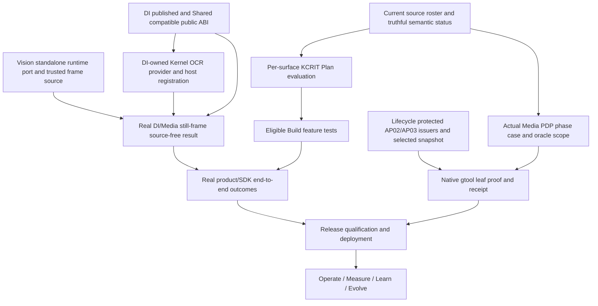

# Ghatana Media — current-source residual completion plan and owner execution dispositions

> **CURRENT CONTROLLING UPDATE (2026-11-01 PT): See [§41](#41-november-1-current-remote-reconciliation-exact-remaining-work-approvals-and-per-surface-execution).** Connected GitHub Media `main` now contains the 251 previously unpublished commits through `e2b449ea` including IP-06 `1e4c571a`; Kernel `main` contains `f30264795` DI HTTP adapter. The 56 source declarations are all matrix-bound, and the current source bridge is 3,188/8,668/0. PDP1/2/3 matrices are **STALE** with 16/19/16 raw pins. Kernel context authorization and false cancellation, H02 owner source semantics, JC03 hard deadlines and IP06 true crash/release proofs remain. Previous dated sections contain historical snapshots and original task details, not new parallel task authorities.

> **Current re-review, October 31, 2026 PT**. Source inspected on connected GitHub `main`: Media `5e1e4117d40688e16cf884dc2d25cdf525f7a081`; Ghatana `7262bc9da397e90e7a30a2ec3f75df62982252eb`; Kernel `209921dea4f13c756deaa0a945580df4587ffbf3`; Shared `13548bf7e73f8868eeba3626a763aa2cd82bddf4`; Lifecycle `feac5c54433c2c7f8f3e781c59a812cdb9293736`. Source commits by this plan advance Media `main`; always re-read the actual new HEAD and exact source bytes before any execution. **This GitHub source review did not run Java/Python/Rust/TS tests, deploy anything, issue protected host credentials, sign reviews, grant licenses, operate production, or obtain native closure receipts.** Host test counts cited below come from commit messages and prior implementer reports, not fresh independent runs.

> **Paired exact machine handoff:** [current 28/21/7 all-surface + 30-journey + 36 R8 + 84 W3 + 8 H execution register](MEDIA-REMAINING-OWNER-DISPOSITIONS-2026-10-31.v1.json). The same existing file is extended (no duplicate stage/task authority). This is a **derived plan**, subordinate to Media PDP0–3, original [50-package Build plan](MEDIA-BUILD-IMPLEMENTATION-PLAN.md), original [Wave2 R8 acceptance](MEDIA-WAVE2-R8-FULL-ACCEPTANCE-MATRIX.json), original [W3/H source package list](MEDIA-BACKEND-REMAINING-SURFACES-2026-10-30.md), and Lifecycle `ghatana.product-development.v3`/native owner acceptance.

## 1. Executive technical verdict and finite denominator

**There is substantial new working code; do not restart completed surfaces. However Media Build, native PDP closure, protected external DI/Kernel integration, production Delivery and Enhance are not proved complete.** The immediate program is *current source correction + owner-public integration + original whole-row acceptance*, not another green source-only plan.

| Original authority / scope | Current source observation | Required completion meaning |
| --- | ---: | --- |
| Physical Media candidates | **28** | Every physical path mapped to an owned applicable source/Build task or justified SUPPORT/SUBSUMED; not 28 independent deployments |
| Logical consumers | **21** | Source-free public ABI, delegated job/rights/effect where applicable; archived desktop gets documented archive-only disposition |
| Compositions including repository root | **7** | Direct cross-child oracle plus current child readback, no duplicated evidence |
| Total declared identities | **56** | Four phase matrices still bind **54** historic IDs: two additional source-owner rows to admit |
| Original Wave2 R8 | **58 = 22 previously locally verified + 36 unaccepted** | Independently verify each of 36 full original criteria; no code-only promotion |
| Original W3 local engineering | **84** | Inspect existing code and finish actual missing original positive/negative/recovery; no blind reimplementation |
| Original H cross-surface outcomes | **8** | Real recorder/capture/animation/simulation/film effects |
| Original W3 OCR legacy | **4 OC tasks source retired** | No old Media engine reimplementation; **replacement Kernel/DI still unverified** |
| Original Build packages | **50 / 57 original plan tasks** | F00–F13, V01–V30, L01–L03, X01–X03; KCRIT owner-controlled admission |
| Source product | **30 journeys; 47 screens; 30 HTTP routes; 44 gRPC RPCs** | Actual real product effects/negative oracles and published channel parity, not source-only definitions |

**Overlap warning:** 36 R8 + 84 W3 + 8 H = **128 selected unaccepted or unqualified rows**, *not 128 necessarily unimplemented features*; F/V/L/X packages overlap. The four retired OC tasks are outside the 84. Never sum root and child tasks, never infer whole-product acceptance from a local green suite.

## 2. Changes already in source — preserve, but qualify honestly

| Area | Actual code/test source | Residual boundary |
| --- | --- | --- |
| **CAP-01/02/03** | `a5be0f60` and `07b3df19` source on main; 111+ provider tests, launcher/runtime contracts, 12/12 TS tests and V029 lineage reported green on host | Only full J03 live effect, external release and unrelated original ledger proofs; no reimplementation |
| **VIS09 internal composition** | `c9aee4d4` with bounded DI transport, trusted still-image crop/source authorization, explicit OCR_ONLY/FULL_VISION profile; author reports 518 Vision tests | Real standalone host port is missing, real DI worker/model/quality and video frame path remain |
| **TTS/MM baseline test defects** | `3d91bcff` changed all three original test classes, source preserves admitted voice/child guards; commit message reports 83 TTS/MM test classes green | Whole TTS/MM R8 model/quality and real source effects still outstanding |
| **Media legacy OCR module retirement** | `f212cf6b` source deletion and `0613884a` topology deletion, four OC tasks recorded retired | Kernel remote main lacks claimed DiOcrProvider; DI replacement/consumer qualification not proven |
| **Track B contract parser** | `9a5bc9b` reports parity 46/46 source-dispositioned, 29/29 parity tests; true YAML parser instead of regex | Current semantic-review/owner pins and source-current 56/54 matrix extensions still need actual independent readback |
| **Latest Media source-currentness chain work** | Commits from `6d4817dd` through `5e1e4117` repaired historical pin/impact observations | PDP0 still IN_PROGRESS, 2 unbound surfaces, source-status at ebcb older than current; no owner-native pass |

**Critical source discrepancy:** `config/kernel-provider-dependency-requests.source.json` points at `platform-kernel/kernel-product-runtime/.../DiOcrProvider.java` and Media PDP0 source declares Kernel `f30264795` complete, but Kernel `main@209921dea` contains **neither that file nor its test**, and GitHub cannot resolve that commit. The Media OCR module is genuinely removed. This is **not** an admitted substitute Kernel provider. Source/product statements referring to a completed DI-backed Kernel binding must be corrected by the owning PDP/manifest generator and an actual crossrepo implementation/push, not by reintroducing Media OCR.

**Another code-level blocker:** `VisionGrpcServer.main()` constructs a Vision server with **null Media runtime port**; `OCR_ONLY` requires a real `MediaProcessingRuntimePort` for immutable frame/rights/crop. The internal DI-only service's constructor tests are insufficient; the actual standalone host cannot serve the intended operation until it discovers and owns a real source/port. Still-frame crop supports frame `0`, PTS `0` only: video frame/track qualification remains a separate original effect.

**A third source-currentness blocker:** latest source-pinned `MEDIA-BUILD-BRIDGE-BLOCKER-INVENTORY.v1.json` says **3,186 identities / 8,667 edges**, whereas the later `ebcbdfca` repair reports **3,188 / 8,668**. Exact current bridge blobs exceeded the connected small-file readback, so do not assume either is the live generated census: re-run owner generators/checks from one frozen actual source readset and attach current results.

## 3. Owner approvals, authorizations and hard boundaries

| Authority decision | Status and scope | Limit / truthful proof rule |
| --- | --- | --- |
| Owner technical decisions, source- and code-scoped crossrepo implementation and deterministic tests | **PREAUTHORIZED** | No need to ask for ordinary fixes that respect original PDP/ABI/owner boundaries. |
| Replace nonexistent Kernel OCR binding and reconcile source authority | **PREAUTHORIZED_FIX_FORWARD** | Do not resurrect Media OCR; require real available DI worker or keep typed NOT_ADMITTED. |
| Vision standalone MediaRuntimePortFactory composition + CI-level host tests | **PREAUTHORIZED** | One factory, no implicit authorization/credentials, preserve FULL_VISION and existing safety. |
| Two PDP matrix extensions and source pin successors | **PREAUTHORIZED_WITH_OWNER_IMPACT_REVIEW** | No blind hashes, no unsupported N/A, no retroactive approval of 29 skips. |
| Repair generator/checker and trace denominators | **PREAUTHORIZED** | Generator-driven, no manual green counters/false CURRENT. |
| External DI/Shared package release/Kernel plugin runtime | **SOURCE_IMPLEMENTATION_APPROVED_RELEASE_NOT_GRANTED** | Real owner-published package/license/installer and source-free test required. |
| Normal per-surface gtool & KCRIT code/plan preparation | **PREAUTHORIZED** | No canonical stage/status/closure mutation without actual protected host and admitted owner; Lifecycle campaign stop respected. |
| R8/W3/H tests, host, model performance and first-party synthetic data | **PREAUTHORIZED** | No external model/audio/license/voice biometric consent/independent reviewer invented. |
| Dev/staging migration rehearsals/rollback | **PREAUTHORIZED** | Production irreversible cutover, trust grant, publishing/release remains separate. |
| Native Lifecycle AP02/AP03, independent technical/a11y/legal/quality evidence and production release | **OUTSIDE_DISCRETIONARY_TECHNICAL_APPROVAL** | Require real private registered verifier, genuine separate human owner/operator if mandated and true recorded effect. |

**Architecture is fixed:** Ghatana Document Intelligence alone executes OCR and qualifies its engines. Shared owns provider-neutral document extraction types. Kernel owns only neutral materialization/registration and existing compatible facet contracts; a DI-owned adapter consumes the public Kernel SPI and the DI public service. Media owns lawful artifact/frame/crop/source clock/PTS/text tracking and its local results, never Paddle/Tesseract model inference. Data Cloud is an optional metadata projection, not a required Media runtime or OCR authority.

**Owner decisions and routine technical approvals are sufficient for source/code/test preparation** across Media, Ghatana, Kernel and Shared, including modifying current specs and machine projections through their owner generators. Real third-party model/voice/biometric rights, protected private signer/verifier enrollment, an independent qualified reviewer, an operator's irreversible production cutover, package publication and release approval **cannot** be granted by this derived plan. On unavailable evidence, use typed `NOT_ADMITTED`/`UNAVAILABLE`/`WAIT_AUTH`/`UNKNOWN_OUTCOME`, preserve original input and proceed with independent ready surfaces.

## 4. All unresolved blocker packets — where/how/owner/exact exit

| Blocker | Accountable owner, status | Required source implementation and test | Exit |
| --- | --- | --- | --- |
| **B01 · Kernel replacement recorded but absent on connected main** | `ghatana-kernel`; **EXTERNAL_REPO_CODE_REQUIRED**; [issue](https://github.com/samujjwal/ghatana-kernel/issues/99) | **Observed:** Media dependency request targets DiOcrProvider.java, current Kernel main 209921dea lacks it; f30264795 commit not resolvable **Action:** Implement provider in Ghatana DI adapter against Kernel public API, or source-authorized Kernel composition shim with DI-owned execution only. Commit to actual Kernel/DI main, align Media manifest sourceRefs, installed conformance/receipt | Source-free Kernel OcrProvider extract/status/cancel with real lawful DI worker, tenant/source/consent/rights, installed consumers; no phantom ref |
| **B02 · Vision standalone OCR_ONLY cannot compose source port** | `ghatana-media`; **ENGINEERING_READY**; [issue](https://github.com/samujjwal/ghatana-media/issues/23) | **Observed:** VisionGrpcServer.main invokes two-argument constructor -> createProductionRuntime(null); OCR_ONLY requires nonnull MediaProcessingRuntimePort **Action:** Runtime port ServiceLoader through actual VisionGrpcServer entrypoint, reject ambiguous factories, close port on failed start/shutdown, support source-owned DI endpoint identity and no runtime-pixel bypass | Process-level OCR_ONLY standalone real rights/image+DI positive, missing/duplicate factory fail-closed, no YOLO dependency, cleanup verified |
| **B03 · DI provider/Shared package is development-only** | `ghatana`; **HOST_LICENSE_AND_PUBLIC_PACKAGE_REQUIRED**; [issue](https://github.com/samujjwal/ghatana/issues/252) | **Observed:** DI client 0.1.0 peers @ghatana/document-extraction 0.1.0-SNAPSHOT; no installed qualified release or real worker proof **Action:** Pin compatible immutable Shared+DI package, classify honest DEV_SOURCE_COMPOSITE vs published release, qualify real worker PNG+PDF and two source-free consumers; credential/mTLS and no open network egress | Installed peer and worker first positive/provenance/quality/readiness/negative and owner approval |
| **B04 · OCR retirement was confused with provider admission** | `ghatana-media`; **ENGINEERING_READY_SOURCE_IMPACT_REVIEW**; [issue](https://github.com/samujjwal/ghatana-media/issues/19) | **Observed:** PDP0 `ocr-ownership.yaml`, the Kernel dependency request and OCR consumer inventory already mark replacement/admission unverified. The physical-topology rationale, retirement decision and older execution-plan statements still implied a completed DI-backed Kernel replacement. **Action:** Correct those current source records and tests; keep W3 OC source retirement distinct from public consumer/provider admission; do not rewrite historical source inventory or stage/status records. | No current source claims the retired Media adapter is an admitted Kernel/DI replacement; OCR inventory and focused owner checks pass; source-pin currentness remains separately reported. |
| **B05 · 56 declarations vs 54 historic phase matrix bindings** | `ghatana-media`; **OWNER_REVIEW_AND_ENGINEERING**; [issue](https://github.com/samujjwal/ghatana-media/issues/19) | **Observed:** roster reports 28 physical +21 logical +7 compositions; two physical extensions unbound in PDP0..3; top PDP0 IN_PROGRESS **Action:** Phase-matrix generator one-row additions for agent-tools SUPPORT_ONLY and DataCloud active OPTIONAL; source-guard PDP0 skipped 29, owner status, P2 old 180 vs status157 current pins; verify source-by-source snapshot post latest main | 56 source dispositions and all 4 current phase matrices with scoped original tests; PDP0 truthful outcome, admitted closure-unit roster separate |
| **B06 · Current bridge status file has obsolete denominator** | `ghatana-media`; **ENGINEERING_READY**; [issue](https://github.com/samujjwal/ghatana-media/issues/21) | **Observed:** blocker inventory source 3186/8667 while newer OCR-M03 generator commit reports 3188/8668; exact current bridge blobs too large for connector readback **Action:** Re-run check/generate source identity trace, bridge, blocker inventory, 50-package task plan from same current source readset, typed ID/edge digest and wrong/source-free guard; KCRIT owner proof separately | All live generated census equal under exact source cut, zero real unresolved, owner KCRIT task admission |
| **B07 · PDP source-currentness is older than live main** | `ghatana-media`; **INDEPENDENT_REVIEW_AND_ENGINEERING**; [issue](https://github.com/samujjwal/ghatana-media/issues/3) | **Observed:** PDP0 IN_PROGRESS, P1-3 historical DEV_COMPLETE; status mainSha ebcbdfca77, later 16+ source/observation commits, P0-03 has 29 skips, no current independent owner readback **Action:** Run impacted selector review, 56-row generator closure, result checks, source-current P0 criteria and independent reviewers; attach owner adopted source status only if actual criteria pass | No silent stale/UNKNOWN or P0 fake success, current source and review/test evidence |
| **B08 · Lifecycle AP02/AP03 source admission and protected host not configured** | `ghatana-lifecycle`; **PROTECTED_OPERATOR_AND_USER_RESUME_REQUIRED**; [issue](https://github.com/samujjwal/ghatana-lifecycle/issues/24) | **Observed:** No authentic Media AP02/AP03 owner verifier/selected snapshot/native receipt on connected data; Lifecycle source includes user-requested stop after 62-ID report **Action:** On authorized resume, actual AP02 contract DAG selection, AP03 Media tracked source source-cut and trusted signer/verifier; native gtool first leaf; no consumer JSON replacement | Genuine registered host and first current PDP0 physical leaf receipt; fail-closed tamper/revocation |
| **B09 · Kernel Work Planner Build task closure not authenticated** | `ghatana-kernel`; **OWNER_HOST_REQUIRED**; [issue](https://github.com/samujjwal/ghatana-media/issues/22) | **Observed:** 50 canonical F/V/L/X packages /57 original Build plan tasks, 19 formerly blocked selected; no authenticated per-surface KCRIT Plan Ready **Action:** Bind exact original task+source/test/owner/ABI/current method revision; KCRIT-PLAN-TASK-CLOSURE then KCRIT-PLAN-READY for independently eligible surfaces | Authentic owner result/revision+typed reason for each selected task, not new Media stage writer |
| **B10 · Original model and rights/performance acceptance not complete** | `ghatana-media`; **EXTERNAL_ASSETS_AND_REAL_HOST**; [issue](https://github.com/samujjwal/ghatana-media/issues/22) | **Observed:** Wave2 R8 still 36 unaccepted; W3/H 84+8 require original real positive negative/recovery and host quality, 5 stream capabilities pending **Action:** Source-approved licensed corpus/model/voice and provider qualification; c1/16/64, WER/CER/mAP/latency resource; streaming WebRTC/adaptive/HLS/DASH/lease, all 30 real journeys | 36 original R8 accepted; 92 W3/H whole rows adjudicated; no unlicensed or mocked effect |
| **B11 · Old writer vs new Media PostgreSQL source ownership** | `ghatana-media`; **PRODUCTION_OPERATOR_REQUIRED**; [issue](https://github.com/samujjwal/ghatana-media/issues/22) | **Observed:** V029 source Testcontainers PASS reported, deployed historical ghatana/services/media real writer cutover unverified **Action:** Read applied Flyway V001-V029; dry-run snapshot/recover, old writer quiesce+fence, bounded rollback/forward and outbox dedupe; real operator grant later | Actual deployed source owner cutover verified, zero duplicate row/receipt and recovery/retention proof |
| **B12 · Full UI/recorder/studio/player and first real PDP3 twin not complete** | `ghatana-media`; **ENGINEERING_AND_SPECIALIST_REVIEW**; [issue](https://github.com/samujjwal/ghatana-media/issues/5) | **Observed:** 30 journey proposal contracts, 47 source screens and one v1 J03 static Explorer recording edition; no complete 30 real product terminals proven **Action:** Finish original V01..V30/L01..L03/H01..H08, real UI/animation/simulation/film, negative/a11y/scientific quality/rights proof | All selected real business terminal effects, independent visual/scientific/a11y reviews, playback/source truth |
| **B13 · Platform Data Cloud/Event/Action Plane actual integration acceptance** | `ghatana`; **EXTERNAL_PUBLIC_PLATFORM_OWNER**; [issue](https://github.com/samujjwal/ghatana/issues/254) | **Observed:** Data Cloud optional, Event Plane 201 append != consume/final; Action Plane real end-effect and original 32 AEP cases unverified **Action:** Exact public consumer versions, 201 append and eventual result/readback, Action Plane source/rights/owner receipt, optional Data Cloud outage proof, 32 AEP cases as applicable | Real installed negative/partition/lostACK and independent effect receipts; Media jobs finish without Data Cloud |
| **B14 · Vision video-frame DI time semantics not admitted** | `ghatana-media`; **NATIVE_VIDEO_CODEC_AND_REAL_WORKER**; [issue](https://github.com/samujjwal/ghatana-media/issues/23) | **Observed:** MediaRuntimeSceneTextSource explicitly refuses non-frame 0/PTS0; fine for still-image proof but not tracked video text **Action:** Reuse source-pinned qualified VideoFrameExtractor/OCI worker; true frameId/PTS/clock/crop, rights and source version; choose explicit DI processing and tracking schema | Real VFR/frames reordered/scene cut/ROI/time tests and DI text track source-fidelity under exact origin |

### Dependency graph and non-pausing alternative work



A blocked DI/Kernel case does not stop non-OCR STT/TTS/Studio/stream/Explorer engineering. A blocked protected Lifecycle host does not stop valid Build code or source-current planning. Native closure does not receive synthetic proof from these independent outputs.

## 5. Surface-by-surface physical implementation and tests — all 28 current candidates

Each row is a **current source ownership selection**, not a source-certified `DEV_COMPLETE`. `W3` IDs refer to original local rows; `R8` IDs to original unaccepted Wave 2. Support-only/subsumed means actual testing and parent ownership, not automatic N/A. Apply PDP applicability from topology, and the Product Development v3 stage/phase predicates in §11.

| Physical source surface and owner | Original selected tasks | Actual remaining code action (what / where / how) | Whole-row acceptance (including denials) |
| --- | --- | --- | --- |
| **adapters-agent-tools-media** · `adapters/agent-tools-media` · media-runtime (SUPPORT_ONLY) | `AT-01`, `AT-02`, `AT-03`, `AT-04`, `AT-05`, `AT-06` | Continue four exact Agent Tool handler contracts through public Tools/Action Plane, tenant-delegated scope, bounded timeout and idempotent action journal; never convert the support adapter to independent model authority. | Run source-free handler positive, wrong tenant/role, revoked grant, cancellation, unknown-outcome/reconcile and no duplicate effect; original AT-01..06. |
| **adapters-data-cloud-media** · `adapters/data-cloud-media` · media-runtime (PHYSICAL) | `DC-01`, `DC-02`, `DC-03`, `DC-04`, `DC-05`, `DC-06` | Keep Data Cloud a strictly optional downstream metadata consumer. Reconcile real versioned public Data Cloud API and owner-authorized consent/redaction; outbox replay and stable source provenance. | Prove Data Cloud absent/partitioned cannot block Media upload, jobs, transcript/caption or provider finality; qualified installed API plus duplicate/lost ACK tests, DC-01..06. |
| **adapters-ledger** · `adapters/ledger` · media-platform (SUPPORT_ONLY) | `LD-01`, `LD-02`, `LD-03`, `LD-04`, `LD-05` | Maintain bounded immutable ledger projections over canonical attempts/jobs rather than second event/transaction authority; exact caller/tenant/provider/receipt IDs and retention. | Real duplicate/timeout/restart/no-secondary-writer tests, LD-01..05 and correct owner-disposition for support-only leaf. |
| **apps-media-experience-explorer** · `apps/media-experience-explorer` · media-product-engineering (PHYSICAL) | F/V/L/X and selected cross-surface only | Keep source-curated PDP3 Explorer screens/one J03 edition film simulated only; reconcile changed source fixtures, narration/captions and screen semantics against true action contracts. | Headless CSP/keyboard/visual/a11y, deterministic scenario recapture and negative/UNKNOWN journeys; no live product effect claim. |
| **audio-video-observability** · `audio-video-observability` · media-platform (SUPPORT_ONLY) | `OBS-07`, `OBS-08` | Preserve verified Micrometer/Prometheus baseline; complete true provider readiness/quality freshness and alert receiver identity; measure c1/16/64 with live models on permitted hosts. | R8 OBS-07/08 actual exporter→receiver firing/cleared, quality change, budget, bounded cardinality/PII and independent run traces; source-only alerts do not establish capacity. |
| **integration-tests** · `integration-tests` · media-platform (SUPPORT_ONLY) | `IT-01`, `IT-02`, `IT-03`, `IT-04`, `IT-05`, `IT-06` | Reconcile actual runtime/job/DI/caption/stream/provider/rights/SDK scenario fixtures against current 30 HTTP/44 RPC and original all-surface negative cases. | IT-01..06 real positive/denial/UNKNOWN/crash/restart and source-free consumer plus J03 film; zero synthetic effects passed as real. |
| **launcher** · `launcher` · media-runtime (PHYSICAL) | F/V/L/X and selected cross-surface only | Reuse completed CAP HTTP auth/profile/caption 30-route seam; complete real selected runtime writer/authorized provider/composition, stream lease and job attempts, external effects and shutdown. | Authenticated production-like Java HTTP server, 30-route OpenAPI match, source revocation/replay, crash/health and actual single-writer recovery; CAP tests reused. |
| **libs-audio-video-client** · `libs/audio-video-client` · media-client-owner (PHYSICAL) | `SK-01`, `SK-02`, `SK-03`, `SK-04`, `SK-05`, `SK-06`, `SK-07`, `SK-08` | Preserve CAP credential/readback/fingerprint; complete all SK-01..08 SDK/CLI, source-free DI/public ABI, job/stream/production-spec and exact cancellation/UNKNOWN semantics. | Installed packed SDK against actual 30-route HTTP, gRPC where applicable, wrong tenant, timeout, stale version, provider denial, monotone retries. |
| **libs-audio-video-types** · `libs/audio-video-types` · media-types-owner (PHYSICAL) | `TY-01`, `TY-02`, `TY-03`, `TY-04`, `TY-05`, `TY-06` | Repair typed contracts to current 30 HTTP/44 RPC/immutable caption and transcript versions; validate rational ticks/bigints/rights/ProductionSpec and single type authority. | TY-01..06 strict Zod/runtime/TS schema vectors plus Java/TS/golden/install, overflows and hostile polymorphic payloads. |
| **libs-audio-video-ui** · `libs/audio-video-ui` · media-ui-owner (PHYSICAL) | F/V/L/X and selected cross-surface only | Connect real production host for all 47 screens, caption exact-pair comparison, jobs, rights, recording, studio and interactive delivery; do not reuse Explorer as live host. | Actual product E2E: keyboard/reader/zoom/reduced-motion, denial/recovery/real effects and independent a11y visual professional report. |
| **libs-common** · `libs/common` · media-runtime (SUBSUMED) | `JC-01`, `JC-02`, `JC-03`, `JC-04` | Reuse Shared TLS/identity and existing interceptors; strengthen gRPC4-service admission, rate/timeout, no redundant quota/provider authority. | JC-01..04 real cross-tenant/forged header/revocation and source-free transport parity with bounded queues. |
| **libs-java-common** · `libs/java/common` · media-runtime (SUBSUMED) | `MC-01`, `MC-02`, `MC-03`, `MC-04`, `MC-05` | Reuse modality engine SPI and current DSP; bound parsers/pools/close/sync and isolate Wave2 ownership for Whisper/Piper/YOLO code. | MC-01..05 focused codec/fuzz/negative/resource tests and original Wave2 model quality/rights, no synthetic default success. |
| **libs-media-experience-simulation** · `libs/media-experience-simulation` · media-product-engineering (SUPPORT_ONLY) | F/V/L/X and selected cross-surface only | Keep deterministic curated Explorer state engine separate from real Media job/physics solver, source-authorized versioned scenarios and recorded narration. | Reproducible static scene model+negative statuses+source digests, no claim of real simulation or film. |
| **modules-audio-streaming** · `modules/audio-streaming` · media-runtime (SUPPORT_ONLY) | `AS-01`, `AS-02`, `AS-03`, `AS-04`, `AS-05`, `AS-06`, `AS-07` | Complete actual WebRTC and adaptive HTTP/audio transport admission, framed STT/TTS, ACK/backpressure/reconnect/lease with one canonical stream authority. | AS-01..07 1/16/64 real host source clock/rights/reconnect/cancel, playable audio and fail-closed unsupported profiles. |
| **modules-infrastructure-cache** · `modules/infrastructure/cache` · media-platform (SUPPORT_ONLY) | `CA-01`, `CA-02`, `CA-03`, `CA-04`, `CA-05` | Bound cache by tenant/source/rights epoch, TTL and memory; cache never overrides live source rights or completion authority. | CA-01..05 stale/revoked/cache poisoning/eviction/Redis outage and deterministic no second runtime writer. |
| **modules-infrastructure-messaging** · `modules/infrastructure/messaging` · media-platform (SUPPORT_ONLY) | F/V/L/X and selected cross-surface only | Wire Event Plane 201 append, real outbox/consumer finality, per-version idempotency and crash fence; prevent Event Plane receipt from implying Media job done. | Lost ACK/timeout/reordered duplicate/restart and owner source-free Event Plane public API, with negative 200 response. |
| **modules-infrastructure-persistence** · `modules/infrastructure/persistence` · media-platform (SUPPORT_ONLY) | `IP-01`, `IP-02`, `IP-03`, `IP-04`, `IP-05`, `IP-06`, `IP-07` | Use canonical PostgreSQL provider as single writer; interface boundaries, migration freeze/forward compatibility, immutable transcript/caption/job/consent lineage. | IP-01..07 real Postgres CAS/restart/retention/tenant RLS, compare applied V001–V029 against live historical writer and one-writer cutover. |
| **modules-infrastructure-security** · `modules/infrastructure/security` · media-platform (SUPPORT_ONLY) | F/V/L/X and selected cross-surface only | Unify current source/rights/biometric/voice purpose and tenant auth at every effect boundary, including DI frame extraction, cache hit, retries and delivery. | Revocation between authorize/read/effect, wrong principal, stale source/decision, no unqualified model or untrusted callback. |
| **modules-integration-tests** · `modules/integration-tests` · media-platform (SUPPORT_ONLY) | `CT-01`, `CT-02`, `CT-03`, `CT-04`, `CT-05` | Prove production-wired public REST/gRPC SDK and machine channels; preserve original TC/CT catalog and direct declarations rather than inferred success. | CT-01..05 source-free installed clients, protocol version and denial/UNKNOWN, provider runtime and DI/Kernel receipt. |
| **modules-intelligence-ai-voice-libs-ai-voice-ui-react** · `modules/intelligence/ai-voice/libs/ai-voice-ui-react` · media-ui-owner (PHYSICAL) | F/V/L/X and selected cross-surface only | Real host voice selection/consent, license/clone restrictions, preview, narration and a11y, no test data as rights. | Reader/keyboard/no-consent/revoked/unsupported locale/readiness, real qualified output and versioned result. |
| **modules-intelligence-multimodal-service** · `modules/intelligence/multimodal-service` · media-runtime (PHYSICAL) | `MM-02`, `MM-03`, `MM-05`, `MM-06`, `MM-08`, `MM-09`, `MM-10`, `MM-12` | Qualify actual STT/Vision child source version/clock and executor; no synthetic fused success, Data Cloud optional and child UNKNOWN guarded. | R8 MM-02/03/05/06/08/09/10/12 and full real STT+Vision fused terminal, restart and 1/16/64. |
| **modules-intelligence-speech-libs-speech-audio-rust** · `modules/intelligence/speech/libs/speech-audio-rust` · media-runtime (SUPPORT_ONLY) | `RS-01`, `RS-02`, `RS-03`, `RS-04`, `RS-05`, `RS-06`, `RS-07` | Reuse rational Blackman-sinc DSP; verify finite sample offsets, anti-alias/format/FFI, no double clock/codec implementation. | RS-01..07 cargo fmt/clippy/fuzz/roundtrip and real host throughput 1/16/64 with bounded allocations. |
| **modules-speech-stt-service** · `modules/speech/stt-service` · media-runtime (PHYSICAL) | `STT-03`, `STT-04`, `STT-08`, `STT-09`, `STT-05`, `STT-06`, `STT-07`, `STT-10`, `STT-12` | Real licensed STT en/hi/ne source-constrained model, stream decode, exact transcript revision/clock/attempt and consent/fencing. | R8 STT outstanding row positives+negative/quality WER/CER/DER and restart/host 1/16/64; no skipped model tests presented as success. |
| **modules-speech-tts-service** · `modules/speech/tts-service` · media-runtime (PHYSICAL) | `TTS-05`, `TTS-02`, `TTS-03`, `TTS-06`, `TTS-07`, `TTS-08`, `TTS-09`, `TTS-10`, `TTS-12` | Reuse repaired host baseline 83-class TTS/MM tests; finish actual permitted Piper/voice phoneme/locale/rights/consent, playable chunks and profile admission. | R8 TTS outstanding original rows, voice revocation/cancel/clone denial, measured intelligibility + c1/16/64 and real licensed output. |
| **modules-video-streaming** · `modules/video-streaming` · media-runtime (SUPPORT_ONLY) | `VS-01`, `VS-02`, `VS-03`, `VS-04`, `VS-05`, `VS-06`, `VS-07` | Finish actual WebRTC/HLS/DASH/adaptive transports, correct VFR/source PTS, leases, codec source and authenticated reconnection. | VS-01..07 actual media samples/checksum/arrival/timing/revocation/c1/16/64, no synthetic wrapper counted. |
| **modules-vision-vision-service** · `modules/vision/vision-service` · media-runtime (PHYSICAL) | `VIS-03`, `VIS-10`, `VIS-02`, `VIS-05`, `VIS-06`, `VIS-07`, `VIS-09`, `VIS-12` | VIS09 internal DI consumer, trusted still-image pixels and bounded transport are implemented. `VisionGrpcServer.main()` now uses the single `MediaRuntimePortFactory` ServiceLoader composition path; composed-port ownership closes on construction/bind/shutdown. The OCR_ONLY fixture startup test remains not-ready without an admitted provider. | Existing factory-composed OCR_ONLY startup coverage passed 7/7 (see §28). Installed owner factory, real DI worker/result, source rights, allowlist authority, process/package host qualification, video-frame source/PTS/tracking and original R8 VIS rows remain open. Media remains a DI consumer; it does not own a competing OCR engine. |
| **providers-aws-postgresql** · `providers/aws-postgresql` · media-runtime (PHYSICAL) | F/V/L/X and selected cross-surface only | Preserve V029 CAP exact transcriptVersionRef and 111+ host green; actual applied-history & single-writer live cutover remain, with captions/outbox/provider state retention. | Real durable PG Testcontainers/restart/applied V001–V029 records; RLS/tenant/revoke/duplicate and protected production forward migration/rollback plan. |
| **runtime-contracts** · `runtime-contracts` · media-runtime (PHYSICAL) | F/V/L/X and selected cross-surface only | Keep MediaDeploymentProfiles, typed CAP, source/content/clock, job/stream/provider schemas as one canonical Java/TS runtime contract; separate effect states and route truth. | Installed Java/TS 30 HTTP/44 RPC parity, malformed/status/request-fingerprint tests, stable wire version and no duplicate owner API. |

### Required independent steps for any physical leaf

1. Read its current manifest, source owner, PDP0–3 requirement/operation/experience applicability, concrete public ABI and original source task IDs. If SOURCE_SUPPORT/SUBSUMED, bind the authoritative owning composite; do not invent a new deployed product.
2. Capture actual current SHA and status for **only** its impacted source members; compare existing source/test and machine receipts before writing code. Preserve current passing CAP, DSP, OCI, TTS/MM readiness, schema migrations and static Explorer material.
3. Finish each original incomplete effect with source identity, tenant/principal/delegation, rights, finite resource limits, cancellation/idempotency and UNKNOWN/recovery, independent positive and negative test. Use installed public consumers, not private source imports.
4. Get a genuine Work Planner owner phase transition for a selected eligible Build task under current method and source revision. Actual native PDP proof and owner case/observer/oracle receipts are separate; only then count relevant phase closure. No unrelated surface dependency expansion.

## 6. All 21 logical consumer surfaces — named real acceptance

| Logical source | Current owner binding | Required consumer behavior and test |
| --- | --- | --- |
| `media.surface.web` (HOST_DEPENDENT) | `libs-audio-video-ui` | Real authenticated production host, 47 screens, source screen actions and finality. **Completion test:** Positive real effect if required; negative, restart, rights/currentness; native proof separate |
| `media.surface.embedded` (HOST_DEPENDENT) | `libs-audio-video-ui` | Sandboxed origin/auth/player and exact simulated-vs-real label and a11y. **Completion test:** Positive real effect if required; negative, restart, rights/currentness; native proof separate |
| `media.surface.public-http` (HOST_DEPENDENT) | `launcher`, `runtime-contracts` | 30 HTTP operations, JWT permission mapping, error/result parity, real positive. **Completion test:** Positive real effect if required; negative, restart, rights/currentness; native proof separate |
| `media.surface.service-grpc` (CONTRACT_ONLY) | `runtime-contracts`, `modules-speech-stt-service`, `modules-speech-tts-service`, `modules-vision-vision-service`, `modules-intelligence-multimodal-service` | 44 RPCs, mTLS/JWT identity, quota/cancel/timeout, generated source-free client. **Completion test:** Positive real effect if required; negative, restart, rights/currentness; native proof separate |
| `media.surface.grpc.stt` (CONTRACT_ONLY) | `modules-speech-stt-service` | True STT voice/audio stream, finality, gold, negative cases. **Completion test:** Positive real effect if required; negative, restart, rights/currentness; native proof separate |
| `media.surface.grpc.tts` (CONTRACT_ONLY) | `modules-speech-tts-service` | True TTS audio stream and licensed voice rights, negative cases. **Completion test:** Positive real effect if required; negative, restart, rights/currentness; native proof separate |
| `media.surface.grpc.vision` (CONTRACT_ONLY) | `modules-vision-vision-service` | Real Vision geometry and DI-only OCR VIS09, real DI binding. **Completion test:** Positive real effect if required; negative, restart, rights/currentness; native proof separate |
| `media.surface.grpc.multimodal` (CONTRACT_ONLY) | `modules-intelligence-multimodal-service` | True STT/Vision child receipts and fused source result. **Completion test:** Positive real effect if required; negative, restart, rights/currentness; native proof separate |
| `media.surface.sdk` (PHYSICAL) | `libs-audio-video-client`, `libs-audio-video-types` | Installed TS public client, authenticated caption and DI transport, no empty-on-error. **Completion test:** Positive real effect if required; negative, restart, rights/currentness; native proof separate |
| `media.surface.cli` (HOST_DEPENDENT) | `libs-audio-video-client`, `libs-media-experience-simulation` | Source-bound real artifact/job/recorder operations with deterministic JSON and error semantics. **Completion test:** Positive real effect if required; negative, restart, rights/currentness; native proof separate |
| `media.surface.agent-tools` (CONTRACT_ONLY) | `runtime-contracts`, `adapters-agent-tools-media` | Four exact handlers with Tools/Action Plane policy and no fake admission. **Completion test:** Positive real effect if required; negative, restart, rights/currentness; native proof separate |
| `media.surface.events` (CONTRACT_ONLY) | `modules-infrastructure-messaging`, `runtime-contracts` | Event Plane outbox, 201 append, durable consumer true finality. **Completion test:** Positive real effect if required; negative, restart, rights/currentness; native proof separate |
| `media.surface.integrations` (HOST_DEPENDENT) | `adapters-data-cloud-media`, `adapters-ledger`, `modules-infrastructure-cache`, `modules-infrastructure-messaging`, `modules-infrastructure-persistence`, `modules-infrastructure-security`, `providers-aws-postgresql` | DI/Kernel/DataCloud/AEP/Agents/Shared source-free public boundary and outage isolation. **Completion test:** Positive real effect if required; negative, restart, rights/currentness; native proof separate |
| `media.surface.types-library` (PHYSICAL) | `libs-audio-video-types` | Strict published validators and Java/TS/JSON contract parity. **Completion test:** Positive real effect if required; negative, restart, rights/currentness; native proof separate |
| `media.surface.ui-library` (HOST_DEPENDENT) | `libs-audio-video-ui`, `modules-intelligence-ai-voice-libs-ai-voice-ui-react` | Packaged accessible Studio/caption/player/voice components in real host. **Completion test:** Positive real effect if required; negative, restart, rights/currentness; native proof separate |
| `media.surface.explorer` (PHYSICAL) | `apps-media-experience-explorer`, `libs-media-experience-simulation` | PDP3 curated static data, narration/caption demo and negative/a11y cases. **Completion test:** Positive real effect if required; negative, restart, rights/currentness; native proof separate |
| `media.surface.desktop-archive` (ARCHIVED) | Archived historical owner only | Keep NOT_ACTIVE_ARCHIVED and historical receipt; no fabricated deployable. **Completion test:** Positive real effect if required; negative, restart, rights/currentness; native proof separate |
| `media.surface.recorder-orchestrator` (HOST_DEPENDENT) | `libs-audio-video-client`, `libs-media-experience-simulation` | Automated source-driven deterministic capture, selective recapture, narration and provenance. **Completion test:** Positive real effect if required; negative, restart, rights/currentness; native proof separate |
| `media.surface.capture-adapters` (CONTRACT_ONLY) | `runtime-contracts` | Qualified desktop/mobile/browser/terminal/API/gRPC/camera/media capture with rights and clocks. **Completion test:** Positive real effect if required; negative, restart, rights/currentness; native proof separate |
| `media.surface.production-studio` (HOST_DEPENDENT) | `libs-audio-video-ui` | Professional GUI timeline/caption/animation/edit/render/undo and real backend effects. **Completion test:** Positive real effect if required; negative, restart, rights/currentness; native proof separate |
| `media.surface.interactive-demo-player` (HOST_DEPENDENT) | `libs-audio-video-ui` | Sandboxed branching player, captions, a11y, evidence-mode/real truth labels. **Completion test:** Positive real effect if required; negative, restart, rights/currentness; native proof separate |

**Hosted/virtual distinctions:** the HTTP 30-route and gRPC 44-RPC descriptors are contract counts, not evidence that each RPC has an admitted production provider. An archived desktop surface is not required to run as current deployable code. AgentTools, CLI, SDK, Events and Integrations need independent installed protocol/permission/finality tests; UI and Embedded/Studio/Player need real host proof. Source-only Explorer is a separate static simulation.

## 7. Seven semantic composites, dependency direction and root

| Composite | Current direct children | Direct meaning to prove |
| --- | --- | --- |
| `media.composition.repository-root` | client-and-machine-interfaces; creation-composition-and-delivery; governed-job-execution; ingestion-and-versioned-artifacts; speech-and-caption-workflows; vision-and-multimodal-analysis; adapters-agent-tools-media; adapters-data-cloud-media; audio-video-observability; integration-tests; libs-common; libs-java-common; libs-media-experience-simulation; modules-integration-tests; modules-intelligence-ai-voice-libs-ai-voice-ui-react | Owner-reviewed cross-child source/rights/version/finality and true terminal; reuse child receipts by ref without copying/re-executing proofs |
| `media.composition.ingestion-and-versioned-artifacts` | runtime-contracts; launcher; modules-infrastructure-persistence; modules-infrastructure-security; modules-infrastructure-messaging; modules-infrastructure-cache; providers-aws-postgresql; adapters-ledger | Owner-reviewed cross-child source/rights/version/finality and true terminal; reuse child receipts by ref without copying/re-executing proofs |
| `media.composition.governed-job-execution` | runtime-contracts; launcher; modules-infrastructure-messaging; modules-infrastructure-persistence; modules-infrastructure-security; modules-infrastructure-cache | Owner-reviewed cross-child source/rights/version/finality and true terminal; reuse child receipts by ref without copying/re-executing proofs |
| `media.composition.speech-and-caption-workflows` | modules-speech-stt-service; modules-speech-tts-service; modules-audio-streaming; modules-intelligence-speech-libs-speech-audio-rust | Owner-reviewed cross-child source/rights/version/finality and true terminal; reuse child receipts by ref without copying/re-executing proofs |
| `media.composition.vision-and-multimodal-analysis` | modules-vision-vision-service; modules-intelligence-multimodal-service; modules-video-streaming; runtime-contracts | Owner-reviewed cross-child source/rights/version/finality and true terminal; reuse child receipts by ref without copying/re-executing proofs |
| `media.composition.creation-composition-and-delivery` | launcher; runtime-contracts; modules-infrastructure-persistence; modules-infrastructure-messaging; libs-audio-video-types; libs-audio-video-client; libs-audio-video-ui | Owner-reviewed cross-child source/rights/version/finality and true terminal; reuse child receipts by ref without copying/re-executing proofs |
| `media.composition.client-and-machine-interfaces` | runtime-contracts; libs-audio-video-types; libs-audio-video-client; libs-audio-video-ui; modules-speech-stt-service; modules-speech-tts-service; modules-vision-vision-service; modules-intelligence-multimodal-service; apps-media-experience-explorer | Owner-reviewed cross-child source/rights/version/finality and true terminal; reuse child receipts by ref without copying/re-executing proofs |

For each composite, reference current accepted child artifacts/receipts **by identity and fingerprint**; run only its own cross-child invariant (e.g. source upload→canonical job→attempt→transcript/caption→versioned UI and external effect). Root requires direct repo-level consistency and all applicable child dispositions; do not rerun 8,664 source candidate cases blindly or collapse SOURCE_DEV_COMPLETE into native CLOSED.

## 8. All 30 V01–V30 vertical product outcomes — real terminal and negative proof

PDP3's current journey registry defines 28 master journeys plus two additional journeys and labels them proposal/source definition contracts. A P3 definition status is **not** proof of each live runtime outcome. Use original authored journey contracts and scoped current source tests. The first real product flow is **J-01 → J-02 → J-20 → J-03**, reusing completed CAP code, and requires a real rights-cleared STT provider.

| Original Build package / journey | Required business outcome | Actual acceptance oracle and recovery |
| --- | --- | --- |
| **M-BLD-V01 / J-01** | First use, authentication, context, and project creation | Real JWT/tenant and exact project/create/readback; wrong actor/role, idempotent replay, denied bootstrap. Plus exact source-current actor/rights, negative/UNKNOWN/recovery and public-interface/host parity |
| **M-BLD-V02 / J-02** | Upload/import, inspect, and produce a usable artifact | Real resumable upload, chunk checksum, final immutable artifact/source version; oversize/wrong tenant/corrupt/restart. Plus exact source-current actor/rights, negative/UNKNOWN/recovery and public-interface/host parity |
| **M-BLD-V03 / J-03** | Audio/video transcription through corrected captions | Real eligible STT job → persisted transcriptVersionRef → edited caption V029 registration → EXACT_PAIR read/verify; bad clock/rights/restart. Plus exact source-current actor/rights, negative/UNKNOWN/recovery and public-interface/host parity |
| **M-BLD-V04 / J-04** | Authorized text-to-speech to approved audio | Qualified licensed voice and consent → actual playable TTS bytes; denied clone/expired consent/unsupported locale. Plus exact source-current actor/rights, negative/UNKNOWN/recovery and public-interface/host parity |
| **M-BLD-V05 / J-05** | Image/video analysis, geometry, and tracks | Real image/video classification/detection/tracking with heldout geometry & PTS; DI text only via authorized gateway. Plus exact source-current actor/rights, negative/UNKNOWN/recovery and public-interface/host parity |
| **M-BLD-V06 / J-06** | Multimodal or document consumer request to grounded typed result | Real grounded STT/Vision/DI/document child effects with per-child source policy, confidence/provenance and independent finality. Plus exact source-current actor/rights, negative/UNKNOWN/recovery and public-interface/host parity |
| **M-BLD-V07 / J-07** | Noisy/clipped interview cleanup with preservation and comparison | Actual source-preserving bounded audio denoise/repair and A/B measured output; clipped/missing bands declared. Plus exact source-current actor/rights, negative/UNKNOWN/recovery and public-interface/host parity |
| **M-BLD-V08 / J-08** | Low-quality video repair with measured comparison | Actual codec-safe video restoration, source frame mapping, measured quality & no fabricated enhancement. Plus exact source-current actor/rights, negative/UNKNOWN/recovery and public-interface/host parity |
| **M-BLD-V09 / J-09** | Prompt/brief to storyboard, composition, render, review, and delivery | Brief → versioned storyboard/timeline → real composition/render/artifact/delivery, provenance+rights. Plus exact source-current actor/rights, negative/UNKNOWN/recovery and public-interface/host parity |
| **M-BLD-V10 / J-10** | Controlled generation with references and continuity review | Real reference-conditioned generation where admitted; no unlicensed model or synthetic continuity score. Plus exact source-current actor/rights, negative/UNKNOWN/recovery and public-interface/host parity |
| **M-BLD-V11 / J-11** | Region mask/tracking edit with comparison and undo | Actual region mask/tracking source-clock and undo/CAS version, wrong-frame/rights denial. Plus exact source-current actor/rights, negative/UNKNOWN/recovery and public-interface/host parity |
| **M-BLD-V12 / J-12** | Deterministic 2D/vector/procedural animation | Real 2D/vector animation frame output from bounded typed specs, golden easing/clock and render checksum. Plus exact source-current actor/rights, negative/UNKNOWN/recovery and public-interface/host parity |
| **M-BLD-V13 / J-13** | 3D character, rig, path, or control animation | Real 3D rig/animation with admitted renderer, pose/coordinate safety, output frames or truthful UNAVAILABLE. Plus exact source-current actor/rights, negative/UNKNOWN/recovery and public-interface/host parity |
| **M-BLD-V14 / J-14** | Explore a domain simulation and its measurements | Executable deterministic domain simulation with units/initials/solver, analytic Newton fixture a=3, v=6, x=6 at t=2; compare error. Plus exact source-current actor/rights, negative/UNKNOWN/recovery and public-interface/host parity |
| **M-BLD-V15 / J-15** | Simulation/procedural passes with protected semantic validation | Validated simulation passes/model identity + uncertainty, solver stability, ABSTAIN for unsupported domain. Plus exact source-current actor/rights, negative/UNKNOWN/recovery and public-interface/host parity |
| **M-BLD-V16 / J-16** | Existing-video translation/dubbing and voice/timing review | Real authorized transcription/translation/dubbing/voice timing; no unconsented voice clone or wrong-language substitution. Plus exact source-current actor/rights, negative/UNKNOWN/recovery and public-interface/host parity |
| **M-BLD-V17 / J-17** | Music, effects, Foley, stems, mix, and mastering | Licensed/original music+effects/stem/audio mix real playable master and protected rights/level boundaries. Plus exact source-current actor/rights, negative/UNKNOWN/recovery and public-interface/host parity |
| **M-BLD-V18 / J-18** | Compose clips, captions, exact graphics, color, and audio master | Actual clip/caption/graphics/color/audio timeline export with source retention, exact render checksum and negative. Plus exact source-current actor/rights, negative/UNKNOWN/recovery and public-interface/host parity |
| **M-BLD-V19 / J-19** | Review media quality and improve it within declared limits | Actual holdout quality measurements and bounded optimization decision; never promote unknown quality. Plus exact source-current actor/rights, negative/UNKNOWN/recovery and public-interface/host parity |
| **M-BLD-V20 / J-20** | Observe a long-running job and check its outcome | Real queued/running/failed/succeeded/UNKNOWN job observation, exact attempt/fencing/restart/idempotency. Plus exact source-current actor/rights, negative/UNKNOWN/recovery and public-interface/host parity |
| **M-BLD-V21 / J-21** | Review/comment/approve exact version and re-review changed material | Real review/comment/version compare and approval re-evaluation on changed source; denied stale/signature. Plus exact source-current actor/rights, negative/UNKNOWN/recovery and public-interface/host parity |
| **M-BLD-V22 / J-22** | Export/download/publish with destination acknowledgement | Real export/downstream destination receipt and consumed finality, separate HTTP 201 transport from delivered. Plus exact source-current actor/rights, negative/UNKNOWN/recovery and public-interface/host parity |
| **M-BLD-V23 / J-23** | Private/local workflow while disconnected and reconnect | Offline queue on real client, revalidate consent/version/rights on reconnect; conflict and no duplicate effects. Plus exact source-current actor/rights, negative/UNKNOWN/recovery and public-interface/host parity |
| **M-BLD-V24 / J-24** | CLI batch/JSON plan through verified outputs | Actual CLI batch structured JSON, deterministic spec and typed cancellation/exit/no hidden workspace work. Plus exact source-current actor/rights, negative/UNKNOWN/recovery and public-interface/host parity |
| **M-BLD-V25 / J-25** | Agent or product integration with bounded delegated Media action | Real four Agent Tool purposes and product consumer delegation with bounded authority, negative and stable results. Plus exact source-current actor/rights, negative/UNKNOWN/recovery and public-interface/host parity |
| **M-BLD-V26 / J-26** | Delete/revoke/retention/hold and visible lifecycle | Real revoke/deletion/hold/retention lifecycle with durable effects and auditor recheck; no irreversible bypass. Plus exact source-current actor/rights, negative/UNKNOWN/recovery and public-interface/host parity |
| **M-BLD-V27 / J-27** | Continue safely when processing is unavailable | Provider unavailable/circuit recovery without fake success or unsupported silent route; preserve user edits. Plus exact source-current actor/rights, negative/UNKNOWN/recovery and public-interface/host parity |
| **M-BLD-V28 / J-28** | Spatial/360/interactive/synthetic-data export to declared consumer | Actual admitted spatial/360/interactive export, clock/coordinate conventions and installed player. Plus exact source-current actor/rights, negative/UNKNOWN/recovery and public-interface/host parity |
| **M-BLD-V29 / J-29** | Live session loss, consent change, and bounded recovery | Real streaming session break/reconnect with lease/consent change and no unauthorized replay or lost finality. Plus exact source-current actor/rights, negative/UNKNOWN/recovery and public-interface/host parity |
| **M-BLD-V30 / J-30** | Check which processing options are eligible | Real model/provider eligibility catalog and independent license/readiness, no readiness from configured metadata alone. Plus exact source-current actor/rights, negative/UNKNOWN/recovery and public-interface/host parity |

**PDP3 recordings:** source edition `media-pdp3-demo-v1` requires **one** source-bound narrated/captioned Explorer J03 film, labeled `EXPLORER_SIMULATED`; extending to 30 recordings is a **new approved versioned edition** with owner source impact, not an unannounced v1 requirement. The first actual J03 Build film must show real upload, authorized STT, immutable correction, source/clock compare, actual versioned artifact and receipt, labeled `LIVE_PRODUCT_VERIFIED`, with same semantic scenario and explicit differences. Do not record mock source states as production proof.

**Animation vs simulation:** J12/13 require actual typed renderer outputs; J14/15 require executable model, solver identity, units, seed, checkpoints and independent scientific oracle (Newton constant-force check: mass 2 kg, force 6 N → acceleration 3 m/s²; at 2 s, velocity 6 m/s and position 6 m from rest). Renderer success cannot certify a simulation equation or declared physical correctness.

## 9. Original Wave2 R8 — every one of the 36 still-unaccepted task IDs

The table below is **not** 36 newly missing implementations; it is the original whole-row positive/negative/rights/performance/restart acceptance still absent from canonical owner readback. Previously verified original 22 IDs are not rerun without material source/host change: `STT-01`, `STT-02`, `STT-11`, `TTS-01`, `TTS-04`, `TTS-11`, `VIS-01`, `VIS-04`, `VIS-08`, `VIS-11`, `MM-01`, `MM-04`, `MM-07`, `MM-11`, `OBS-01`, `OBS-02`, `OBS-03`, `OBS-04`, `OBS-05`, `OBS-06`, `OBS-09`, `OBS-10`.

| Original R8 ID | Source and owner | Exact remaining task / original proof |
| --- | --- | --- |
| **VIS-03** (PARTIAL) | `modules/vision/vision-service`; Media Vision Native and Model Quality; gates G06 | Finish broker source owner/version/auth binding and hard native OCI adversarial corpus, zero leaked processes. **Proof:** `docs/implementation/MEDIA-WAVE2-R8-FULL-ACCEPTANCE-MATRIX.json#/rows/0/independentAcceptanceProof` plus original negative/restart/source license and real effect, do not promote from source-only tests |
| **STT-03** (PARTIAL) | `modules/speech/stt-service`; Media STT and Runtime Security; gates G02 | Verified identity and source rights, current Shared policy, wrong-actor/tenant/expiry/revoke no effects. **Proof:** `docs/implementation/MEDIA-WAVE2-R8-FULL-ACCEPTANCE-MATRIX.json#/rows/1/independentAcceptanceProof` plus original negative/restart/source license and real effect, do not promote from source-only tests |
| **TTS-05** (PARTIAL) | `modules/speech/tts-service`; Media TTS and Voice Governance; gates G02,G04,G11 | Voice profile, clone and biometric owner consent denied before effect, revoked profile no reused embedding. **Proof:** `docs/implementation/MEDIA-WAVE2-R8-FULL-ACCEPTANCE-MATRIX.json#/rows/2/independentAcceptanceProof` plus original negative/restart/source license and real effect, do not promote from source-only tests |
| **VIS-10** (PARTIAL) | `modules/vision/vision-service`; Media Vision Native and Model Quality; gates G02,G11 | No face/gaze/identity effect without biometric purpose/region/retention/consent, tenant isolation. **Proof:** `docs/implementation/MEDIA-WAVE2-R8-FULL-ACCEPTANCE-MATRIX.json#/rows/3/independentAcceptanceProof` plus original negative/restart/source license and real effect, do not promote from source-only tests |
| **MM-02** (PARTIAL) | `modules/intelligence/multimodal-service`; Media Multimodal Integration; gates G02 | Per-child tenant/principal/immutable version/current rights and policy before fanout. **Proof:** `docs/implementation/MEDIA-WAVE2-R8-FULL-ACCEPTANCE-MATRIX.json#/rows/4/independentAcceptanceProof` plus original negative/restart/source license and real effect, do not promote from source-only tests |
| **STT-04** (PARTIAL) | `modules/speech/stt-service`; Media STT and Runtime Security; gates G01,G02,G03 | Real source WAV and advertised FLAC, codec headers/frame bounds/clock negatives. **Proof:** `docs/implementation/MEDIA-WAVE2-R8-FULL-ACCEPTANCE-MATRIX.json#/rows/5/independentAcceptanceProof` plus original negative/restart/source license and real effect, do not promote from source-only tests |
| **STT-08** (PARTIAL) | `modules/speech/stt-service`; Media STT and Runtime Security; gates G03 | CAS immutable transcript/captions/word lineage, typed unsupported align/translation. **Proof:** `docs/implementation/MEDIA-WAVE2-R8-FULL-ACCEPTANCE-MATRIX.json#/rows/6/independentAcceptanceProof` plus original negative/restart/source license and real effect, do not promote from source-only tests |
| **STT-09** (PARTIAL) | `modules/speech/stt-service`; Media STT and Runtime Security; gates G03 | Crash before/after provider receipt; reconcile UNKNOWN and idempotent transcript/outbox. **Proof:** `docs/implementation/MEDIA-WAVE2-R8-FULL-ACCEPTANCE-MATRIX.json#/rows/7/independentAcceptanceProof` plus original negative/restart/source license and real effect, do not promote from source-only tests |
| **STT-05** (PARTIAL) | `modules/speech/stt-service`; Media STT and Runtime Security; gates G01,G03 | True streaming ack/gap/reconnect/backpressure/cancel/EOS provider-finality. **Proof:** `docs/implementation/MEDIA-WAVE2-R8-FULL-ACCEPTANCE-MATRIX.json#/rows/8/independentAcceptanceProof` plus original negative/restart/source license and real effect, do not promote from source-only tests |
| **STT-06** (PARTIAL) | `modules/speech/stt-service`; Media STT and Runtime Security; gates G01,G07 | Source timebase, word/phoneme gold, ordered timings and unknown confidence when unqualified. **Proof:** `docs/implementation/MEDIA-WAVE2-R8-FULL-ACCEPTANCE-MATRIX.json#/rows/9/independentAcceptanceProof` plus original negative/restart/source license and real effect, do not promote from source-only tests |
| **STT-07** (PARTIAL) | `modules/speech/stt-service`; Media STT and Runtime Security; gates G07,G11 | Anonymous overlap diarization, lawful DER; speaker identity remains consent gated. **Proof:** `docs/implementation/MEDIA-WAVE2-R8-FULL-ACCEPTANCE-MATRIX.json#/rows/10/independentAcceptanceProof` plus original negative/restart/source license and real effect, do not promote from source-only tests |
| **TTS-02** (PARTIAL) | `modules/speech/tts-service`; Media TTS and Voice Governance; gates G04 | Decoded genuine speech, exact PCM/codec/duration metadata and no synthetic fake bytes. **Proof:** `docs/implementation/MEDIA-WAVE2-R8-FULL-ACCEPTANCE-MATRIX.json#/rows/11/independentAcceptanceProof` plus original negative/restart/source license and real effect, do not promote from source-only tests |
| **TTS-03** (PARTIAL) | `modules/speech/tts-service`; Media TTS and Voice Governance; gates G04,G11 | Pinned voice model/sidecar/phonemizer rights, health, wrong pin not ready. **Proof:** `docs/implementation/MEDIA-WAVE2-R8-FULL-ACCEPTANCE-MATRIX.json#/rows/12/independentAcceptanceProof` plus original negative/restart/source license and real effect, do not promote from source-only tests |
| **TTS-06** (PARTIAL) | `modules/speech/tts-service`; Media TTS and Voice Governance; gates G04 | Supported SSML/prosody A/B actual audio, unsupported typed instead of simulated controls. **Proof:** `docs/implementation/MEDIA-WAVE2-R8-FULL-ACCEPTANCE-MATRIX.json#/rows/13/independentAcceptanceProof` plus original negative/restart/source license and real effect, do not promote from source-only tests |
| **TTS-07** (OWNER_EXTERNAL) | `modules/speech/tts-service`; Media TTS and Voice Governance; gates G04,G11 | Verified permitted voice+phonemes and real decoded exact sample frames. **Proof:** `docs/implementation/MEDIA-WAVE2-R8-FULL-ACCEPTANCE-MATRIX.json#/rows/14/independentAcceptanceProof` plus original negative/restart/source license and real effect, do not promote from source-only tests |
| **TTS-08** (PARTIAL) | `modules/speech/tts-service`; Media TTS and Voice Governance; gates G04 | Streaming chunk/backpressure/cancel and no false final after provider loss. **Proof:** `docs/implementation/MEDIA-WAVE2-R8-FULL-ACCEPTANCE-MATRIX.json#/rows/15/independentAcceptanceProof` plus original negative/restart/source license and real effect, do not promote from source-only tests |
| **TTS-09** (PARTIAL) | `modules/speech/tts-service`; Media TTS and Voice Governance; gates G03,G04 | Durable audio artifact CAS/outbox, receipt idempotency and real restart readback. **Proof:** `docs/implementation/MEDIA-WAVE2-R8-FULL-ACCEPTANCE-MATRIX.json#/rows/16/independentAcceptanceProof` plus original negative/restart/source license and real effect, do not promote from source-only tests |
| **VIS-02** (OWNER_EXTERNAL) | `modules/vision/vision-service`; Media Vision Native and Model Quality; gates G05,G11 | Exact weight/export/classes/license model readiness and negative bad pin. **Proof:** `docs/implementation/MEDIA-WAVE2-R8-FULL-ACCEPTANCE-MATRIX.json#/rows/17/independentAcceptanceProof` plus original negative/restart/source license and real effect, do not promote from source-only tests |
| **VIS-05** (PARTIAL) | `modules/vision/vision-service`; Media Vision Native and Model Quality; gates G05,G06 | BGR/EXIF/rotation/letterbox inverse bbox, ROI exact version and native Mat bounds. **Proof:** `docs/implementation/MEDIA-WAVE2-R8-FULL-ACCEPTANCE-MATRIX.json#/rows/18/independentAcceptanceProof` plus original negative/restart/source license and real effect, do not promote from source-only tests |
| **VIS-06** (PARTIAL) | `modules/vision/vision-service`; Media Vision Native and Model Quality; gates G05,G07 | Multiple classes/NMS/NaN/bbox and heldout mAP/PR with independent rights cleared gold. **Proof:** `docs/implementation/MEDIA-WAVE2-R8-FULL-ACCEPTANCE-MATRIX.json#/rows/19/independentAcceptanceProof` plus original negative/restart/source license and real effect, do not promote from source-only tests |
| **VIS-07** (PARTIAL) | `modules/vision/vision-service`; Media Vision Native and Model Quality; gates G05,G06 | VFR/reorder/scene cut timestamp tracking, source PTS/epoch uncertainty and accuracy. **Proof:** `docs/implementation/MEDIA-WAVE2-R8-FULL-ACCEPTANCE-MATRIX.json#/rows/20/independentAcceptanceProof` plus original negative/restart/source license and real effect, do not promote from source-only tests |
| **MM-03** (PARTIAL) | `modules/intelligence/multimodal-service`; Media Multimodal Integration; gates G12 | Actual source audio/visual clock/rational mapping, offset gold and unknown when not comparable. **Proof:** `docs/implementation/MEDIA-WAVE2-R8-FULL-ACCEPTANCE-MATRIX.json#/rows/21/independentAcceptanceProof` plus original negative/restart/source license and real effect, do not promote from source-only tests |
| **MM-05** (PARTIAL) | `modules/intelligence/multimodal-service`; Media Multimodal Integration; gates G03,G12 | Durable canonical per-operation executor, child STT/Vision attempts and no blind replay. **Proof:** `docs/implementation/MEDIA-WAVE2-R8-FULL-ACCEPTANCE-MATRIX.json#/rows/22/independentAcceptanceProof` plus original negative/restart/source license and real effect, do not promote from source-only tests |
| **MM-06** (PARTIAL) | `modules/intelligence/multimodal-service`; Media Multimodal Integration; gates G11,G12 | Finite grounded source association with calibrated or heuristic-only confidence, no unconsented ID. **Proof:** `docs/implementation/MEDIA-WAVE2-R8-FULL-ACCEPTANCE-MATRIX.json#/rows/23/independentAcceptanceProof` plus original negative/restart/source license and real effect, do not promote from source-only tests |
| **MM-08** (PARTIAL) | `modules/intelligence/multimodal-service`; Media Multimodal Integration; gates G12 | Separate successful/UNKNOWN child and operation outcomes, no family PARTIAL as success. **Proof:** `docs/implementation/MEDIA-WAVE2-R8-FULL-ACCEPTANCE-MATRIX.json#/rows/24/independentAcceptanceProof` plus original negative/restart/source license and real effect, do not promote from source-only tests |
| **MM-09** (PARTIAL) | `modules/intelligence/multimodal-service`; Media Multimodal Integration; gates G03,G12 | Fenced durable MM result, causal source-child references, compare-and-set/restart exact readback. **Proof:** `docs/implementation/MEDIA-WAVE2-R8-FULL-ACCEPTANCE-MATRIX.json#/rows/25/independentAcceptanceProof` plus original negative/restart/source license and real effect, do not promote from source-only tests |
| **MM-10** (PARTIAL) | `modules/intelligence/multimodal-service`; Media Multimodal Integration; gates G10 | Ghatana Data Cloud owner versioned projection public API 202/commit/UNKNOWN and installed consumer. **Proof:** `docs/implementation/MEDIA-WAVE2-R8-FULL-ACCEPTANCE-MATRIX.json#/rows/26/independentAcceptanceProof` plus original negative/restart/source license and real effect, do not promote from source-only tests |
| **VIS-09** (PARTIAL) | `modules/vision/vision-service`; Media Vision Native and Model Quality; gates G09 | Ghatana Document Intelligence owner public region OCR source/box/time and rights negatives. **Proof:** `docs/implementation/MEDIA-WAVE2-R8-FULL-ACCEPTANCE-MATRIX.json#/rows/27/independentAcceptanceProof` plus original negative/restart/source license and real effect, do not promote from source-only tests |
| **STT-10** (PARTIAL) | `modules/speech/stt-service`; Media STT and Runtime Security; gates G07,G08 | Actual corpus WER/CER/DER per language and capped attempts; failed tiny stays review only. **Proof:** `docs/implementation/MEDIA-WAVE2-R8-FULL-ACCEPTANCE-MATRIX.json#/rows/28/independentAcceptanceProof` plus original negative/restart/source license and real effect, do not promote from source-only tests |
| **STT-12** (OWNER_EXTERNAL) | `modules/speech/stt-service`; Media STT and Runtime Security; gates G01,G02,G03,G07,G08,G11 | Qualified locale-specific real STT 12-RPC and 1/16/64; all privacy/fault/restart cases. **Proof:** `docs/implementation/MEDIA-WAVE2-R8-FULL-ACCEPTANCE-MATRIX.json#/rows/29/independentAcceptanceProof` plus original negative/restart/source license and real effect, do not promote from source-only tests |
| **TTS-10** (PARTIAL) | `modules/speech/tts-service`; Media TTS and Voice Governance; gates G04,G07 | Truthful voice-locale en/hi/ne support; no unsupported auto substitution or implicit clone. **Proof:** `docs/implementation/MEDIA-WAVE2-R8-FULL-ACCEPTANCE-MATRIX.json#/rows/30/independentAcceptanceProof` plus original negative/restart/source license and real effect, do not promote from source-only tests |
| **TTS-12** (OWNER_EXTERNAL) | `modules/speech/tts-service`; Media TTS and Voice Governance; gates G04,G07,G08,G11 | Real TTS 1/16/64 and decoded quality/load/rights plus fault/restart. **Proof:** `docs/implementation/MEDIA-WAVE2-R8-FULL-ACCEPTANCE-MATRIX.json#/rows/31/independentAcceptanceProof` plus original negative/restart/source license and real effect, do not promote from source-only tests |
| **VIS-12** (OWNER_EXTERNAL) | `modules/vision/vision-service`; Media Vision Native and Model Quality; gates G05,G06,G07,G08,G11 | Full declared Vision RPC, real mAP/native codec limits and measured load/restart. **Proof:** `docs/implementation/MEDIA-WAVE2-R8-FULL-ACCEPTANCE-MATRIX.json#/rows/32/independentAcceptanceProof` plus original negative/restart/source license and real effect, do not promote from source-only tests |
| **MM-12** (OWNER_EXTERNAL) | `modules/intelligence/multimodal-service`; Media Multimodal Integration; gates G03,G05,G07,G08,G10,G11,G12 | Real authorized STT+Vision grounded fused business outcome, optional TTS narration and load. **Proof:** `docs/implementation/MEDIA-WAVE2-R8-FULL-ACCEPTANCE-MATRIX.json#/rows/33/independentAcceptanceProof` plus original negative/restart/source license and real effect, do not promote from source-only tests |
| **OBS-07** (PARTIAL) | `audio-video-observability`; Media Observability and Performance; gates G08 | Actual profile health/quality exporter-Prometheus-Alertmanager named receiver fire/clear. **Proof:** `docs/implementation/MEDIA-WAVE2-R8-FULL-ACCEPTANCE-MATRIX.json#/rows/34/independentAcceptanceProof` plus original negative/restart/source license and real effect, do not promote from source-only tests |
| **OBS-08** (PARTIAL) | `audio-video-observability`; Media Observability and Performance; gates G06,G08 | Real STT/TTS/Vision/MM plus OCI c1/16/64 resource/latency under bounded abort. **Proof:** `docs/implementation/MEDIA-WAVE2-R8-FULL-ACCEPTANCE-MATRIX.json#/rows/35/independentAcceptanceProof` plus original negative/restart/source license and real effect, do not promote from source-only tests |

## 10. All 84 original Wave3 local backend/support tasks — exact code targets and expectations

Every W3 row is copied by ID and task content from the existing canonical W3 execution source; it remains a *selection and test* until actual source-current task review. Do not create a second task count. The old **OC-01..OC-04** are source-retired and excluded here, but their promised DI/Kernel positive is still blocked by B01/B03.

| Original W3 ID | Dependencies | Exact location | What/how; positive/negative and expected result |
| --- | --- | --- | --- |
| **JC-01** | — | `libs/common/src/main/java/.../GrpcTransportSecurityPolicy.java; AudioVideoGrpcServerBase.java` | Inspect all actual transport profile/TLS/mTLS/peer identities and inherited interceptors. Reuse Shared identity/TLS primitives and stop duplicated transport default configuration. **Accept:** Cross-profile tests: local loopback plaintext only where allowed; staging/production absent/mismatched key denies before bind; no hidden port/listener. |
| **JC-02** | JC-01 | `libs/common/src/main/java/.../security/AudioVideoRequestContextInterceptor.java; JwtServerInterceptor.java; AudioVideoMethodRbacRegistry.java` | Verify principal/tenant from trusted auth context only, operation-level RBAC and stream reauthorization; classify absent delegation separately from provider failure. **Accept:** In-process 4-service interceptor tests prove forged metadata/cross-tenant and revoked principal cause zero backend effect; no random principal fallback. |
| **JC-03** | JC-01 | `libs/common/src/main/java/.../resilience/TenantAwareRateLimitingInterceptor.java; RetryPolicy.java; model/FileSystemModelStore.java` | Bound per-tenant concurrency/timeouts, TLS rotation and model registry descriptors. Do not add a second quota, circuit breaker, or generic model-governance authority. **Accept:** Saturation/timeout tests show finite queues and deterministic rejection; model source+version/readiness results never imply qualified engine effect. |
| **JC-04** | JC-01,JC-02,JC-03 | `libs/common/src/test/java/.../GrpcTransportSecurityPolicyTest.java; common source Gradle project` | Prove compatibility of current STT/TTS/Vision/Multimodal consumers and relocate/subsume any duplicated helper only after exact public API compatibility review. **Accept:** Source-only Media build and in-process 4-provider tests pass; no duplicate types, third-party code copied, or independent SUBSUMED leaf completion claim. |
| **MC-01** | — | `libs/java/common/src/main/java/com/ghatana/media/AudioVideoLibrary.java; capability/MediaCapabilityInventory.java; service/AudioVideoServiceRegistry.java` | Inventory actual consumer classes, duplicate engine/provider factories and exported statuses; reuse Wave2 provider SPI and canonical model admission; no unconditional synthetic fallback. **Accept:** Exact class/API use table and source-free consumer test; no unqualified engine exposed as ready or a second Media runtime. |
| **MC-02** | MC-01 | `libs/java/common/common/AudioConverter.java; common/AudioMetadataExtractor.java; common/validation/MediaFormatValidator.java` | Bound media parsing, decoded samples/pixels, unsigned arithmetic, rational sample/frame clocks and codec sniffing before allocating or processing untrusted source. **Accept:** Malformed/huge audio & image fixtures, overflow, endianness and clip boundary tests fail safely; all real output formats decoded against advertised MIME. |
| **MC-03** | MC-01 | `libs/java/common/common/pool/EnginePool.java; resilience/CircuitBreakerSttEngine.java; resilience/CircuitBreakerTtsEngine.java; resilience/CircuitBreakerVisionEngine.java` | Unify bounded model lease/close, retry/no-effect proof, expiry and failure state with existing foundation; avoid a second Media job retry owner. **Accept:** Pool stress, interrupted acquisition, provider close and recovery tests show no leaked engine/native handle, duplicate side effect or endless thread. |
| **MC-04** | MC-02,MC-03 | `libs/java/common/stt/engine/onnx/*; tts/engine/onnx/*; vision/api/*; sync/AudioVideoSyncPipeline.java` | Route engine-specific codecs, Whisper/Piper/vision and sync through Wave2 owner-reviewed adapters; eliminate test-only/synthetic outputs from production admission and false measured quality. **Accept:** Current Wave2 licensed-model/quality tests and source-only engine contract vectors remain unchanged; no silent fallback or guessed scientific measurement. |
| **MC-05** | MC-01..MC-04 | `libs/java/common/src/test/java/.../AudioVideoLibraryTest.java; SttEngineContractTest.java; VisionEngineContractTest.java; build.gradle.kts` | Verify Java public API against real consumers; classify source-only legacy exports KEEP/COMPAT/DEPRECATE (never mechanical deletion or new V2). **Accept:** All affected engine/source-free client compatibility, modeled timeout, resource and positive-output tests pass; no duplicate SUBSUMED module status promoted. |
| **TY-01** | — | `libs/audio-video-types/src/contracts.ts; src/index.ts; src/index.d.ts` | Audit exported Zod objects against PDP-1 canonical job states, attempts, artifact versions, rights, request/finality and source PTS; classify already stable and missing consumer-facing fields. **Accept:** Golden Java/JSON/OpenAPI/TS fixtures roundtrip; nine logical job states/legacy spelling remain losslessly observable. |
| **TY-02** | TY-01 | `libs/audio-video-types/src/contracts.ts; src/__tests__/types.contract.test.ts` | Enforce strict request limits, decimal-int64 time/tick/byte semantics, immutable revision IDs, provenance and normalized typed errors; reject invalid numeric rounding and unknown enum coalescing. **Accept:** Overflow, precision, cross-tenant, stale revision, unknown effect and hostile payload tests fail closed; no data shape invented by client. |
| **TY-03** | TY-01,TY-02 | `libs/audio-video-types/src/contracts.ts; service/OpenAPI/proto adapter tests` | Reconcile 27 HTTP and 43 gRPC observed operation fields as schema projections without regenerating a new semantic source; tag absent PDP binding UNBOUND, not admitted. **Accept:** Stable field/route/proto identity snapshot and backward client fixture suite; no silent wire breaking change. |
| **TY-04** | TY-01 | `libs/audio-video-types/src/index.ts; src/contracts.ts; sdk JSON value tests` | Introduce/reuse typed headless ProductionSpec/Scene/Capture/Animation/Simulation/Run/RenderOutcome parsers from PDP-1 declared values; use closed formats and exact units. **Accept:** Malformed schema, unknown fields, unbounded recursion, wrong clock or wrong immutable source version rejected before any effect. |
| **TY-05** | TY-02,TY-04 | `libs/audio-video-types/src/contracts.test.ts; src/__tests__/types.contract.test.ts` | Validate public package exports/subpaths, classify sample/mock fixtures versus actual result, negative/cancellation/idempotency, and backward compatibility for existing consumers. **Accept:** Current published package surface builds/installs source-free, with exact existing consumer fixtures and no second contract registry. |
| **TY-06** | TY-03,TY-05 | `libs/audio-video-types/package.json; tsconfig.build.json; src/index.d.ts` | Consolidate generated/handwritten type ownership only where safe; ensure D.TS/Zod runtime schemas and ESM/CJS import behavior match and no internal monorepo-only module imports. **Accept:** pnpm workspace build and isolated installed-package smoke pass; 118 topology intent memberships each mapped to an existing supported/delegated/definition-only type, not fake API. |
| **RS-01** | — | `modules/intelligence/speech/libs/speech-audio-rust/src/lib.rs; Cargo.toml` | Inventory bounded decoding/encoding/resampler/mixer/slicing/waveform APIs and 63 inherited PDP capabilities; partition local DSP vs delegated STT/TTS/stream duties; no second provider/solver. **Accept:** Exact Rust export/consumer/capability matrix; all 63 source intents have owned local primitive or delegated provider and no invented feature claims. |
| **RS-02** | RS-01 | `modules/intelligence/speech/libs/speech-audio-rust/src/lib.rs decode_audio/load_audio_buffer` | Harden channels/sample-rate/duration/sample-count multiplication, malformed codec and decoded-memory bombs; bound bytes/frames/process time with a finite resource budget; prefer chunk iterator over full materialization when possible. **Accept:** Fuzz truncated/corrupt/large containers; no panic, overcommit, invalid float or escaped path; bounded peak RSS measured. |
| **RS-03** | RS-02 | `modules/intelligence/speech/libs/speech-audio-rust/src/lib.rs Resampler::resample` | Replace simple linear interpolation as a claimed high-fidelity resampler with qualified bandlimited polyphase/windowed-sinc or explicit fidelity restriction; track rational source-to-target sample offsets. **Accept:** 1k/8k/44.1k/48k impulse, alias rejection, channel isolation and long-duration drift tests versus reference tolerance. |
| **RS-04** | RS-02 | `modules/intelligence/speech/libs/speech-audio-rust/src/lib.rs slice_audio_buffer; extract_waveform; mix_audio` | Apply half-open sample windows, bounded lookahead and unit checks; prevent clipping/NaNs and unrealistic normalization on speech/audio; preserve multichannel timing. **Accept:** Boundary sample, large negative/overflow, silence, interleaved stereo, pan and loudness fixtures exact or explicitly approximate. |
| **RS-05** | RS-03,RS-04 | `modules/intelligence/speech/libs/speech-audio-rust/src/lib.rs write_wav; decode_audio; DSP test corpus` | Verify RIFF/WAV metadata, sample range, dither/bit depth/channel layout, provenance & replay; output bytes must be real decodable audio, not synthetic provider result. **Accept:** Roundtrip hash/PCM tolerance and codec metadata measured on licensed synthetic fixtures; malformed output rejected. |
| **RS-06** | RS-03,RS-04 | `modules/intelligence/speech/libs/speech-audio-rust/Cargo.toml; parent Cargo.lock; Java bridge/consumer test harness` | Define explicitly owned FFI/public interface if consumed by STT/TTS; avoid JNI duplication or unbounded copies; configure deterministic offline build and low-disk artifact cleanup. **Accept:** Rust cargo test/clippy/format and actual Media Java consumer vectors; supported platform triple/architecture recorded with no model auto-download. |
| **RS-07** | RS-01..RS-06 | `modules/intelligence/speech/libs/speech-audio-rust/src/lib.rs tests; benchmarks; cargo profiles` | Measure resample RTF, memory overhead, decode throughput and CPU SIMD determinism across seeded data; fault injection and nonfinite-value security audit. **Accept:** Reproducible p50/p95, max RSS and format/test coverage under bounded scratch; no performance baseline asserted without run. |
| **IP-01** | — | `modules/infrastructure/persistence/src/main/resources/db/migration/V1__init_schema.sql; entities/AudioFileEntity.java; TranscriptionEntity.java` | Classify JPA source tables against Media canonical PostgreSQL V009→V018 and prior applied Flyway histories; choose adapter/dual-read or deprecate, never new authoritative database. **Accept:** Schema lineage crosswalk includes exact table/column/tenant/immutable-version owner and no collision/duplicate migration runner. |
| **IP-02** | IP-01 | `modules/infrastructure/persistence/repository/JpaAudioFileRepository.java; repository/JpaTranscriptionRepository.java` | Enforce tenant/principal/source-version predicates on each read/write/delete, closed transactions, CAS revisions and immutable result semantics; no unconstrained tenant lists. **Accept:** PostgreSQL two-tenant/stale revision tests: zero wrong-tenant rows, no stale overwrite, no silent version mutation. |
| **IP-03** | IP-01,IP-02 | `modules/infrastructure/persistence/service/AudioFileService.java; service/TranscriptionService.java` | Bound injected ExecutorService and eventloop execution, provide deterministic ownership/shutdown and cancellation; avoid per-service unbounded virtual thread creation. **Accept:** Repeated create/close/crash test has zero leaked executors/connections and bounded DB concurrency; eventloop never blocked by sync DAO. |
| **IP-04** | IP-02 | `modules/infrastructure/persistence/repository/*; service/*; entity/*` | Persist same canonical transcription/caption/artifact-version IDs and source lineage as foundation; source/content finality remains authoritative in providers/aws-postgresql, no second successful transcript claim. **Accept:** Exact STT original/result and revision joins survive restart; cross-store mismatch yields reconciliation/UNKNOWN instead of fabricated complete. |
| **IP-05** | IP-01,IP-04 | `modules/infrastructure/persistence/src/main/resources/db/migration; repository/*` | Add compatibility reads or forward migration only through the one Media canonical migration owner with real applied-history agreement; handle tombstones, backup/replica, legal hold and aged data separately. **Accept:** Migration old populated fixture is non-destructive, crash-resumable and checksum-safe; no JPA ddl-auto destructive schema effect. |
| **IP-06** | IP-03,IP-04,IP-05 | `modules/infrastructure/persistence/src/test/java/.../integration/PersistenceIntegrationTest.java; repository tests` | Exercise valid, unauthorized, stale, crash, concurrent commit, readback and erasure cases against PostgreSQL with controlled S3 when applicable. **Accept:** All durable integration assertions source-bound and genuinely executed; no in-memory-only pass for persistence completion. |
| **IP-07** | IP-01..IP-06 | `modules/infrastructure/persistence/README.md; build.gradle.kts; consumer dependency graph` | Reconcile/remove duplicate JPA DAL in favor of provider SPI if source proven equivalent; preserve legacy interfaces through adapters until every consumer moved. **Accept:** One effective writer, source-free compiled dependency parity with STT/TTS/MM and DataCloud; no premature physical leaf closure. |
| **CA-01** | NONE | `modules/infrastructure/cache/src/main/java/.../AudioVideoCache.java; TranscriptionCacheService.java` | Inventory Shared DistributedCachePort semantics and every caller, cache value/source provenance, mutable user scope and current TTL. Preserve one platform cache contract; never let cache decide rights. **Accept:** Compatibility + cache disabled/read-through tests; stale cache not mistaken for job/consent truth. |
| **CA-02** | CA-01 | `modules/infrastructure/cache/src/main/java/.../AudioVideoCache.java` | Replace key log output with bounded redacted identifiers and enforce tenant, authenticated principal, rights/purpose/classification, immutable artifact/transcript revision and source fingerprint in effective cache scope. **Accept:** Two-tenant/equal-audio hash tests yield zero cross-scope hits; adversarial key/secret markers absent in logs/metrics. |
| **CA-03** | CA-01,CA-02 | `modules/infrastructure/cache/src/main/java/.../TranscriptionCacheService.java` | Check cache-hit still passes current scope/consent/retention, source-version and transcription revision validation; never return stale protected transcript after revocation or erasure. **Accept:** Revocation/revision/retention race returns MISS/DENIED before protected data; tested with Shared cache adapter. |
| **CA-04** | CA-02,CA-03 | `modules/infrastructure/cache/src/main/java/.../AudioVideoCache.java; TranscriptionCacheService.java` | Bound TTL, serialization, entry size/cardinality, concurrent getOrLoad stampede, timeout and failure handling; fail safe when distributed cache unavailable without fabricating source result. **Accept:** 64-contender same-version load bounded, corrupt JSON quarantined, provider timeout and cache failure explicitly classified; no unbounded memory. |
| **CA-05** | CA-02..CA-04 | `modules/infrastructure/cache/src/test/java/.../AudioVideoCacheTest.java; TranscriptionCacheIT.java; README.md` | Integrate Redis/Testcontainers where available, source version and erasure invalidations into actual Media read path; test read after process restart and compare uncached result. **Accept:** Cache-on/cache-off equivalence, privacy, stale invalidation, latency/heap observations and no independent cache source of truth. |
| **LD-01** | NONE | `adapters/ledger/src/main/java/.../AudioVideoRunLedgerAdapter.java` | Compare RunLedger and Media job/attempt/quality/delivery source states; classify submitted/transcoding/processing/storing vs nine Media logical states and ten attempt states. **Accept:** Explicit exhaustive mapping matrix and fallback UNKNOWN, no silent unknown→RUNNING/FAILED or success projection. |
| **LD-02** | LD-01 | `adapters/ledger/src/main/java/.../AudioVideoRunLedgerAdapter.java` | Map exact immutable tenant/job/attempt/request/source version, source digest, actor/rights, cancellation request vs confirmed, partial output and effect-UNKNOWN without claiming queue completion. **Accept:** Golden ledger fixture for terminal, partial, retry, cancelled and uncertain outcomes; no privileged status inferred from provider string. |
| **LD-03** | LD-02 | `adapters/ledger/src/main/java/.../AudioVideoRunLedgerAdapter.java` | Sanitize serialized inputParams, source tokens, provider job ID and metrics; separate audit/ledger/telemetry retention; allow only typed whitelist with bounded lengths. **Accept:** PII/token/biometric fixture fails disclosure scan; output is bounded, classification/rights provenance preserved. |
| **LD-04** | LD-02,LD-03 | `adapters/ledger/src/test/java/.../AudioVideoRunLedgerAdapterTest.java; Media job/outbox SPI fixture` | Verify replay/ordering/idempotent ledger projection and honest store acknowledgment through existing Data Cloud RunLedger API; no second ledger writer/DB invented. **Accept:** Duplicate/out-of-order/stale attempt and Event Plane outage cases do not overwrite more recent truth; unavailable ledger remains explicit. |
| **LD-05** | LD-01..LD-04 | `adapters/ledger/build.gradle.kts; src/test; consumer compatibility guide` | Prove public RunLedger version/profile compatibility and performance on seeded 10k records, with actual consumer readback if admitted. **Accept:** One canonical owner for ledger persistence, source-free adapter tests green, no false production/ledger-delivery claim. |
| **AS-01** | NONE | `modules/audio-streaming/src/main/java/com/ghatana/audio/streaming/AudioStreamSession.java` | Reconcile current tiny frame helper with canonical MediaRuntime stream-session FSM, lease/reconnect/rights and OpenAPI stream routes. Identify exact format compatibility and owner of buffer/ack. **Accept:** 17 stream intent and API field disposition matrix; no second session store, no public stream success claim from byte frame helper. |
| **AS-02** | AS-01 | `modules/audio-streaming/src/main/java/.../AudioStreamSession.java` | Fix decodeFrame untrusted 4+8+4 byte header, signed/overflowed length, short payload, trailing garbage, oversize and 32-bit sequence wrap; add explicit bounded error/result. **Accept:** Fuzz/corpus negative framing tests no exception type leak, allocation bomb or implicit acceptance; valid legacy frame roundtrips. |
| **AS-03** | AS-01,AS-02 | `modules/audio-streaming/src/main/java/.../AudioStreamSession.java; MediaRuntime stream SPI adapter` | Bind trusted stream ID, tenant/principal/purpose/session revision and ordered sequence/ACK to existing canonical stream store with lease fence and idempotent reconnect. **Accept:** Duplicate/dropped/reordered chunks and reconnect after process loss yield one logical frame each, proper next-ACK and no cross-tenant resume. |
| **AS-04** | AS-02,AS-03 | `modules/audio-streaming/new bounded source-frame adapter under module; Rust audio codec/public bridge` | Decode actual PCM/Opus only under declared codec/timebase, rational sample positions, VAD/caption partial revision and backpressure with explicit max frames/bytes. **Accept:** Sample boundary/VFR+audio sync tests, producer-faster-than-consumer load bounded, frame subtype unsupported returns UNAVAILABLE. |
| **AS-05** | AS-03,AS-04 | `modules/audio-streaming/MediaRuntime stream provider SPI; module client adapter` | Apply current consent at connect, frame, provider dispatch and reconnect; expired token or revoked purpose forbids new frames and external processing; separate detach from true server cancel. **Accept:** Revocation during stream, unauthorized reconnect and stale-generation retry tests prove no further provider effect. |
| **AS-06** | AS-03..AS-05 | `modules/audio-streaming/module adapter; provider/capability/manifest` | Distinguish actual WebRTC/adaptive-HTTP/HLS/DASH transport qualification from abstract stream semantics; integrate only published, eligible public transport, no hidden local media relay clone. **Accept:** Each of 17 PDP stream intents supported by real test, delegated owner or NOT_ADMITTED with source-owned follow-up; no HTTP/WebRTC route fabricated. |
| **AS-07** | AS-02..AS-06 | `modules/audio-streaming/src/test/java/.../RealTimeAudioTest.java; AudioStreamingPerformanceTierTest.java` | Full property, process-restart, timebase, 1/16/64-session, queue/drop/liveness, cancellation and codec invalid-input tests on actual Media host/adapter. **Accept:** Frame/ack invariants, PTS drift tolerance, p95/p99, memory/CPU/RTF and honest unfinished transport coverage documented. |
| **VS-01** | NONE | `modules/video-streaming/src/main/java/com/ghatana/video/streaming/VideoStreamSession.java` | Reconcile helper with foundation stream-session owner, source VFR/frame PTS/timebase and actual transport/capture adapters; no new job/stream database. **Accept:** Exact 17 capability/route/transport source matrix; duplicate canonical stream implementation prohibited. |
| **VS-02** | VS-01 | `modules/video-streaming/src/main/java/.../VideoStreamSession.java` | Validate 4+1+8+4 frame header/boolean/length, signed overflow, unknown keyframe flag, payload/trailer, maximum frame/codec/width/height and sequence rollover before any copy. **Accept:** Malformed/oversized/truncated frame fuzz no huge allocation/unsafe decode; valid current framing roundtrip. |
| **VS-03** | VS-02 | `modules/video-streaming/src/main/java/.../VideoStreamSession.java; media timebase adapter` | Track keyframe identity, source capture PTS vs presentation frame time, discontinuity/variable frame rate and codec changes with exact clock and frame mapping. **Accept:** Synthetic VFR/scene-cut tests preserve source PTS, frame ordering and uncertainty; cannot use wall clock as media PTS. |
| **VS-04** | VS-01,VS-02,VS-03 | `modules/video-streaming/MediaRuntime stream provider and capture adapter hooks` | Implement tenant-scoped claim/lease/backpressure/ACK/buffer/resumable reconnect preserving frame ID/keyframe dependencies; protect consent on every actual egress. **Accept:** Two-worker stale lease and out-of-order missing keyframe, denied tenant and disconnect cases produce correct gap/UNKNOWN vs false success. |
| **VS-05** | VS-02,VS-04 | `modules/video-streaming/video capture/transcode public provider adapter; no internal FFmpeg spawn from raw caller string` | Support only qualified HLS/DASH/adaptive/WebRTC profiles and bounded codec process; capture to owned immutable artifact version with exact source/provenance. **Accept:** Real supported one transport smoke with decoded frame readback; missing transport/pinned codec unavailable with no fabricated accessible stream. |
| **VS-06** | VS-04,VS-05 | `modules/video-streaming/stream/session SPI; privacy and observability hooks` | Apply restricted media redaction, tenant/principal, rights, budget and retention to frame/cache/preview/replay; headless capture reuse without exposing camera tokens. **Accept:** No unauthorized captured frame/cache leak, no unbounded process/RSS on stalls, safe temp deletion and cancel. |
| **VS-07** | VS-02..VS-06 | `modules/video-streaming/src/test/java/.../VideoStreamingTest.java; VideoStreamingPerformanceTierTest.java` | Run deterministic VFR/frame order, source-time, frame-gap, loss, 1/16/64 sessions and actual codec/integration tests with isolated Media runtime. **Accept:** Real frame vs fixture distinctions recorded; bounded frame memory/latency plus exact disabled transports and unqualified provider disclosures. |
| **DC-01** | NONE | `adapters/data-cloud-media/src/main/java/.../DataCloudMultimodalAdapter.java; DataCloudVisionAdapter.java; DataCloudSttAdapter.java` | Inventory exact public Data Cloud read/write APIs, existing projections and ownership. Note PDP-0 applicable with zero mapped capability IDs; do not fabricate one. **Accept:** One source/consumer/parity table with explicit no-direct-capability disposition and no private cross-repo imports. |
| **DC-02** | DC-01 | `adapters/data-cloud-media/src/main/java/.../MediaSemanticObservationProjector.java` | Retain immutable source artifact/version/tenant/classification/purpose, provenance and actual policy/consent/redaction decisions; projection validation is NOT source authentication. **Accept:** Equal-digest cross-tenant, stale revision, classification downgrade, fake consent ref denied before any Data Cloud publication. |
| **DC-03** | DC-01,DC-02 | `adapters/data-cloud-media/src/main/java/.../DataCloudSttAdapter.java; DataCloudVisionAdapter.java` | Project actual transcript/region/frame observations with exact source PTS, bounded metadata and rights-protected snippets; no source media bytes or raw transcript where disallowed. **Accept:** Semantic output schema/clock fixtures pass and no source bytes, face/voice biometrics or credentials leave Media. |
| **DC-04** | DC-02,DC-03 | `adapters/data-cloud-media/src/main/java/.../DataCloudMultimodalAdapter.java; MediaSemanticObservationProjector.java` | Require live source owner/readback authority and destination publication receipts through admitted Data Cloud public clients. Integrate shared idempotent outbox, not direct synchronous double write. **Accept:** Missing/ambiguous receipt remains OUTCOME_UNKNOWN; same event/version replay results one logical downstream projection. |
| **DC-05** | DC-03,DC-04 | `adapters/data-cloud-media/src/test/java/.../DataCloudMultimodalAdapterTest.java; MediaSemanticObservationProjectorTest.java; privacy log tests` | Test tenant isolation, source redaction, model/data provenance, malformed observation, replay/ordering, Data Cloud unavailable and reaccess after revocation. **Accept:** Admitted integration test reports consumer readback and version; local-only fixtures honestly marked UNVERIFIED_EXTERNAL. |
| **DC-06** | DC-01..DC-05 | `adapters/data-cloud-media/build.gradle.kts; README/runbook` | Reconcile client/source-free dependency and cross-repository owner contract; verify latency and no accidental DataCloud ownership over Media job finality. **Accept:** Full Media adapter compile/test, zero raw content in Data Cloud, preserved source-of-truth and exact external handoff status. |
| **AT-01** | NONE | `adapters/agent-tools-media/src/main/resources/capabilities/*.yaml; src/main/java/.../AudioVideoToolHandlerFactory.java` | Audit all four actual Media handler IDs and fifth Data Cloud read-model descriptor against Tools/Action Plane published registry/permissions. Do not treat a YAML enabled:true flag as authenticated execution authority. **Accept:** Every declared tool ID has exact implementation/contract/owner, status SUPPORTED/NOT_ADMITTED, and no duplicate public tool registry. |
| **AT-02** | AT-01 | `adapters/agent-tools-media/src/main/java/.../AgentToolInput.java` | Require schema-bound bounded input/result depth, character/byte limits, stable idempotency and exact authorization principal; prohibit remote $ref fetching and malicious tool-induced egress. **Accept:** Adversarial schema refs, nested JSON, oversized base64, cross-tenant principal and malformed tool args fail before effect; output safe and bounded. |
| **AT-03** | AT-01,AT-02 | `adapters/agent-tools-media/src/main/java/.../SpeechToTextToolHandler.java; TextToSpeechToolHandler.java` | Use qualified Media STT/TTS public operations with real job receipt and immutable output; enforce voice/biometric, consent, model and source version; no fake model output. **Accept:** Authorized test provider yields bounded real/fixture-labeled result, denied wrong-tenant or voice produces zero provider call; missing model typed unavailable. |
| **AT-04** | AT-01,AT-02 | `adapters/agent-tools-media/src/main/java/.../VisionAnalysisToolHandler.java; MultimodalInferenceToolHandler.java` | Integrate actual published Vision/MM capability eligibility, temporal provenance, source grounding, privacy and cancellation/finality; no independent generic OCR or AI inference model. **Accept:** Bad source version/region, unsupported tensor, cross-tenant and revoked-consent tests abstain/deny without raw frame disclosure. |
| **AT-05** | AT-02..AT-04 | `adapters/agent-tools-media/src/main/java/.../AudioVideoToolHandlerFactory.java; Java Agent Tool implementation` | Bind Tools runtime tool execution envelope and existing Media job/attempt/UNKNOWN readback to one public operation; timeout after unknown effect never triggers blind replay. **Accept:** Same-key replay and failed Action Plane transport preserve one logical action, exact outcome/UNKNOWN, correlation, sanitized errors and cancellation semantics. |
| **AT-06** | AT-01..AT-05 | `adapters/agent-tools-media/src/test/java/.../AudioVideoToolHandlersTest.java; AvAgentsTest.java; descriptors` | Test installed/source-free consumer compatibility, all declared tools and exact negative/real provider paths against current Types/SDK and public Action Plane descriptors. **Accept:** Every registered tool has positive or safe explicit unavailable + auth/error tests; no registered-but-missing handler and bounded execution time. |
| **SK-01** | NONE | `libs/audio-video-client/src/operations.ts; src/canonical-routes.ts; contracts/openapi/media.yaml` | Compare every exported SDK operation and real route/response to current 27 OpenAPI operations, 43 gRPC providers (different channels), PDP-1 operation identity and source dispositions. **Accept:** Exact route/use-case parity table; unsupported PDP capability not advertised as a live API or another contract version. |
| **SK-02** | SK-01,TY-02 | `libs/audio-video-client/src/operations.ts; src/index.ts` | Implement stable per-request identity/digest/timeout/AbortSignal, canonical error envelopes, retry only for admitted no-effect reads, and preserve OUTCOME_UNKNOWN for post-dispatch ambiguity. **Accept:** Network abort/timeout/5xx, 401/403, changed payload same-key, idempotent retry and corrupted JSON tests produce documented safe outcomes. |
| **SK-03** | SK-01,SK-02 | `libs/audio-video-client/src/operations.ts; src/canonical-routes.ts` | Complete source-authorized immutable upload/inspect/job read/cancel/status clients using actual Media host and scoped auth; do not allow caller principal header to act as authentication. **Accept:** Five bounded PDP-1 artifact operations plus admitted job calls roundtrip in-process and HTTP with exact 403/404/409/UNKNOWN. |
| **SK-04** | SK-02,SK-03 | `libs/audio-video-client/src/cli.ts; .product-experience/pdp-3-product-experience/cli/production-command-registry.yaml` | Keep currently admitted `media.cli.artifact.inspect` read-only command correct. Extend actual CLI only once matching PDP-1 operation/route/owner exists; never expose 11 Explorer simulator commands as real. **Accept:** CLI exit JSON/human output deterministic, token env-only and credentials absent in args/logs; new command unavailable until source-bound. |
| **SK-05** | SK-01,SK-03 | `libs/audio-video-client/src/operations.ts; src/index.ts` | Implement SDK method identity, version/cursor pagination and stream/reconnect/watch where a genuinely bound server operation exists; no invented HTTP watch/check-outcome or raw byte download. **Accept:** Supported stream/cancel/unavailable API paths distinct; schema-validated status read never mutates job or claims remote provider result. |
| **SK-06** | SK-03,SK-04,TY-04 | `libs/audio-video-client/src/operations.ts; src/cli.ts; headless capture/ProductionSpec adapter` | Expose typed local dry-run/plan-compile/recorder/capture commands from PDP1 source using current artifact/job SPI; do not dispatch browser/user actions without host proof. **Accept:** Deterministic dry-run and no-effect plan hash on same inputs, protected capture source rejected, one existing immutable source revision. |
| **SK-07** | SK-02..SK-06 | `libs/audio-video-client/src/__tests__/AudioVideoClient.integration.test.ts; operations.test.ts; cli.test.ts` | Cross-language installed SDK, old client fixtures, semver export/route compatibility, cancellation/UNKNOWN/tenant/revocation and malformed response tests; preserve null/no-operation behavior. **Accept:** Same source-cut request produces SDK/CLI/HTTP semantically equivalent result; no unqualified provider/data claim. |
| **SK-08** | SK-01..SK-07 | `libs/audio-video-client/package.json; src/index.ts; src/canonical-routes.ts; source-free install fixture` | Build ESM/CJS/types and installed CLI against isolated Media root; no monorepo private imports, no bundling model weights, no token/PII, bounded perf and backward contract matrix. **Accept:** Artifact/package exports verified from installed consumer, correct trusted URL policy, no duplicated contract authority; remaining capabilities transparently UNBOUND. |
| **CT-01** | NONE | `modules/integration-tests/src/test/java/.../MediaOpenApiContractConsumptionTest.java; MultimodalRpcMatrixIntegrationTest.java` | Validate present OpenAPI + route manifest 27 operations and proto service registry 43 RPCs, public enum/version/errors, current producer modules and provided SDK. **Accept:** Bidirectional existing operation/field/route mapping, no phantom or duplicate names; allow source-declared UNBOUND without claiming admission. |
| **CT-02** | CT-01 | `modules/integration-tests/src/test/java/.../SttAuthenticatedIntegrationTest.java; TtsAuthenticatedIntegrationTest.java` | Negative auth/permission/context, consent and bad input tests through real gRPC interceptors; do not repeat unchanged Wave2 package acceptance work. **Accept:** Missing/forged principal and unauthorized purpose perform no provider/network/storage writes; same errors across direct/transport. |
| **CT-03** | CT-01 | `modules/integration-tests/src/test/java/.../MediaPipelineIntegrationTest.java; AudioVideoAdvancedServicesIntegrationTest.java` | Exercise actual backend stream, cache, DSP, ledger and DataCloud adapter contracts including timebase and version/provenance, with synthetic fixtures and isolated stores. **Accept:** Success/failure/UNKNOWN and static fixture labeling exact, no fake scientific or media output counted as real provider test. |
| **CT-04** | CT-01,CT-02,CT-03 | `modules/integration-tests/src/test/java/.../MultimodalContractTest.java; Integration service fixtures` | Assert SDK/CLI, Agent Tools, REST and gRPC semantic equivalence only for source-authorized operations; preserve absent adapter typed errors and source owner constraints. **Accept:** Source-free consumer field/temporal/rights/parity tests pass, no new aggregate service-contract.yaml. |
| **CT-05** | CT-01..CT-04 | `modules/integration-tests/build.gradle.kts; src/test; JUnit XML aggregate` | Prevent `verifyIntentionalPublicApi` input failure on truly sourceless test-only module via current narrow opt-out; leave Shared upstream bug/verification authority with Shared owner. **Accept:** Tests run on Media root and fail on real mismatch, skip only accurately absent provider; NOT a formal gtool receipt. |
| **IT-01** | NONE | `integration-tests/src/test/java/com/ghatana/media/integration/MediaTestHarness.java; build.gradle.kts` | Inventory reusable active Postgres/S3, JUnit, H2, Docker/Compose, synthetic and licensed model fixtures, and exact test selection profile; preserve active Wave2 test outcomes. **Accept:** One test harness registry with sources, prerequisites, safety, 3 tiers and no external customer/private data copied. |
| **IT-02** | IT-01,IP-06,CA-05,LD-04 | `integration-tests/src/test/java/com/ghatana/media/integration/MediaLauncherEndToEndIT.java; MediaProviderJobLifecycleE2ETest.java` | Exercise real persisted artifact, transcript/caption version, tenant/consent, outbox/ledger/cache and Data Cloud public result through isolated Media-bounded Postgres/S3. **Accept:** Actual byte/hash/version readback and customer-neutral source proof, safe cancellation/replay/UNKNOWN before and after process kill. |
| **IT-03** | IT-01,AS-07,VS-07,RS-07 | `integration-tests/src/test/java/com/ghatana/audio/video/integration/EndToEndWorkflowTest.java; PerformanceIntegrationTest.java` | Integrate audio/video frame buffers, actual source clock VFR/PCM, stream reconnect/cancel/backpressure and qualified codec profiles with bounded 1/16/64 clients. **Accept:** Measured p50/p95/p99, CPU/RSS, frames/s/RTF, finite timeouts and no cross-tenant byte leakage; absent codec marked UNVERIFIED. |
| **IT-04** | IT-01,DC-05,AT-06,SK-07 | `integration-tests/src/test/java/.../AudioVideoDataCloudAepAgentE2ETest.java; MediaProviderLifecycle.test.ts` | Exercise Action Plane tool→Media job→event/outbox→Data Cloud consumer readback, exact source credential auth and secret-free errors, protected failure recovery. **Accept:** One authorized real provider effect with source rights and receipt where available; unavailable platform returns exact missing external dependency. |
| **IT-05** | IT-01,IT-02,IT-03 | `integration-tests/src/test/java/com/ghatana/audio/video/integration/IntegrationImagesCondition.java; AudioVideoContainerBase.java; docker-compose.integration.yml` | Resolve GH-90000 as separate ops lane: CI-pinned service images or `AUDIO_VIDEO_STT_IMAGE`/`AUDIO_VIDEO_TTS_IMAGE` with digest/host/version proof; rerun only nine previously skipped compose cases. **Accept:** 9 image-dependent test statuses observed as true PASS/FAIL/SKIP with documented reason; never rewrite skip totals or turn test absence into PASS. |
| **IT-06** | IT-02..IT-05,CT-05 | `integration-tests/src/test/java/com/ghatana/media/integration/*; docs/TESTING.md; resource/fixture profile` | Run incremental affected suites, then single correct whole-backend suite for selected 15 physical targets, including mixed workload, terminal/partial, provider ambiguity, cross-product and resource-bound tests. **Accept:** Every selected backend surface has real test IDs/commands/observed counts, negative/fault and compatibility; Track B/PDP/production cutover remain untouched. |

## 11. Eight cross-surface engine/recorder outcomes — actual H01–H08

These are not eight extra physical surfaces. Keep original writer/launcher owner lock and one canonical job/artifact authority.

| ID | Dependencies / source | Exact implementation and genuine outcome |
| --- | --- | --- |
| **H-01** | TY-04,TY-05 · `libs/audio-video-types/src/contracts.ts`; PDP-1 JSON Schema compiled validator | Compile versioned ProductionSpec/CaptureSceneSpec/AnimationSpec/SimulationSpec with exact bigint/rational/custom formats and closed parameters. Invalid units, unbounded recursion, missing source digest, and unsafe code/shader block before job admission; schema fixture roundtrips. |
| **H-02** | H-01,IP-04 · `runtime-contracts/src/main/java/com/ghatana/media/runtime/MediaProductionSpecCompiler.java` (new) + existing `launcher/src/main/java/com/ghatana/media/launcher/MediaRuntime.java` (serialized owner edit) | Compile typed specs into a deterministic DAG of existing Media commands with one canonical project revision, manual operation locks, source/rights decisions, bounded cost and plan fingerprint. Same input/rights/engine hashes yield same plan; source change invalidates affected descendants only. |
| **H-03** | H-02,SK-06 · `libs/audio-video-client/src/recorder-orchestrator.ts` (new), `src/operations.ts`, `src/cli.ts`; `media.surface.recorder-orchestrator` logical consumer | Data-driven unattended scenario runner: typed actors/scenes/source refs, capture orchestration, timed narration/captions/track refs, noninteractive bounded recapture and dry-run; no hidden business action or production provider enabled from fixture. Test two identical runs + selective changed scene with stable output lineage. |
| **H-04** | H-02,AS-05,VS-06 · `runtime-contracts/src/main/java/com/ghatana/media/runtime/MediaCaptureSourceContracts.java` (new) and `libs/audio-video-client/src/capture-adapters.ts` (new); existing public device/product adapters only | Exact browser/desktop/mobile/terminal/http-api/grpc-api/camera/media-file **adapter eligibility** through existing public device/product interfaces. Requires source identity, rights/purpose/version, controlled secrets, frame clock and actual captured bytes. Disabled adapters return NOT_ADMITTED; never fabricate screen pixels, device availability or product success. |
| **H-05** | H-01,RS-03 · `libs/java/common/src/main/java/com/ghatana/media/production/AnimationSpecCompiler.java` (new) + existing Media `launcher` job/provider SPI (owner lock) | Compile declarative 2D/3D keyframe/scene/animation graph with typed easing, dimensions, time and assets; reuse selected renderer/codec, source and quality policies. Rendered frames must be actual outputs with exact version; unsupported rigs/physics/3D model ⇒ typed unavailable, not placeholder video. |
| **H-06** | H-01,RS-03 · `libs/java/common/src/main/java/com/ghatana/media/simulation/MediaDeterministicSimulator.java` (new), integrated through existing `launcher` job SPI; no physical-surface claim without registry authority | Implement deterministic seeded stepper, model IR, solver identity, units/boundary/initial state, checkpoints, adaptive-step error/uncertainty and reproducible observables. Analytical PDP-3 Newton constant-force fixture (mass 2 kg, force 6 N, t=2 s ⇒ a=3 m/s², v=6 m/s, x=6 m) validates solver, not just animation; mismatched units/unstable solver ABSTAIN. |
| **H-07** | H-03,H-04,H-05,H-06 · `launcher/src/main/java/com/ghatana/media/launcher/MediaProductionRunCoordinator.java` (new), existing canonical job/attempt/outbox | Produce qualified real-capture/animation/simulation outputs with origin class REAL_CAPTURE/DECLARATIVE_ANIMATION/MODEL_SIMULATION, immutable source/version + plan fingerprint, verifiable checksum, sealed result provenance, effective rights and process-fence. Crash/UNKNOWN cannot cause duplicate external effect or fake scientific validation. |
| **H-08** | H-03,H-07,IT-06 · `integration-tests/src/test/java/com/ghatana/media/integration/MediaPdp3BusinessRecordingIT.java` (new), `libs/audio-video-client`, PDP-3 `media.demo.j03.corrected-captions.v1` | Run one end-to-end **real product** business scenario against authorized synthetic/curated data, capture genuine source-derived video with narration and captions and verify exact terminal artifact/version. Keep Explorer static counterpart visibly labeled and same scenario source; no actual customer recording or external publication, Track B PDP-3 closure untouched. |

**Preserved original Build package structure:** F00–F13 are 14 foundations (authority, storage, rights, transport, provider, public contracts, orchestration, quality); V01–V30 are the 30 journeys above; L01 Recorder, L02 Production Studio, L03 Interactive Demo Player; X01–X03 real integrated acceptance/handoff = **50 packages, 57 original plan tasks**. Work Planner KCRIT evaluates their exact original nodes; Wave2/W3/H task views are linked sources, not newly generated Build task IDs.

## 12. Per-surface Product Development v3 and actual gtool progression

| Stage | Nodes | Eligible selected-surface owner exit |
| --- | --- | --- |
| Discovery | PDP-0 Product Truth → PDP-1 Domain/Data → PDP-2 Design/Interface → PDP-3 Complete Experience | Original source-defined direct criteria plus owner-current source pins, supported N/A, one admitted narrated static film edition where applicable; P0 currently IN_PROGRESS |
| Build | Plan Implementation → Implement → Verify → Development Complete | Original 50/57 task set with KCRIT owner readiness; source code + real effects/negative/unknown/recovery + qualified installed consumers; no fake provider pass |
| Deliver | Release → Deliver → Operate | Genuine licensed/signed artifact, SBOM, one-writer DB migration, current rights and independent release safety, installed deployment, rollback/SLO/operator/pager |
| Enhance | Measure Outcomes → Learn → Evolve | Actual privacy-safe operated product metrics, reviewed empirical results/alternatives, bounded scoped development successor |

Native PDP closure uses four distinct canonical PhaseProgram IDs: `media.product-truth.definition-acceptance`; `media.canonical-domain-data.definition-acceptance`; `media.design-interface-system.definition-acceptance`; `media.complete-product-experience.definition-acceptance`. The physical source roster is **not** a claim that all 56 are separate admitted ClosureUnits. Logical consumers bind physical owners; meaningful composites add direct proof; archived/support disposition is owner-selected. `gtool` owner host must check source/method revision, original task/operation, actual currentness, selected scope, expected owner revision, typed reason, no hidden siblings, idempotency, observer/oracle and a trusted proof producer. Source-only `method plan` never equals native `closure run` or released code.

**Lifecycle current status:** `ghatana-lifecycle@feac5c5` records a distinct user-requested stop point for the Lifecycle/Toolchain active campaign. It has genuine unfinished G4/G5 and native package provenance/host gates, including a failing hosted package preparation and absent protected AP02/AP03. This Media review **does not resume that Lifecycle campaign**. The Media implementer may finish independent code/source/owner case mapping now. On explicit Lifecycle resumption and protected operator provisioning, use the existing [native Media gtool runbook](https://github.com/samujjwal/ghatana-lifecycle/blob/main/docs/engineering/MEDIA_GTOOL_PHASE_MANAGEMENT_RUNBOOK.md), protected AP02 [#24](https://github.com/samujjwal/ghatana-lifecycle/issues/24) / AP03 [#25](https://github.com/samujjwal/ghatana-lifecycle/issues/25), and exact current Media source snapshot. This is an external protected authority/dependency, **not** a license for Media to forge a verifier.

### Read-only gtool preflight and exact accepted phase workflow

```bash
cd "$LIFECYCLE_ROOT"
node tools/gtool/bin/gtool.mjs method inspect --definition tools/documentation-model/presets/methods/ghatana-product-development.v3.yaml --json
node tools/gtool/bin/gtool.mjs method progress --root "$MEDIA_ROOT" --json
node tools/gtool/bin/gtool.mjs provider health --capability proof-producer --json
node tools/gtool/bin/gtool.mjs closure config check --root "$MEDIA_ROOT" --no-write --json
# Authenticated host only after genuine AP02/AP03 and approved case/oracle admission:
node tools/gtool/bin/gtool.mjs closure phase-projection --repository-id '<ACTUAL_OWNER_REPO_ID>' --program-id '<ACTUAL_PROGRAM_ID>' --surface '<ACTUAL_ADMITTED_CLOSURE_SURFACE_ID>' --phase media.product-truth.definition-acceptance --selection-mode EXACT_UNIT --json
node tools/gtool/bin/gtool.mjs closure run-plan prepare --unit-id '<ACTUAL_RETURNED_UNIT_ID>' --json
# Then owner-authorized, re-admitted immutable RunPlan; never guess a proof provider or receipt.
```

After a genuine native run, read/cross-check the actual canonical receipt; only invoke adopt-native-receipt if the returned owner workflow requires that operation. Reconcile uncertain results with the **same idempotency identity** before any retry. Do not copy signed proof across distinct subjects or phases.

## 13. Exact Track B, public ABI, source pin and external interface repair

1. **Current exact source selection:** record current `git rev-parse HEAD`, tracked/dirty state, topology, source manifest, all four status `sourceShaSet` and four phase matrices; compute true SHA-256 selector members from live bytes. Current statuses were last stamped at `ebcbdfca` and are not by themselves an exact pass for current `5e1e4117`. No automatic mass repin.
2. **Two matrix extensions:** add `media.physical.adapters-agent-tools-media` source-owned support-only/referenced applicability and `media.physical.adapters-data-cloud-media` active-but-optional integration, in each original matrix generator at its meaning owner. Preserve 54 historically reviewed identities and 28 physical topology; verify 56 declarations. No third OCR surface resurrected.
3. **PDP0 direct status:** current `pdp-0-phase-dev-status.json` reports `IN_PROGRESS`, zero outstanding meaning IDs and P0-03 29 skips. Resolve whether skips are owner-applicable tests, excluded fixtures, or genuine omissions by enumerated test IDs and qualified source-owner review. P1–P3 historic `DEV_COMPLETE` require current impact and independent review, not assumption.
4. **PDP2 pin/projection mismatch:** PDP2 status now lists 157 source selectors while the historic PDP2 matrix metadata still reports 180; find exact moved/retired rows, required source selectors and the generator's own currentness/denominator before issuing a verified `CURRENT`. An old matrix's stored `CURRENT` field is not today's independent evaluation.
5. **Bridge/plan:** regenerate from one current source cut `MEDIA-BUILD-IDENTITY-TRACE`, `MEDIA-BUILD-CONTRACT-BRIDGE`, `MEDIA-BUILD-BRIDGE-BLOCKER-INVENTORY`, `MEDIA-BUILD-WORK-PACKAGES`; reconcile 3186/8667 historical vs 3188/8668 new message and fail on missing links. No direct JSON edit or artifact rename to mask drift.
6. **OCR source authority:** replace false `DiOcrProvider.java` and `f30264795` references with actual published DI/Kernel owner artifact and current commit *only when that code exists*; until then record `DI_KERNEL_PROVIDER_NOT_ADMITTED` and permanent Media module retirement distinctly. Rebuild the stale `ocr-consumer-inventory` against currently deleted paths and current DI-only client. Do not downgrade needed Kernel client functionality to N/A.
7. **Operation parity:** current `9a5bc9b` commit reports 46/46 source-dispositioned, 29/29 tests. Re-run current parser on changes; preserve source-owned 14 PDP1 operation semantics and confirm real installed transport behavior. No need to recreate old two gap reports as live failures without actual output.
8. **Work Planner and source owner readback:** per original selected surface, real KCRIT Plan Task Closure then Plan Ready with exact source/owner/outcome, and native proof later on actual protected host. Only upstream-qualified release/rights/performance results can advance corresponding whole-row claims.

## 14. Concrete verification commands, host inputs and no-repeat resource policy

```bash
cd "$MEDIA_ROOT"
git rev-parse HEAD
git status --porcelain
pnpm run check:surface-roster
pnpm run test:surface-roster
pnpm run check:ocr-consumer-inventory
pnpm run test:ocr-single-authority
pnpm run check:contract-parity
pnpm run check:build-contract-bridge
pnpm run check:build-bridge-blockers
pnpm run check:build-work-packages
pnpm run check:build-plan-task-closure
pnpm run check:lifecycle-source-inputs
pnpm run test:build-contract-bridge
pnpm run test:build-plan-task-closure
pnpm run test:backend-remaining-surfaces-plan
pnpm run test:backend-terminal-qualification
pnpm run test:pdp3-recording-source
pnpm run test:gtool-closure-source

# Concrete impacted Java module examples; use exact standalone Media Gradle project prefix:
./gradlew -Pghatana.media.dependencyProfile=DEV_SOURCE_COMPOSITE -Pghatana.media.compositeScope=FOCUSED -Pghatana.media.focusedModules=vision :services:media:modules:vision:vision-service:test --no-daemon --no-parallel --max-workers=2 --console=plain
./gradlew -Pghatana.media.dependencyProfile=DEV_SOURCE_COMPOSITE -Pghatana.media.compositeScope=FOCUSED -Pghatana.media.focusedModules=tts :services:media:modules:speech:tts-service:test --no-daemon --no-parallel --max-workers=2 --console=plain
./gradlew -Pghatana.media.dependencyProfile=DEV_SOURCE_COMPOSITE -Pghatana.media.compositeScope=FOCUSED -Pghatana.media.focusedModules=multimodal :services:media:modules:intelligence:multimodal-service:test --no-daemon --no-parallel --max-workers=2 --console=plain
```

These are proposed current-checkout commands, **not freshly executed by this review**. For real DI, host-scope test must start standalone Vision server with an *installed* MediaRuntimePortFactory and actual DI worker; local fake `HttpServer` / `FakePort` proves transport code but not source-free qualification. For Kernel/Shared, use an independently packed installed TS+Java consumer and real DI engine/rights/test gold. For STT/TTS/Vision/MM, use lawful pinned model and holdout dataset, measure WER/CER/DER/mAP, decoded output, c1/c16/c64 RTF/latency/memory and revoked consent/race. For WebRTC/HLS/DASH, test actual network/media clients and restart/lease/cancel, not method availability only.

**Efficiency:** independent leaf tests before parent E2E, exact files only, hash reuse, bounded package cache, one source writer per conflicting artifact, 2 max concurrent heavyweight host suites unless resources prove otherwise, no big downloaded archives until lawful qualified inputs, no rerun of current passed R8 unless material code/host/model fingerprint changed, no sudo-provisioned fake evidence and no proliferation of duplicate plans or V2 APIs.

## 15. Cross-repository owner issue dispositions (no generic waiting queue)

| Owner issue | Exact active outcome |
| --- | --- |
| [Media #23](https://github.com/samujjwal/ghatana-media/issues/23) | Vision internal code present; standalone port factory/live real DI/rights/video source gaps remain open |
| [Media #24](https://github.com/samujjwal/ghatana-media/issues/24) | Three pre-existing TTS/MM test defects repaired in code and author reports 83 classes PASS; engineering issue may close only as test repair, not as R8 completion |
| [Media #19](https://github.com/samujjwal/ghatana-media/issues/19) | Correct current roster to 28/56 and extend two source phase-matrix rows, not 29/57 |
| [Media #20](https://github.com/samujjwal/ghatana-media/issues/20) | First protected genuine PDP0 native leaf receipt remains outstanding until real owner host |
| [Media #21](https://github.com/samujjwal/ghatana-media/issues/21) | Source bridge latest revalidation against 3188/8668 vs old inventory, then real F00.T02 Plan acceptance |
| [Media #22](https://github.com/samujjwal/ghatana-media/issues/22) | KCRIT/50 packages and independent Build task acceptance, R8/W3/H actual positives |
| [Media #6](https://github.com/samujjwal/ghatana-media/issues/6) | Parity source parser currently reported PASS; independent semantic owner review/current source+installed parity, not historical two phantom failures |
| [Media #3/#4/#5/#7/#8](https://github.com/samujjwal/ghatana-media/issues/3) | PDP0 currentness, independent domain/visual/a11y review, artifact/job real positive, L02/L03 case routes and historical counts rebased |
| [Kernel #99](https://github.com/samujjwal/ghatana-kernel/issues/99) | Remote Kernel main still lacks the required current provider fixes/install. Local Kernel main is 2 commits ahead (a97d6dfa, 1a3d7cec) with caller/source checks and lost-response UNKNOWN; no push is claimed. Local provider still lacks durable cross-process outcome readback, production source-authority resolver wiring, and real host registration/install. |
| [Shared #246](https://github.com/samujjwal/ghatana-shared/issues/246) | Immutable extraction package and compatible DI client source-free peer, 0.1.0-SNAPSHOT not release-ready |
| [Ghatana #252](https://github.com/samujjwal/ghatana/issues/252) | Real DI public client/worker and two consumer qualification; retain DI exclusive inference |
| [Ghatana #254](https://github.com/samujjwal/ghatana/issues/254) | Optional Data Cloud, real Event Plane append/consume and Action Plane terminal |
| [Lifecycle #24/#25](https://github.com/samujjwal/ghatana-lifecycle/issues/24) | Media-specific AP02/03 owner selected trust and tracked source; suspended external host pending real protected authority/resumption |
| [Lifecycle #29](https://github.com/samujjwal/ghatana-lifecycle/issues/29) | Distinct Lifecycle own-repository governance protected-host stage-nine and current stop |

## 16. Ordered execution waves — all decisions approved, no code pause from unrelated trust

**W0 — Exact source and false-claim correction.** Execute in parallel with separate file/source owners: Media source Track B; Media runtime owner; Ghatana DI/Kernel owner. **Stop/next gate:** Remote Kernel source gap resolved/reported; 56/54 source impact, bridge census/current pins, no stale OCR claims
**W1 — Executable public source/DI and runtime composition.** Execute in parallel with separate file/source owners: Vision port and live process; DI/Shared installed API; Kernel provider plugin; DataCloud optional API. **Stop/next gate:** Standalone OCR_ONLY through real runtime source/rights+real DI worker or truthful typed block, public installed consumer
**W2 — Independent modality code verification.** Execute in parallel with separate file/source owners: STT/voice/model; Vision/video/OCI; TTS; MM; streaming; observability. **Stop/next gate:** R8 36 exact whole-row proofs and source-bound negatives, c1/16/64 as applicable
**W3 — Support and engine surfaces.** Execute in parallel with separate file/source owners: 14 W3 backend-support originals; 4 nonbackend host lanes; H01..H08 engine/recording. **Stop/next gate:** 84 W3 original whole rows and 8 H outcomes reconciled, source-free public channels
**W4 — Real product first terminal and full verticals.** Execute in parallel with separate file/source owners: J01-J02-J20-J03; remaining V04..V30; 47 screens/Studio/Player/Recorder; API/CLI/SDK/Agents/events. **Stop/next gate:** 30 real terminal outcomes and honest negative/replay, same J03 simulated vs real films labeled separately
**W5 — Owner stage and native proof separate.** Execute in parallel with separate file/source owners: per-surface Work Planner KCRIT; Media PDP0..3 case graph/observer; Lifecycle host AP02/03 on authorized resumption. **Stop/next gate:** True selected owner stage transitions and native receipts; no global root barrier on unrelated code
**W6 — Deliver and Enhance.** Execute in parallel with separate file/source owners: release and operator; privacy/risk legal; reliability and metrics. **Stop/next gate:** Actual signed release/deploy/operate; measured outcomes and reviewed follow-up

**Implementer immediately starts W0/W1 in disjoint repos**: (a) correct missing Kernel DiOcrProvider artifact/actual DI adapter and stale Media ownership refs, (b) bind VisionGrpcServer standalone MediaRuntimePortFactory and negative/real DI host, (c) source-owned two phase rows/PDP0 currentness and bridge inventory parity, (d) continue independent STT/TTS/MM, streaming and UX outcomes with original row acceptance. When a real protected Lifecycle operator/reviewer is missing, return exact owner-issued input reference and `WAIT_AUTH`, not a fake approved record; do not restart another repository's intentionally stopped campaign.

## 17. Exact terminal no-remainer predicate

Media is **not** universally complete until all of the following hold on one inspected source epoch and correctly scoped owners: (a) 56 declarations and true native ClosureUnit membership with no unresolved source phase applicability or stale pins; (b) four PDP current source/independent meaning criteria, including P0 29 skips; (c) 50/57 original Build work owner statuses, full 36 R8 and 84 W3/8 H selected whole-row proofs or legitimate source-authorized N/A; (d) source-free real 30 HTTP/44 RPC/SDK/CLI/Agent/event consumers and 47 actual GUI screens; (e) 30 real journeys with rights/source/terminal/negative/recovery and separate one-edition PDP3 static J03 film versus live real product film; (f) real DI provider plus Kernel public OCR artifact/Shared peer, no Media engine, trusted video frame/ROI/PTS and no Data Cloud dependency; (g) one PostgreSQL writer and protected deployment/migration; (h) actual per-leaf Work Planner transitions and native authenticated PDP receipts where applicable; (i) real Deliver deployed/operated release and measured Enhance outcomes only when those stages are in scope.

No task disappears because its source compiler passes, no provider/quality result becomes successful from a fixture, and no unverified off-main SHA is treated as canonical. Every remaining task has its current owner, path, ID, dependency, test/oracle and typed external input above. **This document issues technical authorizations and exact implementation instructions; it does not assert any of these pending actions already ran.**

## 18. Local Track A continuation readback (2026-11-01)

This execution readback is for the `ghatana-media/main` checkout that began at `2287867bd74332a77216d83d3b9a3b566ab5a4d9` with a clean worktree and 107 local commits ahead of `origin/main`. It records scoped code and generator evidence only. It does not refresh PDP source pins, accept R8/W3/H rows, grant model or voice rights, publish external packages, establish native closure, or prove release/deployment. The entries below refine the local implementation state in §§13–16 without changing those source owners or formal lifecycle states.

| Original work unit | Local implementation/readback | Remaining bound |
| --- | --- | --- |
| **B02 / Vision standalone composition** | The existing `VisionGrpcServer` ServiceLoader path composes one installed `MediaRuntimePortFactory`, rejects zero/ambiguous factories, and closes owned ports on failed start and shutdown. `VisionGrpcServerRuntimePortFactoryTest` passed 6 cases. | No installed DI-owned factory, real worker result, or rights-authorized OCR positive is present; this remains source/runtime qualification work. |
| **B04 / OCR retirement correction** | Updated current topology rationale, OCR retirement decision, DI crosswalk, execution-plan statements, and regression tests to distinguish retired Media OCR source from an admitted Kernel/DI replacement. OCR ownership and consumer checks passed 11/11. A live source-impact readback found candidate `DiOcrProvider` only in clean local `ghatana-kernel/main@f3026479515e471285015e032f965f5d2ccfb58f`; `git ls-remote origin refs/heads/main` returned `209921dea4f13c756deaa0a945580df4587ffbf3`, and that origin tree lacks the provider file. | Kernel `AGENTS.md` requires the whole applicable Discovery barrier before scheduled Build work. This Media execution did not establish that prerequisite, so no Kernel test or push was performed. DI worker, installed consumers, and source-current owner review remain open. No Media OCR engine is to be restored. |
| **B05 / 56 surface matrix extension** | All four owner generators now produce 56 unique rows (28 physical, 7 compositions, 21 logical); roster reconciliation reports 56/56 matrix-bound and 0 unbound. Generator tests pass. | All four matrices remain `IN_PROGRESS` / `STALE`. Historical status pins and independent semantic review were not refreshed; PDP-2’s 23 prior selectors still have unresolved continuity. This is matrix representation, not phase completion. |
| **B06 / bridge census** | Current bridge and blocker inventory checks agree at 3,188 identities / 8,668 edges, with zero unresolved source identities or relations. Contract-bridge and blocker-inventory tests pass. | Build work-package generation fails closed on the 23 PDP-2 selector-continuity removals. The older checked-in projection remains preserved and stale; KCRIT task closure/Plan Ready is not admitted. |
| **IP-03 / persistence executor lifecycle** | Added explicit `ExecutorOwnership` to the two persistence services so service-owned executors drain on close while caller-owned executors remain reusable. Bounded executor settings remain in place. Persistence module tests pass. | Cancellation is not exposed by the current `ActiveJ Promise` API; PostgreSQL concurrency, connection-leak, and restart qualification are not established by H2/unit checks. |
| **CA-04 / cache bounds and failure path** | Cache TTL is positive and capped at 30 minutes; same-key misses coalesce locally, with an atomic 1,024-key in-flight cap and source fallback when cache reads/writes fail. A 1,200-distinct-key test proves bounded admission and source fallback. | This is process-local coordination, not a distributed lock or total Redis cardinality/entry-size bound. Redis restart, erasure/revocation, serialization, and protected cache-hit qualification remain open. |
| **STT-03 / direct-service identity** | Direct artifact transcription requires a trusted verified UUID subject and matching tenant before source lookup; authenticated requests emit a minimal audit and then return `STT_SOURCE_AUTHORITY_NOT_ADMITTED` because this compatibility entry point has no current source/purpose/rights authority. STT validation (24), gRPC (included in 22 combined cases), and Shared-policy tests pass. | No authorized provider, outbox, or transcript effect is claimed. Lawful source/version/purpose/rights and current Shared policy authority remain required for a positive effect. |
| **AS-02 / VS-02 / frame boundaries** | Audio and video wire helpers reject negative sequence values and malformed, oversized, truncated, or trailing payloads before allocation. `Integer.MAX_VALUE` remains a valid terminal frame; reconnect refuses wrap. Focused audio and video frame suites pass 3/3 each. | No WebRTC/HLS/DASH/adaptive transport, durable lease renewal, host capture, or c1/c16/c64 result is established. |
| **MC-02 / shared parser bounds** | PCM conversion rejects over 16 million samples before allocating output; rational sample clocks use integer rounding; WAV metadata checks complete sample frames; JPEG/GIF dimensions are parsed and checked against the existing 8,192-axis / 16-million-pixel limits. Focused parser suites pass 27 tests. | The 16-million sample bound is a conservative Media development cap where the source does not declare a maximum. Focused unit checks do not qualify codecs or provider outputs. The full common-library build is blocked at `pmdTest` by existing `EnginePoolLifecycleTest` object-reference assertions (lines 173, 174, and 210); no PMD rule was disabled. |
| **TY-02 / production numeric contracts** | Decimal strings now enforce exact signed/positive int64 ranges before `BigInt` parsing, with length caps before conversion. Numeric resource bounds preserve their wire shape and reject values above JavaScript’s exact integer range. Type package tests pass 57/57 and package build passes. | PDP-1 leaves resource-bound maxima unspecified; `Number.MAX_SAFE_INTEGER` is the conservative local parsing limit, not a product maximum or runtime admission. |
| **LD-03 / ledger disclosure boundary** | Ledger serialization validates bounded parameter values, preserves recognized classification/rights references, filters provider metadata and metrics, and omits untyped free-form purpose/reason values. Adapter tests pass 20 cases. | This local projection test does not establish an admitted RunLedger service, real downstream acknowledgement, or production retention policy. |

Additional focused checks passed: physical topology (15), surface roster (3), OCR single-authority (11), PDP-0..3 matrix generators/tests, backend remaining-surface plan (11), terminal qualification plan (7), modality plan (7), R10 plan (15), Build plan closure (7), and Build work-package tests (4 pass, 1 intentionally skipped for unresolved selector continuity). The cache/persistence/common-library Gradle tasks passed; two pinned Piper model tests were skipped because the required weights are unavailable. The focused Vision, STT, audio/video frame, ledger, and parser Gradle selections also passed. `git diff --check` passed.

The current blocker inventory is unchanged in substance: 36 original R8 rows remain unaccepted; real lawful model/gold/voice evidence, real stream transports and lease semantics, Ghatana #252/#254 public packages and effects, the actual J-03 product-host outcome, protected Lifecycle/Work Planner authority, independent PDP source review, and the production one-writer migration remain open. The `media.stream.lease.renew` operation stays `NOT_ADMITTED`: the current source request lacks renewal-duration and durable claim-generation semantics, and `connect(...)` is reconnect behavior rather than lease renewal. No status was promoted from this Track A work.

## 19. Local Track A continuation readback (2026-11-01, second pulse)

This pulse continues the same Media checkout and preserves the owners, 56-surface denominator, original task IDs, and acceptance gates above. The scoped tests below prove local input boundaries only; they do not admit the default runtime chain, providers, external data, or model quality.

| Original work unit | Local implementation/readback | Remaining bound |
| --- | --- | --- |
| **RS-02 / speech-audio-rust decode bounds** | Added a 512 MiB encoded-input cap, preflight checks for container-declared sample extents against decode budgets, and EOF verification against declared WAVE frame counts. Malformed/truncated and budget-boundary fixtures verify no panic. `cargo test` passes 20/20, `cargo fmt --check` passes, and `cargo clippy --all-targets -- -D warnings` passes. | Peak RSS and hard processing-time limits remain unmeasured. The file-size preflight does not prevent concurrent growth after metadata is read. RS-03 through RS-07 (qualified resampling, format/provenance, public bridge, and benchmark evidence) remain open. |
| **AT-02 / Agent Tools input contracts** | Nonempty registered Draft 2020-12 schemas now validate bounded input values before a handler interprets or dispatches them; malformed and remote `$ref` schemas fail locally without fetch. Adversarial handler tests pass. Empty schemas remain unresolved for compatibility. | This does not install the Tools public registry, prove exact principal authority from a live host, or admit a provider effect. |
| **JC-03 / common tenant rate limiter** | The helper now derives tenant from verified JWT identity, treats `x-tenant-id` only as a matching cross-check, bounds configured tenant quotas and TPS, and uses one bounded default bucket for unconfigured tenants. Focused tests pass 9/9. | `TenantAwareRateLimitingInterceptor` is still absent from the default `GrpcInterceptorChain`; this hardens the helper but does not claim tenant-aware enforcement on current default services. |
| **MM-03 / temporal mapping boundary** | Existing rational sample/PTS and variable-frame-rate behavior now has an overflow regression proving unrepresentable mapped timestamps stay unknown instead of wrapping. Focused `MediaClockMappingTest` passes 14/14. | The tests use deterministic clock fixtures and do not prove a real source clock, provider result, or calibrated synchronization error. |
| **TTS-10 / locale support truth** | Added exact profile-match regressions for `en-US`, `hi-IN`, and `ne-NP`, including wrong-locale and wrong-voice rejection. The production config suite passes 20 cases; the existing request path already fails closed for unadmitted profiles. | No licensed voice weights, consented voice, or real locale quality result was available or claimed. |
| **R10 G01 / G07 Whisper unit checks** | Ran `WhisperOnnxThreadPolicyTest` and `WhisperDecoderPolicyTest`; all 6 tests passed, including pre-session thread validation and no-EOT/truncation behavior. | The private profile/audio/gold environment inputs are unset. No reference-model integration, full-transcript result, FLEURS audio row, or real c1/c16/c64 run was attempted. |
| **R10 Q02 source exploration** | Reviewed Mozilla Data Collective's published Common Voice 27.0 metadata as a possible corpus candidate. Its Nepali page states CC0-1.0 and 64 speakers; the catalog lists Hindi at 546.57 MB and English at 88.43 GB. A separate Common Voice 26.0 American-English male (`en-US`) subset is listed at 9.68 GB. Mozilla's terms prohibit re-hosting and contributor re-identification; its API documents authenticated archive and sample downloads, and requires terms agreement. No selected-clip retrieval endpoint was found in the reviewed API reference. Sources: [Nepali dataset page](https://mozilladatacollective.com/datasets/cmu61478v00j9o107alzuue1z), [catalog](https://mozilladatacollective.com/organization/cmfh0j9o10006ns07jq45h7xk), [en-US subset listing](https://mozilladatacollective.com/organization/cmm3fmi6i00icnt07jsxlpf5p), [API docs](https://mozilladatacollective.com/api-reference/docs), [consumer terms](https://mozilladatacollective.com/terms/consumers). | No account terms were accepted and no dataset/audio was downloaded. These releases are only candidates, not selected source authority or independent gold; the no-rehost/identity constraints, version mismatch, and bounded en/hi/ne clip access need resolution before use. |

Additional focused verification in this pulse passed the TenantAwareRateLimitingInterceptor test, Agent Tools handler test class, MediaClockMappingTest, ProductionTtsGrpcServiceConfigTest, and Whisper policy/decoder tests. The first rate-limit test compile exposed a visibility mismatch after its test was moved to the JWT context package; the test now defines its own `x-tenant-id` metadata key, and the rerun passed. No Kernel source was changed, tested, or published because its repository-local Discovery-first Build rule remains the applicable gate for that cross-repository candidate.

## 20. Local Track A continuation readback (2026-11-01, third pulse)

This pulse ran against local `main@2287867b` with a dirty implementation worktree. `origin/main` and `git ls-remote origin/main` both resolved to `57efefcd`; local `main` was 107 commits ahead. No push or status-authority mutation occurred. Results below are scoped source/test evidence on the listed worktree, not original R8 acceptance, real rights/model admission, formal closure, deployment, or release.

| Original work unit | Local implementation/readback | Remaining bound |
| --- | --- | --- |
| **RS-02 / speech-audio-rust decoder bounds** | Exact expected-frame checks now trust WAVE/AIFF container extents only; estimated ADTS/AAC frame counts are not treated as exact decode counts. `cargo test` passed 21/21, `cargo fmt --check` passed, and Clippy passed with `-D warnings`. | Peak RSS and hard decode-time limits remain unmeasured; concurrent file growth after metadata preflight remains possible. |
| **CA-03 / CA-05 / transcription cache** | Direct reads remain misses because cache/entity APIs cannot revalidate current authorization, source version, retention, or immutable transcript revision. `getOrLoad` re-runs source loading. Canonical keys use `av2-<sha256>` so the Shared cache policy accepts them. Focused unit tests passed 33 cases; Redis `TranscriptionCacheIT` passed 7/7 with no skips. | Redis is only an optimization. Protected cache-hit qualification, distributed locking, and total entry-size/cardinality bounds remain open. |
| **VS-03 / video PTS discontinuity readback** | Reconciler retains the discontinuity decision for the last delivered sequence, including held-frame release, so post-delivery readback preserves source PTS jumps. Focused tests passed 13/13. | No real stream transport, durable lease, or external clock is established. |
| **AT-03 / AT-04 / Agent Tools speech, Vision, and multimodal handlers** | Unadmitted handler calls now return typed `UNAVAILABLE`/`ADMISSION` before invoking injected delegates. Combined handler/admission XML reports 45 tests, 0 failures, 0 errors, 0 skips; valid-shaped and invalid-input paths are both covered. | No installed public Tools registry, owner-authorized Media operation, current source-version/temporal-grounding contract, or real provider effect is admitted. |
| **CT-01 / gRPC registry-to-descriptor parity** | Added bidirectional comparison for the declared RPC rows against four generated protobuf descriptors, including streaming flags; OpenAPI contract-consumption test also passed. Current registry count is 44 while the plan denominator is 43; the mismatch is preserved. | Descriptor/source parity is not public API admission. Three Jackson deprecation warnings remain in the focused test compile. |
| **CT-02 / authenticated STT and TTS transport negatives** | Added forged-signature cases and a blank-subject case; the TTS integration fixture now uses production `JwtServerInterceptor`. Focused integration XML reports 13 tests, 0 failures, 0 skips. The full TTS module passed 365 tests with 1 existing skip after the default-chain health exemption was corrected. | These are in-process interceptor tests, not a live identity/revocation service or provider qualification. |
| **IT-02 / Media launcher local lifecycle** | `MediaLauncherEndToEndIT` passed 4 methods with LocalStack S3 and H2 PostgreSQL-compat mode: upload/finalize byte readback, idempotency/mismatch conflict, local transform/status, and cross-tenant not-found/forged-principal scrubbing. | Test callers resolve to one synthetic principal; this does not prove independent principal isolation, external rights/consent, provider effects, J-03 capture, or terminal caption readback. |
| **H-06 / deterministic simulator adverse case** | Added a regression for finite extreme inputs that overflow acceleration; the simulator returns `ABSTAIN` before non-finite state/checkpoints. Focused tests passed 10/10. | This remains a bounded Newton/unit fixture, not qualification of broader scientific solver families or business outcomes. |
| **JC-03 / default gRPC quota chain** | Replaced the global token-bucket interceptor in the default chain with tenant-aware limiting after JWT and before RBAC. `x-tenant-id` only cross-checks verified identity; configured tenant bucket state is capped at 4,096. The former global concurrency cap remains, health Check/Watch retain JWT's exemption, and no second runtime quota is stacked. Common-chain, tenant-limiter, and TTS health-composition tests passed 18/18. | Unconfigured tenants share the default bucket and concurrency is a process-global semaphore, not per-tenant isolation. RetryPolicy/FileSystemModelStore, model-registry descriptors, TLS rotation, and any source-defined per-tenant concurrency/timeout policy remain open. Do not mark JC-03 complete. |
| **Q08 / AS-07 and VS-07 local performance selectors** | Audio and video module suites passed 47/47 and 49/49. Their performance selectors process tiny UTF-8 labels through in-process encode/decode loops and meet local FPS assertions. | No source-bound media, network transport, playback, throughput distribution, resource profile, or c1/c16/c64 capacity was measured. Five stream intents remain NOT_ADMITTED; AS-07/VS-07 are not accepted. |
| **TY-04 / typed production values** | Source review found parsers/tests for the five ProductionSpec, SceneBinding, AnimationSpec, ModelExecutionSpec, and SimulationState values declared by PDP-1. The package's 57 tests and build passed; no unsupported capture/run/render value fields were invented. | Capture/run operations and result variants remain operation contracts, not typed value schemas. No installed consumer or host execution is inferred. |
| **SK-01..SK-08 / client and CLI readback** | `pnpm --filter @audio-video/client test` passed 248 tests in 14 files including TypeScript build. Bounded routes, abort/UNKNOWN, CLI registry, production-plan hash, unsupported-operation errors, and package exports were inspected. No SDK code changed. | Exhaustive 27 HTTP/43 RPC parity, real canonical upload service roundtrip, cross-language SDK/CLI/HTTP equivalence, and packed isolated install/performance remain unproven. The registered PDP-3 CLI is read-only artifact inspection. |
| **TTS-05 / Q04 voice and clone authority** | Focused profile/clone/consent tests passed. TTS RPCs reject profile CRUD, clone, and voice load before engine lookup; synthesis/stream paths require trusted request authorization. No source change was needed. | Signed voice-owner authority, human clone/biometric consent, licensed model/voice/phonemizer assets, real locale quality, and waveform review remain unavailable. No cloning or positive voice effect is claimed. |
| **Q13 / 32 AEP integration scaffolds** | Read-only review classified 17 `AudioVideoDataCloudAepAgentE2ETest` and 15 `AudioVideoDataCloudAepIntegrationJourneyTest` methods as `BLOCKED_EXTERNAL`; assertions are hand-authored maps/literals and neither class calls a real service/API/channel. Existing class-level `@Disabled` reasons identify scaffolds, so no code edit was made. | Ghatana #254's versioned public Data Cloud POST/GET and installed Media consumer, public Action Plane enrollment/invocation, actual Media job/outbox flow, and a real Ghatana server are missing. Do not enable these as passing integration evidence. |
| **Q14 / real J-03 product-host recording** | Source review found `MediaPdp3BusinessRecordingIT` synthetic/in-memory, `MediaLauncherEndToEndIT` limited to local upload/job paths, capture defaulting to `NOT_ADMITTED`, no production browser/desktop capture adapter, and `MediaProviderLifecycle.test.ts` targeting stale routes/direct job mutation. No safe positive implementation could be exercised from current fixtures. | Requires actual product UI/Studio host wiring, lawful source and consent authority, admitted capture with PTS, real STT job/transcript/CAS caption, rights-cleared narration, and independent artifact/version validation. Explorer simulation remains separate. |
| **G06 / host OCI worker on this host** | On macOS ARM64 with a Linux/AArch64 Docker engine and local digest-addressed fixtures, host-worker, authenticated-broker, real FFmpeg BMP, and PNG suites passed 14/14: 4 worker-boundary, 3 broker, 3 real-codec, 4 PNG tests. Tests exercised cgroup OOM/PID limits, timeout cleanup, private mounts, malformed input, and exact pixels. | This is evidence for this host/image/source cut only; it does not qualify other platforms or the full VIS-03 adversarial corpus/model path. No R8 row was promoted. |

The original Wave 2 denominator remains **22 LOCALLY_VERIFIED / 30 PARTIAL / 6 OWNER_EXTERNAL**. This pulse did not change those 58 states or the 96 W3/H accounting. Still-open work includes lawful en/hi/ne model gold and voice rights, authentic STT provider-to-job/outbox/transcript restart readback, real stream transports and capacity, Ghatana #252/#254 public consumers, the real J-03 product host, and the separately governed PDP/gtool/deployment/release track. Local bounded tests above do not substitute for those effects.

## 21. Local Track A continuation readback (2026-11-01, fourth pulse)

This pulse continued on local `main` at `a1138fa0` with OpenJDK 27.0.1 / Gradle 9.8.2 on macOS ARM64. The worktree remains development-only evidence; no original R8 status or Track B record was changed.

| Original work unit | Local implementation/readback | Remaining bound |
| --- | --- | --- |
| **AS-02 / audio frame boundary** | Existing decoder already rejects malformed, short, trailing, negative, wrapped, and oversized frames before payload allocation. Added an explicit regression for a wire array above header + 8 MiB whose header declares an empty payload. Focused `AudioStreamSessionFrameTest` passed 3/3. | Deterministic framing cases only; no fuzz campaign or real transport/host qualification. |
| **VS-02 / video frame boundary** | Existing decoder already enforces the 16 MiB payload cap and rejects malformed flags, length, truncation, trailing bytes, and sequence wrap. Added exact-cap roundtrip and one-byte-over-wire-size regressions. Full video-streaming module passed 50/50. | Codec/width/height are not fields in this legacy frame envelope; real transport/codec tests remain separate. |
| **JC-03 / common quota and model store** | Cancellation and `startCall` failure now release a bounded concurrency permit exactly once; concurrent model load/unload and active-model reads share one monitor. Focused limiter, retry, and model-store selections passed 49/49. | Concurrency remains process-global; no hard in-flight timeout, TLS rotation, or model qualification evidence was added. JC-03 remains partial. |
| **media.stream.lease.renew / storage CAS primitive** | Added `MediaStreamSessionStore.renewLease` to the existing local and PostgreSQL-backed store implementations. It CASes the expected session version and token, requires CONNECTED/DEGRADED with no in-flight or terminal frame, checks exact `lastSequence + 1`, and advances expiry at millisecond precision within a one-hour renewal and 24-hour session horizon. Local tests passed 7/7; the PostgreSQL-store integration selector passed 1/1 using H2 PostgreSQL-compat mode and LocalStack, including stale contenders and restart readback. A read-only review found and fixed sub-millisecond truncation that could otherwise report a no-op renewal as success. | The one-hour cap reuses the existing explicit stream lease-duration bound; 24 hours reuses the source operation's maximum timeline bound. The canonical request does not define renewal duration, and the public route/SDK has no renewal operation or replay receipt. This is a low-level store primitive only: source/version, clock, current rights/consent, operation idempotency and guarded audio/video-session binding remain absent. `StreamIntentSupport` therefore remains `NOT_ADMITTED`; no HTTP route or public client operation was added. |

Focused verification commands on this host:

```bash
./gradlew :services:media:launcher:test --tests com.ghatana.media.launcher.MediaStreamLeaseRenewalTest
./gradlew :services:media:providers:aws-postgresql:test --tests com.ghatana.media.provider.aws.MediaAwsPostgresqlRuntimeStateTest
./gradlew :services:media:modules:audio-streaming:test --tests com.ghatana.audio.streaming.AudioStreamSessionFrameTest
./gradlew :services:media:modules:video-streaming:test
./gradlew :services:media:libs:common:test --tests com.ghatana.audio.video.common.security.TenantAwareRateLimitingInterceptorTest --tests com.ghatana.audio.video.common.resilience.RetryPolicyTest --tests com.ghatana.audio.video.common.model.FileSystemModelStoreTest
```

The PostgreSQL-backed store test uses the local H2 compatibility fixture rather than a PostgreSQL server. Linux ARM64 reruns, authentic source/clock/consent and lease-renew replay handling, all five real stream transports, and AS-07/VS-07 remain open. The canonical denominator remains **58 Wave 2 = 22 LOCALLY_VERIFIED / 30 PARTIAL / 6 OWNER_EXTERNAL** plus **96 W3/H**; this pulse promoted no task or lifecycle state.

## 22. Local Track A continuation readback (2026-11-01, fifth pulse)

This pulse continued from local `main` at `ed7b0717` on OpenJDK 27.0.1 / Gradle 9.8.2 / macOS ARM64. The changes below are focused code and adverse-case evidence only. No original R8 row, PDP/gtool state, model/voice right, deployment, or release status was promoted.

| Original work unit | Local implementation/readback | Remaining bound |
| --- | --- | --- |
| **R10 Wave 0 / Whisper decoder and thread policy** | Ran `WhisperOnnxThreadPolicyTest` and `WhisperDecoderPolicyTest`; all 6 tests passed on JDK 27. | Those three `GHATANA_MEDIA_WHISPER_*` inputs were unset at test time. The FLEURS input assets below are now locally prepared, but no pinned model profile exists; real model correctness and default/1/2/4-thread qualification did not run. |
| **Q02 / G07, bounded FLEURS source pilot** | Pinned `google/fleurs` at `70bb2e84b976b7e960aa89f1c648e09c59f894dd`; used its CC-BY-4.0-declared `en_us`, `hi_in`, and `ne_np` validation rows (5 each). All 15 audio filenames and source-provided transcripts matched the pinned `dev.tsv` files. Prepared raw float32 WAV and derived mono PCM16 WAV with SHA-256s in ignored `build/reports/media-fleurs-pilot-70bb2e84/manifest.json`; the artifact is 13,404,610 bytes. | The dataset card's source transcript was not independently re-transcribed or quality-reviewed; the official test split stays held out. Gender metadata was omitted and no speaker identity is used. The dataset license is not a Media source-authority record or an individual voice-consent grant. No model output/quality test ran because the pinned profile is unavailable. |
| **STT-06 / STT-08 / STT-09, candidate transcript persistence** | Extended `PostgresqlMediaTranscriptStoreTest` so a fenced successful attempt appends source-tick and provider-time-unqualified segments, exact retry returns the same revision, and both segment tags plus attempt binding read back after runtime-state recreation. The focused store suite passed 20/20. | This store fixture does not exercise a real rights-admitted STT provider, source-clock authority, canonical job/outbox dispatch, or actual transcript effect. These original rows remain partial. |
| **TTS-08, stream failure semantics** | A null session from an admitted `TtsEngine.startStreaming` now maps to a terminal `FAILED_PRECONDITION` without audio or successful completion. `TtsGrpcServiceTest` and its nested metrics selector passed (64 + 1 cases). | No licensed voice, real synthesis, stream capacity, or model-quality evidence is added; TTS whole-row acceptance remains open. |
| **VIS-09, DI consumer request boundary** | `DocumentIntelligenceHttpClient.cancel` now validates the operation ID before forming or sending DELETE. Blank, path-like, query-like, and overlength IDs cause no request. Focused client suite passed 7/7. | This hardens the existing consumer seam only. No installed public DI client/worker, authorized OCR positive, or Media OCR engine is introduced; VIS-09 remains partial. |
| **AT-02, uninstalled-schema input bounds** | Generic input depth/node/character bounds now run even when the Tool registry has not installed an input schema. A 70-level nested input fails closed. The full `AudioVideoToolHandlersTest` selection passed 35/35. | Exact authenticated-principal binding still lacks a verified principal in the Tool execution envelope; that input is not replaced with caller-agent/tenant claims, and AT-02 is not declared complete. |
| **G02, source-rights evidence revalidation** | Revalidation now compares the supplied evidence with the durable decision and current source record, including authority/decision IDs, source owner/version/digest, policy attribution, scope, consent, source clock, epoch and persisted validity times; it returns a canonical evidence object after a fresh authoritative policy ALLOW. Added a caller-tampering regression. PostgreSQL 16 + LocalStack authority tests passed 9/9. | The policy engine in this fixture is a test double. No live authenticated ingress credential, external owner source record, real Shared-policy service result, or lawful provider effect was supplied; G02 and dependent Wave 2 rows remain unaccepted. |

Focused verification commands:

```bash
./gradlew -Pghatana.media.dependencyProfile=DEV_SOURCE_COMPOSITE -Pghatana.media.compositeScope=FOCUSED -Pghatana.media.focusedModules=stt :services:media:libs:java:common:test --tests 'com.ghatana.media.stt.engine.onnx.WhisperOnnxThreadPolicyTest' --tests 'com.ghatana.media.stt.engine.onnx.WhisperDecoderPolicyTest' --no-daemon --no-parallel --max-workers=2 --console=plain
./gradlew :services:media:providers:aws-postgresql:test --tests 'com.ghatana.media.provider.aws.PostgresqlMediaTranscriptStoreTest' --no-daemon --max-workers=2 --console=plain
./gradlew :services:media:modules:speech:tts-service:test --tests com.ghatana.tts.grpc.TtsGrpcServiceTest --no-daemon --max-workers=2 --console=plain
./gradlew :services:media:modules:vision:vision-service:test --tests com.ghatana.audio.video.vision.scenetext.DocumentIntelligenceHttpClientTest --no-daemon --max-workers=2 --console=plain
./gradlew :services:media:adapters:agent-tools-media:test --tests 'com.ghatana.audio.video.tools.AudioVideoToolHandlersTest' --no-daemon --max-workers=2 --console=plain
./gradlew :services:media:providers:aws-postgresql:test --tests 'com.ghatana.media.provider.aws.PostgresqlMediaSourceAuthorizationAuthorityTest' --no-daemon --max-workers=2 --console=plain
```

The original denominator remains **58 Wave 2 = 22 LOCALLY_VERIFIED / 30 PARTIAL / 6 OWNER_EXTERNAL** plus **96 W3/H**. This pulse records no original row acceptance or Track B transition. Remaining independent work includes an admitted Whisper profile and larger independently reviewed en/hi/ne gold corpus, verified Media source/consent and live Shared-policy authority, real TTS/Vision effects, installed DI/Tools identity contracts, actual STT provider-to-job/outbox/transcript restart readback, real transports and workload capacity, and the separate host/product journey.

## 23. Local Track A continuation readback (2026-11-01, sixth pulse)

Tests and source review ran on local `main@415b1a3d` with OpenJDK 27 / Gradle 9.8.2 on macOS ARM64. At that tested source cut, the worktree was clean and `main` was 139 commits ahead of `origin/main`; no push occurred. The work below is source implementation and bounded test evidence only. It changes no PDP, Build, R8, W3/H, gtool, rights, deployment, release, or active-writer status.

| Original work unit | Local implementation/readback | Remaining bound |
| --- | --- | --- |
| **RS-05 / WAV container and sample bounds** (`72020ee5`) | Strict RIFF/WAVE and extensible-header extent checks, bounded format parsing, safe writer sizes, finite float decoding, exact PCM payload checks, and PCM16/24 cases. `cargo fmt --check`, `cargo test`, and `cargo clippy --all-targets -- -D warnings` passed; Rust tests: 33/33. | Generated fixtures verify parser/encoder code only. This does not qualify codec-provider output, model inference, or licensed source/audio. |
| **SK-01 / SDK route parity** (`d1677f9d`) | Added an executable comparison of client-bound job/stream methods against OpenAPI and runtime route-manifest identities, while preserving separate legacy compatibility paths. `pnpm --dir libs/audio-video-client test`: 251 tests passed across 15 files. | Covers the nine exported client-bound operations and route identity. It does not establish the full 27 HTTP / 43 RPC semantic mapping, installed roundtrip, or remote authorization/finality. |
| **MC-01 / capability readiness** (`d7de3a9c`, `9555ff74`) | STT/TTS/vision inventory now reports provider-optional unless the library-owned engine reports healthy; the README records the factory/consumer inventory. Focused library and inventory selectors passed 11/11. | Health/readiness is not model, rights, provider, or output qualification. Whisper remains a separate Wave 2 owner path. |
| **MC-02 / untrusted image headers** (`097d929a`) | Header formats without safely parsed positive dimensions fail closed; JPEG segment and magic-offset arithmetic avoid overflow within the existing 8,192-axis / 16-million-pixel ceiling. Focused converter/validator tests passed 28/28. | Header checks do not decode or qualify successful image output, crop semantics, or provider results. |
| **MC-03 / engine pool lifecycle** (`1245cdac`) | Circuit-breaker wrappers close delegates exactly once after successful cleanup and permit retry if provider close fails. Added concurrent lease, interrupted acquisition, idle expiry, and close-retry tests. Focused pool/wrapper suite passed 31/31. | Provider handles are mocks; native model-handle release and real inference recovery remain unqualified. |
| **JC-03 / TLS identity rotation** (`222e3e55`) | Certificate/key pairs are prevalidated, replacement TLS handshake is verified, the existing service rebinds on the same port, and cleanup releases preflight TLS context. Rotation test passed 1/1; STT/TTS/Vision/MM consumer selectors passed 24/24 (12/2/2/8). | This is in-process TLS compatibility on this host. A deterministic failed-rebind test and other host/platform qualification remain open; no provider is admitted by TLS success. |
| **IP-03 / injected persistence execution** (`f6b64973`) | Both services route DAO calls through bounded admission of 136 outstanding operations per service, derived from the default pool's 8 workers plus 128 queued calls. Saturation, supplier failure, executor rejection, inline execution on the active eventloop, shutdown ownership, and draining are covered. Persistence unit suite passed 77 tests. The explicit `integrationTest` run against PostgreSQL 16 passed all 13 `PersistenceIntegrationTest` cases. | Each service has a separate admission gate; this is not a process-wide cap for a shared executor. ActiveJ Promise exposes no task cancellation, so accepted JPA work drains. The tests do not establish process-crash recovery, pool/connection leak freedom under production load, or an operational writer cutover. |
| **JC-03 / retry outcome safety** (`6ec63b09`) | `RetryPolicy` now performs one attempt by default; retries require an explicit predicate documented for failures that prove no effect. Regression confirms an ambiguous failure is attempted once. Focused retry suite passed 23/23; no production Java callsites using the permissive default were found. | Retry predicates still depend on each caller's operation semantics. This utility does not supply provider finality or idempotency proof. |
| **JC-03 / model descriptor bounds** (`34a39bee`) | Canonical `ModelMetadata` construction bounds model ID to 256 chars, name to 512, version to 128, path to 4,096, language lists to 512 entries of at most 64 chars, and rejects negative size. Language lists are defensively copied. `READY` remains local asset-store readiness only and descriptors exclude filesystem paths. Focused model-store suite passed 25/25. | Caps are conservative local development bounds, not PDP-defined product maxima, model identity/currentness, license, engine readiness, or model quality. |
| **AT-02/AT-03 / speech tool privacy boundary** (`47c149ca`) | STT/TTS validation logs and failure strings now use allowlisted codes or generic sanitized errors; tenant, invocation, transcript text, audio source and voice IDs are excluded. Captured-log sentinel tests confirm injected delegates receive zero calls and typed `STT_NOT_ADMITTED` / `TTS_NOT_ADMITTED` remains. Focused selector passed 4/4. | No authenticated public Tools registry, trusted principal binding, admitted STT/TTS operation, qualified voice/model, consent, or provider output is established. |
| **IT-01 / integration fixture registry** (`415b1a3d`) | Extended the existing census as the single registry for local fixtures, isolated integrations, and external qualification selectors. `MediaTestHarness` exposes immutable profiles; its consumer test checks selectors, source paths, prerequisites, assets, safety, and evidence limits. Focused selector passed 2/2. | Untagged `MediaServicesIntegrationTest`, four disabled untagged legacy scaffolds, the separate `modules/integration-tests` module, provider-owned tests, and observability-owned tests remain separate selections. No hosted runner or verified external model/source assets are declared. |

Focused commands and observed counts:

```bash
# RS-05; run from modules/intelligence/speech/libs/speech-audio-rust/: 33 Rust tests
cargo fmt --check && cargo test && cargo clippy --all-targets -- -D warnings

# SK-01: 251 tests across 15 files
pnpm --dir libs/audio-video-client test

# MC-01: 11 tests
./gradlew :services:media:libs:java:common:test --tests com.ghatana.media.AudioVideoLibraryTest --tests com.ghatana.media.capability.MediaCapabilityInventoryTest

# MC-02: 28 tests
./gradlew :services:media:libs:java:common:test --tests com.ghatana.media.common.AudioConverterTest --tests com.ghatana.media.common.validation.MediaFormatValidatorQualificationTest

# MC-03: 31 tests
./gradlew :services:media:libs:java:common:test --tests com.ghatana.media.common.pool.EnginePoolLifecycleTest --tests com.ghatana.media.resilience.CircuitBreakerEngineCloseTest --tests com.ghatana.media.resilience.CircuitBreakerSttEngineTest --tests com.ghatana.media.resilience.CircuitBreakerTtsEngineTest

# JC-03 TLS: 1 rotation test
./gradlew :services:media:libs:common:test --tests com.ghatana.audio.video.common.AudioVideoGrpcServerBaseTest.tlsRotationRebindsWithNewCertificateWithoutClosingService

# JC-03 TLS consumers: 24 tests (STT 12, TTS 2, Vision 2, Multimodal 8)
./gradlew :services:media:modules:speech:stt-service:test --tests com.ghatana.stt.grpc.SttGrpcServiceInProcessIntegrationTest :services:media:modules:speech:tts-service:test --tests com.ghatana.tts.grpc.TtsGrpcServerCompositionTest :services:media:modules:vision:vision-service:test --tests com.ghatana.audio.video.vision.grpc.VisionGrpcServerCompositionTest :services:media:modules:intelligence:multimodal-service:test --tests com.ghatana.audio.video.multimodal.grpc.MultimodalGrpcServiceInProcessIntegrationTest

# IP-03: 77 persistence module tests
./gradlew :services:media:modules:infrastructure:persistence:test

# IP-03 PostgreSQL integration: 13 tests
./gradlew :services:media:modules:infrastructure:persistence:integrationTest --tests com.ghatana.audio.video.infrastructure.persistence.integration.PersistenceIntegrationTest --no-daemon --max-workers=2 --console=plain

# JC-03 RetryPolicy: 23 tests
./gradlew :services:media:libs:common:test --tests com.ghatana.audio.video.common.resilience.RetryPolicyTest

# JC-03 model descriptor: 25 tests
./gradlew :services:media:libs:common:test --tests com.ghatana.audio.video.common.model.FileSystemModelStoreTest --no-daemon

# AT-02/AT-03: 4 tests
./gradlew :services:media:adapters:agent-tools-media:test --tests com.ghatana.audio.video.tools.SpeechToolAdmissionTest

# IT-01: 2 tests
./gradlew :services:media:integration-tests:test --tests com.ghatana.media.integration.MediaTestHarnessCatalogTest
```

No latency or c1/c16/c64 performance benchmark was run in this pulse. The updated IT-01 census is an executable fixture/selector inventory, not provider qualification. The local cache source also retains a 1 MiB bounded transcription serialization path; total Redis cardinality and protected cache-hit authority remain separate limits.

The canonical denominator remains **58 Wave 2 = 22 LOCALLY_VERIFIED / 30 PARTIAL / 6 OWNER_EXTERNAL** and **96 W3/H**. For the alternate physical-task accounting, the 88 backend/support tasks include 84 active non-OCR W3 tasks plus the four OCR compatibility tasks already retired; eight H outcomes remain. No row was promoted by this pulse. Still-open actual effects include lawful and independently reviewed en/hi/ne model gold and voice rights, an admitted STT provider through job/outbox/transcript restart readback, real TTS/Vision/MM effects, all five unadmitted stream intents and AS-07/VS-07 transport capacity, Ghatana #252/#254 public consumers, the real J-03 product-host recording, authenticated PDP/gtool owner evidence, and the separately governed one-writer migration/deployment track.

## 24. Local Track A continuation readback (2026-11-01, seventh pulse)

This pulse began from clean local `main@a948c61b`, 148 commits ahead of `origin/main`, on macOS ARM64 / Darwin 25.2, Temurin 27.0.1, Gradle 9.8.2, pnpm 10.33.0 and Rust 1.94.0. The commits below are local; no push occurred. These are bounded implementation and test results, not PDP/gtool admission, original-row acceptance, external rights/provider proof, deployment, release or Track B status.

| Original work unit | Local change or readback | Result and remaining bound |
| --- | --- | --- |
| **CA-04 / tenant-wide cache invalidation** (`1fa09e9f`) | Cache adapter now refuses a tenant-wide eviction through the Shared port-wide `invalidateAll()` API, which has no tenant argument. | Cache service tests passed **21/21**. Tenant-wide eviction still needs a tenant-scoped Shared cache operation. |
| **IT-02 / cross-tenant job denial** (`0098a31f`) | The launcher integration test compares another tenant's persisted-job denial with the absent-job response while excluding request metadata; no job ID is disclosed. | `MediaLauncherEndToEndIT` passed **4/4** with LocalStack and H2 compatibility mode. Synthetic caller identity, no provider/rights/caption-terminal evidence. |
| **IP-04 / JPA successful transcript finality** (`f5b7e5a0`) | Legacy JPA inserts/updates claiming `COMPLETED`/`CORRECTED` transcript content fail without canonical source/attempt binding; existing successful content rows cannot be rewritten. PostgreSQL provider remains the intended canonical writer. | Repository tests **17/17** and PostgreSQL Testcontainers integration tests **13/13** passed. JPA still lacks source-version/successful-attempt bindings; no migration or second writer was added. |
| **RS-03 / RS-07 / Rust DSP** (`6e3704bf`, `c2924724`) | Existing bounded Blackman-windowed-sinc resampler gained impulse, channel-isolation, 30-second drift and analytic-reference coverage. RS-07 measures synchronized 1/16/64 workers, p50/p95 and tracked allocation. | `cargo test -p speech-audio-rust`: **35/35**; format and clippy pass. Current targeted run: resample/decode RTF **0.057/0.004**; 1/16/64-worker p50/p95 **54.273/54.298**, **149.470/169.864**, **640.105/787.329 ms**; tracked allocation **0.61/2.44/8.31 MiB**. `/usr/bin/time -l` reported **32,358,400 B** maximum RSS for the test process; RSS includes harness/runtime/thread costs and is not fixture-only. No cross-architecture or production-capacity claim. |
| **AS-07 / VS-07 / frame-helper performance** (`a2ec2dda`, `393f214e`) | Fixture tests use synchronized 1/16/64 worker tiers, payload/order/timestamp checks and finite timeouts. | Audio selector **1/1**; video selector **2/2**. Audio fixture p50/p95/p99: 1 worker **2.000/6.042/15.584 µs**, 16 **5.125/8.875/55.750 µs**, 64 **2.250/3.542/13.916 µs**. Video fixture FPS: **1,549.9 / 243,155.8 / 337,582.4** at 1/16/64 workers; p50/p95/p99 latency **0.004/0.013/0.094**, **0.006/0.014/0.199**, **0.004/0.007/0.068 ms**. These are in-process labels/frames, not transport, codec, playback, or host-capacity measurements. |
| **LD-05 / seeded ledger projection** (`1b12d0e3`) | A deterministic seed drives 10,000 local state projections with bounded/sanitized serialization checks. | Focused selector **1/1**; seed `1279537205`, p50 **6 µs**, p95 **26 µs**, maximum serialized record **1,131 chars**. Public RunLedger consumer readback remains unadmitted. |
| **JC-03 / TLS failure cleanup** (`a948c61b`) | Failed replacement-listener rebind now has a deterministic regression for readiness, service cleanup and no fallback listener/plaintext path. | TLS rotation selectors **2/2**. This is in-process host evidence only; no provider admission. |
| **TY-01 / TY-02 / canonical job types** (`b543fd3f`, `7d863627`) | Tests roundtrip all nine PDP-1 logical job states and preserve legacy `CANCELLING`/`RETRYING` as raw observations. Added numeric/time overflow, non-finite, upload-part ceiling and closed-enum adversarial cases without changing wire fields. | `pnpm --filter @audio-video/types check`: typecheck, build, ESM/CJS and isolated consumer passed; Vitest **62/62**. Canonical attempt/artifact-version, scoped rights decision, full request-fingerprint binding and source-PTS/timebase types remain absent from this projection. |
| **DC-02 / DC-05 / consent reference validation** (`489ad308`) | Added source-defined blank, overlength and whitespace consent-reference rejection cases. Existing tests cover tenant mismatch, stale version, classification downgrade, redaction, replay, revocation and unavailable downstream paths. | Focused adapter/coordinator/projector selection **29/29**. Reference shape does not authenticate consent or authorize publication; Ghatana #252/#254 public consumer contracts remain external. |
| **SK-02 / SK-04 / SK-08 / SDK and CLI** (`b8625a57`, `bceec1a6`, `c1bd7edd`, `03b1a217`, `7529eed0`) | Mutation calls share post-dispatch ambiguity handling. Only 400/401/403 stay definitive; 404/409/422, 408/429, 5xx, transport failure and unusable acknowledgements remain `OUTCOME_UNKNOWN`. CLI remains the registered read-only artifact inspect command; 11 Explorer fixture commands/human/scenario modes fail closed, and an artifact echoing the configured bearer token is rejected before output. Installed package check covers all eight export paths in ESM/CJS/TypeScript and missing-token CLI refusal. | SDK tests **261/15 files**, CLI tests **24/24**, package build and `test:package` passed. No performance/backward-contract matrix or authenticated server run. The 3 upload SDK bindings and legacy cancel-route disposition below remain unresolved by source. |
| **JC-02 / AT-04 / trusted metadata and inline-frame refusal** (`fdd1f03d`, `9e9d71d0`) | A supplied raw tenant header that disagrees with the verified JWT tenant now fails before the gRPC handler. Vision Tool rejects inline frame bytes before base64 decode; tests cover unsupported source/version/region/MM input and zero delegate calls. | Common security/JWT selectors **34**; Vision/MM admission selector **5/5**; four gRPC consumer compatibility classes passed **24/24** after the common change. Revocation authority, trusted artifact/version resolution and rights/consent evidence remain unavailable. |
| **H-02 / H-04 / H-07 / local production boundaries** (`d6a0073b`, `fddd7930`, `3c43c37c`) | H-02 now validates/fingerprints the canonical `production-spec.v1` schema version. H-04 asserts default `NOT_ADMITTED` for every declared capture kind. H-07 verifies the exact claimed pre-effect fence readback before dispatch; absent/mismatched readback refuses execution. | Focused tests **7/7**, **3/3**, and **15/15** respectively. H-02 still lacks canonical engine hash/cost/manual-lock fields and a rights decision (a `rightsRef` is not authority); H-04 has no public host adapter/rights/clock admission; H-07 has no production StepLedger, trusted admission, canonical job/attempt lease or authoritative receipt readback. |

### Source and owner dispositions from this pulse

| Task or discrepancy | Exact current readback | Next lawful input |
| --- | --- | --- |
| **TY-03 operation identity** | The wire snapshot records **30 HTTP routes, 44 RPCs and 89 protobuf message field-name sets**; its test passed **3/3**. The task row's 27/43 counts are historical (three caption-version routes and `RecognizeSceneText` are now present). `pnpm check:contract-parity` is **NON-GREEN: 46 findings, 42 dispositioned, 4 unresolved**: no OpenAPI binding for `media.sdk.createUploadSession`, `media.sdk.uploadPart`, `media.sdk.completeUploadSession`; stale compatibility-route disposition for `POST /api/v1/media/operations/{parameter}:cancel`. PDP-3 bindings and 26 gRPC logical identities remain unresolved. No wire schema was invented. | Reconcile through the owning PDP/contract source and current route/proto inventory; retain absent mappings as UNBOUND. |
| **H-01 / H-03 / H-05 / H-06** | H-01's canonical package values exist for production-spec, scene-binding, animation-spec, model-execution-spec and simulation-state, but not names `CaptureSceneSpec` / `SimulationSpec`; digest/operator-tree, recursive bounds and unit resolution are not fully specified. H-03's existing local runner synthesizes scenario, actor-role, clock, purpose/secrets and lineage fields not bound by PDP-1/PDP-3; its focused **21/21** tests and typecheck pass, but actual capture is not admitted. H-05's animation compiler fields (millisecond keyframes, easing/property vocabulary, scene ordering and asset strings) have no PDP field mapping; its **4/4** tests pass and unsupported 3D/rig paths remain unavailable. H-06's Newton oracle is explicitly `ANALYTICAL_REFERENCE_ONLY`; existing simulator tests **10/10** pass but the selected solver/profile/build/tolerance/randomness semantics are absent, and the local implementation's `constant-force@1.0.0` identity is not owner-selected. | Obtain canonical schema aliases/bindings, source digest/operator/unit rules, scenario/actor/clock semantics, animation graph mapping, and a versioned solver profile. Do not promote fixture results to qualified media or science. |
| **AT-05 / AT-06 / Action Plane** | Binder tests cover atomic pre-dispatch UNKNOWN fencing, idempotent terminal replay, ambiguous ACK, cancel and identity mismatch; no production call site or durable ledger/readback exists. Existing tests prove all four canonical AV tool IDs resolve to handlers and malformed/valid-looking NOT_ADMITTED inputs cause zero provider calls. The fifth Data Cloud read-model descriptor is intentionally not a Media handler; its path is external and factory lookup rejects it. | Current public envelope has no authenticated-principal field or published exact AV tool binding. Tools/Action Plane owner must supply authenticated execution binding, durable invocation claim/completion and canonical Media job/attempt readback. Keep positive effects and installed tool compatibility unadmitted. |
| **Wave 2 and W3/H state** | No original row was promoted. Wave 2 remains **58 = 22 LOCALLY_VERIFIED / 30 PARTIAL / 6 OWNER_EXTERNAL**. W3/H remains **96** (88 backend/support including 4 retired OCR compatibility tasks, plus 8 H outcomes). | Continue local engineering independently. Real model/voice rights and holdout gold, actual STT job/outbox/transcript restart, real TTS/Vision/MM, five stream intents and transport capacity, #252/#254 installed public clients, real J-03 product-host recording, authenticated Track B owner evidence and one-writer cutover remain open. |

Focused commands and observed results:

```bash
./gradlew :services:media:modules:infrastructure:cache:test --tests 'com.ghatana.audio.video.infrastructure.cache.TranscriptionCacheServiceTest' --no-daemon --max-workers=2 --console=plain  # 21
./gradlew :services:media:integration-tests:test --tests com.ghatana.media.integration.MediaLauncherEndToEndIT  # 4
./gradlew :services:media:modules:infrastructure:persistence:test --tests 'com.ghatana.audio.video.infrastructure.persistence.repository.JpaTranscriptionRepositoryTest'  # 17
./gradlew :services:media:modules:infrastructure:persistence:integrationTest  # 13 PostgreSQL Testcontainers
./gradlew :services:media:modules:audio-streaming:test --tests 'com.ghatana.audio.streaming.AudioStreamingPerformanceTierTest' --no-daemon  # 1
./gradlew :services:media:modules:video-streaming:test --tests com.ghatana.video.streaming.VideoStreamingPerformanceTierTest --no-daemon --max-workers=2  # 2
./gradlew :services:media:adapters:ledger:test --tests 'com.ghatana.audiovideo.adapter.ledger.AudioVideoRunLedgerAdapterTest.testSeededTenThousandRecordProjectionMeasurement'  # 1
./gradlew :services:media:libs:common:test --tests com.ghatana.audio.video.common.AudioVideoGrpcServerBaseTest.tlsRotationRebindsWithNewCertificateWithoutClosingService --tests com.ghatana.audio.video.common.AudioVideoGrpcServerBaseTest.tlsRotationFailsClosedWhenReplacementPortCannotBeRebound  # 2
# Run the following two commands from modules/intelligence/speech/libs/speech-audio-rust:
cargo fmt --all -- --check && cargo test -p speech-audio-rust && cargo clippy -p speech-audio-rust --all-targets -- -D warnings  # 35
/usr/bin/time -l cargo test --manifest-path Cargo.toml resample_decode_rtf_smoke -- --nocapture  # 1 passed, 34 filtered; metrics/RSS above
pnpm --filter @audio-video/types check  # 62 tests + build/format/isolated consumer
pnpm --filter @audio-video/client test  # 261 tests / 15 files
pnpm --filter @audio-video/client build && pnpm --filter @audio-video/client exec vitest run src/cli.test.ts  # 24
pnpm --filter @audio-video/client test:package  # installed ESM/CJS/TS and CLI consumer
node --test tests/media-wire-projection-snapshot.test.mjs  # 3
pnpm check:contract-parity  # NON-GREEN as dispositioned above
./gradlew :services:media:runtime-contracts:test --tests com.ghatana.media.runtime.MediaProductionSpecCompilerTest  # 7
./gradlew :services:media:runtime-contracts:test --tests com.ghatana.media.runtime.MediaCaptureSourceContractsTest  # 3
./gradlew :services:media:libs:java:common:test --tests com.ghatana.media.production.AnimationSpecCompilerTest  # 4
# Run the following two commands from libs/audio-video-client:
pnpm exec vitest run src/recorder-orchestrator.test.ts  # 21
pnpm typecheck
./gradlew :services:media:launcher:test --tests 'com.ghatana.media.launcher.MediaProductionRunCoordinatorTest'  # 15
./gradlew :services:media:adapters:agent-tools-media:test --tests 'com.ghatana.audio.video.tools.VisionMultimodalAdmissionTest'  # 5
./gradlew :services:media:adapters:agent-tools-media:test --no-daemon  # module pass; binder and existing tool tests
./gradlew :services:media:libs:java:common:test --tests com.ghatana.media.simulation.MediaDeterministicSimulatorTest  # 10; local fixture only
./gradlew :services:media:libs:common:test --tests com.ghatana.audio.video.common.security.AudioVideoRequestContextInterceptorTest --tests com.ghatana.audio.video.common.security.JwtServerInterceptorTest  # 34
./gradlew :services:media:modules:speech:stt-service:test --tests com.ghatana.stt.grpc.SttGrpcServiceInProcessIntegrationTest :services:media:modules:speech:tts-service:test --tests com.ghatana.tts.grpc.TtsGrpcServerCompositionTest :services:media:modules:vision:vision-service:test --tests com.ghatana.audio.video.vision.grpc.VisionGrpcServerCompositionTest :services:media:modules:intelligence:multimodal-service:test --tests com.ghatana.audio.video.multimodal.grpc.MultimodalGrpcServiceInProcessIntegrationTest --no-daemon --no-parallel --max-workers=2 --console=plain  # 24
pnpm test:backend-remaining-surfaces-plan  # 11/11; denominator, dependencies and no-status-laundering assertions
git diff --check
```

No single aggregate build or live model/provider/capture/c1/c16/c64 transport qualification ran in this pulse. The local tests above establish only the specific code paths and environments stated in their rows.

## 25. Local Track A continuation readback (2026-11-01, eighth pulse)

This pulse began from Media `main@03b1a217`, 162 commits ahead of `origin/main`. No push occurred. Source changes below are bounded local engineering and source-derived candidates; no original R8/W3/H row, PDP status, Build admission, owner receipt, deployment or release status was promoted.

| Work unit | Exact change or readback | Result and remaining bound |
| --- | --- | --- |
| **VIS-03 / R10 G06 host OCI broker fixture** | The source-controlled broker runner builds the pinned Ubuntu ARM64 fixture and exercises the authenticated host broker while the Media JVM has an unusable Docker CLI. Added EXIT and HUP/INT/TERM cleanup for its exact temporary broker directory/token/socket. | `bash scripts/qualification/run-wave2-vision-oci-checks.sh broker` passed all **3/3** bounded-worker, timeout/kill and kernel-PID-limit cases after the cleanup change; the wrapper confirmed `created_remaining=[]`. Fixture image reported `sha256:8e46209439b3c34d0102e1afb5c15363705255bd00c9afb2424198e24d386ad4`; base is Ubuntu `sha256:24737cef17f4e22b1977df7d9a05e77c4e28b7da5b8911f8d8ccda136bf3573c`. This uses a shell verifier, not real FFmpeg decoding; no OOM adversary, real codec, Vision model, source rights, or production host qualification was established. |
| **PDP-3 experience-specification projection** | Refreshed `.product-experience/pdp-3-product-experience/generated/experience-specification.candidate.json` from its canonical requirement, operation and journey sources. The diff is limited to those source fingerprints/declared IDs and candidate `updatedAt`; acceptance, validation, currentness, blockers, and field-mapping status remain unchanged. | `node scripts/generate-media-phase-projections.mjs --only=experience-specification --check --strict` passed; `node --test tests/media-experience-specification-projection.test.mjs` passed **10/10**. This remains `NOT_ACCEPTED`/`NOT_CLAIMED` and not a currentness or closure receipt. |
| **PDP-0 product-definition currentness** | The product-definition candidate generator cannot run because PXD-225's `latestCurrentnessRefresh` has a missing/stale pin for `.product-experience/pdp-0-product-truth/capabilities.yaml`. | No pin/status was edited. `tests/media-phase-projection-timestamp-determinism.test.mjs` remains non-green at its generator assertion with the exact PXD-225 pin error. Refresh requires a reviewed source successor through its owning path; no hash was invented. |
| **56/54 surface and Build census** | `pnpm run check:surface-roster` passes with **56 identities, 56 matrix-bound, 0 unbound**; `pnpm run test:surface-roster` passes **3/3**. Agent Tools and Data Cloud rows already exist in all four PDP matrices with their current non-complete applicability/status. | No matrix row needed addition. Current F00.T01/G0 observation still binds **54 identities / 216 cells**; the full source matrices have **56 / 224**. Build contract bridge check and blocker inventory pass at **3,188 identities / 8,668 edges** and zero unresolved source relations, but gtool queue check stops on the stale 54-row G0 observation and its test is **9/10** (stale expectations 3,186/8,667). Do not rewrite G0 or those assertions until the source owner returns a current 56/224 readback preserving the two rows' actual pending/in-progress states. |
| **B03 / Ghatana DI client and Shared extraction package** | On copied current source cuts in `/tmp/di-b03-ready-5gc7w0no`, built the Shared extraction package; DI TypeScript client typecheck/build passed. DI tests ran without worker inference. A temporary packed-consumer probe installed local Shared extraction, DI client and documents packages offline and imported the public client/error exports. | DI suite: **107 passed, 13 skipped** across 20 passing and one skipped file. The isolated pack needed a copied-manifest substitution for Shared's `workspace:*` documents dependency plus local tarball override; this proves local compatibility only. No released compatible peer, real PNG/PDF worker/rights/quality, host credential/mTLS/no-egress, installed owner admission, or production activation. |
| **R10 Whisper gold/profile preflight** | Rechecked the qualification manifest and environment: FLEURS is `METADATA_ONLY_NOT_FROZEN`, selection has **0 clips**, and `GHATANA_MEDIA_WHISPER_PROFILE`, `GHATANA_MEDIA_WHISPER_AUDIO`, and `GHATANA_MEDIA_WHISPER_GOLD_TRANSCRIPT` are unset. | No reference inference or ORT 0/1/2/4 A/B was run. Preserve the lawful source/speaker-reference and independently authored gold requirement; existing 6/6 JDK 27 Whisper policy/decoder unit results remain bounded unit evidence only. |

The Wave 2 denominator remains **58 = 22 LOCALLY_VERIFIED / 30 PARTIAL / 6 OWNER_EXTERNAL**; the W3/H denominator remains **84 W3 + 8 H**, with four retired OCR compatibility tasks outside W3. No whole-row acceptance changed. The local Kernel checkout has a clean, unpublished `main@f3026479515e471285015e032f965f5d2ccfb58f` one commit ahead of `origin/main`, containing the DI-owned `DiOcrProvider` and wire-fixture test. Kernel's current source-bound 48-subject/192-cell Discovery record is `FAIL` (`pdp0OwnerBinding=STALE`, `perSubjectDefinitionDevComplete=NOT_ESTABLISHED`, `buildAllowed=false`); its AGENTS.md therefore bars Build verification and publication. The local commit was preserved without tests or push; this is a stage-eligibility disposition, not a code-correctness judgment. Media has not recreated OCR code.

## 26. Linux ARM64 suite follow-up (2026-11-01)

At the committed cut `cb10f6e2`, the pinned Linux ARM64 core run recorded **1,616 tests, 1 failure, 28 skips**. The sole failure was `DocumentIntelligenceHttpClientTest.oversizedUndeclaredResponseIsBoundedDuringReceipt()`. That test sends a 33 MiB chunked fixture through the default 3-second catalog timeout; it passed when run alone on both the native host and the same Linux ARM64 container, indicating suite-load sensitivity rather than a production response-bound failure. The test now uses a 20-second timeout only for that large fixture; the shared helper default and production implementation remain unchanged. The focused native test passed after the change.

The clean rerun at Media `301b885dda6a6bc5e604e3d1a0b0d82698d4a1ba` / Shared `13548bf7e73f8868eeba3626a763aa2cd82bddf4` completed **2,139 tests, 0 failures, 0 errors, 28 skips** across 286 JUnit XML files. It used Linux ARM64, OpenJDK 27 (`2026-09-15`), digest-pinned `eclipse-temurin@sha256:473d02d477a8152a05dc42fde10b965754f1863d45e586a97763ef298965c48b`, and limits **6 GiB / 4 CPUs / 512 PIDs**. `gradleFailure` is null in the successful JSON report at `/tmp/ghatana-media-wave2-platform-results-301b885d/linux-arm64-core.json`. The 28 skips are explicit no-input/opt-in cases for Whisper/FLEURS, Piper, YOLOX, native Vision, and host OCI/codec integrations; none count as real model, codec, host isolation or performance qualification. No FFmpeg/FFprobe or native codec archive was configured.

The first run also exposed a runner report defect: its automatic retry recovered the initial protobuf executable-bit failure, but the JSON diagnostic selected that first attempt instead of the later Vision test failure. `scripts/test-media-wave2-platform-matrix.sh` now parses the last retry attempt for both `failedTasks` and `gradleFailure`; `node --test tests/media-wave2-platform-matrix-report.test.mjs` passes **1/1**, and `bash -n` passes. The first JSON report remains a truthful test failure by `failedTestNames`/counts, but its Gradle diagnostic fields refer to the recovered attempt; the rerun uses the corrected parser.

## 27. Local Track A continuation readback (2026-11-01, ninth pulse)

This pulse began from Media `main@f8e170b6`, 165 commits ahead of `origin/main`, with a clean worktree. It makes two disjoint, bounded Track A changes. No push occurred; no PDP status, Build admission, R8/W3/H acceptance, owner receipt, deployment, or release state changed.

| Work unit | Exact change | Verification and remaining bound |
| --- | --- | --- |
| **JC-01 / gRPC profile policy matrix** | Expanded `GrpcTransportSecurityPolicyTest` across STT, TTS, Vision and Multimodal for local/test/development plaintext, production/staging/sovereign missing-TLS rejection, and service-specific partial pairs that may not borrow from shared Media TLS paths. Production policy and server code are unchanged. | Focused selector passed **13/13**. This covers policy resolution; it does not establish mTLS peer identity or whole-service runtime qualification. |
| **TTS-06 / bounded speed and pitch mapping** | `SynthesisControlPolicy` now passes the bounded wire speed multiplier through and converts pitch semitones to the runtime ratio with `2^(semitones/12)`. Energy/volume, emotion and all SSML/prosody/pronunciation effects remain typed `NOT_ADMITTED`. The gRPC service continues to reject before engine lookup until an exact voice/language/rights profile is admitted. | On JDK 27.0.1, the focused `SynthesisControlPolicyTest` and `TtsGrpcServiceTest` run passed **77 tests, 0 failures, 0 skips** (12 + 65). This proves mapping and fail-closed profile behavior only. No lawful voice/phonemizer evidence or matched real-audio A/B was available, so TTS-06 remains unaccepted. |
| **AS-03 / canonical stream reconnect readback** | Read-only source review confirms `MediaRuntime.connectStream` and `acceptFrame` use the canonical stream store, token and consent checks, contiguous sequence reservation, ACK persistence and UNKNOWN on ambiguous provider outcome. Existing launcher and PostgreSQL tests cover tenant isolation, process/store restart readback, stale CAS and unresolved-frame replay refusal. | No duplicate implementation or test was added. This does not admit the five missing public transport intents; lease renewal remains a separate `NOT_ADMITTED` operation. The existing test result was reused, not rerun. |
| **TY-01 / artifact-version projection ambiguity** | No TypeScript digest-to-version helper or wire field was added. PDP-1 says artifact `versionId` is a stable opaque identity and the content digest never replaces identity; the current Java runtime `ArtifactVersion.fromSha256` derives a version from the digest. | This is an owner/source reconciliation gap, not a safe client-side mapping to infer. Keep TY-01 open for the exact cross-interface identity decision and roundtrip fixture; do not promote from a TypeScript-only derivation. |
| **PDP-0 PXD-225 currentness** | Rechecked the live `capabilities.yaml` SHA-256 (`fb5fa356c007dfe3617f0d8505247439dcfdea27d28016797ec927099fbc74d2`) against PXD-225's pinned `b688138bbdb6687a6f72b8faebbcd3fd24b4b0fcaef45131be431ab09ea3eeac`. PXD-226/227 source changes already have exact committed readbacks; their journals establish source application only. | No currentness pin or PDP status was edited. The ten-pin status successor candidate (`8c3e5ec6…554bf5bc`) is bound to status preimage `6e92932b…28028b7c`, preserves PDP-0 `IN_PROGRESS`, 188 pins, 54 identities and 462 historical owner rows, and its packet records the required authentic root-status owner decision as `NOT_YET_RECORDED`. General Track A authorization does not satisfy that exact status-record decision; do not write it or infer approval. The PXD-227 planner also has a provenance-predecessor digest mismatch, though its CAS journal already records exact committed source readback and must not be replayed. |

The original Wave 2 denominator remains **58 = 22 LOCALLY_VERIFIED / 30 PARTIAL / 6 OWNER_EXTERNAL**; the backend/support and headless denominator remains **84 W3 + 8 H**, with the four OCR compatibility tasks already retired. No whole-row acceptance changed. The Kernel `DiOcrProvider` local commit remains blocked by Kernel's source-bound Discovery barrier; #252/#254 public contracts, lawful model/voice and gold inputs, actual STT durable provider effect, five stream transport intents and AS-07/VS-07, real J-03 product-host recording, and Track B owner/native evidence remain separate open work.

## 28. Local Track A continuation readback (2026-11-01, tenth pulse)

This pulse began from Media `main@f8e170b6`, 165 commits ahead of `origin/main`; the ninth-pulse JC-01/TTS-06 changes are now committed as `6c18879a`. Remaining work below is source implementation, static parity, and focused local evidence only. No push, source-status apply, PDP/Build transition, original R8/W3/H acceptance, owner receipt, deployment, or release occurred.

| Work unit | Exact change or readback | Verification and remaining bound |
| --- | --- | --- |
| **VIS-09 / B02 standalone Vision composition** | `VisionGrpcServer.main()` and the focused host test now use the same `MediaRuntimePortFactory` ServiceLoader composition path. Runtime-port ownership transfers to the composed service; failed construction, bind, and shutdown close the owned port. Missing factories fail before binding, and ambiguous factories remain rejected. | `VisionGrpcServerRuntimePortFactoryTest` passed **7/7**. The test starts/closes a factory-built OCR_ONLY server with an unadmitted fixture, so readiness stays false. No installed factory, real DI worker/result, lawful source rights, or process/package host qualification is established. |
| **TY-03 / SDK route parity** | Extended the parity parser to observe exact upload-session routes passed through the existing `requestMutation` helper and the source-local `fetchRaw` path. Existing PXD-051 dispositions bind those calls to the current begin/append/complete OpenAPI operations. The existing legacy operation-cancel route remains explicitly dispositioned. No route or wire field was added. | `pnpm check:contract-parity` now reports **46/46 findings dispositioned, 0 unresolved**, and **20 SDK HTTP call sites**; `node --test tests/media-contract-parity.test.mjs` passed **29/29**. The independent semantic review remains `REVIEW_REQUIRED`; this does not establish full runtime, rights, or provider acceptance. |
| **OCR-C01 / consumer inventory scan** | The inventory scanner now excludes only `libs/audio-video-client/dist-cjs`, an ignored CommonJS build output emitted from tracked `src/` TypeScript. Regression coverage confirms authored call sites in that package's `src/` and other source directories remain visible, and an unregistered OCR signal elsewhere still fails. No ownership or consumer disposition changed. | `pnpm run check:ocr-consumer-inventory` passed; `pnpm test:ocr-single-authority` passed **12/12**. Inventory counts remain 3 `DI_MIGRATED`, 6 `REQUIRES_WORK`, 2 `RETIRED`, and 3 `NOT_OCR`; these are inventory dispositions, not provider acceptance. |
| **STT-03 / identity boundary** | Read-only source audit found no remaining local implementation gap: gRPC identity comes only from verified JWT context; direct service calls match verified tenant/principal; invalid/missing identity and rights/policy failures precede provider, DB, or outbox work. UUID generation is for correlation/record IDs, not caller identity. | Full STT service suite passed **393 tests, 0 failures/errors/skips**. STT-03 stays `PARTIAL` pending genuine JWT wrong-actor/tenant, current Shared policy, Media source-rights/revocation and independent effect observation. |
| **JC-03 / failed TLS rebind** | Read-only test audit found the requested deterministic occupied-port replacement test already present; it proves readiness becomes NOT_SERVING, resources close once, and the failed port is not left bound. No duplicate test was added. | Existing focused TLS rotation selectors passed **2/2** on macOS ARM64/JDK 27. This is in-process evidence only; mTLS identity and other host/provider qualification remain separate. |
| **B14 / video-frame OCR** | No code change is safe from current Media contracts. The runtime scene-text source admits still image frame `0` at PTS `0`; there is no composed canonical source-version/decoder/clock/crop/DI-egress authority path for video. Existing tests cover timestamped test-seam mapping and fail-closed invalid frame, unsupported source, rights and caller-crop cases. | Focused scene-text tests passed **32/32**. Actual source-bound video extraction, qualified native worker/codec, current egress consent, DI #252 and VFR/reordered-frame text-track proof remain required. |
| **Q07 / `media.stream.lease.renew`** | No runtime operation or route was added. Canonical store CAS primitives already fence token, version, current sequence, expiry, session state, unresolved frame and concurrent renewals. The operation still lacks duration and claim-generation semantics, a durable requestId/fingerprint replay receipt, and source/clock/current-rights revalidation binding. | Keep `StreamIntentSupport` `NOT_ADMITTED`; the existing store tests are bounded CAS evidence, not operation completion. Do not infer a renewal route or promotion from the primitive. |
| **B01 / Kernel OCR provider current readback** | Kernel local `main@f3026479` contains `DiOcrProvider` and fixture tests, but is one commit ahead of `origin/main@209921de`; no installed provider registration/consumer path was found. Kernel `AGENTS.md` requires the repository-wide Discovery exit before BUILD implementation, and its live status reports that barrier FAIL. No Kernel change or publication was made. | Kernel provider construction/installation and installed consumer proof remain open. Its fixture `cancel()` path records CANCELLED without checking the DELETE result; do not repair or publish this Kernel implementation while its repository gate blocks BUILD. Media remains OCR consumer only. |

The original denominator remains **Wave 2: 58 = 22 LOCALLY_VERIFIED / 30 PARTIAL / 6 OWNER_EXTERNAL; W3: 84; H: 8**. No original row was accepted or promoted. PDP-0 stays `IN_PROGRESS`; the exact ten-pin status successor still lacks its authentic root-status owner decision. The 56/54 status and F00 observation mismatch, stale Build-package projection, external DI/Shared and Data Cloud public artifacts, lawful model/voice/gold inputs, actual STT durable provider readback, real transport capacity, product-host J-03, protected Lifecycle proof, live legacy-writer cutover, and UI/Recorder/Studio/Player handoffs remain separately tracked.

## 29. Local Track A continuation readback (2026-11-01, eleventh pulse)

This pulse continues from Media `main@2383b317`, 168 commits ahead of `origin/main`, with the previous Vision composition, parity, inventory, JC-01, and TTS-06 work already committed. The evidence below is local and bounded; no Wave 2 row, W3/H physical disposition, PDP status, deployment, or release was changed.

| Work unit | Exact change or readback | Verification and remaining bound |
| --- | --- | --- |
| **MC-03 / `EnginePoolLifecycleTest` PMD blocker** | Replaced ambiguous `==` comparisons in the intentionally equal-valued test engines with identity-backed test fixtures and a concurrent creation queue. Test semantics remain instance-identity based; no PMD rule was suppressed or disabled. | `EnginePoolLifecycleTest` passed **17/17**, and `:services:media:libs:java:common:pmdTest` passed. `checkstyleTest` also succeeded with repository warning-level findings across the test source set; these are not PMD failures. |
| **VIS-03 / OCI broker cleanup** | `MediaOciBrokerDaemon.remove()` now returns success only when `docker rm --force` exits zero before timeout; a failed cleanup propagates an `IOException`, preventing the broker from treating a possibly leaked worker as complete. Added an adversarial nonzero-exit regression. | Focused Vision run passed `MediaOciBrokerPolicyTest` **7**, `HostOciVisionWorkerSupervisorTest` **3**, and `VideoFrameExtractorProcessTest` **64** tests. Actual pinned-image Linux cgroup OOM/PID/CPU/disk/time tests, hostile codec corpus, cross-host authenticated broker run, and zero real process/container leak evidence remain open. VIS-03 stays `PARTIAL`. |
| **Q07 / `media.stream.lease.renew` disposition** | Strengthened the existing `NOT_ADMITTED` rationale and test to name the source gaps: no canonical renew route, required session generation or current consent/rights refs, durable replay receipt, or authoritative renewed-expiry result. No route or storage operation was invented. | `StreamIntentSupportTest` passed. Existing storage CAS tests remain bounded primitive evidence only; a source-owned public API and bound authority/replay semantics are still missing. |
| **CA-02 / cache privacy** | Success logs in `TranscriptionCacheService` now use bounded hashed references instead of raw tenant, transcript, or audio IDs. Added secret-marker log assertions and same-audio-ID/two-tenant key isolation coverage. Existing direct reads remain misses; `getOrLoad` re-runs the current source loader before returning. | Focused cache module tests passed. The current API does not carry a trusted principal, rights/purpose/classification, immutable transcript/artifact revision, or authoritative source fingerprint, so full scoped-key/read-hit validation remains incomplete. |
| **SK-08 / source-free package check** | No source change was needed: the existing installed-package fixture covers ESM, CJS, NodeNext types, CLI executable behavior, isolated tarballs, exports, HTTPS/loopback URL policy, and missing-token fail-closed behavior. | `pnpm --filter @audio-video/client test:package` passed. This does not establish the broader bounded performance/contract matrix or bind unadmitted capabilities. |
| **AT-05 / Agent Tools finality binder** | Read-only review found scoped same-key dedupe/race, UNKNOWN replay, claim/completion ambiguity, sanitized-error/readback, cancellation, and typed-unavailable/no-delegate tests already present; no safe production injection point was available. | Focused binder/admission selectors passed **32 tests**. Production `InvocationLedger` remains absent and no authenticated Tools-envelope → Media request/job/attempt mapping or Shared ledger authorization contract exists. AT-05 remains incomplete. |
| **R10 G01 / Whisper real-model and thread policy** | Reused the existing full normalized-transcript comparison and bounded ONNX thread-policy harness. No model, audio, or gold asset was added. | Six thread/decoder policy tests passed; two opt-in reference-model tests skipped because `GHATANA_MEDIA_WHISPER_PROFILE` and `GHATANA_MEDIA_WHISPER_AUDIO` are unset. Exact remaining inputs: rights-reviewed pinned model profile, rights-cleared pinned WAV, and independently authored complete transcript. No inference, hashes, or CPU A/B result is claimed. |
| **IP-01 / persistence schema lineage** | Existing persistence README contains the source-backed JPA V1/entity versus canonical V009–V018 crosswalk. Clarified that the prior `media-persistence-schema-lineage.v1.json` applied-range label is not evidence of a live applied database history. The integration fixture uses H2 PostgreSQL mode and executable assertions seed V001–V009 and verify V010–V029; one stale Javadoc still says V010–V027. | `pnpm test:backend-remaining-surfaces-plan` passed **11/11**. No migration/schema change was made. Actual applied legacy history and active writer remain unresolved. |
| **AS-07 / VS-07 / real stream capacity** | Read-only source exploration found bounded in-process audio PCM frame handling and video encode→queue→decode byte transport, but no admitted audio wire queue, pinned OPUS/H264 codec, stream gRPC service, or real WebRTC/adaptive/HLS/DASH profile. Existing tier tests are the previously identified tiny-string microbenchmarks. | No tests were rerun or relabeled. Real authenticated transport/client playback, pinned codec artifacts, current rights/revocation binding, and bounded host 1/16/64 resource evidence remain required. No code was changed in this lane. |

The denominator remains **Wave 2: 58 = 22 LOCALLY_VERIFIED / 30 PARTIAL / 6 OWNER_EXTERNAL; W3: 84; H: 8**; no original task was accepted or promoted. The ten-pin status successor still lacks its authentic root-status owner decision; 56/54 and F00 source observations, stale Build projection, DI #252 and Data Cloud #254 public artifacts, lawful model/voice/gold evidence, durable authorized STT result, real transport/capacity and host outcomes, product-host J-03, protected Lifecycle proof, live legacy-writer cutover, and UI/Recorder/Studio/Player remain separately tracked. This pulse did not change Track B or external ownership.

## 30. Local Track A continuation readback (2026-11-01, twelfth pulse)

This pulse started at Media `main@7040dbb4`, 174 commits ahead of `origin/main`. During integration of the VIS-03 cleanup fix, source review found that a failed/timed-out/malformed Docker `inspect --format {{.State.OOMKilled}}` response was converted to `oomKilled=false`. The broker now requires exit-zero and an exact `true` or `false` result; otherwise it fails the worker result and attempts container cleanup. `MediaOciBrokerPolicyTest` passed **8/8**, including true/false, failed command, timeout, malformed state, and failed-force-removal cases. `git diff --check` passed before commit `1b10d8ea`.

This closes two local broker-result honesty gaps only. It does not qualify cgroup enforcement, real OOM/PID/CPU/disk/time adversaries, hostile codec safety, zero container leaks on a real constrained host, model rights, or the complete VIS-03 row. The original denominator remains **Wave 2: 58 = 22 LOCALLY_VERIFIED / 30 PARTIAL / 6 OWNER_EXTERNAL; W3: 84; H: 8**; no original row or lifecycle status changed.

## 31. Local Track A continuation readback (2026-11-01, thirteenth pulse)

This pulse started from Media `main@b0fd7605`, 177 commits ahead of `origin/main`. Work remained within the current Media checkout; no real-provider status, Wave 2 acceptance, Track B stage, or external receipt was created.

| Work unit | Exact change or readback | Verification and remaining bound |
| --- | --- | --- |
| **VIS-03 / broker diagnostic stream bound** | Replaced line-based process-output capture with fixed 8,192-character reads, a 1,000,000-character retained-output ceiling, and continued drain of excess output. A single long line can no longer allocate an unbounded `String` before the cap. | `MediaOciBrokerPolicyTest` passed **9/9**, including a 64 KiB no-newline output fixture that verifies the 64-character test cap and full pipe drain. Host cgroup enforcement, adversarial native corpus, actual leak-free Linux runs and original VIS-03 acceptance remain open. |
| **OBS-07 / quality alert evidence boundary** | Qualified and reference-only quality alert selectors now exclude explicit `source="fixture"` samples. Promtool cases cover fixture and `NOT_MEASURED` non-firing, a short regression that clears before the five-minute threshold, and a real qualified-rule fire followed by recovery/clear. | `MediaWorkflowMetricsTest` and `MediaWorkflowAlertRulesTest` passed **23** tests. Pinned Prometheus promtool v3.15.1 validated **6 shared + 47 Media rules** and all alert scenarios. This validates rule behavior only; no real model-quality measurement or owner-operated durable HTTPS receiver delivery is established. |
| **STT-04 / audio input boundary** | Read-only review found the current decoder bounds protobuf/input size before byte-array conversion; validates WAV RIFF/chunk lengths, padding, mono PCM S16LE, sample rate, full frames, decoded-size and duration before allocation. FLAC is signature/STREAMINFO checked but remains `NOT_ADMITTED`; it is not advertised as a decoder. | `SttAudioInputDecoderTest` passed **18/18**. Lawful version-bound audio, an admitted licensed decoder/provider and real model quality remain required. STT-04 stays `PARTIAL`. |
| **TTS-05 / voice rights boundary** | Read-only review found synthesis checks current request authorization before engine lookup/effect; streaming rechecks before each chunk and final chunk. Clone/load/profile operations are typed `NOT_ADMITTED`, and the compatibility persistence path refuses before engine or storage access. Existing tests cover wrong-principal/tenant, purpose, revocation/retry, clone denial and zero-effect refusal. | No source change or test rerun was needed. Rights-holder licensing, revocable subject consent, independent reviewer trust, provider/region/deletion constraints, a live source-rights resolver and owner-scoped encrypted profile store remain external inputs; TTS-05 stays `PARTIAL`. |

Wave 2 remains **58 = 22 LOCALLY_VERIFIED / 30 PARTIAL / 6 OWNER_EXTERNAL**; W3 remains **84**, and H remains **8**. No status was promoted. Real model/voice/gold evidence, authorized durable STT, real stream transport and 1/16/64 host capacity, #252/#254 public artifacts, product-host J-03, protected Lifecycle/Work Planner authority, legacy-writer cutover, and UI/Recorder/Studio/Player work remain open.

## 32. Local Track A continuation readback (2026-11-01, fourteenth pulse)

This pulse started from Media `main@6b6ab74c`, 179 commits ahead of `origin/main`. It reused existing Media and Data Cloud seams and made no external-owner, rights, release, or Track B claim.

| Work unit | Exact change or readback | Verification and remaining bound |
| --- | --- | --- |
| **MM-08 / parent cancellation finality** | `MediaCanonicalOperationExecutor` now preserves a durable parent `CANCELLED` status through fusion instead of normalizing it to `FAILED`. Added regressions for cancelled parent and child rejection and for a single successful STT child not completing an STT+Vision family. Existing code rejects UNKNOWN, failed, malformed, duplicate, and missing child results before success. | `CanonicalOperationsFinalityTest` and `MediaCanonicalOperationExecutorTest` passed **20** tests. MM-08 remains `PARTIAL` pending real authorized STT+Vision child effects, durable provider/attempt linkage, restart/readback/cancellation-fault evidence, and qualified capacity tests. |
| **LD-04 / ledger replay projection** | No code change was needed. Existing `RunLedgerProjection` covers duplicate replay, attempt order, stale open-after-terminal, immutable terminal conflicts, concurrent projection, pre-dispatch `UNAVAILABLE`, and post-dispatch `OUTCOME_UNKNOWN` fenced pending exact readback. The guard is process-local. | Focused adapter/projection suite passed **29** tests. No admitted Data Cloud writer/readback client is wired to the Media job/outbox path; restart/multi-instance protection requires the owner’s durable idempotency/order/readback contract. Fixture outage tests do not establish Event Plane/Data Cloud operation. |
| **TTS-09 / durable synthesis path** | Read-only review found `PersistentTtsService.synthesizeAndPersist` returns typed `NOT_ADMITTED` before touching the injected legacy engine or audio store. Repeated denial verifies no audio or failure artifact; production gRPC composition likewise keeps its runtime port untouched when provider authorization is missing. | No source edit or test rerun was needed. Positive voice/provider rights and canonical job/artifact/outbox wiring with restart readback remain absent; TTS-09 stays `PARTIAL`. |

The original denominator remains **Wave 2: 58 = 22 LOCALLY_VERIFIED / 30 PARTIAL / 6 OWNER_EXTERNAL; W3: 84; H: 8**. No task or status was promoted. External Data Cloud #254 writer/readback, real STT/Vision/TTS rights and effects, 1/16/64 host capacity, real stream transports, product-host J-03, protected lifecycle authority, migration cutover and UI/Recorder/Studio/Player work remain open.

## 33. Local Track A continuation readback (2026-11-01, fifteenth pulse)

This pulse started from local `main@591a96c3`, 181 commits ahead of `origin/main`; all changes below are local Media source commits. No push, rights grant, task acceptance, Track B transition, external receipt, deployment or release was created.

| Work unit | Exact change or readback | Verification and remaining bound |
| --- | --- | --- |
| **TY-04 / H-01 declarative value preflight** (`fea6458c`) | Added iterative JSON-value preflight to the existing production-spec, scene-binding, animation-spec, model-execution-spec and simulation-state parsers. It rejects non-JSON values, cycles, excessive depth/node counts, sparse/decorated arrays and throwing Proxy inspection; model family fields use the 22 exact PDP-1 simulation leaf IDs. | `pnpm --filter @audio-video/types check` passed typecheck, **66 tests**, build, emitted parity and isolated ESM/CJS/types consumer. PDP-1 does not define source-digest/operator-tree or unit-registry resolution fields here; referenced graph contents remain outside parser scope. |
| **MC-02 image signature** (`df9caee5`) | GIF sniffing now requires the complete `GIF87a` or `GIF89a` signature; an invalid `GIF8` prefix with plausible dimensions is rejected. | `MediaFormatValidatorQualificationTest` and `AudioConverterTest` selectors passed (**28** tests total). This does not qualify codecs or provider output. |
| **TTS-03 / R10 G04 locale admission** (`fb73222f`) | The current Piper/LJSpeech profile reaches its trusted admission resolver only for `en-US`; other well-formed locales stop with `NOT_ADMITTED` before resolver calls. | `ProductionTtsGrpcServiceConfigTest` passed **21/21**. This prevents unsupported-locale dispatch; voice/model/phonemizer provenance, license, rights and genuine speech quality remain unadmitted. |
| **VIS-05 native raster bounds** (`8411ee77`) | Both YOLO adapters now validate native Mats before resize: maximum 8,192 per dimension, 16 million pixels total, and 8-bit three-channel BGR input. | Preprocessing, geometry, caller-Mat and bound selectors passed **14/14**. Rights-cleared model quality, exact ROI source-version binding and native leak-rate stress remain open; VIS-05 stays partial. |
| **IP-01 migration fixture documentation** (`eb8e0d1c`) | Corrected the fixture Javadoc from V010–V027 to V010–V029, matching its seeded fixture and forward-migration test range. | No migration was changed. This remains fixture lineage only; live Flyway applied history and the historical active writer are unknown. |
| **IP-02 legacy repository tenant mutation** (`0d8c771b`) | Tenant-scoped JPA update/delete paths lock and re-read the persisted tenant, then refresh managed state before mutation. Retagging a managed entity can no longer authorize an attacker-tenant status change or delete. Added H2 repository and PostgreSQL integration regressions. | Both repository classes passed **32** tests and the PostgreSQL integration selector passed **3/3**. The legacy APIs still lack principal and canonical source-version bindings; this scoped tenant guard does not make JPA a canonical writer or close IP-02. |
| **AT-02 tool schema and byte bounds** (`f866582e`) | Recursive local `$ref: "#"` schemas are converted from `StackOverflowError` into the existing typed input/output schema violations. Added recursive input/output, malformed base64, decoded-over-limit and exact-limit tests. | `AudioVideoToolHandlersTest` passed **15/15** and `MediaToolExecutionBinderTest` **23/23**. `ToolExecutionEnvelope` still has no authenticated principal/authorization context, and production durable invocation-ledger admission remains absent. |
| **IP-03 / CA-03 existing fail-closed behavior** | IP-03's bounded executors, 136 in-flight admission, shutdown ownership and eventloop rejection were already present; selected lifecycle tests passed **25**. CA-03 cache reads remain misses and `getOrLoad` always calls the source loader; current authority/source revision fields needed for a protected hit are absent. | No source changes were needed. PostgreSQL connection/leak behavior under production load, cache-hit rights authority and source revision binding remain unqualified. |
| **Q07 lease renewal disposition** | No code change was safe. PDP-1 leaves session/rights/consent inputs optional and defines no renewal horizon, claim generation, durable request fingerprint receipt or authoritative renewed-expiry/fence result. Existing `MediaStreamSessionStore.renewLease` is only a CAS primitive and explicitly requires an owning authority/replay adapter. | Preserve `NOT_ADMITTED`. The owning source must bind required session revision/generation, renewal rules, current rights/consent with race semantics, durable replay identity and the renewed expiry/version/fence result before a route or SDK surface is added. |

The denominators remain **Wave 2: 58 = 22 LOCALLY_VERIFIED / 30 PARTIAL / 6 OWNER_EXTERNAL; W3: 84; H: 8**. No original task was promoted. Actual STT/TTS/Vision/MM effects and rights, lawful independent gold, five transport intents and real 1/16/64 host capacity, public Ghatana #252/#254 client contracts, authenticated Action Plane envelope and durable ledger, product-host J-03, protected Lifecycle evidence, legacy-writer cutover, and UI/Recorder/Studio/Player work remain open.

## 34. Local Track A continuation readback (2026-11-01, sixteenth pulse)

This pulse started from local `main@5006ae9c`, 189 commits ahead of `origin/main`. It added only test-scope integration coverage; no external API, rights, provider, product status, deployment or Track B authority changed.

| Work unit | Exact change or readback | Verification and remaining bound |
| --- | --- | --- |
| **CT-03 source-timebase fixture integration** (`ea2715e6`) | Added a test-only dependency on the existing audio-streaming module. The synthetic pipeline test covers bounded PCM decode, exact rational sample position, codec/partial-revision provenance, defensive payload copying, malformed frames and OPUS `UNAVAILABLE`. The advanced integration test pins a known sample clock and keeps missing source time explicitly `UNKNOWN`; it also confirms the Data Cloud media provider SPI exposes read operations only. | `MediaPipelineIntegrationTest` and `AudioVideoAdvancedServicesIntegrationTest` passed **13/13**. These are controlled fixtures and interface checks; no real provider, model quality, or Data Cloud implementation/readback is established. Cache/Redis and ledger contracts retain their separate owner-module tests. |
| **CT-04 cross-surface multimodal parity** | No change. PDP-1's source-current review marks legacy multimodal RPCs non-equivalent/`NOT_ADMITTED`; the two legacy RPCs have no single target, Agent Tools execution is not admitted, and the SDK request lacks immutable source and temporal bindings. | Focused `MultimodalContractTest` passed **9/9** and confirms existing fail-closed behavior only. There is no source-authorized cross-surface positive parity result to assert. |

Wave 2 remains **58 = 22 LOCALLY_VERIFIED / 30 PARTIAL / 6 OWNER_EXTERNAL**; W3 remains **84**; H remains **8**. No original row was promoted. Actual stream transports and capacity, public Data Cloud/Document Intelligence APIs, authenticated Action Plane principal plus durable ledger, lawful media/model evidence, real product-host J-03, and protected Track B/deployment inputs remain open.

## 35. Local Track A continuation readback (2026-11-01, seventeenth pulse)

This pulse started from local `main@e9e3cf70`, 191 commits ahead of `origin/main`. Five focused code commits followed; all remain local. No push, provider/rights grant, external receipt, formal task acceptance, Track B transition, deployment, or release occurred.

| Work unit | Exact change or readback | Verification and remaining bound |
| --- | --- | --- |
| **DC-03 semantic source-time projection** (`6e26f2ef`) | The optional source timestamp on a derived observation now projects exact known PTS ticks and its rational numerator/denominator as typed facts; an UNKNOWN timestamp adds no fabricated PTS facts. Existing constructor call sites remain compatible. | `MediaSemanticObservationProjectorTest` passed **9/9**. This is a local projection fixture only. The source review still reports no shared source-PTS wire/timebase contract, and no Data Cloud publication/readback or rights authority is established. |
| **MC-04 / MC-05 health versus capability admission** (`c9795e06`) | The legacy Java facade keeps STT, TTS, object detection, and classification at `PROVIDER_OPTIONAL`; process/engine health remains available through diagnostics and cannot promote runtime capability admission. | Focused `AudioVideoLibraryTest`, STT and Vision contract selectors passed **65/65**. The multimodal consumer compile succeeded with compile tasks up-to-date. Twelve pre-existing deprecation warnings were emitted by the FLEURS evaluation test source; no provider or model admission changed. |
| **LD-01 / LD-02 / LD-03 ledger projection safety** (`ecaf8bdc`) | Provider terminal strings no longer establish Media success, failure, or confirmed cancellation; canonical UNKNOWN, RECONCILING, and CANCELLING states fail when the coarse ledger cannot encode them losslessly. URL/token-shaped or malformed source artifact references are fingerprinted before ledger serialization; ordinary bounded IDs, classification, and safe rights references are preserved. | Adapter plus `RunLedgerProjectionTest` passed **31/31**. These tests cover local replay/order/fencing and disclosure behavior; no external Data Cloud writer/readback, restart durability, or retention authority is wired. |
| **CA-04 custom TTL and provider failure bounds** (`576d54c0`) | Custom transcription-cache TTL rejects null, zero, and negative values before cache I/O; positive TTLs remain clamped to 30 minutes. A source timeout remains visible and does not become a successful cached result. | `AudioVideoCacheTest` and `TranscriptionCacheServiceTest` passed **53/53**. The current transcription read path remains a source-backed safe MISS because current authorization and immutable source/revision authority are absent. |
| **CA-05 Redis fixture readback** | No code change. Docker was available; the existing Redis/Testcontainers `TranscriptionCacheIT` exercised serialization, tenant-scoped keys, TTL, explicit key invalidation, fresh service/client visibility, and source-revocation safe behavior. | Serial rerun passed **8/8** with zero skips or failures. The first run reached all passing tests but failed Gradle result-file finalization with `NoSuchFileException`; the serial rerun completed successfully. This is not an actual process restart, production cache-hit path, source-version invalidation, erasure wiring, or cache-on/cache-off proof for exposed transcript reads. |
| **VS-03 source-time disposition** (`fffea63f`) | Removed the assumption that the legacy `timestampMillis` field is source PTS. Reconciliation now returns `SOURCE_TIME_MAPPING_NOT_ADMITTED` and preserves UNKNOWN through resume, while retaining frame ordering and keyframe behavior. The wire envelope is unchanged. | Full video-streaming module passed **49/49**. The session identity lacks PDP-required clock kind, source stream, origin, and immutable artifact-version bindings; no PTS comparison or codec-change mapping was added. |
| **AS-03 canonical stream binding disposition** | No code change or second adapter/store was needed. Read-only source inspection reconfirmed that `MediaRuntime.openStream/connectStream/acceptFrame` uses the canonical `MediaStreamSessionStore`, tenant/principal/token checks, verified/rechecked consent, ordered frame reservation, ACK persistence, and durable UNKNOWN on ambiguous provider outcome. The PostgreSQL store fences updates with the session `version` CAS. Its current duplicate-sequence behavior rejects a replay; it does not return the exact prior ACK/backpressure result. The PDP stream-session operation still marks exact bindings and idempotency semantics unresolved; do not invent a new `purposeRef` wire/storage field from the current governance string. | Focused in-memory selectors passed **24/24**. Existing PostgreSQL/launcher restart and stale-CAS evidence from §27 was reused, not rerun. No new public transport intent or actual source/rights/provider stream effect is admitted. The next safe step depends on the owner binding exact duplicate-frame/readback semantics to the existing durable store. |
| **SK-05 operation identity disposition** | No code change. `OperationAccepted.operationId` is separate from `job.id`; the current job has no `operationId`, the legacy status/cancel route is not source-bound, and operation-specific result schemas have no common response identity. | `operations.test.ts` passed **96/96** and client typecheck passed. No status/cancel/result identity comparison was invented; the route and its response binding remain an owner-source gap. |

The denominator remains **Wave 2: 58 = 22 LOCALLY_VERIFIED / 30 PARTIAL / 6 OWNER_EXTERNAL; W3: 84; H: 8**. No original task was promoted. External Data Cloud/Document Intelligence public APIs, actual rights-bound STT/TTS/Vision/MM effects, lawful independent model gold, durable authenticated Action Plane and ledger integration, stream-store source identity/fencing, real transport and 1/16/64 host qualification, product-host J-03, protected Track B evidence, and legacy-writer cutover remain open.

## 36. Local Track A continuation readback (2026-11-01, eighteenth pulse)

This pulse continued from `main@3deeddb6`; the Vision/Multimodal privacy repair is committed as `99be03ec`, with source-observation and regression-test corrections prepared in this pulse. All results below are bounded Media source or local test evidence. No provider, rights, public registry, PDP status, Build admission, original acceptance, owner receipt, deployment, or release was promoted.

| Work unit | Exact implementation or readback | Verification and remaining bound |
| --- | --- | --- |
| **AT-04 / Vision and Multimodal diagnostic privacy** (`99be03ec`) | Vision and Multimodal handlers no longer log tenant, invocation, source, or artifact identifiers. Validation failures use allowlisted codes; valid-shaped requests still return typed `VISION_NOT_ADMITTED` / `MULTIMODAL_NOT_ADMITTED` without invoking configured delegates. Captured-log tests use caller/source sentinels and assert zero calls. | Focused `VisionMultimodalAdmissionTest` passed **7/7**. Full `:services:media:adapters:agent-tools-media:test` passed **86 tests, 0 failures, 0 errors, 0 skips**. This does not admit providers, source rights, model output, or Action Plane execution. |
| **AT-01 / Agent Tool inventory crosswalk** | All four `av.*` handler IDs match their per-tool descriptor, Java `TOOL_ID`, factory switch, and canonical PDP-3 tool registry; canonical execution dispositions remain `NOT_ADMITTED`. The fifth `datacloud.media.artifacts` entry is descriptor-only and resolves to no Media handler; its descriptor path is absent and its referenced controller belongs to Data Cloud. `enabled: true` is not treated as identity, authorization, or runtime proof. | `tests/media-agent-tools-census.test.mjs`, Agent Tool contract tests, definition-schema tests, and contract-parity tests passed **49/49**. No installed Tools/Action Plane registry or public Data Cloud descriptor/permission contract was found. Do not invent the missing owner's status vocabulary or change the descriptor's discovery semantics without that contract. |
| **AT-02 / schema and byte bounds** | Read-only review found local Draft 2020-12 validation, bounded JSON-domain input/output trees, local-only schema references, decoded Base64 byte ceilings, and malformed input rejection already implemented. | `AudioVideoToolHandlersTest` passed **15/15** in the focused selector; full Agent Tools module passed above. AT-02 remains incomplete because `ToolExecutionEnvelope` has no authenticated principal binding or owner-defined stable idempotency mapping. Neither is inferred from tenant or caller-agent fields. |
| **RS-04 / Rust audio sample operations** | Read-only review found half-open sample windows, finite/range/channel checks, bounded waveform allocation, preserved interleaved channel timing, and no automatic peak normalization or clipping in `slice_audio_buffer`, `extract_waveform`, and `mix_audio`. | `cargo fmt --all -- --check`, `cargo test -p speech-audio-rust` (**35/35**), and `cargo clippy -p speech-audio-rust --all-targets -- -D warnings` passed. This is deterministic DSP fixture evidence only, not licensed input or provider-quality evidence. |
| **B05 / 56-row phase matrix binding** | The generated roster still reports **56 identities, 56 matrix-bound, 0 unbound** across the four phase matrices. | `pnpm run check:surface-roster` and `pnpm run test:surface-roster` passed (**3/3**). The two rows remain separate from current owner status, source pins, PDP acceptance, or closure. |
| **B06 / bridge census** | Current contract bridge and blocker inventory agree at **3,188 identities / 8,668 edges** with zero unresolved source identities or relations; the older 3,186/8,667 note is a stale historical projection, not a current generator mismatch. | `pnpm run check:build-contract-bridge`, `pnpm run check:build-bridge-blockers`, and `pnpm run test:build-bridge-blockers` passed; tests **8/8**. The inventory's `taskCompletionStatus` remains `NOT_EVALUATED`; no KCRIT or Build task acceptance is implied. |
| **B07 / Build task-closure source continuity** | `pnpm run check:build-plan-task-closure` still stops in the generator before closure evaluation because **23 prior PDP-2 status selectors** are absent and outside the historical R17 source path set. This is unresolved source continuity, not evidence that the selectors were retired. | Missing paths: `.product-experience/explorer/EXPERIENCE-EXPLORER.md`, `.product-experience/pdp-0-product-truth/capabilities.yaml`, `.product-experience/pdp-2-design-interface-system/gui/explorer-workbench.yaml`, `.product-experience/pdp-2-design-interface-system/recorder-studio-interface.yaml`, `.product-experience/pdp-2-design-interface-system/source-audit-interface-review.json`, `apps/media-experience-explorer/README.md`, `docs/implementation/observations/media-attached-third-pass-id-provenance-crosswalk-2026-10-18.json`, `docs/implementation/observations/media-unified-source-task-and-experiment-crosswalk-2026-10-18.json`, `docs/implementation/observations/pdp0-semantic-audit-slices/pdp0-501-disposition-crosswalk.json`, `docs/implementation/references/MEDIA-UNIFIED-PRODUCTION-ATTACHED-COMBINED-AUDIT-V3-2026-10-17.json`, `docs/implementation/verification/pdp-38/pdp0-surface-phase-status-matrix.json`, `docs/implementation/verification/pdp-38/pdp1-surface-phase-status-matrix.json`, `scripts/check-media-pdp2-declarative-interface.mjs`, `scripts/check-media-physical-topology.mjs`, `scripts/check-media-recorder-studio-definitions.mjs`, `tests/media-pdp2-declarative-interface.test.mjs`, `tests/media-pdp2-explorer-workbench.test.mjs`, `tests/media-physical-topology.test.mjs`, `tests/media-recorder-studio-definitions.test.mjs`, `tests/pdp-cli-owner-command-contracts.test.mjs`, `tests/pdp-http-versioned-adapter-definitions.test.mjs`, `tests/pdp2-gui-source-definition-bindings.test.mjs`, and `tests/pdp2-read-consumer-adapters.test.mjs`. Reconcile source-to-source successor bindings with the owning review path; do not mutate status pins to clear this error. |
| **PDP-3 Agent Tool source observations** | Updated the current handler observations in `tool-registry.yaml` and `runtime-dispositions.json`: the four handlers validate then return NOT_ADMITTED, compatibility delegates are ignored, successful output-validation helpers are not current handler dispatches, and current diagnostics use bounded codes. Updated the parity test to enforce no dispatch and safe diagnostic content. | `pnpm run check:product-definition-authority` passed; `pnpm run check:contract-parity` passed with **46 findings dispositioned / 0 unresolved** and semantic binding still `REVIEW_REQUIRED`. Focused source tests passed **49/49**. No PDP source-currentness pin or status was refreshed. |

The original denominator remains **Wave 2: 58 = 22 LOCALLY_VERIFIED / 30 PARTIAL / 6 OWNER_EXTERNAL; W3: 84; H: 8**. No original row was accepted. Remaining gates include an installed authenticated Tools/Action Plane registry and durable invocation ledger, the external Data Cloud descriptor/permission contract, authenticated principal and stable request identity semantics, Kernel's source-bound Discovery barrier, DI/Shared public packages and real worker, lawful real-provider/model evidence, real stream transports and host capacity, source-current Track B review, product-host J-03, and one-writer production cutover.

## 37. Local Track A continuation readback (2026-11-01, nineteenth pulse)

This pulse started from local `main@630a8ef0`; Agent Tools source observations were committed as `630a8ef0`, the focused host OOM test as `c2d86c2e`, and the Rust decoder bound as `6f6de784`. No provider/rights authority, task acceptance, PDP status, Track B stage, external receipt, deployment, or release was created.

| Work unit | Exact implementation or readback | Verification and remaining bound |
| --- | --- | --- |
| **RS-02 / bounded audio decoder** | Added a 60-second cooperative wall-time budget checked before/after probe, packet read, and decode operations. A synchronous codec call cannot be interrupted by this in-process API; hard kill still requires a worker-process boundary. Added a bounded deterministic byte-mutation corpus alongside existing malformed/truncated WAV, input-byte, channel/rate, frame-count and decoded-sample tests. | `cargo fmt --all -- --check`, `cargo test -p speech-audio-rust` passed **36/36**, and `cargo clippy -p speech-audio-rust --all-targets -- -D warnings` passed. Peak RSS was not measured; the 96,000,000-f32 retained-sample ceiling is not a process RSS measurement. Caller path authorization remains the caller's responsibility. |
| **VIS-03 / G06 broker OOM adverse case** (`c2d86c2e`) | Added a one-container OOM integration case against the opt-in pinned host broker fixture. It asserts kernel `OOMKilled=true`, nonzero worker exit, no timeout misclassification, no success marker, and no output or partial file. | `bash scripts/qualification/run-wave2-vision-oci-checks.sh broker` completed **4/4** on the available host. This adds real OOM behavior to prior cgroup/PID/time/read-only/network/socket checks; full codec corpus, CPU exhaustion, disk/tmpfs adversaries and leak-free native qualification remain outside this test and VIS-03 remains unaccepted. |
| **IP-01 / persistence lineage** | Existing persistence README already crosswalks `audio_video.audio_files` and `audio_video.transcriptions` against canonical artifact/transcript tables, JPA fields, and V009–V018 sources. The H2 fixture proves only its V001–V009 seed followed by V010–V029 migration path. No schema edit was needed. | `pnpm test:backend-remaining-surfaces-plan` passed **11/11**. Live `flyway_schema_history`, deployed DDL, legacy applied checksums, active writer inventory, and cutover proof are absent; applied production lineage and compatibility retirement remain unresolved. |
| **TY-01 / TypeScript contract projection** | Existing runtime schemas and published generated declarations are derived/aligned; canonical job states and the two legacy spellings roundtrip. `src/index.d.ts` differs in representation from generated declarations but is not the package declaration export. No contract change was justified. | Package typecheck, **66 tests**, emitted ESM/CJS contract parity, and packed source-free ESM/CJS/types consumer checks passed. Cross-language Java/JSON/OpenAPI fixtures and PDP-owned artifact version/attempt/rights/PTS semantics remain unproved. |
| **AT / Agent Tools source and privacy repair** (`630a8ef0`) | Committed the corrected PDP-3 observation and parity tests from §36 alongside `99be03ec` handler log redaction; handler dispatch remains typed `NOT_ADMITTED` with no delegate calls. | Focused Agent Tools contract/source checks passed **49/49**; product-definition authority and contract-parity checks passed with **46 findings dispositioned / 0 unresolved**, semantic binding still `REVIEW_REQUIRED`. |

The denominator remains **Wave 2: 58 = 22 LOCALLY_VERIFIED / 30 PARTIAL / 6 OWNER_EXTERNAL; W3: 84 active (88 backend/support total including four retired OCR-compatibility tasks); H: 8**. These local results do not close their original rows. Separate blockers still include source-current Build selector continuity (23 prior PDP-2 paths), authenticated Tools/Action Plane and invocation identity, real lawful model/voice quality and effects, public DI/Data Cloud contracts, durable stream/ledger/runtime integrations, full OCI CPU/disk/codec adversaries, measured resource/load evidence, external owner receipts, protected Track B source review, and production writer cutover.

## 38. Local Track A continuation readback (2026-11-01, twentieth pulse)

This pulse started from local `main@c9f2f530` and committed the focused changes below through `e962d432`. No original task row, provider/rights authority, PDP status, Track B stage, external receipt, deployment, or release was promoted.

| Work unit | Exact implementation or readback | Verification and remaining bound |
| --- | --- | --- |
| **JC-01 / plaintext listener scope** (`6e163f6c`) | Development plaintext gRPC servers now bind IPv4 loopback explicitly; TLS listeners keep their configured wildcard bind. Tests cover loopback/localhost success, non-loopback rejection, TLS identity mismatch before bind, rotation, and cleanup. | Selected common gRPC suite passed **94/94** tests, with **0 failures, 0 errors, 0 skips**. No server mTLS client-certificate or peer-identity mapping primitive was introduced. |
| **JC-02 / authenticated provider dispatch** (`bf85da8e`) | Added no-dispatch assertions for forged identity/role/tenant metadata across STT, TTS, Vision, and Multimodal method names, plus a gateway-rejected (revoked) identity. Existing trusted JWT identity and RBAC paths already fail closed; no interceptor code change was needed. | Included in the **94/94** selected common gRPC suite. This does not establish revocation lookup for locally verified JWTs or per-message stream reauthorization. |
| **JC-03 / tenant limits and model descriptors** (`abff702f`) | Added deterministic saturated-tenant rejection/recovery, elapsed retry-budget, and filesystem/in-memory descriptor assertions. Existing code already uses fail-fast finite concurrency, releases permits on call close/cancel, and scopes `READY` to local asset availability. | Included in the **94/94** selected common gRPC suite. Provider calls still need their own I/O timeout; retry elapsed limits cannot interrupt a blocked provider call. |
| **MC-02 / image payload decoding** (`e4d87abb`) | Bounded PNG/JPEG/GIF headers are now decoded by an installed JDK reader and checked for format/dimension agreement before acceptance; header-only impostors fail. | `MediaFormatValidatorQualificationTest`, `AudioConverterTest`, and `EnginePoolLifecycleTest` passed **47** selected tests combined. WebP remains rejected when no local decoder is installed; GIF validation decodes the first frame only. This is local codec validation, not arbitrary codec or provider qualification. |
| **MC-03 / engine destruction recovery** (`87051add`) | Failed engine destruction remains owned and can be retried by a later explicit `close()`; per-handle serialization and ownership checks prevent duplicate successful disposal. | `EnginePoolLifecycleTest` passed **18/18**, including failed-close recovery, interrupted acquisition, expiry, and lease stress. If a destroyer throws after partial disposal, physical cleanup outcome remains ambiguous. |
| **AS-04 / source frame copy bound** (`b0ace96b`) | Bounded audio-frame decoding rejects payloads above the existing 8 MiB frame cap before `DecodedSourceFrame` copies bytes; aggregate-byte admission uses subtraction to avoid addition overflow. | Focused `BoundedAudioFrameDecoderTest` passed **11/11** after the change. PCM structural decoding is bounded; OPUS remains explicitly `UNAVAILABLE` without a wired decoder. Full stream transport, session lease, rights and c1/c16/c64 acceptance remain open. |
| **SK-02 / setup abort before SDK dispatch** (`7deec582`) | Async credential acquisition now races timeout/caller cancellation. Aborts before `fetch` avoid dispatch and are not mislabeled `OUTCOME_UNKNOWN`; credential setup rejection is observed even when already aborted. Post-dispatch ambiguity remains unchanged. | `pnpm --filter @audio-video/client typecheck` and full client tests passed; **275 tests** across 15 files. Same-key changed-payload digest semantics remain unavailable in the current client contract. |
| **VIS-03 / broker resource adversaries** (`e962d432`) | Extended the host OCI fixture for CPU quota throttling, tmpfs `ENOSPC`, `EMFILE`, and `RLIMIT_FSIZE`, in addition to OOM/PID/timeout/success. Failed workers expose no complete result; output-size failure retains only a kernel-bounded partial file until fixture cleanup. | `bash scripts/qualification/run-wave2-vision-oci-checks.sh broker` passed **8/8** on the available Docker host using fixture image `sha256:1b1255f3fe293fdd83a823984dd587871aba1a5573663dd18aa32f403c1990e7`. This remains fixture/host-local evidence, not real codec corpus, all-platform isolation, zero-leak proof, or VIS-03 acceptance. |

The denominator remains **Wave 2: 58 = 22 LOCALLY_VERIFIED / 30 PARTIAL / 6 OWNER_EXTERNAL; W3: 84 active (88 backend/support total including four retired OCR-compatibility tasks); H: 8**. This pulse advances local source and adverse-case coverage only. Remaining independent work still includes authentic voice/model/source rights and quality, real public DI/Data Cloud clients and receipts, stream transport/session authorization and performance tiers, production writer cutover, source-current Track B review, and the prior 23-selector Build-source continuity issue. No original row is accepted by these local test results.


## 39. Local Track A continuation readback (2026-11-01, twenty-second pulse)

This pulse continued on local `main` from `d0fcbc09`; implementation and test commits are now local through `6a0403ac`. No push, provider/rights grant, external receipt, task acceptance, PDP status, Track B transition, deployment, or release was created.

| Work unit | Exact implementation or readback | Verification and remaining bound |
| --- | --- | --- |
| **AS-03 / canonical stream frame binding** (`6a988a03`) | Added the audio-streaming `CanonicalStreamFramePort` SPI and a `MediaRuntime` launcher adapter over the existing canonical stream store. The adapter binds tenant, verified principal, session and token; rechecks live lease/generation before runtime dispatch; persists ACK through the existing path; and returns typed denial or `OUTCOME_UNKNOWN` without a duplicate provider call. | Focused audio-streaming (15) and launcher adapter (3) tests passed; the current serialized slice reused the unchanged audio suite as up-to-date and reran launcher coverage. Duplicate frame replay still rejects instead of returning an exact prior ACK; process-loss replay, source PTS and external transport remain unqualified. |
| **CA-02 / cache diagnostic privacy** (`be91da1d`) | Cache key and namespace diagnostics now use bounded process-keyed HMAC references. Equal audio fingerprints under different tenants produce distinct cache keys/source loads. | Key-redaction selectors passed in the cache suite. Effective caller key dimensions still do not include principal, rights/purpose/classification, immutable revision or source fingerprint; CA-02 is incomplete as a protected scope guarantee. |
| **TY-03 / HTTP and gRPC projection snapshot** (`9cc85df9`) | Reworked the source snapshot checker to preserve protobuf map/oneof fields and full HTTP method/path/operation identity tuples. The snapshot retains the observed 27 HTTP routes and 43 named gRPC RPCs and labels proposal-only/unbound entries without inferring admission. | Typecheck, 68 package tests, package test, and projection write/check passed. Snapshot parity does not establish semantic equivalence or public API admission. |
| **TY-05 / isolated public package consumers** (`bd557d49`) | Expanded source-free ESM, CJS and TypeScript consumer fixtures for request/result separation, idempotency-key shape, structural-only result fixtures, `CANCELLED` and lossless legacy `CANCELLING`. | `pnpm --filter @audio-video/types test:package` passed; emitted ESM/CJS contract numeric boundaries matched and isolated consumers passed. This checks packaging/types, not endpoint or provider behavior. |
| **AS-05 / consent at reconnect and frame dispatch** (`531126b0`) | Added expired-consent reconnect/frame and revoked-consent frame cases through direct runtime and AS-03 adapter calls. Rejections leave version, reconnect generation, ACK cursor and in-flight state unchanged and make no provider call. | Launcher selection passed **4/4** tests. The fixture seeds a legacy connected session to isolate consent revalidation; new external sessions remain blocked by source-rights admission. No real consent authority or source-rights qualification is implied. |
| **CA-04 / cache write failure fallback** (`3e8d8cda`) | Read-through returns its already-resolved current source result if the optimization cache write fails synchronously or asynchronously; explicit cache-write APIs retain their failure semantics. The diagnostic assertion now expects the CA-02 HMAC prefix. | Cache unit selectors passed **60/60**; Redis `TranscriptionCacheIT` passed **8/8**, including cache-on/cache-off source-result equivalence and revocation-safe reads. This does not create a protected cache-hit path: the current source loader remains authoritative and direct protected cache reads remain misses. |
| **IP-02 / legacy JPA owner mutation guard** (`3978e958`) | Save/update paths compare the persisted `user_id` value (and transcription source-audio identity) before mutation. Native UUID hydration accepts UUID values, exactly 16-byte binary UUIDs, or canonical UUID text and rejects other forms; row locking and refresh semantics remain. | `JpaAudioFileRepositoryTest` and `JpaTranscriptionRepositoryTest` passed **35/35**. The focused PostgreSQL `PersistenceIntegrationTest` passed **17/17**, including three new persisted owner/source-rebind denials with cleared-context durable readback. These legacy APIs still lack authenticated-principal and canonical source-version binding and remain outside the canonical writer path. |
| **56/54 source-roster and PDP matrix reconciliation** | Read-only inspection confirms all four generated PDP-0..3 matrices contain 56 identities, including `adapters-agent-tools-media` and `adapters-data-cloud-media`, with phase dispositions matching the owner source decision; OCR compatibility has no row. PDP-0 `--check` passes. | PDP-1, PDP-2 and PDP-3 `--check` report stale projection outputs. The underlying PDP statuses/source pins remain stale or `IN_PROGRESS`; no status, pin, receipt or matrix artifact was rewritten. The two-row source-matrix extension is already represented locally; stale projections remain a Track B source-currentness task, not a missing row implementation. `test:gtool-closure-source` passed **6/6**, and the four PDP matrix generator tests passed **11/11**; these do not clear source currentness. |
| **VIS-09 / B02 standalone Vision runtime-port composition** | Current source readback confirms `VisionGrpcServer.main()` calls `createStandaloneServer`, which discovers exactly one `MediaRuntimePortFactory`, composes the canonical Media port, and closes its owned port on startup failure or server shutdown. The path uses the DI consumer seam and does not introduce a Media OCR executor. | Existing factory-composed OCR_ONLY startup/lifecycle selector passed **7/7** (§28); readiness stays false with the test-only unadmitted factory. This does not establish an installed factory, real DI result, rights/source qualification, or process/package-host qualification. The stale overview claim that `main()` had no runtime port is corrected above. |
| **VIS-09 / standalone process lifecycle** | Added a child-JVM test that runs the actual `VisionGrpcServer.main()` with an isolated test-only ServiceLoader provider, starts OCR_ONLY, observes NOT_SERVING readiness, then verifies shutdown closes the composed runtime port. The occupied-bind lifecycle test now uses a second loopback gRPC listener, matching the production binder rather than a wildcard `ServerSocket`. Vision's Gradle test task now selects health port 0 to isolate in-process lifecycle tests from host listeners. | The focused in-process + subprocess selectors passed **8/8** with the module-owned ephemeral health port. The child provider is unadmitted and test-only; this proves process wiring/cleanup only, not installed provider, actual OCR, rights or host/package qualification. |
| **VS-02 / video frame bounds** | Current `VideoStreamSession` already validates sequence, keyframe boolean, signed/oversized lengths, truncation, trailers, payload bound and sequence rollover before allocation. | `VideoStreamSessionFrameTest` passed **4/4**. The wire frame has no codec, width or height fields, so those limits cannot be enforced by this helper without a wire-contract change. No transport or media-time qualification is inferred. |
| **VS-04 / canonical video session adapter boundary** | Read-only inspection found `GuardedVideoStreamSession` already provides bounded in-process ordering/backpressure, tenant/principal/purpose identity, lease-token fencing and per-egress consent. No adapter was added: the canonical `StreamFrame` omits keyframe/source-clock fields, the canonical stream adapter is audio-typed, and the guarded video session is not durable across process restart. | Full video-streaming module passed **50/50**. Mapping video as opaque audio payload would discard required keyframe/timebase semantics; runtime-contract owner input is needed for those fields and durable video claim/readback. |
| **VS-06 / bounded video frame privacy cache** (`c0b61f17`) | The in-memory frame cache is bound to exact session identity and classification, checks tenant/principal before lookup, snapshots bytes, returns classification-aware defensive `FrameView`s, fixes replacement byte accounting and synchronizes bounded operations. Oversized payloads fail closed; logs remain metadata-only. | Full video-streaming module passed **55/55** after the last guard change; `verifyIntentionalPublicApi` passed for **28 public types / 22 ownership entries / 0 structural findings**. `ViewerScope` still must be created from trusted authenticated context; this is not production capture/cache/replay or process-isolation evidence. |
| **RS-02 / Rust decode bounds** | Current Rust decoder checks input bytes, channels, sample rate, sample-count arithmetic, decoded-sample cap, cooperative time budget and finite samples before materializing its bounded interleaved buffer; malformed/truncated WAV cases are covered. | `cargo fmt --all -- --check`, `cargo test --locked` (**36/36**) and `cargo clippy --locked --all-targets -- -D warnings` passed. Test-process maximum RSS was about **72 MiB** on this host. The time cap is cooperative between synchronous codec calls, and the post-packet sample cap does not bound a decoder-internal allocation. |
| **RS-03 / Rust rational bandlimited resampling** | Existing public `Resampler` is bounded Blackman-windowed sinc, with capped radius, tighter-Nyquist cutoff, integer-rational source positions, bounded output allocation and nonfinite rejection; no linear-interpolation rewrite was needed. | Regression vectors cover impulses at 1k/8k/44.1k/48k, high-frequency alias rejection, stereo isolation, analytic sine error and 30-second rational endpoint drift. The final crate suite after RS-05 passed **39 tests** with fmt and clippy. The plan supplies no numeric reference tolerance; these are local regression thresholds, not provider/production fidelity proof. |
| **RS-04 / Rust audio slicing, waveform and mixing bounds** | Slice output now reserves fallibly and reports resource limit rather than infallibly copying; mixer rejects zero sample rate. Added stereo placement/gain, shorter-track zero-padding and zero-rate regressions. Existing code bounds waveform buckets to 1,000,000 and uses exact half-open sample ranges, finite-value checks and multichannel frame alignment. | Rust fmt, suite (**39/39**) and clippy passed. No RS-04 timing/RSS measurement was run. Mixing preserves caller-supplied channel placement but has no configurable pan law; slicing is in-memory, so streaming lookahead is not applicable. |
| **RS-05 / Rust WAV metadata, replay and sample ranges** | Existing writer emits RIFF/WAVEFORMATEXTENSIBLE float32 and validates rate/channels/complete frames/finite samples/RIFF size; decoder validates RIFF/chunk/formats and bounds PCM/floats. Added deterministic byte-replay and stereo float-range roundtrip coverage, including samples beyond ±1 which float WAV preserves without clipping. | Rust fmt, suite (**39/39**) and clippy passed. Dither is not applicable to fixed float32 output; this crate has no source provenance or rights contract, so replay equality is not provenance/licensing/provider qualification. |
| **RS-06 / Rust public ABI and offline build** | Current Media tree has no Java/TypeScript consumer of the Rust crate; only an archived desktop app references the former path. Kept the crate as a Rust library without unused JNI/C ABI export. Root workspace lockfile/build profile is source-owned and `--locked --offline` works; left the shared 189 MiB `target/` intact. | `cargo test --locked --offline -p speech-audio-rust` passed **39/39**, plus offline clippy and fmt. No installed Java consumer proof is applicable to current Media source; archived app migration remains separate. |
| **RS-07 / Rust local DSP benchmark** | Reused the existing bounded fixture harness; no unmeasured SLO or provider-capacity claim added. Tested source SHA-256 `82084ca52be5271776344be502751c7f7b9b630366f7e7b53ef99907ff1fd5c5`, Rust 1.94.0 / Apple M4, deterministic 1 s stereo 48 kHz→16 kHz fixture; three synchronized batches at 1/16/64 workers, nearest-rank p50/p95, no explicit warmup. | Resample/decode RTF **0.065/0.005**; 1/16/64 worker p50/p95 **63.446/68.740**, **198.889/277.690**, **791.041/1,122.443 ms**; estimated tracked allocation **640,376 / 2,562,176 / 8,711,936 B**; whole-process peak RSS **15,450,112 B**. Allocations omit allocator/thread-stack overhead; only local DSP fixture evidence, not real codec/provider capacity. |
| **IP-01 / JPA versus canonical persistence lineage** | No source change: existing persistence README crosswalk was checked against JPA V1 entities/DDL and canonical provider V009–V018 SQL. JPA uses tenant scalar + row `@Version` identities; canonical artifact/job/transcript rows use tenant-scoped composite keys, CAS versions and source/right lineage. | JPA selectors passed **35/35** (15 audio file, 20 transcript). JPA V1 omits `failure_reason` DDL and has no tenant-composite transcript→audio FK. Provider source currently writes both attempt generations and V016 outbox while publisher reads V011 outbox; applied Flyway history and deployed single-writer/cutover state are not proven. No migrations or cutover were changed. |
| **IP-04 / legacy-to-canonical transcript identity** | No adapter added: JPA transcription rows do not carry canonical transcript/revision, content source version/SHA, job attempt/fence, provider/model, rights or consent bindings, and the JPA save path rejects completed/corrected finality. The canonical `MediaTranscriptStore` remains the only source-backed immutable revision/CAS path. | Provider transcript store/attempt/readback selectors passed **23/23**, including Postgres restart/state recreation. This proves provider-source behavior only; it does not create JPA cross-store joins or deployed writer/cutover proof. |
| **LD-03 / ledger output reference privacy** | Output artifact references now use the existing bounded safe reference projection in both `OutputSnapshot.resultId` and serialized ledger attributes, matching source-reference handling. | `AudioVideoRunLedgerAdapterTest` passed **22/22**, including an output URI with a credential query. Pattern-based redaction is not general DLP or retention separation; no ledger authority or real consumer readback is established. |
| **DC-02 / live disclosure authorization** | Added a separate full-observation `DisclosureReadbackAuthority`. The compatibility constructor defaults it to `NOT_ADMITTED`; every publication/replay checks current disclosure authority before outbox read/claim or destination dispatch. Non-empty consent/redaction refs are not treated as authority. | Projector/coordinator selectors passed **31/31**. Denial, missing/unavailable authority and exceptions do not dispatch or mutate the outbox; revocation blocks replay. No production caller or admitted policy/Data Cloud `#254` public client exists, so publication remains `NOT_ADMITTED` until supplied by its owner. |
| **DC-03 / Data Cloud STT/Vision consumer admission** (`897d7f92`) | Legacy STT/Vision adapters advertise no available operation, locale or analysis types. Direct operation calls now return sanitized `STT_SOURCE_AUTHORITY_NOT_ADMITTED` / `VISION_SOURCE_AUTHORITY_NOT_ADMITTED` failures before invoking the backing services; stale class documentation claiming admitted transcription, face recognition or Media OCR was removed. | Full Data Cloud adapter module passed **44/44**. The current SPI lacks immutable source version, authenticated principal, purpose/consent/redaction readback and PTS/timebase, so actual transcript/region/frame projection remains unavailable. |
| **AT-02 / authenticated principal boundary** | Audit found existing bounded recursive schemas, byte/size checks, local refs, envelope fingerprints and no-redispatch tests. No code change: the installed `ToolExecutionEnvelope` contains caller agent/release and tenant but no authenticated principal or authorization context. | The final Agent Tools module passed **91/91** after AT-04 and AT-05 checks. Bind authenticated delegation only after the public Tools/Action Plane contract and durable invocation policy are supplied; do not treat callerAgentId or tenantId as principal proof. |
| **AT-03 / speech tool admission** | Existing STT/TTS handlers validate bounded syntax and return typed `UNAVAILABLE/ADMISSION` before delegate calls when public operations, rights, consent or qualified voice/model are absent. No redundant handler change was made; the existing privacy/log regression cases remain intact. | Included in the final Agent Tools module result (**91/91**). Real STT/TTS effects remain not admitted without public operations, authenticated delegation, rights/consent and qualified voice/model bindings. |
| **AT-05 / Action Plane invocation fence** | `AudioVideoToolHandlerFactory` can now wrap created handlers with an owner-injected `MediaToolExecutionBinder`; the default remains local fail-closed. Factory tests cover replay of terminal `NOT_ADMITTED` and failed ledger claims. | Factory + binder selectors passed **26/26**. A durable Action Plane ledger, authenticated principal context and owner receipts remain external; this does not authorize or qualify real effects. |
| **AT-04 / Vision and Multimodal tool admission** (`ce9a851b`) | Existing handlers already reject unbound source versions/regions and unsupported tensors and avoid observing delegate output before admission. Added dedicated cases for OCR requests, fully specified frame-by-frame requests, and caller-supplied tenant/consent claims with zero delegate calls and sanitized errors. | Focused boundary selector passed **3/3**; full Agent Tools module passed **91/91** after these additions. Media still lacks the installed Vision/MM capability, source rights, temporal provenance and authenticated delegation needed for real effects. |
| **SK-02 / SDK identity, timeout and ambiguity** | Existing SDK preserves `OUTCOME_UNKNOWN` for dispatched mutations and does not blindly retry. Fixed positive fractional timeout rounding to remain at least 1 ms, removed abort listeners after completed polling waits, and added same-idempotency-key/changed-payload 409 preservation coverage. | Client typecheck and focused operation selectors passed (**124 tests / 2 files**). A mocked server 409 verifies client behavior; server-side digest enforcement remains owner behavior and is not established by this test. |
| **SK-07 / SDK source-bound parity** | Added a live local HTTP roundtrip for the existing scoped artifact metadata GET and a cancellation-after-dispatch test that returns `MediaOperationAmbiguousError` after exactly one request. No new endpoint was introduced. | Client typecheck and full suite passed (**15 files / 280 tests**). Immutable artifact-version inspection remains `NOT_ADMITTED` because no current route binds it. |
| **TY-02 / numeric and bounded TypeScript inputs** | Existing `NonNegativeIntegerSchema` already rejects negative, fractional, unsafe, infinite and NaN values. Added boundary regressions for synthesis duration/counts, provider byte/duration caps, retry delays and upload part sizes without inventing artifact revision fields. | Typecheck and package suite passed (**69 tests / 3 files**); projection parity remains at the observed 27 HTTP routes and 43 gRPC RPCs. PDP-1 does not bind immutable artifact-version identity in the current wire shape. |
| **TY-04 / headless production parsers** (`93814c1a`) | Source-defined ProductionSpec, Scene, Animation, model-execution and Simulation parsers already existed in `production.ts` but were not exported from the package root. Exported them through `index.ts` and added exact rational seconds-per-tick boundary cases. | Typecheck, package suite (**70 tests / 3 files**), ESM/CJS parity and isolated source-free package consumer passed. PDP-1 does not define typed value schemas for Capture, Run or RenderOutcome; no parser was invented for those unbound shapes. |
| **H-01 / PDP-1 production spec schema boundary** | Existing exported parsers already enforce versioned closed schemas, rational/int64 formats, and bounded cycle-safe values. Added positive and negative regression coverage for the exact `scene-binding.v1` shape and rejects unknown fields, missing source refs, invalid optional refs and duplicate anchors. | Types package typecheck and suite passed (**71 tests / 3 files**); HTTP/gRPC parity is 27/43. PDP-1 names `scene-binding` and `model-execution-spec`, not proposed `CaptureSceneSpec`/`SimulationSpec` aliases. Source digest is owned by a separate descriptor; no unbound physical-unit validator was invented. |
| **H-05 / animation instruction-plan boundary** | No code change: the locked common compiler is a bounded deterministic instruction-plan prototype and returns typed `UNAVAILABLE` for rig/physics/3D model inputs. It does not consume the PDP-1 animation-spec descriptor or create frames/render receipts. | Focused `AnimationSpecCompilerTest` passed **4/4**. PDP-1 descriptor requires versioned graph/operator/assets/curve/story clock/rendering refs but states field mapping `NOT_ASSERTED`; PDP-3 adds qualified geometry, data-bound math, 2D/3D scene nodes and accessible text. Actual renderer/codec/profile/source receipt remain unbound; runtime admission is `NOT_ADMITTED`. |
| **H-06 / deterministic simulation sanity** | No change: existing fixed-step constant-force solver and checkpoint tests cover its declared local contract. Focused Newton fixture with m=2 kg, F=6 N, dt=0.5 s reaches v=6 m/s and x=6 m at 2 s; acceleration is implied but not exposed/asserted. | `MediaDeterministicSimulatorTest` passed **10/10**. PDP-1 model runtime is `NOT_ADMITTED`; source model/solver/build digests, qualified time/fidelity/uncertainty/randomness/resource profile and independent solver evidence are missing. Newton remains `ANALYTICAL_REFERENCE_ONLY`; this is local solver sanity, not qualification. |
| **H-07 / production run coordinator boundary** | No change: coordinator accepts a bounded `ProductionStep`, hashes returned bytes, and leaves ambiguous results `OUTCOME_UNKNOWN`; its default `StepLedger.claim()` is `NOT_ADMITTED`. Only test `InMemoryLedger` implements claims. | `MediaProductionRunCoordinatorTest` passed **15/15**. No canonical durable claim/fence, Media job/attempt/outbox, rights/consent recheck, artifact registration, immutable artifact version or byte readback is wired. The SPI is safe prototype behavior, not production run qualification. |
| **JC-01 / Media gRPC transport profile audit** | No code change: all four service mains use the policy; dev plaintext is IPv4 loopback, production/staging/sovereign require a complete certificate/key pair, and configured pairs fail before bind when invalid. Service-specific values override shared Media TLS without mixing partial pairs. | `GrpcTransportSecurityPolicyTest` + `AudioVideoGrpcServerBaseTest` passed **27/27**. TLS authenticates the server only; no mTLS/client certificate identity is configured. Public server constructors can still select plaintext directly, profile defaults to local, TLS binds wildcard, and separate HTTP health listener defaults to wildcard port 8090. Resolve those profile/listener boundaries with the owning transport/deployment semantics; no peer identity or hidden-listener qualification is claimed. |
| **IP-03 / legacy persistence executor ownership** | Current `PersistenceExecutors` and `PersistenceOperations` already cap workers, queue and in-flight tasks; both legacy services expose SERVICE/CALLER ownership and close accepted work without blocking the eventloop. No code change was justified. | `AudioFileServiceLifecycleTest` plus `TranscriptionServiceLifecycleTest` passed **6/6**. Blocking DAO tasks do not expose cancellation handles, and this does not prove production eventloop/container lifecycle or canonical writer status. |
| **IT-01 / integration test harness inventory** | The existing `media-integration-test-census.v1.json` and `MediaTestHarnessCatalogTest` already enumerate test sources, selectors, infrastructure, input assets, prerequisites, safety and evidence limits. No duplicate registry was created. Updated the integration-tests README to remove obsolete Gradle task/image/port claims and document current isolated profiles. | `MediaTestHarnessCatalogTest` passed **2/2**. No Docker, model or provider tests were run; fixtures remain synthetic/local evidence. |
| **IT-02 / durable cancellation outbox readback** (`6a697f70`) | Added a Postgres-backed regression that dispatches a fixture STT attempt, confirms cancellation, proves no transcript revision, closes/reopens runtime and stores, reads terminal `CANCELLED`, repeats cancellation without provider replay, and counts the matching durable outbox payload. Existing store transition already appends the terminal outbox row atomically. | Focused method passed **1/1** and full `MediaSttTranscriptCommitFenceIT` passed **4/4**. The fixture proves this cancellation/outbox/restart path only; it does not complete all IT-02 artifact, Data Cloud, licensed source, or actual model requirements. |
| **H-03 / deterministic recorder recapture fixture** | Strengthened tests to compare identical complete plans and selective source-version recapture: a changed `intro` source retains the unchanged `main` lineage and invokes the bounded `maxScenes=1` recapture only for the changed source through explicit eligibility/adapter callbacks. | Typecheck and recorder-orchestrator selector passed **22/22**. This remains synthetic logic, not PDP-3’s `s01`–`s07` product recording; current code synthesizes purpose/secrets/frame-clock and assumes `MEDIA_FILE`, while Build recording is still `NOT_RECORDED` and semantic equivalence `NOT_VERIFIED`. |
| **H-04 / capture host capability unavailable path** (`71de9852`) | Added explicit `unavailableCaptureAdapter` and typed `CaptureUnavailableError`; absent browser/desktop/mobile/camera/HTTP/gRPC host capability rejects before invoking the adapter. Existing disabled-adapter default remains `NOT_ADMITTED`; no capture simulation or host API probe was added. | Client typecheck and capture-adapter selector passed **27/27**. Current request fields do not prove exact tenant/rights scope, authorized adapter, credential controls or measured source timebase; source-owned capture capability remains unqualified. |
| **H-08 / synthetic recording label and no-effect gate** (`6a0403ac`) | Corrected the local J-03 plan origin from `REAL_CAPTURE` to `PDP_SYNTHETIC_FIXTURE`; added a test that the absent durable host claim returns `NOT_ADMITTED` before executor, outbox or output. Explorer checks now read the PDP-3 standard and pin the exact seven scene IDs, `EXPLORER_SIMULATED`, `NOT_RECORDED` and persistent disclosure. | `MediaPdp3BusinessRecordingIT` passed **3/3**. This removes a synthetic-as-real claim only; a live product host, authorized source capture, actual video+narration+synced captions and terminal artifact/version receipt remain absent, so H-08 remains incomplete. |
| **CA-03 / protected transcript cache revalidation** | Current protected direct reads are unconditional misses. `getOrLoadTranscription` always calls the current source loader, validates tenant/ID and absence/deletion, returns that source result and writes only a best-effort optimization entry. No code change was justified. | Focused cache selector passed **27/27**; existing Redis integration covers revocation, restart reload and cache-on/off equivalence. Source loader lambdas do not independently prove live consent, retention, revision or erasure authority, which remains upstream of this cache. |
| **CA-04 / cache bounds and malformed payload safety** | Added a malformed-JSON cache-port entry case proving the source loader still runs and its current result wins; cache lookup is not invoked on the transcript read path. Existing cache code also bounds TTL, JSON size, active reservations, same-key single-flight, operation timeouts and failure fallback. | Cache unit selectors passed **55/55** and Redis integration passed **8/8**, with zero failures/errors/skips. Malformed JSON is safely ignored, not physically quarantined: doing so would require a post-loader integrity read tied to a source-version/current-authority contract absent from this module. |
| **LD-04 / ledger projection ordering** | Existing `RunLedgerProjection` tests cover duplicate replay, out-of-order timestamps, stale attempts, terminal immutability, unavailable store/retry, UNKNOWN reconciliation and same-run races. No duplicate ledger writer was added. | Projection + adapter selectors passed **20/20**. `RunLedger` lacks durable CAS/claim/readback, so stale-write protection is process-local and cannot be guaranteed across restart or multiple Media instances; durable semantics belong to the Data Cloud owner API. |
| **LD-05 / ledger public API and seeded read-only scale** | Corrected the adapter’s Gradle dependency from `implementation` to `api` because the canonical Data Cloud `RunLedger` type appears in public Java signatures; added a consumer compatibility guide documenting owner and proof limits. | Focused `DEV_SOURCE_COMPOSITE` adapter/projection selectors passed **32/32**. Seeded 10k projection run observed p50 **10 µs**, p95 **25 µs**, and max `toString()` length **1,131 chars**; this did not measure storage, heap or remote readback. `RELEASE_ARTIFACT_ONLY`/installed consumer and Data Cloud writer remain unqualified. |
| **LD-01 / ledger state mapping matrix** | Added executable coverage of all nine canonical Media logical job statuses, representable legacy submission/processing phases, attempt-only states, and arbitrary unknown strings. Unrepresentable `OUTCOME_UNKNOWN`/`RECONCILING`/attempt states throw instead of mapping to a false RunLedger state. | `AudioVideoRunLedgerAdapterTest` passed **23/23**. Untyped `jobState` leaves `SUCCEEDED` ambiguous between legacy job success and attempt state; the adapter has no attempt, quality or delivery projection API. Those semantics remain owner-owned. |
| **VS-03 / video timestamp uncertainty** (`bb7eea97`) | Added irregular wire timestamp/keyframe values through encode/decode and reordered release, asserting raw values survive while the result remains `SOURCE_TIME_MAPPING_NOT_ADMITTED`. No wall-clock-to-PTS inference was added. | `VideoFrameReconcilerTest` passed **12/12**. Source clock, stream/origin, immutable artifact version and a retained PTS map are still absent. |
| **IT-03 / bounded synthetic stream workload** (`0191a174`) | Replaced the disabled simulated-latency scaffold with bounded in-process dispatch for 1/16/64 clients, eight 256-byte frames each, per-tenant bounded inboxes, fixed deadline/shutdown budgets and p50/p95/p99 measurements. A wrong-tenant routing key is rejected and its inbox stays empty. | The focused `PerformanceIntegrationTest` passed **1/1**. This is test-owned synthetic routing and measures fixture dispatch only; no actual stream transport, source clock, audio/video codec, provider, host capacity or production isolation is qualified. |
| **CT-05 / test-only public API verifier scope** | No code change: `modules/integration-tests` already skips `verifyIntentionalPublicApi` only when its `build/classes/java/main` output is absent. Its test sources still run. | Focused verifier + module test command passed **46/46** tests; the verifier itself was correctly skipped for the source-free module. Shared's generic convention still derives expected compiled output from the existence of `compileJava`; that behavior remains a Shared-owned issue. |

A serialized focused Gradle slice passed for audio-streaming, launcher, cache unit tests, persistence repositories, and video-streaming: **126 tests, 0 failures, 0 errors, 0 skips** (15 audio tests were unchanged/up-to-date; launcher 4, cache 60, persistence 35, video 12). The Vision factory/process selectors passed **8/8** with the module-owned ephemeral health port; the video-streaming full module passed **55/55** and its intentional-public-API alignment check passed; ledger output-reference selectors passed **22/22**, LD-05 adapter/projection selectors passed **32/32**, and its seeded 10k projection run observed p50/p95 of 10/25 µs; the Data Cloud module passed **44/44** including DC-02/DC-03 guards; Rust `cargo test --locked` passed **39/39** with fmt and clippy clean; `VideoStreamSessionFrameTest` passed **4/4**; and the SDK client typecheck/full suite passed **280 tests across 15 files**, with SK-02 focused selectors passing **124 tests across 2 files**, recorder-orchestrator **22/22**, and capture-adapter **27/27**. The Agent Tools module passed **91/91** after AT-04; its focused factory/binder selectors passed **26/26**; persistence service lifecycle selectors passed **6/6**; the TypeScript types package passed **71 tests across 3 files** with typecheck plus ESM/CJS package verification; and the IT-01 harness catalog selector passed **2/2**. Cache selectors passed **55/55** and the Redis integration selector passed **8/8**; IT-02's PostgreSQL cancellation/restart test passed **4/4** as part of its class, CT-05's module passed **46/46**, IT-03's synthetic workload passed **1/1**, and the focused PostgreSQL integration suite passed **17/17**, including persisted `user_id` and source-audio rebind negatives with durable readback. These are selected source checks, not an unfiltered backend build.

R10 G01 input refresh found `GHATANA_MEDIA_WHISPER_PROFILE`, `GHATANA_MEDIA_WHISPER_AUDIO`, and `GHATANA_MEDIA_WHISPER_GOLD` unset; no model inference was started. The next real-model action requires the rights-reviewed pinned profile, rights-cleared WAV and independently authored complete transcript identified in §29.

The denominator remains **Wave 2: 58 = 22 LOCALLY_VERIFIED / 30 PARTIAL / 6 OWNER_EXTERNAL; W3: 84 active (88 backend/support total including four retired OCR-compatibility tasks); H: 8**. No original task was accepted or promoted. Real lawful model/source/gold and voice evidence, five actual stream transport intents and source-time mapping, provider-bound durable STT/TTS/Vision/MM effects, public Ghatana #252/#254 contracts and readback, measured real provider c1/c16/c64 capacity, authenticated Action Plane identity plus durable ledger authority, product-host J-03/H-08 recording, Track B proof, and legacy-writer cutover remain open.

## 40. Local Track A continuation readback (2026-11-01, twenty-third pulse)

This pulse continued on local `main@6a0403ac`; the isolated IP-06 restart regression is committed locally as `1e4c571a`. No push, original-row acceptance, provider/rights grant, external receipt, PDP status, Track B transition, deployment, or release was created.

| Work unit | Exact implementation or readback | Verification and remaining bound |
| --- | --- | --- |
| **IP-06 / PostgreSQL persistence-factory restart** (`1e4c571a`) | Added an isolated UUID-named PostgreSQL database case. It writes one legacy audio row and transcription, closes the `EntityManagerFactory`, opens a new factory with schema validation, verifies tenant-scoped row/source linkage, then closes every handle and force-drops only that test database. Cleanup failures are preserved alongside a primary test failure. | `PersistenceIntegrationTest` passed **18/18** with Testcontainers PostgreSQL 16 using `--rerun-tasks`; no failures or skips. This demonstrates graceful factory restart/readback only. It is not abrupt crash recovery, controlled S3, canonical transcript finality, Flyway applied-history proof, or writer/cutover evidence. |
| **JC-03 / rate, retry, and model-store boundedness** | Read-only source review plus focused selectors confirm fail-fast `RESOURCE_EXHAUSTED` admission, a 20-call interceptor cap, five concurrent calls per verified tenant, and active-tenant tracking capped at 4,096. `RetryPolicy` defaults to one attempt; caller-selected retries require their own no-effect proof. Model `READY` is local file readability only. | Focused common selectors passed **66/66** (interceptor 17, retry 24, model store 25), 0 failures/skips. There is no RPC deadline enforcement; the retry elapsed budget cannot interrupt a blocked callable and can return success after budget expiry. The model registry binds no checksum/profile/engine qualification. These utilities do not establish provider effects. |
| **JC-04 / common gRPC consumer compatibility** | Read-only audit confirms STT/TTS/Vision/Multimodal all use `AudioVideoGrpcServerBase` and the single `GrpcInterceptorChain`; legacy `RateLimitingServerInterceptor` remains present but is not installed. | Reused unchanged source-composite and four-provider selector evidence **24/24** recorded in §38. This is selected in-process/source-composite compatibility, not a source-free published artifact or released binary compatibility result. |
| **JC-02 / trusted identity and provider no-dispatch** | No source change was needed: verified JWT context and RBAC remain in the shared interceptor path, with forged identity/role/tenant metadata and gateway-rejected identity covered by existing assertions. | Reused the unchanged **94/94** selected common gRPC suite recorded in §38. Locally verified JWT revocation lookup and per-message stream reauthorization remain outside the test. |
| **H-02 / production-plan compiler boundary** | Read-only audit confirms the existing compiler emits a deterministic fingerprinted DAG, bounds scenes/output profiles, inserts manual review gates, and invalidates changed descendants. No implementation change is safe against the current PDP-1 mapping. | The contract has `runtimeAdmission: NOT_ADMITTED` and operation mappings `fieldMapping: NOT_ASSERTED`; no source-defined engine hash, cost budget, source-authorization decision, or edit-lock semantics exist. A `rightsRef` is not authority, and plan-size caps do not measure cost. Keep the compiler as a bounded prototype; existing focused tests are unchanged and no new test was run. |
| **R10 G01 / lawful Whisper input refresh** | Rechecked variable presence without reading or exposing values. | `GHATANA_MEDIA_WHISPER_PROFILE`, `GHATANA_MEDIA_WHISPER_AUDIO`, and `GHATANA_MEDIA_WHISPER_GOLD` are all unset, so no inference ran. A real-model run still needs the pinned rights-reviewed profile, cleared audio, and independently authored complete transcript. |

No original task state changed. Wave 2 remains **58 = 22 LOCALLY_VERIFIED / 30 PARTIAL / 6 OWNER_EXTERNAL**; W3 remains **84 active (88 including four retired OCR-compatibility tasks)**; H remains **8**. Exact external/owner inputs and remaining whole-row oracles remain as recorded in the controlling terminal runbook and prior pulse rows.

## 41. November 1 current-remote reconciliation: exact remaining work, approvals, and per-surface execution

> **This is the current controlling remaining-work update to this existing plan.** GitHub `samujjwal/ghatana-media/main@e2b449ea974ce7f97e4d26660d8a6f25288e4263` now contains all **251** commits the implementer previously reported as local only, including `1e4c571a` and the §40 ledger at `e2b449ea`. Kernel `main@f3026479515e471285015e032f965f5d2ccfb58f` now contains `DiOcrProvider`. The earlier §1/§2 conclusions and blockers about unpublished commits, missing Kernel provider, 54/56 unbound surface rows, stale 3,186/8,667 source bridge and missing Vision standalone factory are **historical**, not today's remaining actions. This update is a derived owner engineering plan, not a new PDP, canonical task definition, Evidence Generator authority, actual provider license, protected trust record or receipt. No new runtime, host tests or native operations were executed during this review; reported test passes are source-linked prior implementer/commit evidence.

### 41.1 Current closed engineering vs whole-row acceptance

| Area | Preserved observed work | Still required to count true original task acceptance |
| --- | --- | --- |
| **CAP** | Caption JWT, exact persisted `transcriptVersionRef`, V029, SDK typed read/reconciliation, reported 111+ PG/12 SDK tests | Actual first full J03 real STT/rights/edit/export product outcome; signed Build/native and release separate |
| **VIS-09** | DI-only OCR_ONLY production wiring, real Media runtime port discovery and process tests, trusted still-image crop, bounded DI HTTP, 518 Vision unit cases reported | Real qualified DI model/legal input and current rights, video ROI/time if applicable, installed Kernel/public consumer and original R8 VIS09 whole-row proof |
| **Kernel OCR** | Real `DiOcrProvider` exists on Kernel main `f30264795`; Media old OCR shim retired | P0 tenant/principal/source auth, exact request digest, per-tenant status/cancel and truthful cancellation/UNKNOWN/restart; live DI/Shared public package and gold |
| **Wave2** | 22 original rows retained locally verified, many negative fixtures and OSS host/runtime fixes | 30 partial +6 owner-external full original rows still unaccepted; real model/legal/voice/quality/host c1/c16/c64 and provider-specific terminal effects |
| **W3** | Numerous true focused fixes/tests; JC03 66/66, JC04 source-composite compatibility, IP06 18/18, SDK 280, Audio/Vision/etc. from §§18–40 | 84 original whole W3 rows remain unpromoted; test only the missing part of each original acceptance, no code reimplementation by default |
| **H01–H08** | H02 deterministic DAG, H03 recapture 22/22, H04 unavailable 27/27, H08 synthetic no-effect 3/3 | H02 source semantics admission; real recorder/capture/render/simulation and J03 live film/terminal version, all 8 outcomes owner reviewed |
| **PDP source** | Roster **28 physical +21 logical +7 compositions =56**, **56 matrix-bound**, delta 0; bridge **3,188 identities/8,668 joins/0 unresolved** | PDP0 top IN_PROGRESS/29 P0-03 skips; P1/P2/P3 matrices STALE on **16/19/16** source member pins, no native receipts inferred |
| **IP06** | `1e4c571a` isolated PG16 close/reopen and tenant readback **18/18** | Abrupt crash/commit fence, S3, Flyway actual history, old canonical writer cutover/erasure still open |

**Do not repush the 251 commits reflexively**: the connected remote now resolves to the same exact tip as the previously reported local commit. Before any *subsequent* publish compare `git rev-parse main`, `git ls-remote origin refs/heads/main`, `git rev-list --left-right --count origin/main...main`, and dirty state; push only an actually unpublished fast-forward. No force/reset/merging unrelated changes to appease a branch-count warning.

### 41.2 Highest-impact owner-approved source and security packets

**K-DI-P0 — Kernel `DiOcrProvider` security before any production admission (owner: Kernel/DI; original OCR-K01).** Kernel implementation receives `ProductExecutionContext` on `extract/status/cancel` but does not use it to bind tenant/principal/permission and stores terminal result/generation under unscoped `operationId`; another caller may otherwise query/cancel a known ID. `cancel()` marks `CANCELLED` even after HTTP DELETE transport errors. The provider `receiptRef` is assembled as a URI, not proof of an authentic signed worker receipt. **Fix:** use existing `ProductExecutionContext` authenticated tenant/workspace/principal/permissions and a source/rights resolver, enforce actual SHA-256 of input bytes vs `SchemaPayload.payloadDigest` and immutable source/consent/purpose, key ledger by `(tenant, principal, operationId, generation, requestFingerprint)`, keep one idempotency key with conflict error, authorize `status/cancel` before lookup. Require DI’s actual acknowledged terminal cancellation or return `UNKNOWN_OUTCOME`; preserve ambiguity across process restart using an owner-supported durable operation store/readback, otherwise explicit unavailable with no false success. Bound request queue, endpoint and model digest. **Tests:** cross-tenant read/cancel zero text, forged digest, revoked permissions, conflicting same ID, worker 503/lost DELETE ACK, duplicate/restart, valid real worker positive and unavailable negative. **Acceptance:** source-free Kernel+DI SDK consumer and independently cleared real worker; commit/test existing Kernel public SPI, not a new OCR engine or Media provider. Source: `ghatana-kernel/platform-kernel/kernel-product-runtime/.../DiOcrProvider.java`; [Kernel #99](https://github.com/samujjwal/ghatana-kernel/issues/99).

**H-02-PDP1 — Source-owned execution binding and remaining semantic mapping (owner: Media Product Truth/PDP1 + runtime-contracts, original H-02).** The owner-directed v3 admission envelope and exact per-scene binding rules are now present in `.product-experience/pdp-1-domain-data/declarative-production-contracts.yaml`; `ProductionSpec` v1 remains unchanged. The source requires immutable per-step engine/build digests or explicit `NO_ENGINE`, same-unit worst-case reservation coverage, current tenant/principal/purpose/source decisions with expiry and revocation epoch, exact project revision CAS, target-scoped fenced locks, and exact clock identities/conversions. Preserve those rules and fail closed. The remaining PDP-1 gap is the operation's canonical semantic mapping: resolve the exact versioned specification/schema/compiler contract and preserve its declared step kinds in a normalized graph. The current Java prototype binds input references but does not resolve schema/compiler content or interpret declared step kinds; `stepOperationMapping` remains undefined. `MediaRuntime` has no authority-backed H-02 JobAttempt dispatch/retry/restart adapter. A caller-supplied lock-CAS delegate can be invoked by the local helper, so it is not evidence of a trusted project authority. Keep runtime `NOT_ADMITTED` until source meaning is resolved and independently reviewed, then wire and test the canonical existing authority path; do not add a new authority or change the v1 spec shape.

**H-02 owner-source implementation disposition (updated November 2, 2026):** Under the user's delegated Media semantic-owner direction, a separate v3 execution-admission envelope is defined for the existing `media.recipe.specification.compile`; `ProductionSpec` v1 and its six operation slots remain unchanged. The fixed-DAG local compiler binds exact versioned input1/input2/input3 references into plan and node fingerprints, checks that the input2 declared schema identity matches the typed spec's `schemaVersion`, and rejects a bound plan whose exact scene-source map does not match the spec. Compilation is local candidate preparation. The separate `acquireEditLocks` helper validates the compiler-issued candidate and then invokes a caller-supplied `ProjectEditLockCas`; no trusted project authority is wired, so this callback is not canonical CAS evidence. Current PDP-1 binding rules cover same-unit worst-case reservations, authority re-resolution, revision CAS, per-step locks/clocks, and fail-closed unmapped scope. Optional inputs5/input6 still return explicit `NOT_REQUESTED`, `UNKNOWN_INCOMPLETE_INPUTS`, or `UNKNOWN_UNSUPPORTED_TRANSFORMATION`; no migration candidate is fabricated. A fresh independent read-only review at Media `85464ad027bd` returned **`ACCEPT_LOCAL_CANDIDATE_ONLY`** for the bounded local structure. It did **not** accept the canonical operation mapping: the versioned schema/compiler content is not resolved, declared compiler step kinds are not interpreted, and the required normalized semantic graph is not produced from those declared steps (`operations.yaml` operation record at line 256939; mapping status at `declarative-production-contracts.yaml:1984`). The H-02 effect path remains unwired to `MediaRuntime`/`JobAttempt` (PDP-1 line 2087); unknown outcomes lack authority-backed attempt readback. This review is a subagent's technical disposition, not a human owner signature or trusted proof. Runtime admission remains `NOT_ADMITTED`.

**JC-03/JC-04 gRPC-stack regressions (updated November 2, 2026):** `RpcDeadlineGrpcStackIntegrationTest` now has five cases through the full `GrpcInterceptorChain` on an in-process server. The original cases cover cooperative caller-deadline cancellation with no late success, explicit cancellation of effect-capable work with `UNKNOWN`, and bounded server-deadline/queue behavior. Two new cases exercise the four full method names (`STTService/Transcribe`, `TTSService/Synthesize`, `VisionService/AnalyzeImage`, and `MultimodalService/ProcessMultimodal`): effect-capable server deadline reports `UNKNOWN`; effect-capable client deadline remains client-visible `DEADLINE_EXCEEDED` while the child reports `UNKNOWN`. The fixtures allow a late effect to commit but assert no late successful response or duplicate dispatch. The class passed **5/5**. These use synthetic `StringValue` messages and a test handler, with no canonical operation/attempt store or durable readback; they establish interceptor-to-bounded-worker behavior, not actual provider integration. Killable host supervision for noncooperative/native providers and source-free installed-consumer/host qualification remain open; JC-03/JC-04 are not complete.

**JC-03-DEADLINE — preserve bounded rate+retry implementation and enforce actual effect deadlines (owner: Media gRPC common, original JC-03/04).** Source `libs/common/.../TenantAwareRateLimitingInterceptor` has a finite quota and per-tenant tracking, while `RetryPolicy` uses elapsed time only between attempts; it cannot interrupt a blocked `Callable` or prove a late result had no effect. **Approve:** per-RPC owner configured maximum deadline, effective minimum with client's authenticated gRPC deadline; propagate `Context` cancel/deadline via all four modality child runtimes and bounded worker queues; preserve finite per-tenant limits and current JWT identity. For cooperative callables, cancel/interrupt and prove work ends; for non-cooperative/native workloads use existing killable isolated provider worker, enforce deadline through host supervisor. Distinguish `DEADLINE_EXCEEDED` when no effect is proven from `UNKNOWN_OUTCOME` when a provider may have committed; read canonical attempt/receipt before retry; no silent success after time budget. **Tests:** blocked cooperative/noncooperative calls, downstream cancel propagation, late-effect race, no second provider dispatch, bounded threads/FDs/PIDs/CPU; four-service source-free compiled consumer and 1/16/64 real host where original task requires. Retain **66/66** focused JC03 evidence and **24/24** JC04 source-composite, do not rerun unchanged suites simply for a new date.

**IP-06-RECOVERY — preserve `1e4c571a` and finish original persistence integration meaning (owner: Media persistence/PG).** Current 18/18 Testcontainers PostgreSQL16 fixture proves only *graceful* EntityManagerFactory close/reopen and tenant-scoped source linkage. **Next:** controlled child JVM process terminated mid-transaction (before/after COMMIT), exact committed row/outbox/counter after cold restart, no resurrected unauthorized mutation or dual writer; controlled S3/MinIO object staging/finalization/retry/erasure with orphan cleanup and fingerprint; genuine Flyway `flyway_schema_history` from installed old writer V001–V016 through canonical Media V029 (including overlap/conflict policy); explicit fencing of old `ghatana/services/media` writer before replay, rollback/restore rehearsal under isolated environment. **Tests:** PostgreSQL16 Testcontainers + source/tenant rights/optimistic lock; Testcontainers MinIO when lawful; process kill in isolated subprocess; post-restart direct DB queries and same-key idempotent outbox; negative wrong applied migration/failed schema. No production cutover without its real operator authority. IP-06 whole row stays unaccepted until those additional tests succeed.

**IP-06 source-derived lineage rehearsal (November 1, 2026):** Commit `01f20723` adds test-only copies of legacy V001–V016 from read-only source commit `d62557fdaac7a324e036ca25f672d2a62ac532ea`, with a 16-row Flyway checksum manifest. The focused PostgreSQL 16 test applies that chain, verifies every history row, proves the current full Media chain rejects V007–V016 description/checksum drift before V017, then applies current V017–V029 in an isolated source-derived database and verifies synthetic artifact/job/transcript/outbox rows survive. This is a migration-source rehearsal only: it does not establish any deployed database's applied history or prove the old writer is fenced. A genuine deployed history export and operator cutover evidence remain required for whole-row IP-06 acceptance.

**PDP/GTOOL — 56 source members are mapped, not current source accepted (owner: Media/Kernel/Lifecycle).** The earlier two matrix extension tasks are **source graph implemented** and should not be repeated. A read-only in-memory rebuild on the current Media checkout reports PDP-1 `STALE` 27/137 pins, PDP-2 `STALE` 20/157, and PDP-3 `STALE` 21/367; all three matrix denominators pass. This includes the current H-02 source edit; no generated matrix or status record was written. Review and classify raw changes versus generated/test-only changes, then regenerate only after predecessor/current owner dispositions settle in dependency order (P0→P1→P2→P3). PDP0 top status `IN_PROGRESS` with P0-03 29 skips needs explicit case applicability and owner-readback. The Build bridge reports 3188/8668/0 and must be preserved, not re-fixed. For each actually eligible leaf use original canonical 50/57 task owner and Kernel Work Planner `KCRIT-PLAN-TASK-CLOSURE` → `KCRIT-PLAN-READY`; authenticated source status cannot become native PDP `CLOSED/CURRENT` without genuine Lifecycle AP02/03 issuer, proof provider, independent oracle and original receipt. Lifecycle owns protected host and its distinct ongoing qualification; Media may prepare cases/config/read-only source decisions in parallel.

### 41.3 Original per-surface current selection and no-repeat queue (28 physical leaves)

| Physical surface and owner | Proven engineering to preserve / current original IDs | Only remaining implementation or acceptance |
| --- | --- | --- |
| `adapters-agent-tools-media` — `adapters/agent-tools-media` (media-runtime) | AT-01, AT-02, AT-03, AT-04, AT-05, AT-06. 91/91 Agent Tool module tests reported | AT-04 tool owner rights, installed Action Plane and real modality effects unqualified |
| `adapters-data-cloud-media` — `adapters/data-cloud-media` (media-runtime) | DC-01, DC-02, DC-03, DC-04, DC-05, DC-06. 44/44 DataCloud adapter tests reported | Public API/actual Data Cloud remote readback unqualified; remains optional |
| `adapters-ledger` — `adapters/ledger` (media-platform) | LD-01, LD-02, LD-03, LD-04, LD-05. 32/32 ledger tests, seeded 10k p50/p95 10/25 µs reported | Legacy RunLedger durability/owner CAS and installed binary missing |
| `apps-media-experience-explorer` — `apps/media-experience-explorer` (media-product-engineering) | Original F/V/L/X + consumer applicability. static source disclosure and seven-scene demo fixture | Real hosted J03 business film NOT_RECORDED |
| `audio-video-observability` — `audio-video-observability` (media-platform) | OBS-07, OBS-08. Prometheus/Alertmanager component fixture earlier green | R8 OBS07/08 real receiver, quality freshness and c1/16/64 still unaccepted |
| `integration-tests` — `integration-tests` (media-platform) | IT-01, IT-02, IT-03, IT-04, IT-05, IT-06. IT01 test harness 2/2, IT03 synthetic workload 1/1 | real provider/host endpoints and source-free integration unqualified |
| `launcher` — `launcher` (media-runtime) | Original F/V/L/X + consumer applicability. CAP server/rights and 126-test selected Gradle slice reported | full first real J03 terminal, runtime/old writer cutover, release proof missing |
| `libs-audio-video-client` — `libs/audio-video-client` (media-client-owner) | SK-01, SK-02, SK-03, SK-04, SK-05, SK-06, SK-07, SK-08. 280 TS client tests across 15 files; 124 SK02 focused reported | packed independent installed client, real product host/DI effects missing |
| `libs-audio-video-types` — `libs/audio-video-types` (media-types-owner) | TY-01, TY-02, TY-03, TY-04, TY-05, TY-06. 71 types tests, ESM/CJS package verification reported | published installed ABI/actual source clock and H02 authority pending |
| `libs-audio-video-ui` — `libs/audio-video-ui` (media-ui-owner) | Original F/V/L/X + consumer applicability. source screen tests/fixtures exist | 47 actually hosted screens and independent a11y/visual real-effect checks pending |
| `libs-common` — `libs/common` (media-runtime) | JC-01, JC-02, JC-03, JC-04. JC03 66/66 focused; JC02 earlier 94/94; JC04 24/24 source composite | hard RPC deadline, noncooperative block, source-free consumer missing |
| `libs-java-common` — `libs/java/common` (media-runtime) | MC-01, MC-02, MC-03, MC-04, MC-05. MC01 11, MC02 28, MC03 31 local selectors previously reported | real qualified engines/host power+model cleanup and source-free API pending |
| `libs-media-experience-simulation` — `libs/media-experience-simulation` (media-product-engineering) | Original F/V/L/X + consumer applicability. PDP3 deterministic static Explorer effects and synthetic scene tests | actual solver/real product output not proven |
| `modules-audio-streaming` — `modules/audio-streaming` (media-runtime) | AS-01, AS-02, AS-03, AS-04, AS-05, AS-06, AS-07. selected 126 audio/launcher/cache/persistence/video suite + stream revocation tests reported | WebRTC/HLS/DASH/adaptive audio actual host intent and lease/sync unresolved |
| `modules-infrastructure-cache` — `modules/infrastructure/cache` (media-platform) | CA-01, CA-02, CA-03, CA-04, CA-05. 55/55 unit +8/8 Redis tests reported | revocation source loader owner and actual production retention/upstream finality separate |
| `modules-infrastructure-messaging` — `modules/infrastructure/messaging` (media-platform) | Original F/V/L/X + consumer applicability. IT02 durable cancellation/outbox 4/4 reported | public Event Plane consumption and action receipt unqualified |
| `modules-infrastructure-persistence` — `modules/infrastructure/persistence` (media-platform) | IP-01, IP-02, IP-03, IP-04, IP-05, IP-06, IP-07. IP06 1e4c571a PostgreSQL16 18/18 factory close/reopen; tenant-scoped source readback | abrupt crash/S3/Flyway applied history/one-writer cutover remain |
| `modules-infrastructure-security` — `modules/infrastructure/security` (media-platform) | Original F/V/L/X + consumer applicability. current source authorization and revocation tests previously reported | full cross-authority security review and downstream trusted DI/Kernel context missing |
| `modules-integration-tests` — `modules/integration-tests` (media-platform) | CT-01, CT-02, CT-03, CT-04, CT-05. CT05 46/46 selected module tests reported | full real source-free HTTP/gRPC/cancellation test matrix pending |
| `modules-intelligence-ai-voice-libs-ai-voice-ui-react` — `modules/intelligence/ai-voice/libs/ai-voice-ui-react` (media-ui-owner) | Original F/V/L/X + consumer applicability. voice UI implementation exists | real rights-cleared voice, host accessibility and clone consent qualification pending |
| `modules-intelligence-multimodal-service` — `modules/intelligence/multimodal-service` (media-runtime) | MM-02, MM-03, MM-05, MM-06, MM-08, MM-09, MM-10, MM-12. 83 TTS/MM classes earlier green, child fail-closed tests | real STT/Vision clocks/consent/live multimodal output pending |
| `modules-intelligence-speech-libs-speech-audio-rust` — `modules/intelligence/speech/libs/speech-audio-rust` (media-runtime) | RS-01, RS-02, RS-03, RS-04, RS-05, RS-06, RS-07. 39 Rust tests, fmt/clippy green reported | real c1/16/64 decoded audio fidelity and native host tests pending |
| `modules-speech-stt-service` — `modules/speech/stt-service` (media-runtime) | STT-03, STT-04, STT-08, STT-09, STT-05, STT-06, STT-07, STT-10, STT-12. STT compilations/source safety tests | Whisper profile/audio/gold all absent; WER/CER/DER real inference not performed |
| `modules-speech-tts-service` — `modules/speech/tts-service` (media-runtime) | TTS-05, TTS-02, TTS-03, TTS-06, TTS-07, TTS-08, TTS-09, TTS-10, TTS-12. 83 TTS/MM classes earlier green | real licensed voice & objective listening/latency and c1/16/64 absent |
| `modules-video-streaming` — `modules/video-streaming` (media-runtime) | VS-01, VS-02, VS-03, VS-04, VS-05, VS-06, VS-07. 55/55 video suite and 12/12 PTS preservation reported | source TIME_MAPPING_NOT_ADMITTED, live WebRTC/HLS/DASH unverified |
| `modules-vision-vision-service` — `modules/vision/vision-service` (media-runtime) | VIS-03, VIS-10, VIS-02, VIS-05, VIS-06, VIS-07, VIS-09, VIS-12. 518 Vision fixture/profile tests and 8/8 factory/process reported | real legal DI model/image + video frame PTS and Kernel rights issues pending |
| `providers-aws-postgresql` — `providers/aws-postgresql` (media-runtime) | Original F/V/L/X + consumer applicability. 111+ PG provider tests including V029 migration passed earlier | old writer cutover, S3 object lifecycle, production migration and native receipt unverified |
| `runtime-contracts` — `runtime-contracts` (media-runtime) | Original F/V/L/X + consumer applicability. CAP typed clock/profile; H-02 v3 envelope now has per-step engine, reservation, authority, revision, edit-lock, source and clock bindings, with focused candidate tests | H-02 canonical versioned schema/compiler-content mapping and authority-backed MediaRuntime/JobAttempt dispatch/reconciliation remain unqualified; runtime admission is NOT_ADMITTED |

**Ownership rule:** Original W3 IDs are **84**, Wave2 unaccepted **36**, H outcomes **8**, combined **128 unique selected original task IDs**, *not 128 new modules or necessarily code changes*. Original exact file/test/negative case for every selected W3 row is in §10 and the [machine register](MEDIA-REMAINING-OWNER-DISPOSITIONS-2026-10-31.v1.json); R8 exact original criteria for 36 are in §9 and the immutable [R8 acceptance matrix](MEDIA-WAVE2-R8-FULL-ACCEPTANCE-MATRIX.json). Already 22 Wave2 verified remain skip/reuse unless a material source/model/host regression is proved. Four OC source tasks remain retired, but that does not qualify Kernel DI.

### 41.4 The eight cross-surface original H outcomes: stop conditions and dependencies

| Original task | Source status and remaining proof | Do not misclaim |
| --- | --- | --- |
| **H-01** | Typed production parsers already exported; validate exact source-approved units, recursion/depth, clock and immutable version, installed source-free TS/Java parity | A schema parser is not an admitted run |
| **H-02** | v3 execution binding and fixed-DAG candidate exist. The versioned schema/compiler content and declared step-kind mapping still require source resolution and independent review; the authority-backed `MediaRuntime`/`JobAttempt` adapter and unknown-outcome readback remain unimplemented | Local candidate disposition does not admit runtime; keep `NOT_ADMITTED` until the canonical mapping and effect path are reviewed and proven |
| **H-03** | Synthetic selective recapture 22/22. Require authorized actual recorder host, narration/caption track and stable immutable source/capture receipts | Static source recapture is not physical recording |
| **H-04** | Unavailable adapter 27/27. Require real browser/desktop/mobile/terminal/API/gRPC/camera/media capture eligibility, rights, secret limits, byte/clock origin and source receipts | A typed NOT_ADMITTED is not captured pixels |
| **H-05** | Actual frame renderer 2D/3D typed animation frames, source-qualified engine/codec, wrong rig/format and locked-edits negative | Placeholder/synthetic frame not real animation |
| **H-06** | Actual deterministic simulation solver with seed/unit/clock/known Newton analytic result, uncertainty, consistency, bounded step and abstention for unsupported physics | Explorer 2D animation does not validate physical science |
| **H-07** | One canonical MediaRun/JobAttempt/outbox for qualified real capture, render and simulation outputs, signed rights/source/version/finality; UNKNOWN reconciled | No second Media writer or unqualified provider effect |
| **H-08** | 3/3 synthetic non-effect passes, J03 Explorer film still NOT_RECORDED for Build. Require real hosted upload→authorized STT→V029 transcript/caption exact pair and captured playable video+narration+time-aligned captions/artifact receipt | Synthetic PDP3 seven scenes are not LIVE_PRODUCT_VERIFIED |

**H dependency routing:** H01 precedes H02/renderer/simulation; H02 source+CAS admission precedes H03/H04/H07; H03/H04/H05/H06 with correct rights and codecs precede H07; H07 and original IT06 real positive precede H08 live product film. Independent model/voice constraints gate only scenarios that use them.

### 41.5 Real acceptance matrix for Wave2 and Wave3 — no blanket code rewrite

| Original acceptance family | Unaccepted original IDs | Owner-required real test and external input |
| --- | --- | --- |
| **R8 STT** | `STT-03`, `STT-04`, `STT-08`, `STT-09`, `STT-05`, `STT-06`, `STT-07`, `STT-10`, `STT-12` | Real Whisper weight/version/license, source-cleared en/hi/ne WAV and independently complete gold; original WER/CER/DER, source rights, cancellation/restart/outbox and c1/16/64 |
| **R8 TTS** | `TTS-05`, `TTS-02`, `TTS-03`, `TTS-06`, `TTS-07`, `TTS-08`, `TTS-09`, `TTS-10`, `TTS-12` | Actual licensed Piper/voice/profile, owner+consent/clone denials, phonemizer/playable WAV/PCM quality, source/version/stream/cancel and c1/16/64 |
| **R8 VIS** | `VIS-03`, `VIS-10`, `VIS-02`, `VIS-05`, `VIS-06`, `VIS-07`, `VIS-09`, `VIS-12` | Real pinned YOLO/license+holdout mAP/native OCI CPU/memory/PIDs and vision PTS; DI real worker scene-text/crop/source/ROI with Kernel auth gate |
| **R8 MM** | `MM-02`, `MM-03`, `MM-05`, `MM-06`, `MM-08`, `MM-09`, `MM-10`, `MM-12` | Real STT and Vision child receipts/clock/policy/fusion and no fabricated grounded result; durable UNKNOWN/reconcile and host capacity |
| **R8 OBS** | `OBS-07`, `OBS-08` | Actual live provider/readiness/quality freshness Prometheus→Alertmanager authenticated receiver fire/clear, c1/16/64 end-to-end measurements |

Every original W3 family must be tested to its **own** actual target, using source/ABI negative+effect evidence rather than the existence of its task row. Current source packages: `JC` 4; `MC` 5; `TY` 6; `RS` 7; `IP` 7; `CA` 5; `LD` 5; `AS` 7; `VS` 7; `DC` 6; `AT` 6; `SK` 8; `CT` 5; `IT` 6. The 84 W3 rows and 36 R8 rows may share a single real observed test *only if its independent original oracles and source/host inputs are fully bound*, never by duplicated or copied child PASS badges.

### 41.6 Exact proof and release ordering, real authorizations, resource discipline

**Batch A (immediate, concurrent source owners):** (1) Kernel #99 caller/source checks and lost-response handling exist only on local Kernel main; durable readback, production resolver/host wiring and installed qualification remain; (2) Media H02 now has an independently reviewed reference-bound fixed-DAG prototype, while source semantics and effect integration remain; (3) Media JC03 has the full-chain in-process deadline/cancel regression, while killable host supervision and real host qualification remain; (4) PDP0 owner P0-03 and current source-pin classification; read-only in-memory matrix rebuild reports PDP-1/2/3 stale 27/137, 20/157, 21/367; (5) IP06 controlled crash/S3/Flyway staging with deployed applied-history and writer cutover still outstanding. All ordinary source/config/code/tests are **approved without another discretionary owner pause**. Only current original source writers change their own files, in small disjoint commits, with independent/adversarial review where required.

**Batch B (public installed qualification):** Shared `@ghatana/document-extraction` snapshot peer and Ghatana DI `@ghatana/document-intelligence-client` stable installed release; real worker image/PDF and Media/Kernel two independent consumers. Ghatana #254 current Data Cloud/Event/Action Plane public API and real remote effect; Data Cloud absence must not block Media. Real model/voice/corpus/rights input selection is a legal/qualification prerequisite, not an approval to download or distribute a third-party model without rights.

**Batch C (backend original 128 proof rows):** small modality/surface batches; independently finish R8 36 original whole rows and W3 84/H8, including real WebRTC/adaptive HTTP/HLS/DASH/lease, source time and 1/16/64 capacity. Reuse earlier local passing tests by same source/host/model fingerprint, re-run only changed negative/positive scope. Never use disabled model path, host-only codec stub, synthetic stream or fixture scene as positive provider acceptance.

**Batch D (actual business outcome):** J01 upload/auth → J02 immutable artifact → J20 durable job readback/UNKNOWN → J03 lawful real STT and V029 caption version/EXACT_PAIR; real product host H07/H08 recording with narration/PTS/caption and one signed result. Continue V04–V30 real terminals, 47 actual UI screens/CLI/SDK/Agent/Events/Studio/Player under existing canonical product task IDs. PDP3 one static narrated J03 source film remains separately labeled and edition-scoped; no retroactive requirement for all 30 static films without source owner versioned amendment.

**Batch E (governance stages and later):** per-leaf Work Planner owner Plan Ready and Build Verify/Development Complete when actual source and test criteria qualify; genuine protected Lifecycle AP02/AP03 case/oracle/native receipts only after original operator/issuer/independent reviewer; Delivery signed package, controlled single writer cutover, real deployment/rollback/SLO/pager; Enhance measure actual drift/quality/cost/user outcome and source-scoped iteration. No release or Enhance conclusion from source-only plans.

**Protected vs delegated approvals:** User delegated ordinary engineering choices, crossrepo source fixes and same-method proof setup. Do **not** self-issue external image/audio/model/voice/biometric rights, independent specialist signoff, real signer root/host grant, actual production DB operator privileges, package registry release or production publishing. Every unavailable authority returns exact owner, missing input, typed disposition and independent ready work. No fake approval receipts.

**Host/storage limits:** the prior owner host ran macOS ARM64 and PostgreSQL16 with Docker; native Linux/macOS/Windows each use declared original applicability. Keep private existing model weight/corpus snapshots and source hashes; no global rerun of 251 commits, no mass download/temporary container accumulation; one CPU-heavy OCI/model suite per admitted host allocation (scale only with measured resources), 2 Gradle workers by default, one writer to shared data/config. Prefer source-free packed installed consumer over source-composite passing when qualifying release.

**First commands:** `git rev-parse HEAD`, `git ls-remote origin refs/heads/main`, `git status --porcelain`; `pnpm run check:surface-roster`, `pnpm run check:contract-parity`, `pnpm run check:build-bridge-blockers`, `pnpm run check:build-plan-task-closure`, and owner phase-specific source validators using the existing registered scripts. Select exact Gradle `-Pghatana.media.dependencyProfile=DEV_SOURCE_COMPOSITE -Pghatana.media.compositeScope=FOCUSED` and `:services:media:libs:common:test`, `:services:media:modules:infrastructure:persistence:test`, original JUnit classes, Kernel `DiOcrProviderTest` and real DI worker fixture. All suggested commands require checking the actual checkout task selector; no command is claimed executed by this planning review.

### 41.7 Finite completion predicates and next implementer handoff

A surface is **development complete** only when original source-defined applicable requirements, source/current permission, actual positive/negative/timeout/UNKNOWN/recovery and installed ABI tests satisfy its selected method node and the **original owner Work Planner** readback. A source-only `DEV_COMPLETE` does not authorize a provider, product delivery, native proof or independent reviewer.

Whole campaign source roster 56/56 and bridge 3188/8668 are **structural positives**, not 56 native receipts. **Wave2 acceptance remains 22 verified/36 unaccepted, W3 active 84, H8** until original owner whole-row oracles and authentic real input/effect prove otherwise. Terminal engineering zero-remainer requires every original F/V/L/X, R8, W3/H selected row and live product/cross-platform task to be explicitly accepted or source-owner legally non-applicable, with no hidden UNKNOWN. Native PDP closure requires each admitted applicable real leaf + direct parent root proof on an actual protected host; Deliver/Enhance require actual operated host and measured outcomes. Never close because all local plans pass.

**Copy/paste implementer start:** *Read main at e2b449ea or its exact successor. Preserve the reported IP06 18/18, JC03 66/66, JC04 24/24 source-composite, H03 22/22, H04 27/27, H08 3/3 synthetic evidence; these do not finish the original rows. Execute disjoint P0 batches for Kernel DiOcrProvider context/cancel/security, Media H02 source-authorized execution envelope, JC03 hard RPC deadline, PDP phase stale source/current owner review, and IP06 crash/S3/Flyway cases. Produce actual code+focused JUnit and source-free client readback, record per original task ID and exact source SHA, use genuine qualified model/host/rights when available; do not reset code, fabricate approvals, re-create OCR engines or promote lifecycle without original owner verification.*

### 41.8 Local implementation continuation (2026-11-02)

This local follow-up records Track A code and test evidence only. The Media work is on local `main`; no remote push, original-row acceptance, PDP status/pin update, Track B transition, deployment, or release was made.

Fresh focused Media source-composite runs recorded below passed **244/244 tests** across runtime contracts, Java common, STT, TTS, multimodal, Vision/DI/OCI, launcher, PostgreSQL, the transcript commit integration test, and five additional IP-06 PostgreSQL/S3 recovery and history tests. Separately, the current H-02 binding/compiler selectors passed **25/25** after opaque-ID and plan-provenance guard changes. The additional selectors recorded below were run later and are counted per command because some classes overlap earlier batches. No Kernel build ran; its Discovery gate prohibits it.

| Work unit | Local implementation and independent disposition | Focused evidence and remaining boundary |
| --- | --- | --- |
| **Kernel #99 / DI OCR public boundary** | Read-only inspection found local Kernel `main@92abbafb49` clean and five commits ahead of `origin/main@f30264795`; those existing commits add tenant/workspace/principal-scoped operation keys, verified context and source-digest gates, and truthful cancellation handling. Public production constructors still return `PROVIDER_NOT_ADMITTED` until durable DI operation readback and model/rights qualification are wired. This pulse made no Kernel edits. GitHub #99 remains OPEN. Media's old `OcrService` and `KernelOcrProviderAdapter` are retired; Java has the thin DI v1 HTTP client and TS a structural public-client seam. The raw-image `VisionModelEngine.extractText(byte[])` has no source/tenant/frame-time/ROI provenance and remains fail-closed; its Javadoc now directs callers to the source-aware scene-text operation and `VisionModelEngineTest` passed. `ComposedMediaRuntimePortFactory` is ServiceLoader-registered in `launcher`; `VisionGrpcServer` discovers, owns and closes that canonical runtime port, with focused factory/process tests present. Scene-text processing remains `NOT_ADMITTED` because the Vision contract lacks trusted external-egress consent revalidation for DI. An unfiltered Vision module run reported **606 tests, 1 failed, 27 skipped**: the bind-failure test occupied wildcard `0.0.0.0` while the server binds IPv4 loopback. The test now occupies the same loopback listener; `VisionGrpcServerCompositionTest` passes **2/2** after the correction. The broader module suite was not rerun. | Kernel's own `AGENTS.md` has a mandatory Discovery-before-Build barrier. At the same local HEAD, `pnpm verify:pdp-definition:source` returned **5/15 suites PASS, 10 FAIL**: read-only `EPERM` on generated validator outputs, four missing visual-baseline decisions, stale phase package/snapshot/manifest/census/matrix projections, and denominator mismatches (92 authority artifacts vs 93 census records; 77 event-contract leaves vs 78). No Kernel build/test was run because the Build prerequisite is not met; prior **16/16 `DiOcrProviderTest`** belongs to an earlier source cut and was not rerun against `92abbafb49`. The verifier could not persist its report outside the writable workspace. The issue's v1 contract remains fixed; DI auth context, limits, confidence/model provenance, reading order, errors, durable owner readback, installed public consumer, and real model/rights qualification remain open. |
| **AS-02 / VS-02 / stream frame decoder bounds and immutability** | Both decoders validate header size, nonnegative sequence, signed declared length, exact payload size and a hard cap before allocating payload bytes; video also restricts keyframe flag to 0/1. Audio caps frames at 8 MiB and video at 16 MiB. Decoded frame records now snapshot payloads at construction and return copies, preventing callers from mutating bytes after validation or admission. The bounded byte-frame helper still does not provide a tenant-scoped session or admitted transport. | `AudioStreamSessionFrameTest` plus `GuardedAudioStreamSessionTest` passed **15/15**; `VideoStreamSessionFrameTest` passed **5/5**. Audio command: `./gradlew :services:media:modules:audio-streaming:test --tests 'com.ghatana.audio.streaming.AudioStreamSessionFrameTest' --tests 'com.ghatana.audio.streaming.GuardedAudioStreamSessionTest' --no-daemon --max-workers=2 --console=plain`. Video command: `./gradlew :services:media:modules:video-streaming:test --tests 'com.ghatana.video.streaming.VideoStreamSessionFrameTest' --no-daemon --max-workers=2 --console=plain`. AS/VS session ownership, transport qualification, source PTS, rights/consent, and 1/16/64 workload proof remain open. |
| **CA-03 / source-authoritative transcription-cache revocation** | When the current source/authorization loader returns absent or a deleted transcript, the cache now attempts to invalidate only that tenant/transcript key. Invalidation is nonblocking and best effort; a stalled or failed cache cannot delay or override the authoritative denial, and failure logs contain only the exception type. The API does not expose cached transcript hits without a fresh source load. CA-02 principal/rights/purpose/version key expansion remains unavailable because the cache adapter has no authenticated authority context. | `TranscriptionCacheServiceTest` covers absent/deleted invalidation limited to the requested tenant and a never-completing invalidation future while returning the source denial. This is cache safety evidence, not full Shared Redis/read-hit, rights scope, or production retention qualification. |
| **TY-02 / blank identity rejection** | The TypeScript identity validator now rejects whitespace-only IDs while preserving the exact spelling of every accepted opaque ID. This is a conservative input-validation assumption: current OpenAPI identity fields generally require `minLength: 1` but do not expressly forbid whitespace, so this local validation is not a cross-language parity or owner-source acceptance claim. | `libs/audio-video-types/src/contracts.test.ts` passed **18/18**. No request/response field or serialization shape changed. TY-02 remains open for complete Java/JSON/OpenAPI/TS vectors, numeric/time bounds, hostile polymorphic inputs, and installed-package compatibility. |
| **SK-02 / mutation dispatch-boundary outcomes** | `MediaHttpTransport` marks dispatch immediately before `fetch`; job and stream-frame mutations include asynchronous credential setup inside the caller abort/request-timeout boundary. Post-dispatch transport/parser failures and retryable 429/5xx responses become `MediaOperationAmbiguousError`; nonretryable 4xx canonical rejections remain definitive. No automatic mutation retry was added. | `canonical-operations.test.ts` passed **31/31** and `pnpm typecheck` passed. Added checks cover abort and credential timeout before dispatch, retryable frame 429/503, empty/malformed frame ACK, and definitive frame 403. The canonical HTTP integration selector remains blocked because the sandbox denied loopback bind with `listen EPERM: operation not permitted`; no HTTP integration result is claimed. Request identity/digest/routes were unchanged. |
| **H-02 / versioned execution-admission binding** | Added v3 exact `sourceBindingsByScene` mapping, keyed one-to-one to `ProductionSpec.sceneRefs`, including immutable source version/SHA, rights, owner decision/expiry, and revocation epoch. Compiler maps each source to its matching capture node and fingerprints source fields into that node and descendants. The local candidate also structurally requires per-node immutable engine digests or explicit `NO_ENGINE`, matching-unit worst-case reservations, current authority/revision snapshots, and fenced edit-lock identity. `CurrentState` now carries current global owner decision, expiry, revocation epoch, and rights independently of per-scene rights; the legacy constructor leaves global authority unavailable and fails closed. This follow-up applies PDP-1 `opaqueId` grammar to the v3 envelope IDs/map keys and rejects reconstructed, value-equal `CompiledPlan` records at lock-CAS and plan-scoped currentness checks. The public record components, constructors, and value semantics remain intact; the weak identity registry is a process-local misuse guard, not authenticated provenance. `ProductionSpec` v1 and its six compile slots remain unchanged. | Fresh independent read-only PDP-1 review at `85464ad027bd` returned **`ACCEPT_LOCAL_CANDIDATE_ONLY`** for the local structural candidate. The compiler itself produces a local candidate; the separate lock-CAS helper invokes its supplied delegate and is not a trusted authority adapter. The review did not accept the canonical operation mapping: source status remains `OWNER_AUTHORED_SOURCE_MAPPING_REVIEW_REQUIRED`, and the canonical compiler contract still needs versioned specification/schema/compiler content resolution, declared step-kind interpretation, and a normalized semantic graph. Exact sources: operation record `operations.yaml:256939`, mapping/review requirement `declarative-production-contracts.yaml:1980` and `:2096`, and the `opaqueId` definition at `declarative-production-contracts.yaml:608`. The review is an agent technical disposition, not an authorized human source acceptance. Focused binding/compiler selectors passed **25/25**. No authority-backed JobAttempt dispatch/retry/restart exists; runtime admission remains `NOT_ADMITTED`. |
| **JC-03 / hard deadline, cancellation, and JC-04 artifact consumer** | Added one monotonic per-job budget at `MediaRuntime.startJob`, threaded through `ProcessingContext`, Whisper provider/client, the signed broker envelope and the worker supervisor. Queue/preflight expiry yields exact `NO_EFFECT_PROVEN`; after dispatch, cancellation, timeout, late response or cleanup ambiguity stays `UNKNOWN`. The worker journal success commit is fenced against a late result after inspect/removal. `Instant.MAX` compatibility contexts now use an explicit unbounded state. Whisper status reconciliation runs asynchronously on a one-worker/four-entry bounded executor; exact status lookup never dispatches work. The multimodal child call uses the earlier parent/service deadline. Existing Whisper ONNX cancellation remains cooperative with request-local `RunOptions`, bounded conversion/decoder polling, and final provider success fences. A further review found that preflight work could exhaust the budget yet still reach provider handoff; `MediaRuntime` now checks the monotonic budget after final source-authorization refresh and immediately before dispatch. Expiry is a typed no-effect failure with `PROCESSING_DEADLINE_EXCEEDED_BEFORE_PROVIDER`, `deadlineOutcome=EXPIRED_BEFORE_PROVIDER_HANDOFF`, and no fallback. `PostgresqlMediaJobStore` now records generic `PRE_DISPATCH_NO_EFFECT` plus the exact failure code instead of mislabeling every no-effect finality `POLICY_DENIED`. The Java common artifact is test-runtime capable; all four modality sources compiled in the FOCUSED composite. | Fresh FOCUSED selectors previously passed: runtime contracts **10/10**, Java common Whisper/broker/cancel/decoder/thread **25/25**, STT **33/33**, TTS **11/11**, multimodal **18/18**. Current `MediaRuntimeJobTimeoutTest` passed **2/2**, including a 200 ms versioned artifact-read delay against a 50 ms budget and assertions for zero provider/fallback calls and pre-dispatch finalization. `PostgresqlMediaProcessingAttemptReadTest` passed **2/2** with PostgreSQL 16/Testcontainers; direct row readback confirms `NO_EFFECT_PROVEN`, `PRE_DISPATCH_NO_EFFECT`, and the deadline failure code without `POLICY_DENIED`. `RpcDeadlineGrpcStackIntegrationTest` passed **5/5**; its two new cases cover all four full method names through the interceptor chain, assert `UNKNOWN` for post-dispatch effect-capable server/child outcomes and client-visible `DEADLINE_EXCEEDED`, and prove no late success or repeat dispatch after a late effect. The launcher durable-store proxy is an in-memory runtime seam test, not database evidence; PostgreSQL finality is established separately. The gRPC fixtures use synthetic messages/test handlers, not provider services, and have no durable attempt readback or retry path. The complete Whisper cancel/provider tests are model-free and do not show native ONNX hard kill. The common compile is source-composite evidence, not a source-free published consumer or installed release. The Docker CLI probe denies its socket and the Whisper image-build base input is unset, so no Whisper OCI worker execution or cgroup/OOM enforcement was observed; the passing Testcontainers cases below cover PostgreSQL and LocalStack only. JC-03/JC-04 remain open for canonical attempt/receipt readback before retry, source-free installed-consumer qualification, and killable host supervision. |
| **JC-03 / broker deadline outcome finality** | A broker `DEADLINE_EXCEEDED` reply is no longer accepted as proof that no provider dispatch occurred; only an exact-identity `NOT_ADMITTED` response yields `NO_EFFECT_PROVEN`. Deadline replies therefore remain on the ambiguous outcome path. | `WhisperBrokerSttProviderTest` passed **10/10**. Command: `./gradlew :services:media:modules:speech:stt-service:test --tests com.ghatana.stt.provider.WhisperBrokerSttProviderTest`. This local protocol guard does not prove a live provider effect or killable host supervision. |
| **STT job/outbox/transcript finality and restart readback** | Added the canonical runtime path that persists exact provider operation identity before dispatch; the PostgreSQL provider commits successful STT attempt finality, completed job, immutable transcript revision, attempt binding, transcript outbox and lifecycle outbox in one transaction. Restart recovery performs one exact provider status read, cancels a timed-out lookup, never replays or exposes transcript bytes without a reconstructed current principal/source-rights context, and records only `OUTCOME_UNKNOWN` plus a receipt digest for provider `SUCCEEDED`. | Launcher admission/restart/timeout/MM recovery selectors passed **17/17**; PostgreSQL transcript-store/lost-ack/history/snapshot selectors passed **23/23**, plus the five fresh IP-06 PostgreSQL/S3 recovery and history tests listed below; `MediaSttTranscriptCommitFenceIT` passed **5/5**. Tests prove local transaction and fixture readback behavior, not a real authorized Whisper provider effect, production authorization reconstruction, or original Wave 2 whole-row acceptance. |
| **W2-R03 / PostgreSQL multimodal child crash and runtime reconciliation** | Added an abrupt seed-JVM crash test with a persisted multimodal parent/snapshot and deterministic Vision child. The worker commits a synthetic provider receipt, `OUTCOME_UNKNOWN` child finality, and one lifecycle outbox event, signals the commit, then is forcibly killed. A fresh PostgreSQL store verifies exact parent/child/spec/attempt identity, receipt, UNKNOWN finality and single event; exact child replay creates no attempt #2. A separate launcher test kills the seeded JVM, then starts a fresh `MediaRuntime` with empty provider registries; it reads PostgreSQL, preserves exact parent/child artifacts, versions, fingerprints and receipt, keeps the parent `OUTCOME_UNKNOWN`, and does not retry the child. The receipt is synthetic and no provider effect or gRPC acknowledgement is asserted. | `MediaRuntimePostgresqlMultimodalRestartTest` plus `MediaRuntimeMultimodalRestartTest` passed **3/3**; provider `MediaPostgresqlProcessCrashRecoveryTest` plus `PostgresqlMediaMultimodalSnapshotTest` passed **7/7** on PostgreSQL 16/LocalStack Testcontainers. Remaining checkpoints are parent CAS/lost-gRPC-ack and pre/post-receipt crashes, partial-fanout cancellation preserving UNKNOWN for dispatched children, and a real rights-bound STT+Vision fused effect; the original W2 row remains unaccepted. |
| **W2-R04 / V027 nonempty source-timed transcript candidate** | Extended the fenced successful-attempt transcript persistence fixture with one whole-transcript `SOURCE_TICKS` segment using a fixture clock and full declared source span. The test asserts `CANDIDATE` status, the exact `SOURCE_CLOCK_BOUND` timing union, exact provider attempt/fence binding, idempotent append, and the same segment plus binding after store recreation. It also rejects an end tick beyond the declared duration. This proves persisted candidate metadata only: it does not qualify Whisper timing, word alignment, consent, model quality, or any original R8 row. | Current PostgreSQL 16 and LocalStack selectors passed **21/21**: `PostgresqlMediaTranscriptAttemptBindingSpiTest` **1/1** and `PostgresqlMediaTranscriptStoreTest` **20/20**. Exact command: `./gradlew :services:media:providers:aws-postgresql:test --tests com.ghatana.media.provider.aws.PostgresqlMediaTranscriptAttemptBindingSpiTest --tests com.ghatana.media.provider.aws.PostgresqlMediaTranscriptStoreTest --no-daemon --max-workers=2 --console=plain`. |
| **DC-04/06 / multimodal publication fail-closed guard** | `DataCloudMultimodalAdapter.indexMultimodal` now returns the existing opaque unavailable result without calling `PersistentMultimodalService`; the legacy call lacks immutable artifact version, authenticated principal, purpose, and live disclosure readback. This prevents future backing-service changes from accidentally enabling an unauthorized effect. | `DataCloudMultimodalAdapterTest` passed **4/4**. Command: `./gradlew :services:media:adapters:data-cloud-media:test --tests 'com.ghatana.audio.video.multimodal.datacloud.DataCloudMultimodalAdapterTest'`. Real Data Cloud source/receipt/consumer readback remains unavailable pending the admitted public client/effect contract from Ghatana #254. |
| **IT-01 / integration fixture catalog validation** | `MediaTestHarness.testProfiles` now rejects absent/empty registries, non-object profiles, duplicate IDs, unknown tiers, blank required fields and empty or malformed selector/source/resource/prerequisite lists. Existing three-tier census structure remains intact; the harness change validates test metadata and does not claim provider or production integration. | `MediaTestHarnessCatalogTest` passed **4/4** with PostgreSQL/S3/model/Compose requirements still labeled as external prerequisites in the catalog. Command: `./gradlew :services:media:integration-tests:test --tests 'com.ghatana.media.integration.MediaTestHarnessCatalogTest' --no-daemon --max-workers=2 --console=plain`. |
| **AT-02/05 / delegate dispatch boundary** | Added an isolated test for synchronous delegate throws, null promises, and a successful result carrying another invocation ID. Each stays on the exceptional/fail-closed path; these local fixtures do not authorize or execute an Action Plane effect. | `AgentToolInputDispatchBoundaryTest` passed. Command: `./gradlew :services:media:adapters:agent-tools-media:test --tests com.ghatana.audio.video.tools.AgentToolInputDispatchBoundaryTest`. The public Action Plane contract and installed source-free consumer qualification remain external. |
| **CT-02 / blank authenticated subject** | Added a signed-JWT regression with a whitespace-only subject. The real gRPC auth interceptor rejects it as `UNAUTHENTICATED` before provider or storage interactions. | `SttAuthenticatedIntegrationTest` passed **6/6** with `--no-build-cache`; this is an in-process auth boundary test, not live identity/revocation or provider qualification. Command: `./gradlew :services:media:modules:integration-tests:test --tests com.ghatana.audio.video.integration.SttAuthenticatedIntegrationTest --no-build-cache`. |
| **MC-01..05 / capability inventory snapshot** | Added a contract test proving the capability inventory owns a defensive snapshot: later changes to the supplied map do not alter status, and the exported map rejects mutation. No engine/provider qualification is inferred. | `MediaCapabilityInventoryTest` passed **2/2**. Command: `./gradlew :services:media:libs:java:common:test --tests com.ghatana.media.capability.MediaCapabilityInventoryTest`. |
| **RS-03 / resampler finite output boundary** | Resampling now rejects a normalized accumulation that overflows the public `f32` sample range instead of returning an infinite sample. A deterministic near-maximum input regression covers the boundary. | `cargo test -p speech-audio-rust --lib` passed **40/40** and `cargo fmt --check` passed. This guards output validity; it does not establish licensed reference fidelity or real provider quality. |
| **R10 / Whisper per-invocation OCI worker** | Added fixed server-owned Whisper image/model/profile configuration; a bounded authenticated Unix-socket execute/status/cancel protocol; one Docker container per invocation with pinned command, no network, read-only root, resource limits, exact identity/result binding; startup orphan cleanup; single-flight execution; and an authenticated encrypted owner-only journal with restart recovery. `WhisperBrokerSttProvider` is registered in the canonical `MediaProcessingProvider` ServiceLoader file and is discovered by `MediaRuntime.compose`; it remains a non-production-eligible candidate (`productionEligible() == false`), and real runtime admission is still NOT_ADMITTED. The fixed worker image script uses an existing digest-pinned base and disables build networking/pulls. | The Vision focused broker/config/DI/standalone-server selection passed **97/97**; `bash -n scripts/qualification/build-whisper-worker-oci-image.sh` and `git diff --check` passed. The Docker CLI `docker info` probe returned `permission denied` for `/Users/samujjwal/.docker/run/docker.sock`; the required `MEDIA_WHISPER_WORKER_BASE_IMAGE` input was unset, so no Whisper image/container/inference was run. PostgreSQL and LocalStack Testcontainers recovery selectors did pass, but do not exercise the Whisper worker. No rights-reviewed model profile, WAV or independent complete gold transcript is present, so model quality, c1/c16/c64, installed host enforcement and runtime admission remain `NOT_ADMITTED`. |
| **IP-01..07 / legacy JPA versus canonical persistence** | Read-only review confirmed the legacy JPA V1 DDL/entity mismatch (`failure_reason` is mapped by the entity but absent from V1 DDL), scalar tenant identity and `@Version` do not provide canonical artifact/job/transcript identity or writer fencing, and successful JPA transcript finality is already rejected. Existing PostgreSQL tenant/stale-version mutation tests, graceful factory restart, and the isolated V001–V016 test fixture with V017–V029 compatibility rehearsal remain the available local evidence. No migration or second writer was added. | The `failure_reason` mismatch cannot be repaired safely without actual applied history and consumer contracts. IP-06/IP-07 still require the old installed writer's applied `flyway_schema_history`/DDL, writer and publisher inventory, old-writer fence evidence, and operator-approved isolated cutover/rollback. The V001–V016 artifacts are a Testcontainers fixture, not deployed history. No new tests were run by this read-only audit. |
| **IP-06 / V001–V016 test-only snapshot and applied history** | Provided `providers/aws-postgresql/src/test/resources/db/legacy-media-runtime-v001-v016-snapshot/test-snapshot.sql` and `applied-history.csv`, reconstructed from the byte-identical legacy migration source at commit `d62557fdaac7a324e036ca25f672d2a62ac532ea`, with synthetic IP-06 rows. The applied-history CSV is a PostgreSQL 16 Testcontainers readback of the isolated V001–V016 fixture (SHA-256 `8aebbf666624dc73cf2dea461b89ac755a1077b63cee45f0898045f4dc7a2667`); it is not a deployed history export. | `MediaLegacyMigrationSnapshotArtifactTest` passed **1/1** and the separate readback test validates all 16 applied-history fields against `manifest.csv`. Fresh current selectors passed **5/5**: `MediaLegacyMigrationHistoryReadbackTest` 1/1, `MediaPostgresqlProcessCrashRecoveryTest` 2/2, `MediaPostgresqlS3IntegrityRestartTest` 1/1, and `MediaPostgresqlS3ProcessCrashRecoveryTest` 1/1. This turn also passed **2/2**: `MediaPostgresqlS3MissingObjectRestartTest` returns zero bytes and fails closed after restart while retaining artifact metadata; `Ip06LegacyMigrationCompatibilityTest` validates fixture lineage, rejects V007–V016 drift before V017, and applies V017–V029 in an isolated schema. Pre-commit process death leaves no visible job or accepted event; post-commit restart reads one exact outcome/event; the S3 integrity test rejects drift without publishing an unverified prefix. These fixtures do not prove actual deployed history, old-writer fencing, production cutover, or rollback/restore. Missing-object quarantine/repair semantics remain undefined. |
| **IP-06 / replayable staged-object cleanup** | Replaying completion for an already committed upload now retries best-effort deletion of only the staged keys in its durable chunk manifest. A regression simulates a leftover object after commit and verifies replay removes it without creating a second artifact or changing the request fingerprint. | `MediaPostgresqlS3ProcessCrashRecoveryTest` passed **1/1** with PostgreSQL 16 and LocalStack S3 using `--rerun-tasks`. The test simulates a leftover object, not an injected S3 delete failure; deployed migration history, old-writer fencing/cutover, and rollback remain unproven. |
| **PDP-0 P0-03 skipped-case disposition and PDP candidate probe** | The persisted P0-03 receipt remains historical at 142 tests: 113 passed, 29 skipped. Current source selection now counts 30 skipped cases (26 from the PDP-1 source-observation file plus four later-phase checks); they remain skipped under PDP-0, not N/A or PASS. The receipt was not regenerated. The PDP-0 filtered source-observation file passed **11**, skipped **26**. Restored PXD-196 byte-for-byte from commit `83395e52` (SHA `d5a7…`); rewired 55 candidate successor pointers to unique matching PXD-210 records. Added pending-only observations for live raw-source/value drift while preserving prior pins and all status/acceptance fields. | The five related source-test files passed **67/67** with their supported default `ALL` phase. They validate the 260-row unresolved overlay and 860 routed claim denominator; current source labels are 492 verified, 361 pending, and 7 coordinator-route-review, while historical review counters remain untouched. PXD-214 keeps its historical requirements pin `5fcb…` despite live `672c…`; its selected naming projection remains byte-identical. PXD-223's recorded capabilities cut `b688…` differs from live `fb5…` and remains stale. PXD-130 `bc1d…` to PXD-210 `fb5…` retains the selected projection; MPSEM-0023, MPSEM-0335, MPSEM-0369, MPSEM-0235, MPSEM-0303, and MPSEM-1259-S16 drift observations remain pending and do not promote semantic, owner, or phase acceptance. |
| **R10 G01 / real Whisper input availability** | Checked environment-variable names only and searched Media test resources for model/audio files. `GHATANA_MEDIA_WHISPER_PROFILE`, `GHATANA_MEDIA_WHISPER_AUDIO`, and `GHATANA_MEDIA_WHISPER_GOLD_TRANSCRIPT` are unset; no `.onnx` model or WAV is present in the Media repo. | No reference inference or CPU-thread A/B ran. File presence alone would not prove weight/source rights or independent gold. The existing model-free thread/decoder policy selectors remain **6/6** as previously recorded; exact missing inputs are a rights-reviewed model profile, rights-cleared pinned WAV, and independently authored complete transcript. |
| **PDP source currentness and original acceptance** | Regenerated only the four derived PDP surface matrices in dependency order after current source edits; each contains 56 source identities and remains `IN_PROGRESS` / `STALE` with **0 source-current DEV_COMPLETE cells**. No phase status, source pin, owner decision, or receipt was changed. Source checks passed the 56/56 roster and 3,188 identity / 8,668 edge / 0 unresolved bridge census. Contract parity passed with 30 HTTP routes, 44 gRPC RPCs, 46 current findings dispositioned and 0 unresolved, but semantic binding remains `REVIEW_REQUIRED`. The internal runtime-event denominator is 10 for `media.job.outcome_unknown`; that event has no owner contract and remains unresolved. Twenty SDK source-line observations were refreshed without semantic changes. | The four matrix `--check` commands exit successfully without changing bytes; the persisted diagnostics remain source-stale, including PDP-0's 18/188 stale pins. Matrix generator tests passed **11/11**. PDP-1 has stale source, predecessor and semantic-review currentness and unknown phase-task ownership; PDP-2/3 task assignment is known, but stale source pins keep 41/55 applicable rows in progress. The read-only `node scripts/generate-media-phase-projections.mjs --only=product-definition --check --strict` check fails at `scripts/lib/pdp0-feature-review-applicability.mjs:812`: PXD-225 currentness rejects the stale capabilities pin. The candidate has **11 stale `sourceAuthorities`** (including capabilities, requirements, quality policy, source manifest, decision log, the 501-crosswalk/AQ traces, and the PXD-225 quality-currentness review). On 2026-11-02, `pnpm run check:surface-roster` passed (56/56 identities bound), `pnpm run check:contract-parity` passed structurally (30 HTTP routes, 44 gRPC RPCs, 46 findings dispositioned, 0 unresolved; semantic binding still `REVIEW_REQUIRED`), while `pnpm run check:build-plan-task-closure` failed closed on 23 PDP-2 status selectors absent/outside the historical R17 source set. The selector failure is existing source-currentness evidence, not grounds to retire selectors mechanically. Historical P0 receipts pin an older source cut and do not prove current bytes. PXD-226 and PXD-227 each have exact owner decision, technical review, apply authorization and committed exact-readback journals, but their decision-log effects still say source apply is pending. A fresh read-only source audit confirmed that live capabilities (`fb5fa356…`), quality-policy (`39d66c0d…`), and decision-log (`0d4c518a…`) hashes match the committed PXD-226/227 journal postimages, while the decision text still says apply/adoption is pending. PXD-227's authorization-linked v2 peer record names candidate hashes `13e5…/3529…`, different from the adopted `f6fe…/a7a2…`; the exact-candidate v3 provenance review still marks root provenance review pending and source currentness `NOT_CLAIMED`. PXD-223's capabilities basis predates PXD-226/227 and PXD-225 covers only its 20 reviewed rows, so no authorized projection-only repair exists. Do not replay journals, alter decisions/pins/status/receipts, or infer source currentness. The smallest next step is an owner-authored source-currentness disposition plus reconciliation of the stale decision wording, then a supported producer/test path and dependent projections. The separate PDP-0 ten-pin candidate is `NOT_YET_RECORDED` pending an authentic root-status owner decision; applying it would mutate status pins. Do not run the status-pin successor helper or mutate status, pins, receipts, or owner decisions here. Authoritative currentness remains `NOT_EVALUATED`. Preserve all original denominators and external gates. No lawful Whisper input, licensed model/voice qualification, actual stream intents, real provider capacity runs, Wave 2/W3/H whole-row acceptance, Work Planner/Lifecycle receipt, or writer cutover is established. |

### 41.9 H-02 and IP-06 follow-up after the requested evidence search (2026-11-02)

The H-02 source disposition is **effect-free local plan-candidate preparation only**. PDP-1 operation `media.definition-extension-operation.media-recipe-specification-compile` (`.product-experience/pdp-1-domain-data/operations.yaml:256939`) declares inputs 1–6 and a normalized graph/reviewable candidate output. The current compiler source says input-1 digest attestation, schema/compiler interpretation and migration candidate support are not implemented; the binding remains `OWNER_AUTHORED_SOURCE_MAPPING_REVIEW_REQUIRED`, `ownerApproval: NOT_CLAIMED`, `independentAcceptance: NOT_CLAIMED`, and runtime `NOT_ADMITTED_PENDING_INDEPENDENT_SOURCE_REVIEW_AND_AUTHORITY_BACKED_ADAPTER` (`declarative-production-contracts.yaml:2071-2097`). The prior PDP-1 development-review artifact pins an older contract digest and the current phase matrix is stale, so it is not a review of this binding. A fresh read-only Luna source audit found no current independent PDP-1 acceptance artifact. That audit and the independent code review below are technical evidence only; they do not satisfy the source's independent acceptance gate.

The local H-02 helper `compileWithResolvedContentFingerprints` now resolves the three references through a supplied resolver, checks the echoed reference and resolver-claimed SHA-256 against each returned byte array, and fingerprints reference/digest/length. It rejects a declared spec/schema version mismatch before calling the resolver and limits each already-materialized response to 1 MiB before its defensive copy. This is an operational guard, not a PDP limit. The resolver must enforce immutable-version lookup and authorization and cap reads before materializing bytes. Content remains opaque and is not proved to be the source of the separate typed `ProductionSpec`; therefore this helper does not implement the source-required input-1 digest attestation, trusted source binding, schema/compiler interpretation, normalized semantic graph, canonical engine/cost/current-auth/edit-lock semantics, or runtime admission. The technical review disposition is `ACCEPT_LOCAL_FINGERPRINTING_ONLY`; a fresh independent Luna code review found no blocking defect in that bounded helper and the inclusive 1 MiB boundary is tested. This is not current PDP-1 mapping acceptance. H-02 source review and runtime gates remain fail-closed.

The requested test-only V001–V016 materials already exist at `providers/aws-postgresql/src/test/resources/db/legacy-media-runtime-v001-v016-snapshot/test-snapshot.sql` and `applied-history.csv`. The fixture SQL is copied from historical source commit `d62557fdaac7a324e036ca25f672d2a62ac532ea`, includes only synthetic `ip06-*` records, and is not a deployed database export. The applied-history capture is an isolated PostgreSQL 16 Testcontainers Flyway readback with all 16 successful versions and checksums; its `installed_by`, `installed_on`, and execution time are fixture observations only. The focused run in this follow-up passed `MediaLegacyMigrationSnapshotArtifactTest` **1/1**, `MediaLegacyMigrationHistoryReadbackTest` **1/1**, `MediaProductionSpecCompilerTest` **15/15**, and `MediaPostgresqlS3ProcessCrashRecoveryTest` **3/3** (PostgreSQL 16 plus LocalStack S3). The S3 tests now also reject a foreign chunk key before object reads/publication, preserve the foreign object on replay, and retry cleanup of an upload-owned deduplicated final key. Live/deployed `flyway_schema_history`, old-writer fencing, cutover, and rollback/restore remain unproven.

For the Media DI consumer, scene text now preserves source authority outcomes: `NOT_ADMITTED` maps to `SOURCE_NOT_ADMITTED`, denial remains `SOURCE_DENIED`, and absent/throwing authority reads return `SOURCE_UNAVAILABLE` before any DI call. `authorized-scene-text.test.ts` passed **13/13**, `pnpm typecheck` passed, and `pnpm run check:ocr-consumer-inventory` passed. This remains consumer-side fail-closed mapping; it does not create a Media OCR executor or qualify DI dispatch.

The PDP-2 work-package selector-continuity failure names these 23 paths: `.product-experience/explorer/EXPERIENCE-EXPLORER.md`, `.product-experience/pdp-0-product-truth/capabilities.yaml`, `.product-experience/pdp-2-design-interface-system/gui/explorer-workbench.yaml`, `.product-experience/pdp-2-design-interface-system/recorder-studio-interface.yaml`, `.product-experience/pdp-2-design-interface-system/source-audit-interface-review.json`, `apps/media-experience-explorer/README.md`, `docs/implementation/observations/media-attached-third-pass-id-provenance-crosswalk-2026-10-18.json`, `docs/implementation/observations/media-unified-source-task-and-experiment-crosswalk-2026-10-18.json`, `docs/implementation/observations/pdp0-semantic-audit-slices/pdp0-501-disposition-crosswalk.json`, `docs/implementation/references/MEDIA-UNIFIED-PRODUCTION-ATTACHED-COMBINED-AUDIT-V3-2026-10-17.json`, `docs/implementation/verification/pdp-38/pdp0-surface-phase-status-matrix.json`, `docs/implementation/verification/pdp-38/pdp1-surface-phase-status-matrix.json`, `scripts/check-media-pdp2-declarative-interface.mjs`, `scripts/check-media-physical-topology.mjs`, `scripts/check-media-recorder-studio-definitions.mjs`, `tests/media-pdp2-declarative-interface.test.mjs`, `tests/media-pdp2-explorer-workbench.test.mjs`, `tests/media-physical-topology.test.mjs`, `tests/media-recorder-studio-definitions.test.mjs`, `tests/pdp-cli-owner-command-contracts.test.mjs`, `tests/pdp-http-versioned-adapter-definitions.test.mjs`, `tests/pdp2-gui-source-definition-bindings.test.mjs`, and `tests/pdp2-read-consumer-adapters.test.mjs`. No historical selector was retired or status-promoted to make the generator pass.

Commands used for this local evidence:

```bash
./gradlew :services:media:runtime-contracts:test \
  --tests com.ghatana.media.runtime.MediaProductionAdmissionBindingTest \
  --tests com.ghatana.media.runtime.MediaProductionSpecCompilerTest

./gradlew :services:media:libs:common:test \
  --tests com.ghatana.audio.video.common.resilience.RpcDeadlineGrpcStackIntegrationTest \
  --tests com.ghatana.audio.video.common.resilience.RpcDeadlineServerInterceptorTest \
  --tests com.ghatana.audio.video.common.resilience.GrpcInterceptorChainTest

./gradlew :services:media:providers:aws-postgresql:test \
  --tests com.ghatana.media.provider.aws.MediaLegacyMigrationSnapshotArtifactTest \
  --tests com.ghatana.media.provider.aws.MediaLegacyMigrationHistoryReadbackTest

./gradlew :services:media:providers:aws-postgresql:test \
  --tests com.ghatana.media.provider.aws.Ip06LegacyMigrationCompatibilityTest

./gradlew :services:media:providers:aws-postgresql:test \
  --tests com.ghatana.media.provider.aws.MediaPostgresqlLostAckReplayFenceTest

./gradlew -Pghatana.media.compositeScope=FOCUSED -Pghatana.media.focusedModules=launcher \
  :services:media:providers:aws-postgresql:test --max-workers=2 \
  --tests '*MediaPostgresqlProcessCrashRecoveryTest' \
  --tests '*MediaPostgresqlS3ProcessCrashRecoveryTest' \
  --tests '*MediaPostgresqlS3IntegrityRestartTest' \
  --tests '*MediaLegacyMigrationHistoryReadbackTest'

./gradlew :services:media:providers:aws-postgresql:test \
  --tests com.ghatana.media.provider.aws.MediaPostgresqlS3MissingObjectRestartTest \
  --no-daemon --max-workers=2 --console=plain

./gradlew --offline --max-workers=2 :services:media:libs:java:common:test \
  --tests com.ghatana.media.stt.engine.onnx.WhisperOnnxCancellationTest

./gradlew --offline --max-workers=2 :services:media:runtime-contracts:test --rerun-tasks

./gradlew --offline --max-workers=2 :services:media:modules:speech:stt-service:test \
  --tests com.ghatana.stt.provider.WhisperOnnxSttProviderTest

./gradlew :services:media:runtime-contracts:test \
  --tests com.ghatana.media.runtime.MediaProductionSpecCompilerTest \
  --no-daemon --max-workers=2 --console=plain

./gradlew :services:media:providers:aws-postgresql:test \
  --tests com.ghatana.media.provider.aws.MediaLegacyMigrationSnapshotArtifactTest \
  --tests com.ghatana.media.provider.aws.MediaLegacyMigrationHistoryReadbackTest \
  --tests com.ghatana.media.provider.aws.MediaPostgresqlS3ProcessCrashRecoveryTest \
  --no-daemon --max-workers=2 --console=plain

(cd libs/audio-video-client && pnpm exec vitest run src/authorized-scene-text.test.ts && pnpm typecheck)
pnpm run check:ocr-consumer-inventory

# Read-only currentness checks; each currently reports its persisted matrix as stale.
node scripts/generate-media-pdp0-surface-phase-status-matrix.mjs --check
node scripts/generate-media-pdp1-surface-phase-status-matrix.mjs --check
node scripts/generate-media-pdp2-surface-phase-status-matrix.mjs --check
node scripts/generate-media-pdp3-surface-phase-status-matrix.mjs --check

# Diagnostic only; does not write readiness or stage status.
pnpm run report:pdp-readiness

# Read-only product-definition projection check; currently fails at the stale PXD-225 currentness pin.
node scripts/generate-media-phase-projections.mjs --only=product-definition --check --strict

# Execute the phase-guarded candidate checks without mutating PDP status or pins.
node --test --test-reporter=spec \
  tests/pdp-truth-domain-migration-199-owner-candidate.test.mjs \
  tests/pdp-migration-capability-material-claims.test.mjs \
  tests/pdp-migration-constitution-claims.test.mjs \
  tests/pdp-migration-pxd120-current-target-observations.test.mjs \
  tests/pdp-migration-semantic-reconciliation.test.mjs
```

Historical Kernel test selector (not run against current local `main@92abbafb49`; its Discovery barrier failed):

```bash
./gradlew :platform-kernel:kernel-product-runtime:test \
  --tests com.ghatana.kernel.product.runtime.DiOcrProviderTest
```

Focused Media source-composite verification run for this local implementation cut:

```bash
./gradlew -Pghatana.media.compositeScope=FOCUSED -Pghatana.media.focusedModules=stt \
  :services:media:runtime-contracts:test \
  --tests com.ghatana.media.runtime.MonotonicDeadlineTest \
  --tests com.ghatana.media.runtime.WhisperComputeContractsTest

./gradlew -Pghatana.media.compositeScope=FOCUSED -Pghatana.media.focusedModules=stt \
  :services:media:libs:java:common:test \
  --tests '*WhisperComputeBrokerClientTest' \
  --tests '*WhisperDecoderPolicyTest' \
  --tests '*WhisperOnnxThreadPolicyTest' \
  --tests '*WhisperOnnxCancellationTest'

./gradlew -Pghatana.media.compositeScope=FOCUSED -Pghatana.media.focusedModules=stt \
  :services:media:modules:speech:stt-service:test \
  --tests '*WhisperBrokerSttProviderTest' \
  --tests '*WhisperComputeWorkerMainTest' \
  --tests '*WhisperOnnxSttProviderTest' \
  --tests '*WhisperOnnxThreadPolicyTest'

./gradlew -Pghatana.media.compositeScope=FOCUSED -Pghatana.media.focusedModules=multimodal \
  :services:media:modules:intelligence:multimodal-service:test \
  --tests '*DelegatingMultimodalProviderTest'

./gradlew -Pghatana.media.compositeScope=FOCUSED -Pghatana.media.focusedModules=tts \
  :services:media:modules:speech:tts-service:test \
  --tests 'com.ghatana.tts.grpc.TtsUnaryBoundedDispatchTest'

./gradlew -Pghatana.media.compositeScope=FOCUSED -Pghatana.media.focusedModules=vision \
  :services:media:modules:vision:vision-service:test \
  --tests '*WhisperOciWorkerSupervisorTest' \
  --tests '*MediaOciBrokerWhisperProtocolTest' \
  --tests '*MediaOciBrokerWhisperJournalTest' \
  --tests '*WhisperWorkerServerConfigTest' \
  --tests '*MediaOciBrokerPolicyTest' \
  --tests '*DocumentIntelligenceHttpClientTest' \
  --tests '*SceneTextRecognitionServiceTest' \
  --tests '*VisionGrpcServerMainProcessTest' \
  --tests '*VisionGrpcServerRuntimePortFactoryTest'

./gradlew -Pghatana.media.compositeScope=FOCUSED -Pghatana.media.focusedModules=launcher \
  :services:media:launcher:test \
  --tests '*MediaRuntimeSpeechAdmissionTest' \
  --tests '*MediaRuntimeRestartReconciliationTest' \
  --tests '*MediaRuntimeJobTimeoutTest' \
  --tests '*MediaRuntimeMultimodalRestartTest'

./gradlew -Pghatana.media.compositeScope=FOCUSED -Pghatana.media.focusedModules=launcher \
  :services:media:providers:aws-postgresql:test \
  --tests '*PostgresqlMediaTranscriptStoreTest' \
  --tests '*MediaPostgresqlLostAckReplayFenceTest' \
  --tests '*Ip06LegacyMigrationCompatibilityTest' \
  --tests '*MediaLegacyMigrationSnapshotArtifactTest'

./gradlew -Pghatana.media.compositeScope=FOCUSED -Pghatana.media.focusedModules=runtime-integration \
  :services:media:integration-tests:test \
  --tests '*MediaSttTranscriptCommitFenceIT'

bash -n scripts/qualification/build-whisper-worker-oci-image.sh
git diff --check
```

### 41.10 Local H-02 content binding, IP-06 delete-fault recovery, and JC-03 late-result fence (2026-11-02)

This continuation is effect-free Track A evidence on local `main`, based on pre-change HEAD `f816e0ecd18f`. Implementation commits are `cd0d6e0d` (H-02), `5e425564` (IP-06), and `3d5bf67d` (JC-03). These local commits do not update PDP status, source pins, phase receipts, Wave 2 acceptance, runtime admission, or the remote branch.

| Work unit | Implementation and technical disposition | Evidence and remaining boundary |
| --- | --- | --- |
| **H-02 / input-1 content and input-2 schema binding** | `compileWithResolvedContentFingerprints` resolves input 1 and input 2 once, verifies echoed references and SHA-256 values, validates input-1 JSON against the resolved Draft 2020-12 schema with remote fetching disabled, then requires the closed ten-field decoded value to equal the existing typed `ProductionSpec`. Parsing rejects duplicate fields, trailing JSON, malformed UTF-8, unknown/missing fields, wrong types, invalid schemas, excessive nesting/tokens/size, and schema violations. All three response fingerprints remain bound into the effect-free candidate; input-3 compiler content stays opaque. | `MediaProductionSpecCompilerTest` passed **16/16**. The full runtime-contracts test task and focused launcher consumer compilation passed with `./gradlew -Pghatana.media.compositeScope=FOCUSED -Pghatana.media.focusedModules=launcher :services:media:runtime-contracts:test :services:media:launcher:compileJava --no-daemon --max-workers=2 --console=plain`. Independent Luna review **ACCEPTED** this local validation/equality behavior. Its test schema covers declared fields, ID/reference formats, and the shared unique nonempty reference list. Canonical source materialization of `$defs`, resolver authorization/immutability, source-currentness, input-3 step-kind semantics, normalized graph mapping, engine/cost/current-auth/revision/lock/clock admission, and authority-backed attempt dispatch/reconciliation remain open; runtime stays `NOT_ADMITTED`. This is technical review only, not PDP-1 owner acceptance. |
| **IP-06 / staged S3 DeleteObject failure** | Added a package-private test-only S3 client decorator hook and a one-shot failure for the exact upload-owned staged chunk delete. Completion remains committed with the exact artifact bytes and metadata while the staged object remains; an exact completion replay removes the orphan without changing artifact count or request fingerprint. An independent Luna review found the injected fault is limited to the UUID-scoped bucket and exact staged key and found no code defect in the recovery assertions. | The full `MediaPostgresqlS3ProcessCrashRecoveryTest` class passed **4/4** with `./gradlew :services:media:providers:aws-postgresql:test --tests com.ghatana.media.provider.aws.MediaPostgresqlS3ProcessCrashRecoveryTest --no-daemon --max-workers=2 --console=plain` on PostgreSQL 16 + LocalStack. The provider's shared lifecycle installer is process-global, so this class must not run concurrently with another lifecycle-installer test in the same JVM. No deployed Flyway history, old-writer fence, production cutover, or rollback/restore is established. |
| **JC-03 / late completion after cancellation** | Strengthened the existing non-cooperative callable regression: after its effect completes late, the caller-visible result is asserted to remain `UNKNOWN`; the bounded worker slot remains occupied until the callable exits. | `RpcDeadlineServerInterceptorTest` passed **10/10** with `./gradlew :services:media:libs:common:test --tests com.ghatana.audio.video.common.resilience.RpcDeadlineServerInterceptorTest`. This proves result fencing only; no killable process boundary, arbitrary hard cancellation, or worker-slot reclamation before task exit is claimed. |
| **JC-03 / OCI supervisor cancellation path audit** | The existing per-invocation supervisor issues Docker `KILL` and forced removal after cancellation, preserves `UNKNOWN_OUTCOME` for dispatched work, and fences late success in the journal commit path. No code change was justified by the source/test review. | `WhisperOciWorkerSupervisorTest` passed **12/12** with `./gradlew :services:media:modules:vision:vision-service:test --tests 'com.ghatana.audio.video.vision.video.WhisperOciWorkerSupervisorTest'`. These fake-runner tests do not qualify real Docker/OCI process termination, cgroup/OOM enforcement, or the worker host; JC-03 remains open. |
| **IP-06 / test-only V001–V016 snapshot and applied history** | Reconfirmed the existing artifacts: `providers/aws-postgresql/src/test/resources/db/legacy-media-runtime-v001-v016-snapshot/test-snapshot.sql` is the historical migration-source snapshot with synthetic `ip06-*` data; `applied-history.csv` is the isolated PostgreSQL 16 fixture readback containing 16 applied version rows. SHA-256 values are `1afad850c7e3f1098dc09216c327d715f2d4ed7bf3ce47a620ad2bbf1b14c883` and `8aebbf666624dc73cf2dea461b89ac755a1077b63cee45f0898045f4dc7a2667`, respectively. | `MediaLegacyMigrationSnapshotArtifactTest` and `MediaLegacyMigrationHistoryReadbackTest` passed **2/2** with `./gradlew :services:media:providers:aws-postgresql:test --tests com.ghatana.media.provider.aws.MediaLegacyMigrationSnapshotArtifactTest --tests com.ghatana.media.provider.aws.MediaLegacyMigrationHistoryReadbackTest --no-daemon --max-workers=2 --console=plain`. These files can be used as a test-only fixture, not as a deployed `flyway_schema_history` export. Live applied history, writer ownership/fencing, cutover, and rollback remain open. |

The review/candidate source references remain `.product-experience/pdp-1-domain-data/operations.yaml:256939` and `.product-experience/pdp-1-domain-data/declarative-production-contracts.yaml:52-74,608-659,1980-2097`. The independent local technical disposition does not replace the required owner-authored source-currentness disposition, canonical resolver proof, or independent PDP-1 acceptance artifact.

### 41.11 MC-03 bounded engine-pool lifecycle readback (2026-11-02)

Read-only code audit and focused tests on code at `8c1fb594` found the selected MC-03 lifecycle behaviors already implemented; this pulse made no Java changes. `EnginePool` uses tokenized leases, preserves interruption, bounds acquisition and close behavior, reserves capacity while destroy fails, and permits close retry. STT/TTS/Vision circuit-breaker wrappers keep delegate-close state retryable until provider close succeeds. Selected tests passed **32/32** with `./gradlew :services:media:libs:java:common:test --tests com.ghatana.media.common.pool.EnginePoolLifecycleTest --tests com.ghatana.media.resilience.CircuitBreakerEngineCloseTest --tests com.ghatana.media.resilience.CircuitBreakerSttEngineTest --tests com.ghatana.media.resilience.CircuitBreakerTtsEngineTest`. The providers in these tests are mocked; native handle cleanup, real inference recovery, and source-free consumer qualification remain unproven. MC-03 is not promoted to original-task or package acceptance from these local tests.

### 41.12 MC-02 media decode-boundary readback (2026-11-02)

Read-only review on code at `774ab145` found no narrow local repair justified in `AudioConverter`, `AudioMetadataExtractor`, or `MediaFormatValidator`; this pulse made no code changes. Existing code bounds PCM conversion to 16 million samples, validates unsigned WAV/RIFF lengths and chunk padding before use, rejects incomplete frames and unsupported encodings, computes duration with integer arithmetic, and caps image dimensions/pixels before ImageIO decode. The focused selectors `AudioConverterTest` and `MediaFormatValidatorQualificationTest` passed **29/29** with `./gradlew :services:media:libs:java:common:test --tests 'com.ghatana.media.common.AudioConverterTest' --tests 'com.ghatana.media.common.validation.MediaFormatValidatorQualificationTest'`. Local fixtures do not qualify independent native audio codecs or every advertised MIME output. The PDP-1 uint32 sample-rate range also exceeds the current Java model's positive-`int` field; changing that would alter the type/API boundary and needs a source-bound contract decision. MC-02 remains open for those qualification and contract gaps.

### 41.13 RS-02 corrupt compressed packet handling (2026-11-02)

Commit `f3dfb783` changes the Rust audio decoder to return a typed decode error for `SymphoniaError::DecodeError` rather than silently skipping a corrupt packet and returning incomplete audio as success. A malformed MP3 packet regression asserts no panic and a decode failure. `cargo test --locked -p speech-audio-rust` passed **41/41**; `cargo fmt --manifest-path modules/intelligence/speech/libs/speech-audio-rust/Cargo.toml -- --check` and `git diff --check` passed. Existing sample/frame/channel/rate/duration caps were not changed. This is one adverse decoder path; it does not supply fuzz/RSS results, native codec qualification, or full RS-02 acceptance.

### 41.14 LD-01 RunLedger projection boundary (2026-11-02)

Read-only source review found `AudioVideoRunLedgerAdapter` maps representable Media job states explicitly and rejects unrepresentable or absent states. `OUTCOME_UNKNOWN`, `RECONCILING`, and `CANCELLING` are never converted to `RUNNING`, `FAILED`, or success. A fresh `--rerun-tasks` execution of `AudioVideoRunLedgerAdapterTest` passed **23/23**; the generated JUnit XML confirms 23 tests, zero failures, zero errors, and zero skipped. Command: `./gradlew :services:media:adapters:ledger:test --tests com.ghatana.audiovideo.adapter.ledger.AudioVideoRunLedgerAdapterTest --rerun-tasks --no-daemon --max-workers=2 --console=plain`. No code change was justified. RunLedger has no typed `UNKNOWN` state, so a direct projection requires a source/public-contract decision. LD-01 remains open at that boundary rather than inventing a new state.

### 41.15 JC-03 explicit cancellation versus deadline (2026-11-02)

Commit `d29ac8b8` corrects `ContextAwareBoundedExecutor` so an explicit caller cancellation of known no-effect work returns gRPC `CANCELLED`, while an elapsed deadline remains `DEADLINE_EXCEEDED`. Once effect-capable work starts, late or ambiguous completion remains `UNKNOWN`; the bounded worker is not treated as killed merely because the caller stopped waiting. `RpcDeadlineServerInterceptorTest` passed **11/11** and `RpcDeadlineGrpcStackIntegrationTest` passed **5/5** with their focused `:services:media:libs:common:test --tests ...` selectors. This closes that status-classification defect only: arbitrary native/blocked work still needs a real killable host boundary, and no four-provider installed-consumer or provider-effect qualification is claimed.

### 41.16 IP-06 abrupt process death at the PostgreSQL commit boundary (2026-11-02)

Commit `64005969` moves the test-only child-JVM crash fence to the JDBC commit boundary. Before commit, the child has executed the attempt/job/outbox writes, but an independent reader still observes the prior `RUNNING` row and no completion event; after commit returns but before the child continues, the parent reads `COMPLETED` and exactly one completion event, then kills the child. The focused `MediaPostgresqlProcessCrashRecoveryTest`, `MediaPostgresqlS3ProcessCrashRecoveryTest`, and `MediaPostgresqlCreateLostAckProcessCrashTest` selection passed **10/10** on PostgreSQL 16 + LocalStack. A separate fresh `Ip06LegacyMigrationCompatibilityTest` passed **1/1**, exercising the synthetic V001–V016 lineage plus current V017–V029 forward tail and checksum fail-closed behavior. The V001–V016 `test-snapshot.sql` and `applied-history.csv` remain test-only fixture artifacts described in §41.9; they are not deployed history. No real old-writer fence, production cutover, rollback/restore, or live applied history is established.

### 41.17 CA-02 scoped cache-key construction (2026-11-02)

Commit `f52bb6b1` adds `AudioVideoCache.CacheKeyScope` and `buildScopedKey`, hashing length-framed tenant, authenticated principal, rights scope, purpose, classification, artifact ID/revision, transcript revision, and source fingerprint. Each dimension is required and bounded to `CachePolicy.MAX_KEY_LENGTH`. The `AudioVideoCacheKeyRedactionTest` and `AudioVideoCacheTest` selectors passed **36/36**. This primitive is not yet effective CA-02 enforcement: `TranscriptionCacheService` still writes with tenant-plus-ID keys, and `TranscriptionEntity` lacks trusted rights/purpose/classification and immutable artifact/transcript revisions. Its protected read methods continue to miss or consult the source path, so no cached hit grants access. CA-02 remains partial until a trusted caller can supply and use the complete current scope; CA-03..05 remain open.

### 41.18 TY-01 typed-client parity boundary (2026-11-02)

Read-only audit made no contract edits. `pnpm --filter @audio-video/types test` passed **72/72**; existing tests roundtrip the nine job states and retain legacy `CANCELLING`/`RETRYING` as unmapped observations. The HTTP/gRPC projection covers 27/43 operation identities and preserves 3 HTTP + 1 gRPC source extras as unresolved gaps. No source-authorized mapping exists yet for the ten attempt states versus the five-value Java `JobAttemptStatus`, artifact `versionId` versus digest, rights decision identities, or source PTS/timebase. Adding fields or enum equivalence would invent a public shape, so TY-01 remains open at those source mappings. `pnpm --filter @audio-video/types test:package` built ESM/CJS and passed emitted numeric parity, but isolated installed-consumer setup remained blocked: npm pack first hit the root-owned cache permission error; a temporary npm cache allowed pack, then offline install lacked `zod@4.6.5`.

### 41.19 AS-02 / VS-02 frame helper bounds readback (2026-11-02)

Read-only review found the existing audio/video frame helpers validate total wire size, signed declared payload length, exact remaining bytes, sequence sign, and sequence exhaustion before allocation or reconnect advancement. `AudioStreamSessionFrameTest` passed **4/4** and `VideoStreamSessionFrameTest` passed **5/5**; no change was justified. This proves the byte-frame helper boundary only. It does not admit a stream session authority or qualify WebRTC/adaptive HTTP/HLS/DASH transports, restart, consent, or load behavior.

### 41.20 Kernel OCR P0 boundary checked read-only (2026-11-02)

The separate local `ghatana-kernel/main` checkout is clean at `92abbafb4` and five commits ahead of its remote. Its current `DiOcrProvider` source already scopes test-seam operation identity by tenant/workspace/principal/operation, verifies content digest and current owner source decisions, requires a generation-bound cancellation acknowledgment, and keeps public provider calls `PROVIDER_NOT_ADMITTED` without durable operation state and model/rights qualification. The read-only current source validator `node scripts/product-definition/validate-product-definition.mjs` exited 1 with **7,915 checks, 29 failures, and 1 diagnostic**. Failures include four stale material-bound PDP owner decisions, mutation commit-point gaps, and stale generated guides/snapshot digest. I made no Kernel edits and ran no Kernel build/tests: its `AGENTS.md` mandates the global Discovery-first barrier before Build, and no status or owner record was rewritten to hide those failures. Kernel #99 remains open until the Discovery source failures and current owner decisions are lawfully resolved; this does not block the independent Media Track A work recorded above.

### 41.21 H-02 resolver path, test-only migration inputs, and independent disposition (2026-11-02)

Commit `90ccff42` adds the H-02 resolver path to `MediaRuntime.compileProductionSpec` as a separate overload. It checks schema-version equality, optional project-revision equality, envelope project/tenant/purpose/rights equality, and exact scene-key coverage before the first resolver call. It then resolves input 1, the input 2 schema, and input 3 compiler contract once each; checks requested-reference echo and SHA-256 of the returned bytes; validates the exact closed input-1 field set and decoded value against the supplied typed `ProductionSpec`; validates input 1 against the returned local Draft 2020-12 schema with remote fetching disabled; and fingerprints the three response digests and lengths. The resolver still owns authenticated immutable-version lookup and read caps. The resolved schema document `$id` is not checked against `productionSpecSchemaVersion`, PDP-1 shared `$defs` are not automatically materialized, and input-3 compiler bytes remain opaque. No declared deterministic/generative step-kind semantics, normalized source-semantic graph, migration candidate, step-to-operation mapping, or MediaRuntime/JobAttempt dispatch/restart path is implemented. Runtime admission remains `NOT_ADMITTED`.

The corresponding PDP-1 `operationInputCoverage` was amended to match those exact local checks and limitations. `ProductionSpec` v1, the six operation slots, operation identity, `fieldMapping: NOT_APPLICABLE_SEPARATE_VERSIONED_ENVELOPE`, the independent source-review requirement, and all runtime/admission statuses remain unchanged. The focused implementation selectors passed `MediaProductionSpecCompilerTest` **16/16**, `MediaProductionAdmissionBindingTest` **16/16**, and `MediaRuntimePortProbeTest` **13/13**; source checker `pnpm run check:declarative-production-definition` reported **PASS** (61 bindings per PDP-1/PDP-2/PDP-3), and `pnpm run test:declarative-production-definition` passed **11/11**. A read-only independent Luna technical review found the current H-02 implementation/source consistent with its bounded, not-admitted scope after correcting the documentation to distinguish structural decoded equality from byte equality and to disclose the missing `$id` check. This is a technical disposition only, not formal PDP-1 independent acceptance or owner closure.

The requested V001–V016 materials already exist as test-only inputs: [historical schema snapshot](/Users/samujjwal/Development/ghatana-media/providers/aws-postgresql/src/test/resources/db/legacy-media-runtime-v001-v016-snapshot/test-snapshot.sql) SHA-256 `1afad850c7e3f1098dc09216c327d715f2d4ed7bf3ce47a620ad2bbf1b14c883`, and [PostgreSQL 16 applied-history readback](/Users/samujjwal/Development/ghatana-media/providers/aws-postgresql/src/test/resources/db/legacy-media-runtime-v001-v016-snapshot/applied-history.csv) SHA-256 `8aebbf666624dc73cf2dea461b89ac755a1077b63cee45f0898045f4dc7a2667`. `MediaLegacyMigrationSnapshotArtifactTest` and `MediaLegacyMigrationHistoryReadbackTest` passed **2/2**. The SQL is copied from historical source commit `d62557fdaac7a324e036ca25f672d2a62ac532ea` and contains synthetic `ip06-*` rows; the applied-history CSV is an isolated Testcontainers readback, not a deployed `flyway_schema_history` export.

At the earlier §41.21 cut, the PDP-1 surface-phase matrix `--check` failed because `docs/implementation/verification/pdp-38/pdp1-surface-phase-status-matrix.json` was stale. Projection generation remains deferred under §41.2 until predecessor and owner source dispositions settle. The H-02 change is source-authored engineering input and does not update `ownerApproval`, `independentAcceptance`, phase status, proof, or runtime admission.

### 41.22 JC-03 bounded queue cleanup and IP-06 S3/metadata retry window (2026-11-02)

| Work unit | Implementation and evidence | Remaining boundary |
| --- | --- | --- |
| **JC-03 / cancelled queued work** | Commit `adebe66b` removes a cancelled not-yet-started `FutureTask` from a `ThreadPoolExecutor` queue. The regression holds a noncooperative worker, expires a queued request, proves zero dispatch and an immediately freed queue slot, then proves the running worker retains its worker slot until exit. `RpcDeadlineServerInterceptorTest` and `RpcDeadlineGrpcStackIntegrationTest` passed **17/17** (12/12 and 5/5). | No hard timeout for arbitrary callables, process-host qualification, or canonical operation/attempt same-key replay is claimed; started effect-capable work remains `UNKNOWN` until a real authority-backed readback. |
| **IP-06 / failure after S3 finalization before artifact metadata** | Commit `6a1759d1` adds a one-shot database trigger that fails the artifact insert after S3 multipart finalization. The test verifies there is no visible artifact while the exact object remains private in quarantine, then replays the same upload and verifies one tenant/principal-bound artifact, matching bytes/digest/metadata, and staged-chunk cleanup. `MediaPostgresqlS3ProcessCrashRecoveryTest` passed **5/5** on PostgreSQL 16 + LocalStack. | Test-only failure injection does not establish deployed applied history, old-writer fencing, live cutover, or rollback/restore. |

### 41.23 November 2 current re-review execution (2026-11-02)

| Work unit | Implementation and evidence | Remaining boundary |
| --- | --- | --- |
| **H-02 / source-bound semantic graph candidate** | Added the versioned `media.production.semantic-source.v1` PDP-1 definition and a closed, bounded Java decoder/model. The compiler verifies exact graph bytes against the supplied reference and SHA-256, rejects duplicate JSON keys/trailing values/malformed UTF-8, normalizes a deterministic DAG, and uses an exact two-stage UTF-8-byte-length-framed fingerprint. It checks the unchanged v3 execution context structurally, then returns `UNKNOWN/STEP_OPERATION_MAPPING_UNDEFINED`; a structural mismatch returns `NOT_ADMITTED/EXECUTION_CONTEXT_MISMATCH`. It never returns a graph-bound v3 candidate. `ProductionSpec` v1 and the six compile-operation inputs remain unchanged. On the November 2 cut, `MediaProductionSemanticSourceTest` + `MediaProductionSpecCompilerTest` passed **25/25**; `MediaProductionAdmissionBindingTest` passed **15/15**; `MediaRuntimePortProbeTest` passed **13/13**. The declarative definition check passed and its tests passed **11/11**. Independent Luna technical disposition: **`ACCEPT_LOCAL_CANDIDATE_ONLY`**; exact source hashes and review limits are recorded in §41.25. | The candidate checks node artifact/scene/lock references for syntax and shape only. Resolver fingerprints and operation-resolution counts remain caller evidence; authoritative resolver identity, node-reference existence/currentness, compiler-contract semantics, and step-to-operation mapping are not established. Media #25 remains open; runtime is `NOT_ADMITTED`, with no MediaRuntime/JobAttempt dispatch. The technical review is not formal PDP-1 acceptance, AP-03 evidence, or a trusted owner receipt. |
| **JC-03 / deadline-versus-dispatch race and installed client** | Added a `WAITING → DISPATCHED` / `WAITING → CLOSED` gate around canonical runtime-port calls. An end-to-end inline-upload regression pauses immediately before dispatch, lets the deadline win, then verifies the typed no-effect deadline and zero upload/submit calls after the worker resumes. `MediaCanonicalOperationExecutorTest` passed **25/25**. Added candidate artifact `com.ghatana.audio-video:grpc-api:0.1.0-SNAPSHOT`, generated from the four existing canonical proto roots. `verifyPublishedGrpcApiConsumer` published it to an isolated local Maven repository; the separate consumer resolved the installed artifact without Media source projects and checked service/proto descriptors (**PASS**). Independent Luna source review accepted the artifact wiring for local engineering. | Media #26 remains open: the consumer smoke check verifies descriptor presence and one required method per service; it does not call a running server or establish full RPC compatibility. The artifact uses Java 27 and its sources JAR contains generated Java, not `.proto` files. Genuine per-service native/process-host qualification remains open. Interruption does not prove non-cooperative native code stopped; effect uncertainty still requires authoritative same-key attempt reconciliation. |
| **IP-06 / S3 finalize crash, lost acknowledgement, rejection, and erasure** | Added tenant-bound derived-object identity checks, PostgreSQL tenant-mutation fencing across derived registration and artifact-tree purge, surviving-reference checks, and rollback orphan cleanup. A persisted scanner `REJECT` is terminal across restart; cleanup holds the upload row lock through finalized-object and staged-chunk deletion before aborting the upload. On PostgreSQL 16 + LocalStack, the selected provider slice passed **30/30**, including `MediaPostgresqlS3ArtifactErasureTreeTest` **5/5**, `MediaPostgresqlS3IntegrityRestartTest` **3/3**, `MediaPostgresqlS3ProcessCrashRecoveryTest` **7/7**, snapshot/history readback and migration compatibility, plus commit-failure and process-death cases. The V001–V016 SQL files are now pinned per file to the immutable legacy commit; snapshot and history artifacts remain synthetic/test-only. | Media #27 remains open: no authentic installed `flyway_schema_history` export, live `ghatana/services/media` writer fence, production cutover, or operator-authorized rollback/restore rehearsal is available. Derived registration still lacks admitted rights/policy authority and a conditional object-version/producer fence against an authorized separate S3 writer changing bytes after verification, so production derived-artifact effects remain closed. The isolated tests do not establish the actual legacy writer boundary. |
| **Kernel DI OCR / #99** | Read-only audit confirmed the local provider source has scoped tenant/workspace/principal operation identity, source-digest checks, current source-decision checks, generation-bound cancellation acknowledgement, and truthful `UNKNOWN_OUTCOME` paths. Media’s Vision path is already DI-only: `SceneTextRecognitionService` calls `DocumentIntelligenceV1` through `DocumentIntelligenceHttpClient`, and production composition uses that adapter; the legacy `OcrService` and `KernelOcrProviderAdapter` are retired. The Media caller checks tenant/principal/purpose/source version+digest, validates the crop against the source frame, and rechecks source rights around dispatch. | No Kernel code or tests were run: Kernel `AGENTS.md` still blocks Build work behind its global Discovery gate. The latest available validator evidence is **7,915 checks, 29 failures, 1 diagnostic**, including stale owner decisions and mutation commit-point/source-guide issues. The frozen DI v1 request omits caller/source attribution fields, and Media’s Java HTTP client is not an installed public consumer artifact; DI/Shared must admit that binding or trusted gateway identity semantics before installed-consumer qualification. No protected owner, model-rights, durable journal, or independent proof was supplied. Kernel #99 remains open; this is not provider admission. |
| **PDP source-currentness projections** | The existing matrices retain all **56** surface identities. Read-only current-source counts are PDP-0 **18/188** stale pins; PDP-1 **27/137** stale pins plus **37** semantic-review pin issues; PDP-2 **20/157** stale pins; PDP-3 **21/367** stale pins. PDP-0 matrix `--check` passes while source status remains `STALE`; PDP-1/2/3 `--check` fail with their own “regenerate after … status settles” diagnostics. An initial local projection refresh was reverted after rechecking §41.2; the checked-in matrix files currently retain the prior snapshots. | The current source review and semantic-review inputs still require their owning dispositions. PDP-2/3 predecessors remain `BLOCKED_OR_UNKNOWN`; matrices are not currentness receipts. Regenerate only in P0→P1→P2→P3 order after the source dispositions settle. |
| **PDP-0 P0-03 skip disposition** | Ran the 26 source-observation/job-UI checks selected independently of the stale MSR-006 authority digest: **25 passed, 1 failed, 0 skipped**. The failure is MPSEM-0023-C002: its recorded current source-file digest `8fead518…` does not match the observed `operation-parity.yaml` bytes `8ea52f22…`; its target-value digest remains current. The six PDP-1 job/UI checks passed; 19/20 PDP-1 source observations passed. | The candidate observation remains `PENDING_COORDINATOR_MATERIAL_REVIEW`; no owning generator exists for an ad hoc digest refresh. The four PDP-1/PDP-2 owner-phase checks remain gated in a PDP-0 run: privacy/erasure/job semantics, REV-14 graph/run-state owner mapping, PXD-120 downstream owner observations, and Simple/Guided/Expert density progression. The separate current P0-03 selector also fails closed at `MSR-006-RESIDUAL-01` on expected authority digest `3902036a…` versus current `ca623597…`. Historical P0-03 status remains **IN_PROGRESS**; recorded test totals are not rewritten. |

The H-02 local candidate and the JC-03/IP-06 component tests are engineering evidence only. No formal phase transition, product acceptance, trusted provider qualification, lifecycle receipt, live writer cutover, or release is claimed by this section.

The implementation commits include `60582da671888e894171214098f27f5c4a8c1640` (H-02 candidate), `4271433380f1d54f36c27de665cd23def92be20a` (JC-03 dispatch fence), `d0bf14993f8eee3ea2d5a8106cc480f5721b7923` (IP-06 crash tests), `4e92f714` (IP-06 S3/erasure and migration lineage), and `0108c897` (installable gRPC API artifact). The November 2 focused selections ran with `--rerun-tasks` against the exact Media source content now recorded by these commits; no push was made.

```bash
./gradlew :services:media:runtime-contracts:test \
  --tests com.ghatana.media.runtime.MediaProductionSemanticSourceTest \
  --tests com.ghatana.media.runtime.MediaProductionSpecCompilerTest \
  --tests com.ghatana.media.runtime.MediaProductionAdmissionBindingTest \
  --rerun-tasks --no-daemon --max-workers=2 --console=plain
# 40/40 passed

./gradlew :services:media:launcher:test \
  --tests com.ghatana.media.launcher.MediaRuntimePortProbeTest \
  --rerun-tasks --no-daemon --max-workers=2 --console=plain
# 13/13 passed

./gradlew :services:media:modules:intelligence:multimodal-service:test \
  --tests com.ghatana.audio.video.multimodal.grpc.MediaCanonicalOperationExecutorTest \
  --rerun-tasks --no-daemon --max-workers=2 --console=plain
# 25/25 passed

./gradlew :services:media:providers:aws-postgresql:test \
  --tests com.ghatana.media.provider.aws.MediaAwsPostgresqlRuntimeStateTest \
  --tests com.ghatana.media.provider.aws.MediaAwsPostgresqlRuntimeStateIntegrationTest \
  --tests com.ghatana.media.provider.aws.MediaPostgresqlS3ArtifactErasureTreeTest \
  --tests com.ghatana.media.provider.aws.MediaPostgresqlS3IntegrityRestartTest \
  --tests com.ghatana.media.provider.aws.MediaPostgresqlS3ProcessCrashRecoveryTest \
  --tests com.ghatana.media.provider.aws.MediaPostgresqlArtifactPurgeCommitFailureTest \
  --tests com.ghatana.media.provider.aws.MediaPostgresqlCreateLostAckProcessCrashTest \
  --tests com.ghatana.media.provider.aws.MediaPostgresqlProcessCrashRecoveryTest \
  --tests com.ghatana.media.provider.aws.MediaLegacyMigrationSnapshotArtifactTest \
  --tests com.ghatana.media.provider.aws.MediaLegacyMigrationHistoryReadbackTest \
  --tests com.ghatana.media.provider.aws.Ip06LegacyMigrationCompatibilityTest \
  --rerun-tasks --no-daemon --no-parallel --max-workers=2 --console=plain
# 30/30 passed on PostgreSQL 16 + LocalStack; 0 skipped

./gradlew verifyPublishedGrpcApiConsumer \
  --rerun-tasks --no-daemon --no-parallel --max-workers=2 --console=plain
# PASS: generated artifact installed to isolated Maven repository and consumed from source-free build
```

```bash
node scripts/generate-media-pdp0-surface-phase-status-matrix.mjs --check  # exits 0; source pins remain stale
node scripts/generate-media-pdp1-surface-phase-status-matrix.mjs --check  # exits 1; wait for PDP-1 status/review to settle
node scripts/generate-media-pdp2-surface-phase-status-matrix.mjs --check  # exits 1; wait for PDP-2 source status to settle
node scripts/generate-media-pdp3-surface-phase-status-matrix.mjs --check  # exits 1; wait for PDP-3 source status to settle
```

`pnpm check:declarative-production-definition` passed, and `pnpm test:declarative-production-definition` passed **11/11**. The PDP matrix failures are preserved as nonblocking currentness evidence under §41.2. `git diff --check` also passes.

### 41.24 Coordinator current-source and Kernel boundary disposition (2026-11-02)

| Work unit | Current evidence | Disposition / next allowed action |
| --- | --- | --- |
| **Kernel OCR / #99 Discovery barrier** | Read-only review of local Kernel `main@92abbafb490d5a7f81e00233022011033281e02b` found a clean worktree five commits ahead of `origin/main`. `docs/product-definition/acceptance.yaml` reports earliest phase PDP-0 `REVIEW_REQUIRED` with `materialBinding: STALE`; PDP-1/2/3 also have stale bindings. PDP-3 retains visual-review and Verification Planner blockers. The local Kernel `AGENTS.md` requires all applicable PDP definitions source-current and validated before Build. Candidate `DiOcrProvider` checks actual payload SHA-256, scopes operation state to tenant/workspace/principal/operation, re-resolves source authority, and returns `UNKNOWN_OUTCOME` for uncertain cancellation; public constructors remain `PROVIDER_NOT_ADMITTED`, and terminal state is process-local only. | Discovery barrier is **FAIL**. No Kernel Build code or tests were run. The candidate still lacks trusted-context provenance verification at `authorized()`, a durable owner journal/restart readback, a public generation input, and wired model/license/source authority; it is not an accepted provider. Media remains a DI consumer, and no Media OCR engine or competing provider is authorized. Revisit Kernel implementation after its owning Discovery exit; continue only Media-owned consumer work meanwhile. |
| **PDP-1/2/3 source pins** | Current read-only source counts remain PDP-1 **27/137** stale pins plus **37** semantic-review pin issues; PDP-2 **20/157**; PDP-3 **21/367**. Stale normative clusters include PDP-1 declarative-production/operation-parity and source-manifest/topology inputs; PDP-2 design-language/component types/action semantics; PDP-3 runtime/tool registries, declarative experience, gRPC registry and journeys. Generated matrices, semantic review pins, candidate observations and derived Explorer artifacts are authority-bound. | Do not blanket-refresh raw hashes or regenerate projections. Obtain the owning PDP-1 domain/interface, PDP-2 design and PDP-3 experience/API source dispositions in order, refresh each through its owning producer, then regenerate projections P0→P1→P2→P3. The three matrix `--check` commands currently fail with “regenerate after … status settles”; PDP-0 `--check` passes while still reporting stale source. No PDP status, owner approval, independent acceptance or receipt changed. |
| **PDP-0 P0-03 skips and candidate observations** | The current global P0 selector has **30 skips** and still fails closed at `MSR-006-RESIDUAL-01` (expected authority digest `3902036a…`, current `ca623597…`). The narrow owner-candidate test run remains **25 passed / 1 failed / 0 skipped** across 26 source-observation/job-UI checks; MPSEM-0023-C002 pins operation-parity file SHA `8fead518…`, while the observed file SHA is `8ea52f22…` and its target-value digest remains current. | Preserve the historical selector status and all 30 skip dispositions. MPSEM-0023-C002 is still `PENDING_COORDINATOR_MATERIAL_REVIEW`; no owning digest-refresh generator exists, so no manual source pin was changed. The four later-phase gated checks remain PDP-1/PDP-2 owner work: privacy/erasure/job semantics; REV-14 graph/run-state mapping; PXD-120 downstream observations; and Simple/Guided/Expert density progression. Do not turn the narrow candidate run into a P0 pass or acceptance receipt. |

These read-only dispositions resolve the route and current boundary for the November 2 re-review. They do not close the PDP currentness, Kernel Discovery, H-02 operation mapping, provider qualification, installed-consumer, old-writer fence, or production cutover tasks.

### 41.25 November 2 coordinator follow-up: H-02 review and migration lineage (2026-11-02)

An independent read-only Luna engineering review of the H-02 source at Media `main` commit `e78a29eb2a5f37bdc4f6b47a3a7111478f22b1ca` returned **`ACCEPT_LOCAL_CANDIDATE_ONLY`**. It reviewed the PDP-1 binding source (`declarative-production-contracts.yaml`, SHA-256 `f1be038d4a98b9bc7e3cf2b7d8fc846e10bb00dcf50b3db378ad8b1a9dc23d9c`; `operations.yaml`, SHA-256 `3e11254e703f6a827891f3523007144d93979ef009e41dec1ca2c1077e90516b`) and implementation (`MediaProductionSemanticSource.java`, SHA-256 `446e7f150f772324b87b184d458c6e2e3919b8b59193ae014b2935c133e1da20`; `MediaProductionSpecCompiler.java`, SHA-256 `df12d1d4fe0fd4557656e6a58764f4a04c37e9720ec28bcb821cd76aeb76af74`). The candidate remains bounded and effect-free. The review confirms that `stepOperationMapping` is undefined, node reference existence and resolver authority/currentness remain unproven, declared step-kind/compiler semantics are incomplete, and no authority-backed MediaRuntime/JobAttempt dispatch or durable attempt readback exists. This is an independent technical disposition for the local candidate; it is **not** a persisted canonical PDP-1 independent acceptance, source-currentness receipt, owner closure, or runtime admission. Keep the formal gate fail-closed and runtime `NOT_ADMITTED`.

The test-only V001–V016 source lineage was independently compared with the read-only historical `ghatana/services/media` checkout at commit `d62557fdaac7a324e036ca25f672d2a62ac532ea`: all 16 migration filenames and bytes match. The checked-in `test-snapshot.sql` and `applied-history.csv` remain reproducible synthetic PostgreSQL 16 fixture artifacts with `ip06-*` rows. No authentic installed-database history export was found in that legacy checkout. These materials support isolated compatibility tests only; they do not establish deployed schema history, an old-writer fence, or data cutover.

### 41.26 November 2 focused continuation: H-02 guards, JC-03 cancellation and IP-06 migration recovery (2026-11-02)

| Work unit | Implementation and fresh evidence | Remaining boundary |
| --- | --- | --- |
| **H-02 / local binding guards** | `MediaProductionAdmissionBinding` now rejects expired scene/output lock receipts before invoking the delegated project revision CAS, and requires worst-case and reserved amounts to use the same unit. The deterministic-time regression also verifies an expired receipt makes zero CAS calls. An independent Luna review of this exact local delta returned **ACCEPT WITH CONDITIONS** for effect-free Track A helper behavior. The combined focused `MediaProductionAdmissionBindingTest` passed **16/16**. | CAS must atomically revalidate lease ownership, epoch/fencing and project revision. Semantic step-to-operation mapping, authoritative resolver identity/currentness and durable MediaRuntime/JobAttempt dispatch/readback remain unresolved; PDP-1 remains unaccepted and runtime stays `NOT_ADMITTED`. The review is advisory engineering disposition, not an authorized PDP-1 phase decision. |
| **JC-03 / pre-dispatch cancellation and queue recovery** | `RpcDeadlineServerInterceptor` now distinguishes an already-cancelled caller from an elapsed deadline before dispatch (`CANCELLED` versus `DEADLINE_EXCEEDED`). All four production gRPC servers compose the common interceptor chain. In the canonical multimodal executor, cancellation that wins before dispatch removes the queued call immediately and reports known no-effect `CANCELLED`; started work keeps its worker slot and effect-capable uncertainty remains `UNKNOWN`. The combined focused suites passed `RpcDeadlineServerInterceptorTest` **13/13**, `MediaCanonicalOperationExecutorTest` **26/26**, and `MultimodalGrpcFinalitySurfaceTest` **9/9**. | Hard termination for noncooperative/native work, installed-client/server qualification, and durable same-key operation readback are still required for JC-03 whole-row acceptance. These tests use local interceptors/ports and do not prove a real provider effect. |
| **IP-06 / interrupted forward migration** | `Ip06LegacyMigrationCompatibilityTest` now injects a SQL fault into a temporary V021 copy, verifies PostgreSQL rolls the failed migration back while V017–V020 and synthetic legacy rows remain intact, restores the exact checked-in V021 bytes, applies V021–V029 through a fresh Flyway instance, then verifies a second migration run is a no-op. The focused IP-06 class passed **2/2** on PostgreSQL 16. The test-only snapshot, applied-history CSV and 16-file manifest checksums were rechecked against the recorded SHA-256 values. | This is an isolated Testcontainers replay over synthetic `ip06-*` rows. It does not provide authentic deployed `flyway_schema_history`, old-writer fencing, production cutover or operator-authorized rollback/restore evidence. Keep those gates closed. |
| **Media DI OCR consumer / Kernel #99** | Read-only review found the Media Vision path remains DI-only and checks source/version/digest/rights around dispatch. Media's canonical durable authority is the full `MediaJobStore`/`MediaRuntime` attempt lifecycle, not a standalone reservation table; the current Vision path does not yet persist the typed frame/ROI/PTS request needed for restart recovery through that lifecycle. | MDI-001 still leaves the public DI operation/version/payload, caller-purpose-delegation binding, timeout/cancellation and finality contract pending. A safe canonical-job route needs those semantics plus a typed restart snapshot and provider/readback wiring; no small reservation adapter is justified. Keep composition fail closed and do not add a second identity table, Media OCR engine or new fields to frozen DI v1. Kernel provider security and durable restart readback remain Kernel-owned; its Discovery barrier and DI public-client/attribution qualification remain open. |

The combined focused command selected the common interceptor (13), H-02 binding (16), multimodal executor/finality (35), Media DI consumer (51), and IP-06 migration compatibility (2): **117 passed, 0 failed, 0 skipped**. `git diff --check` passes. The V001–V016 artifacts are linked and described in §41.25; they are reproducible test inputs, not deployed-history evidence.

```bash
./gradlew -Pghatana.media.compositeScope=FOCUSED -Pghatana.media.focusedModules=launcher,multimodal \
  :services:media:libs:common:test --tests com.ghatana.audio.video.common.resilience.RpcDeadlineServerInterceptorTest \
  :services:media:runtime-contracts:test --tests com.ghatana.media.runtime.MediaProductionAdmissionBindingTest \
  :services:media:modules:intelligence:multimodal-service:test \
    --tests com.ghatana.audio.video.multimodal.grpc.MediaCanonicalOperationExecutorTest \
    --tests com.ghatana.audio.video.multimodal.grpc.MultimodalGrpcFinalitySurfaceTest \
  :services:media:modules:vision:vision-service:test \
    --tests com.ghatana.audio.video.vision.scenetext.SceneTextRecognitionServiceTest \
    --tests com.ghatana.audio.video.vision.scenetext.MediaRuntimeSceneTextSourceTest \
    --tests com.ghatana.audio.video.vision.scenetext.DocumentIntelligenceHttpClientTest \
  :services:media:providers:aws-postgresql:test \
    --tests com.ghatana.media.provider.aws.Ip06LegacyMigrationCompatibilityTest \
  --rerun-tasks --no-daemon --no-parallel --max-workers=2 --console=plain
```

The read-only PDP matrix checks were also rerun after this continuation: PDP-0 `--check` exits 0 while its source status remains stale; PDP-1, PDP-2 and PDP-3 `--check` still fail with their prescribed “regenerate after status settles” diagnostics. No projection or pin was regenerated. The latest exact known stale-source counts and owner-disposition dependencies remain in §41.24.

No PDP source status, owner decision, matrix projection, phase receipt, provider qualification, database writer fence, production cutover, or release state changed in this continuation.

### 41.27 November 2 Whisper worker local qualification slice (2026-11-02)

On Temurin JDK **27.0.1**, Darwin **25.2 arm64**, the current decoder/thread/broker candidate suites passed with **64/64 tests** and no failures or skips: `WhisperOnnxThreadPolicyTest` 3/3, `WhisperDecoderPolicyTest` 3/3, `WhisperBrokerSttProviderTest` 10/10, `WhisperComputeWorkerMainTest` 4/4, `WhisperOciWorkerSupervisorTest` 12/12, `MediaOciBrokerClientTest` 1/1, `MediaOciBrokerPolicyTest` 16/16, `MediaOciBrokerWhisperJournalTest` 9/9, and `MediaOciBrokerWhisperProtocolTest` 6/6. These exercise bounded fake-runner protocol, identity, journal, cancellation and restart behavior. The broker provider remains `productionEligible() == false`.

The real-model inputs `GHATANA_MEDIA_WHISPER_PROFILE`, `GHATANA_MEDIA_WHISPER_AUDIO`, `GHATANA_MEDIA_WHISPER_GOLD_TRANSCRIPT`, the opt-in `WHISPER_PERF_QUALIFICATION`, and `MEDIA_WHISPER_WORKER_BASE_IMAGE` are absent. `docker info` fails with permission denied connecting to `/Users/samujjwal/.docker/run/docker.sock`. Therefore no pinned OCI image was built, no real model/gold test or CPU-thread A/B ran, and no effective container OOM/PID/CPU/wall limits were observed. The existing real model, rights, trusted-host, durable Media job and transcript restart gates remain open; no quality or Wave 2 row was promoted.

```bash
./gradlew -Pghatana.media.compositeScope=FOCUSED -Pghatana.media.focusedModules=launcher,stt,vision \
  :services:media:libs:java:common:test \
    --tests com.ghatana.media.stt.engine.onnx.WhisperOnnxThreadPolicyTest \
    --tests com.ghatana.media.stt.engine.onnx.WhisperDecoderPolicyTest \
  :services:media:modules:speech:stt-service:test \
    --tests com.ghatana.stt.provider.WhisperBrokerSttProviderTest \
    --tests com.ghatana.stt.provider.WhisperComputeWorkerMainTest \
  --rerun-tasks --no-daemon --no-parallel --max-workers=2 --console=plain

./gradlew -Pghatana.media.compositeScope=FOCUSED -Pghatana.media.focusedModules=launcher,vision \
  :services:media:modules:vision:vision-service:test \
    --tests com.ghatana.audio.video.vision.video.WhisperOciWorkerSupervisorTest \
    --tests 'com.ghatana.audio.video.vision.video.MediaOciBroker*Test' \
  --rerun-tasks --no-daemon --no-parallel --max-workers=2 --console=plain
```


### 41.28 November 2 owner-requested H-02 and IP-06 artifact readback (2026-11-02)

At Media `main@407fd1e5c5ab196d7eb9450ee4c867e82e83ca80`, an independent read-only Luna re-review returned **`ACCEPT WITH CONDITIONS` for the narrow, effect-free `MediaProductionAdmissionBinding` helper delta only**: expired edit-lock receipts are rejected before the caller-supplied CAS callback, and reserved/worst-case amounts must use the same unit. Its existing focused test result is 16/16. The callback is not a trusted authority adapter and must atomically recheck lease owner, epoch/fencing and project revision. The reviewer confirmed PDP-1 still has `stepOperationMapping: NOT_DEFINED_BY_LOCAL_COMPILE_CANDIDATE`; the semantic candidate returns `UNKNOWN/STEP_OPERATION_MAPPING_UNDEFINED`, `requireAdmitted()` fails closed, and no authority-backed `MediaRuntime`/`JobAttempt` dispatch or readback exists. This advisory review is not persisted formal PDP-1 independent acceptance, source-currentness, owner closure, or runtime admission. Keep runtime `NOT_ADMITTED`.

The requested V001–V016 materials are already present and hash-verified:

| Artifact | SHA-256 | Provenance and limit |
| --- | --- | --- |
| [test snapshot](</Users/samujjwal/Development/ghatana-media/providers/aws-postgresql/src/test/resources/db/legacy-media-runtime-v001-v016-snapshot/test-snapshot.sql>) | `1afad850c7e3f1098dc09216c327d715f2d4ed7bf3ce47a620ad2bbf1b14c883` | Test-only synthetic `ip06-*` rows; migration source bytes match legacy commit `d62557fdaac7a324e036ca25f672d2a62ac532ea`. |
| [applied history](</Users/samujjwal/Development/ghatana-media/providers/aws-postgresql/src/test/resources/db/legacy-media-runtime-v001-v016-snapshot/applied-history.csv>) | `8aebbf666624dc73cf2dea461b89ac755a1077b63cee45f0898045f4dc7a2667` | PostgreSQL 16/Testcontainers readback from the isolated synthetic fixture; not a deployed `flyway_schema_history` export. |
| [migration manifest](</Users/samujjwal/Development/ghatana-media/providers/aws-postgresql/src/test/resources/db/legacy-media-runtime-v001-v016/manifest.csv>) | `d54d17682c8b322f41457457831503b55342264989876bf7bd19cf34e06678b0` | Pins the 16 historical migration files; does not prove actual installation or old-writer fencing. |

The snapshot/history artifact selectors passed 2/2, and the interrupted forward-migration test passed 2/2 on PostgreSQL 16. These inputs support isolated compatibility replay only; no authentic deployed history, live writer fence, or production cutover was found.

### 41.29 November 2 RS-07 current-source benchmark readback (2026-11-02)

On Media commit `407fd1e5c5ab196d7eb9450ee4c867e82e83ca80`, `modules/intelligence/speech/libs/speech-audio-rust/src/lib.rs` SHA-256 `64a94e8ca14d1dfdeb5f59a87075687c5a6b271069840d038edd039d1f46ea6a`, Rust/Cargo 1.94.0, Darwin 25.2 arm64 / macOS 26.2, `cargo test --locked -p speech-audio-rust resample_decode_rtf_smoke -- --nocapture` passed **1/1** (40 filtered). The local synthetic one-second stereo 48 kHz f32 sine/cosine fixture reported single-operation resample/decode RTF **0.058/0.004**. Three synchronized local batches at 1/16/64 workers reported p50/p95 latency **54.105/55.077 ms**, **164.923/189.468 ms**, and **602.886/653.752 ms**, with harness-estimated tracked bytes **640,376 / 2,562,176 / 8,711,936**.

A second focused invocation also passed 1/1 and observed RTF **0.052/0.002**, p50/p95 **52.158/55.621 ms**, **150.858/172.046 ms**, and **594.461/661.772 ms**. Its `/usr/bin/time -l` wrapper exited 1 after the test passed because `sysctl kern.clockrate` was denied; no current-source maximum RSS was obtained. The byte figures are source-computed estimates, not measured allocation or RSS. The 3 observations per worker setting make nearest-rank p95 equal the maximum observed latency; there is no warmup, and per-worker timing excludes thread startup.

The decoder measurement reads the WAV generated by this test, not a broad compressed-codec corpus. These are short local DSP smoke measurements, not a provider/model quality or capacity result, baseline/SLO, maximum-RSS measurement, SIMD determinism check, or cross-platform qualification. RS-07 remains partial against its format-coverage, memory, and determinism acceptance criteria.

### 41.30 November 2 JC-03 cancellation-before-enqueue race (2026-11-02)

Commit `b318023b` closes a bounded-queue leak when cancellation wins after the initial pre-dispatch check but before `ThreadPoolExecutor.execute` enqueues the `FutureTask`: after `execute` returns, the submission rechecks terminal/not-started state and removes the canceled queued task. A latch-controlled regression pauses immediately before `super.execute`, cancels the caller context while the queue is empty, then releases enqueue; it verifies the canceled task is removed, dispatch count remains zero, and a subsequent valid submission can occupy and use the only queue slot. An independent read-only Luna review accepted the delta and confirmed that if dispatch already won, `started` prevents queue cleanup from changing running-work finality.

`RpcDeadlineServerInterceptorTest` passed **14/14** with the focused selector:

```bash
./gradlew -Pghatana.media.compositeScope=FOCUSED -Pghatana.media.focusedModules=launcher \
  :services:media:libs:common:test \
  --tests com.ghatana.audio.video.common.resilience.RpcDeadlineServerInterceptorTest \
  --rerun-tasks --no-daemon --no-parallel --max-workers=2 --console=plain
```

This removes a no-effect canceled task from the bounded queue. It does not terminate noncooperative/native work after dispatch; effect-capable started work remains `UNKNOWN` until authority-backed attempt readback. JC-03 whole-row acceptance and real host qualification remain open.

### 41.31 November 2 Media DI client lost-cancel-ack regression (2026-11-02)

Commit `0300ddb0` adds `DocumentIntelligenceHttpClientTest.lostCancellationTransportAcknowledgmentLeavesParseUnknown`: the local parse endpoint signals request receipt and holds the response, explicit caller cancellation cancels the pending HTTP request, and the DI DELETE endpoint drops its acknowledgment. The client returns `UNKNOWN_OUTCOME` and sends exactly one DELETE; the parse request timeout and server gate are 30 seconds while the test waits up to five seconds for request receipt, so it exercises explicit cancellation rather than a deadline. The gate is released in `finally`. An independent read-only Luna review accepted the test with the limitation that it proves Media client's lost-ack handling only, not that a remote DI worker stopped.

The focused `DocumentIntelligenceHttpClientTest` passed **13/13**, zero failures/errors/skips, under the `FOCUSED` launcher/vision Gradle profile. No public DI v1 fields or production Media behavior changed. Kernel #99's provider authorization/durable journal work remains Kernel-owned and gated by its Discovery barrier; MDI-001's attribution/finality semantics remain open.

### 41.32 November 2 IP-06 post-commit/pre-S3-chunk-delete crash recovery (2026-11-02)

Commit `88485869` adds a test-only child mode that wraps only `deleteObject` for the exact unique bucket and upload-owned staged-chunk key. The marker is reached after `complete()` commits artifact and `COMPLETED` upload metadata but before the staged chunk delete reaches S3. The parent verifies the single tenant-bound artifact, request fingerprint, and final-object bytes while the staged chunk still exists, force-kills the child, opens a fresh lifecycle, then replays the same completion. It verifies the chunk is removed and artifact count, identity, fingerprint and bytes remain unchanged. An independent read-only Luna review accepted this isolated fault slice with the boundary that it is not deployed writer/cutover evidence.

`MediaPostgresqlS3ProcessCrashRecoveryTest` passed **8/8**, zero failures/errors/skips, on PostgreSQL 16 + LocalStack/Testcontainers. The case is test-only and changes no production store or migration. Deployed Flyway history, the old-writer fence, production cutover and operator-authorized rollback/restore remain unproven.

### 41.33 November 2 PDP matrix currentness checks after the focused continuation (2026-11-02)

Read-only checks returned PDP-0 `--check` exit **0** while its source status remains stale, PDP-1 exit **1** (matrix stale; regenerate after PDP-1 status and semantic review settle), PDP-2 exit **1** (status unsettled), and PDP-3 exit **1** (status unsettled). No matrix, pin, owner decision or PDP status was regenerated or changed. The check results do not establish source-currentness or formal phase acceptance.

### 41.34 November 2 JC-03 cancellation during OCI container creation (2026-11-02)

`WhisperOciWorkerSupervisorTest.cancellationDuringCreateKillsCreatedContainerWithoutStartingWorker` closes a cancellation window before the OCI container ID is published to the active operation. A fake command runner blocks `create`; the test starts cancellation, observes its normal wait after the cancellation flag is set, then releases `create`. It verifies the newly created container is killed and removed, `start` is never invoked, execution/cancellation/status/journal all remain `UNKNOWN_OUTCOME`, and both threads finish before the journal closes. No production code changed.

The focused `WhisperOciWorkerSupervisorTest` selector passed **13/13**, with zero skips, failures, or errors. Independent Luna engineering review accepted the final test diff. This proves supervisor control flow with a fake runner only; it does not prove Docker process termination, cgroup/OOM enforcement, or native host qualification. JC-03 whole-row acceptance remains open.

### 41.35 November 2 owner-directed artifact readback, Kernel PDP-0 projections, and JC-03 durable deadline fencing (2026-11-02)

The owner-directed request for V001–V016 test inputs and an independent H-02/PDP-1 disposition required no new database artifact. The existing synthetic snapshot, isolated PostgreSQL 16 applied-history CSV, and 16-file migration manifest were rechecked at their recorded SHA-256 values in §41.28. `MediaLegacyMigrationSnapshotArtifactTest` and `MediaLegacyMigrationHistoryReadbackTest` passed **2/2** against the current local Media source. The readback used an isolated Testcontainers PostgreSQL 16 database with synthetic `ip06-*` rows; no shared or deployed database was contacted. An independent Luna technical review returned **`ACCEPT_LOCAL_CANDIDATE_ONLY`** for the current effect-free H-02 binding. `stepOperationMapping` remains undefined, so this is not canonical PDP-1 acceptance, owner closure, source-currentness, or runtime admission. Keep H-02 runtime `NOT_ADMITTED`; the fixture is not deployed `flyway_schema_history`, writer-fence, cutover, or rollback evidence.

Kernel's authorized PDP-0 projection repair is committed locally as `bb07a172d` (`docs(kernel): refresh PDP surface projections`), with no push. The native census, matrix, and source-manifest metadata checks pass; the matrix contains **856** identities, **666** contract leaves, and **78** events, while the source manifest reconciles **99 = 93 materialized + 6 generated projections**. The focused four-script source selector reported **81/82** before one more stale expected leaf count was found; after updating that exact expectation from 665 to 666, the affected matrix assertion passed **1/1**. No PDP owner decision, acceptance status, or Kernel OCR code changed. The latest product-definition validator remains **7,915 checks / 28 failures / 1 diagnostic**: 20 mutation `commitPoint` gaps, stale PDP-0/PDP-3 phase guides, stale phase snapshot, and four stale owner material digests. Kernel Discovery and OCR admission remain closed.

For JC-03, `MediaJobStore` now accepts the in-process monotonic deadline for atomic success finalization. PostgreSQL samples `clock_timestamp()`, maps the remaining monotonic budget onto that earlier database timestamp, checks the cutoff on the job-row update, after lock acquisition, and before commit; attempt, job, transcript, and lifecycle outbox remain in one transaction. If a definitive provider success has reached Media but the success transaction expires or rolls back, `recordProviderSuccessWithUnknownJob` stores the exact provider receipt, finality, result digest, provenance, and observation on the attempt while keeping the job `OUTCOME_UNKNOWN` with an empty result and only a content-free unknown lifecycle event. It creates no transcript revision or success event. Provider failure and proven no-effect outcomes keep their known failed disposition. The callback carries a typed submission already received when timeout/cancellation races with result mapping, and success finalization never falls back to another provider after an effect-capable dispatch.

Focused verification on the current Media source passed **5/5** across `MediaRuntimeJobTimeoutTest` and `LocalMediaJobFinalizationDeadlineTest`, and **4/4** in `PostgresqlMediaProcessingAttemptReadTest` on PostgreSQL 16:

```bash
./gradlew :services:media:launcher:test \
  --tests com.ghatana.media.launcher.MediaRuntimeJobTimeoutTest \
  --tests com.ghatana.media.launcher.LocalMediaJobFinalizationDeadlineTest \
  --no-daemon --no-parallel --max-workers=2 --console=plain
# 5/5 passed

./gradlew :services:media:providers:aws-postgresql:test \
  --tests com.ghatana.media.provider.aws.PostgresqlMediaProcessingAttemptReadTest \
  --no-daemon --no-parallel --max-workers=2 --console=plain
# 4/4 passed on PostgreSQL 16
```

The PostgreSQL selector forces finalization to wait on the job row past the deadline, verifies the completion transaction rolls back, then confirms the Media job is `OUTCOME_UNKNOWN`, the attempt reads back as provider `SUCCEEDED`, and there is no transcript revision or completion event. Independent Luna review found no remaining callback, lease, fallback, transcript, or outbox defect. One strict-deadline limit remains: JDBC/PostgreSQL may stall inside `connection.commit()` after the final clock check; current code cannot prove that the commit acknowledgment itself arrives before expiry. JC-03 remains `IN_PROGRESS` for that boundary, noncooperative/native host qualification, and the real installed-consumer/provider evidence in its original acceptance row.

### 41.36 November 2 IP-06 interrupted S3 body read (2026-11-02)

`MediaPostgresqlS3IntegrityRestartTest.interruptedObjectBodyDoesNotPublishPrefixAndSameVersionCanBeRetried` adds a test-only LocalStack failure at the exact committed bucket/key. The injected GET yields 16 bytes and then throws. The test verifies `copyContent` returns an `IOException`, the caller's output remains empty, the interrupted stream is closed, and the tenant-scoped artifact metadata/count remain unchanged. A fresh provider lifecycle then retries the same immutable version and verifies the exact bytes plus version, SHA-256, and byte-count receipt, with one artifact row throughout. Independent Luna review found no concrete issue in the exact-key injection, prefix handling, staging, and retry behavior.

The focused `MediaPostgresqlS3IntegrityRestartTest` selector passed **4/4**, with zero failures/errors/skips, using PostgreSQL 16 and LocalStack/Testcontainers:

```bash
./gradlew :services:media:providers:aws-postgresql:test \
  --tests com.ghatana.media.provider.aws.MediaPostgresqlS3IntegrityRestartTest \
  --no-daemon --no-parallel --max-workers=2 --console=plain
```

This strengthens local IP-06 S3 integrity/retry evidence only. It does not establish deployed applied Flyway history, the legacy writer inventory/fence, a cutover/rollback rehearsal, production S3 version fencing, or original IP-06 row acceptance.

### 41.37 November 2 H-02 schema identity correction and JC-03 pre-COMMIT idle bound (2026-11-02)

The first local draft added a check matching a present resolved schema `$id` to the supplied version. Source review against `.product-experience/pdp-1-domain-data/declarative-production-contracts.yaml:2238-2242` found that this is explicitly outside the contract: the source requires the exact versioned schema reference and agreement between the supplied version and typed `ProductionSpec.schemaVersion`, while stating `RESOLVED_SCHEMA_DOCUMENT_$ID_IS_NOT_MATCHED_TO_THE_SUPPLIED_VERSION`. I removed the `$id` check and its new tests before commit. The existing focused compiler test is rerun against the corrected implementation below. No PDP source/pin/status, operation mapping, v1 wire shape, or runtime admission changed. H-02 remains `NOT_ADMITTED`; `stepOperationMapping`, schema/compiler content resolution, declared step-kind interpretation, normalized semantic graph, and authority-backed runtime dispatch/readback remain undefined.

For JC-03, `PostgresqlMediaJobStore` now arms transaction-local `idle_in_transaction_session_timeout` immediately before commit, derived from the mapped PostgreSQL cutoff with a 25ms guard. A guarded test-only connection decorator delays the final commit call for four seconds after reading back that positive configured value. The commit then fails; durable readback confirms the job remains `RUNNING`, the attempt remains `UNKNOWN`, and no completion outbox event was committed. A separate durable update records the exact provider success as an `OUTCOME_UNKNOWN` job with no success event. The test verifies the configured timeout and durable result but does not assert the driver SQLSTATE or directly inspect server session termination. The entire `PostgresqlMediaProcessingAttemptReadTest` class passed **5/5** on PostgreSQL 16.

This bound covers the client-idle gap immediately before COMMIT. Two separate PG16 deferred-trigger experiments show that transaction-local `statement_timeout` does not cancel the delayed COMMIT: a disposable Testcontainers probe set `SET LOCAL statement_timeout='300ms'`, observed a successful durable commit after **1,508 ms**, and observed the no-timeout control commit after **1,505 ms**. The command was `./gradlew :services:media:providers:aws-postgresql:test --tests com.ghatana.media.provider.aws.Postgresql16DeferredCommitStatementTimeoutProbeTest --no-daemon`; its temporary test class was removed after the experiment, and no production `statement_timeout` setting remains. Active COMMIT processing and lost/late acknowledgment remain unresolved and require exact durable job/attempt readback. This does not prove an end-to-end hard deadline, noncooperative/native worker termination, installed four-service compatibility, or JC-03 row acceptance.

`MediaProductionSpecCompilerTest` passed **16/16** after removing the source-inconsistent `$id` check:

```bash
./gradlew :services:media:runtime-contracts:test \
  --tests com.ghatana.media.runtime.MediaProductionSpecCompilerTest \
  --no-daemon --no-parallel --max-workers=2 --console=plain
```

### 41.38 November 2 commit-ack recovery, Flyway process death, and source-status recheck (2026-11-02)

**JC-03 simulated post-commit failure:** `PostgresqlMediaProcessingAttemptReadTest.simulatedLateFailedCommitAcknowledgementPreservesDurableSuccessWithoutRetryOrUnknownEvent` calls the actual delegate `commit()`, verifies it returned, waits 5.2 seconds past a 5-second monotonic deadline, then injects SQLSTATE `08006` at the test connection boundary. Fresh store reads verify the job remains `COMPLETED` with its exact result, attempt 1 remains `SUCCEEDED` with its operation and receipt IDs, exactly one completion outbox event remains, and no unknown event or second commit call appears. The focused PG16 selector passed **6/6**. The test is explicitly a connection-wrapper simulation after a successful underlying commit; it is not a real network/JDBC lost-ack reproduction and does not bound server-side COMMIT latency. Active COMMIT deadline handling remains open.

**IP-06 V021 process-death rehearsal:** new `Ip06FlywayProcessCrashRecoveryTest` and `MediaIp06FlywayCrashWorker` build V001–V016 from the preserved historical fixture in a private PG16 Testcontainer schema, seed one synthetic legacy artifact, copy V017–V029 into a temporary location, and append a test-only advisory-lock barrier after V021's DDL. The test kills the child JVM while the migration transaction is blocked, then verifies successful history ends at V020, V021 left no applied-history row or `purpose_ref` column, and the legacy row survives. A fresh child applies the exact V021–V029 tail (9 migrations), a second child no-ops, and both post-restart states retain the artifact. The timeout helper kills and reaps a stuck resume/no-op JVM. Independent Luna review found the child-kill boundary and recovery path sound, with the ordinary timeout leak fixed. The focused Testcontainers selector passed **1/1**. All inputs remain synthetic; this is not deployed Flyway history, old-writer fencing, cutover, or rollback authority.

**Fresh Media source checks:** surface roster passed **56/56**; contract parity passed its structural census (**30 HTTP routes, 44 gRPC RPCs, 20 TypeScript types, 21 schemas, 4 tools**) with semantic binding still `REVIEW_REQUIRED`; the Build bridge passed at **3,188 identities / 8,668 edges / zero unresolved**. `check:build-plan-task-closure` still exits before closure evaluation because **23 prior PDP-2 status selectors** are absent outside the historical R17 source path set. PDP-0 matrix `--check` exits 0 while its source status remains stale; PDP-1, PDP-2, and PDP-3 matrix `--check` each fail with their existing source-status/currentness unsettled errors. No matrix, source pin, owner decision, or phase status was regenerated or changed.

**Kernel OCR boundary:** current read-only Kernel main is `bb07a172d84a488090d5bb134812fad28082def5`, with a clean worktree and six commits ahead of its tracking ref. Its root `AGENTS.md` still bars Build implementation/testing until every applicable PDP-0..3 definition is source-current validated `DEV_COMPLETE`. The generated phase package digests differ from the reviewed digests in the existing Kernel owner-decision file; this is not an owner reaffirmation. Kernel issue #99 remains open and its public provider is not admitted. No Kernel runtime or test files were changed; continue through the earliest permitted PDP source-currentness work and preserve the independent owner/admission gates.

### 41.39 November 2 Kernel Discovery validation and selector continuity detail (2026-11-02)

`verifyPdpSource()` was invoked without its report-writing `main()` to keep the observation read-only. It returned **9/15 suites PASS and 6 FAIL** with complete material binding. The failures comprise (a) `canonical-domain-data` and `interface-system` validators attempting to write generated closure/conformance outputs and receiving sandbox `EPERM`; (b) four PDP-2 visual failure-recovery baselines missing approved scope/case/image/geometry/material/decision bindings; (c) stale phase-package digests for PDP-0/PDP-2/PDP-3 and a stale phase snapshot; and (d) source-contract tests with multiple failures. A focused five-file source-contract rerun reported **50/53 PASS**: one fixture test itself could not write `evidence-contracts.yaml` under the read-only Kernel root, and two PDP-2 interface tests have stale expected counts (`79` vs `78`, and `78` vs `77`) against current source. These are Discovery findings, not Build failures or a formal stage transition.

The source verifier itself is a non-authoritative observation; Kernel's current owner-decision digests remain stale against generated package digests. A deterministic `export-phase-package.mjs --all` refresh was attempted through the authorized escalation path, but automatic approval review rejected the cross-repository Kernel write. No workaround or indirect write was attempted. This leaves the fresh package export, stale snapshot, visual approval decisions, and owner digest reaffirmation open; exact permission to write the Kernel root is needed before that projection repair can be performed. Do not run Kernel OCR Build code or tests before its global Discovery exit.

For Media Build selector continuity, an independent Luna read-only audit mapped the same-path current PDP-2 files (`gui/explorer-workbench.yaml`, `recorder-studio-interface.yaml`, and `source-audit-interface-review.json`) and their current checks, but found no exact successors for the Explorer documents, PDP-0/PDP-1 matrices, historical audit crosswalks, topology files, or the remaining historical selectors absent stable-ID source bindings. File-name similarity and referenced historical artifacts do not prove semantic successor identity. The 23-selector error therefore remains unresolved pending owning source adjudication; no selectors, pins, denominator, or current status were edited.

### 41.40 November 2 owner-directed artifact and independent H-02 disposition readback (2026-11-02)

The requested test-only V001–V016 snapshot and applied history already exist in this repository and were re-hashed at Media `main@73fcad0c`:

| Artifact | SHA-256 | Provenance |
| --- | --- | --- |
| `providers/aws-postgresql/src/test/resources/db/legacy-media-runtime-v001-v016-snapshot/test-snapshot.sql` | `1afad850c7e3f1098dc09216c327d715f2d4ed7bf3ce47a620ad2bbf1b14c883` | Synthetic `ip06-*` test rows; not a deployed database snapshot. |
| `providers/aws-postgresql/src/test/resources/db/legacy-media-runtime-v001-v016-snapshot/applied-history.csv` | `8aebbf666624dc73cf2dea461b89ac755a1077b63cee45f0898045f4dc7a2667` | Isolated PostgreSQL 16/Testcontainers readback of 16 fixture migrations (`installed_by=test`); not deployed `flyway_schema_history`. |
| `providers/aws-postgresql/src/test/resources/db/legacy-media-runtime-v001-v016/manifest.csv` | `d54d17682c8b322f41457457831503b55342264989876bf7bd19cf34e06678b0` | Historical migration-source manifest; it pins the 16 copied SQL files. |

The fixture migrations match the read-only legacy source at `ghatana/services/media@d62557fdaac7a324e036ca25f672d2a62ac532ea`; local evidence search found no authentic installed database snapshot or applied-history export. The fixture supports compatibility replay only. It does not provide an old-writer fence, production cutover, or rollback/restore evidence.

A fresh independent read-only Luna review of H-02 at Media `73fcad0c` returned **`ACCEPT_LOCAL_CANDIDATE_ONLY`** for the effect-free semantic-graph syntax/topology compiler and v3 binding guards. It found the locally implementable guards consistent with source, but did not accept the canonical compile operation. PDP-1 still leaves the versioned compiler-contract content and shared `$defs` materialization unimplemented, operation resolver authority/currentness unproven, and `stepOperationMapping` undefined (`declarative-production-contracts.yaml:1948-1962, 2228-2247`; `operations.yaml:256939-257001`). There is no authority-backed `MediaRuntime`/`JobAttempt` dispatch or durable restart/unknown-outcome reconciliation (`declarative-production-contracts.yaml:2252-2258`). This technical review is not PDP-1 source-currentness or formal independent acceptance. Keep H-02 runtime `NOT_ADMITTED`.

The owner-directed evidence lookup therefore supplied the existing reproducible test materials and a fresh technical disposition without substituting either for deployed database evidence or formal PDP-1 authority. No PDP source, pin, status, matrix, runtime-admission state, writer fence, cutover, or release state changed.

### 41.41 November 2 JC-03 active COMMIT deadline cancellation (2026-11-02)

`PostgresqlMediaJobStore` now bounds the JDBC wait for final-outcome COMMIT to the remaining monotonic budget and schedules PostgreSQL's protocol CancelRequest 25 ms before that cutoff. The runtime state uses one timer thread, four cancellation workers, four in-flight permits, a one-second pgjdbc cancel-socket timeout, and removes canceled timer entries. If cancellation may have been sent, the underlying Hikari connection is evicted before it can be reused, including when COMMIT returns a late success acknowledgement. A confirmed SQLSTATE `57014` maps to the typed finalization-deadline result; connection loss follows the existing durable job/attempt readback path. Unsupported JDBC network-timeout setup fails before COMMIT and rolls back.

The full `PostgresqlMediaProcessingAttemptReadTest` class passed **7/7** on PostgreSQL 16/Testcontainers with:

```bash
./gradlew :services:media:providers:aws-postgresql:test \
  --tests com.ghatana.media.provider.aws.PostgresqlMediaProcessingAttemptReadTest \
  --no-daemon --no-parallel --max-workers=2 --console=plain --rerun-tasks
```

The new deferred-trigger case holds COMMIT in an eight-second server-side trigger against a four-second deadline. It observed `57014`, verified transaction rollback, no completion outbox event, and the job still `RUNNING`; then the exact provider success was persisted as `OUTCOME_UNKNOWN` and read back. Existing class cases also passed for the pre-COMMIT idle timeout and simulated late failed acknowledgement after a successful real delegate COMMIT. An independent Luna read-only code review found no concrete defect in the cancellation race, bounded workers, Hikari eviction, and failure/readback paths.

This is focused local PG16 evidence, not a hard end-to-end deadline guarantee. If the CancelRequest cannot reach PostgreSQL, the network timeout bounds the tested client's socket wait but the server may still finish COMMIT after the client loses its connection. That outcome remains ambiguous until exact durable readback. Production pgjdbc/proxy/network combinations and cancellation saturation remain unqualified; JC-03 is still in progress against its whole-row requirements.

### 41.42 November 2 focused continuation: deadline propagation, installed gRPC clients, and frame sequence guard (2026-11-02)

The owner-requested V001–V016 inputs and H-02 review disposition are available as recorded in §41.40. A fresh independent Luna technical review of the current H-02 local binding returned **`ACCEPT_LOCAL_CANDIDATE_ONLY`**: effect-free spec/schema/compiler-contract resolution, normalized semantic graph preparation, and structural v3 binding are acceptable as a local candidate. The review did not run tests and does not accept canonical step-to-operation mapping, source currentness, a trusted CAS adapter, PDP-1 status, runtime admission, or provider effects. Keep H-02 runtime `NOT_ADMITTED`; no PDP pin, projection, or status changed.

| Work unit | Implemented evidence | Remaining limit |
| --- | --- | --- |
| **JC-03 / STT, TTS, Multimodal, Vision deadlines** | STT verifies an active provider deadline yields `UNKNOWN_OUTCOME` and suppresses late success, while a queued deadline removes work before dispatch. TTS preserves known-no-effect `CANCELLED` for a queued caller cancellation and maps provider `CANCELLED` after dispatch to content-free `UNKNOWN_OUTCOME`; queued deadline expiry removes the work. Multimodal verifies the client deadline reaches its canonical executor and the late service result is not sent. The new Vision gRPC/provider test confirms provider context cancellation, retains the noncooperative provider's worker slot while the next request remains queued, and records exactly one response message for the later request, proving the first provider's late result was suppressed. Focused class results: STT **9/9**, TTS **13/13**, Multimodal **10/10**, Vision **1/1**. | Context cancellation and a bounded Java worker do not kill arbitrary native/model work or establish absence of an external effect. Host process termination, installed production interceptors/clients, provider finality, same-key durable reconciliation, and real quality/effect evidence remain outside these tests. |
| **JC-03 / PostgreSQL cancellation transport loss** | `PostgresqlMediaProcessingAttemptReadTest` injects a failed pgjdbc CancelRequest transport while a deferred server trigger holds COMMIT beyond the two-second deadline. The client connection is evicted; bounded durable readback observes the server's late successful commit, exact `COMPLETED` job and `SUCCEEDED` provider receipt, one completion event, and no unknown event. The changed PG16/Testcontainers class passed **8/8** on the final rerun. | This is an injected cancellation transport failure against local PostgreSQL 16. Production proxy/network behavior and cancellation saturation remain unqualified; exact durable job/attempt/outbox readback remains required whenever commit outcome is unknown. |
| **JC-04 / installed public gRPC client** | The isolated `api/grpc-consumer` build now starts local in-process servers implementing the generated STT, TTS, Vision, and Multimodal service bases, invokes one installed blocking-stub RPC per service, checks response serialization, and asserts one dispatch each. `verifyPublishedGrpcApiConsumer` passed after artifact publication and source-free consumer compile/run. The consumer declares no Media source project dependency. | This proves installed generated-client ↔ generated-base interoperability for one unary method per service. It does not cover every RPC, streaming, Media service behavior, authentication/interceptor composition, cross-version compatibility, or release qualification. |
| **AS-02 / reconnect ACK sequence** | `AudioStreamSession.expectedNextSequenceAfterReconnect` accepts `-1` only as the fresh-session sentinel, rejects ACKs below `-1`, and retains the exhausted `Integer.MAX_VALUE` failure. `AudioStreamSessionFrameTest` plus `StreamFrameReconcilerTest` passed **17/17**. | This closes the local sequence-boundary defect only; no transport/session authority, native stream cancellation, or broader AS-02 row acceptance is claimed. |
| **VS-02 / byte-frame helper** | Independent Luna review accepted the unchanged fixed-header parser boundary and its focused frame tests. | The plan also calls for codec and width/height bounds before copy, but the current VS-02 frame format contains no codec or dimension metadata and the helper receives opaque bytes. Preserve this as a source/contract scope handoff; do not invent wire fields or claim full VS-02 completion. |
| **IP-06 / requested test history** | The synthetic snapshot, applied-history CSV, and migration manifest remain hash-verified and are documented with provenance in §41.40. Process-crash recovery and S3 integrity/retry work are recorded in §41.35–§41.38. | No deployed `flyway_schema_history`, old-writer fence, production cutover, or rollback authority was found. Do not treat fixture history as installed-state evidence. |

### 41.43 November 2 IP-06 atomic STT transcript finalization after process death (2026-11-02)

At Media `main@36ab531d` plus the uncommitted test-only changes to `MediaPostgresqlProcessCrashRecoveryTest` and `MediaPostgresqlProcessCrashWorker`, the new `forcibleProcessDeathKeepsTranscriptAttemptJobAndBothOutboxEventsAtomic` selector covers the distinct successful-STT finalization boundary absent from the generic job/outbox kill test in §41.16. A synthetic authorized STT fixture is killed before COMMIT and after PostgreSQL reports COMMIT returned. Before COMMIT, fresh reads retain `RUNNING`/attempt `UNKNOWN` and show no transcript revision row, transcript version, or either completion/revision-created event. After COMMIT, fresh stores recover the exact completed job, succeeded attempt, transcript revision and attempt binding (job, attempt/fence, provider operation/receipt, request fingerprint, source version, transcript version, and result digest), with exactly one job completion event and one `media.transcript.revision.created` event. Replaying the same successful-attempt transcript append returns the same revision and leaves one revision/event. Independent Luna review caught that a version-ref lookup could miss an orphan transcript row; the pre-COMMIT path now asserts the principal-scoped revision list is empty, and the updated selector passed.

The focused PostgreSQL 16 + LocalStack/Testcontainers selector passed **1/1** with:

```bash
./gradlew \
  :services:media:providers:aws-postgresql:test \
  --tests com.ghatana.media.provider.aws.MediaPostgresqlProcessCrashRecoveryTest.forcibleProcessDeathKeepsTranscriptAttemptJobAndBothOutboxEventsAtomic \
  --no-daemon --no-parallel --max-workers=2 --console=plain
```

Together with §41.16 and §41.35–§41.38, no additional local crash-boundary gap was identified for this transcript/attempt/job/outbox invariant. This synthetic test does not establish deployed `flyway_schema_history`, an old-writer fence, production cutover, rollback/restore authority, or IP-06 row acceptance; each remains open.

Focused commands in this continuation:

```bash
./gradlew :services:media:modules:vision:vision-service:test \
  --tests com.ghatana.audio.video.vision.grpc.VisionGrpcDeadlineProviderIntegrationTest \
  --no-daemon --no-parallel --max-workers=2 --console=plain
# 1/1 passed

./gradlew verifyPublishedGrpcApiConsumer \
  --no-daemon --no-parallel --max-workers=2 --console=plain --rerun-tasks
# PASS: isolated installed-artifact consumer; one unary roundtrip per service

./gradlew :services:media:providers:aws-postgresql:test \
  --tests com.ghatana.media.provider.aws.PostgresqlMediaProcessingAttemptReadTest \
  --no-daemon --no-parallel --max-workers=2 --console=plain --rerun-tasks
# 8/8 passed on PostgreSQL 16/Testcontainers
```

`git diff --check` passed. Media implementation/test commits are `327b7661` (deadline outcomes and PostgreSQL cancellation readback), `34169e37` (audio reconnect ACK guard), and `93408b7c` (installed gRPC consumer roundtrips). The local Media branch remains ahead of `origin/main`; nothing was pushed. These changes do not close JC-03/04, VS-02, IP-06, Kernel OCR #99, Wave 2/Wave 3, PDP source-currentness, formal phase acceptance, or production admission.

### 41.44 November 2 H-02 typed operation evidence and PDP-0 check-only guard (2026-11-02)

At Media `main@36ab531d`, H-02 now has an additive typed `OperationResolutionEvidence` path. It requires exactly one caller-asserted operationRef → versioned definitionRef/SHA pair for every distinct graph operation, rejects missing/duplicate/extra mappings, resolves each exact definition ref once, checks reference echo and bytes against the supplied digest, and includes adverse outcomes for absent content, resolver failure, and wrong-ref echo. The existing cardinality API remains compatible with PDP-1: one caller-supplied resolution still prepares a local candidate, zero is `UNRESOLVED_OPERATION`, and multiple are `AMBIGUOUS_OPERATION`. Typed evidence adds byte-bound source checking only. PDP-1 keeps its exact graph fingerprint field order, so operation definition evidence is deliberately excluded from candidate identity. The typed association is caller asserted; the bytes are not interpreted to prove they define that operation.

Independent Luna technical review returned **`ACCEPT_LOCAL_CANDIDATE_ONLY`** for this bounded structural slice. It does not establish resolver authority/currentness, operation existence or compatibility, canonical PDP-1 acceptance, trusted edit-lock CAS, runtime admission, dispatch, or durable runtime readback. The declared `stepOperationMapping` review remains open, PDP-1/2/3 source currentness remains stale, no source pins or status projections changed, and H-02 runtime stays `NOT_ADMITTED`.

PDP-0's matrix check now exits nonzero when computed phase source currentness is not `CURRENT`, even if the committed matrix bytes match the generated projection. The regression exercises the current `STALE` state and confirms status and matrix files remain unchanged. The guard detects stale provenance; it does not rebind pins or settle any owner review. The owner-mediated selector and pin-reconciliation route remains as recorded in §41.24.

Focused evidence:

```bash
./gradlew :services:media:runtime-contracts:test \
  --tests com.ghatana.media.runtime.MediaProductionSemanticSourceTest \
  --tests com.ghatana.media.runtime.MediaProductionCompilerContractTest \
  --tests com.ghatana.media.runtime.MediaProductionSpecCompilerTest \
  --tests com.ghatana.media.runtime.MediaProductionAdmissionBindingTest \
  --no-daemon --no-parallel --max-workers=2 --console=plain
# 50/50 passed

pnpm check:declarative-production-definition
# PASS: 507 capability leaves, 620 canonical operation identities

pnpm test:ocr-single-authority
# 12/12 passed

node --test tests/pdp0-surface-phase-status-matrix.test.mjs
# 1/1 passed; the generated PDP-0 currentness remains STALE
```

No PDP status, pin, matrix, runtime, provider, deployment, or release state was promoted. The independent PDP-0 status owner still needs to enumerate and disposition its skipped selector cases and reconcile source review before any currentness claim; exact owner route and distinct skip counts remain recorded in §41.24.

### 41.45 November 2 JC-04 installed-client deadline and cancellation boundary (2026-11-02)

At Media `main@a43ebd8c` plus the uncommitted `api/grpc-consumer/src/main/java/com/ghatana/media/consumer/GrpcApiConsumerSmoke.java` change, the source-free consumer tests the installed generated STT, TTS, Vision, and Multimodal blocking stubs against synthetic in-process service bases with a short caller deadline. Each call reaches its service once, returns `DEADLINE_EXCEEDED`, and causes the server RPC `Context` to observe cancellation. The smoke now waits on a distinct post-cancellation latch for each handler, signaled only after its `onNext` and `onCompleted` late-response attempts, and asserts exactly one such attempt per service. This covers the installed-client transport boundary omitted by the prior one-unary-roundtrip-per-service check in §41.42. It does not exercise Media's production gRPC interceptors, server deployment, authentication composition, actual provider cancellation, arbitrary native work termination, or external-effect finality.

The strengthened focused source-free consumer verifier passed with:

```bash
GRADLE_USER_HOME=/private/tmp/ghatana-media-gradle-home ./gradlew verifyPublishedGrpcApiConsumer \
  --no-daemon --no-parallel --max-workers=2 --console=plain --rerun-tasks
# PASS: published API artifact, source-free consumer compile and installed-stub deadline/cancellation/late-attempt smoke
```

An independent Luna read-only review accepted the bounded smoke as **`ACCEPT_LOCAL_CANDIDATE_ONLY`**. The review confirmed that dispatch, client-visible deadline, server cancellation, and the single post-cancellation late response attempt are each asserted without a concrete false-positive race. It does not verify production Media adapter deadlines, real network behavior, provider side-effect suppression, or durable job outcomes.

The local installed-client deadline/cancellation gap is covered for one unary method per service. JC-04's full RPC/streaming/interceptor/version compatibility and canonical PDP acceptance remain open; JC-03's hard process/native termination, production provider effect finality and same-key durable reconciliation also remain open. No runtime-admission, real-provider, or whole-row acceptance claim follows from this consumer smoke.

### 41.46 November 2 STT G02 cross-tenant authoritative policy denial (2026-11-02)

At Media `main@92bce06d` plus the uncommitted test-only change to `modules/speech/stt-service/src/test/java/com/ghatana/stt/grpc/SharedPolicySttRequestAuthorizationTest.java`, a new negative case supplies an otherwise authoritative `ALLOW` decision with a trusted `VerifiedPolicyContext` for the same principal and correlation but `tenant-other`. The evaluated request is bound to `tenant-verified`; the adapter rejects the mismatched tenant before looking up the STT library, and the test verifies zero library/provider interactions. An independent Luna read-only review confirmed the context remains trusted and that tenant mismatch is the operative rejection.

The focused test passed **1/1**:

```bash
GRADLE_USER_HOME=/private/tmp/ghatana-media-gradle-home ./gradlew \
  :services:media:modules:speech:stt-service:test \
  --tests com.ghatana.stt.grpc.SharedPolicySttRequestAuthorizationTest.authoritativePolicyPermitForAnotherTenantIsRejectedBeforeProviderDispatch \
  --no-daemon --no-parallel --max-workers=2 --console=plain --rerun-tasks
# BUILD SUCCESSFUL; 55 actionable tasks, 1 selected test passed
```

This is synthetic authorization-adapter evidence only. No actual rights record, Shared policy authority, provider effect, runtime admission, G02 whole-row acceptance, or source status was changed.
