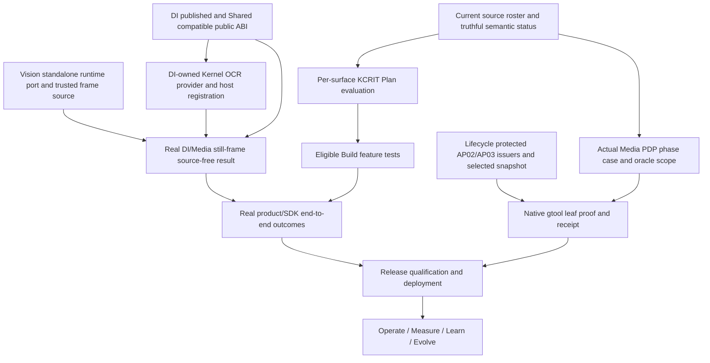

# Ghatana Media — current-source residual completion plan and owner execution dispositions

> **CURRENT ASR CORPUS DISPOSITION (2026-11-03):** FLEURS authorization, download, and inference are deferred and nonblocking for the active English/Nepali phase. The owner confirms Common Voice v27 MDC access/terms and local EN/NE-NP archives are handled; a restricted 24-per-locale pilot manifest is prepared privately. Model/export-rights, independent reference, and host evidence remain open. Hindi is deferred. Production quality evidence remains required through an approved route, including app-domain evidence. Historical FLEURS reports, original task identities, denominators, and R8/R10 statuses are unchanged. See [the current corpus disposition](MEDIA-ASR-CORPUS-DISPOSITION-2026-11-03.md).

> **CURRENT CONTROLLING UPDATE (2026-11-01 PT): See [§41](#41-november-1-current-remote-reconciliation-exact-remaining-work-approvals-and-per-surface-execution).** Connected GitHub Media `main` now contains the 251 previously unpublished commits through `e2b449ea` including IP-06 `1e4c571a`; Kernel `main` contains `f30264795` DI HTTP adapter. The 56 source declarations are all matrix-bound, and the current source bridge is 3,188/8,668/0. PDP1/2/3 matrices are **STALE** with 16/19/16 raw pins. Kernel context authorization and false cancellation, H02 owner source semantics, JC03 hard deadlines and IP06 true crash/release proofs remain. Previous dated sections contain historical snapshots and original task details, not new parallel task authorities.

> **Current re-review, October 31, 2026 PT**. Source inspected on connected GitHub `main`: Media `5e1e4117d40688e16cf884dc2d25cdf525f7a081`; Ghatana `7262bc9da397e90e7a30a2ec3f75df62982252eb`; Kernel `209921dea4f13c756deaa0a945580df4587ffbf3`; Shared `13548bf7e73f8868eeba3626a763aa2cd82bddf4`; Lifecycle `feac5c54433c2c7f8f3e781c59a812cdb9293736`. Source commits by this plan advance Media `main`; always re-read the actual new HEAD and exact source bytes before any execution. **This GitHub source review did not run Java/Python/Rust/TS tests, deploy anything, issue protected host credentials, sign reviews, grant licenses, operate production, or obtain native closure receipts.** Host test counts cited below come from commit messages and prior implementer reports, not fresh independent runs.

> **Paired exact machine handoff:** [current 28/21/7 all-surface + 30-journey + 36 R8 + 84 W3 + 8 H execution register](MEDIA-REMAINING-OWNER-DISPOSITIONS-2026-10-31.v1.json). The same existing file is extended (no duplicate stage/task authority). This is a **derived plan**, subordinate to Media PDP0–3, original [50-package Build plan](MEDIA-BUILD-IMPLEMENTATION-PLAN.md), original [Wave2 R8 acceptance](MEDIA-WAVE2-R8-FULL-ACCEPTANCE-MATRIX.json), original [W3/H source package list](MEDIA-BACKEND-REMAINING-SURFACES-2026-10-30.md), and Lifecycle `ghatana.product-development.v3`/native owner acceptance.

## 1. Executive technical verdict and finite denominator

**There is substantial new working code; do not restart completed surfaces. However Media Build, native PDP closure, protected external DI/Kernel integration, production Delivery and Enhance are not proved complete.** The immediate program is *current source correction + owner-public integration + original whole-row acceptance*, not another green source-only plan.

| Original authority / scope | Current source observation | Required completion meaning |
| --- | ---: | --- |
| Physical Media candidates | **28** | Every physical path mapped to an owned applicable source/Build task or justified SUPPORT/SUBSUMED; not 28 independent deployments |
| Logical consumers | **21** | Source-free public ABI, delegated job/rights/effect where applicable; archived desktop gets documented archive-only disposition |
| Compositions including repository root | **7** | Direct cross-child oracle plus current child readback, no duplicated evidence |
| Total declared identities | **56** | Four phase matrices still bind **54** historic IDs: two additional source-owner rows to admit |
| Original Wave2 R8 | **58 = 22 previously locally verified + 36 unaccepted** | Independently verify each of 36 full original criteria; no code-only promotion |
| Original W3 local engineering | **84** | Inspect existing code and finish actual missing original positive/negative/recovery; no blind reimplementation |
| Original H cross-surface outcomes | **8** | Real recorder/capture/animation/simulation/film effects |
| Original W3 OCR legacy | **4 OC tasks source retired** | No old Media engine reimplementation; **replacement Kernel/DI still unverified** |
| Original Build packages | **50 / 57 original plan tasks** | F00–F13, V01–V30, L01–L03, X01–X03; KCRIT owner-controlled admission |
| Source product | **30 journeys; 47 screens; 30 HTTP routes; 44 gRPC RPCs** | Actual real product effects/negative oracles and published channel parity, not source-only definitions |

**Overlap warning:** 36 R8 + 84 W3 + 8 H = **128 selected unaccepted or unqualified rows**, *not 128 necessarily unimplemented features*; F/V/L/X packages overlap. The four retired OC tasks are outside the 84. Never sum root and child tasks, never infer whole-product acceptance from a local green suite.

## 2. Changes already in source — preserve, but qualify honestly

| Area | Actual code/test source | Residual boundary |
| --- | --- | --- |
| **CAP-01/02/03** | `a5be0f60` and `07b3df19` source on main; 111+ provider tests, launcher/runtime contracts, 12/12 TS tests and V029 lineage reported green on host | Only full J03 live effect, external release and unrelated original ledger proofs; no reimplementation |
| **VIS09 internal composition** | `c9aee4d4` with bounded DI transport, trusted still-image crop/source authorization, explicit OCR_ONLY/FULL_VISION profile; author reports 518 Vision tests | Real standalone host port is missing, real DI worker/model/quality and video frame path remain |
| **TTS/MM baseline test defects** | `3d91bcff` changed all three original test classes, source preserves admitted voice/child guards; commit message reports 83 TTS/MM test classes green | Whole TTS/MM R8 model/quality and real source effects still outstanding |
| **Media legacy OCR module retirement** | `f212cf6b` source deletion and `0613884a` topology deletion, four OC tasks recorded retired | Kernel remote main lacks claimed DiOcrProvider; DI replacement/consumer qualification not proven |
| **Track B contract parser** | `9a5bc9b` reports parity 46/46 source-dispositioned, 29/29 parity tests; true YAML parser instead of regex | Current semantic-review/owner pins and source-current 56/54 matrix extensions still need actual independent readback |
| **Latest Media source-currentness chain work** | Commits from `6d4817dd` through `5e1e4117` repaired historical pin/impact observations | PDP0 still IN_PROGRESS, 2 unbound surfaces, source-status at ebcb older than current; no owner-native pass |

**Critical source discrepancy:** `config/kernel-provider-dependency-requests.source.json` points at `platform-kernel/kernel-product-runtime/.../DiOcrProvider.java` and Media PDP0 source declares Kernel `f30264795` complete, but Kernel `main@209921dea` contains **neither that file nor its test**, and GitHub cannot resolve that commit. The Media OCR module is genuinely removed. This is **not** an admitted substitute Kernel provider. Source/product statements referring to a completed DI-backed Kernel binding must be corrected by the owning PDP/manifest generator and an actual crossrepo implementation/push, not by reintroducing Media OCR.

**Another code-level blocker:** `VisionGrpcServer.main()` constructs a Vision server with **null Media runtime port**; `OCR_ONLY` requires a real `MediaProcessingRuntimePort` for immutable frame/rights/crop. The internal DI-only service's constructor tests are insufficient; the actual standalone host cannot serve the intended operation until it discovers and owns a real source/port. Still-frame crop supports frame `0`, PTS `0` only: video frame/track qualification remains a separate original effect.

**A third source-currentness blocker:** latest source-pinned `MEDIA-BUILD-BRIDGE-BLOCKER-INVENTORY.v1.json` says **3,186 identities / 8,667 edges**, whereas the later `ebcbdfca` repair reports **3,188 / 8,668**. Exact current bridge blobs exceeded the connected small-file readback, so do not assume either is the live generated census: re-run owner generators/checks from one frozen actual source readset and attach current results.

## 3. Owner approvals, authorizations and hard boundaries

| Authority decision | Status and scope | Limit / truthful proof rule |
| --- | --- | --- |
| Owner technical decisions, source- and code-scoped crossrepo implementation and deterministic tests | **PREAUTHORIZED** | No need to ask for ordinary fixes that respect original PDP/ABI/owner boundaries. |
| Replace nonexistent Kernel OCR binding and reconcile source authority | **PREAUTHORIZED_FIX_FORWARD** | Do not resurrect Media OCR; require real available DI worker or keep typed NOT_ADMITTED. |
| Vision standalone MediaRuntimePortFactory composition + CI-level host tests | **PREAUTHORIZED** | One factory, no implicit authorization/credentials, preserve FULL_VISION and existing safety. |
| Two PDP matrix extensions and source pin successors | **PREAUTHORIZED_WITH_OWNER_IMPACT_REVIEW** | No blind hashes, no unsupported N/A, no retroactive approval of 29 skips. |
| Repair generator/checker and trace denominators | **PREAUTHORIZED** | Generator-driven, no manual green counters/false CURRENT. |
| External DI/Shared package release/Kernel plugin runtime | **SOURCE_IMPLEMENTATION_APPROVED_RELEASE_NOT_GRANTED** | Real owner-published package/license/installer and source-free test required. |
| Normal per-surface gtool & KCRIT code/plan preparation | **PREAUTHORIZED** | No canonical stage/status/closure mutation without actual protected host and admitted owner; Lifecycle campaign stop respected. |
| R8/W3/H tests, host, model performance and first-party synthetic data | **PREAUTHORIZED** | No external model/audio/license/voice biometric consent/independent reviewer invented. |
| Dev/staging migration rehearsals/rollback | **PREAUTHORIZED** | Production irreversible cutover, trust grant, publishing/release remains separate. |
| Native Lifecycle AP02/AP03, independent technical/a11y/legal/quality evidence and production release | **OUTSIDE_DISCRETIONARY_TECHNICAL_APPROVAL** | Require real private registered verifier, genuine separate human owner/operator if mandated and true recorded effect. |

**Architecture is fixed:** Ghatana Document Intelligence alone executes OCR and qualifies its engines. Shared owns provider-neutral document extraction types. Kernel owns only neutral materialization/registration and existing compatible facet contracts; a DI-owned adapter consumes the public Kernel SPI and the DI public service. Media owns lawful artifact/frame/crop/source clock/PTS/text tracking and its local results, never Paddle/Tesseract model inference. Data Cloud is an optional metadata projection, not a required Media runtime or OCR authority.

**Owner decisions and routine technical approvals are sufficient for source/code/test preparation** across Media, Ghatana, Kernel and Shared, including modifying current specs and machine projections through their owner generators. Real third-party model/voice/biometric rights, protected private signer/verifier enrollment, an independent qualified reviewer, an operator's irreversible production cutover, package publication and release approval **cannot** be granted by this derived plan. On unavailable evidence, use typed `NOT_ADMITTED`/`UNAVAILABLE`/`WAIT_AUTH`/`UNKNOWN_OUTCOME`, preserve original input and proceed with independent ready surfaces.

## 4. All unresolved blocker packets — where/how/owner/exact exit

| Blocker | Accountable owner, status | Required source implementation and test | Exit |
| --- | --- | --- | --- |
| **B01 · Kernel replacement recorded but absent on connected main** | `ghatana-kernel`; **EXTERNAL_REPO_CODE_REQUIRED**; [issue](https://github.com/samujjwal/ghatana-kernel/issues/99) | **Observed:** Media dependency request targets DiOcrProvider.java, current Kernel main 209921dea lacks it; f30264795 commit not resolvable **Action:** Implement provider in Ghatana DI adapter against Kernel public API, or source-authorized Kernel composition shim with DI-owned execution only. Commit to actual Kernel/DI main, align Media manifest sourceRefs, installed conformance/receipt | Source-free Kernel OcrProvider extract/status/cancel with real lawful DI worker, tenant/source/consent/rights, installed consumers; no phantom ref |
| **B02 · Vision standalone OCR_ONLY cannot compose source port** | `ghatana-media`; **ENGINEERING_READY**; [issue](https://github.com/samujjwal/ghatana-media/issues/23) | **Observed:** VisionGrpcServer.main invokes two-argument constructor -> createProductionRuntime(null); OCR_ONLY requires nonnull MediaProcessingRuntimePort **Action:** Runtime port ServiceLoader through actual VisionGrpcServer entrypoint, reject ambiguous factories, close port on failed start/shutdown, support source-owned DI endpoint identity and no runtime-pixel bypass | Process-level OCR_ONLY standalone real rights/image+DI positive, missing/duplicate factory fail-closed, no YOLO dependency, cleanup verified |
| **B03 · DI provider/Shared package is development-only** | `ghatana`; **HOST_LICENSE_AND_PUBLIC_PACKAGE_REQUIRED**; [issue](https://github.com/samujjwal/ghatana/issues/252) | **Observed:** DI client 0.1.0 peers @ghatana/document-extraction 0.1.0-SNAPSHOT; no installed qualified release or real worker proof **Action:** Pin compatible immutable Shared+DI package, classify honest DEV_SOURCE_COMPOSITE vs published release, qualify real worker PNG+PDF and two source-free consumers; credential/mTLS and no open network egress | Installed peer and worker first positive/provenance/quality/readiness/negative and owner approval |
| **B04 · OCR retirement was confused with provider admission** | `ghatana-media`; **ENGINEERING_READY_SOURCE_IMPACT_REVIEW**; [issue](https://github.com/samujjwal/ghatana-media/issues/19) | **Observed:** PDP0 `ocr-ownership.yaml`, the Kernel dependency request and OCR consumer inventory already mark replacement/admission unverified. The physical-topology rationale, retirement decision and older execution-plan statements still implied a completed DI-backed Kernel replacement. **Action:** Correct those current source records and tests; keep W3 OC source retirement distinct from public consumer/provider admission; do not rewrite historical source inventory or stage/status records. | No current source claims the retired Media adapter is an admitted Kernel/DI replacement; OCR inventory and focused owner checks pass; source-pin currentness remains separately reported. |
| **B05 · 56 declarations vs 54 historic phase matrix bindings** | `ghatana-media`; **OWNER_REVIEW_AND_ENGINEERING**; [issue](https://github.com/samujjwal/ghatana-media/issues/19) | **Observed:** roster reports 28 physical +21 logical +7 compositions; two physical extensions unbound in PDP0..3; top PDP0 IN_PROGRESS **Action:** Phase-matrix generator one-row additions for agent-tools SUPPORT_ONLY and DataCloud active OPTIONAL; source-guard PDP0 skipped 29, owner status, P2 old 180 vs status157 current pins; verify source-by-source snapshot post latest main | 56 source dispositions and all 4 current phase matrices with scoped original tests; PDP0 truthful outcome, admitted closure-unit roster separate |
| **B06 · Current bridge status file has obsolete denominator** | `ghatana-media`; **ENGINEERING_READY**; [issue](https://github.com/samujjwal/ghatana-media/issues/21) | **Observed:** blocker inventory source 3186/8667 while newer OCR-M03 generator commit reports 3188/8668; exact current bridge blobs too large for connector readback **Action:** Re-run check/generate source identity trace, bridge, blocker inventory, 50-package task plan from same current source readset, typed ID/edge digest and wrong/source-free guard; KCRIT owner proof separately | All live generated census equal under exact source cut, zero real unresolved, owner KCRIT task admission |
| **B07 · PDP source-currentness is older than live main** | `ghatana-media`; **INDEPENDENT_REVIEW_AND_ENGINEERING**; [issue](https://github.com/samujjwal/ghatana-media/issues/3) | **Observed:** PDP0 IN_PROGRESS, P1-3 historical DEV_COMPLETE; status mainSha ebcbdfca77, later 16+ source/observation commits, P0-03 has 29 skips, no current independent owner readback **Action:** Run impacted selector review, 56-row generator closure, result checks, source-current P0 criteria and independent reviewers; attach owner adopted source status only if actual criteria pass | No silent stale/UNKNOWN or P0 fake success, current source and review/test evidence |
| **B08 · Lifecycle AP02/AP03 source admission and protected host not configured** | `ghatana-lifecycle`; **PROTECTED_OPERATOR_AND_USER_RESUME_REQUIRED**; [issue](https://github.com/samujjwal/ghatana-lifecycle/issues/24) | **Observed:** No authentic Media AP02/AP03 owner verifier/selected snapshot/native receipt on connected data; Lifecycle source includes user-requested stop after 62-ID report **Action:** On authorized resume, actual AP02 contract DAG selection, AP03 Media tracked source source-cut and trusted signer/verifier; native gtool first leaf; no consumer JSON replacement | Genuine registered host and first current PDP0 physical leaf receipt; fail-closed tamper/revocation |
| **B09 · Kernel Work Planner Build task closure not authenticated** | `ghatana-kernel`; **OWNER_HOST_REQUIRED**; [issue](https://github.com/samujjwal/ghatana-media/issues/22) | **Observed:** 50 canonical F/V/L/X packages /57 original Build plan tasks, 19 formerly blocked selected; no authenticated per-surface KCRIT Plan Ready **Action:** Bind exact original task+source/test/owner/ABI/current method revision; KCRIT-PLAN-TASK-CLOSURE then KCRIT-PLAN-READY for independently eligible surfaces | Authentic owner result/revision+typed reason for each selected task, not new Media stage writer |
| **B10 · Original model and rights/performance acceptance not complete** | `ghatana-media`; **EXTERNAL_ASSETS_AND_REAL_HOST**; [issue](https://github.com/samujjwal/ghatana-media/issues/22) | **Observed:** Wave2 R8 still 36 unaccepted; W3/H 84+8 require original real positive negative/recovery and host quality, 5 stream capabilities pending **Action:** Source-approved licensed corpus/model/voice and provider qualification; c1/16/64, WER/CER/mAP/latency resource; streaming WebRTC/adaptive/HLS/DASH/lease, all 30 real journeys | 36 original R8 accepted; 92 W3/H whole rows adjudicated; no unlicensed or mocked effect |
| **B11 · Old writer vs new Media PostgreSQL source ownership** | `ghatana-media`; **PRODUCTION_OPERATOR_REQUIRED**; [issue](https://github.com/samujjwal/ghatana-media/issues/22) | **Observed:** V029 source Testcontainers PASS reported, deployed historical ghatana/services/media real writer cutover unverified **Action:** Read applied Flyway V001-V029; dry-run snapshot/recover, old writer quiesce+fence, bounded rollback/forward and outbox dedupe; real operator grant later | Actual deployed source owner cutover verified, zero duplicate row/receipt and recovery/retention proof |
| **B12 · Full UI/recorder/studio/player and first real PDP3 twin not complete** | `ghatana-media`; **ENGINEERING_AND_SPECIALIST_REVIEW**; [issue](https://github.com/samujjwal/ghatana-media/issues/5) | **Observed:** 30 journey proposal contracts, 47 source screens and one v1 J03 static Explorer recording edition; no complete 30 real product terminals proven **Action:** Finish original V01..V30/L01..L03/H01..H08, real UI/animation/simulation/film, negative/a11y/scientific quality/rights proof | All selected real business terminal effects, independent visual/scientific/a11y reviews, playback/source truth |
| **B13 · Platform Data Cloud/Event/Action Plane actual integration acceptance** | `ghatana`; **EXTERNAL_PUBLIC_PLATFORM_OWNER**; [issue](https://github.com/samujjwal/ghatana/issues/254) | **Observed:** Data Cloud optional, Event Plane 201 append != consume/final; Action Plane real end-effect and original 32 AEP cases unverified **Action:** Exact public consumer versions, 201 append and eventual result/readback, Action Plane source/rights/owner receipt, optional Data Cloud outage proof, 32 AEP cases as applicable | Real installed negative/partition/lostACK and independent effect receipts; Media jobs finish without Data Cloud |
| **B14 · Vision video-frame DI time semantics not admitted** | `ghatana-media`; **NATIVE_VIDEO_CODEC_AND_REAL_WORKER**; [issue](https://github.com/samujjwal/ghatana-media/issues/23) | **Observed:** MediaRuntimeSceneTextSource explicitly refuses non-frame 0/PTS0; fine for still-image proof but not tracked video text **Action:** Reuse source-pinned qualified VideoFrameExtractor/OCI worker; true frameId/PTS/clock/crop, rights and source version; choose explicit DI processing and tracking schema | Real VFR/frames reordered/scene cut/ROI/time tests and DI text track source-fidelity under exact origin |

### Dependency graph and non-pausing alternative work



A blocked DI/Kernel case does not stop non-OCR STT/TTS/Studio/stream/Explorer engineering. A blocked protected Lifecycle host does not stop valid Build code or source-current planning. Native closure does not receive synthetic proof from these independent outputs.

## 5. Surface-by-surface physical implementation and tests — all 28 current candidates

Each row is a **current source ownership selection**, not a source-certified `DEV_COMPLETE`. `W3` IDs refer to original local rows; `R8` IDs to original unaccepted Wave 2. Support-only/subsumed means actual testing and parent ownership, not automatic N/A. Apply PDP applicability from topology, and the Product Development v3 stage/phase predicates in §11.

| Physical source surface and owner | Original selected tasks | Actual remaining code action (what / where / how) | Whole-row acceptance (including denials) |
| --- | --- | --- | --- |
| **adapters-agent-tools-media** · `adapters/agent-tools-media` · media-runtime (SUPPORT_ONLY) | `AT-01`, `AT-02`, `AT-03`, `AT-04`, `AT-05`, `AT-06` | Continue four exact Agent Tool handler contracts through public Tools/Action Plane, tenant-delegated scope, bounded timeout and idempotent action journal; never convert the support adapter to independent model authority. | Run source-free handler positive, wrong tenant/role, revoked grant, cancellation, unknown-outcome/reconcile and no duplicate effect; original AT-01..06. |
| **adapters-data-cloud-media** · `adapters/data-cloud-media` · media-runtime (PHYSICAL) | `DC-01`, `DC-02`, `DC-03`, `DC-04`, `DC-05`, `DC-06` | Keep Data Cloud a strictly optional downstream metadata consumer. Reconcile real versioned public Data Cloud API and owner-authorized consent/redaction; outbox replay and stable source provenance. | Prove Data Cloud absent/partitioned cannot block Media upload, jobs, transcript/caption or provider finality; qualified installed API plus duplicate/lost ACK tests, DC-01..06. |
| **adapters-ledger** · `adapters/ledger` · media-platform (SUPPORT_ONLY) | `LD-01`, `LD-02`, `LD-03`, `LD-04`, `LD-05` | Maintain bounded immutable ledger projections over canonical attempts/jobs rather than second event/transaction authority; exact caller/tenant/provider/receipt IDs and retention. | Real duplicate/timeout/restart/no-secondary-writer tests, LD-01..05 and correct owner-disposition for support-only leaf. |
| **apps-media-experience-explorer** · `apps/media-experience-explorer` · media-product-engineering (PHYSICAL) | F/V/L/X and selected cross-surface only | Keep source-curated PDP3 Explorer screens/one J03 edition film simulated only; reconcile changed source fixtures, narration/captions and screen semantics against true action contracts. | Headless CSP/keyboard/visual/a11y, deterministic scenario recapture and negative/UNKNOWN journeys; no live product effect claim. |
| **audio-video-observability** · `audio-video-observability` · media-platform (SUPPORT_ONLY) | `OBS-07`, `OBS-08` | Preserve verified Micrometer/Prometheus baseline; complete true provider readiness/quality freshness and alert receiver identity; measure c1/16/64 with live models on permitted hosts. | R8 OBS-07/08 actual exporter→receiver firing/cleared, quality change, budget, bounded cardinality/PII and independent run traces; source-only alerts do not establish capacity. |
| **integration-tests** · `integration-tests` · media-platform (SUPPORT_ONLY) | `IT-01`, `IT-02`, `IT-03`, `IT-04`, `IT-05`, `IT-06` | Reconcile actual runtime/job/DI/caption/stream/provider/rights/SDK scenario fixtures against current 30 HTTP/44 RPC and original all-surface negative cases. | IT-01..06 real positive/denial/UNKNOWN/crash/restart and source-free consumer plus J03 film; zero synthetic effects passed as real. |
| **launcher** · `launcher` · media-runtime (PHYSICAL) | F/V/L/X and selected cross-surface only | Reuse completed CAP HTTP auth/profile/caption 30-route seam; complete real selected runtime writer/authorized provider/composition, stream lease and job attempts, external effects and shutdown. | Authenticated production-like Java HTTP server, 30-route OpenAPI match, source revocation/replay, crash/health and actual single-writer recovery; CAP tests reused. |
| **libs-audio-video-client** · `libs/audio-video-client` · media-client-owner (PHYSICAL) | `SK-01`, `SK-02`, `SK-03`, `SK-04`, `SK-05`, `SK-06`, `SK-07`, `SK-08` | Preserve CAP credential/readback/fingerprint; complete all SK-01..08 SDK/CLI, source-free DI/public ABI, job/stream/production-spec and exact cancellation/UNKNOWN semantics. | Installed packed SDK against actual 30-route HTTP, gRPC where applicable, wrong tenant, timeout, stale version, provider denial, monotone retries. |
| **libs-audio-video-types** · `libs/audio-video-types` · media-types-owner (PHYSICAL) | `TY-01`, `TY-02`, `TY-03`, `TY-04`, `TY-05`, `TY-06` | Repair typed contracts to current 30 HTTP/44 RPC/immutable caption and transcript versions; validate rational ticks/bigints/rights/ProductionSpec and single type authority. | TY-01..06 strict Zod/runtime/TS schema vectors plus Java/TS/golden/install, overflows and hostile polymorphic payloads. |
| **libs-audio-video-ui** · `libs/audio-video-ui` · media-ui-owner (PHYSICAL) | F/V/L/X and selected cross-surface only | Connect real production host for all 47 screens, caption exact-pair comparison, jobs, rights, recording, studio and interactive delivery; do not reuse Explorer as live host. | Actual product E2E: keyboard/reader/zoom/reduced-motion, denial/recovery/real effects and independent a11y visual professional report. |
| **libs-common** · `libs/common` · media-runtime (SUBSUMED) | `JC-01`, `JC-02`, `JC-03`, `JC-04` | Reuse Shared TLS/identity and existing interceptors; strengthen gRPC4-service admission, rate/timeout, no redundant quota/provider authority. | JC-01..04 real cross-tenant/forged header/revocation and source-free transport parity with bounded queues. |
| **libs-java-common** · `libs/java/common` · media-runtime (SUBSUMED) | `MC-01`, `MC-02`, `MC-03`, `MC-04`, `MC-05` | Reuse modality engine SPI and current DSP; bound parsers/pools/close/sync and isolate Wave2 ownership for Whisper/Piper/YOLO code. | MC-01..05 focused codec/fuzz/negative/resource tests and original Wave2 model quality/rights, no synthetic default success. |
| **libs-media-experience-simulation** · `libs/media-experience-simulation` · media-product-engineering (SUPPORT_ONLY) | F/V/L/X and selected cross-surface only | Keep deterministic curated Explorer state engine separate from real Media job/physics solver, source-authorized versioned scenarios and recorded narration. | Reproducible static scene model+negative statuses+source digests, no claim of real simulation or film. |
| **modules-audio-streaming** · `modules/audio-streaming` · media-runtime (SUPPORT_ONLY) | `AS-01`, `AS-02`, `AS-03`, `AS-04`, `AS-05`, `AS-06`, `AS-07` | Complete actual WebRTC and adaptive HTTP/audio transport admission, framed STT/TTS, ACK/backpressure/reconnect/lease with one canonical stream authority. | AS-01..07 1/16/64 real host source clock/rights/reconnect/cancel, playable audio and fail-closed unsupported profiles. |
| **modules-infrastructure-cache** · `modules/infrastructure/cache` · media-platform (SUPPORT_ONLY) | `CA-01`, `CA-02`, `CA-03`, `CA-04`, `CA-05` | Bound cache by tenant/source/rights epoch, TTL and memory; cache never overrides live source rights or completion authority. | CA-01..05 stale/revoked/cache poisoning/eviction/Redis outage and deterministic no second runtime writer. |
| **modules-infrastructure-messaging** · `modules/infrastructure/messaging` · media-platform (SUPPORT_ONLY) | F/V/L/X and selected cross-surface only | Wire Event Plane 201 append, real outbox/consumer finality, per-version idempotency and crash fence; prevent Event Plane receipt from implying Media job done. | Lost ACK/timeout/reordered duplicate/restart and owner source-free Event Plane public API, with negative 200 response. |
| **modules-infrastructure-persistence** · `modules/infrastructure/persistence` · media-platform (SUPPORT_ONLY) | `IP-01`, `IP-02`, `IP-03`, `IP-04`, `IP-05`, `IP-06`, `IP-07` | Use canonical PostgreSQL provider as single writer; interface boundaries, migration freeze/forward compatibility, immutable transcript/caption/job/consent lineage. | IP-01..07 real Postgres CAS/restart/retention/tenant RLS, compare applied V001–V029 against live historical writer and one-writer cutover. |
| **modules-infrastructure-security** · `modules/infrastructure/security` · media-platform (SUPPORT_ONLY) | F/V/L/X and selected cross-surface only | Unify current source/rights/biometric/voice purpose and tenant auth at every effect boundary, including DI frame extraction, cache hit, retries and delivery. | Revocation between authorize/read/effect, wrong principal, stale source/decision, no unqualified model or untrusted callback. |
| **modules-integration-tests** · `modules/integration-tests` · media-platform (SUPPORT_ONLY) | `CT-01`, `CT-02`, `CT-03`, `CT-04`, `CT-05` | Prove production-wired public REST/gRPC SDK and machine channels; preserve original TC/CT catalog and direct declarations rather than inferred success. | CT-01..05 source-free installed clients, protocol version and denial/UNKNOWN, provider runtime and DI/Kernel receipt. |
| **modules-intelligence-ai-voice-libs-ai-voice-ui-react** · `modules/intelligence/ai-voice/libs/ai-voice-ui-react` · media-ui-owner (PHYSICAL) | F/V/L/X and selected cross-surface only | Real host voice selection/consent, license/clone restrictions, preview, narration and a11y, no test data as rights. | Reader/keyboard/no-consent/revoked/unsupported locale/readiness, real qualified output and versioned result. |
| **modules-intelligence-multimodal-service** · `modules/intelligence/multimodal-service` · media-runtime (PHYSICAL) | `MM-02`, `MM-03`, `MM-05`, `MM-06`, `MM-08`, `MM-09`, `MM-10`, `MM-12` | Qualify actual STT/Vision child source version/clock and executor; no synthetic fused success, Data Cloud optional and child UNKNOWN guarded. | R8 MM-02/03/05/06/08/09/10/12 and full real STT+Vision fused terminal, restart and 1/16/64. |
| **modules-intelligence-speech-libs-speech-audio-rust** · `modules/intelligence/speech/libs/speech-audio-rust` · media-runtime (SUPPORT_ONLY) | `RS-01`, `RS-02`, `RS-03`, `RS-04`, `RS-05`, `RS-06`, `RS-07` | Reuse rational Blackman-sinc DSP; verify finite sample offsets, anti-alias/format/FFI, no double clock/codec implementation. | RS-01..07 cargo fmt/clippy/fuzz/roundtrip and real host throughput 1/16/64 with bounded allocations. |
| **modules-speech-stt-service** · `modules/speech/stt-service` · media-runtime (PHYSICAL) | `STT-03`, `STT-04`, `STT-08`, `STT-09`, `STT-05`, `STT-06`, `STT-07`, `STT-10`, `STT-12` | Real licensed STT en/hi/ne source-constrained model, stream decode, exact transcript revision/clock/attempt and consent/fencing. | R8 STT outstanding row positives+negative/quality WER/CER/DER and restart/host 1/16/64; no skipped model tests presented as success. |
| **modules-speech-tts-service** · `modules/speech/tts-service` · media-runtime (PHYSICAL) | `TTS-05`, `TTS-02`, `TTS-03`, `TTS-06`, `TTS-07`, `TTS-08`, `TTS-09`, `TTS-10`, `TTS-12` | Reuse repaired host baseline 83-class TTS/MM tests; finish actual permitted Piper/voice phoneme/locale/rights/consent, playable chunks and profile admission. | R8 TTS outstanding original rows, voice revocation/cancel/clone denial, measured intelligibility + c1/16/64 and real licensed output. |
| **modules-video-streaming** · `modules/video-streaming` · media-runtime (SUPPORT_ONLY) | `VS-01`, `VS-02`, `VS-03`, `VS-04`, `VS-05`, `VS-06`, `VS-07` | Finish actual WebRTC/HLS/DASH/adaptive transports, correct VFR/source PTS, leases, codec source and authenticated reconnection. | VS-01..07 actual media samples/checksum/arrival/timing/revocation/c1/16/64, no synthetic wrapper counted. |
| **modules-vision-vision-service** · `modules/vision/vision-service` · media-runtime (PHYSICAL) | `VIS-03`, `VIS-10`, `VIS-02`, `VIS-05`, `VIS-06`, `VIS-07`, `VIS-09`, `VIS-12` | VIS09 internal DI consumer, trusted still-image pixels and bounded transport are implemented. `VisionGrpcServer.main()` now uses the single `MediaRuntimePortFactory` ServiceLoader composition path; composed-port ownership closes on construction/bind/shutdown. The OCR_ONLY fixture startup test remains not-ready without an admitted provider. | Existing factory-composed OCR_ONLY startup coverage passed 7/7 (see §28). Installed owner factory, real DI worker/result, source rights, allowlist authority, process/package host qualification, video-frame source/PTS/tracking and original R8 VIS rows remain open. Media remains a DI consumer; it does not own a competing OCR engine. |
| **providers-aws-postgresql** · `providers/aws-postgresql` · media-runtime (PHYSICAL) | F/V/L/X and selected cross-surface only | Preserve V029 CAP exact transcriptVersionRef and 111+ host green; actual applied-history & single-writer live cutover remain, with captions/outbox/provider state retention. | Real durable PG Testcontainers/restart/applied V001–V029 records; RLS/tenant/revoke/duplicate and protected production forward migration/rollback plan. |
| **runtime-contracts** · `runtime-contracts` · media-runtime (PHYSICAL) | F/V/L/X and selected cross-surface only | Keep MediaDeploymentProfiles, typed CAP, source/content/clock, job/stream/provider schemas as one canonical Java/TS runtime contract; separate effect states and route truth. | Installed Java/TS 30 HTTP/44 RPC parity, malformed/status/request-fingerprint tests, stable wire version and no duplicate owner API. |

### Required independent steps for any physical leaf

1. Read its current manifest, source owner, PDP0–3 requirement/operation/experience applicability, concrete public ABI and original source task IDs. If SOURCE_SUPPORT/SUBSUMED, bind the authoritative owning composite; do not invent a new deployed product.
2. Capture actual current SHA and status for **only** its impacted source members; compare existing source/test and machine receipts before writing code. Preserve current passing CAP, DSP, OCI, TTS/MM readiness, schema migrations and static Explorer material.
3. Finish each original incomplete effect with source identity, tenant/principal/delegation, rights, finite resource limits, cancellation/idempotency and UNKNOWN/recovery, independent positive and negative test. Use installed public consumers, not private source imports.
4. Get a genuine Work Planner owner phase transition for a selected eligible Build task under current method and source revision. Actual native PDP proof and owner case/observer/oracle receipts are separate; only then count relevant phase closure. No unrelated surface dependency expansion.

## 6. All 21 logical consumer surfaces — named real acceptance

| Logical source | Current owner binding | Required consumer behavior and test |
| --- | --- | --- |
| `media.surface.web` (HOST_DEPENDENT) | `libs-audio-video-ui` | Real authenticated production host, 47 screens, source screen actions and finality. **Completion test:** Positive real effect if required; negative, restart, rights/currentness; native proof separate |
| `media.surface.embedded` (HOST_DEPENDENT) | `libs-audio-video-ui` | Sandboxed origin/auth/player and exact simulated-vs-real label and a11y. **Completion test:** Positive real effect if required; negative, restart, rights/currentness; native proof separate |
| `media.surface.public-http` (HOST_DEPENDENT) | `launcher`, `runtime-contracts` | 30 HTTP operations, JWT permission mapping, error/result parity, real positive. **Completion test:** Positive real effect if required; negative, restart, rights/currentness; native proof separate |
| `media.surface.service-grpc` (CONTRACT_ONLY) | `runtime-contracts`, `modules-speech-stt-service`, `modules-speech-tts-service`, `modules-vision-vision-service`, `modules-intelligence-multimodal-service` | 44 RPCs, mTLS/JWT identity, quota/cancel/timeout, generated source-free client. **Completion test:** Positive real effect if required; negative, restart, rights/currentness; native proof separate |
| `media.surface.grpc.stt` (CONTRACT_ONLY) | `modules-speech-stt-service` | True STT voice/audio stream, finality, gold, negative cases. **Completion test:** Positive real effect if required; negative, restart, rights/currentness; native proof separate |
| `media.surface.grpc.tts` (CONTRACT_ONLY) | `modules-speech-tts-service` | True TTS audio stream and licensed voice rights, negative cases. **Completion test:** Positive real effect if required; negative, restart, rights/currentness; native proof separate |
| `media.surface.grpc.vision` (CONTRACT_ONLY) | `modules-vision-vision-service` | Real Vision geometry and DI-only OCR VIS09, real DI binding. **Completion test:** Positive real effect if required; negative, restart, rights/currentness; native proof separate |
| `media.surface.grpc.multimodal` (CONTRACT_ONLY) | `modules-intelligence-multimodal-service` | True STT/Vision child receipts and fused source result. **Completion test:** Positive real effect if required; negative, restart, rights/currentness; native proof separate |
| `media.surface.sdk` (PHYSICAL) | `libs-audio-video-client`, `libs-audio-video-types` | Installed TS public client, authenticated caption and DI transport, no empty-on-error. **Completion test:** Positive real effect if required; negative, restart, rights/currentness; native proof separate |
| `media.surface.cli` (HOST_DEPENDENT) | `libs-audio-video-client`, `libs-media-experience-simulation` | Source-bound real artifact/job/recorder operations with deterministic JSON and error semantics. **Completion test:** Positive real effect if required; negative, restart, rights/currentness; native proof separate |
| `media.surface.agent-tools` (CONTRACT_ONLY) | `runtime-contracts`, `adapters-agent-tools-media` | Four exact handlers with Tools/Action Plane policy and no fake admission. **Completion test:** Positive real effect if required; negative, restart, rights/currentness; native proof separate |
| `media.surface.events` (CONTRACT_ONLY) | `modules-infrastructure-messaging`, `runtime-contracts` | Event Plane outbox, 201 append, durable consumer true finality. **Completion test:** Positive real effect if required; negative, restart, rights/currentness; native proof separate |
| `media.surface.integrations` (HOST_DEPENDENT) | `adapters-data-cloud-media`, `adapters-ledger`, `modules-infrastructure-cache`, `modules-infrastructure-messaging`, `modules-infrastructure-persistence`, `modules-infrastructure-security`, `providers-aws-postgresql` | DI/Kernel/DataCloud/AEP/Agents/Shared source-free public boundary and outage isolation. **Completion test:** Positive real effect if required; negative, restart, rights/currentness; native proof separate |
| `media.surface.types-library` (PHYSICAL) | `libs-audio-video-types` | Strict published validators and Java/TS/JSON contract parity. **Completion test:** Positive real effect if required; negative, restart, rights/currentness; native proof separate |
| `media.surface.ui-library` (HOST_DEPENDENT) | `libs-audio-video-ui`, `modules-intelligence-ai-voice-libs-ai-voice-ui-react` | Packaged accessible Studio/caption/player/voice components in real host. **Completion test:** Positive real effect if required; negative, restart, rights/currentness; native proof separate |
| `media.surface.explorer` (PHYSICAL) | `apps-media-experience-explorer`, `libs-media-experience-simulation` | PDP3 curated static data, narration/caption demo and negative/a11y cases. **Completion test:** Positive real effect if required; negative, restart, rights/currentness; native proof separate |
| `media.surface.desktop-archive` (ARCHIVED) | Archived historical owner only | Keep NOT_ACTIVE_ARCHIVED and historical receipt; no fabricated deployable. **Completion test:** Positive real effect if required; negative, restart, rights/currentness; native proof separate |
| `media.surface.recorder-orchestrator` (HOST_DEPENDENT) | `libs-audio-video-client`, `libs-media-experience-simulation` | Automated source-driven deterministic capture, selective recapture, narration and provenance. **Completion test:** Positive real effect if required; negative, restart, rights/currentness; native proof separate |
| `media.surface.capture-adapters` (CONTRACT_ONLY) | `runtime-contracts` | Qualified desktop/mobile/browser/terminal/API/gRPC/camera/media capture with rights and clocks. **Completion test:** Positive real effect if required; negative, restart, rights/currentness; native proof separate |
| `media.surface.production-studio` (HOST_DEPENDENT) | `libs-audio-video-ui` | Professional GUI timeline/caption/animation/edit/render/undo and real backend effects. **Completion test:** Positive real effect if required; negative, restart, rights/currentness; native proof separate |
| `media.surface.interactive-demo-player` (HOST_DEPENDENT) | `libs-audio-video-ui` | Sandboxed branching player, captions, a11y, evidence-mode/real truth labels. **Completion test:** Positive real effect if required; negative, restart, rights/currentness; native proof separate |

**Hosted/virtual distinctions:** the HTTP 30-route and gRPC 44-RPC descriptors are contract counts, not evidence that each RPC has an admitted production provider. An archived desktop surface is not required to run as current deployable code. AgentTools, CLI, SDK, Events and Integrations need independent installed protocol/permission/finality tests; UI and Embedded/Studio/Player need real host proof. Source-only Explorer is a separate static simulation.

## 7. Seven semantic composites, dependency direction and root

| Composite | Current direct children | Direct meaning to prove |
| --- | --- | --- |
| `media.composition.repository-root` | client-and-machine-interfaces; creation-composition-and-delivery; governed-job-execution; ingestion-and-versioned-artifacts; speech-and-caption-workflows; vision-and-multimodal-analysis; adapters-agent-tools-media; adapters-data-cloud-media; audio-video-observability; integration-tests; libs-common; libs-java-common; libs-media-experience-simulation; modules-integration-tests; modules-intelligence-ai-voice-libs-ai-voice-ui-react | Owner-reviewed cross-child source/rights/version/finality and true terminal; reuse child receipts by ref without copying/re-executing proofs |
| `media.composition.ingestion-and-versioned-artifacts` | runtime-contracts; launcher; modules-infrastructure-persistence; modules-infrastructure-security; modules-infrastructure-messaging; modules-infrastructure-cache; providers-aws-postgresql; adapters-ledger | Owner-reviewed cross-child source/rights/version/finality and true terminal; reuse child receipts by ref without copying/re-executing proofs |
| `media.composition.governed-job-execution` | runtime-contracts; launcher; modules-infrastructure-messaging; modules-infrastructure-persistence; modules-infrastructure-security; modules-infrastructure-cache | Owner-reviewed cross-child source/rights/version/finality and true terminal; reuse child receipts by ref without copying/re-executing proofs |
| `media.composition.speech-and-caption-workflows` | modules-speech-stt-service; modules-speech-tts-service; modules-audio-streaming; modules-intelligence-speech-libs-speech-audio-rust | Owner-reviewed cross-child source/rights/version/finality and true terminal; reuse child receipts by ref without copying/re-executing proofs |
| `media.composition.vision-and-multimodal-analysis` | modules-vision-vision-service; modules-intelligence-multimodal-service; modules-video-streaming; runtime-contracts | Owner-reviewed cross-child source/rights/version/finality and true terminal; reuse child receipts by ref without copying/re-executing proofs |
| `media.composition.creation-composition-and-delivery` | launcher; runtime-contracts; modules-infrastructure-persistence; modules-infrastructure-messaging; libs-audio-video-types; libs-audio-video-client; libs-audio-video-ui | Owner-reviewed cross-child source/rights/version/finality and true terminal; reuse child receipts by ref without copying/re-executing proofs |
| `media.composition.client-and-machine-interfaces` | runtime-contracts; libs-audio-video-types; libs-audio-video-client; libs-audio-video-ui; modules-speech-stt-service; modules-speech-tts-service; modules-vision-vision-service; modules-intelligence-multimodal-service; apps-media-experience-explorer | Owner-reviewed cross-child source/rights/version/finality and true terminal; reuse child receipts by ref without copying/re-executing proofs |

For each composite, reference current accepted child artifacts/receipts **by identity and fingerprint**; run only its own cross-child invariant (e.g. source upload→canonical job→attempt→transcript/caption→versioned UI and external effect). Root requires direct repo-level consistency and all applicable child dispositions; do not rerun 8,664 source candidate cases blindly or collapse SOURCE_DEV_COMPLETE into native CLOSED.

## 8. All 30 V01–V30 vertical product outcomes — real terminal and negative proof

PDP3's current journey registry defines 28 master journeys plus two additional journeys and labels them proposal/source definition contracts. A P3 definition status is **not** proof of each live runtime outcome. Use original authored journey contracts and scoped current source tests. The first real product flow is **J-01 → J-02 → J-20 → J-03**, reusing completed CAP code, and requires a real rights-cleared STT provider.

| Original Build package / journey | Required business outcome | Actual acceptance oracle and recovery |
| --- | --- | --- |
| **M-BLD-V01 / J-01** | First use, authentication, context, and project creation | Real JWT/tenant and exact project/create/readback; wrong actor/role, idempotent replay, denied bootstrap. Plus exact source-current actor/rights, negative/UNKNOWN/recovery and public-interface/host parity |
| **M-BLD-V02 / J-02** | Upload/import, inspect, and produce a usable artifact | Real resumable upload, chunk checksum, final immutable artifact/source version; oversize/wrong tenant/corrupt/restart. Plus exact source-current actor/rights, negative/UNKNOWN/recovery and public-interface/host parity |
| **M-BLD-V03 / J-03** | Audio/video transcription through corrected captions | Real eligible STT job → persisted transcriptVersionRef → edited caption V029 registration → EXACT_PAIR read/verify; bad clock/rights/restart. Plus exact source-current actor/rights, negative/UNKNOWN/recovery and public-interface/host parity |
| **M-BLD-V04 / J-04** | Authorized text-to-speech to approved audio | Qualified licensed voice and consent → actual playable TTS bytes; denied clone/expired consent/unsupported locale. Plus exact source-current actor/rights, negative/UNKNOWN/recovery and public-interface/host parity |
| **M-BLD-V05 / J-05** | Image/video analysis, geometry, and tracks | Real image/video classification/detection/tracking with heldout geometry & PTS; DI text only via authorized gateway. Plus exact source-current actor/rights, negative/UNKNOWN/recovery and public-interface/host parity |
| **M-BLD-V06 / J-06** | Multimodal or document consumer request to grounded typed result | Real grounded STT/Vision/DI/document child effects with per-child source policy, confidence/provenance and independent finality. Plus exact source-current actor/rights, negative/UNKNOWN/recovery and public-interface/host parity |
| **M-BLD-V07 / J-07** | Noisy/clipped interview cleanup with preservation and comparison | Actual source-preserving bounded audio denoise/repair and A/B measured output; clipped/missing bands declared. Plus exact source-current actor/rights, negative/UNKNOWN/recovery and public-interface/host parity |
| **M-BLD-V08 / J-08** | Low-quality video repair with measured comparison | Actual codec-safe video restoration, source frame mapping, measured quality & no fabricated enhancement. Plus exact source-current actor/rights, negative/UNKNOWN/recovery and public-interface/host parity |
| **M-BLD-V09 / J-09** | Prompt/brief to storyboard, composition, render, review, and delivery | Brief → versioned storyboard/timeline → real composition/render/artifact/delivery, provenance+rights. Plus exact source-current actor/rights, negative/UNKNOWN/recovery and public-interface/host parity |
| **M-BLD-V10 / J-10** | Controlled generation with references and continuity review | Real reference-conditioned generation where admitted; no unlicensed model or synthetic continuity score. Plus exact source-current actor/rights, negative/UNKNOWN/recovery and public-interface/host parity |
| **M-BLD-V11 / J-11** | Region mask/tracking edit with comparison and undo | Actual region mask/tracking source-clock and undo/CAS version, wrong-frame/rights denial. Plus exact source-current actor/rights, negative/UNKNOWN/recovery and public-interface/host parity |
| **M-BLD-V12 / J-12** | Deterministic 2D/vector/procedural animation | Real 2D/vector animation frame output from bounded typed specs, golden easing/clock and render checksum. Plus exact source-current actor/rights, negative/UNKNOWN/recovery and public-interface/host parity |
| **M-BLD-V13 / J-13** | 3D character, rig, path, or control animation | Real 3D rig/animation with admitted renderer, pose/coordinate safety, output frames or truthful UNAVAILABLE. Plus exact source-current actor/rights, negative/UNKNOWN/recovery and public-interface/host parity |
| **M-BLD-V14 / J-14** | Explore a domain simulation and its measurements | Executable deterministic domain simulation with units/initials/solver, analytic Newton fixture a=3, v=6, x=6 at t=2; compare error. Plus exact source-current actor/rights, negative/UNKNOWN/recovery and public-interface/host parity |
| **M-BLD-V15 / J-15** | Simulation/procedural passes with protected semantic validation | Validated simulation passes/model identity + uncertainty, solver stability, ABSTAIN for unsupported domain. Plus exact source-current actor/rights, negative/UNKNOWN/recovery and public-interface/host parity |
| **M-BLD-V16 / J-16** | Existing-video translation/dubbing and voice/timing review | Real authorized transcription/translation/dubbing/voice timing; no unconsented voice clone or wrong-language substitution. Plus exact source-current actor/rights, negative/UNKNOWN/recovery and public-interface/host parity |
| **M-BLD-V17 / J-17** | Music, effects, Foley, stems, mix, and mastering | Licensed/original music+effects/stem/audio mix real playable master and protected rights/level boundaries. Plus exact source-current actor/rights, negative/UNKNOWN/recovery and public-interface/host parity |
| **M-BLD-V18 / J-18** | Compose clips, captions, exact graphics, color, and audio master | Actual clip/caption/graphics/color/audio timeline export with source retention, exact render checksum and negative. Plus exact source-current actor/rights, negative/UNKNOWN/recovery and public-interface/host parity |
| **M-BLD-V19 / J-19** | Review media quality and improve it within declared limits | Actual holdout quality measurements and bounded optimization decision; never promote unknown quality. Plus exact source-current actor/rights, negative/UNKNOWN/recovery and public-interface/host parity |
| **M-BLD-V20 / J-20** | Observe a long-running job and check its outcome | Real queued/running/failed/succeeded/UNKNOWN job observation, exact attempt/fencing/restart/idempotency. Plus exact source-current actor/rights, negative/UNKNOWN/recovery and public-interface/host parity |
| **M-BLD-V21 / J-21** | Review/comment/approve exact version and re-review changed material | Real review/comment/version compare and approval re-evaluation on changed source; denied stale/signature. Plus exact source-current actor/rights, negative/UNKNOWN/recovery and public-interface/host parity |
| **M-BLD-V22 / J-22** | Export/download/publish with destination acknowledgement | Real export/downstream destination receipt and consumed finality, separate HTTP 201 transport from delivered. Plus exact source-current actor/rights, negative/UNKNOWN/recovery and public-interface/host parity |
| **M-BLD-V23 / J-23** | Private/local workflow while disconnected and reconnect | Offline queue on real client, revalidate consent/version/rights on reconnect; conflict and no duplicate effects. Plus exact source-current actor/rights, negative/UNKNOWN/recovery and public-interface/host parity |
| **M-BLD-V24 / J-24** | CLI batch/JSON plan through verified outputs | Actual CLI batch structured JSON, deterministic spec and typed cancellation/exit/no hidden workspace work. Plus exact source-current actor/rights, negative/UNKNOWN/recovery and public-interface/host parity |
| **M-BLD-V25 / J-25** | Agent or product integration with bounded delegated Media action | Real four Agent Tool purposes and product consumer delegation with bounded authority, negative and stable results. Plus exact source-current actor/rights, negative/UNKNOWN/recovery and public-interface/host parity |
| **M-BLD-V26 / J-26** | Delete/revoke/retention/hold and visible lifecycle | Real revoke/deletion/hold/retention lifecycle with durable effects and auditor recheck; no irreversible bypass. Plus exact source-current actor/rights, negative/UNKNOWN/recovery and public-interface/host parity |
| **M-BLD-V27 / J-27** | Continue safely when processing is unavailable | Provider unavailable/circuit recovery without fake success or unsupported silent route; preserve user edits. Plus exact source-current actor/rights, negative/UNKNOWN/recovery and public-interface/host parity |
| **M-BLD-V28 / J-28** | Spatial/360/interactive/synthetic-data export to declared consumer | Actual admitted spatial/360/interactive export, clock/coordinate conventions and installed player. Plus exact source-current actor/rights, negative/UNKNOWN/recovery and public-interface/host parity |
| **M-BLD-V29 / J-29** | Live session loss, consent change, and bounded recovery | Real streaming session break/reconnect with lease/consent change and no unauthorized replay or lost finality. Plus exact source-current actor/rights, negative/UNKNOWN/recovery and public-interface/host parity |
| **M-BLD-V30 / J-30** | Check which processing options are eligible | Real model/provider eligibility catalog and independent license/readiness, no readiness from configured metadata alone. Plus exact source-current actor/rights, negative/UNKNOWN/recovery and public-interface/host parity |

**PDP3 recordings:** source edition `media-pdp3-demo-v1` requires **one** source-bound narrated/captioned Explorer J03 film, labeled `EXPLORER_SIMULATED`; extending to 30 recordings is a **new approved versioned edition** with owner source impact, not an unannounced v1 requirement. The first actual J03 Build film must show real upload, authorized STT, immutable correction, source/clock compare, actual versioned artifact and receipt, labeled `LIVE_PRODUCT_VERIFIED`, with same semantic scenario and explicit differences. Do not record mock source states as production proof.

**Animation vs simulation:** J12/13 require actual typed renderer outputs; J14/15 require executable model, solver identity, units, seed, checkpoints and independent scientific oracle (Newton constant-force check: mass 2 kg, force 6 N → acceleration 3 m/s²; at 2 s, velocity 6 m/s and position 6 m from rest). Renderer success cannot certify a simulation equation or declared physical correctness.

## 9. Original Wave2 R8 — every one of the 36 still-unaccepted task IDs

The table below is **not** 36 newly missing implementations; it is the original whole-row positive/negative/rights/performance/restart acceptance still absent from canonical owner readback. Previously verified original 22 IDs are not rerun without material source/host change: `STT-01`, `STT-02`, `STT-11`, `TTS-01`, `TTS-04`, `TTS-11`, `VIS-01`, `VIS-04`, `VIS-08`, `VIS-11`, `MM-01`, `MM-04`, `MM-07`, `MM-11`, `OBS-01`, `OBS-02`, `OBS-03`, `OBS-04`, `OBS-05`, `OBS-06`, `OBS-09`, `OBS-10`.

| Original R8 ID | Source and owner | Exact remaining task / original proof |
| --- | --- | --- |
| **VIS-03** (PARTIAL) | `modules/vision/vision-service`; Media Vision Native and Model Quality; gates G06 | Finish broker source owner/version/auth binding and hard native OCI adversarial corpus, zero leaked processes. **Proof:** `docs/implementation/MEDIA-WAVE2-R8-FULL-ACCEPTANCE-MATRIX.json#/rows/0/independentAcceptanceProof` plus original negative/restart/source license and real effect, do not promote from source-only tests |
| **STT-03** (PARTIAL) | `modules/speech/stt-service`; Media STT and Runtime Security; gates G02 | Verified identity and source rights, current Shared policy, wrong-actor/tenant/expiry/revoke no effects. **Proof:** `docs/implementation/MEDIA-WAVE2-R8-FULL-ACCEPTANCE-MATRIX.json#/rows/1/independentAcceptanceProof` plus original negative/restart/source license and real effect, do not promote from source-only tests |
| **TTS-05** (PARTIAL) | `modules/speech/tts-service`; Media TTS and Voice Governance; gates G02,G04,G11 | Voice profile, clone and biometric owner consent denied before effect, revoked profile no reused embedding. **Proof:** `docs/implementation/MEDIA-WAVE2-R8-FULL-ACCEPTANCE-MATRIX.json#/rows/2/independentAcceptanceProof` plus original negative/restart/source license and real effect, do not promote from source-only tests |
| **VIS-10** (PARTIAL) | `modules/vision/vision-service`; Media Vision Native and Model Quality; gates G02,G11 | No face/gaze/identity effect without biometric purpose/region/retention/consent, tenant isolation. **Proof:** `docs/implementation/MEDIA-WAVE2-R8-FULL-ACCEPTANCE-MATRIX.json#/rows/3/independentAcceptanceProof` plus original negative/restart/source license and real effect, do not promote from source-only tests |
| **MM-02** (PARTIAL) | `modules/intelligence/multimodal-service`; Media Multimodal Integration; gates G02 | Per-child tenant/principal/immutable version/current rights and policy before fanout. **Proof:** `docs/implementation/MEDIA-WAVE2-R8-FULL-ACCEPTANCE-MATRIX.json#/rows/4/independentAcceptanceProof` plus original negative/restart/source license and real effect, do not promote from source-only tests |
| **STT-04** (PARTIAL) | `modules/speech/stt-service`; Media STT and Runtime Security; gates G01,G02,G03 | Real source WAV and advertised FLAC, codec headers/frame bounds/clock negatives. **Proof:** `docs/implementation/MEDIA-WAVE2-R8-FULL-ACCEPTANCE-MATRIX.json#/rows/5/independentAcceptanceProof` plus original negative/restart/source license and real effect, do not promote from source-only tests |
| **STT-08** (PARTIAL) | `modules/speech/stt-service`; Media STT and Runtime Security; gates G03 | CAS immutable transcript/captions/word lineage, typed unsupported align/translation. **Proof:** `docs/implementation/MEDIA-WAVE2-R8-FULL-ACCEPTANCE-MATRIX.json#/rows/6/independentAcceptanceProof` plus original negative/restart/source license and real effect, do not promote from source-only tests |
| **STT-09** (PARTIAL) | `modules/speech/stt-service`; Media STT and Runtime Security; gates G03 | Crash before/after provider receipt; reconcile UNKNOWN and idempotent transcript/outbox. **Proof:** `docs/implementation/MEDIA-WAVE2-R8-FULL-ACCEPTANCE-MATRIX.json#/rows/7/independentAcceptanceProof` plus original negative/restart/source license and real effect, do not promote from source-only tests |
| **STT-05** (PARTIAL) | `modules/speech/stt-service`; Media STT and Runtime Security; gates G01,G03 | True streaming ack/gap/reconnect/backpressure/cancel/EOS provider-finality. **Proof:** `docs/implementation/MEDIA-WAVE2-R8-FULL-ACCEPTANCE-MATRIX.json#/rows/8/independentAcceptanceProof` plus original negative/restart/source license and real effect, do not promote from source-only tests |
| **STT-06** (PARTIAL) | `modules/speech/stt-service`; Media STT and Runtime Security; gates G01,G07 | Source timebase, word/phoneme gold, ordered timings and unknown confidence when unqualified. **Proof:** `docs/implementation/MEDIA-WAVE2-R8-FULL-ACCEPTANCE-MATRIX.json#/rows/9/independentAcceptanceProof` plus original negative/restart/source license and real effect, do not promote from source-only tests |
| **STT-07** (PARTIAL) | `modules/speech/stt-service`; Media STT and Runtime Security; gates G07,G11 | Anonymous overlap diarization, lawful DER; speaker identity remains consent gated. **Proof:** `docs/implementation/MEDIA-WAVE2-R8-FULL-ACCEPTANCE-MATRIX.json#/rows/10/independentAcceptanceProof` plus original negative/restart/source license and real effect, do not promote from source-only tests |
| **TTS-02** (PARTIAL) | `modules/speech/tts-service`; Media TTS and Voice Governance; gates G04 | Decoded genuine speech, exact PCM/codec/duration metadata and no synthetic fake bytes. **Proof:** `docs/implementation/MEDIA-WAVE2-R8-FULL-ACCEPTANCE-MATRIX.json#/rows/11/independentAcceptanceProof` plus original negative/restart/source license and real effect, do not promote from source-only tests |
| **TTS-03** (PARTIAL) | `modules/speech/tts-service`; Media TTS and Voice Governance; gates G04,G11 | Pinned voice model/sidecar/phonemizer rights, health, wrong pin not ready. **Proof:** `docs/implementation/MEDIA-WAVE2-R8-FULL-ACCEPTANCE-MATRIX.json#/rows/12/independentAcceptanceProof` plus original negative/restart/source license and real effect, do not promote from source-only tests |
| **TTS-06** (PARTIAL) | `modules/speech/tts-service`; Media TTS and Voice Governance; gates G04 | Supported SSML/prosody A/B actual audio, unsupported typed instead of simulated controls. **Proof:** `docs/implementation/MEDIA-WAVE2-R8-FULL-ACCEPTANCE-MATRIX.json#/rows/13/independentAcceptanceProof` plus original negative/restart/source license and real effect, do not promote from source-only tests |
| **TTS-07** (OWNER_EXTERNAL) | `modules/speech/tts-service`; Media TTS and Voice Governance; gates G04,G11 | Verified permitted voice+phonemes and real decoded exact sample frames. **Proof:** `docs/implementation/MEDIA-WAVE2-R8-FULL-ACCEPTANCE-MATRIX.json#/rows/14/independentAcceptanceProof` plus original negative/restart/source license and real effect, do not promote from source-only tests |
| **TTS-08** (PARTIAL) | `modules/speech/tts-service`; Media TTS and Voice Governance; gates G04 | Streaming chunk/backpressure/cancel and no false final after provider loss. **Proof:** `docs/implementation/MEDIA-WAVE2-R8-FULL-ACCEPTANCE-MATRIX.json#/rows/15/independentAcceptanceProof` plus original negative/restart/source license and real effect, do not promote from source-only tests |
| **TTS-09** (PARTIAL) | `modules/speech/tts-service`; Media TTS and Voice Governance; gates G03,G04 | Durable audio artifact CAS/outbox, receipt idempotency and real restart readback. **Proof:** `docs/implementation/MEDIA-WAVE2-R8-FULL-ACCEPTANCE-MATRIX.json#/rows/16/independentAcceptanceProof` plus original negative/restart/source license and real effect, do not promote from source-only tests |
| **VIS-02** (OWNER_EXTERNAL) | `modules/vision/vision-service`; Media Vision Native and Model Quality; gates G05,G11 | Exact weight/export/classes/license model readiness and negative bad pin. **Proof:** `docs/implementation/MEDIA-WAVE2-R8-FULL-ACCEPTANCE-MATRIX.json#/rows/17/independentAcceptanceProof` plus original negative/restart/source license and real effect, do not promote from source-only tests |
| **VIS-05** (PARTIAL) | `modules/vision/vision-service`; Media Vision Native and Model Quality; gates G05,G06 | BGR/EXIF/rotation/letterbox inverse bbox, ROI exact version and native Mat bounds. **Proof:** `docs/implementation/MEDIA-WAVE2-R8-FULL-ACCEPTANCE-MATRIX.json#/rows/18/independentAcceptanceProof` plus original negative/restart/source license and real effect, do not promote from source-only tests |
| **VIS-06** (PARTIAL) | `modules/vision/vision-service`; Media Vision Native and Model Quality; gates G05,G07 | Multiple classes/NMS/NaN/bbox and heldout mAP/PR with independent rights cleared gold. **Proof:** `docs/implementation/MEDIA-WAVE2-R8-FULL-ACCEPTANCE-MATRIX.json#/rows/19/independentAcceptanceProof` plus original negative/restart/source license and real effect, do not promote from source-only tests |
| **VIS-07** (PARTIAL) | `modules/vision/vision-service`; Media Vision Native and Model Quality; gates G05,G06 | VFR/reorder/scene cut timestamp tracking, source PTS/epoch uncertainty and accuracy. **Proof:** `docs/implementation/MEDIA-WAVE2-R8-FULL-ACCEPTANCE-MATRIX.json#/rows/20/independentAcceptanceProof` plus original negative/restart/source license and real effect, do not promote from source-only tests |
| **MM-03** (PARTIAL) | `modules/intelligence/multimodal-service`; Media Multimodal Integration; gates G12 | Actual source audio/visual clock/rational mapping, offset gold and unknown when not comparable. **Proof:** `docs/implementation/MEDIA-WAVE2-R8-FULL-ACCEPTANCE-MATRIX.json#/rows/21/independentAcceptanceProof` plus original negative/restart/source license and real effect, do not promote from source-only tests |
| **MM-05** (PARTIAL) | `modules/intelligence/multimodal-service`; Media Multimodal Integration; gates G03,G12 | Durable canonical per-operation executor, child STT/Vision attempts and no blind replay. **Proof:** `docs/implementation/MEDIA-WAVE2-R8-FULL-ACCEPTANCE-MATRIX.json#/rows/22/independentAcceptanceProof` plus original negative/restart/source license and real effect, do not promote from source-only tests |
| **MM-06** (PARTIAL) | `modules/intelligence/multimodal-service`; Media Multimodal Integration; gates G11,G12 | Finite grounded source association with calibrated or heuristic-only confidence, no unconsented ID. **Proof:** `docs/implementation/MEDIA-WAVE2-R8-FULL-ACCEPTANCE-MATRIX.json#/rows/23/independentAcceptanceProof` plus original negative/restart/source license and real effect, do not promote from source-only tests |
| **MM-08** (PARTIAL) | `modules/intelligence/multimodal-service`; Media Multimodal Integration; gates G12 | Separate successful/UNKNOWN child and operation outcomes, no family PARTIAL as success. **Proof:** `docs/implementation/MEDIA-WAVE2-R8-FULL-ACCEPTANCE-MATRIX.json#/rows/24/independentAcceptanceProof` plus original negative/restart/source license and real effect, do not promote from source-only tests |
| **MM-09** (PARTIAL) | `modules/intelligence/multimodal-service`; Media Multimodal Integration; gates G03,G12 | Fenced durable MM result, causal source-child references, compare-and-set/restart exact readback. **Proof:** `docs/implementation/MEDIA-WAVE2-R8-FULL-ACCEPTANCE-MATRIX.json#/rows/25/independentAcceptanceProof` plus original negative/restart/source license and real effect, do not promote from source-only tests |
| **MM-10** (PARTIAL) | `modules/intelligence/multimodal-service`; Media Multimodal Integration; gates G10 | Ghatana Data Cloud owner versioned projection public API 202/commit/UNKNOWN and installed consumer. **Proof:** `docs/implementation/MEDIA-WAVE2-R8-FULL-ACCEPTANCE-MATRIX.json#/rows/26/independentAcceptanceProof` plus original negative/restart/source license and real effect, do not promote from source-only tests |
| **VIS-09** (PARTIAL) | `modules/vision/vision-service`; Media Vision Native and Model Quality; gates G09 | Ghatana Document Intelligence owner public region OCR source/box/time and rights negatives. **Proof:** `docs/implementation/MEDIA-WAVE2-R8-FULL-ACCEPTANCE-MATRIX.json#/rows/27/independentAcceptanceProof` plus original negative/restart/source license and real effect, do not promote from source-only tests |
| **STT-10** (PARTIAL) | `modules/speech/stt-service`; Media STT and Runtime Security; gates G07,G08 | Actual corpus WER/CER/DER per language and capped attempts; failed tiny stays review only. **Proof:** `docs/implementation/MEDIA-WAVE2-R8-FULL-ACCEPTANCE-MATRIX.json#/rows/28/independentAcceptanceProof` plus original negative/restart/source license and real effect, do not promote from source-only tests |
| **STT-12** (OWNER_EXTERNAL) | `modules/speech/stt-service`; Media STT and Runtime Security; gates G01,G02,G03,G07,G08,G11 | Qualified locale-specific real STT 12-RPC and 1/16/64; all privacy/fault/restart cases. **Proof:** `docs/implementation/MEDIA-WAVE2-R8-FULL-ACCEPTANCE-MATRIX.json#/rows/29/independentAcceptanceProof` plus original negative/restart/source license and real effect, do not promote from source-only tests |
| **TTS-10** (PARTIAL) | `modules/speech/tts-service`; Media TTS and Voice Governance; gates G04,G07 | Truthful voice-locale en/hi/ne support; no unsupported auto substitution or implicit clone. **Proof:** `docs/implementation/MEDIA-WAVE2-R8-FULL-ACCEPTANCE-MATRIX.json#/rows/30/independentAcceptanceProof` plus original negative/restart/source license and real effect, do not promote from source-only tests |
| **TTS-12** (OWNER_EXTERNAL) | `modules/speech/tts-service`; Media TTS and Voice Governance; gates G04,G07,G08,G11 | Real TTS 1/16/64 and decoded quality/load/rights plus fault/restart. **Proof:** `docs/implementation/MEDIA-WAVE2-R8-FULL-ACCEPTANCE-MATRIX.json#/rows/31/independentAcceptanceProof` plus original negative/restart/source license and real effect, do not promote from source-only tests |
| **VIS-12** (OWNER_EXTERNAL) | `modules/vision/vision-service`; Media Vision Native and Model Quality; gates G05,G06,G07,G08,G11 | Full declared Vision RPC, real mAP/native codec limits and measured load/restart. **Proof:** `docs/implementation/MEDIA-WAVE2-R8-FULL-ACCEPTANCE-MATRIX.json#/rows/32/independentAcceptanceProof` plus original negative/restart/source license and real effect, do not promote from source-only tests |
| **MM-12** (OWNER_EXTERNAL) | `modules/intelligence/multimodal-service`; Media Multimodal Integration; gates G03,G05,G07,G08,G10,G11,G12 | Real authorized STT+Vision grounded fused business outcome, optional TTS narration and load. **Proof:** `docs/implementation/MEDIA-WAVE2-R8-FULL-ACCEPTANCE-MATRIX.json#/rows/33/independentAcceptanceProof` plus original negative/restart/source license and real effect, do not promote from source-only tests |
| **OBS-07** (PARTIAL) | `audio-video-observability`; Media Observability and Performance; gates G08 | Actual profile health/quality exporter-Prometheus-Alertmanager named receiver fire/clear. **Proof:** `docs/implementation/MEDIA-WAVE2-R8-FULL-ACCEPTANCE-MATRIX.json#/rows/34/independentAcceptanceProof` plus original negative/restart/source license and real effect, do not promote from source-only tests |
| **OBS-08** (PARTIAL) | `audio-video-observability`; Media Observability and Performance; gates G06,G08 | Real STT/TTS/Vision/MM plus OCI c1/16/64 resource/latency under bounded abort. **Proof:** `docs/implementation/MEDIA-WAVE2-R8-FULL-ACCEPTANCE-MATRIX.json#/rows/35/independentAcceptanceProof` plus original negative/restart/source license and real effect, do not promote from source-only tests |

## 10. All 84 original Wave3 local backend/support tasks — exact code targets and expectations

Every W3 row is copied by ID and task content from the existing canonical W3 execution source; it remains a *selection and test* until actual source-current task review. Do not create a second task count. The old **OC-01..OC-04** are source-retired and excluded here, but their promised DI/Kernel positive is still blocked by B01/B03.

| Original W3 ID | Dependencies | Exact location | What/how; positive/negative and expected result |
| --- | --- | --- | --- |
| **JC-01** | — | `libs/common/src/main/java/.../GrpcTransportSecurityPolicy.java; AudioVideoGrpcServerBase.java` | Inspect all actual transport profile/TLS/mTLS/peer identities and inherited interceptors. Reuse Shared identity/TLS primitives and stop duplicated transport default configuration. **Accept:** Cross-profile tests: local loopback plaintext only where allowed; staging/production absent/mismatched key denies before bind; no hidden port/listener. |
| **JC-02** | JC-01 | `libs/common/src/main/java/.../security/AudioVideoRequestContextInterceptor.java; JwtServerInterceptor.java; AudioVideoMethodRbacRegistry.java` | Verify principal/tenant from trusted auth context only, operation-level RBAC and stream reauthorization; classify absent delegation separately from provider failure. **Accept:** In-process 4-service interceptor tests prove forged metadata/cross-tenant and revoked principal cause zero backend effect; no random principal fallback. |
| **JC-03** | JC-01 | `libs/common/src/main/java/.../resilience/TenantAwareRateLimitingInterceptor.java; RetryPolicy.java; model/FileSystemModelStore.java` | Bound per-tenant concurrency/timeouts, TLS rotation and model registry descriptors. Do not add a second quota, circuit breaker, or generic model-governance authority. **Accept:** Saturation/timeout tests show finite queues and deterministic rejection; model source+version/readiness results never imply qualified engine effect. |
| **JC-04** | JC-01,JC-02,JC-03 | `libs/common/src/test/java/.../GrpcTransportSecurityPolicyTest.java; common source Gradle project` | Prove compatibility of current STT/TTS/Vision/Multimodal consumers and relocate/subsume any duplicated helper only after exact public API compatibility review. **Accept:** Source-only Media build and in-process 4-provider tests pass; no duplicate types, third-party code copied, or independent SUBSUMED leaf completion claim. |
| **MC-01** | — | `libs/java/common/src/main/java/com/ghatana/media/AudioVideoLibrary.java; capability/MediaCapabilityInventory.java; service/AudioVideoServiceRegistry.java` | Inventory actual consumer classes, duplicate engine/provider factories and exported statuses; reuse Wave2 provider SPI and canonical model admission; no unconditional synthetic fallback. **Accept:** Exact class/API use table and source-free consumer test; no unqualified engine exposed as ready or a second Media runtime. |
| **MC-02** | MC-01 | `libs/java/common/common/AudioConverter.java; common/AudioMetadataExtractor.java; common/validation/MediaFormatValidator.java` | Bound media parsing, decoded samples/pixels, unsigned arithmetic, rational sample/frame clocks and codec sniffing before allocating or processing untrusted source. **Accept:** Malformed/huge audio & image fixtures, overflow, endianness and clip boundary tests fail safely; all real output formats decoded against advertised MIME. |
| **MC-03** | MC-01 | `libs/java/common/common/pool/EnginePool.java; resilience/CircuitBreakerSttEngine.java; resilience/CircuitBreakerTtsEngine.java; resilience/CircuitBreakerVisionEngine.java` | Unify bounded model lease/close, retry/no-effect proof, expiry and failure state with existing foundation; avoid a second Media job retry owner. **Accept:** Pool stress, interrupted acquisition, provider close and recovery tests show no leaked engine/native handle, duplicate side effect or endless thread. |
| **MC-04** | MC-02,MC-03 | `libs/java/common/stt/engine/onnx/*; tts/engine/onnx/*; vision/api/*; sync/AudioVideoSyncPipeline.java` | Route engine-specific codecs, Whisper/Piper/vision and sync through Wave2 owner-reviewed adapters; eliminate test-only/synthetic outputs from production admission and false measured quality. **Accept:** Current Wave2 licensed-model/quality tests and source-only engine contract vectors remain unchanged; no silent fallback or guessed scientific measurement. |
| **MC-05** | MC-01..MC-04 | `libs/java/common/src/test/java/.../AudioVideoLibraryTest.java; SttEngineContractTest.java; VisionEngineContractTest.java; build.gradle.kts` | Verify Java public API against real consumers; classify source-only legacy exports KEEP/COMPAT/DEPRECATE (never mechanical deletion or new V2). **Accept:** All affected engine/source-free client compatibility, modeled timeout, resource and positive-output tests pass; no duplicate SUBSUMED module status promoted. |
| **TY-01** | — | `libs/audio-video-types/src/contracts.ts; src/index.ts; src/index.d.ts` | Audit exported Zod objects against PDP-1 canonical job states, attempts, artifact versions, rights, request/finality and source PTS; classify already stable and missing consumer-facing fields. **Accept:** Golden Java/JSON/OpenAPI/TS fixtures roundtrip; nine logical job states/legacy spelling remain losslessly observable. |
| **TY-02** | TY-01 | `libs/audio-video-types/src/contracts.ts; src/__tests__/types.contract.test.ts` | Enforce strict request limits, decimal-int64 time/tick/byte semantics, immutable revision IDs, provenance and normalized typed errors; reject invalid numeric rounding and unknown enum coalescing. **Accept:** Overflow, precision, cross-tenant, stale revision, unknown effect and hostile payload tests fail closed; no data shape invented by client. |
| **TY-03** | TY-01,TY-02 | `libs/audio-video-types/src/contracts.ts; service/OpenAPI/proto adapter tests` | Reconcile 27 HTTP and 43 gRPC observed operation fields as schema projections without regenerating a new semantic source; tag absent PDP binding UNBOUND, not admitted. **Accept:** Stable field/route/proto identity snapshot and backward client fixture suite; no silent wire breaking change. |
| **TY-04** | TY-01 | `libs/audio-video-types/src/index.ts; src/contracts.ts; sdk JSON value tests` | Introduce/reuse typed headless ProductionSpec/Scene/Capture/Animation/Simulation/Run/RenderOutcome parsers from PDP-1 declared values; use closed formats and exact units. **Accept:** Malformed schema, unknown fields, unbounded recursion, wrong clock or wrong immutable source version rejected before any effect. |
| **TY-05** | TY-02,TY-04 | `libs/audio-video-types/src/contracts.test.ts; src/__tests__/types.contract.test.ts` | Validate public package exports/subpaths, classify sample/mock fixtures versus actual result, negative/cancellation/idempotency, and backward compatibility for existing consumers. **Accept:** Current published package surface builds/installs source-free, with exact existing consumer fixtures and no second contract registry. |
| **TY-06** | TY-03,TY-05 | `libs/audio-video-types/package.json; tsconfig.build.json; src/index.d.ts` | Consolidate generated/handwritten type ownership only where safe; ensure D.TS/Zod runtime schemas and ESM/CJS import behavior match and no internal monorepo-only module imports. **Accept:** pnpm workspace build and isolated installed-package smoke pass; 118 topology intent memberships each mapped to an existing supported/delegated/definition-only type, not fake API. |
| **RS-01** | — | `modules/intelligence/speech/libs/speech-audio-rust/src/lib.rs; Cargo.toml` | Inventory bounded decoding/encoding/resampler/mixer/slicing/waveform APIs and 63 inherited PDP capabilities; partition local DSP vs delegated STT/TTS/stream duties; no second provider/solver. **Accept:** Exact Rust export/consumer/capability matrix; all 63 source intents have owned local primitive or delegated provider and no invented feature claims. |
| **RS-02** | RS-01 | `modules/intelligence/speech/libs/speech-audio-rust/src/lib.rs decode_audio/load_audio_buffer` | Harden channels/sample-rate/duration/sample-count multiplication, malformed codec and decoded-memory bombs; bound bytes/frames/process time with a finite resource budget; prefer chunk iterator over full materialization when possible. **Accept:** Fuzz truncated/corrupt/large containers; no panic, overcommit, invalid float or escaped path; bounded peak RSS measured. |
| **RS-03** | RS-02 | `modules/intelligence/speech/libs/speech-audio-rust/src/lib.rs Resampler::resample` | Replace simple linear interpolation as a claimed high-fidelity resampler with qualified bandlimited polyphase/windowed-sinc or explicit fidelity restriction; track rational source-to-target sample offsets. **Accept:** 1k/8k/44.1k/48k impulse, alias rejection, channel isolation and long-duration drift tests versus reference tolerance. |
| **RS-04** | RS-02 | `modules/intelligence/speech/libs/speech-audio-rust/src/lib.rs slice_audio_buffer; extract_waveform; mix_audio` | Apply half-open sample windows, bounded lookahead and unit checks; prevent clipping/NaNs and unrealistic normalization on speech/audio; preserve multichannel timing. **Accept:** Boundary sample, large negative/overflow, silence, interleaved stereo, pan and loudness fixtures exact or explicitly approximate. |
| **RS-05** | RS-03,RS-04 | `modules/intelligence/speech/libs/speech-audio-rust/src/lib.rs write_wav; decode_audio; DSP test corpus` | Verify RIFF/WAV metadata, sample range, dither/bit depth/channel layout, provenance & replay; output bytes must be real decodable audio, not synthetic provider result. **Accept:** Roundtrip hash/PCM tolerance and codec metadata measured on licensed synthetic fixtures; malformed output rejected. |
| **RS-06** | RS-03,RS-04 | `modules/intelligence/speech/libs/speech-audio-rust/Cargo.toml; parent Cargo.lock; Java bridge/consumer test harness` | Define explicitly owned FFI/public interface if consumed by STT/TTS; avoid JNI duplication or unbounded copies; configure deterministic offline build and low-disk artifact cleanup. **Accept:** Rust cargo test/clippy/format and actual Media Java consumer vectors; supported platform triple/architecture recorded with no model auto-download. |
| **RS-07** | RS-01..RS-06 | `modules/intelligence/speech/libs/speech-audio-rust/src/lib.rs tests; benchmarks; cargo profiles` | Measure resample RTF, memory overhead, decode throughput and CPU SIMD determinism across seeded data; fault injection and nonfinite-value security audit. **Accept:** Reproducible p50/p95, max RSS and format/test coverage under bounded scratch; no performance baseline asserted without run. |
| **IP-01** | — | `modules/infrastructure/persistence/src/main/resources/db/migration/V1__init_schema.sql; entities/AudioFileEntity.java; TranscriptionEntity.java` | Classify JPA source tables against Media canonical PostgreSQL V009→V018 and prior applied Flyway histories; choose adapter/dual-read or deprecate, never new authoritative database. **Accept:** Schema lineage crosswalk includes exact table/column/tenant/immutable-version owner and no collision/duplicate migration runner. |
| **IP-02** | IP-01 | `modules/infrastructure/persistence/repository/JpaAudioFileRepository.java; repository/JpaTranscriptionRepository.java` | Enforce tenant/principal/source-version predicates on each read/write/delete, closed transactions, CAS revisions and immutable result semantics; no unconstrained tenant lists. **Accept:** PostgreSQL two-tenant/stale revision tests: zero wrong-tenant rows, no stale overwrite, no silent version mutation. |
| **IP-03** | IP-01,IP-02 | `modules/infrastructure/persistence/service/AudioFileService.java; service/TranscriptionService.java` | Bound injected ExecutorService and eventloop execution, provide deterministic ownership/shutdown and cancellation; avoid per-service unbounded virtual thread creation. **Accept:** Repeated create/close/crash test has zero leaked executors/connections and bounded DB concurrency; eventloop never blocked by sync DAO. |
| **IP-04** | IP-02 | `modules/infrastructure/persistence/repository/*; service/*; entity/*` | Persist same canonical transcription/caption/artifact-version IDs and source lineage as foundation; source/content finality remains authoritative in providers/aws-postgresql, no second successful transcript claim. **Accept:** Exact STT original/result and revision joins survive restart; cross-store mismatch yields reconciliation/UNKNOWN instead of fabricated complete. |
| **IP-05** | IP-01,IP-04 | `modules/infrastructure/persistence/src/main/resources/db/migration; repository/*` | Add compatibility reads or forward migration only through the one Media canonical migration owner with real applied-history agreement; handle tombstones, backup/replica, legal hold and aged data separately. **Accept:** Migration old populated fixture is non-destructive, crash-resumable and checksum-safe; no JPA ddl-auto destructive schema effect. |
| **IP-06** | IP-03,IP-04,IP-05 | `modules/infrastructure/persistence/src/test/java/.../integration/PersistenceIntegrationTest.java; repository tests` | Exercise valid, unauthorized, stale, crash, concurrent commit, readback and erasure cases against PostgreSQL with controlled S3 when applicable. **Accept:** All durable integration assertions source-bound and genuinely executed; no in-memory-only pass for persistence completion. |
| **IP-07** | IP-01..IP-06 | `modules/infrastructure/persistence/README.md; build.gradle.kts; consumer dependency graph` | Reconcile/remove duplicate JPA DAL in favor of provider SPI if source proven equivalent; preserve legacy interfaces through adapters until every consumer moved. **Accept:** One effective writer, source-free compiled dependency parity with STT/TTS/MM and DataCloud; no premature physical leaf closure. |
| **CA-01** | NONE | `modules/infrastructure/cache/src/main/java/.../AudioVideoCache.java; TranscriptionCacheService.java` | Inventory Shared DistributedCachePort semantics and every caller, cache value/source provenance, mutable user scope and current TTL. Preserve one platform cache contract; never let cache decide rights. **Accept:** Compatibility + cache disabled/read-through tests; stale cache not mistaken for job/consent truth. |
| **CA-02** | CA-01 | `modules/infrastructure/cache/src/main/java/.../AudioVideoCache.java` | Replace key log output with bounded redacted identifiers and enforce tenant, authenticated principal, rights/purpose/classification, immutable artifact/transcript revision and source fingerprint in effective cache scope. **Accept:** Two-tenant/equal-audio hash tests yield zero cross-scope hits; adversarial key/secret markers absent in logs/metrics. |
| **CA-03** | CA-01,CA-02 | `modules/infrastructure/cache/src/main/java/.../TranscriptionCacheService.java` | Check cache-hit still passes current scope/consent/retention, source-version and transcription revision validation; never return stale protected transcript after revocation or erasure. **Accept:** Revocation/revision/retention race returns MISS/DENIED before protected data; tested with Shared cache adapter. |
| **CA-04** | CA-02,CA-03 | `modules/infrastructure/cache/src/main/java/.../AudioVideoCache.java; TranscriptionCacheService.java` | Bound TTL, serialization, entry size/cardinality, concurrent getOrLoad stampede, timeout and failure handling; fail safe when distributed cache unavailable without fabricating source result. **Accept:** 64-contender same-version load bounded, corrupt JSON quarantined, provider timeout and cache failure explicitly classified; no unbounded memory. |
| **CA-05** | CA-02..CA-04 | `modules/infrastructure/cache/src/test/java/.../AudioVideoCacheTest.java; TranscriptionCacheIT.java; README.md` | Integrate Redis/Testcontainers where available, source version and erasure invalidations into actual Media read path; test read after process restart and compare uncached result. **Accept:** Cache-on/cache-off equivalence, privacy, stale invalidation, latency/heap observations and no independent cache source of truth. |
| **LD-01** | NONE | `adapters/ledger/src/main/java/.../AudioVideoRunLedgerAdapter.java` | Compare RunLedger and Media job/attempt/quality/delivery source states; classify submitted/transcoding/processing/storing vs nine Media logical states and ten attempt states. **Accept:** Explicit exhaustive mapping matrix and fallback UNKNOWN, no silent unknown→RUNNING/FAILED or success projection. |
| **LD-02** | LD-01 | `adapters/ledger/src/main/java/.../AudioVideoRunLedgerAdapter.java` | Map exact immutable tenant/job/attempt/request/source version, source digest, actor/rights, cancellation request vs confirmed, partial output and effect-UNKNOWN without claiming queue completion. **Accept:** Golden ledger fixture for terminal, partial, retry, cancelled and uncertain outcomes; no privileged status inferred from provider string. |
| **LD-03** | LD-02 | `adapters/ledger/src/main/java/.../AudioVideoRunLedgerAdapter.java` | Sanitize serialized inputParams, source tokens, provider job ID and metrics; separate audit/ledger/telemetry retention; allow only typed whitelist with bounded lengths. **Accept:** PII/token/biometric fixture fails disclosure scan; output is bounded, classification/rights provenance preserved. |
| **LD-04** | LD-02,LD-03 | `adapters/ledger/src/test/java/.../AudioVideoRunLedgerAdapterTest.java; Media job/outbox SPI fixture` | Verify replay/ordering/idempotent ledger projection and honest store acknowledgment through existing Data Cloud RunLedger API; no second ledger writer/DB invented. **Accept:** Duplicate/out-of-order/stale attempt and Event Plane outage cases do not overwrite more recent truth; unavailable ledger remains explicit. |
| **LD-05** | LD-01..LD-04 | `adapters/ledger/build.gradle.kts; src/test; consumer compatibility guide` | Prove public RunLedger version/profile compatibility and performance on seeded 10k records, with actual consumer readback if admitted. **Accept:** One canonical owner for ledger persistence, source-free adapter tests green, no false production/ledger-delivery claim. |
| **AS-01** | NONE | `modules/audio-streaming/src/main/java/com/ghatana/audio/streaming/AudioStreamSession.java` | Reconcile current tiny frame helper with canonical MediaRuntime stream-session FSM, lease/reconnect/rights and OpenAPI stream routes. Identify exact format compatibility and owner of buffer/ack. **Accept:** 17 stream intent and API field disposition matrix; no second session store, no public stream success claim from byte frame helper. |
| **AS-02** | AS-01 | `modules/audio-streaming/src/main/java/.../AudioStreamSession.java` | Fix decodeFrame untrusted 4+8+4 byte header, signed/overflowed length, short payload, trailing garbage, oversize and 32-bit sequence wrap; add explicit bounded error/result. **Accept:** Fuzz/corpus negative framing tests no exception type leak, allocation bomb or implicit acceptance; valid legacy frame roundtrips. |
| **AS-03** | AS-01,AS-02 | `modules/audio-streaming/src/main/java/.../AudioStreamSession.java; MediaRuntime stream SPI adapter` | Bind trusted stream ID, tenant/principal/purpose/session revision and ordered sequence/ACK to existing canonical stream store with lease fence and idempotent reconnect. **Accept:** Duplicate/dropped/reordered chunks and reconnect after process loss yield one logical frame each, proper next-ACK and no cross-tenant resume. |
| **AS-04** | AS-02,AS-03 | `modules/audio-streaming/new bounded source-frame adapter under module; Rust audio codec/public bridge` | Decode actual PCM/Opus only under declared codec/timebase, rational sample positions, VAD/caption partial revision and backpressure with explicit max frames/bytes. **Accept:** Sample boundary/VFR+audio sync tests, producer-faster-than-consumer load bounded, frame subtype unsupported returns UNAVAILABLE. |
| **AS-05** | AS-03,AS-04 | `modules/audio-streaming/MediaRuntime stream provider SPI; module client adapter` | Apply current consent at connect, frame, provider dispatch and reconnect; expired token or revoked purpose forbids new frames and external processing; separate detach from true server cancel. **Accept:** Revocation during stream, unauthorized reconnect and stale-generation retry tests prove no further provider effect. |
| **AS-06** | AS-03..AS-05 | `modules/audio-streaming/module adapter; provider/capability/manifest` | Distinguish actual WebRTC/adaptive-HTTP/HLS/DASH transport qualification from abstract stream semantics; integrate only published, eligible public transport, no hidden local media relay clone. **Accept:** Each of 17 PDP stream intents supported by real test, delegated owner or NOT_ADMITTED with source-owned follow-up; no HTTP/WebRTC route fabricated. |
| **AS-07** | AS-02..AS-06 | `modules/audio-streaming/src/test/java/.../RealTimeAudioTest.java; AudioStreamingPerformanceTierTest.java` | Full property, process-restart, timebase, 1/16/64-session, queue/drop/liveness, cancellation and codec invalid-input tests on actual Media host/adapter. **Accept:** Frame/ack invariants, PTS drift tolerance, p95/p99, memory/CPU/RTF and honest unfinished transport coverage documented. |
| **VS-01** | NONE | `modules/video-streaming/src/main/java/com/ghatana/video/streaming/VideoStreamSession.java` | Reconcile helper with foundation stream-session owner, source VFR/frame PTS/timebase and actual transport/capture adapters; no new job/stream database. **Accept:** Exact 17 capability/route/transport source matrix; duplicate canonical stream implementation prohibited. |
| **VS-02** | VS-01 | `modules/video-streaming/src/main/java/.../VideoStreamSession.java` | Validate 4+1+8+4 frame header/boolean/length, signed overflow, unknown keyframe flag, payload/trailer, maximum frame/codec/width/height and sequence rollover before any copy. **Accept:** Malformed/oversized/truncated frame fuzz no huge allocation/unsafe decode; valid current framing roundtrip. |
| **VS-03** | VS-02 | `modules/video-streaming/src/main/java/.../VideoStreamSession.java; media timebase adapter` | Track keyframe identity, source capture PTS vs presentation frame time, discontinuity/variable frame rate and codec changes with exact clock and frame mapping. **Accept:** Synthetic VFR/scene-cut tests preserve source PTS, frame ordering and uncertainty; cannot use wall clock as media PTS. |
| **VS-04** | VS-01,VS-02,VS-03 | `modules/video-streaming/MediaRuntime stream provider and capture adapter hooks` | Implement tenant-scoped claim/lease/backpressure/ACK/buffer/resumable reconnect preserving frame ID/keyframe dependencies; protect consent on every actual egress. **Accept:** Two-worker stale lease and out-of-order missing keyframe, denied tenant and disconnect cases produce correct gap/UNKNOWN vs false success. |
| **VS-05** | VS-02,VS-04 | `modules/video-streaming/video capture/transcode public provider adapter; no internal FFmpeg spawn from raw caller string` | Support only qualified HLS/DASH/adaptive/WebRTC profiles and bounded codec process; capture to owned immutable artifact version with exact source/provenance. **Accept:** Real supported one transport smoke with decoded frame readback; missing transport/pinned codec unavailable with no fabricated accessible stream. |
| **VS-06** | VS-04,VS-05 | `modules/video-streaming/stream/session SPI; privacy and observability hooks` | Apply restricted media redaction, tenant/principal, rights, budget and retention to frame/cache/preview/replay; headless capture reuse without exposing camera tokens. **Accept:** No unauthorized captured frame/cache leak, no unbounded process/RSS on stalls, safe temp deletion and cancel. |
| **VS-07** | VS-02..VS-06 | `modules/video-streaming/src/test/java/.../VideoStreamingTest.java; VideoStreamingPerformanceTierTest.java` | Run deterministic VFR/frame order, source-time, frame-gap, loss, 1/16/64 sessions and actual codec/integration tests with isolated Media runtime. **Accept:** Real frame vs fixture distinctions recorded; bounded frame memory/latency plus exact disabled transports and unqualified provider disclosures. |
| **DC-01** | NONE | `adapters/data-cloud-media/src/main/java/.../DataCloudMultimodalAdapter.java; DataCloudVisionAdapter.java; DataCloudSttAdapter.java` | Inventory exact public Data Cloud read/write APIs, existing projections and ownership. Note PDP-0 applicable with zero mapped capability IDs; do not fabricate one. **Accept:** One source/consumer/parity table with explicit no-direct-capability disposition and no private cross-repo imports. |
| **DC-02** | DC-01 | `adapters/data-cloud-media/src/main/java/.../MediaSemanticObservationProjector.java` | Retain immutable source artifact/version/tenant/classification/purpose, provenance and actual policy/consent/redaction decisions; projection validation is NOT source authentication. **Accept:** Equal-digest cross-tenant, stale revision, classification downgrade, fake consent ref denied before any Data Cloud publication. |
| **DC-03** | DC-01,DC-02 | `adapters/data-cloud-media/src/main/java/.../DataCloudSttAdapter.java; DataCloudVisionAdapter.java` | Project actual transcript/region/frame observations with exact source PTS, bounded metadata and rights-protected snippets; no source media bytes or raw transcript where disallowed. **Accept:** Semantic output schema/clock fixtures pass and no source bytes, face/voice biometrics or credentials leave Media. |
| **DC-04** | DC-02,DC-03 | `adapters/data-cloud-media/src/main/java/.../DataCloudMultimodalAdapter.java; MediaSemanticObservationProjector.java` | Require live source owner/readback authority and destination publication receipts through admitted Data Cloud public clients. Integrate shared idempotent outbox, not direct synchronous double write. **Accept:** Missing/ambiguous receipt remains OUTCOME_UNKNOWN; same event/version replay results one logical downstream projection. |
| **DC-05** | DC-03,DC-04 | `adapters/data-cloud-media/src/test/java/.../DataCloudMultimodalAdapterTest.java; MediaSemanticObservationProjectorTest.java; privacy log tests` | Test tenant isolation, source redaction, model/data provenance, malformed observation, replay/ordering, Data Cloud unavailable and reaccess after revocation. **Accept:** Admitted integration test reports consumer readback and version; local-only fixtures honestly marked UNVERIFIED_EXTERNAL. |
| **DC-06** | DC-01..DC-05 | `adapters/data-cloud-media/build.gradle.kts; README/runbook` | Reconcile client/source-free dependency and cross-repository owner contract; verify latency and no accidental DataCloud ownership over Media job finality. **Accept:** Full Media adapter compile/test, zero raw content in Data Cloud, preserved source-of-truth and exact external handoff status. |
| **AT-01** | NONE | `adapters/agent-tools-media/src/main/resources/capabilities/*.yaml; src/main/java/.../AudioVideoToolHandlerFactory.java` | Audit all four actual Media handler IDs and fifth Data Cloud read-model descriptor against Tools/Action Plane published registry/permissions. Do not treat a YAML enabled:true flag as authenticated execution authority. **Accept:** Every declared tool ID has exact implementation/contract/owner, status SUPPORTED/NOT_ADMITTED, and no duplicate public tool registry. |
| **AT-02** | AT-01 | `adapters/agent-tools-media/src/main/java/.../AgentToolInput.java` | Require schema-bound bounded input/result depth, character/byte limits, stable idempotency and exact authorization principal; prohibit remote $ref fetching and malicious tool-induced egress. **Accept:** Adversarial schema refs, nested JSON, oversized base64, cross-tenant principal and malformed tool args fail before effect; output safe and bounded. |
| **AT-03** | AT-01,AT-02 | `adapters/agent-tools-media/src/main/java/.../SpeechToTextToolHandler.java; TextToSpeechToolHandler.java` | Use qualified Media STT/TTS public operations with real job receipt and immutable output; enforce voice/biometric, consent, model and source version; no fake model output. **Accept:** Authorized test provider yields bounded real/fixture-labeled result, denied wrong-tenant or voice produces zero provider call; missing model typed unavailable. |
| **AT-04** | AT-01,AT-02 | `adapters/agent-tools-media/src/main/java/.../VisionAnalysisToolHandler.java; MultimodalInferenceToolHandler.java` | Integrate actual published Vision/MM capability eligibility, temporal provenance, source grounding, privacy and cancellation/finality; no independent generic OCR or AI inference model. **Accept:** Bad source version/region, unsupported tensor, cross-tenant and revoked-consent tests abstain/deny without raw frame disclosure. |
| **AT-05** | AT-02..AT-04 | `adapters/agent-tools-media/src/main/java/.../AudioVideoToolHandlerFactory.java; Java Agent Tool implementation` | Bind Tools runtime tool execution envelope and existing Media job/attempt/UNKNOWN readback to one public operation; timeout after unknown effect never triggers blind replay. **Accept:** Same-key replay and failed Action Plane transport preserve one logical action, exact outcome/UNKNOWN, correlation, sanitized errors and cancellation semantics. |
| **AT-06** | AT-01..AT-05 | `adapters/agent-tools-media/src/test/java/.../AudioVideoToolHandlersTest.java; AvAgentsTest.java; descriptors` | Test installed/source-free consumer compatibility, all declared tools and exact negative/real provider paths against current Types/SDK and public Action Plane descriptors. **Accept:** Every registered tool has positive or safe explicit unavailable + auth/error tests; no registered-but-missing handler and bounded execution time. |
| **SK-01** | NONE | `libs/audio-video-client/src/operations.ts; src/canonical-routes.ts; contracts/openapi/media.yaml` | Compare every exported SDK operation and real route/response to current 27 OpenAPI operations, 43 gRPC providers (different channels), PDP-1 operation identity and source dispositions. **Accept:** Exact route/use-case parity table; unsupported PDP capability not advertised as a live API or another contract version. |
| **SK-02** | SK-01,TY-02 | `libs/audio-video-client/src/operations.ts; src/index.ts` | Implement stable per-request identity/digest/timeout/AbortSignal, canonical error envelopes, retry only for admitted no-effect reads, and preserve OUTCOME_UNKNOWN for post-dispatch ambiguity. **Accept:** Network abort/timeout/5xx, 401/403, changed payload same-key, idempotent retry and corrupted JSON tests produce documented safe outcomes. |
| **SK-03** | SK-01,SK-02 | `libs/audio-video-client/src/operations.ts; src/canonical-routes.ts` | Complete source-authorized immutable upload/inspect/job read/cancel/status clients using actual Media host and scoped auth; do not allow caller principal header to act as authentication. **Accept:** Five bounded PDP-1 artifact operations plus admitted job calls roundtrip in-process and HTTP with exact 403/404/409/UNKNOWN. |
| **SK-04** | SK-02,SK-03 | `libs/audio-video-client/src/cli.ts; .product-experience/pdp-3-product-experience/cli/production-command-registry.yaml` | Keep currently admitted `media.cli.artifact.inspect` read-only command correct. Extend actual CLI only once matching PDP-1 operation/route/owner exists; never expose 11 Explorer simulator commands as real. **Accept:** CLI exit JSON/human output deterministic, token env-only and credentials absent in args/logs; new command unavailable until source-bound. |
| **SK-05** | SK-01,SK-03 | `libs/audio-video-client/src/operations.ts; src/index.ts` | Implement SDK method identity, version/cursor pagination and stream/reconnect/watch where a genuinely bound server operation exists; no invented HTTP watch/check-outcome or raw byte download. **Accept:** Supported stream/cancel/unavailable API paths distinct; schema-validated status read never mutates job or claims remote provider result. |
| **SK-06** | SK-03,SK-04,TY-04 | `libs/audio-video-client/src/operations.ts; src/cli.ts; headless capture/ProductionSpec adapter` | Expose typed local dry-run/plan-compile/recorder/capture commands from PDP1 source using current artifact/job SPI; do not dispatch browser/user actions without host proof. **Accept:** Deterministic dry-run and no-effect plan hash on same inputs, protected capture source rejected, one existing immutable source revision. |
| **SK-07** | SK-02..SK-06 | `libs/audio-video-client/src/__tests__/AudioVideoClient.integration.test.ts; operations.test.ts; cli.test.ts` | Cross-language installed SDK, old client fixtures, semver export/route compatibility, cancellation/UNKNOWN/tenant/revocation and malformed response tests; preserve null/no-operation behavior. **Accept:** Same source-cut request produces SDK/CLI/HTTP semantically equivalent result; no unqualified provider/data claim. |
| **SK-08** | SK-01..SK-07 | `libs/audio-video-client/package.json; src/index.ts; src/canonical-routes.ts; source-free install fixture` | Build ESM/CJS/types and installed CLI against isolated Media root; no monorepo private imports, no bundling model weights, no token/PII, bounded perf and backward contract matrix. **Accept:** Artifact/package exports verified from installed consumer, correct trusted URL policy, no duplicated contract authority; remaining capabilities transparently UNBOUND. |
| **CT-01** | NONE | `modules/integration-tests/src/test/java/.../MediaOpenApiContractConsumptionTest.java; MultimodalRpcMatrixIntegrationTest.java` | Validate present OpenAPI + route manifest 27 operations and proto service registry 43 RPCs, public enum/version/errors, current producer modules and provided SDK. **Accept:** Bidirectional existing operation/field/route mapping, no phantom or duplicate names; allow source-declared UNBOUND without claiming admission. |
| **CT-02** | CT-01 | `modules/integration-tests/src/test/java/.../SttAuthenticatedIntegrationTest.java; TtsAuthenticatedIntegrationTest.java` | Negative auth/permission/context, consent and bad input tests through real gRPC interceptors; do not repeat unchanged Wave2 package acceptance work. **Accept:** Missing/forged principal and unauthorized purpose perform no provider/network/storage writes; same errors across direct/transport. |
| **CT-03** | CT-01 | `modules/integration-tests/src/test/java/.../MediaPipelineIntegrationTest.java; AudioVideoAdvancedServicesIntegrationTest.java` | Exercise actual backend stream, cache, DSP, ledger and DataCloud adapter contracts including timebase and version/provenance, with synthetic fixtures and isolated stores. **Accept:** Success/failure/UNKNOWN and static fixture labeling exact, no fake scientific or media output counted as real provider test. |
| **CT-04** | CT-01,CT-02,CT-03 | `modules/integration-tests/src/test/java/.../MultimodalContractTest.java; Integration service fixtures` | Assert SDK/CLI, Agent Tools, REST and gRPC semantic equivalence only for source-authorized operations; preserve absent adapter typed errors and source owner constraints. **Accept:** Source-free consumer field/temporal/rights/parity tests pass, no new aggregate service-contract.yaml. |
| **CT-05** | CT-01..CT-04 | `modules/integration-tests/build.gradle.kts; src/test; JUnit XML aggregate` | Prevent `verifyIntentionalPublicApi` input failure on truly sourceless test-only module via current narrow opt-out; leave Shared upstream bug/verification authority with Shared owner. **Accept:** Tests run on Media root and fail on real mismatch, skip only accurately absent provider; NOT a formal gtool receipt. |
| **IT-01** | NONE | `integration-tests/src/test/java/com/ghatana/media/integration/MediaTestHarness.java; build.gradle.kts` | Inventory reusable active Postgres/S3, JUnit, H2, Docker/Compose, synthetic and licensed model fixtures, and exact test selection profile; preserve active Wave2 test outcomes. **Accept:** One test harness registry with sources, prerequisites, safety, 3 tiers and no external customer/private data copied. |
| **IT-02** | IT-01,IP-06,CA-05,LD-04 | `integration-tests/src/test/java/com/ghatana/media/integration/MediaLauncherEndToEndIT.java; MediaProviderJobLifecycleE2ETest.java` | Exercise real persisted artifact, transcript/caption version, tenant/consent, outbox/ledger/cache and Data Cloud public result through isolated Media-bounded Postgres/S3. **Accept:** Actual byte/hash/version readback and customer-neutral source proof, safe cancellation/replay/UNKNOWN before and after process kill. |
| **IT-03** | IT-01,AS-07,VS-07,RS-07 | `integration-tests/src/test/java/com/ghatana/audio/video/integration/EndToEndWorkflowTest.java; PerformanceIntegrationTest.java` | Integrate audio/video frame buffers, actual source clock VFR/PCM, stream reconnect/cancel/backpressure and qualified codec profiles with bounded 1/16/64 clients. **Accept:** Measured p50/p95/p99, CPU/RSS, frames/s/RTF, finite timeouts and no cross-tenant byte leakage; absent codec marked UNVERIFIED. |
| **IT-04** | IT-01,DC-05,AT-06,SK-07 | `integration-tests/src/test/java/.../AudioVideoDataCloudAepAgentE2ETest.java; MediaProviderLifecycle.test.ts` | Exercise Action Plane tool→Media job→event/outbox→Data Cloud consumer readback, exact source credential auth and secret-free errors, protected failure recovery. **Accept:** One authorized real provider effect with source rights and receipt where available; unavailable platform returns exact missing external dependency. |
| **IT-05** | IT-01,IT-02,IT-03 | `integration-tests/src/test/java/com/ghatana/audio/video/integration/IntegrationImagesCondition.java; AudioVideoContainerBase.java; docker-compose.integration.yml` | Resolve GH-90000 as separate ops lane: CI-pinned service images or `AUDIO_VIDEO_STT_IMAGE`/`AUDIO_VIDEO_TTS_IMAGE` with digest/host/version proof; rerun only nine previously skipped compose cases. **Accept:** 9 image-dependent test statuses observed as true PASS/FAIL/SKIP with documented reason; never rewrite skip totals or turn test absence into PASS. |
| **IT-06** | IT-02..IT-05,CT-05 | `integration-tests/src/test/java/com/ghatana/media/integration/*; docs/TESTING.md; resource/fixture profile` | Run incremental affected suites, then single correct whole-backend suite for selected 15 physical targets, including mixed workload, terminal/partial, provider ambiguity, cross-product and resource-bound tests. **Accept:** Every selected backend surface has real test IDs/commands/observed counts, negative/fault and compatibility; Track B/PDP/production cutover remain untouched. |

## 11. Eight cross-surface engine/recorder outcomes — actual H01–H08

These are not eight extra physical surfaces. Keep original writer/launcher owner lock and one canonical job/artifact authority.

| ID | Dependencies / source | Exact implementation and genuine outcome |
| --- | --- | --- |
| **H-01** | TY-04,TY-05 · `libs/audio-video-types/src/contracts.ts`; PDP-1 JSON Schema compiled validator | Compile versioned ProductionSpec/CaptureSceneSpec/AnimationSpec/SimulationSpec with exact bigint/rational/custom formats and closed parameters. Invalid units, unbounded recursion, missing source digest, and unsafe code/shader block before job admission; schema fixture roundtrips. |
| **H-02** | H-01,IP-04 · `runtime-contracts/src/main/java/com/ghatana/media/runtime/MediaProductionSpecCompiler.java` (new) + existing `launcher/src/main/java/com/ghatana/media/launcher/MediaRuntime.java` (serialized owner edit) | Compile typed specs into a deterministic DAG of existing Media commands with one canonical project revision, manual operation locks, source/rights decisions, bounded cost and plan fingerprint. Same input/rights/engine hashes yield same plan; source change invalidates affected descendants only. |
| **H-03** | H-02,SK-06 · `libs/audio-video-client/src/recorder-orchestrator.ts` (new), `src/operations.ts`, `src/cli.ts`; `media.surface.recorder-orchestrator` logical consumer | Data-driven unattended scenario runner: typed actors/scenes/source refs, capture orchestration, timed narration/captions/track refs, noninteractive bounded recapture and dry-run; no hidden business action or production provider enabled from fixture. Test two identical runs + selective changed scene with stable output lineage. |
| **H-04** | H-02,AS-05,VS-06 · `runtime-contracts/src/main/java/com/ghatana/media/runtime/MediaCaptureSourceContracts.java` (new) and `libs/audio-video-client/src/capture-adapters.ts` (new); existing public device/product adapters only | Exact browser/desktop/mobile/terminal/http-api/grpc-api/camera/media-file **adapter eligibility** through existing public device/product interfaces. Requires source identity, rights/purpose/version, controlled secrets, frame clock and actual captured bytes. Disabled adapters return NOT_ADMITTED; never fabricate screen pixels, device availability or product success. |
| **H-05** | H-01,RS-03 · `libs/java/common/src/main/java/com/ghatana/media/production/AnimationSpecCompiler.java` (new) + existing Media `launcher` job/provider SPI (owner lock) | Compile declarative 2D/3D keyframe/scene/animation graph with typed easing, dimensions, time and assets; reuse selected renderer/codec, source and quality policies. Rendered frames must be actual outputs with exact version; unsupported rigs/physics/3D model ⇒ typed unavailable, not placeholder video. |
| **H-06** | H-01,RS-03 · `libs/java/common/src/main/java/com/ghatana/media/simulation/MediaDeterministicSimulator.java` (new), integrated through existing `launcher` job SPI; no physical-surface claim without registry authority | Implement deterministic seeded stepper, model IR, solver identity, units/boundary/initial state, checkpoints, adaptive-step error/uncertainty and reproducible observables. Analytical PDP-3 Newton constant-force fixture (mass 2 kg, force 6 N, t=2 s ⇒ a=3 m/s², v=6 m/s, x=6 m) validates solver, not just animation; mismatched units/unstable solver ABSTAIN. |
| **H-07** | H-03,H-04,H-05,H-06 · `launcher/src/main/java/com/ghatana/media/launcher/MediaProductionRunCoordinator.java` (new), existing canonical job/attempt/outbox | Produce qualified real-capture/animation/simulation outputs with origin class REAL_CAPTURE/DECLARATIVE_ANIMATION/MODEL_SIMULATION, immutable source/version + plan fingerprint, verifiable checksum, sealed result provenance, effective rights and process-fence. Crash/UNKNOWN cannot cause duplicate external effect or fake scientific validation. |
| **H-08** | H-03,H-07,IT-06 · `integration-tests/src/test/java/com/ghatana/media/integration/MediaPdp3BusinessRecordingIT.java` (new), `libs/audio-video-client`, PDP-3 `media.demo.j03.corrected-captions.v1` | Run one end-to-end **real product** business scenario against authorized synthetic/curated data, capture genuine source-derived video with narration and captions and verify exact terminal artifact/version. Keep Explorer static counterpart visibly labeled and same scenario source; no actual customer recording or external publication, Track B PDP-3 closure untouched. |

**Preserved original Build package structure:** F00–F13 are 14 foundations (authority, storage, rights, transport, provider, public contracts, orchestration, quality); V01–V30 are the 30 journeys above; L01 Recorder, L02 Production Studio, L03 Interactive Demo Player; X01–X03 real integrated acceptance/handoff = **50 packages, 57 original plan tasks**. Work Planner KCRIT evaluates their exact original nodes; Wave2/W3/H task views are linked sources, not newly generated Build task IDs.

## 12. Per-surface Product Development v3 and actual gtool progression

| Stage | Nodes | Eligible selected-surface owner exit |
| --- | --- | --- |
| Discovery | PDP-0 Product Truth → PDP-1 Domain/Data → PDP-2 Design/Interface → PDP-3 Complete Experience | Original source-defined direct criteria plus owner-current source pins, supported N/A, one admitted narrated static film edition where applicable; P0 currently IN_PROGRESS |
| Build | Plan Implementation → Implement → Verify → Development Complete | Original 50/57 task set with KCRIT owner readiness; source code + real effects/negative/unknown/recovery + qualified installed consumers; no fake provider pass |
| Deliver | Release → Deliver → Operate | Genuine licensed/signed artifact, SBOM, one-writer DB migration, current rights and independent release safety, installed deployment, rollback/SLO/operator/pager |
| Enhance | Measure Outcomes → Learn → Evolve | Actual privacy-safe operated product metrics, reviewed empirical results/alternatives, bounded scoped development successor |

Native PDP closure uses four distinct canonical PhaseProgram IDs: `media.product-truth.definition-acceptance`; `media.canonical-domain-data.definition-acceptance`; `media.design-interface-system.definition-acceptance`; `media.complete-product-experience.definition-acceptance`. The physical source roster is **not** a claim that all 56 are separate admitted ClosureUnits. Logical consumers bind physical owners; meaningful composites add direct proof; archived/support disposition is owner-selected. `gtool` owner host must check source/method revision, original task/operation, actual currentness, selected scope, expected owner revision, typed reason, no hidden siblings, idempotency, observer/oracle and a trusted proof producer. Source-only `method plan` never equals native `closure run` or released code.

**Lifecycle current status:** `ghatana-lifecycle@feac5c5` records a distinct user-requested stop point for the Lifecycle/Toolchain active campaign. It has genuine unfinished G4/G5 and native package provenance/host gates, including a failing hosted package preparation and absent protected AP02/AP03. This Media review **does not resume that Lifecycle campaign**. The Media implementer may finish independent code/source/owner case mapping now. On explicit Lifecycle resumption and protected operator provisioning, use the existing [native Media gtool runbook](https://github.com/samujjwal/ghatana-lifecycle/blob/main/docs/engineering/MEDIA_GTOOL_PHASE_MANAGEMENT_RUNBOOK.md), protected AP02 [#24](https://github.com/samujjwal/ghatana-lifecycle/issues/24) / AP03 [#25](https://github.com/samujjwal/ghatana-lifecycle/issues/25), and exact current Media source snapshot. This is an external protected authority/dependency, **not** a license for Media to forge a verifier.

### Read-only gtool preflight and exact accepted phase workflow

```bash
cd "$LIFECYCLE_ROOT"
node tools/gtool/bin/gtool.mjs method inspect --definition tools/documentation-model/presets/methods/ghatana-product-development.v3.yaml --json
node tools/gtool/bin/gtool.mjs method progress --root "$MEDIA_ROOT" --json
node tools/gtool/bin/gtool.mjs provider health --capability proof-producer --json
node tools/gtool/bin/gtool.mjs closure config check --root "$MEDIA_ROOT" --no-write --json
# Authenticated host only after genuine AP02/AP03 and approved case/oracle admission:
node tools/gtool/bin/gtool.mjs closure phase-projection --repository-id '<ACTUAL_OWNER_REPO_ID>' --program-id '<ACTUAL_PROGRAM_ID>' --surface '<ACTUAL_ADMITTED_CLOSURE_SURFACE_ID>' --phase media.product-truth.definition-acceptance --selection-mode EXACT_UNIT --json
node tools/gtool/bin/gtool.mjs closure run-plan prepare --unit-id '<ACTUAL_RETURNED_UNIT_ID>' --json
# Then owner-authorized, re-admitted immutable RunPlan; never guess a proof provider or receipt.
```

After a genuine native run, read/cross-check the actual canonical receipt; only invoke adopt-native-receipt if the returned owner workflow requires that operation. Reconcile uncertain results with the **same idempotency identity** before any retry. Do not copy signed proof across distinct subjects or phases.

## 13. Exact Track B, public ABI, source pin and external interface repair

1. **Current exact source selection:** record current `git rev-parse HEAD`, tracked/dirty state, topology, source manifest, all four status `sourceShaSet` and four phase matrices; compute true SHA-256 selector members from live bytes. Current statuses were last stamped at `ebcbdfca` and are not by themselves an exact pass for current `5e1e4117`. No automatic mass repin.
2. **Two matrix extensions:** add `media.physical.adapters-agent-tools-media` source-owned support-only/referenced applicability and `media.physical.adapters-data-cloud-media` active-but-optional integration, in each original matrix generator at its meaning owner. Preserve 54 historically reviewed identities and 28 physical topology; verify 56 declarations. No third OCR surface resurrected.
3. **PDP0 direct status:** current `pdp-0-phase-dev-status.json` reports `IN_PROGRESS`, zero outstanding meaning IDs and P0-03 29 skips. Resolve whether skips are owner-applicable tests, excluded fixtures, or genuine omissions by enumerated test IDs and qualified source-owner review. P1–P3 historic `DEV_COMPLETE` require current impact and independent review, not assumption.
4. **PDP2 pin/projection mismatch:** PDP2 status now lists 157 source selectors while the historic PDP2 matrix metadata still reports 180; find exact moved/retired rows, required source selectors and the generator's own currentness/denominator before issuing a verified `CURRENT`. An old matrix's stored `CURRENT` field is not today's independent evaluation.
5. **Bridge/plan:** regenerate from one current source cut `MEDIA-BUILD-IDENTITY-TRACE`, `MEDIA-BUILD-CONTRACT-BRIDGE`, `MEDIA-BUILD-BRIDGE-BLOCKER-INVENTORY`, `MEDIA-BUILD-WORK-PACKAGES`; reconcile 3186/8667 historical vs 3188/8668 new message and fail on missing links. No direct JSON edit or artifact rename to mask drift.
6. **OCR source authority:** replace false `DiOcrProvider.java` and `f30264795` references with actual published DI/Kernel owner artifact and current commit *only when that code exists*; until then record `DI_KERNEL_PROVIDER_NOT_ADMITTED` and permanent Media module retirement distinctly. Rebuild the stale `ocr-consumer-inventory` against currently deleted paths and current DI-only client. Do not downgrade needed Kernel client functionality to N/A.
7. **Operation parity:** current `9a5bc9b` commit reports 46/46 source-dispositioned, 29/29 tests. Re-run current parser on changes; preserve source-owned 14 PDP1 operation semantics and confirm real installed transport behavior. No need to recreate old two gap reports as live failures without actual output.
8. **Work Planner and source owner readback:** per original selected surface, real KCRIT Plan Task Closure then Plan Ready with exact source/owner/outcome, and native proof later on actual protected host. Only upstream-qualified release/rights/performance results can advance corresponding whole-row claims.

## 14. Concrete verification commands, host inputs and no-repeat resource policy

```bash
cd "$MEDIA_ROOT"
git rev-parse HEAD
git status --porcelain
pnpm run check:surface-roster
pnpm run test:surface-roster
pnpm run check:ocr-consumer-inventory
pnpm run test:ocr-single-authority
pnpm run check:contract-parity
pnpm run check:build-contract-bridge
pnpm run check:build-bridge-blockers
pnpm run check:build-work-packages
pnpm run check:build-plan-task-closure
pnpm run check:lifecycle-source-inputs
pnpm run test:build-contract-bridge
pnpm run test:build-plan-task-closure
pnpm run test:backend-remaining-surfaces-plan
pnpm run test:backend-terminal-qualification
pnpm run test:pdp3-recording-source
pnpm run test:gtool-closure-source

# Concrete impacted Java module examples; use exact standalone Media Gradle project prefix:
./gradlew -Pghatana.media.dependencyProfile=DEV_SOURCE_COMPOSITE -Pghatana.media.compositeScope=FOCUSED -Pghatana.media.focusedModules=vision :services:media:modules:vision:vision-service:test --no-daemon --no-parallel --max-workers=2 --console=plain
./gradlew -Pghatana.media.dependencyProfile=DEV_SOURCE_COMPOSITE -Pghatana.media.compositeScope=FOCUSED -Pghatana.media.focusedModules=tts :services:media:modules:speech:tts-service:test --no-daemon --no-parallel --max-workers=2 --console=plain
./gradlew -Pghatana.media.dependencyProfile=DEV_SOURCE_COMPOSITE -Pghatana.media.compositeScope=FOCUSED -Pghatana.media.focusedModules=multimodal :services:media:modules:intelligence:multimodal-service:test --no-daemon --no-parallel --max-workers=2 --console=plain
```

These are proposed current-checkout commands, **not freshly executed by this review**. For real DI, host-scope test must start standalone Vision server with an *installed* MediaRuntimePortFactory and actual DI worker; local fake `HttpServer` / `FakePort` proves transport code but not source-free qualification. For Kernel/Shared, use an independently packed installed TS+Java consumer and real DI engine/rights/test gold. For STT/TTS/Vision/MM, use lawful pinned model and holdout dataset, measure WER/CER/DER/mAP, decoded output, c1/c16/c64 RTF/latency/memory and revoked consent/race. For WebRTC/HLS/DASH, test actual network/media clients and restart/lease/cancel, not method availability only.

**Efficiency:** independent leaf tests before parent E2E, exact files only, hash reuse, bounded package cache, one source writer per conflicting artifact, 2 max concurrent heavyweight host suites unless resources prove otherwise, no big downloaded archives until lawful qualified inputs, no rerun of current passed R8 unless material code/host/model fingerprint changed, no sudo-provisioned fake evidence and no proliferation of duplicate plans or V2 APIs.

## 15. Cross-repository owner issue dispositions (no generic waiting queue)

| Owner issue | Exact active outcome |
| --- | --- |
| [Media #23](https://github.com/samujjwal/ghatana-media/issues/23) | Vision internal code present; standalone port factory/live real DI/rights/video source gaps remain open |
| [Media #24](https://github.com/samujjwal/ghatana-media/issues/24) | Three pre-existing TTS/MM test defects repaired in code and author reports 83 classes PASS; engineering issue may close only as test repair, not as R8 completion |
| [Media #19](https://github.com/samujjwal/ghatana-media/issues/19) | Correct current roster to 28/56 and extend two source phase-matrix rows, not 29/57 |
| [Media #20](https://github.com/samujjwal/ghatana-media/issues/20) | First protected genuine PDP0 native leaf receipt remains outstanding until real owner host |
| [Media #21](https://github.com/samujjwal/ghatana-media/issues/21) | Source bridge latest revalidation against 3188/8668 vs old inventory, then real F00.T02 Plan acceptance |
| [Media #22](https://github.com/samujjwal/ghatana-media/issues/22) | KCRIT/50 packages and independent Build task acceptance, R8/W3/H actual positives |
| [Media #6](https://github.com/samujjwal/ghatana-media/issues/6) | Parity source parser currently reported PASS; independent semantic owner review/current source+installed parity, not historical two phantom failures |
| [Media #3/#4/#5/#7/#8](https://github.com/samujjwal/ghatana-media/issues/3) | PDP0 currentness, independent domain/visual/a11y review, artifact/job real positive, L02/L03 case routes and historical counts rebased |
| [Kernel #99](https://github.com/samujjwal/ghatana-kernel/issues/99) | Remote Kernel main still lacks the required current provider fixes/install. Local Kernel main is 2 commits ahead (a97d6dfa, 1a3d7cec) with caller/source checks and lost-response UNKNOWN; no push is claimed. Local provider still lacks durable cross-process outcome readback, production source-authority resolver wiring, and real host registration/install. |
| [Shared #246](https://github.com/samujjwal/ghatana-shared/issues/246) | Immutable extraction package and compatible DI client source-free peer, 0.1.0-SNAPSHOT not release-ready |
| [Ghatana #252](https://github.com/samujjwal/ghatana/issues/252) | Real DI public client/worker and two consumer qualification; retain DI exclusive inference |
| [Ghatana #254](https://github.com/samujjwal/ghatana/issues/254) | Optional Data Cloud, real Event Plane append/consume and Action Plane terminal |
| [Lifecycle #24/#25](https://github.com/samujjwal/ghatana-lifecycle/issues/24) | Media-specific AP02/03 owner selected trust and tracked source; suspended external host pending real protected authority/resumption |
| [Lifecycle #29](https://github.com/samujjwal/ghatana-lifecycle/issues/29) | Distinct Lifecycle own-repository governance protected-host stage-nine and current stop |

## 16. Ordered execution waves — all decisions approved, no code pause from unrelated trust

**W0 — Exact source and false-claim correction.** Execute in parallel with separate file/source owners: Media source Track B; Media runtime owner; Ghatana DI/Kernel owner. **Stop/next gate:** Remote Kernel source gap resolved/reported; 56/54 source impact, bridge census/current pins, no stale OCR claims
**W1 — Executable public source/DI and runtime composition.** Execute in parallel with separate file/source owners: Vision port and live process; DI/Shared installed API; Kernel provider plugin; DataCloud optional API. **Stop/next gate:** Standalone OCR_ONLY through real runtime source/rights+real DI worker or truthful typed block, public installed consumer
**W2 — Independent modality code verification.** Execute in parallel with separate file/source owners: STT/voice/model; Vision/video/OCI; TTS; MM; streaming; observability. **Stop/next gate:** R8 36 exact whole-row proofs and source-bound negatives, c1/16/64 as applicable
**W3 — Support and engine surfaces.** Execute in parallel with separate file/source owners: 14 W3 backend-support originals; 4 nonbackend host lanes; H01..H08 engine/recording. **Stop/next gate:** 84 W3 original whole rows and 8 H outcomes reconciled, source-free public channels
**W4 — Real product first terminal and full verticals.** Execute in parallel with separate file/source owners: J01-J02-J20-J03; remaining V04..V30; 47 screens/Studio/Player/Recorder; API/CLI/SDK/Agents/events. **Stop/next gate:** 30 real terminal outcomes and honest negative/replay, same J03 simulated vs real films labeled separately
**W5 — Owner stage and native proof separate.** Execute in parallel with separate file/source owners: per-surface Work Planner KCRIT; Media PDP0..3 case graph/observer; Lifecycle host AP02/03 on authorized resumption. **Stop/next gate:** True selected owner stage transitions and native receipts; no global root barrier on unrelated code
**W6 — Deliver and Enhance.** Execute in parallel with separate file/source owners: release and operator; privacy/risk legal; reliability and metrics. **Stop/next gate:** Actual signed release/deploy/operate; measured outcomes and reviewed follow-up

**Implementer immediately starts W0/W1 in disjoint repos**: (a) correct missing Kernel DiOcrProvider artifact/actual DI adapter and stale Media ownership refs, (b) bind VisionGrpcServer standalone MediaRuntimePortFactory and negative/real DI host, (c) source-owned two phase rows/PDP0 currentness and bridge inventory parity, (d) continue independent STT/TTS/MM, streaming and UX outcomes with original row acceptance. When a real protected Lifecycle operator/reviewer is missing, return exact owner-issued input reference and `WAIT_AUTH`, not a fake approved record; do not restart another repository's intentionally stopped campaign.

## 17. Exact terminal no-remainer predicate

Media is **not** universally complete until all of the following hold on one inspected source epoch and correctly scoped owners: (a) 56 declarations and true native ClosureUnit membership with no unresolved source phase applicability or stale pins; (b) four PDP current source/independent meaning criteria, including P0 29 skips; (c) 50/57 original Build work owner statuses, full 36 R8 and 84 W3/8 H selected whole-row proofs or legitimate source-authorized N/A; (d) source-free real 30 HTTP/44 RPC/SDK/CLI/Agent/event consumers and 47 actual GUI screens; (e) 30 real journeys with rights/source/terminal/negative/recovery and separate one-edition PDP3 static J03 film versus live real product film; (f) real DI provider plus Kernel public OCR artifact/Shared peer, no Media engine, trusted video frame/ROI/PTS and no Data Cloud dependency; (g) one PostgreSQL writer and protected deployment/migration; (h) actual per-leaf Work Planner transitions and native authenticated PDP receipts where applicable; (i) real Deliver deployed/operated release and measured Enhance outcomes only when those stages are in scope.

No task disappears because its source compiler passes, no provider/quality result becomes successful from a fixture, and no unverified off-main SHA is treated as canonical. Every remaining task has its current owner, path, ID, dependency, test/oracle and typed external input above. **This document issues technical authorizations and exact implementation instructions; it does not assert any of these pending actions already ran.**

## 18. Local Track A continuation readback (2026-11-01)

This execution readback is for the `ghatana-media/main` checkout that began at `2287867bd74332a77216d83d3b9a3b566ab5a4d9` with a clean worktree and 107 local commits ahead of `origin/main`. It records scoped code and generator evidence only. It does not refresh PDP source pins, accept R8/W3/H rows, grant model or voice rights, publish external packages, establish native closure, or prove release/deployment. The entries below refine the local implementation state in §§13–16 without changing those source owners or formal lifecycle states.

| Original work unit | Local implementation/readback | Remaining bound |
| --- | --- | --- |
| **B02 / Vision standalone composition** | The existing `VisionGrpcServer` ServiceLoader path composes one installed `MediaRuntimePortFactory`, rejects zero/ambiguous factories, and closes owned ports on failed start and shutdown. `VisionGrpcServerRuntimePortFactoryTest` passed 6 cases. | No installed DI-owned factory, real worker result, or rights-authorized OCR positive is present; this remains source/runtime qualification work. |
| **B04 / OCR retirement correction** | Updated current topology rationale, OCR retirement decision, DI crosswalk, execution-plan statements, and regression tests to distinguish retired Media OCR source from an admitted Kernel/DI replacement. OCR ownership and consumer checks passed 11/11. A live source-impact readback found candidate `DiOcrProvider` only in clean local `ghatana-kernel/main@f3026479515e471285015e032f965f5d2ccfb58f`; `git ls-remote origin refs/heads/main` returned `209921dea4f13c756deaa0a945580df4587ffbf3`, and that origin tree lacks the provider file. | Kernel `AGENTS.md` requires the whole applicable Discovery barrier before scheduled Build work. This Media execution did not establish that prerequisite, so no Kernel test or push was performed. DI worker, installed consumers, and source-current owner review remain open. No Media OCR engine is to be restored. |
| **B05 / 56 surface matrix extension** | All four owner generators now produce 56 unique rows (28 physical, 7 compositions, 21 logical); roster reconciliation reports 56/56 matrix-bound and 0 unbound. Generator tests pass. | All four matrices remain `IN_PROGRESS` / `STALE`. Historical status pins and independent semantic review were not refreshed; PDP-2’s 23 prior selectors still have unresolved continuity. This is matrix representation, not phase completion. |
| **B06 / bridge census** | Current bridge and blocker inventory checks agree at 3,188 identities / 8,668 edges, with zero unresolved source identities or relations. Contract-bridge and blocker-inventory tests pass. | Build work-package generation fails closed on the 23 PDP-2 selector-continuity removals. The older checked-in projection remains preserved and stale; KCRIT task closure/Plan Ready is not admitted. |
| **IP-03 / persistence executor lifecycle** | Added explicit `ExecutorOwnership` to the two persistence services so service-owned executors drain on close while caller-owned executors remain reusable. Bounded executor settings remain in place. Persistence module tests pass. | Cancellation is not exposed by the current `ActiveJ Promise` API; PostgreSQL concurrency, connection-leak, and restart qualification are not established by H2/unit checks. |
| **CA-04 / cache bounds and failure path** | Cache TTL is positive and capped at 30 minutes; same-key misses coalesce locally, with an atomic 1,024-key in-flight cap and source fallback when cache reads/writes fail. A 1,200-distinct-key test proves bounded admission and source fallback. | This is process-local coordination, not a distributed lock or total Redis cardinality/entry-size bound. Redis restart, erasure/revocation, serialization, and protected cache-hit qualification remain open. |
| **STT-03 / direct-service identity** | Direct artifact transcription requires a trusted verified UUID subject and matching tenant before source lookup; authenticated requests emit a minimal audit and then return `STT_SOURCE_AUTHORITY_NOT_ADMITTED` because this compatibility entry point has no current source/purpose/rights authority. STT validation (24), gRPC (included in 22 combined cases), and Shared-policy tests pass. | No authorized provider, outbox, or transcript effect is claimed. Lawful source/version/purpose/rights and current Shared policy authority remain required for a positive effect. |
| **AS-02 / VS-02 / frame boundaries** | Audio and video wire helpers reject negative sequence values and malformed, oversized, truncated, or trailing payloads before allocation. `Integer.MAX_VALUE` remains a valid terminal frame; reconnect refuses wrap. Focused audio and video frame suites pass 3/3 each. | No WebRTC/HLS/DASH/adaptive transport, durable lease renewal, host capture, or c1/c16/c64 result is established. |
| **MC-02 / shared parser bounds** | PCM conversion rejects over 16 million samples before allocating output; rational sample clocks use integer rounding; WAV metadata checks complete sample frames; JPEG/GIF dimensions are parsed and checked against the existing 8,192-axis / 16-million-pixel limits. Focused parser suites pass 27 tests. | The 16-million sample bound is a conservative Media development cap where the source does not declare a maximum. Focused unit checks do not qualify codecs or provider outputs. The full common-library build is blocked at `pmdTest` by existing `EnginePoolLifecycleTest` object-reference assertions (lines 173, 174, and 210); no PMD rule was disabled. |
| **TY-02 / production numeric contracts** | Decimal strings now enforce exact signed/positive int64 ranges before `BigInt` parsing, with length caps before conversion. Numeric resource bounds preserve their wire shape and reject values above JavaScript’s exact integer range. Type package tests pass 57/57 and package build passes. | PDP-1 leaves resource-bound maxima unspecified; `Number.MAX_SAFE_INTEGER` is the conservative local parsing limit, not a product maximum or runtime admission. |
| **LD-03 / ledger disclosure boundary** | Ledger serialization validates bounded parameter values, preserves recognized classification/rights references, filters provider metadata and metrics, and omits untyped free-form purpose/reason values. Adapter tests pass 20 cases. | This local projection test does not establish an admitted RunLedger service, real downstream acknowledgement, or production retention policy. |

Additional focused checks passed: physical topology (15), surface roster (3), OCR single-authority (11), PDP-0..3 matrix generators/tests, backend remaining-surface plan (11), terminal qualification plan (7), modality plan (7), R10 plan (15), Build plan closure (7), and Build work-package tests (4 pass, 1 intentionally skipped for unresolved selector continuity). The cache/persistence/common-library Gradle tasks passed; two pinned Piper model tests were skipped because the required weights are unavailable. The focused Vision, STT, audio/video frame, ledger, and parser Gradle selections also passed. `git diff --check` passed.

The current blocker inventory is unchanged in substance: 36 original R8 rows remain unaccepted; real lawful model/gold/voice evidence, real stream transports and lease semantics, Ghatana #252/#254 public packages and effects, the actual J-03 product-host outcome, protected Lifecycle/Work Planner authority, independent PDP source review, and the production one-writer migration remain open. The `media.stream.lease.renew` operation stays `NOT_ADMITTED`: the current source request lacks renewal-duration and durable claim-generation semantics, and `connect(...)` is reconnect behavior rather than lease renewal. No status was promoted from this Track A work.

## 19. Local Track A continuation readback (2026-11-01, second pulse)

This pulse continues the same Media checkout and preserves the owners, 56-surface denominator, original task IDs, and acceptance gates above. The scoped tests below prove local input boundaries only; they do not admit the default runtime chain, providers, external data, or model quality.

| Original work unit | Local implementation/readback | Remaining bound |
| --- | --- | --- |
| **RS-02 / speech-audio-rust decode bounds** | Added a 512 MiB encoded-input cap, preflight checks for container-declared sample extents against decode budgets, and EOF verification against declared WAVE frame counts. Malformed/truncated and budget-boundary fixtures verify no panic. `cargo test` passes 20/20, `cargo fmt --check` passes, and `cargo clippy --all-targets -- -D warnings` passes. | Peak RSS and hard processing-time limits remain unmeasured. The file-size preflight does not prevent concurrent growth after metadata is read. RS-03 through RS-07 (qualified resampling, format/provenance, public bridge, and benchmark evidence) remain open. |
| **AT-02 / Agent Tools input contracts** | Nonempty registered Draft 2020-12 schemas now validate bounded input values before a handler interprets or dispatches them; malformed and remote `$ref` schemas fail locally without fetch. Adversarial handler tests pass. Empty schemas remain unresolved for compatibility. | This does not install the Tools public registry, prove exact principal authority from a live host, or admit a provider effect. |
| **JC-03 / common tenant rate limiter** | The helper now derives tenant from verified JWT identity, treats `x-tenant-id` only as a matching cross-check, bounds configured tenant quotas and TPS, and uses one bounded default bucket for unconfigured tenants. Focused tests pass 9/9. | `TenantAwareRateLimitingInterceptor` is still absent from the default `GrpcInterceptorChain`; this hardens the helper but does not claim tenant-aware enforcement on current default services. |
| **MM-03 / temporal mapping boundary** | Existing rational sample/PTS and variable-frame-rate behavior now has an overflow regression proving unrepresentable mapped timestamps stay unknown instead of wrapping. Focused `MediaClockMappingTest` passes 14/14. | The tests use deterministic clock fixtures and do not prove a real source clock, provider result, or calibrated synchronization error. |
| **TTS-10 / locale support truth** | Added exact profile-match regressions for `en-US`, `hi-IN`, and `ne-NP`, including wrong-locale and wrong-voice rejection. The production config suite passes 20 cases; the existing request path already fails closed for unadmitted profiles. | No licensed voice weights, consented voice, or real locale quality result was available or claimed. |
| **R10 G01 / G07 Whisper unit checks** | Ran `WhisperOnnxThreadPolicyTest` and `WhisperDecoderPolicyTest`; all 6 tests passed, including pre-session thread validation and no-EOT/truncation behavior. | The private profile/audio/gold environment inputs are unset. No reference-model integration, full-transcript result, FLEURS audio row, or real c1/c16/c64 run was attempted. |
| **R10 Q02 source exploration** | Reviewed Mozilla Data Collective's published Common Voice 27.0 metadata as a possible corpus candidate. Its Nepali page states CC0-1.0 and 64 speakers; the catalog lists Hindi at 546.57 MB and English at 88.43 GB. A separate Common Voice 26.0 American-English male (`en-US`) subset is listed at 9.68 GB. Mozilla's terms prohibit re-hosting and contributor re-identification; its API documents authenticated archive and sample downloads, and requires terms agreement. No selected-clip retrieval endpoint was found in the reviewed API reference. Sources: [Nepali dataset page](https://mozilladatacollective.com/datasets/cmu61478v00j9o107alzuue1z), [catalog](https://mozilladatacollective.com/organization/cmfh0j9o10006ns07jq45h7xk), [en-US subset listing](https://mozilladatacollective.com/organization/cmm3fmi6i00icnt07jsxlpf5p), [API docs](https://mozilladatacollective.com/api-reference/docs), [consumer terms](https://mozilladatacollective.com/terms/consumers). | No account terms were accepted and no dataset/audio was downloaded. These releases are only candidates, not selected source authority or independent gold; the no-rehost/identity constraints, version mismatch, and bounded en/hi/ne clip access need resolution before use. |

Additional focused verification in this pulse passed the TenantAwareRateLimitingInterceptor test, Agent Tools handler test class, MediaClockMappingTest, ProductionTtsGrpcServiceConfigTest, and Whisper policy/decoder tests. The first rate-limit test compile exposed a visibility mismatch after its test was moved to the JWT context package; the test now defines its own `x-tenant-id` metadata key, and the rerun passed. No Kernel source was changed, tested, or published because its repository-local Discovery-first Build rule remains the applicable gate for that cross-repository candidate.

## 20. Local Track A continuation readback (2026-11-01, third pulse)

This pulse ran against local `main@2287867b` with a dirty implementation worktree. `origin/main` and `git ls-remote origin/main` both resolved to `57efefcd`; local `main` was 107 commits ahead. No push or status-authority mutation occurred. Results below are scoped source/test evidence on the listed worktree, not original R8 acceptance, real rights/model admission, formal closure, deployment, or release.

| Original work unit | Local implementation/readback | Remaining bound |
| --- | --- | --- |
| **RS-02 / speech-audio-rust decoder bounds** | Exact expected-frame checks now trust WAVE/AIFF container extents only; estimated ADTS/AAC frame counts are not treated as exact decode counts. `cargo test` passed 21/21, `cargo fmt --check` passed, and Clippy passed with `-D warnings`. | Peak RSS and hard decode-time limits remain unmeasured; concurrent file growth after metadata preflight remains possible. |
| **CA-03 / CA-05 / transcription cache** | Direct reads remain misses because cache/entity APIs cannot revalidate current authorization, source version, retention, or immutable transcript revision. `getOrLoad` re-runs source loading. Canonical keys use `av2-<sha256>` so the Shared cache policy accepts them. Focused unit tests passed 33 cases; Redis `TranscriptionCacheIT` passed 7/7 with no skips. | Redis is only an optimization. Protected cache-hit qualification, distributed locking, and total entry-size/cardinality bounds remain open. |
| **VS-03 / video PTS discontinuity readback** | Reconciler retains the discontinuity decision for the last delivered sequence, including held-frame release, so post-delivery readback preserves source PTS jumps. Focused tests passed 13/13. | No real stream transport, durable lease, or external clock is established. |
| **AT-03 / AT-04 / Agent Tools speech, Vision, and multimodal handlers** | Unadmitted handler calls now return typed `UNAVAILABLE`/`ADMISSION` before invoking injected delegates. Combined handler/admission XML reports 45 tests, 0 failures, 0 errors, 0 skips; valid-shaped and invalid-input paths are both covered. | No installed public Tools registry, owner-authorized Media operation, current source-version/temporal-grounding contract, or real provider effect is admitted. |
| **CT-01 / gRPC registry-to-descriptor parity** | Added bidirectional comparison for the declared RPC rows against four generated protobuf descriptors, including streaming flags; OpenAPI contract-consumption test also passed. Current registry count is 44 while the plan denominator is 43; the mismatch is preserved. | Descriptor/source parity is not public API admission. Three Jackson deprecation warnings remain in the focused test compile. |
| **CT-02 / authenticated STT and TTS transport negatives** | Added forged-signature cases and a blank-subject case; the TTS integration fixture now uses production `JwtServerInterceptor`. Focused integration XML reports 13 tests, 0 failures, 0 skips. The full TTS module passed 365 tests with 1 existing skip after the default-chain health exemption was corrected. | These are in-process interceptor tests, not a live identity/revocation service or provider qualification. |
| **IT-02 / Media launcher local lifecycle** | `MediaLauncherEndToEndIT` passed 4 methods with LocalStack S3 and H2 PostgreSQL-compat mode: upload/finalize byte readback, idempotency/mismatch conflict, local transform/status, and cross-tenant not-found/forged-principal scrubbing. | Test callers resolve to one synthetic principal; this does not prove independent principal isolation, external rights/consent, provider effects, J-03 capture, or terminal caption readback. |
| **H-06 / deterministic simulator adverse case** | Added a regression for finite extreme inputs that overflow acceleration; the simulator returns `ABSTAIN` before non-finite state/checkpoints. Focused tests passed 10/10. | This remains a bounded Newton/unit fixture, not qualification of broader scientific solver families or business outcomes. |
| **JC-03 / default gRPC quota chain** | Replaced the global token-bucket interceptor in the default chain with tenant-aware limiting after JWT and before RBAC. `x-tenant-id` only cross-checks verified identity; configured tenant bucket state is capped at 4,096. The former global concurrency cap remains, health Check/Watch retain JWT's exemption, and no second runtime quota is stacked. Common-chain, tenant-limiter, and TTS health-composition tests passed 18/18. | Unconfigured tenants share the default bucket and concurrency is a process-global semaphore, not per-tenant isolation. RetryPolicy/FileSystemModelStore, model-registry descriptors, TLS rotation, and any source-defined per-tenant concurrency/timeout policy remain open. Do not mark JC-03 complete. |
| **Q08 / AS-07 and VS-07 local performance selectors** | Audio and video module suites passed 47/47 and 49/49. Their performance selectors process tiny UTF-8 labels through in-process encode/decode loops and meet local FPS assertions. | No source-bound media, network transport, playback, throughput distribution, resource profile, or c1/c16/c64 capacity was measured. Five stream intents remain NOT_ADMITTED; AS-07/VS-07 are not accepted. |
| **TY-04 / typed production values** | Source review found parsers/tests for the five ProductionSpec, SceneBinding, AnimationSpec, ModelExecutionSpec, and SimulationState values declared by PDP-1. The package's 57 tests and build passed; no unsupported capture/run/render value fields were invented. | Capture/run operations and result variants remain operation contracts, not typed value schemas. No installed consumer or host execution is inferred. |
| **SK-01..SK-08 / client and CLI readback** | `pnpm --filter @audio-video/client test` passed 248 tests in 14 files including TypeScript build. Bounded routes, abort/UNKNOWN, CLI registry, production-plan hash, unsupported-operation errors, and package exports were inspected. No SDK code changed. | Exhaustive 27 HTTP/43 RPC parity, real canonical upload service roundtrip, cross-language SDK/CLI/HTTP equivalence, and packed isolated install/performance remain unproven. The registered PDP-3 CLI is read-only artifact inspection. |
| **TTS-05 / Q04 voice and clone authority** | Focused profile/clone/consent tests passed. TTS RPCs reject profile CRUD, clone, and voice load before engine lookup; synthesis/stream paths require trusted request authorization. No source change was needed. | Signed voice-owner authority, human clone/biometric consent, licensed model/voice/phonemizer assets, real locale quality, and waveform review remain unavailable. No cloning or positive voice effect is claimed. |
| **Q13 / 32 AEP integration scaffolds** | Read-only review classified 17 `AudioVideoDataCloudAepAgentE2ETest` and 15 `AudioVideoDataCloudAepIntegrationJourneyTest` methods as `BLOCKED_EXTERNAL`; assertions are hand-authored maps/literals and neither class calls a real service/API/channel. Existing class-level `@Disabled` reasons identify scaffolds, so no code edit was made. | Ghatana #254's versioned public Data Cloud POST/GET and installed Media consumer, public Action Plane enrollment/invocation, actual Media job/outbox flow, and a real Ghatana server are missing. Do not enable these as passing integration evidence. |
| **Q14 / real J-03 product-host recording** | Source review found `MediaPdp3BusinessRecordingIT` synthetic/in-memory, `MediaLauncherEndToEndIT` limited to local upload/job paths, capture defaulting to `NOT_ADMITTED`, no production browser/desktop capture adapter, and `MediaProviderLifecycle.test.ts` targeting stale routes/direct job mutation. No safe positive implementation could be exercised from current fixtures. | Requires actual product UI/Studio host wiring, lawful source and consent authority, admitted capture with PTS, real STT job/transcript/CAS caption, rights-cleared narration, and independent artifact/version validation. Explorer simulation remains separate. |
| **G06 / host OCI worker on this host** | On macOS ARM64 with a Linux/AArch64 Docker engine and local digest-addressed fixtures, host-worker, authenticated-broker, real FFmpeg BMP, and PNG suites passed 14/14: 4 worker-boundary, 3 broker, 3 real-codec, 4 PNG tests. Tests exercised cgroup OOM/PID limits, timeout cleanup, private mounts, malformed input, and exact pixels. | This is evidence for this host/image/source cut only; it does not qualify other platforms or the full VIS-03 adversarial corpus/model path. No R8 row was promoted. |

The original Wave 2 denominator remains **22 LOCALLY_VERIFIED / 30 PARTIAL / 6 OWNER_EXTERNAL**. This pulse did not change those 58 states or the 96 W3/H accounting. Still-open work includes lawful en/hi/ne model gold and voice rights, authentic STT provider-to-job/outbox/transcript restart readback, real stream transports and capacity, Ghatana #252/#254 public consumers, the real J-03 product host, and the separately governed PDP/gtool/deployment/release track. Local bounded tests above do not substitute for those effects.

## 21. Local Track A continuation readback (2026-11-01, fourth pulse)

This pulse continued on local `main` at `a1138fa0` with OpenJDK 27.0.1 / Gradle 9.8.2 on macOS ARM64. The worktree remains development-only evidence; no original R8 status or Track B record was changed.

| Original work unit | Local implementation/readback | Remaining bound |
| --- | --- | --- |
| **AS-02 / audio frame boundary** | Existing decoder already rejects malformed, short, trailing, negative, wrapped, and oversized frames before payload allocation. Added an explicit regression for a wire array above header + 8 MiB whose header declares an empty payload. Focused `AudioStreamSessionFrameTest` passed 3/3. | Deterministic framing cases only; no fuzz campaign or real transport/host qualification. |
| **VS-02 / video frame boundary** | Existing decoder already enforces the 16 MiB payload cap and rejects malformed flags, length, truncation, trailing bytes, and sequence wrap. Added exact-cap roundtrip and one-byte-over-wire-size regressions. Full video-streaming module passed 50/50. | Codec/width/height are not fields in this legacy frame envelope; real transport/codec tests remain separate. |
| **JC-03 / common quota and model store** | Cancellation and `startCall` failure now release a bounded concurrency permit exactly once; concurrent model load/unload and active-model reads share one monitor. Focused limiter, retry, and model-store selections passed 49/49. | Concurrency remains process-global; no hard in-flight timeout, TLS rotation, or model qualification evidence was added. JC-03 remains partial. |
| **media.stream.lease.renew / storage CAS primitive** | Added `MediaStreamSessionStore.renewLease` to the existing local and PostgreSQL-backed store implementations. It CASes the expected session version and token, requires CONNECTED/DEGRADED with no in-flight or terminal frame, checks exact `lastSequence + 1`, and advances expiry at millisecond precision within a one-hour renewal and 24-hour session horizon. Local tests passed 7/7; the PostgreSQL-store integration selector passed 1/1 using H2 PostgreSQL-compat mode and LocalStack, including stale contenders and restart readback. A read-only review found and fixed sub-millisecond truncation that could otherwise report a no-op renewal as success. | The one-hour cap reuses the existing explicit stream lease-duration bound; 24 hours reuses the source operation's maximum timeline bound. The canonical request does not define renewal duration, and the public route/SDK has no renewal operation or replay receipt. This is a low-level store primitive only: source/version, clock, current rights/consent, operation idempotency and guarded audio/video-session binding remain absent. `StreamIntentSupport` therefore remains `NOT_ADMITTED`; no HTTP route or public client operation was added. |

Focused verification commands on this host:

```bash
./gradlew :services:media:launcher:test --tests com.ghatana.media.launcher.MediaStreamLeaseRenewalTest
./gradlew :services:media:providers:aws-postgresql:test --tests com.ghatana.media.provider.aws.MediaAwsPostgresqlRuntimeStateTest
./gradlew :services:media:modules:audio-streaming:test --tests com.ghatana.audio.streaming.AudioStreamSessionFrameTest
./gradlew :services:media:modules:video-streaming:test
./gradlew :services:media:libs:common:test --tests com.ghatana.audio.video.common.security.TenantAwareRateLimitingInterceptorTest --tests com.ghatana.audio.video.common.resilience.RetryPolicyTest --tests com.ghatana.audio.video.common.model.FileSystemModelStoreTest
```

The PostgreSQL-backed store test uses the local H2 compatibility fixture rather than a PostgreSQL server. Linux ARM64 reruns, authentic source/clock/consent and lease-renew replay handling, all five real stream transports, and AS-07/VS-07 remain open. The canonical denominator remains **58 Wave 2 = 22 LOCALLY_VERIFIED / 30 PARTIAL / 6 OWNER_EXTERNAL** plus **96 W3/H**; this pulse promoted no task or lifecycle state.

## 22. Local Track A continuation readback (2026-11-01, fifth pulse)

This pulse continued from local `main` at `ed7b0717` on OpenJDK 27.0.1 / Gradle 9.8.2 / macOS ARM64. The changes below are focused code and adverse-case evidence only. No original R8 row, PDP/gtool state, model/voice right, deployment, or release status was promoted.

| Original work unit | Local implementation/readback | Remaining bound |
| --- | --- | --- |
| **R10 Wave 0 / Whisper decoder and thread policy** | Ran `WhisperOnnxThreadPolicyTest` and `WhisperDecoderPolicyTest`; all 6 tests passed on JDK 27. | Those three `GHATANA_MEDIA_WHISPER_*` inputs were unset at test time. The FLEURS input assets below are now locally prepared, but no pinned model profile exists; real model correctness and default/1/2/4-thread qualification did not run. |
| **Q02 / G07, bounded FLEURS source pilot** | Pinned `google/fleurs` at `70bb2e84b976b7e960aa89f1c648e09c59f894dd`; used its CC-BY-4.0-declared `en_us`, `hi_in`, and `ne_np` validation rows (5 each). All 15 audio filenames and source-provided transcripts matched the pinned `dev.tsv` files. Prepared raw float32 WAV and derived mono PCM16 WAV with SHA-256s in ignored `build/reports/media-fleurs-pilot-70bb2e84/manifest.json`; the artifact is 13,404,610 bytes. | The dataset card's source transcript was not independently re-transcribed or quality-reviewed; the official test split stays held out. Gender metadata was omitted and no speaker identity is used. The dataset license is not a Media source-authority record or an individual voice-consent grant. No model output/quality test ran because the pinned profile is unavailable. |
| **STT-06 / STT-08 / STT-09, candidate transcript persistence** | Extended `PostgresqlMediaTranscriptStoreTest` so a fenced successful attempt appends source-tick and provider-time-unqualified segments, exact retry returns the same revision, and both segment tags plus attempt binding read back after runtime-state recreation. The focused store suite passed 20/20. | This store fixture does not exercise a real rights-admitted STT provider, source-clock authority, canonical job/outbox dispatch, or actual transcript effect. These original rows remain partial. |
| **TTS-08, stream failure semantics** | A null session from an admitted `TtsEngine.startStreaming` now maps to a terminal `FAILED_PRECONDITION` without audio or successful completion. `TtsGrpcServiceTest` and its nested metrics selector passed (64 + 1 cases). | No licensed voice, real synthesis, stream capacity, or model-quality evidence is added; TTS whole-row acceptance remains open. |
| **VIS-09, DI consumer request boundary** | `DocumentIntelligenceHttpClient.cancel` now validates the operation ID before forming or sending DELETE. Blank, path-like, query-like, and overlength IDs cause no request. Focused client suite passed 7/7. | This hardens the existing consumer seam only. No installed public DI client/worker, authorized OCR positive, or Media OCR engine is introduced; VIS-09 remains partial. |
| **AT-02, uninstalled-schema input bounds** | Generic input depth/node/character bounds now run even when the Tool registry has not installed an input schema. A 70-level nested input fails closed. The full `AudioVideoToolHandlersTest` selection passed 35/35. | Exact authenticated-principal binding still lacks a verified principal in the Tool execution envelope; that input is not replaced with caller-agent/tenant claims, and AT-02 is not declared complete. |
| **G02, source-rights evidence revalidation** | Revalidation now compares the supplied evidence with the durable decision and current source record, including authority/decision IDs, source owner/version/digest, policy attribution, scope, consent, source clock, epoch and persisted validity times; it returns a canonical evidence object after a fresh authoritative policy ALLOW. Added a caller-tampering regression. PostgreSQL 16 + LocalStack authority tests passed 9/9. | The policy engine in this fixture is a test double. No live authenticated ingress credential, external owner source record, real Shared-policy service result, or lawful provider effect was supplied; G02 and dependent Wave 2 rows remain unaccepted. |

Focused verification commands:

```bash
./gradlew -Pghatana.media.dependencyProfile=DEV_SOURCE_COMPOSITE -Pghatana.media.compositeScope=FOCUSED -Pghatana.media.focusedModules=stt :services:media:libs:java:common:test --tests 'com.ghatana.media.stt.engine.onnx.WhisperOnnxThreadPolicyTest' --tests 'com.ghatana.media.stt.engine.onnx.WhisperDecoderPolicyTest' --no-daemon --no-parallel --max-workers=2 --console=plain
./gradlew :services:media:providers:aws-postgresql:test --tests 'com.ghatana.media.provider.aws.PostgresqlMediaTranscriptStoreTest' --no-daemon --max-workers=2 --console=plain
./gradlew :services:media:modules:speech:tts-service:test --tests com.ghatana.tts.grpc.TtsGrpcServiceTest --no-daemon --max-workers=2 --console=plain
./gradlew :services:media:modules:vision:vision-service:test --tests com.ghatana.audio.video.vision.scenetext.DocumentIntelligenceHttpClientTest --no-daemon --max-workers=2 --console=plain
./gradlew :services:media:adapters:agent-tools-media:test --tests 'com.ghatana.audio.video.tools.AudioVideoToolHandlersTest' --no-daemon --max-workers=2 --console=plain
./gradlew :services:media:providers:aws-postgresql:test --tests 'com.ghatana.media.provider.aws.PostgresqlMediaSourceAuthorizationAuthorityTest' --no-daemon --max-workers=2 --console=plain
```

The original denominator remains **58 Wave 2 = 22 LOCALLY_VERIFIED / 30 PARTIAL / 6 OWNER_EXTERNAL** plus **96 W3/H**. This pulse records no original row acceptance or Track B transition. Remaining independent work includes an admitted Whisper profile and larger independently reviewed en/hi/ne gold corpus, verified Media source/consent and live Shared-policy authority, real TTS/Vision effects, installed DI/Tools identity contracts, actual STT provider-to-job/outbox/transcript restart readback, real transports and workload capacity, and the separate host/product journey.

## 23. Local Track A continuation readback (2026-11-01, sixth pulse)

Tests and source review ran on local `main@415b1a3d` with OpenJDK 27 / Gradle 9.8.2 on macOS ARM64. At that tested source cut, the worktree was clean and `main` was 139 commits ahead of `origin/main`; no push occurred. The work below is source implementation and bounded test evidence only. It changes no PDP, Build, R8, W3/H, gtool, rights, deployment, release, or active-writer status.

| Original work unit | Local implementation/readback | Remaining bound |
| --- | --- | --- |
| **RS-05 / WAV container and sample bounds** (`72020ee5`) | Strict RIFF/WAVE and extensible-header extent checks, bounded format parsing, safe writer sizes, finite float decoding, exact PCM payload checks, and PCM16/24 cases. `cargo fmt --check`, `cargo test`, and `cargo clippy --all-targets -- -D warnings` passed; Rust tests: 33/33. | Generated fixtures verify parser/encoder code only. This does not qualify codec-provider output, model inference, or licensed source/audio. |
| **SK-01 / SDK route parity** (`d1677f9d`) | Added an executable comparison of client-bound job/stream methods against OpenAPI and runtime route-manifest identities, while preserving separate legacy compatibility paths. `pnpm --dir libs/audio-video-client test`: 251 tests passed across 15 files. | Covers the nine exported client-bound operations and route identity. It does not establish the full 27 HTTP / 43 RPC semantic mapping, installed roundtrip, or remote authorization/finality. |
| **MC-01 / capability readiness** (`d7de3a9c`, `9555ff74`) | STT/TTS/vision inventory now reports provider-optional unless the library-owned engine reports healthy; the README records the factory/consumer inventory. Focused library and inventory selectors passed 11/11. | Health/readiness is not model, rights, provider, or output qualification. Whisper remains a separate Wave 2 owner path. |
| **MC-02 / untrusted image headers** (`097d929a`) | Header formats without safely parsed positive dimensions fail closed; JPEG segment and magic-offset arithmetic avoid overflow within the existing 8,192-axis / 16-million-pixel ceiling. Focused converter/validator tests passed 28/28. | Header checks do not decode or qualify successful image output, crop semantics, or provider results. |
| **MC-03 / engine pool lifecycle** (`1245cdac`) | Circuit-breaker wrappers close delegates exactly once after successful cleanup and permit retry if provider close fails. Added concurrent lease, interrupted acquisition, idle expiry, and close-retry tests. Focused pool/wrapper suite passed 31/31. | Provider handles are mocks; native model-handle release and real inference recovery remain unqualified. |
| **JC-03 / TLS identity rotation** (`222e3e55`) | Certificate/key pairs are prevalidated, replacement TLS handshake is verified, the existing service rebinds on the same port, and cleanup releases preflight TLS context. Rotation test passed 1/1; STT/TTS/Vision/MM consumer selectors passed 24/24 (12/2/2/8). | This is in-process TLS compatibility on this host. A deterministic failed-rebind test and other host/platform qualification remain open; no provider is admitted by TLS success. |
| **IP-03 / injected persistence execution** (`f6b64973`) | Both services route DAO calls through bounded admission of 136 outstanding operations per service, derived from the default pool's 8 workers plus 128 queued calls. Saturation, supplier failure, executor rejection, inline execution on the active eventloop, shutdown ownership, and draining are covered. Persistence unit suite passed 77 tests. The explicit `integrationTest` run against PostgreSQL 16 passed all 13 `PersistenceIntegrationTest` cases. | Each service has a separate admission gate; this is not a process-wide cap for a shared executor. ActiveJ Promise exposes no task cancellation, so accepted JPA work drains. The tests do not establish process-crash recovery, pool/connection leak freedom under production load, or an operational writer cutover. |
| **JC-03 / retry outcome safety** (`6ec63b09`) | `RetryPolicy` now performs one attempt by default; retries require an explicit predicate documented for failures that prove no effect. Regression confirms an ambiguous failure is attempted once. Focused retry suite passed 23/23; no production Java callsites using the permissive default were found. | Retry predicates still depend on each caller's operation semantics. This utility does not supply provider finality or idempotency proof. |
| **JC-03 / model descriptor bounds** (`34a39bee`) | Canonical `ModelMetadata` construction bounds model ID to 256 chars, name to 512, version to 128, path to 4,096, language lists to 512 entries of at most 64 chars, and rejects negative size. Language lists are defensively copied. `READY` remains local asset-store readiness only and descriptors exclude filesystem paths. Focused model-store suite passed 25/25. | Caps are conservative local development bounds, not PDP-defined product maxima, model identity/currentness, license, engine readiness, or model quality. |
| **AT-02/AT-03 / speech tool privacy boundary** (`47c149ca`) | STT/TTS validation logs and failure strings now use allowlisted codes or generic sanitized errors; tenant, invocation, transcript text, audio source and voice IDs are excluded. Captured-log sentinel tests confirm injected delegates receive zero calls and typed `STT_NOT_ADMITTED` / `TTS_NOT_ADMITTED` remains. Focused selector passed 4/4. | No authenticated public Tools registry, trusted principal binding, admitted STT/TTS operation, qualified voice/model, consent, or provider output is established. |
| **IT-01 / integration fixture registry** (`415b1a3d`) | Extended the existing census as the single registry for local fixtures, isolated integrations, and external qualification selectors. `MediaTestHarness` exposes immutable profiles; its consumer test checks selectors, source paths, prerequisites, assets, safety, and evidence limits. Focused selector passed 2/2. | Untagged `MediaServicesIntegrationTest`, four disabled untagged legacy scaffolds, the separate `modules/integration-tests` module, provider-owned tests, and observability-owned tests remain separate selections. No hosted runner or verified external model/source assets are declared. |

Focused commands and observed counts:

```bash
# RS-05; run from modules/intelligence/speech/libs/speech-audio-rust/: 33 Rust tests
cargo fmt --check && cargo test && cargo clippy --all-targets -- -D warnings

# SK-01: 251 tests across 15 files
pnpm --dir libs/audio-video-client test

# MC-01: 11 tests
./gradlew :services:media:libs:java:common:test --tests com.ghatana.media.AudioVideoLibraryTest --tests com.ghatana.media.capability.MediaCapabilityInventoryTest

# MC-02: 28 tests
./gradlew :services:media:libs:java:common:test --tests com.ghatana.media.common.AudioConverterTest --tests com.ghatana.media.common.validation.MediaFormatValidatorQualificationTest

# MC-03: 31 tests
./gradlew :services:media:libs:java:common:test --tests com.ghatana.media.common.pool.EnginePoolLifecycleTest --tests com.ghatana.media.resilience.CircuitBreakerEngineCloseTest --tests com.ghatana.media.resilience.CircuitBreakerSttEngineTest --tests com.ghatana.media.resilience.CircuitBreakerTtsEngineTest

# JC-03 TLS: 1 rotation test
./gradlew :services:media:libs:common:test --tests com.ghatana.audio.video.common.AudioVideoGrpcServerBaseTest.tlsRotationRebindsWithNewCertificateWithoutClosingService

# JC-03 TLS consumers: 24 tests (STT 12, TTS 2, Vision 2, Multimodal 8)
./gradlew :services:media:modules:speech:stt-service:test --tests com.ghatana.stt.grpc.SttGrpcServiceInProcessIntegrationTest :services:media:modules:speech:tts-service:test --tests com.ghatana.tts.grpc.TtsGrpcServerCompositionTest :services:media:modules:vision:vision-service:test --tests com.ghatana.audio.video.vision.grpc.VisionGrpcServerCompositionTest :services:media:modules:intelligence:multimodal-service:test --tests com.ghatana.audio.video.multimodal.grpc.MultimodalGrpcServiceInProcessIntegrationTest

# IP-03: 77 persistence module tests
./gradlew :services:media:modules:infrastructure:persistence:test

# IP-03 PostgreSQL integration: 13 tests
./gradlew :services:media:modules:infrastructure:persistence:integrationTest --tests com.ghatana.audio.video.infrastructure.persistence.integration.PersistenceIntegrationTest --no-daemon --max-workers=2 --console=plain

# JC-03 RetryPolicy: 23 tests
./gradlew :services:media:libs:common:test --tests com.ghatana.audio.video.common.resilience.RetryPolicyTest

# JC-03 model descriptor: 25 tests
./gradlew :services:media:libs:common:test --tests com.ghatana.audio.video.common.model.FileSystemModelStoreTest --no-daemon

# AT-02/AT-03: 4 tests
./gradlew :services:media:adapters:agent-tools-media:test --tests com.ghatana.audio.video.tools.SpeechToolAdmissionTest

# IT-01: 2 tests
./gradlew :services:media:integration-tests:test --tests com.ghatana.media.integration.MediaTestHarnessCatalogTest
```

No latency or c1/c16/c64 performance benchmark was run in this pulse. The updated IT-01 census is an executable fixture/selector inventory, not provider qualification. The local cache source also retains a 1 MiB bounded transcription serialization path; total Redis cardinality and protected cache-hit authority remain separate limits.

The canonical denominator remains **58 Wave 2 = 22 LOCALLY_VERIFIED / 30 PARTIAL / 6 OWNER_EXTERNAL** and **96 W3/H**. For the alternate physical-task accounting, the 88 backend/support tasks include 84 active non-OCR W3 tasks plus the four OCR compatibility tasks already retired; eight H outcomes remain. No row was promoted by this pulse. Still-open actual effects include lawful and independently reviewed en/hi/ne model gold and voice rights, an admitted STT provider through job/outbox/transcript restart readback, real TTS/Vision/MM effects, all five unadmitted stream intents and AS-07/VS-07 transport capacity, Ghatana #252/#254 public consumers, the real J-03 product-host recording, authenticated PDP/gtool owner evidence, and the separately governed one-writer migration/deployment track.

## 24. Local Track A continuation readback (2026-11-01, seventh pulse)

This pulse began from clean local `main@a948c61b`, 148 commits ahead of `origin/main`, on macOS ARM64 / Darwin 25.2, Temurin 27.0.1, Gradle 9.8.2, pnpm 10.33.0 and Rust 1.94.0. The commits below are local; no push occurred. These are bounded implementation and test results, not PDP/gtool admission, original-row acceptance, external rights/provider proof, deployment, release or Track B status.

| Original work unit | Local change or readback | Result and remaining bound |
| --- | --- | --- |
| **CA-04 / tenant-wide cache invalidation** (`1fa09e9f`) | Cache adapter now refuses a tenant-wide eviction through the Shared port-wide `invalidateAll()` API, which has no tenant argument. | Cache service tests passed **21/21**. Tenant-wide eviction still needs a tenant-scoped Shared cache operation. |
| **IT-02 / cross-tenant job denial** (`0098a31f`) | The launcher integration test compares another tenant's persisted-job denial with the absent-job response while excluding request metadata; no job ID is disclosed. | `MediaLauncherEndToEndIT` passed **4/4** with LocalStack and H2 compatibility mode. Synthetic caller identity, no provider/rights/caption-terminal evidence. |
| **IP-04 / JPA successful transcript finality** (`f5b7e5a0`) | Legacy JPA inserts/updates claiming `COMPLETED`/`CORRECTED` transcript content fail without canonical source/attempt binding; existing successful content rows cannot be rewritten. PostgreSQL provider remains the intended canonical writer. | Repository tests **17/17** and PostgreSQL Testcontainers integration tests **13/13** passed. JPA still lacks source-version/successful-attempt bindings; no migration or second writer was added. |
| **RS-03 / RS-07 / Rust DSP** (`6e3704bf`, `c2924724`) | Existing bounded Blackman-windowed-sinc resampler gained impulse, channel-isolation, 30-second drift and analytic-reference coverage. RS-07 measures synchronized 1/16/64 workers, p50/p95 and tracked allocation. | `cargo test -p speech-audio-rust`: **35/35**; format and clippy pass. Current targeted run: resample/decode RTF **0.057/0.004**; 1/16/64-worker p50/p95 **54.273/54.298**, **149.470/169.864**, **640.105/787.329 ms**; tracked allocation **0.61/2.44/8.31 MiB**. `/usr/bin/time -l` reported **32,358,400 B** maximum RSS for the test process; RSS includes harness/runtime/thread costs and is not fixture-only. No cross-architecture or production-capacity claim. |
| **AS-07 / VS-07 / frame-helper performance** (`a2ec2dda`, `393f214e`) | Fixture tests use synchronized 1/16/64 worker tiers, payload/order/timestamp checks and finite timeouts. | Audio selector **1/1**; video selector **2/2**. Audio fixture p50/p95/p99: 1 worker **2.000/6.042/15.584 µs**, 16 **5.125/8.875/55.750 µs**, 64 **2.250/3.542/13.916 µs**. Video fixture FPS: **1,549.9 / 243,155.8 / 337,582.4** at 1/16/64 workers; p50/p95/p99 latency **0.004/0.013/0.094**, **0.006/0.014/0.199**, **0.004/0.007/0.068 ms**. These are in-process labels/frames, not transport, codec, playback, or host-capacity measurements. |
| **LD-05 / seeded ledger projection** (`1b12d0e3`) | A deterministic seed drives 10,000 local state projections with bounded/sanitized serialization checks. | Focused selector **1/1**; seed `1279537205`, p50 **6 µs**, p95 **26 µs**, maximum serialized record **1,131 chars**. Public RunLedger consumer readback remains unadmitted. |
| **JC-03 / TLS failure cleanup** (`a948c61b`) | Failed replacement-listener rebind now has a deterministic regression for readiness, service cleanup and no fallback listener/plaintext path. | TLS rotation selectors **2/2**. This is in-process host evidence only; no provider admission. |
| **TY-01 / TY-02 / canonical job types** (`b543fd3f`, `7d863627`) | Tests roundtrip all nine PDP-1 logical job states and preserve legacy `CANCELLING`/`RETRYING` as raw observations. Added numeric/time overflow, non-finite, upload-part ceiling and closed-enum adversarial cases without changing wire fields. | `pnpm --filter @audio-video/types check`: typecheck, build, ESM/CJS and isolated consumer passed; Vitest **62/62**. Canonical attempt/artifact-version, scoped rights decision, full request-fingerprint binding and source-PTS/timebase types remain absent from this projection. |
| **DC-02 / DC-05 / consent reference validation** (`489ad308`) | Added source-defined blank, overlength and whitespace consent-reference rejection cases. Existing tests cover tenant mismatch, stale version, classification downgrade, redaction, replay, revocation and unavailable downstream paths. | Focused adapter/coordinator/projector selection **29/29**. Reference shape does not authenticate consent or authorize publication; Ghatana #252/#254 public consumer contracts remain external. |
| **SK-02 / SK-04 / SK-08 / SDK and CLI** (`b8625a57`, `bceec1a6`, `c1bd7edd`, `03b1a217`, `7529eed0`) | Mutation calls share post-dispatch ambiguity handling. Only 400/401/403 stay definitive; 404/409/422, 408/429, 5xx, transport failure and unusable acknowledgements remain `OUTCOME_UNKNOWN`. CLI remains the registered read-only artifact inspect command; 11 Explorer fixture commands/human/scenario modes fail closed, and an artifact echoing the configured bearer token is rejected before output. Installed package check covers all eight export paths in ESM/CJS/TypeScript and missing-token CLI refusal. | SDK tests **261/15 files**, CLI tests **24/24**, package build and `test:package` passed. No performance/backward-contract matrix or authenticated server run. The 3 upload SDK bindings and legacy cancel-route disposition below remain unresolved by source. |
| **JC-02 / AT-04 / trusted metadata and inline-frame refusal** (`fdd1f03d`, `9e9d71d0`) | A supplied raw tenant header that disagrees with the verified JWT tenant now fails before the gRPC handler. Vision Tool rejects inline frame bytes before base64 decode; tests cover unsupported source/version/region/MM input and zero delegate calls. | Common security/JWT selectors **34**; Vision/MM admission selector **5/5**; four gRPC consumer compatibility classes passed **24/24** after the common change. Revocation authority, trusted artifact/version resolution and rights/consent evidence remain unavailable. |
| **H-02 / H-04 / H-07 / local production boundaries** (`d6a0073b`, `fddd7930`, `3c43c37c`) | H-02 now validates/fingerprints the canonical `production-spec.v1` schema version. H-04 asserts default `NOT_ADMITTED` for every declared capture kind. H-07 verifies the exact claimed pre-effect fence readback before dispatch; absent/mismatched readback refuses execution. | Focused tests **7/7**, **3/3**, and **15/15** respectively. H-02 still lacks canonical engine hash/cost/manual-lock fields and a rights decision (a `rightsRef` is not authority); H-04 has no public host adapter/rights/clock admission; H-07 has no production StepLedger, trusted admission, canonical job/attempt lease or authoritative receipt readback. |

### Source and owner dispositions from this pulse

| Task or discrepancy | Exact current readback | Next lawful input |
| --- | --- | --- |
| **TY-03 operation identity** | The wire snapshot records **30 HTTP routes, 44 RPCs and 89 protobuf message field-name sets**; its test passed **3/3**. The task row's 27/43 counts are historical (three caption-version routes and `RecognizeSceneText` are now present). `pnpm check:contract-parity` is **NON-GREEN: 46 findings, 42 dispositioned, 4 unresolved**: no OpenAPI binding for `media.sdk.createUploadSession`, `media.sdk.uploadPart`, `media.sdk.completeUploadSession`; stale compatibility-route disposition for `POST /api/v1/media/operations/{parameter}:cancel`. PDP-3 bindings and 26 gRPC logical identities remain unresolved. No wire schema was invented. | Reconcile through the owning PDP/contract source and current route/proto inventory; retain absent mappings as UNBOUND. |
| **H-01 / H-03 / H-05 / H-06** | H-01's canonical package values exist for production-spec, scene-binding, animation-spec, model-execution-spec and simulation-state, but not names `CaptureSceneSpec` / `SimulationSpec`; digest/operator-tree, recursive bounds and unit resolution are not fully specified. H-03's existing local runner synthesizes scenario, actor-role, clock, purpose/secrets and lineage fields not bound by PDP-1/PDP-3; its focused **21/21** tests and typecheck pass, but actual capture is not admitted. H-05's animation compiler fields (millisecond keyframes, easing/property vocabulary, scene ordering and asset strings) have no PDP field mapping; its **4/4** tests pass and unsupported 3D/rig paths remain unavailable. H-06's Newton oracle is explicitly `ANALYTICAL_REFERENCE_ONLY`; existing simulator tests **10/10** pass but the selected solver/profile/build/tolerance/randomness semantics are absent, and the local implementation's `constant-force@1.0.0` identity is not owner-selected. | Obtain canonical schema aliases/bindings, source digest/operator/unit rules, scenario/actor/clock semantics, animation graph mapping, and a versioned solver profile. Do not promote fixture results to qualified media or science. |
| **AT-05 / AT-06 / Action Plane** | Binder tests cover atomic pre-dispatch UNKNOWN fencing, idempotent terminal replay, ambiguous ACK, cancel and identity mismatch; no production call site or durable ledger/readback exists. Existing tests prove all four canonical AV tool IDs resolve to handlers and malformed/valid-looking NOT_ADMITTED inputs cause zero provider calls. The fifth Data Cloud read-model descriptor is intentionally not a Media handler; its path is external and factory lookup rejects it. | Current public envelope has no authenticated-principal field or published exact AV tool binding. Tools/Action Plane owner must supply authenticated execution binding, durable invocation claim/completion and canonical Media job/attempt readback. Keep positive effects and installed tool compatibility unadmitted. |
| **Wave 2 and W3/H state** | No original row was promoted. Wave 2 remains **58 = 22 LOCALLY_VERIFIED / 30 PARTIAL / 6 OWNER_EXTERNAL**. W3/H remains **96** (88 backend/support including 4 retired OCR compatibility tasks, plus 8 H outcomes). | Continue local engineering independently. Real model/voice rights and holdout gold, actual STT job/outbox/transcript restart, real TTS/Vision/MM, five stream intents and transport capacity, #252/#254 installed public clients, real J-03 product-host recording, authenticated Track B owner evidence and one-writer cutover remain open. |

Focused commands and observed results:

```bash
./gradlew :services:media:modules:infrastructure:cache:test --tests 'com.ghatana.audio.video.infrastructure.cache.TranscriptionCacheServiceTest' --no-daemon --max-workers=2 --console=plain  # 21
./gradlew :services:media:integration-tests:test --tests com.ghatana.media.integration.MediaLauncherEndToEndIT  # 4
./gradlew :services:media:modules:infrastructure:persistence:test --tests 'com.ghatana.audio.video.infrastructure.persistence.repository.JpaTranscriptionRepositoryTest'  # 17
./gradlew :services:media:modules:infrastructure:persistence:integrationTest  # 13 PostgreSQL Testcontainers
./gradlew :services:media:modules:audio-streaming:test --tests 'com.ghatana.audio.streaming.AudioStreamingPerformanceTierTest' --no-daemon  # 1
./gradlew :services:media:modules:video-streaming:test --tests com.ghatana.video.streaming.VideoStreamingPerformanceTierTest --no-daemon --max-workers=2  # 2
./gradlew :services:media:adapters:ledger:test --tests 'com.ghatana.audiovideo.adapter.ledger.AudioVideoRunLedgerAdapterTest.testSeededTenThousandRecordProjectionMeasurement'  # 1
./gradlew :services:media:libs:common:test --tests com.ghatana.audio.video.common.AudioVideoGrpcServerBaseTest.tlsRotationRebindsWithNewCertificateWithoutClosingService --tests com.ghatana.audio.video.common.AudioVideoGrpcServerBaseTest.tlsRotationFailsClosedWhenReplacementPortCannotBeRebound  # 2
# Run the following two commands from modules/intelligence/speech/libs/speech-audio-rust:
cargo fmt --all -- --check && cargo test -p speech-audio-rust && cargo clippy -p speech-audio-rust --all-targets -- -D warnings  # 35
/usr/bin/time -l cargo test --manifest-path Cargo.toml resample_decode_rtf_smoke -- --nocapture  # 1 passed, 34 filtered; metrics/RSS above
pnpm --filter @audio-video/types check  # 62 tests + build/format/isolated consumer
pnpm --filter @audio-video/client test  # 261 tests / 15 files
pnpm --filter @audio-video/client build && pnpm --filter @audio-video/client exec vitest run src/cli.test.ts  # 24
pnpm --filter @audio-video/client test:package  # installed ESM/CJS/TS and CLI consumer
node --test tests/media-wire-projection-snapshot.test.mjs  # 3
pnpm check:contract-parity  # NON-GREEN as dispositioned above
./gradlew :services:media:runtime-contracts:test --tests com.ghatana.media.runtime.MediaProductionSpecCompilerTest  # 7
./gradlew :services:media:runtime-contracts:test --tests com.ghatana.media.runtime.MediaCaptureSourceContractsTest  # 3
./gradlew :services:media:libs:java:common:test --tests com.ghatana.media.production.AnimationSpecCompilerTest  # 4
# Run the following two commands from libs/audio-video-client:
pnpm exec vitest run src/recorder-orchestrator.test.ts  # 21
pnpm typecheck
./gradlew :services:media:launcher:test --tests 'com.ghatana.media.launcher.MediaProductionRunCoordinatorTest'  # 15
./gradlew :services:media:adapters:agent-tools-media:test --tests 'com.ghatana.audio.video.tools.VisionMultimodalAdmissionTest'  # 5
./gradlew :services:media:adapters:agent-tools-media:test --no-daemon  # module pass; binder and existing tool tests
./gradlew :services:media:libs:java:common:test --tests com.ghatana.media.simulation.MediaDeterministicSimulatorTest  # 10; local fixture only
./gradlew :services:media:libs:common:test --tests com.ghatana.audio.video.common.security.AudioVideoRequestContextInterceptorTest --tests com.ghatana.audio.video.common.security.JwtServerInterceptorTest  # 34
./gradlew :services:media:modules:speech:stt-service:test --tests com.ghatana.stt.grpc.SttGrpcServiceInProcessIntegrationTest :services:media:modules:speech:tts-service:test --tests com.ghatana.tts.grpc.TtsGrpcServerCompositionTest :services:media:modules:vision:vision-service:test --tests com.ghatana.audio.video.vision.grpc.VisionGrpcServerCompositionTest :services:media:modules:intelligence:multimodal-service:test --tests com.ghatana.audio.video.multimodal.grpc.MultimodalGrpcServiceInProcessIntegrationTest --no-daemon --no-parallel --max-workers=2 --console=plain  # 24
pnpm test:backend-remaining-surfaces-plan  # 11/11; denominator, dependencies and no-status-laundering assertions
git diff --check
```

No single aggregate build or live model/provider/capture/c1/c16/c64 transport qualification ran in this pulse. The local tests above establish only the specific code paths and environments stated in their rows.

## 25. Local Track A continuation readback (2026-11-01, eighth pulse)

This pulse began from Media `main@03b1a217`, 162 commits ahead of `origin/main`. No push occurred. Source changes below are bounded local engineering and source-derived candidates; no original R8/W3/H row, PDP status, Build admission, owner receipt, deployment or release status was promoted.

| Work unit | Exact change or readback | Result and remaining bound |
| --- | --- | --- |
| **VIS-03 / R10 G06 host OCI broker fixture** | The source-controlled broker runner builds the pinned Ubuntu ARM64 fixture and exercises the authenticated host broker while the Media JVM has an unusable Docker CLI. Added EXIT and HUP/INT/TERM cleanup for its exact temporary broker directory/token/socket. | `bash scripts/qualification/run-wave2-vision-oci-checks.sh broker` passed all **3/3** bounded-worker, timeout/kill and kernel-PID-limit cases after the cleanup change; the wrapper confirmed `created_remaining=[]`. Fixture image reported `sha256:8e46209439b3c34d0102e1afb5c15363705255bd00c9afb2424198e24d386ad4`; base is Ubuntu `sha256:24737cef17f4e22b1977df7d9a05e77c4e28b7da5b8911f8d8ccda136bf3573c`. This uses a shell verifier, not real FFmpeg decoding; no OOM adversary, real codec, Vision model, source rights, or production host qualification was established. |
| **PDP-3 experience-specification projection** | Refreshed `.product-experience/pdp-3-product-experience/generated/experience-specification.candidate.json` from its canonical requirement, operation and journey sources. The diff is limited to those source fingerprints/declared IDs and candidate `updatedAt`; acceptance, validation, currentness, blockers, and field-mapping status remain unchanged. | `node scripts/generate-media-phase-projections.mjs --only=experience-specification --check --strict` passed; `node --test tests/media-experience-specification-projection.test.mjs` passed **10/10**. This remains `NOT_ACCEPTED`/`NOT_CLAIMED` and not a currentness or closure receipt. |
| **PDP-0 product-definition currentness** | The product-definition candidate generator cannot run because PXD-225's `latestCurrentnessRefresh` has a missing/stale pin for `.product-experience/pdp-0-product-truth/capabilities.yaml`. | No pin/status was edited. `tests/media-phase-projection-timestamp-determinism.test.mjs` remains non-green at its generator assertion with the exact PXD-225 pin error. Refresh requires a reviewed source successor through its owning path; no hash was invented. |
| **56/54 surface and Build census** | `pnpm run check:surface-roster` passes with **56 identities, 56 matrix-bound, 0 unbound**; `pnpm run test:surface-roster` passes **3/3**. Agent Tools and Data Cloud rows already exist in all four PDP matrices with their current non-complete applicability/status. | No matrix row needed addition. Current F00.T01/G0 observation still binds **54 identities / 216 cells**; the full source matrices have **56 / 224**. Build contract bridge check and blocker inventory pass at **3,188 identities / 8,668 edges** and zero unresolved source relations, but gtool queue check stops on the stale 54-row G0 observation and its test is **9/10** (stale expectations 3,186/8,667). Do not rewrite G0 or those assertions until the source owner returns a current 56/224 readback preserving the two rows' actual pending/in-progress states. |
| **B03 / Ghatana DI client and Shared extraction package** | On copied current source cuts in `/tmp/di-b03-ready-5gc7w0no`, built the Shared extraction package; DI TypeScript client typecheck/build passed. DI tests ran without worker inference. A temporary packed-consumer probe installed local Shared extraction, DI client and documents packages offline and imported the public client/error exports. | DI suite: **107 passed, 13 skipped** across 20 passing and one skipped file. The isolated pack needed a copied-manifest substitution for Shared's `workspace:*` documents dependency plus local tarball override; this proves local compatibility only. No released compatible peer, real PNG/PDF worker/rights/quality, host credential/mTLS/no-egress, installed owner admission, or production activation. |
| **R10 Whisper gold/profile preflight** | Rechecked the qualification manifest and environment: FLEURS is `METADATA_ONLY_NOT_FROZEN`, selection has **0 clips**, and `GHATANA_MEDIA_WHISPER_PROFILE`, `GHATANA_MEDIA_WHISPER_AUDIO`, and `GHATANA_MEDIA_WHISPER_GOLD_TRANSCRIPT` are unset. | No reference inference or ORT 0/1/2/4 A/B was run. Preserve the lawful source/speaker-reference and independently authored gold requirement; existing 6/6 JDK 27 Whisper policy/decoder unit results remain bounded unit evidence only. |

The Wave 2 denominator remains **58 = 22 LOCALLY_VERIFIED / 30 PARTIAL / 6 OWNER_EXTERNAL**; the W3/H denominator remains **84 W3 + 8 H**, with four retired OCR compatibility tasks outside W3. No whole-row acceptance changed. The local Kernel checkout has a clean, unpublished `main@f3026479515e471285015e032f965f5d2ccfb58f` one commit ahead of `origin/main`, containing the DI-owned `DiOcrProvider` and wire-fixture test. Kernel's current source-bound 48-subject/192-cell Discovery record is `FAIL` (`pdp0OwnerBinding=STALE`, `perSubjectDefinitionDevComplete=NOT_ESTABLISHED`, `buildAllowed=false`); its AGENTS.md therefore bars Build verification and publication. The local commit was preserved without tests or push; this is a stage-eligibility disposition, not a code-correctness judgment. Media has not recreated OCR code.

## 26. Linux ARM64 suite follow-up (2026-11-01)

At the committed cut `cb10f6e2`, the pinned Linux ARM64 core run recorded **1,616 tests, 1 failure, 28 skips**. The sole failure was `DocumentIntelligenceHttpClientTest.oversizedUndeclaredResponseIsBoundedDuringReceipt()`. That test sends a 33 MiB chunked fixture through the default 3-second catalog timeout; it passed when run alone on both the native host and the same Linux ARM64 container, indicating suite-load sensitivity rather than a production response-bound failure. The test now uses a 20-second timeout only for that large fixture; the shared helper default and production implementation remain unchanged. The focused native test passed after the change.

The clean rerun at Media `301b885dda6a6bc5e604e3d1a0b0d82698d4a1ba` / Shared `13548bf7e73f8868eeba3626a763aa2cd82bddf4` completed **2,139 tests, 0 failures, 0 errors, 28 skips** across 286 JUnit XML files. It used Linux ARM64, OpenJDK 27 (`2026-09-15`), digest-pinned `eclipse-temurin@sha256:473d02d477a8152a05dc42fde10b965754f1863d45e586a97763ef298965c48b`, and limits **6 GiB / 4 CPUs / 512 PIDs**. `gradleFailure` is null in the successful JSON report at `/tmp/ghatana-media-wave2-platform-results-301b885d/linux-arm64-core.json`. The 28 skips are explicit no-input/opt-in cases for Whisper/FLEURS, Piper, YOLOX, native Vision, and host OCI/codec integrations; none count as real model, codec, host isolation or performance qualification. No FFmpeg/FFprobe or native codec archive was configured.

The first run also exposed a runner report defect: its automatic retry recovered the initial protobuf executable-bit failure, but the JSON diagnostic selected that first attempt instead of the later Vision test failure. `scripts/test-media-wave2-platform-matrix.sh` now parses the last retry attempt for both `failedTasks` and `gradleFailure`; `node --test tests/media-wave2-platform-matrix-report.test.mjs` passes **1/1**, and `bash -n` passes. The first JSON report remains a truthful test failure by `failedTestNames`/counts, but its Gradle diagnostic fields refer to the recovered attempt; the rerun uses the corrected parser.

## 27. Local Track A continuation readback (2026-11-01, ninth pulse)

This pulse began from Media `main@f8e170b6`, 165 commits ahead of `origin/main`, with a clean worktree. It makes two disjoint, bounded Track A changes. No push occurred; no PDP status, Build admission, R8/W3/H acceptance, owner receipt, deployment, or release state changed.

| Work unit | Exact change | Verification and remaining bound |
| --- | --- | --- |
| **JC-01 / gRPC profile policy matrix** | Expanded `GrpcTransportSecurityPolicyTest` across STT, TTS, Vision and Multimodal for local/test/development plaintext, production/staging/sovereign missing-TLS rejection, and service-specific partial pairs that may not borrow from shared Media TLS paths. Production policy and server code are unchanged. | Focused selector passed **13/13**. This covers policy resolution; it does not establish mTLS peer identity or whole-service runtime qualification. |
| **TTS-06 / bounded speed and pitch mapping** | `SynthesisControlPolicy` now passes the bounded wire speed multiplier through and converts pitch semitones to the runtime ratio with `2^(semitones/12)`. Energy/volume, emotion and all SSML/prosody/pronunciation effects remain typed `NOT_ADMITTED`. The gRPC service continues to reject before engine lookup until an exact voice/language/rights profile is admitted. | On JDK 27.0.1, the focused `SynthesisControlPolicyTest` and `TtsGrpcServiceTest` run passed **77 tests, 0 failures, 0 skips** (12 + 65). This proves mapping and fail-closed profile behavior only. No lawful voice/phonemizer evidence or matched real-audio A/B was available, so TTS-06 remains unaccepted. |
| **AS-03 / canonical stream reconnect readback** | Read-only source review confirms `MediaRuntime.connectStream` and `acceptFrame` use the canonical stream store, token and consent checks, contiguous sequence reservation, ACK persistence and UNKNOWN on ambiguous provider outcome. Existing launcher and PostgreSQL tests cover tenant isolation, process/store restart readback, stale CAS and unresolved-frame replay refusal. | No duplicate implementation or test was added. This does not admit the five missing public transport intents; lease renewal remains a separate `NOT_ADMITTED` operation. The existing test result was reused, not rerun. |
| **TY-01 / artifact-version projection ambiguity** | No TypeScript digest-to-version helper or wire field was added. PDP-1 says artifact `versionId` is a stable opaque identity and the content digest never replaces identity; the current Java runtime `ArtifactVersion.fromSha256` derives a version from the digest. | This is an owner/source reconciliation gap, not a safe client-side mapping to infer. Keep TY-01 open for the exact cross-interface identity decision and roundtrip fixture; do not promote from a TypeScript-only derivation. |
| **PDP-0 PXD-225 currentness** | Rechecked the live `capabilities.yaml` SHA-256 (`fb5fa356c007dfe3617f0d8505247439dcfdea27d28016797ec927099fbc74d2`) against PXD-225's pinned `b688138bbdb6687a6f72b8faebbcd3fd24b4b0fcaef45131be431ab09ea3eeac`. PXD-226/227 source changes already have exact committed readbacks; their journals establish source application only. | No currentness pin or PDP status was edited. The ten-pin status successor candidate (`8c3e5ec6…554bf5bc`) is bound to status preimage `6e92932b…28028b7c`, preserves PDP-0 `IN_PROGRESS`, 188 pins, 54 identities and 462 historical owner rows, and its packet records the required authentic root-status owner decision as `NOT_YET_RECORDED`. General Track A authorization does not satisfy that exact status-record decision; do not write it or infer approval. The PXD-227 planner also has a provenance-predecessor digest mismatch, though its CAS journal already records exact committed source readback and must not be replayed. |

The original Wave 2 denominator remains **58 = 22 LOCALLY_VERIFIED / 30 PARTIAL / 6 OWNER_EXTERNAL**; the backend/support and headless denominator remains **84 W3 + 8 H**, with the four OCR compatibility tasks already retired. No whole-row acceptance changed. The Kernel `DiOcrProvider` local commit remains blocked by Kernel's source-bound Discovery barrier; #252/#254 public contracts, lawful model/voice and gold inputs, actual STT durable provider effect, five stream transport intents and AS-07/VS-07, real J-03 product-host recording, and Track B owner/native evidence remain separate open work.

## 28. Local Track A continuation readback (2026-11-01, tenth pulse)

This pulse began from Media `main@f8e170b6`, 165 commits ahead of `origin/main`; the ninth-pulse JC-01/TTS-06 changes are now committed as `6c18879a`. Remaining work below is source implementation, static parity, and focused local evidence only. No push, source-status apply, PDP/Build transition, original R8/W3/H acceptance, owner receipt, deployment, or release occurred.

| Work unit | Exact change or readback | Verification and remaining bound |
| --- | --- | --- |
| **VIS-09 / B02 standalone Vision composition** | `VisionGrpcServer.main()` and the focused host test now use the same `MediaRuntimePortFactory` ServiceLoader composition path. Runtime-port ownership transfers to the composed service; failed construction, bind, and shutdown close the owned port. Missing factories fail before binding, and ambiguous factories remain rejected. | `VisionGrpcServerRuntimePortFactoryTest` passed **7/7**. The test starts/closes a factory-built OCR_ONLY server with an unadmitted fixture, so readiness stays false. No installed factory, real DI worker/result, lawful source rights, or process/package host qualification is established. |
| **TY-03 / SDK route parity** | Extended the parity parser to observe exact upload-session routes passed through the existing `requestMutation` helper and the source-local `fetchRaw` path. Existing PXD-051 dispositions bind those calls to the current begin/append/complete OpenAPI operations. The existing legacy operation-cancel route remains explicitly dispositioned. No route or wire field was added. | `pnpm check:contract-parity` now reports **46/46 findings dispositioned, 0 unresolved**, and **20 SDK HTTP call sites**; `node --test tests/media-contract-parity.test.mjs` passed **29/29**. The independent semantic review remains `REVIEW_REQUIRED`; this does not establish full runtime, rights, or provider acceptance. |
| **OCR-C01 / consumer inventory scan** | The inventory scanner now excludes only `libs/audio-video-client/dist-cjs`, an ignored CommonJS build output emitted from tracked `src/` TypeScript. Regression coverage confirms authored call sites in that package's `src/` and other source directories remain visible, and an unregistered OCR signal elsewhere still fails. No ownership or consumer disposition changed. | `pnpm run check:ocr-consumer-inventory` passed; `pnpm test:ocr-single-authority` passed **12/12**. Inventory counts remain 3 `DI_MIGRATED`, 6 `REQUIRES_WORK`, 2 `RETIRED`, and 3 `NOT_OCR`; these are inventory dispositions, not provider acceptance. |
| **STT-03 / identity boundary** | Read-only source audit found no remaining local implementation gap: gRPC identity comes only from verified JWT context; direct service calls match verified tenant/principal; invalid/missing identity and rights/policy failures precede provider, DB, or outbox work. UUID generation is for correlation/record IDs, not caller identity. | Full STT service suite passed **393 tests, 0 failures/errors/skips**. STT-03 stays `PARTIAL` pending genuine JWT wrong-actor/tenant, current Shared policy, Media source-rights/revocation and independent effect observation. |
| **JC-03 / failed TLS rebind** | Read-only test audit found the requested deterministic occupied-port replacement test already present; it proves readiness becomes NOT_SERVING, resources close once, and the failed port is not left bound. No duplicate test was added. | Existing focused TLS rotation selectors passed **2/2** on macOS ARM64/JDK 27. This is in-process evidence only; mTLS identity and other host/provider qualification remain separate. |
| **B14 / video-frame OCR** | No code change is safe from current Media contracts. The runtime scene-text source admits still image frame `0` at PTS `0`; there is no composed canonical source-version/decoder/clock/crop/DI-egress authority path for video. Existing tests cover timestamped test-seam mapping and fail-closed invalid frame, unsupported source, rights and caller-crop cases. | Focused scene-text tests passed **32/32**. Actual source-bound video extraction, qualified native worker/codec, current egress consent, DI #252 and VFR/reordered-frame text-track proof remain required. |
| **Q07 / `media.stream.lease.renew`** | No runtime operation or route was added. Canonical store CAS primitives already fence token, version, current sequence, expiry, session state, unresolved frame and concurrent renewals. The operation still lacks duration and claim-generation semantics, a durable requestId/fingerprint replay receipt, and source/clock/current-rights revalidation binding. | Keep `StreamIntentSupport` `NOT_ADMITTED`; the existing store tests are bounded CAS evidence, not operation completion. Do not infer a renewal route or promotion from the primitive. |
| **B01 / Kernel OCR provider current readback** | Kernel local `main@f3026479` contains `DiOcrProvider` and fixture tests, but is one commit ahead of `origin/main@209921de`; no installed provider registration/consumer path was found. Kernel `AGENTS.md` requires the repository-wide Discovery exit before BUILD implementation, and its live status reports that barrier FAIL. No Kernel change or publication was made. | Kernel provider construction/installation and installed consumer proof remain open. Its fixture `cancel()` path records CANCELLED without checking the DELETE result; do not repair or publish this Kernel implementation while its repository gate blocks BUILD. Media remains OCR consumer only. |

The original denominator remains **Wave 2: 58 = 22 LOCALLY_VERIFIED / 30 PARTIAL / 6 OWNER_EXTERNAL; W3: 84; H: 8**. No original row was accepted or promoted. PDP-0 stays `IN_PROGRESS`; the exact ten-pin status successor still lacks its authentic root-status owner decision. The 56/54 status and F00 observation mismatch, stale Build-package projection, external DI/Shared and Data Cloud public artifacts, lawful model/voice/gold inputs, actual STT durable provider readback, real transport capacity, product-host J-03, protected Lifecycle proof, live legacy-writer cutover, and UI/Recorder/Studio/Player handoffs remain separately tracked.

## 29. Local Track A continuation readback (2026-11-01, eleventh pulse)

This pulse continues from Media `main@2383b317`, 168 commits ahead of `origin/main`, with the previous Vision composition, parity, inventory, JC-01, and TTS-06 work already committed. The evidence below is local and bounded; no Wave 2 row, W3/H physical disposition, PDP status, deployment, or release was changed.

| Work unit | Exact change or readback | Verification and remaining bound |
| --- | --- | --- |
| **MC-03 / `EnginePoolLifecycleTest` PMD blocker** | Replaced ambiguous `==` comparisons in the intentionally equal-valued test engines with identity-backed test fixtures and a concurrent creation queue. Test semantics remain instance-identity based; no PMD rule was suppressed or disabled. | `EnginePoolLifecycleTest` passed **17/17**, and `:services:media:libs:java:common:pmdTest` passed. `checkstyleTest` also succeeded with repository warning-level findings across the test source set; these are not PMD failures. |
| **VIS-03 / OCI broker cleanup** | `MediaOciBrokerDaemon.remove()` now returns success only when `docker rm --force` exits zero before timeout; a failed cleanup propagates an `IOException`, preventing the broker from treating a possibly leaked worker as complete. Added an adversarial nonzero-exit regression. | Focused Vision run passed `MediaOciBrokerPolicyTest` **7**, `HostOciVisionWorkerSupervisorTest` **3**, and `VideoFrameExtractorProcessTest` **64** tests. Actual pinned-image Linux cgroup OOM/PID/CPU/disk/time tests, hostile codec corpus, cross-host authenticated broker run, and zero real process/container leak evidence remain open. VIS-03 stays `PARTIAL`. |
| **Q07 / `media.stream.lease.renew` disposition** | Strengthened the existing `NOT_ADMITTED` rationale and test to name the source gaps: no canonical renew route, required session generation or current consent/rights refs, durable replay receipt, or authoritative renewed-expiry result. No route or storage operation was invented. | `StreamIntentSupportTest` passed. Existing storage CAS tests remain bounded primitive evidence only; a source-owned public API and bound authority/replay semantics are still missing. |
| **CA-02 / cache privacy** | Success logs in `TranscriptionCacheService` now use bounded hashed references instead of raw tenant, transcript, or audio IDs. Added secret-marker log assertions and same-audio-ID/two-tenant key isolation coverage. Existing direct reads remain misses; `getOrLoad` re-runs the current source loader before returning. | Focused cache module tests passed. The current API does not carry a trusted principal, rights/purpose/classification, immutable transcript/artifact revision, or authoritative source fingerprint, so full scoped-key/read-hit validation remains incomplete. |
| **SK-08 / source-free package check** | No source change was needed: the existing installed-package fixture covers ESM, CJS, NodeNext types, CLI executable behavior, isolated tarballs, exports, HTTPS/loopback URL policy, and missing-token fail-closed behavior. | `pnpm --filter @audio-video/client test:package` passed. This does not establish the broader bounded performance/contract matrix or bind unadmitted capabilities. |
| **AT-05 / Agent Tools finality binder** | Read-only review found scoped same-key dedupe/race, UNKNOWN replay, claim/completion ambiguity, sanitized-error/readback, cancellation, and typed-unavailable/no-delegate tests already present; no safe production injection point was available. | Focused binder/admission selectors passed **32 tests**. Production `InvocationLedger` remains absent and no authenticated Tools-envelope → Media request/job/attempt mapping or Shared ledger authorization contract exists. AT-05 remains incomplete. |
| **R10 G01 / Whisper real-model and thread policy** | Reused the existing full normalized-transcript comparison and bounded ONNX thread-policy harness. No model, audio, or gold asset was added. | Six thread/decoder policy tests passed; two opt-in reference-model tests skipped because `GHATANA_MEDIA_WHISPER_PROFILE` and `GHATANA_MEDIA_WHISPER_AUDIO` are unset. Exact remaining inputs: rights-reviewed pinned model profile, rights-cleared pinned WAV, and independently authored complete transcript. No inference, hashes, or CPU A/B result is claimed. |
| **IP-01 / persistence schema lineage** | Existing persistence README contains the source-backed JPA V1/entity versus canonical V009–V018 crosswalk. Clarified that the prior `media-persistence-schema-lineage.v1.json` applied-range label is not evidence of a live applied database history. The integration fixture uses H2 PostgreSQL mode and executable assertions seed V001–V009 and verify V010–V029; one stale Javadoc still says V010–V027. | `pnpm test:backend-remaining-surfaces-plan` passed **11/11**. No migration/schema change was made. Actual applied legacy history and active writer remain unresolved. |
| **AS-07 / VS-07 / real stream capacity** | Read-only source exploration found bounded in-process audio PCM frame handling and video encode→queue→decode byte transport, but no admitted audio wire queue, pinned OPUS/H264 codec, stream gRPC service, or real WebRTC/adaptive/HLS/DASH profile. Existing tier tests are the previously identified tiny-string microbenchmarks. | No tests were rerun or relabeled. Real authenticated transport/client playback, pinned codec artifacts, current rights/revocation binding, and bounded host 1/16/64 resource evidence remain required. No code was changed in this lane. |

The denominator remains **Wave 2: 58 = 22 LOCALLY_VERIFIED / 30 PARTIAL / 6 OWNER_EXTERNAL; W3: 84; H: 8**; no original task was accepted or promoted. The ten-pin status successor still lacks its authentic root-status owner decision; 56/54 and F00 source observations, stale Build projection, DI #252 and Data Cloud #254 public artifacts, lawful model/voice/gold evidence, durable authorized STT result, real transport/capacity and host outcomes, product-host J-03, protected Lifecycle proof, live legacy-writer cutover, and UI/Recorder/Studio/Player remain separately tracked. This pulse did not change Track B or external ownership.

## 30. Local Track A continuation readback (2026-11-01, twelfth pulse)

This pulse started at Media `main@7040dbb4`, 174 commits ahead of `origin/main`. During integration of the VIS-03 cleanup fix, source review found that a failed/timed-out/malformed Docker `inspect --format {{.State.OOMKilled}}` response was converted to `oomKilled=false`. The broker now requires exit-zero and an exact `true` or `false` result; otherwise it fails the worker result and attempts container cleanup. `MediaOciBrokerPolicyTest` passed **8/8**, including true/false, failed command, timeout, malformed state, and failed-force-removal cases. `git diff --check` passed before commit `1b10d8ea`.

This closes two local broker-result honesty gaps only. It does not qualify cgroup enforcement, real OOM/PID/CPU/disk/time adversaries, hostile codec safety, zero container leaks on a real constrained host, model rights, or the complete VIS-03 row. The original denominator remains **Wave 2: 58 = 22 LOCALLY_VERIFIED / 30 PARTIAL / 6 OWNER_EXTERNAL; W3: 84; H: 8**; no original row or lifecycle status changed.

## 31. Local Track A continuation readback (2026-11-01, thirteenth pulse)

This pulse started from Media `main@b0fd7605`, 177 commits ahead of `origin/main`. Work remained within the current Media checkout; no real-provider status, Wave 2 acceptance, Track B stage, or external receipt was created.

| Work unit | Exact change or readback | Verification and remaining bound |
| --- | --- | --- |
| **VIS-03 / broker diagnostic stream bound** | Replaced line-based process-output capture with fixed 8,192-character reads, a 1,000,000-character retained-output ceiling, and continued drain of excess output. A single long line can no longer allocate an unbounded `String` before the cap. | `MediaOciBrokerPolicyTest` passed **9/9**, including a 64 KiB no-newline output fixture that verifies the 64-character test cap and full pipe drain. Host cgroup enforcement, adversarial native corpus, actual leak-free Linux runs and original VIS-03 acceptance remain open. |
| **OBS-07 / quality alert evidence boundary** | Qualified and reference-only quality alert selectors now exclude explicit `source="fixture"` samples. Promtool cases cover fixture and `NOT_MEASURED` non-firing, a short regression that clears before the five-minute threshold, and a real qualified-rule fire followed by recovery/clear. | `MediaWorkflowMetricsTest` and `MediaWorkflowAlertRulesTest` passed **23** tests. Pinned Prometheus promtool v3.15.1 validated **6 shared + 47 Media rules** and all alert scenarios. This validates rule behavior only; no real model-quality measurement or owner-operated durable HTTPS receiver delivery is established. |
| **STT-04 / audio input boundary** | Read-only review found the current decoder bounds protobuf/input size before byte-array conversion; validates WAV RIFF/chunk lengths, padding, mono PCM S16LE, sample rate, full frames, decoded-size and duration before allocation. FLAC is signature/STREAMINFO checked but remains `NOT_ADMITTED`; it is not advertised as a decoder. | `SttAudioInputDecoderTest` passed **18/18**. Lawful version-bound audio, an admitted licensed decoder/provider and real model quality remain required. STT-04 stays `PARTIAL`. |
| **TTS-05 / voice rights boundary** | Read-only review found synthesis checks current request authorization before engine lookup/effect; streaming rechecks before each chunk and final chunk. Clone/load/profile operations are typed `NOT_ADMITTED`, and the compatibility persistence path refuses before engine or storage access. Existing tests cover wrong-principal/tenant, purpose, revocation/retry, clone denial and zero-effect refusal. | No source change or test rerun was needed. Rights-holder licensing, revocable subject consent, independent reviewer trust, provider/region/deletion constraints, a live source-rights resolver and owner-scoped encrypted profile store remain external inputs; TTS-05 stays `PARTIAL`. |

Wave 2 remains **58 = 22 LOCALLY_VERIFIED / 30 PARTIAL / 6 OWNER_EXTERNAL**; W3 remains **84**, and H remains **8**. No status was promoted. Real model/voice/gold evidence, authorized durable STT, real stream transport and 1/16/64 host capacity, #252/#254 public artifacts, product-host J-03, protected Lifecycle/Work Planner authority, legacy-writer cutover, and UI/Recorder/Studio/Player work remain open.

## 32. Local Track A continuation readback (2026-11-01, fourteenth pulse)

This pulse started from Media `main@6b6ab74c`, 179 commits ahead of `origin/main`. It reused existing Media and Data Cloud seams and made no external-owner, rights, release, or Track B claim.

| Work unit | Exact change or readback | Verification and remaining bound |
| --- | --- | --- |
| **MM-08 / parent cancellation finality** | `MediaCanonicalOperationExecutor` now preserves a durable parent `CANCELLED` status through fusion instead of normalizing it to `FAILED`. Added regressions for cancelled parent and child rejection and for a single successful STT child not completing an STT+Vision family. Existing code rejects UNKNOWN, failed, malformed, duplicate, and missing child results before success. | `CanonicalOperationsFinalityTest` and `MediaCanonicalOperationExecutorTest` passed **20** tests. MM-08 remains `PARTIAL` pending real authorized STT+Vision child effects, durable provider/attempt linkage, restart/readback/cancellation-fault evidence, and qualified capacity tests. |
| **LD-04 / ledger replay projection** | No code change was needed. Existing `RunLedgerProjection` covers duplicate replay, attempt order, stale open-after-terminal, immutable terminal conflicts, concurrent projection, pre-dispatch `UNAVAILABLE`, and post-dispatch `OUTCOME_UNKNOWN` fenced pending exact readback. The guard is process-local. | Focused adapter/projection suite passed **29** tests. No admitted Data Cloud writer/readback client is wired to the Media job/outbox path; restart/multi-instance protection requires the owner’s durable idempotency/order/readback contract. Fixture outage tests do not establish Event Plane/Data Cloud operation. |
| **TTS-09 / durable synthesis path** | Read-only review found `PersistentTtsService.synthesizeAndPersist` returns typed `NOT_ADMITTED` before touching the injected legacy engine or audio store. Repeated denial verifies no audio or failure artifact; production gRPC composition likewise keeps its runtime port untouched when provider authorization is missing. | No source edit or test rerun was needed. Positive voice/provider rights and canonical job/artifact/outbox wiring with restart readback remain absent; TTS-09 stays `PARTIAL`. |

The original denominator remains **Wave 2: 58 = 22 LOCALLY_VERIFIED / 30 PARTIAL / 6 OWNER_EXTERNAL; W3: 84; H: 8**. No task or status was promoted. External Data Cloud #254 writer/readback, real STT/Vision/TTS rights and effects, 1/16/64 host capacity, real stream transports, product-host J-03, protected lifecycle authority, migration cutover and UI/Recorder/Studio/Player work remain open.

## 33. Local Track A continuation readback (2026-11-01, fifteenth pulse)

This pulse started from local `main@591a96c3`, 181 commits ahead of `origin/main`; all changes below are local Media source commits. No push, rights grant, task acceptance, Track B transition, external receipt, deployment or release was created.

| Work unit | Exact change or readback | Verification and remaining bound |
| --- | --- | --- |
| **TY-04 / H-01 declarative value preflight** (`fea6458c`) | Added iterative JSON-value preflight to the existing production-spec, scene-binding, animation-spec, model-execution-spec and simulation-state parsers. It rejects non-JSON values, cycles, excessive depth/node counts, sparse/decorated arrays and throwing Proxy inspection; model family fields use the 22 exact PDP-1 simulation leaf IDs. | `pnpm --filter @audio-video/types check` passed typecheck, **66 tests**, build, emitted parity and isolated ESM/CJS/types consumer. PDP-1 does not define source-digest/operator-tree or unit-registry resolution fields here; referenced graph contents remain outside parser scope. |
| **MC-02 image signature** (`df9caee5`) | GIF sniffing now requires the complete `GIF87a` or `GIF89a` signature; an invalid `GIF8` prefix with plausible dimensions is rejected. | `MediaFormatValidatorQualificationTest` and `AudioConverterTest` selectors passed (**28** tests total). This does not qualify codecs or provider output. |
| **TTS-03 / R10 G04 locale admission** (`fb73222f`) | The current Piper/LJSpeech profile reaches its trusted admission resolver only for `en-US`; other well-formed locales stop with `NOT_ADMITTED` before resolver calls. | `ProductionTtsGrpcServiceConfigTest` passed **21/21**. This prevents unsupported-locale dispatch; voice/model/phonemizer provenance, license, rights and genuine speech quality remain unadmitted. |
| **VIS-05 native raster bounds** (`8411ee77`) | Both YOLO adapters now validate native Mats before resize: maximum 8,192 per dimension, 16 million pixels total, and 8-bit three-channel BGR input. | Preprocessing, geometry, caller-Mat and bound selectors passed **14/14**. Rights-cleared model quality, exact ROI source-version binding and native leak-rate stress remain open; VIS-05 stays partial. |
| **IP-01 migration fixture documentation** (`eb8e0d1c`) | Corrected the fixture Javadoc from V010–V027 to V010–V029, matching its seeded fixture and forward-migration test range. | No migration was changed. This remains fixture lineage only; live Flyway applied history and the historical active writer are unknown. |
| **IP-02 legacy repository tenant mutation** (`0d8c771b`) | Tenant-scoped JPA update/delete paths lock and re-read the persisted tenant, then refresh managed state before mutation. Retagging a managed entity can no longer authorize an attacker-tenant status change or delete. Added H2 repository and PostgreSQL integration regressions. | Both repository classes passed **32** tests and the PostgreSQL integration selector passed **3/3**. The legacy APIs still lack principal and canonical source-version bindings; this scoped tenant guard does not make JPA a canonical writer or close IP-02. |
| **AT-02 tool schema and byte bounds** (`f866582e`) | Recursive local `$ref: "#"` schemas are converted from `StackOverflowError` into the existing typed input/output schema violations. Added recursive input/output, malformed base64, decoded-over-limit and exact-limit tests. | `AudioVideoToolHandlersTest` passed **15/15** and `MediaToolExecutionBinderTest` **23/23**. `ToolExecutionEnvelope` still has no authenticated principal/authorization context, and production durable invocation-ledger admission remains absent. |
| **IP-03 / CA-03 existing fail-closed behavior** | IP-03's bounded executors, 136 in-flight admission, shutdown ownership and eventloop rejection were already present; selected lifecycle tests passed **25**. CA-03 cache reads remain misses and `getOrLoad` always calls the source loader; current authority/source revision fields needed for a protected hit are absent. | No source changes were needed. PostgreSQL connection/leak behavior under production load, cache-hit rights authority and source revision binding remain unqualified. |
| **Q07 lease renewal disposition** | No code change was safe. PDP-1 leaves session/rights/consent inputs optional and defines no renewal horizon, claim generation, durable request fingerprint receipt or authoritative renewed-expiry/fence result. Existing `MediaStreamSessionStore.renewLease` is only a CAS primitive and explicitly requires an owning authority/replay adapter. | Preserve `NOT_ADMITTED`. The owning source must bind required session revision/generation, renewal rules, current rights/consent with race semantics, durable replay identity and the renewed expiry/version/fence result before a route or SDK surface is added. |

The denominators remain **Wave 2: 58 = 22 LOCALLY_VERIFIED / 30 PARTIAL / 6 OWNER_EXTERNAL; W3: 84; H: 8**. No original task was promoted. Actual STT/TTS/Vision/MM effects and rights, lawful independent gold, five transport intents and real 1/16/64 host capacity, public Ghatana #252/#254 client contracts, authenticated Action Plane envelope and durable ledger, product-host J-03, protected Lifecycle evidence, legacy-writer cutover, and UI/Recorder/Studio/Player work remain open.

## 34. Local Track A continuation readback (2026-11-01, sixteenth pulse)

This pulse started from local `main@5006ae9c`, 189 commits ahead of `origin/main`. It added only test-scope integration coverage; no external API, rights, provider, product status, deployment or Track B authority changed.

| Work unit | Exact change or readback | Verification and remaining bound |
| --- | --- | --- |
| **CT-03 source-timebase fixture integration** (`ea2715e6`) | Added a test-only dependency on the existing audio-streaming module. The synthetic pipeline test covers bounded PCM decode, exact rational sample position, codec/partial-revision provenance, defensive payload copying, malformed frames and OPUS `UNAVAILABLE`. The advanced integration test pins a known sample clock and keeps missing source time explicitly `UNKNOWN`; it also confirms the Data Cloud media provider SPI exposes read operations only. | `MediaPipelineIntegrationTest` and `AudioVideoAdvancedServicesIntegrationTest` passed **13/13**. These are controlled fixtures and interface checks; no real provider, model quality, or Data Cloud implementation/readback is established. Cache/Redis and ledger contracts retain their separate owner-module tests. |
| **CT-04 cross-surface multimodal parity** | No change. PDP-1's source-current review marks legacy multimodal RPCs non-equivalent/`NOT_ADMITTED`; the two legacy RPCs have no single target, Agent Tools execution is not admitted, and the SDK request lacks immutable source and temporal bindings. | Focused `MultimodalContractTest` passed **9/9** and confirms existing fail-closed behavior only. There is no source-authorized cross-surface positive parity result to assert. |

Wave 2 remains **58 = 22 LOCALLY_VERIFIED / 30 PARTIAL / 6 OWNER_EXTERNAL**; W3 remains **84**; H remains **8**. No original row was promoted. Actual stream transports and capacity, public Data Cloud/Document Intelligence APIs, authenticated Action Plane principal plus durable ledger, lawful media/model evidence, real product-host J-03, and protected Track B/deployment inputs remain open.

## 35. Local Track A continuation readback (2026-11-01, seventeenth pulse)

This pulse started from local `main@e9e3cf70`, 191 commits ahead of `origin/main`. Five focused code commits followed; all remain local. No push, provider/rights grant, external receipt, formal task acceptance, Track B transition, deployment, or release occurred.

| Work unit | Exact change or readback | Verification and remaining bound |
| --- | --- | --- |
| **DC-03 semantic source-time projection** (`6e26f2ef`) | The optional source timestamp on a derived observation now projects exact known PTS ticks and its rational numerator/denominator as typed facts; an UNKNOWN timestamp adds no fabricated PTS facts. Existing constructor call sites remain compatible. | `MediaSemanticObservationProjectorTest` passed **9/9**. This is a local projection fixture only. The source review still reports no shared source-PTS wire/timebase contract, and no Data Cloud publication/readback or rights authority is established. |
| **MC-04 / MC-05 health versus capability admission** (`c9795e06`) | The legacy Java facade keeps STT, TTS, object detection, and classification at `PROVIDER_OPTIONAL`; process/engine health remains available through diagnostics and cannot promote runtime capability admission. | Focused `AudioVideoLibraryTest`, STT and Vision contract selectors passed **65/65**. The multimodal consumer compile succeeded with compile tasks up-to-date. Twelve pre-existing deprecation warnings were emitted by the FLEURS evaluation test source; no provider or model admission changed. |
| **LD-01 / LD-02 / LD-03 ledger projection safety** (`ecaf8bdc`) | Provider terminal strings no longer establish Media success, failure, or confirmed cancellation; canonical UNKNOWN, RECONCILING, and CANCELLING states fail when the coarse ledger cannot encode them losslessly. URL/token-shaped or malformed source artifact references are fingerprinted before ledger serialization; ordinary bounded IDs, classification, and safe rights references are preserved. | Adapter plus `RunLedgerProjectionTest` passed **31/31**. These tests cover local replay/order/fencing and disclosure behavior; no external Data Cloud writer/readback, restart durability, or retention authority is wired. |
| **CA-04 custom TTL and provider failure bounds** (`576d54c0`) | Custom transcription-cache TTL rejects null, zero, and negative values before cache I/O; positive TTLs remain clamped to 30 minutes. A source timeout remains visible and does not become a successful cached result. | `AudioVideoCacheTest` and `TranscriptionCacheServiceTest` passed **53/53**. The current transcription read path remains a source-backed safe MISS because current authorization and immutable source/revision authority are absent. |
| **CA-05 Redis fixture readback** | No code change. Docker was available; the existing Redis/Testcontainers `TranscriptionCacheIT` exercised serialization, tenant-scoped keys, TTL, explicit key invalidation, fresh service/client visibility, and source-revocation safe behavior. | Serial rerun passed **8/8** with zero skips or failures. The first run reached all passing tests but failed Gradle result-file finalization with `NoSuchFileException`; the serial rerun completed successfully. This is not an actual process restart, production cache-hit path, source-version invalidation, erasure wiring, or cache-on/cache-off proof for exposed transcript reads. |
| **VS-03 source-time disposition** (`fffea63f`) | Removed the assumption that the legacy `timestampMillis` field is source PTS. Reconciliation now returns `SOURCE_TIME_MAPPING_NOT_ADMITTED` and preserves UNKNOWN through resume, while retaining frame ordering and keyframe behavior. The wire envelope is unchanged. | Full video-streaming module passed **49/49**. The session identity lacks PDP-required clock kind, source stream, origin, and immutable artifact-version bindings; no PTS comparison or codec-change mapping was added. |
| **AS-03 canonical stream binding disposition** | No code change or second adapter/store was needed. Read-only source inspection reconfirmed that `MediaRuntime.openStream/connectStream/acceptFrame` uses the canonical `MediaStreamSessionStore`, tenant/principal/token checks, verified/rechecked consent, ordered frame reservation, ACK persistence, and durable UNKNOWN on ambiguous provider outcome. The PostgreSQL store fences updates with the session `version` CAS. Its current duplicate-sequence behavior rejects a replay; it does not return the exact prior ACK/backpressure result. The PDP stream-session operation still marks exact bindings and idempotency semantics unresolved; do not invent a new `purposeRef` wire/storage field from the current governance string. | Focused in-memory selectors passed **24/24**. Existing PostgreSQL/launcher restart and stale-CAS evidence from §27 was reused, not rerun. No new public transport intent or actual source/rights/provider stream effect is admitted. The next safe step depends on the owner binding exact duplicate-frame/readback semantics to the existing durable store. |
| **SK-05 operation identity disposition** | No code change. `OperationAccepted.operationId` is separate from `job.id`; the current job has no `operationId`, the legacy status/cancel route is not source-bound, and operation-specific result schemas have no common response identity. | `operations.test.ts` passed **96/96** and client typecheck passed. No status/cancel/result identity comparison was invented; the route and its response binding remain an owner-source gap. |

The denominator remains **Wave 2: 58 = 22 LOCALLY_VERIFIED / 30 PARTIAL / 6 OWNER_EXTERNAL; W3: 84; H: 8**. No original task was promoted. External Data Cloud/Document Intelligence public APIs, actual rights-bound STT/TTS/Vision/MM effects, lawful independent model gold, durable authenticated Action Plane and ledger integration, stream-store source identity/fencing, real transport and 1/16/64 host qualification, product-host J-03, protected Track B evidence, and legacy-writer cutover remain open.

## 36. Local Track A continuation readback (2026-11-01, eighteenth pulse)

This pulse continued from `main@3deeddb6`; the Vision/Multimodal privacy repair is committed as `99be03ec`, with source-observation and regression-test corrections prepared in this pulse. All results below are bounded Media source or local test evidence. No provider, rights, public registry, PDP status, Build admission, original acceptance, owner receipt, deployment, or release was promoted.

| Work unit | Exact implementation or readback | Verification and remaining bound |
| --- | --- | --- |
| **AT-04 / Vision and Multimodal diagnostic privacy** (`99be03ec`) | Vision and Multimodal handlers no longer log tenant, invocation, source, or artifact identifiers. Validation failures use allowlisted codes; valid-shaped requests still return typed `VISION_NOT_ADMITTED` / `MULTIMODAL_NOT_ADMITTED` without invoking configured delegates. Captured-log tests use caller/source sentinels and assert zero calls. | Focused `VisionMultimodalAdmissionTest` passed **7/7**. Full `:services:media:adapters:agent-tools-media:test` passed **86 tests, 0 failures, 0 errors, 0 skips**. This does not admit providers, source rights, model output, or Action Plane execution. |
| **AT-01 / Agent Tool inventory crosswalk** | All four `av.*` handler IDs match their per-tool descriptor, Java `TOOL_ID`, factory switch, and canonical PDP-3 tool registry; canonical execution dispositions remain `NOT_ADMITTED`. The fifth `datacloud.media.artifacts` entry is descriptor-only and resolves to no Media handler; its descriptor path is absent and its referenced controller belongs to Data Cloud. `enabled: true` is not treated as identity, authorization, or runtime proof. | `tests/media-agent-tools-census.test.mjs`, Agent Tool contract tests, definition-schema tests, and contract-parity tests passed **49/49**. No installed Tools/Action Plane registry or public Data Cloud descriptor/permission contract was found. Do not invent the missing owner's status vocabulary or change the descriptor's discovery semantics without that contract. |
| **AT-02 / schema and byte bounds** | Read-only review found local Draft 2020-12 validation, bounded JSON-domain input/output trees, local-only schema references, decoded Base64 byte ceilings, and malformed input rejection already implemented. | `AudioVideoToolHandlersTest` passed **15/15** in the focused selector; full Agent Tools module passed above. AT-02 remains incomplete because `ToolExecutionEnvelope` has no authenticated principal binding or owner-defined stable idempotency mapping. Neither is inferred from tenant or caller-agent fields. |
| **RS-04 / Rust audio sample operations** | Read-only review found half-open sample windows, finite/range/channel checks, bounded waveform allocation, preserved interleaved channel timing, and no automatic peak normalization or clipping in `slice_audio_buffer`, `extract_waveform`, and `mix_audio`. | `cargo fmt --all -- --check`, `cargo test -p speech-audio-rust` (**35/35**), and `cargo clippy -p speech-audio-rust --all-targets -- -D warnings` passed. This is deterministic DSP fixture evidence only, not licensed input or provider-quality evidence. |
| **B05 / 56-row phase matrix binding** | The generated roster still reports **56 identities, 56 matrix-bound, 0 unbound** across the four phase matrices. | `pnpm run check:surface-roster` and `pnpm run test:surface-roster` passed (**3/3**). The two rows remain separate from current owner status, source pins, PDP acceptance, or closure. |
| **B06 / bridge census** | Current contract bridge and blocker inventory agree at **3,188 identities / 8,668 edges** with zero unresolved source identities or relations; the older 3,186/8,667 note is a stale historical projection, not a current generator mismatch. | `pnpm run check:build-contract-bridge`, `pnpm run check:build-bridge-blockers`, and `pnpm run test:build-bridge-blockers` passed; tests **8/8**. The inventory's `taskCompletionStatus` remains `NOT_EVALUATED`; no KCRIT or Build task acceptance is implied. |
| **B07 / Build task-closure source continuity** | `pnpm run check:build-plan-task-closure` still stops in the generator before closure evaluation because **23 prior PDP-2 status selectors** are absent and outside the historical R17 source path set. This is unresolved source continuity, not evidence that the selectors were retired. | Missing paths: `.product-experience/explorer/EXPERIENCE-EXPLORER.md`, `.product-experience/pdp-0-product-truth/capabilities.yaml`, `.product-experience/pdp-2-design-interface-system/gui/explorer-workbench.yaml`, `.product-experience/pdp-2-design-interface-system/recorder-studio-interface.yaml`, `.product-experience/pdp-2-design-interface-system/source-audit-interface-review.json`, `apps/media-experience-explorer/README.md`, `docs/implementation/observations/media-attached-third-pass-id-provenance-crosswalk-2026-10-18.json`, `docs/implementation/observations/media-unified-source-task-and-experiment-crosswalk-2026-10-18.json`, `docs/implementation/observations/pdp0-semantic-audit-slices/pdp0-501-disposition-crosswalk.json`, `docs/implementation/references/MEDIA-UNIFIED-PRODUCTION-ATTACHED-COMBINED-AUDIT-V3-2026-10-17.json`, `docs/implementation/verification/pdp-38/pdp0-surface-phase-status-matrix.json`, `docs/implementation/verification/pdp-38/pdp1-surface-phase-status-matrix.json`, `scripts/check-media-pdp2-declarative-interface.mjs`, `scripts/check-media-physical-topology.mjs`, `scripts/check-media-recorder-studio-definitions.mjs`, `tests/media-pdp2-declarative-interface.test.mjs`, `tests/media-pdp2-explorer-workbench.test.mjs`, `tests/media-physical-topology.test.mjs`, `tests/media-recorder-studio-definitions.test.mjs`, `tests/pdp-cli-owner-command-contracts.test.mjs`, `tests/pdp-http-versioned-adapter-definitions.test.mjs`, `tests/pdp2-gui-source-definition-bindings.test.mjs`, and `tests/pdp2-read-consumer-adapters.test.mjs`. Reconcile source-to-source successor bindings with the owning review path; do not mutate status pins to clear this error. |
| **PDP-3 Agent Tool source observations** | Updated the current handler observations in `tool-registry.yaml` and `runtime-dispositions.json`: the four handlers validate then return NOT_ADMITTED, compatibility delegates are ignored, successful output-validation helpers are not current handler dispatches, and current diagnostics use bounded codes. Updated the parity test to enforce no dispatch and safe diagnostic content. | `pnpm run check:product-definition-authority` passed; `pnpm run check:contract-parity` passed with **46 findings dispositioned / 0 unresolved** and semantic binding still `REVIEW_REQUIRED`. Focused source tests passed **49/49**. No PDP source-currentness pin or status was refreshed. |

The original denominator remains **Wave 2: 58 = 22 LOCALLY_VERIFIED / 30 PARTIAL / 6 OWNER_EXTERNAL; W3: 84; H: 8**. No original row was accepted. Remaining gates include an installed authenticated Tools/Action Plane registry and durable invocation ledger, the external Data Cloud descriptor/permission contract, authenticated principal and stable request identity semantics, Kernel's source-bound Discovery barrier, DI/Shared public packages and real worker, lawful real-provider/model evidence, real stream transports and host capacity, source-current Track B review, product-host J-03, and one-writer production cutover.

## 37. Local Track A continuation readback (2026-11-01, nineteenth pulse)

This pulse started from local `main@630a8ef0`; Agent Tools source observations were committed as `630a8ef0`, the focused host OOM test as `c2d86c2e`, and the Rust decoder bound as `6f6de784`. No provider/rights authority, task acceptance, PDP status, Track B stage, external receipt, deployment, or release was created.

| Work unit | Exact implementation or readback | Verification and remaining bound |
| --- | --- | --- |
| **RS-02 / bounded audio decoder** | Added a 60-second cooperative wall-time budget checked before/after probe, packet read, and decode operations. A synchronous codec call cannot be interrupted by this in-process API; hard kill still requires a worker-process boundary. Added a bounded deterministic byte-mutation corpus alongside existing malformed/truncated WAV, input-byte, channel/rate, frame-count and decoded-sample tests. | `cargo fmt --all -- --check`, `cargo test -p speech-audio-rust` passed **36/36**, and `cargo clippy -p speech-audio-rust --all-targets -- -D warnings` passed. Peak RSS was not measured; the 96,000,000-f32 retained-sample ceiling is not a process RSS measurement. Caller path authorization remains the caller's responsibility. |
| **VIS-03 / G06 broker OOM adverse case** (`c2d86c2e`) | Added a one-container OOM integration case against the opt-in pinned host broker fixture. It asserts kernel `OOMKilled=true`, nonzero worker exit, no timeout misclassification, no success marker, and no output or partial file. | `bash scripts/qualification/run-wave2-vision-oci-checks.sh broker` completed **4/4** on the available host. This adds real OOM behavior to prior cgroup/PID/time/read-only/network/socket checks; full codec corpus, CPU exhaustion, disk/tmpfs adversaries and leak-free native qualification remain outside this test and VIS-03 remains unaccepted. |
| **IP-01 / persistence lineage** | Existing persistence README already crosswalks `audio_video.audio_files` and `audio_video.transcriptions` against canonical artifact/transcript tables, JPA fields, and V009–V018 sources. The H2 fixture proves only its V001–V009 seed followed by V010–V029 migration path. No schema edit was needed. | `pnpm test:backend-remaining-surfaces-plan` passed **11/11**. Live `flyway_schema_history`, deployed DDL, legacy applied checksums, active writer inventory, and cutover proof are absent; applied production lineage and compatibility retirement remain unresolved. |
| **TY-01 / TypeScript contract projection** | Existing runtime schemas and published generated declarations are derived/aligned; canonical job states and the two legacy spellings roundtrip. `src/index.d.ts` differs in representation from generated declarations but is not the package declaration export. No contract change was justified. | Package typecheck, **66 tests**, emitted ESM/CJS contract parity, and packed source-free ESM/CJS/types consumer checks passed. Cross-language Java/JSON/OpenAPI fixtures and PDP-owned artifact version/attempt/rights/PTS semantics remain unproved. |
| **AT / Agent Tools source and privacy repair** (`630a8ef0`) | Committed the corrected PDP-3 observation and parity tests from §36 alongside `99be03ec` handler log redaction; handler dispatch remains typed `NOT_ADMITTED` with no delegate calls. | Focused Agent Tools contract/source checks passed **49/49**; product-definition authority and contract-parity checks passed with **46 findings dispositioned / 0 unresolved**, semantic binding still `REVIEW_REQUIRED`. |

The denominator remains **Wave 2: 58 = 22 LOCALLY_VERIFIED / 30 PARTIAL / 6 OWNER_EXTERNAL; W3: 84 active (88 backend/support total including four retired OCR-compatibility tasks); H: 8**. These local results do not close their original rows. Separate blockers still include source-current Build selector continuity (23 prior PDP-2 paths), authenticated Tools/Action Plane and invocation identity, real lawful model/voice quality and effects, public DI/Data Cloud contracts, durable stream/ledger/runtime integrations, full OCI CPU/disk/codec adversaries, measured resource/load evidence, external owner receipts, protected Track B source review, and production writer cutover.

## 38. Local Track A continuation readback (2026-11-01, twentieth pulse)

This pulse started from local `main@c9f2f530` and committed the focused changes below through `e962d432`. No original task row, provider/rights authority, PDP status, Track B stage, external receipt, deployment, or release was promoted.

| Work unit | Exact implementation or readback | Verification and remaining bound |
| --- | --- | --- |
| **JC-01 / plaintext listener scope** (`6e163f6c`) | Development plaintext gRPC servers now bind IPv4 loopback explicitly; TLS listeners keep their configured wildcard bind. Tests cover loopback/localhost success, non-loopback rejection, TLS identity mismatch before bind, rotation, and cleanup. | Selected common gRPC suite passed **94/94** tests, with **0 failures, 0 errors, 0 skips**. No server mTLS client-certificate or peer-identity mapping primitive was introduced. |
| **JC-02 / authenticated provider dispatch** (`bf85da8e`) | Added no-dispatch assertions for forged identity/role/tenant metadata across STT, TTS, Vision, and Multimodal method names, plus a gateway-rejected (revoked) identity. Existing trusted JWT identity and RBAC paths already fail closed; no interceptor code change was needed. | Included in the **94/94** selected common gRPC suite. This does not establish revocation lookup for locally verified JWTs or per-message stream reauthorization. |
| **JC-03 / tenant limits and model descriptors** (`abff702f`) | Added deterministic saturated-tenant rejection/recovery, elapsed retry-budget, and filesystem/in-memory descriptor assertions. Existing code already uses fail-fast finite concurrency, releases permits on call close/cancel, and scopes `READY` to local asset availability. | Included in the **94/94** selected common gRPC suite. Provider calls still need their own I/O timeout; retry elapsed limits cannot interrupt a blocked provider call. |
| **MC-02 / image payload decoding** (`e4d87abb`) | Bounded PNG/JPEG/GIF headers are now decoded by an installed JDK reader and checked for format/dimension agreement before acceptance; header-only impostors fail. | `MediaFormatValidatorQualificationTest`, `AudioConverterTest`, and `EnginePoolLifecycleTest` passed **47** selected tests combined. WebP remains rejected when no local decoder is installed; GIF validation decodes the first frame only. This is local codec validation, not arbitrary codec or provider qualification. |
| **MC-03 / engine destruction recovery** (`87051add`) | Failed engine destruction remains owned and can be retried by a later explicit `close()`; per-handle serialization and ownership checks prevent duplicate successful disposal. | `EnginePoolLifecycleTest` passed **18/18**, including failed-close recovery, interrupted acquisition, expiry, and lease stress. If a destroyer throws after partial disposal, physical cleanup outcome remains ambiguous. |
| **AS-04 / source frame copy bound** (`b0ace96b`) | Bounded audio-frame decoding rejects payloads above the existing 8 MiB frame cap before `DecodedSourceFrame` copies bytes; aggregate-byte admission uses subtraction to avoid addition overflow. | Focused `BoundedAudioFrameDecoderTest` passed **11/11** after the change. PCM structural decoding is bounded; OPUS remains explicitly `UNAVAILABLE` without a wired decoder. Full stream transport, session lease, rights and c1/c16/c64 acceptance remain open. |
| **SK-02 / setup abort before SDK dispatch** (`7deec582`) | Async credential acquisition now races timeout/caller cancellation. Aborts before `fetch` avoid dispatch and are not mislabeled `OUTCOME_UNKNOWN`; credential setup rejection is observed even when already aborted. Post-dispatch ambiguity remains unchanged. | `pnpm --filter @audio-video/client typecheck` and full client tests passed; **275 tests** across 15 files. Same-key changed-payload digest semantics remain unavailable in the current client contract. |
| **VIS-03 / broker resource adversaries** (`e962d432`) | Extended the host OCI fixture for CPU quota throttling, tmpfs `ENOSPC`, `EMFILE`, and `RLIMIT_FSIZE`, in addition to OOM/PID/timeout/success. Failed workers expose no complete result; output-size failure retains only a kernel-bounded partial file until fixture cleanup. | `bash scripts/qualification/run-wave2-vision-oci-checks.sh broker` passed **8/8** on the available Docker host using fixture image `sha256:1b1255f3fe293fdd83a823984dd587871aba1a5573663dd18aa32f403c1990e7`. This remains fixture/host-local evidence, not real codec corpus, all-platform isolation, zero-leak proof, or VIS-03 acceptance. |

The denominator remains **Wave 2: 58 = 22 LOCALLY_VERIFIED / 30 PARTIAL / 6 OWNER_EXTERNAL; W3: 84 active (88 backend/support total including four retired OCR-compatibility tasks); H: 8**. This pulse advances local source and adverse-case coverage only. Remaining independent work still includes authentic voice/model/source rights and quality, real public DI/Data Cloud clients and receipts, stream transport/session authorization and performance tiers, production writer cutover, source-current Track B review, and the prior 23-selector Build-source continuity issue. No original row is accepted by these local test results.


## 39. Local Track A continuation readback (2026-11-01, twenty-second pulse)

This pulse continued on local `main` from `d0fcbc09`; implementation and test commits are now local through `6a0403ac`. No push, provider/rights grant, external receipt, task acceptance, PDP status, Track B transition, deployment, or release was created.

| Work unit | Exact implementation or readback | Verification and remaining bound |
| --- | --- | --- |
| **AS-03 / canonical stream frame binding** (`6a988a03`) | Added the audio-streaming `CanonicalStreamFramePort` SPI and a `MediaRuntime` launcher adapter over the existing canonical stream store. The adapter binds tenant, verified principal, session and token; rechecks live lease/generation before runtime dispatch; persists ACK through the existing path; and returns typed denial or `OUTCOME_UNKNOWN` without a duplicate provider call. | Focused audio-streaming (15) and launcher adapter (3) tests passed; the current serialized slice reused the unchanged audio suite as up-to-date and reran launcher coverage. Duplicate frame replay still rejects instead of returning an exact prior ACK; process-loss replay, source PTS and external transport remain unqualified. |
| **CA-02 / cache diagnostic privacy** (`be91da1d`) | Cache key and namespace diagnostics now use bounded process-keyed HMAC references. Equal audio fingerprints under different tenants produce distinct cache keys/source loads. | Key-redaction selectors passed in the cache suite. Effective caller key dimensions still do not include principal, rights/purpose/classification, immutable revision or source fingerprint; CA-02 is incomplete as a protected scope guarantee. |
| **TY-03 / HTTP and gRPC projection snapshot** (`9cc85df9`) | Reworked the source snapshot checker to preserve protobuf map/oneof fields and full HTTP method/path/operation identity tuples. The snapshot retains the observed 27 HTTP routes and 43 named gRPC RPCs and labels proposal-only/unbound entries without inferring admission. | Typecheck, 68 package tests, package test, and projection write/check passed. Snapshot parity does not establish semantic equivalence or public API admission. |
| **TY-05 / isolated public package consumers** (`bd557d49`) | Expanded source-free ESM, CJS and TypeScript consumer fixtures for request/result separation, idempotency-key shape, structural-only result fixtures, `CANCELLED` and lossless legacy `CANCELLING`. | `pnpm --filter @audio-video/types test:package` passed; emitted ESM/CJS contract numeric boundaries matched and isolated consumers passed. This checks packaging/types, not endpoint or provider behavior. |
| **AS-05 / consent at reconnect and frame dispatch** (`531126b0`) | Added expired-consent reconnect/frame and revoked-consent frame cases through direct runtime and AS-03 adapter calls. Rejections leave version, reconnect generation, ACK cursor and in-flight state unchanged and make no provider call. | Launcher selection passed **4/4** tests. The fixture seeds a legacy connected session to isolate consent revalidation; new external sessions remain blocked by source-rights admission. No real consent authority or source-rights qualification is implied. |
| **CA-04 / cache write failure fallback** (`3e8d8cda`) | Read-through returns its already-resolved current source result if the optimization cache write fails synchronously or asynchronously; explicit cache-write APIs retain their failure semantics. The diagnostic assertion now expects the CA-02 HMAC prefix. | Cache unit selectors passed **60/60**; Redis `TranscriptionCacheIT` passed **8/8**, including cache-on/cache-off source-result equivalence and revocation-safe reads. This does not create a protected cache-hit path: the current source loader remains authoritative and direct protected cache reads remain misses. |
| **IP-02 / legacy JPA owner mutation guard** (`3978e958`) | Save/update paths compare the persisted `user_id` value (and transcription source-audio identity) before mutation. Native UUID hydration accepts UUID values, exactly 16-byte binary UUIDs, or canonical UUID text and rejects other forms; row locking and refresh semantics remain. | `JpaAudioFileRepositoryTest` and `JpaTranscriptionRepositoryTest` passed **35/35**. The focused PostgreSQL `PersistenceIntegrationTest` passed **17/17**, including three new persisted owner/source-rebind denials with cleared-context durable readback. These legacy APIs still lack authenticated-principal and canonical source-version binding and remain outside the canonical writer path. |
| **56/54 source-roster and PDP matrix reconciliation** | Read-only inspection confirms all four generated PDP-0..3 matrices contain 56 identities, including `adapters-agent-tools-media` and `adapters-data-cloud-media`, with phase dispositions matching the owner source decision; OCR compatibility has no row. PDP-0 `--check` passes. | PDP-1, PDP-2 and PDP-3 `--check` report stale projection outputs. The underlying PDP statuses/source pins remain stale or `IN_PROGRESS`; no status, pin, receipt or matrix artifact was rewritten. The two-row source-matrix extension is already represented locally; stale projections remain a Track B source-currentness task, not a missing row implementation. `test:gtool-closure-source` passed **6/6**, and the four PDP matrix generator tests passed **11/11**; these do not clear source currentness. |
| **VIS-09 / B02 standalone Vision runtime-port composition** | Current source readback confirms `VisionGrpcServer.main()` calls `createStandaloneServer`, which discovers exactly one `MediaRuntimePortFactory`, composes the canonical Media port, and closes its owned port on startup failure or server shutdown. The path uses the DI consumer seam and does not introduce a Media OCR executor. | Existing factory-composed OCR_ONLY startup/lifecycle selector passed **7/7** (§28); readiness stays false with the test-only unadmitted factory. This does not establish an installed factory, real DI result, rights/source qualification, or process/package-host qualification. The stale overview claim that `main()` had no runtime port is corrected above. |
| **VIS-09 / standalone process lifecycle** | Added a child-JVM test that runs the actual `VisionGrpcServer.main()` with an isolated test-only ServiceLoader provider, starts OCR_ONLY, observes NOT_SERVING readiness, then verifies shutdown closes the composed runtime port. The occupied-bind lifecycle test now uses a second loopback gRPC listener, matching the production binder rather than a wildcard `ServerSocket`. Vision's Gradle test task now selects health port 0 to isolate in-process lifecycle tests from host listeners. | The focused in-process + subprocess selectors passed **8/8** with the module-owned ephemeral health port. The child provider is unadmitted and test-only; this proves process wiring/cleanup only, not installed provider, actual OCR, rights or host/package qualification. |
| **VS-02 / video frame bounds** | Current `VideoStreamSession` already validates sequence, keyframe boolean, signed/oversized lengths, truncation, trailers, payload bound and sequence rollover before allocation. | `VideoStreamSessionFrameTest` passed **4/4**. The wire frame has no codec, width or height fields, so those limits cannot be enforced by this helper without a wire-contract change. No transport or media-time qualification is inferred. |
| **VS-04 / canonical video session adapter boundary** | Read-only inspection found `GuardedVideoStreamSession` already provides bounded in-process ordering/backpressure, tenant/principal/purpose identity, lease-token fencing and per-egress consent. No adapter was added: the canonical `StreamFrame` omits keyframe/source-clock fields, the canonical stream adapter is audio-typed, and the guarded video session is not durable across process restart. | Full video-streaming module passed **50/50**. Mapping video as opaque audio payload would discard required keyframe/timebase semantics; runtime-contract owner input is needed for those fields and durable video claim/readback. |
| **VS-06 / bounded video frame privacy cache** (`c0b61f17`) | The in-memory frame cache is bound to exact session identity and classification, checks tenant/principal before lookup, snapshots bytes, returns classification-aware defensive `FrameView`s, fixes replacement byte accounting and synchronizes bounded operations. Oversized payloads fail closed; logs remain metadata-only. | Full video-streaming module passed **55/55** after the last guard change; `verifyIntentionalPublicApi` passed for **28 public types / 22 ownership entries / 0 structural findings**. `ViewerScope` still must be created from trusted authenticated context; this is not production capture/cache/replay or process-isolation evidence. |
| **RS-02 / Rust decode bounds** | Current Rust decoder checks input bytes, channels, sample rate, sample-count arithmetic, decoded-sample cap, cooperative time budget and finite samples before materializing its bounded interleaved buffer; malformed/truncated WAV cases are covered. | `cargo fmt --all -- --check`, `cargo test --locked` (**36/36**) and `cargo clippy --locked --all-targets -- -D warnings` passed. Test-process maximum RSS was about **72 MiB** on this host. The time cap is cooperative between synchronous codec calls, and the post-packet sample cap does not bound a decoder-internal allocation. |
| **RS-03 / Rust rational bandlimited resampling** | Existing public `Resampler` is bounded Blackman-windowed sinc, with capped radius, tighter-Nyquist cutoff, integer-rational source positions, bounded output allocation and nonfinite rejection; no linear-interpolation rewrite was needed. | Regression vectors cover impulses at 1k/8k/44.1k/48k, high-frequency alias rejection, stereo isolation, analytic sine error and 30-second rational endpoint drift. The final crate suite after RS-05 passed **39 tests** with fmt and clippy. The plan supplies no numeric reference tolerance; these are local regression thresholds, not provider/production fidelity proof. |
| **RS-04 / Rust audio slicing, waveform and mixing bounds** | Slice output now reserves fallibly and reports resource limit rather than infallibly copying; mixer rejects zero sample rate. Added stereo placement/gain, shorter-track zero-padding and zero-rate regressions. Existing code bounds waveform buckets to 1,000,000 and uses exact half-open sample ranges, finite-value checks and multichannel frame alignment. | Rust fmt, suite (**39/39**) and clippy passed. No RS-04 timing/RSS measurement was run. Mixing preserves caller-supplied channel placement but has no configurable pan law; slicing is in-memory, so streaming lookahead is not applicable. |
| **RS-05 / Rust WAV metadata, replay and sample ranges** | Existing writer emits RIFF/WAVEFORMATEXTENSIBLE float32 and validates rate/channels/complete frames/finite samples/RIFF size; decoder validates RIFF/chunk/formats and bounds PCM/floats. Added deterministic byte-replay and stereo float-range roundtrip coverage, including samples beyond ±1 which float WAV preserves without clipping. | Rust fmt, suite (**39/39**) and clippy passed. Dither is not applicable to fixed float32 output; this crate has no source provenance or rights contract, so replay equality is not provenance/licensing/provider qualification. |
| **RS-06 / Rust public ABI and offline build** | Current Media tree has no Java/TypeScript consumer of the Rust crate; only an archived desktop app references the former path. Kept the crate as a Rust library without unused JNI/C ABI export. Root workspace lockfile/build profile is source-owned and `--locked --offline` works; left the shared 189 MiB `target/` intact. | `cargo test --locked --offline -p speech-audio-rust` passed **39/39**, plus offline clippy and fmt. No installed Java consumer proof is applicable to current Media source; archived app migration remains separate. |
| **RS-07 / Rust local DSP benchmark** | Reused the existing bounded fixture harness; no unmeasured SLO or provider-capacity claim added. Tested source SHA-256 `82084ca52be5271776344be502751c7f7b9b630366f7e7b53ef99907ff1fd5c5`, Rust 1.94.0 / Apple M4, deterministic 1 s stereo 48 kHz→16 kHz fixture; three synchronized batches at 1/16/64 workers, nearest-rank p50/p95, no explicit warmup. | Resample/decode RTF **0.065/0.005**; 1/16/64 worker p50/p95 **63.446/68.740**, **198.889/277.690**, **791.041/1,122.443 ms**; estimated tracked allocation **640,376 / 2,562,176 / 8,711,936 B**; whole-process peak RSS **15,450,112 B**. Allocations omit allocator/thread-stack overhead; only local DSP fixture evidence, not real codec/provider capacity. |
| **IP-01 / JPA versus canonical persistence lineage** | No source change: existing persistence README crosswalk was checked against JPA V1 entities/DDL and canonical provider V009–V018 SQL. JPA uses tenant scalar + row `@Version` identities; canonical artifact/job/transcript rows use tenant-scoped composite keys, CAS versions and source/right lineage. | JPA selectors passed **35/35** (15 audio file, 20 transcript). JPA V1 omits `failure_reason` DDL and has no tenant-composite transcript→audio FK. Provider source currently writes both attempt generations and V016 outbox while publisher reads V011 outbox; applied Flyway history and deployed single-writer/cutover state are not proven. No migrations or cutover were changed. |
| **IP-04 / legacy-to-canonical transcript identity** | No adapter added: JPA transcription rows do not carry canonical transcript/revision, content source version/SHA, job attempt/fence, provider/model, rights or consent bindings, and the JPA save path rejects completed/corrected finality. The canonical `MediaTranscriptStore` remains the only source-backed immutable revision/CAS path. | Provider transcript store/attempt/readback selectors passed **23/23**, including Postgres restart/state recreation. This proves provider-source behavior only; it does not create JPA cross-store joins or deployed writer/cutover proof. |
| **LD-03 / ledger output reference privacy** | Output artifact references now use the existing bounded safe reference projection in both `OutputSnapshot.resultId` and serialized ledger attributes, matching source-reference handling. | `AudioVideoRunLedgerAdapterTest` passed **22/22**, including an output URI with a credential query. Pattern-based redaction is not general DLP or retention separation; no ledger authority or real consumer readback is established. |
| **DC-02 / live disclosure authorization** | Added a separate full-observation `DisclosureReadbackAuthority`. The compatibility constructor defaults it to `NOT_ADMITTED`; every publication/replay checks current disclosure authority before outbox read/claim or destination dispatch. Non-empty consent/redaction refs are not treated as authority. | Projector/coordinator selectors passed **31/31**. Denial, missing/unavailable authority and exceptions do not dispatch or mutate the outbox; revocation blocks replay. No production caller or admitted policy/Data Cloud `#254` public client exists, so publication remains `NOT_ADMITTED` until supplied by its owner. |
| **DC-03 / Data Cloud STT/Vision consumer admission** (`897d7f92`) | Legacy STT/Vision adapters advertise no available operation, locale or analysis types. Direct operation calls now return sanitized `STT_SOURCE_AUTHORITY_NOT_ADMITTED` / `VISION_SOURCE_AUTHORITY_NOT_ADMITTED` failures before invoking the backing services; stale class documentation claiming admitted transcription, face recognition or Media OCR was removed. | Full Data Cloud adapter module passed **44/44**. The current SPI lacks immutable source version, authenticated principal, purpose/consent/redaction readback and PTS/timebase, so actual transcript/region/frame projection remains unavailable. |
| **AT-02 / authenticated principal boundary** | Audit found existing bounded recursive schemas, byte/size checks, local refs, envelope fingerprints and no-redispatch tests. No code change: the installed `ToolExecutionEnvelope` contains caller agent/release and tenant but no authenticated principal or authorization context. | The final Agent Tools module passed **91/91** after AT-04 and AT-05 checks. Bind authenticated delegation only after the public Tools/Action Plane contract and durable invocation policy are supplied; do not treat callerAgentId or tenantId as principal proof. |
| **AT-03 / speech tool admission** | Existing STT/TTS handlers validate bounded syntax and return typed `UNAVAILABLE/ADMISSION` before delegate calls when public operations, rights, consent or qualified voice/model are absent. No redundant handler change was made; the existing privacy/log regression cases remain intact. | Included in the final Agent Tools module result (**91/91**). Real STT/TTS effects remain not admitted without public operations, authenticated delegation, rights/consent and qualified voice/model bindings. |
| **AT-05 / Action Plane invocation fence** | `AudioVideoToolHandlerFactory` can now wrap created handlers with an owner-injected `MediaToolExecutionBinder`; the default remains local fail-closed. Factory tests cover replay of terminal `NOT_ADMITTED` and failed ledger claims. | Factory + binder selectors passed **26/26**. A durable Action Plane ledger, authenticated principal context and owner receipts remain external; this does not authorize or qualify real effects. |
| **AT-04 / Vision and Multimodal tool admission** (`ce9a851b`) | Existing handlers already reject unbound source versions/regions and unsupported tensors and avoid observing delegate output before admission. Added dedicated cases for OCR requests, fully specified frame-by-frame requests, and caller-supplied tenant/consent claims with zero delegate calls and sanitized errors. | Focused boundary selector passed **3/3**; full Agent Tools module passed **91/91** after these additions. Media still lacks the installed Vision/MM capability, source rights, temporal provenance and authenticated delegation needed for real effects. |
| **SK-02 / SDK identity, timeout and ambiguity** | Existing SDK preserves `OUTCOME_UNKNOWN` for dispatched mutations and does not blindly retry. Fixed positive fractional timeout rounding to remain at least 1 ms, removed abort listeners after completed polling waits, and added same-idempotency-key/changed-payload 409 preservation coverage. | Client typecheck and focused operation selectors passed (**124 tests / 2 files**). A mocked server 409 verifies client behavior; server-side digest enforcement remains owner behavior and is not established by this test. |
| **SK-07 / SDK source-bound parity** | Added a live local HTTP roundtrip for the existing scoped artifact metadata GET and a cancellation-after-dispatch test that returns `MediaOperationAmbiguousError` after exactly one request. No new endpoint was introduced. | Client typecheck and full suite passed (**15 files / 280 tests**). Immutable artifact-version inspection remains `NOT_ADMITTED` because no current route binds it. |
| **TY-02 / numeric and bounded TypeScript inputs** | Existing `NonNegativeIntegerSchema` already rejects negative, fractional, unsafe, infinite and NaN values. Added boundary regressions for synthesis duration/counts, provider byte/duration caps, retry delays and upload part sizes without inventing artifact revision fields. | Typecheck and package suite passed (**69 tests / 3 files**); projection parity remains at the observed 27 HTTP routes and 43 gRPC RPCs. PDP-1 does not bind immutable artifact-version identity in the current wire shape. |
| **TY-04 / headless production parsers** (`93814c1a`) | Source-defined ProductionSpec, Scene, Animation, model-execution and Simulation parsers already existed in `production.ts` but were not exported from the package root. Exported them through `index.ts` and added exact rational seconds-per-tick boundary cases. | Typecheck, package suite (**70 tests / 3 files**), ESM/CJS parity and isolated source-free package consumer passed. PDP-1 does not define typed value schemas for Capture, Run or RenderOutcome; no parser was invented for those unbound shapes. |
| **H-01 / PDP-1 production spec schema boundary** | Existing exported parsers already enforce versioned closed schemas, rational/int64 formats, and bounded cycle-safe values. Added positive and negative regression coverage for the exact `scene-binding.v1` shape and rejects unknown fields, missing source refs, invalid optional refs and duplicate anchors. | Types package typecheck and suite passed (**71 tests / 3 files**); HTTP/gRPC parity is 27/43. PDP-1 names `scene-binding` and `model-execution-spec`, not proposed `CaptureSceneSpec`/`SimulationSpec` aliases. Source digest is owned by a separate descriptor; no unbound physical-unit validator was invented. |
| **H-05 / animation instruction-plan boundary** | No code change: the locked common compiler is a bounded deterministic instruction-plan prototype and returns typed `UNAVAILABLE` for rig/physics/3D model inputs. It does not consume the PDP-1 animation-spec descriptor or create frames/render receipts. | Focused `AnimationSpecCompilerTest` passed **4/4**. PDP-1 descriptor requires versioned graph/operator/assets/curve/story clock/rendering refs but states field mapping `NOT_ASSERTED`; PDP-3 adds qualified geometry, data-bound math, 2D/3D scene nodes and accessible text. Actual renderer/codec/profile/source receipt remain unbound; runtime admission is `NOT_ADMITTED`. |
| **H-06 / deterministic simulation sanity** | No change: existing fixed-step constant-force solver and checkpoint tests cover its declared local contract. Focused Newton fixture with m=2 kg, F=6 N, dt=0.5 s reaches v=6 m/s and x=6 m at 2 s; acceleration is implied but not exposed/asserted. | `MediaDeterministicSimulatorTest` passed **10/10**. PDP-1 model runtime is `NOT_ADMITTED`; source model/solver/build digests, qualified time/fidelity/uncertainty/randomness/resource profile and independent solver evidence are missing. Newton remains `ANALYTICAL_REFERENCE_ONLY`; this is local solver sanity, not qualification. |
| **H-07 / production run coordinator boundary** | No change: coordinator accepts a bounded `ProductionStep`, hashes returned bytes, and leaves ambiguous results `OUTCOME_UNKNOWN`; its default `StepLedger.claim()` is `NOT_ADMITTED`. Only test `InMemoryLedger` implements claims. | `MediaProductionRunCoordinatorTest` passed **15/15**. No canonical durable claim/fence, Media job/attempt/outbox, rights/consent recheck, artifact registration, immutable artifact version or byte readback is wired. The SPI is safe prototype behavior, not production run qualification. |
| **JC-01 / Media gRPC transport profile audit** | No code change: all four service mains use the policy; dev plaintext is IPv4 loopback, production/staging/sovereign require a complete certificate/key pair, and configured pairs fail before bind when invalid. Service-specific values override shared Media TLS without mixing partial pairs. | `GrpcTransportSecurityPolicyTest` + `AudioVideoGrpcServerBaseTest` passed **27/27**. TLS authenticates the server only; no mTLS/client certificate identity is configured. Public server constructors can still select plaintext directly, profile defaults to local, TLS binds wildcard, and separate HTTP health listener defaults to wildcard port 8090. Resolve those profile/listener boundaries with the owning transport/deployment semantics; no peer identity or hidden-listener qualification is claimed. |
| **IP-03 / legacy persistence executor ownership** | Current `PersistenceExecutors` and `PersistenceOperations` already cap workers, queue and in-flight tasks; both legacy services expose SERVICE/CALLER ownership and close accepted work without blocking the eventloop. No code change was justified. | `AudioFileServiceLifecycleTest` plus `TranscriptionServiceLifecycleTest` passed **6/6**. Blocking DAO tasks do not expose cancellation handles, and this does not prove production eventloop/container lifecycle or canonical writer status. |
| **IT-01 / integration test harness inventory** | The existing `media-integration-test-census.v1.json` and `MediaTestHarnessCatalogTest` already enumerate test sources, selectors, infrastructure, input assets, prerequisites, safety and evidence limits. No duplicate registry was created. Updated the integration-tests README to remove obsolete Gradle task/image/port claims and document current isolated profiles. | `MediaTestHarnessCatalogTest` passed **2/2**. No Docker, model or provider tests were run; fixtures remain synthetic/local evidence. |
| **IT-02 / durable cancellation outbox readback** (`6a697f70`) | Added a Postgres-backed regression that dispatches a fixture STT attempt, confirms cancellation, proves no transcript revision, closes/reopens runtime and stores, reads terminal `CANCELLED`, repeats cancellation without provider replay, and counts the matching durable outbox payload. Existing store transition already appends the terminal outbox row atomically. | Focused method passed **1/1** and full `MediaSttTranscriptCommitFenceIT` passed **4/4**. The fixture proves this cancellation/outbox/restart path only; it does not complete all IT-02 artifact, Data Cloud, licensed source, or actual model requirements. |
| **H-03 / deterministic recorder recapture fixture** | Strengthened tests to compare identical complete plans and selective source-version recapture: a changed `intro` source retains the unchanged `main` lineage and invokes the bounded `maxScenes=1` recapture only for the changed source through explicit eligibility/adapter callbacks. | Typecheck and recorder-orchestrator selector passed **22/22**. This remains synthetic logic, not PDP-3’s `s01`–`s07` product recording; current code synthesizes purpose/secrets/frame-clock and assumes `MEDIA_FILE`, while Build recording is still `NOT_RECORDED` and semantic equivalence `NOT_VERIFIED`. |
| **H-04 / capture host capability unavailable path** (`71de9852`) | Added explicit `unavailableCaptureAdapter` and typed `CaptureUnavailableError`; absent browser/desktop/mobile/camera/HTTP/gRPC host capability rejects before invoking the adapter. Existing disabled-adapter default remains `NOT_ADMITTED`; no capture simulation or host API probe was added. | Client typecheck and capture-adapter selector passed **27/27**. Current request fields do not prove exact tenant/rights scope, authorized adapter, credential controls or measured source timebase; source-owned capture capability remains unqualified. |
| **H-08 / synthetic recording label and no-effect gate** (`6a0403ac`) | Corrected the local J-03 plan origin from `REAL_CAPTURE` to `PDP_SYNTHETIC_FIXTURE`; added a test that the absent durable host claim returns `NOT_ADMITTED` before executor, outbox or output. Explorer checks now read the PDP-3 standard and pin the exact seven scene IDs, `EXPLORER_SIMULATED`, `NOT_RECORDED` and persistent disclosure. | `MediaPdp3BusinessRecordingIT` passed **3/3**. This removes a synthetic-as-real claim only; a live product host, authorized source capture, actual video+narration+synced captions and terminal artifact/version receipt remain absent, so H-08 remains incomplete. |
| **CA-03 / protected transcript cache revalidation** | Current protected direct reads are unconditional misses. `getOrLoadTranscription` always calls the current source loader, validates tenant/ID and absence/deletion, returns that source result and writes only a best-effort optimization entry. No code change was justified. | Focused cache selector passed **27/27**; existing Redis integration covers revocation, restart reload and cache-on/off equivalence. Source loader lambdas do not independently prove live consent, retention, revision or erasure authority, which remains upstream of this cache. |
| **CA-04 / cache bounds and malformed payload safety** | Added a malformed-JSON cache-port entry case proving the source loader still runs and its current result wins; cache lookup is not invoked on the transcript read path. Existing cache code also bounds TTL, JSON size, active reservations, same-key single-flight, operation timeouts and failure fallback. | Cache unit selectors passed **55/55** and Redis integration passed **8/8**, with zero failures/errors/skips. Malformed JSON is safely ignored, not physically quarantined: doing so would require a post-loader integrity read tied to a source-version/current-authority contract absent from this module. |
| **LD-04 / ledger projection ordering** | Existing `RunLedgerProjection` tests cover duplicate replay, out-of-order timestamps, stale attempts, terminal immutability, unavailable store/retry, UNKNOWN reconciliation and same-run races. No duplicate ledger writer was added. | Projection + adapter selectors passed **20/20**. `RunLedger` lacks durable CAS/claim/readback, so stale-write protection is process-local and cannot be guaranteed across restart or multiple Media instances; durable semantics belong to the Data Cloud owner API. |
| **LD-05 / ledger public API and seeded read-only scale** | Corrected the adapter’s Gradle dependency from `implementation` to `api` because the canonical Data Cloud `RunLedger` type appears in public Java signatures; added a consumer compatibility guide documenting owner and proof limits. | Focused `DEV_SOURCE_COMPOSITE` adapter/projection selectors passed **32/32**. Seeded 10k projection run observed p50 **10 µs**, p95 **25 µs**, and max `toString()` length **1,131 chars**; this did not measure storage, heap or remote readback. `RELEASE_ARTIFACT_ONLY`/installed consumer and Data Cloud writer remain unqualified. |
| **LD-01 / ledger state mapping matrix** | Added executable coverage of all nine canonical Media logical job statuses, representable legacy submission/processing phases, attempt-only states, and arbitrary unknown strings. Unrepresentable `OUTCOME_UNKNOWN`/`RECONCILING`/attempt states throw instead of mapping to a false RunLedger state. | `AudioVideoRunLedgerAdapterTest` passed **23/23**. Untyped `jobState` leaves `SUCCEEDED` ambiguous between legacy job success and attempt state; the adapter has no attempt, quality or delivery projection API. Those semantics remain owner-owned. |
| **VS-03 / video timestamp uncertainty** (`bb7eea97`) | Added irregular wire timestamp/keyframe values through encode/decode and reordered release, asserting raw values survive while the result remains `SOURCE_TIME_MAPPING_NOT_ADMITTED`. No wall-clock-to-PTS inference was added. | `VideoFrameReconcilerTest` passed **12/12**. Source clock, stream/origin, immutable artifact version and a retained PTS map are still absent. |
| **IT-03 / bounded synthetic stream workload** (`0191a174`) | Replaced the disabled simulated-latency scaffold with bounded in-process dispatch for 1/16/64 clients, eight 256-byte frames each, per-tenant bounded inboxes, fixed deadline/shutdown budgets and p50/p95/p99 measurements. A wrong-tenant routing key is rejected and its inbox stays empty. | The focused `PerformanceIntegrationTest` passed **1/1**. This is test-owned synthetic routing and measures fixture dispatch only; no actual stream transport, source clock, audio/video codec, provider, host capacity or production isolation is qualified. |
| **CT-05 / test-only public API verifier scope** | No code change: `modules/integration-tests` already skips `verifyIntentionalPublicApi` only when its `build/classes/java/main` output is absent. Its test sources still run. | Focused verifier + module test command passed **46/46** tests; the verifier itself was correctly skipped for the source-free module. Shared's generic convention still derives expected compiled output from the existence of `compileJava`; that behavior remains a Shared-owned issue. |

A serialized focused Gradle slice passed for audio-streaming, launcher, cache unit tests, persistence repositories, and video-streaming: **126 tests, 0 failures, 0 errors, 0 skips** (15 audio tests were unchanged/up-to-date; launcher 4, cache 60, persistence 35, video 12). The Vision factory/process selectors passed **8/8** with the module-owned ephemeral health port; the video-streaming full module passed **55/55** and its intentional-public-API alignment check passed; ledger output-reference selectors passed **22/22**, LD-05 adapter/projection selectors passed **32/32**, and its seeded 10k projection run observed p50/p95 of 10/25 µs; the Data Cloud module passed **44/44** including DC-02/DC-03 guards; Rust `cargo test --locked` passed **39/39** with fmt and clippy clean; `VideoStreamSessionFrameTest` passed **4/4**; and the SDK client typecheck/full suite passed **280 tests across 15 files**, with SK-02 focused selectors passing **124 tests across 2 files**, recorder-orchestrator **22/22**, and capture-adapter **27/27**. The Agent Tools module passed **91/91** after AT-04; its focused factory/binder selectors passed **26/26**; persistence service lifecycle selectors passed **6/6**; the TypeScript types package passed **71 tests across 3 files** with typecheck plus ESM/CJS package verification; and the IT-01 harness catalog selector passed **2/2**. Cache selectors passed **55/55** and the Redis integration selector passed **8/8**; IT-02's PostgreSQL cancellation/restart test passed **4/4** as part of its class, CT-05's module passed **46/46**, IT-03's synthetic workload passed **1/1**, and the focused PostgreSQL integration suite passed **17/17**, including persisted `user_id` and source-audio rebind negatives with durable readback. These are selected source checks, not an unfiltered backend build.

R10 G01 input refresh found `GHATANA_MEDIA_WHISPER_PROFILE`, `GHATANA_MEDIA_WHISPER_AUDIO`, and `GHATANA_MEDIA_WHISPER_GOLD` unset; no model inference was started. The next real-model action requires the rights-reviewed pinned profile, rights-cleared WAV and independently authored complete transcript identified in §29.

The denominator remains **Wave 2: 58 = 22 LOCALLY_VERIFIED / 30 PARTIAL / 6 OWNER_EXTERNAL; W3: 84 active (88 backend/support total including four retired OCR-compatibility tasks); H: 8**. No original task was accepted or promoted. Real lawful model/source/gold and voice evidence, five actual stream transport intents and source-time mapping, provider-bound durable STT/TTS/Vision/MM effects, public Ghatana #252/#254 contracts and readback, measured real provider c1/c16/c64 capacity, authenticated Action Plane identity plus durable ledger authority, product-host J-03/H-08 recording, Track B proof, and legacy-writer cutover remain open.

## 40. Local Track A continuation readback (2026-11-01, twenty-third pulse)

This pulse continued on local `main@6a0403ac`; the isolated IP-06 restart regression is committed locally as `1e4c571a`. No push, original-row acceptance, provider/rights grant, external receipt, PDP status, Track B transition, deployment, or release was created.

| Work unit | Exact implementation or readback | Verification and remaining bound |
| --- | --- | --- |
| **IP-06 / PostgreSQL persistence-factory restart** (`1e4c571a`) | Added an isolated UUID-named PostgreSQL database case. It writes one legacy audio row and transcription, closes the `EntityManagerFactory`, opens a new factory with schema validation, verifies tenant-scoped row/source linkage, then closes every handle and force-drops only that test database. Cleanup failures are preserved alongside a primary test failure. | `PersistenceIntegrationTest` passed **18/18** with Testcontainers PostgreSQL 16 using `--rerun-tasks`; no failures or skips. This demonstrates graceful factory restart/readback only. It is not abrupt crash recovery, controlled S3, canonical transcript finality, Flyway applied-history proof, or writer/cutover evidence. |
| **JC-03 / rate, retry, and model-store boundedness** | Read-only source review plus focused selectors confirm fail-fast `RESOURCE_EXHAUSTED` admission, a 20-call interceptor cap, five concurrent calls per verified tenant, and active-tenant tracking capped at 4,096. `RetryPolicy` defaults to one attempt; caller-selected retries require their own no-effect proof. Model `READY` is local file readability only. | Focused common selectors passed **66/66** (interceptor 17, retry 24, model store 25), 0 failures/skips. There is no RPC deadline enforcement; the retry elapsed budget cannot interrupt a blocked callable and can return success after budget expiry. The model registry binds no checksum/profile/engine qualification. These utilities do not establish provider effects. |
| **JC-04 / common gRPC consumer compatibility** | Read-only audit confirms STT/TTS/Vision/Multimodal all use `AudioVideoGrpcServerBase` and the single `GrpcInterceptorChain`; legacy `RateLimitingServerInterceptor` remains present but is not installed. | Reused unchanged source-composite and four-provider selector evidence **24/24** recorded in §38. This is selected in-process/source-composite compatibility, not a source-free published artifact or released binary compatibility result. |
| **JC-02 / trusted identity and provider no-dispatch** | No source change was needed: verified JWT context and RBAC remain in the shared interceptor path, with forged identity/role/tenant metadata and gateway-rejected identity covered by existing assertions. | Reused the unchanged **94/94** selected common gRPC suite recorded in §38. Locally verified JWT revocation lookup and per-message stream reauthorization remain outside the test. |
| **H-02 / production-plan compiler boundary** | Read-only audit confirms the existing compiler emits a deterministic fingerprinted DAG, bounds scenes/output profiles, inserts manual review gates, and invalidates changed descendants. No implementation change is safe against the current PDP-1 mapping. | The contract has `runtimeAdmission: NOT_ADMITTED` and operation mappings `fieldMapping: NOT_ASSERTED`; no source-defined engine hash, cost budget, source-authorization decision, or edit-lock semantics exist. A `rightsRef` is not authority, and plan-size caps do not measure cost. Keep the compiler as a bounded prototype; existing focused tests are unchanged and no new test was run. |
| **R10 G01 / lawful Whisper input refresh** | Rechecked variable presence without reading or exposing values. | `GHATANA_MEDIA_WHISPER_PROFILE`, `GHATANA_MEDIA_WHISPER_AUDIO`, and `GHATANA_MEDIA_WHISPER_GOLD` are all unset, so no inference ran. A real-model run still needs the pinned rights-reviewed profile, cleared audio, and independently authored complete transcript. |

No original task state changed. Wave 2 remains **58 = 22 LOCALLY_VERIFIED / 30 PARTIAL / 6 OWNER_EXTERNAL**; W3 remains **84 active (88 including four retired OCR-compatibility tasks)**; H remains **8**. Exact external/owner inputs and remaining whole-row oracles remain as recorded in the controlling terminal runbook and prior pulse rows.

## 41. November 1 current-remote reconciliation: exact remaining work, approvals, and per-surface execution

> **This is the current controlling remaining-work update to this existing plan.** GitHub `samujjwal/ghatana-media/main@e2b449ea974ce7f97e4d26660d8a6f25288e4263` now contains all **251** commits the implementer previously reported as local only, including `1e4c571a` and the §40 ledger at `e2b449ea`. Kernel `main@f3026479515e471285015e032f965f5d2ccfb58f` now contains `DiOcrProvider`. The earlier §1/§2 conclusions and blockers about unpublished commits, missing Kernel provider, 54/56 unbound surface rows, stale 3,186/8,667 source bridge and missing Vision standalone factory are **historical**, not today's remaining actions. This update is a derived owner engineering plan, not a new PDP, canonical task definition, Evidence Generator authority, actual provider license, protected trust record or receipt. No new runtime, host tests or native operations were executed during this review; reported test passes are source-linked prior implementer/commit evidence.

### 41.1 Current closed engineering vs whole-row acceptance

| Area | Preserved observed work | Still required to count true original task acceptance |
| --- | --- | --- |
| **CAP** | Caption JWT, exact persisted `transcriptVersionRef`, V029, SDK typed read/reconciliation, reported 111+ PG/12 SDK tests | Actual first full J03 real STT/rights/edit/export product outcome; signed Build/native and release separate |
| **VIS-09** | DI-only OCR_ONLY production wiring, real Media runtime port discovery and process tests, trusted still-image crop, bounded DI HTTP, 518 Vision unit cases reported | Real qualified DI model/legal input and current rights, video ROI/time if applicable, installed Kernel/public consumer and original R8 VIS09 whole-row proof |
| **Kernel OCR** | Real `DiOcrProvider` exists on Kernel main `f30264795`; Media old OCR shim retired | P0 tenant/principal/source auth, exact request digest, per-tenant status/cancel and truthful cancellation/UNKNOWN/restart; live DI/Shared public package and gold |
| **Wave2** | 22 original rows retained locally verified, many negative fixtures and OSS host/runtime fixes | 30 partial +6 owner-external full original rows still unaccepted; real model/legal/voice/quality/host c1/c16/c64 and provider-specific terminal effects |
| **W3** | Numerous true focused fixes/tests; JC03 66/66, JC04 source-composite compatibility, IP06 18/18, SDK 280, Audio/Vision/etc. from §§18–40 | 84 original whole W3 rows remain unpromoted; test only the missing part of each original acceptance, no code reimplementation by default |
| **H01–H08** | H02 deterministic DAG, H03 recapture 22/22, H04 unavailable 27/27, H08 synthetic no-effect 3/3 | H02 source semantics admission; real recorder/capture/render/simulation and J03 live film/terminal version, all 8 outcomes owner reviewed |
| **PDP source** | Roster **28 physical +21 logical +7 compositions =56**, **56 matrix-bound**, delta 0; bridge **3,188 identities/8,668 joins/0 unresolved** | PDP0 top IN_PROGRESS/29 P0-03 skips; P1/P2/P3 matrices STALE on **16/19/16** source member pins, no native receipts inferred |
| **IP06** | `1e4c571a` isolated PG16 close/reopen and tenant readback **18/18** | Abrupt crash/commit fence, S3, Flyway actual history, old canonical writer cutover/erasure still open |

**Do not repush the 251 commits reflexively**: the connected remote now resolves to the same exact tip as the previously reported local commit. Before any *subsequent* publish compare `git rev-parse main`, `git ls-remote origin refs/heads/main`, `git rev-list --left-right --count origin/main...main`, and dirty state; push only an actually unpublished fast-forward. No force/reset/merging unrelated changes to appease a branch-count warning.

### 41.2 Highest-impact owner-approved source and security packets

**K-DI-P0 — Kernel `DiOcrProvider` security before any production admission (owner: Kernel/DI; original OCR-K01).** Kernel implementation receives `ProductExecutionContext` on `extract/status/cancel` but does not use it to bind tenant/principal/permission and stores terminal result/generation under unscoped `operationId`; another caller may otherwise query/cancel a known ID. `cancel()` marks `CANCELLED` even after HTTP DELETE transport errors. The provider `receiptRef` is assembled as a URI, not proof of an authentic signed worker receipt. **Fix:** use existing `ProductExecutionContext` authenticated tenant/workspace/principal/permissions and a source/rights resolver, enforce actual SHA-256 of input bytes vs `SchemaPayload.payloadDigest` and immutable source/consent/purpose, key ledger by `(tenant, principal, operationId, generation, requestFingerprint)`, keep one idempotency key with conflict error, authorize `status/cancel` before lookup. Require DI’s actual acknowledged terminal cancellation or return `UNKNOWN_OUTCOME`; preserve ambiguity across process restart using an owner-supported durable operation store/readback, otherwise explicit unavailable with no false success. Bound request queue, endpoint and model digest. **Tests:** cross-tenant read/cancel zero text, forged digest, revoked permissions, conflicting same ID, worker 503/lost DELETE ACK, duplicate/restart, valid real worker positive and unavailable negative. **Acceptance:** source-free Kernel+DI SDK consumer and independently cleared real worker; commit/test existing Kernel public SPI, not a new OCR engine or Media provider. Source: `ghatana-kernel/platform-kernel/kernel-product-runtime/.../DiOcrProvider.java`; [Kernel #99](https://github.com/samujjwal/ghatana-kernel/issues/99).

**H-02-PDP1 — Source-owned execution binding and remaining semantic mapping (owner: Media Product Truth/PDP1 + runtime-contracts, original H-02).** The owner-directed v3 admission envelope and exact per-scene binding rules are now present in `.product-experience/pdp-1-domain-data/declarative-production-contracts.yaml`; `ProductionSpec` v1 remains unchanged. The source requires immutable per-step engine/build digests or explicit `NO_ENGINE`, same-unit worst-case reservation coverage, current tenant/principal/purpose/source decisions with expiry and revocation epoch, exact project revision CAS, target-scoped fenced locks, and exact clock identities/conversions. Preserve those rules and fail closed. The remaining PDP-1 gap is the operation's canonical semantic mapping: resolve the exact versioned specification/schema/compiler contract and preserve its declared step kinds in a normalized graph. The current Java prototype binds input references but does not resolve schema/compiler content or interpret declared step kinds; `stepOperationMapping` remains undefined. `MediaRuntime` has no authority-backed H-02 JobAttempt dispatch/retry/restart adapter. A caller-supplied lock-CAS delegate can be invoked by the local helper, so it is not evidence of a trusted project authority. Keep runtime `NOT_ADMITTED` until source meaning is resolved and independently reviewed, then wire and test the canonical existing authority path; do not add a new authority or change the v1 spec shape.

**H-02 owner-source implementation disposition (updated November 2, 2026):** Under the user's delegated Media semantic-owner direction, a separate v3 execution-admission envelope is defined for the existing `media.recipe.specification.compile`; `ProductionSpec` v1 and its six operation slots remain unchanged. The fixed-DAG local compiler binds exact versioned input1/input2/input3 references into plan and node fingerprints, checks that the input2 declared schema identity matches the typed spec's `schemaVersion`, and rejects a bound plan whose exact scene-source map does not match the spec. Compilation is local candidate preparation. The separate `acquireEditLocks` helper validates the compiler-issued candidate and then invokes a caller-supplied `ProjectEditLockCas`; no trusted project authority is wired, so this callback is not canonical CAS evidence. Current PDP-1 binding rules cover same-unit worst-case reservations, authority re-resolution, revision CAS, per-step locks/clocks, and fail-closed unmapped scope. Optional inputs5/input6 still return explicit `NOT_REQUESTED`, `UNKNOWN_INCOMPLETE_INPUTS`, or `UNKNOWN_UNSUPPORTED_TRANSFORMATION`; no migration candidate is fabricated. A fresh independent read-only review at Media `85464ad027bd` returned **`ACCEPT_LOCAL_CANDIDATE_ONLY`** for the bounded local structure. It did **not** accept the canonical operation mapping: the versioned schema/compiler content is not resolved, declared compiler step kinds are not interpreted, and the required normalized semantic graph is not produced from those declared steps (`operations.yaml` operation record at line 256939; mapping status at `declarative-production-contracts.yaml:1984`). The H-02 effect path remains unwired to `MediaRuntime`/`JobAttempt` (PDP-1 line 2087); unknown outcomes lack authority-backed attempt readback. This review is a subagent's technical disposition, not a human owner signature or trusted proof. Runtime admission remains `NOT_ADMITTED`.

**JC-03/JC-04 gRPC-stack regressions (updated November 2, 2026):** `RpcDeadlineGrpcStackIntegrationTest` now has five cases through the full `GrpcInterceptorChain` on an in-process server. The original cases cover cooperative caller-deadline cancellation with no late success, explicit cancellation of effect-capable work with `UNKNOWN`, and bounded server-deadline/queue behavior. Two new cases exercise the four full method names (`STTService/Transcribe`, `TTSService/Synthesize`, `VisionService/AnalyzeImage`, and `MultimodalService/ProcessMultimodal`): effect-capable server deadline reports `UNKNOWN`; effect-capable client deadline remains client-visible `DEADLINE_EXCEEDED` while the child reports `UNKNOWN`. The fixtures allow a late effect to commit but assert no late successful response or duplicate dispatch. The class passed **5/5**. These use synthetic `StringValue` messages and a test handler, with no canonical operation/attempt store or durable readback; they establish interceptor-to-bounded-worker behavior, not actual provider integration. Killable host supervision for noncooperative/native providers and source-free installed-consumer/host qualification remain open; JC-03/JC-04 are not complete.

**JC-03-DEADLINE — preserve bounded rate+retry implementation and enforce actual effect deadlines (owner: Media gRPC common, original JC-03/04).** Source `libs/common/.../TenantAwareRateLimitingInterceptor` has a finite quota and per-tenant tracking, while `RetryPolicy` uses elapsed time only between attempts; it cannot interrupt a blocked `Callable` or prove a late result had no effect. **Approve:** per-RPC owner configured maximum deadline, effective minimum with client's authenticated gRPC deadline; propagate `Context` cancel/deadline via all four modality child runtimes and bounded worker queues; preserve finite per-tenant limits and current JWT identity. For cooperative callables, cancel/interrupt and prove work ends; for non-cooperative/native workloads use existing killable isolated provider worker, enforce deadline through host supervisor. Distinguish `DEADLINE_EXCEEDED` when no effect is proven from `UNKNOWN_OUTCOME` when a provider may have committed; read canonical attempt/receipt before retry; no silent success after time budget. **Tests:** blocked cooperative/noncooperative calls, downstream cancel propagation, late-effect race, no second provider dispatch, bounded threads/FDs/PIDs/CPU; four-service source-free compiled consumer and 1/16/64 real host where original task requires. Retain **66/66** focused JC03 evidence and **24/24** JC04 source-composite, do not rerun unchanged suites simply for a new date.

**IP-06-RECOVERY — preserve `1e4c571a` and finish original persistence integration meaning (owner: Media persistence/PG).** Current 18/18 Testcontainers PostgreSQL16 fixture proves only *graceful* EntityManagerFactory close/reopen and tenant-scoped source linkage. **Next:** controlled child JVM process terminated mid-transaction (before/after COMMIT), exact committed row/outbox/counter after cold restart, no resurrected unauthorized mutation or dual writer; controlled S3/MinIO object staging/finalization/retry/erasure with orphan cleanup and fingerprint; genuine Flyway `flyway_schema_history` from installed old writer V001–V016 through canonical Media V029 (including overlap/conflict policy); explicit fencing of old `ghatana/services/media` writer before replay, rollback/restore rehearsal under isolated environment. **Tests:** PostgreSQL16 Testcontainers + source/tenant rights/optimistic lock; Testcontainers MinIO when lawful; process kill in isolated subprocess; post-restart direct DB queries and same-key idempotent outbox; negative wrong applied migration/failed schema. No production cutover without its real operator authority. IP-06 whole row stays unaccepted until those additional tests succeed.

**IP-06 source-derived lineage rehearsal (November 1, 2026):** Commit `01f20723` adds test-only copies of legacy V001–V016 from read-only source commit `d62557fdaac7a324e036ca25f672d2a62ac532ea`, with a 16-row Flyway checksum manifest. The focused PostgreSQL 16 test applies that chain, verifies every history row, proves the current full Media chain rejects V007–V016 description/checksum drift before V017, then applies current V017–V029 in an isolated source-derived database and verifies synthetic artifact/job/transcript/outbox rows survive. This is a migration-source rehearsal only: it does not establish any deployed database's applied history or prove the old writer is fenced. A genuine deployed history export and operator cutover evidence remain required for whole-row IP-06 acceptance.

**PDP/GTOOL — 56 source members are mapped, not current source accepted (owner: Media/Kernel/Lifecycle).** The earlier two matrix extension tasks are **source graph implemented** and should not be repeated. A read-only in-memory rebuild on the current Media checkout reports PDP-1 `STALE` 27/137 pins, PDP-2 `STALE` 20/157, and PDP-3 `STALE` 21/367; all three matrix denominators pass. This includes the current H-02 source edit; no generated matrix or status record was written. Review and classify raw changes versus generated/test-only changes, then regenerate only after predecessor/current owner dispositions settle in dependency order (P0→P1→P2→P3). PDP0 top status `IN_PROGRESS` with P0-03 29 skips needs explicit case applicability and owner-readback. The Build bridge reports 3188/8668/0 and must be preserved, not re-fixed. For each actually eligible leaf use original canonical 50/57 task owner and Kernel Work Planner `KCRIT-PLAN-TASK-CLOSURE` → `KCRIT-PLAN-READY`; authenticated source status cannot become native PDP `CLOSED/CURRENT` without genuine Lifecycle AP02/03 issuer, proof provider, independent oracle and original receipt. Lifecycle owns protected host and its distinct ongoing qualification; Media may prepare cases/config/read-only source decisions in parallel.

### 41.3 Original per-surface current selection and no-repeat queue (28 physical leaves)

| Physical surface and owner | Proven engineering to preserve / current original IDs | Only remaining implementation or acceptance |
| --- | --- | --- |
| `adapters-agent-tools-media` — `adapters/agent-tools-media` (media-runtime) | AT-01, AT-02, AT-03, AT-04, AT-05, AT-06. 91/91 Agent Tool module tests reported | AT-04 tool owner rights, installed Action Plane and real modality effects unqualified |
| `adapters-data-cloud-media` — `adapters/data-cloud-media` (media-runtime) | DC-01, DC-02, DC-03, DC-04, DC-05, DC-06. 44/44 DataCloud adapter tests reported | Public API/actual Data Cloud remote readback unqualified; remains optional |
| `adapters-ledger` — `adapters/ledger` (media-platform) | LD-01, LD-02, LD-03, LD-04, LD-05. 32/32 ledger tests, seeded 10k p50/p95 10/25 µs reported | Legacy RunLedger durability/owner CAS and installed binary missing |
| `apps-media-experience-explorer` — `apps/media-experience-explorer` (media-product-engineering) | Original F/V/L/X + consumer applicability. static source disclosure and seven-scene demo fixture | Real hosted J03 business film NOT_RECORDED |
| `audio-video-observability` — `audio-video-observability` (media-platform) | OBS-07, OBS-08. Prometheus/Alertmanager component fixture earlier green | R8 OBS07/08 real receiver, quality freshness and c1/16/64 still unaccepted |
| `integration-tests` — `integration-tests` (media-platform) | IT-01, IT-02, IT-03, IT-04, IT-05, IT-06. IT01 test harness 2/2, IT03 synthetic workload 1/1 | real provider/host endpoints and source-free integration unqualified |
| `launcher` — `launcher` (media-runtime) | Original F/V/L/X + consumer applicability. CAP server/rights and 126-test selected Gradle slice reported | full first real J03 terminal, runtime/old writer cutover, release proof missing |
| `libs-audio-video-client` — `libs/audio-video-client` (media-client-owner) | SK-01, SK-02, SK-03, SK-04, SK-05, SK-06, SK-07, SK-08. 280 TS client tests across 15 files; 124 SK02 focused reported | packed independent installed client, real product host/DI effects missing |
| `libs-audio-video-types` — `libs/audio-video-types` (media-types-owner) | TY-01, TY-02, TY-03, TY-04, TY-05, TY-06. 71 types tests, ESM/CJS package verification reported | published installed ABI/actual source clock and H02 authority pending |
| `libs-audio-video-ui` — `libs/audio-video-ui` (media-ui-owner) | Original F/V/L/X + consumer applicability. source screen tests/fixtures exist | 47 actually hosted screens and independent a11y/visual real-effect checks pending |
| `libs-common` — `libs/common` (media-runtime) | JC-01, JC-02, JC-03, JC-04. JC03 66/66 focused; JC02 earlier 94/94; JC04 24/24 source composite | hard RPC deadline, noncooperative block, source-free consumer missing |
| `libs-java-common` — `libs/java/common` (media-runtime) | MC-01, MC-02, MC-03, MC-04, MC-05. MC01 11, MC02 28, MC03 31 local selectors previously reported | real qualified engines/host power+model cleanup and source-free API pending |
| `libs-media-experience-simulation` — `libs/media-experience-simulation` (media-product-engineering) | Original F/V/L/X + consumer applicability. PDP3 deterministic static Explorer effects and synthetic scene tests | actual solver/real product output not proven |
| `modules-audio-streaming` — `modules/audio-streaming` (media-runtime) | AS-01, AS-02, AS-03, AS-04, AS-05, AS-06, AS-07. selected 126 audio/launcher/cache/persistence/video suite + stream revocation tests reported | WebRTC/HLS/DASH/adaptive audio actual host intent and lease/sync unresolved |
| `modules-infrastructure-cache` — `modules/infrastructure/cache` (media-platform) | CA-01, CA-02, CA-03, CA-04, CA-05. 55/55 unit +8/8 Redis tests reported | revocation source loader owner and actual production retention/upstream finality separate |
| `modules-infrastructure-messaging` — `modules/infrastructure/messaging` (media-platform) | Original F/V/L/X + consumer applicability. IT02 durable cancellation/outbox 4/4 reported | public Event Plane consumption and action receipt unqualified |
| `modules-infrastructure-persistence` — `modules/infrastructure/persistence` (media-platform) | IP-01, IP-02, IP-03, IP-04, IP-05, IP-06, IP-07. IP06 1e4c571a PostgreSQL16 18/18 factory close/reopen; tenant-scoped source readback | abrupt crash/S3/Flyway applied history/one-writer cutover remain |
| `modules-infrastructure-security` — `modules/infrastructure/security` (media-platform) | Original F/V/L/X + consumer applicability. current source authorization and revocation tests previously reported | full cross-authority security review and downstream trusted DI/Kernel context missing |
| `modules-integration-tests` — `modules/integration-tests` (media-platform) | CT-01, CT-02, CT-03, CT-04, CT-05. CT05 46/46 selected module tests reported | full real source-free HTTP/gRPC/cancellation test matrix pending |
| `modules-intelligence-ai-voice-libs-ai-voice-ui-react` — `modules/intelligence/ai-voice/libs/ai-voice-ui-react` (media-ui-owner) | Original F/V/L/X + consumer applicability. voice UI implementation exists | real rights-cleared voice, host accessibility and clone consent qualification pending |
| `modules-intelligence-multimodal-service` — `modules/intelligence/multimodal-service` (media-runtime) | MM-02, MM-03, MM-05, MM-06, MM-08, MM-09, MM-10, MM-12. 83 TTS/MM classes earlier green, child fail-closed tests | real STT/Vision clocks/consent/live multimodal output pending |
| `modules-intelligence-speech-libs-speech-audio-rust` — `modules/intelligence/speech/libs/speech-audio-rust` (media-runtime) | RS-01, RS-02, RS-03, RS-04, RS-05, RS-06, RS-07. 39 Rust tests, fmt/clippy green reported | real c1/16/64 decoded audio fidelity and native host tests pending |
| `modules-speech-stt-service` — `modules/speech/stt-service` (media-runtime) | STT-03, STT-04, STT-08, STT-09, STT-05, STT-06, STT-07, STT-10, STT-12. STT compilations/source safety tests | Whisper profile/audio/gold all absent; WER/CER/DER real inference not performed |
| `modules-speech-tts-service` — `modules/speech/tts-service` (media-runtime) | TTS-05, TTS-02, TTS-03, TTS-06, TTS-07, TTS-08, TTS-09, TTS-10, TTS-12. 83 TTS/MM classes earlier green | real licensed voice & objective listening/latency and c1/16/64 absent |
| `modules-video-streaming` — `modules/video-streaming` (media-runtime) | VS-01, VS-02, VS-03, VS-04, VS-05, VS-06, VS-07. 55/55 video suite and 12/12 PTS preservation reported | source TIME_MAPPING_NOT_ADMITTED, live WebRTC/HLS/DASH unverified |
| `modules-vision-vision-service` — `modules/vision/vision-service` (media-runtime) | VIS-03, VIS-10, VIS-02, VIS-05, VIS-06, VIS-07, VIS-09, VIS-12. 518 Vision fixture/profile tests and 8/8 factory/process reported | real legal DI model/image + video frame PTS and Kernel rights issues pending |
| `providers-aws-postgresql` — `providers/aws-postgresql` (media-runtime) | Original F/V/L/X + consumer applicability. 111+ PG provider tests including V029 migration passed earlier | old writer cutover, S3 object lifecycle, production migration and native receipt unverified |
| `runtime-contracts` — `runtime-contracts` (media-runtime) | Original F/V/L/X + consumer applicability. CAP typed clock/profile; H-02 v3 envelope now has per-step engine, reservation, authority, revision, edit-lock, source and clock bindings, with focused candidate tests | H-02 canonical versioned schema/compiler-content mapping and authority-backed MediaRuntime/JobAttempt dispatch/reconciliation remain unqualified; runtime admission is NOT_ADMITTED |

**Ownership rule:** Original W3 IDs are **84**, Wave2 unaccepted **36**, H outcomes **8**, combined **128 unique selected original task IDs**, *not 128 new modules or necessarily code changes*. Original exact file/test/negative case for every selected W3 row is in §10 and the [machine register](MEDIA-REMAINING-OWNER-DISPOSITIONS-2026-10-31.v1.json); R8 exact original criteria for 36 are in §9 and the immutable [R8 acceptance matrix](MEDIA-WAVE2-R8-FULL-ACCEPTANCE-MATRIX.json). Already 22 Wave2 verified remain skip/reuse unless a material source/model/host regression is proved. Four OC source tasks remain retired, but that does not qualify Kernel DI.

### 41.4 The eight cross-surface original H outcomes: stop conditions and dependencies

| Original task | Source status and remaining proof | Do not misclaim |
| --- | --- | --- |
| **H-01** | Typed production parsers already exported; validate exact source-approved units, recursion/depth, clock and immutable version, installed source-free TS/Java parity | A schema parser is not an admitted run |
| **H-02** | v3 execution binding and fixed-DAG candidate exist. The versioned schema/compiler content and declared step-kind mapping still require source resolution and independent review; the authority-backed `MediaRuntime`/`JobAttempt` adapter and unknown-outcome readback remain unimplemented | Local candidate disposition does not admit runtime; keep `NOT_ADMITTED` until the canonical mapping and effect path are reviewed and proven |
| **H-03** | Synthetic selective recapture 22/22. Require authorized actual recorder host, narration/caption track and stable immutable source/capture receipts | Static source recapture is not physical recording |
| **H-04** | Unavailable adapter 27/27. Require real browser/desktop/mobile/terminal/API/gRPC/camera/media capture eligibility, rights, secret limits, byte/clock origin and source receipts | A typed NOT_ADMITTED is not captured pixels |
| **H-05** | Actual frame renderer 2D/3D typed animation frames, source-qualified engine/codec, wrong rig/format and locked-edits negative | Placeholder/synthetic frame not real animation |
| **H-06** | Actual deterministic simulation solver with seed/unit/clock/known Newton analytic result, uncertainty, consistency, bounded step and abstention for unsupported physics | Explorer 2D animation does not validate physical science |
| **H-07** | One canonical MediaRun/JobAttempt/outbox for qualified real capture, render and simulation outputs, signed rights/source/version/finality; UNKNOWN reconciled | No second Media writer or unqualified provider effect |
| **H-08** | 3/3 synthetic non-effect passes, J03 Explorer film still NOT_RECORDED for Build. Require real hosted upload→authorized STT→V029 transcript/caption exact pair and captured playable video+narration+time-aligned captions/artifact receipt | Synthetic PDP3 seven scenes are not LIVE_PRODUCT_VERIFIED |

**H dependency routing:** H01 precedes H02/renderer/simulation; H02 source+CAS admission precedes H03/H04/H07; H03/H04/H05/H06 with correct rights and codecs precede H07; H07 and original IT06 real positive precede H08 live product film. Independent model/voice constraints gate only scenarios that use them.

### 41.5 Real acceptance matrix for Wave2 and Wave3 — no blanket code rewrite

| Original acceptance family | Unaccepted original IDs | Owner-required real test and external input |
| --- | --- | --- |
| **R8 STT** | `STT-03`, `STT-04`, `STT-08`, `STT-09`, `STT-05`, `STT-06`, `STT-07`, `STT-10`, `STT-12` | Real Whisper weight/version/license, source-cleared en/hi/ne WAV and independently complete gold; original WER/CER/DER, source rights, cancellation/restart/outbox and c1/16/64 |
| **R8 TTS** | `TTS-05`, `TTS-02`, `TTS-03`, `TTS-06`, `TTS-07`, `TTS-08`, `TTS-09`, `TTS-10`, `TTS-12` | Actual licensed Piper/voice/profile, owner+consent/clone denials, phonemizer/playable WAV/PCM quality, source/version/stream/cancel and c1/16/64 |
| **R8 VIS** | `VIS-03`, `VIS-10`, `VIS-02`, `VIS-05`, `VIS-06`, `VIS-07`, `VIS-09`, `VIS-12` | Real pinned YOLO/license+holdout mAP/native OCI CPU/memory/PIDs and vision PTS; DI real worker scene-text/crop/source/ROI with Kernel auth gate |
| **R8 MM** | `MM-02`, `MM-03`, `MM-05`, `MM-06`, `MM-08`, `MM-09`, `MM-10`, `MM-12` | Real STT and Vision child receipts/clock/policy/fusion and no fabricated grounded result; durable UNKNOWN/reconcile and host capacity |
| **R8 OBS** | `OBS-07`, `OBS-08` | Actual live provider/readiness/quality freshness Prometheus→Alertmanager authenticated receiver fire/clear, c1/16/64 end-to-end measurements |

Every original W3 family must be tested to its **own** actual target, using source/ABI negative+effect evidence rather than the existence of its task row. Current source packages: `JC` 4; `MC` 5; `TY` 6; `RS` 7; `IP` 7; `CA` 5; `LD` 5; `AS` 7; `VS` 7; `DC` 6; `AT` 6; `SK` 8; `CT` 5; `IT` 6. The 84 W3 rows and 36 R8 rows may share a single real observed test *only if its independent original oracles and source/host inputs are fully bound*, never by duplicated or copied child PASS badges.

### 41.6 Exact proof and release ordering, real authorizations, resource discipline

**Batch A (immediate, concurrent source owners):** (1) Kernel #99 caller/source checks and lost-response handling exist only on local Kernel main; durable readback, production resolver/host wiring and installed qualification remain; (2) Media H02 now has an independently reviewed reference-bound fixed-DAG prototype, while source semantics and effect integration remain; (3) Media JC03 has the full-chain in-process deadline/cancel regression, while killable host supervision and real host qualification remain; (4) PDP0 owner P0-03 and current source-pin classification; read-only in-memory matrix rebuild reports PDP-1/2/3 stale 27/137, 20/157, 21/367; (5) IP06 controlled crash/S3/Flyway staging with deployed applied-history and writer cutover still outstanding. All ordinary source/config/code/tests are **approved without another discretionary owner pause**. Only current original source writers change their own files, in small disjoint commits, with independent/adversarial review where required.

**Batch B (public installed qualification):** Shared `@ghatana/document-extraction` snapshot peer and Ghatana DI `@ghatana/document-intelligence-client` stable installed release; real worker image/PDF and Media/Kernel two independent consumers. Ghatana #254 current Data Cloud/Event/Action Plane public API and real remote effect; Data Cloud absence must not block Media. Real model/voice/corpus/rights input selection is a legal/qualification prerequisite, not an approval to download or distribute a third-party model without rights.

**Batch C (backend original 128 proof rows):** small modality/surface batches; independently finish R8 36 original whole rows and W3 84/H8, including real WebRTC/adaptive HTTP/HLS/DASH/lease, source time and 1/16/64 capacity. Reuse earlier local passing tests by same source/host/model fingerprint, re-run only changed negative/positive scope. Never use disabled model path, host-only codec stub, synthetic stream or fixture scene as positive provider acceptance.

**Batch D (actual business outcome):** J01 upload/auth → J02 immutable artifact → J20 durable job readback/UNKNOWN → J03 lawful real STT and V029 caption version/EXACT_PAIR; real product host H07/H08 recording with narration/PTS/caption and one signed result. Continue V04–V30 real terminals, 47 actual UI screens/CLI/SDK/Agent/Events/Studio/Player under existing canonical product task IDs. PDP3 one static narrated J03 source film remains separately labeled and edition-scoped; no retroactive requirement for all 30 static films without source owner versioned amendment.

**Batch E (governance stages and later):** per-leaf Work Planner owner Plan Ready and Build Verify/Development Complete when actual source and test criteria qualify; genuine protected Lifecycle AP02/AP03 case/oracle/native receipts only after original operator/issuer/independent reviewer; Delivery signed package, controlled single writer cutover, real deployment/rollback/SLO/pager; Enhance measure actual drift/quality/cost/user outcome and source-scoped iteration. No release or Enhance conclusion from source-only plans.

**Protected vs delegated approvals:** User delegated ordinary engineering choices, crossrepo source fixes and same-method proof setup. Do **not** self-issue external image/audio/model/voice/biometric rights, independent specialist signoff, real signer root/host grant, actual production DB operator privileges, package registry release or production publishing. Every unavailable authority returns exact owner, missing input, typed disposition and independent ready work. No fake approval receipts.

**Host/storage limits:** the prior owner host ran macOS ARM64 and PostgreSQL16 with Docker; native Linux/macOS/Windows each use declared original applicability. Keep private existing model weight/corpus snapshots and source hashes; no global rerun of 251 commits, no mass download/temporary container accumulation; one CPU-heavy OCI/model suite per admitted host allocation (scale only with measured resources), 2 Gradle workers by default, one writer to shared data/config. Prefer source-free packed installed consumer over source-composite passing when qualifying release.

**First commands:** `git rev-parse HEAD`, `git ls-remote origin refs/heads/main`, `git status --porcelain`; `pnpm run check:surface-roster`, `pnpm run check:contract-parity`, `pnpm run check:build-bridge-blockers`, `pnpm run check:build-plan-task-closure`, and owner phase-specific source validators using the existing registered scripts. Select exact Gradle `-Pghatana.media.dependencyProfile=DEV_SOURCE_COMPOSITE -Pghatana.media.compositeScope=FOCUSED` and `:services:media:libs:common:test`, `:services:media:modules:infrastructure:persistence:test`, original JUnit classes, Kernel `DiOcrProviderTest` and real DI worker fixture. All suggested commands require checking the actual checkout task selector; no command is claimed executed by this planning review.

### 41.7 Finite completion predicates and next implementer handoff

A surface is **development complete** only when original source-defined applicable requirements, source/current permission, actual positive/negative/timeout/UNKNOWN/recovery and installed ABI tests satisfy its selected method node and the **original owner Work Planner** readback. A source-only `DEV_COMPLETE` does not authorize a provider, product delivery, native proof or independent reviewer.

Whole campaign source roster 56/56 and bridge 3188/8668 are **structural positives**, not 56 native receipts. **Wave2 acceptance remains 22 verified/36 unaccepted, W3 active 84, H8** until original owner whole-row oracles and authentic real input/effect prove otherwise. Terminal engineering zero-remainer requires every original F/V/L/X, R8, W3/H selected row and live product/cross-platform task to be explicitly accepted or source-owner legally non-applicable, with no hidden UNKNOWN. Native PDP closure requires each admitted applicable real leaf + direct parent root proof on an actual protected host; Deliver/Enhance require actual operated host and measured outcomes. Never close because all local plans pass.

**Copy/paste implementer start:** *Read main at e2b449ea or its exact successor. Preserve the reported IP06 18/18, JC03 66/66, JC04 24/24 source-composite, H03 22/22, H04 27/27, H08 3/3 synthetic evidence; these do not finish the original rows. Execute disjoint P0 batches for Kernel DiOcrProvider context/cancel/security, Media H02 source-authorized execution envelope, JC03 hard RPC deadline, PDP phase stale source/current owner review, and IP06 crash/S3/Flyway cases. Produce actual code+focused JUnit and source-free client readback, record per original task ID and exact source SHA, use genuine qualified model/host/rights when available; do not reset code, fabricate approvals, re-create OCR engines or promote lifecycle without original owner verification.*

### 41.8 Local implementation continuation (2026-11-02)

This local follow-up records Track A code and test evidence only. The Media work is on local `main`; no remote push, original-row acceptance, PDP status/pin update, Track B transition, deployment, or release was made.

Fresh focused Media source-composite runs recorded below passed **244/244 tests** across runtime contracts, Java common, STT, TTS, multimodal, Vision/DI/OCI, launcher, PostgreSQL, the transcript commit integration test, and five additional IP-06 PostgreSQL/S3 recovery and history tests. Separately, the current H-02 binding/compiler selectors passed **25/25** after opaque-ID and plan-provenance guard changes. The additional selectors recorded below were run later and are counted per command because some classes overlap earlier batches. No Kernel build ran; its Discovery gate prohibits it.

| Work unit | Local implementation and independent disposition | Focused evidence and remaining boundary |
| --- | --- | --- |
| **Kernel #99 / DI OCR public boundary** | Read-only inspection found local Kernel `main@92abbafb49` clean and five commits ahead of `origin/main@f30264795`; those existing commits add tenant/workspace/principal-scoped operation keys, verified context and source-digest gates, and truthful cancellation handling. Public production constructors still return `PROVIDER_NOT_ADMITTED` until durable DI operation readback and model/rights qualification are wired. This pulse made no Kernel edits. GitHub #99 remains OPEN. Media's old `OcrService` and `KernelOcrProviderAdapter` are retired; Java has the thin DI v1 HTTP client and TS a structural public-client seam. The raw-image `VisionModelEngine.extractText(byte[])` has no source/tenant/frame-time/ROI provenance and remains fail-closed; its Javadoc now directs callers to the source-aware scene-text operation and `VisionModelEngineTest` passed. `ComposedMediaRuntimePortFactory` is ServiceLoader-registered in `launcher`; `VisionGrpcServer` discovers, owns and closes that canonical runtime port, with focused factory/process tests present. Scene-text processing remains `NOT_ADMITTED` because the Vision contract lacks trusted external-egress consent revalidation for DI. An unfiltered Vision module run reported **606 tests, 1 failed, 27 skipped**: the bind-failure test occupied wildcard `0.0.0.0` while the server binds IPv4 loopback. The test now occupies the same loopback listener; `VisionGrpcServerCompositionTest` passes **2/2** after the correction. The broader module suite was not rerun. | Kernel's own `AGENTS.md` has a mandatory Discovery-before-Build barrier. At the same local HEAD, `pnpm verify:pdp-definition:source` returned **5/15 suites PASS, 10 FAIL**: read-only `EPERM` on generated validator outputs, four missing visual-baseline decisions, stale phase package/snapshot/manifest/census/matrix projections, and denominator mismatches (92 authority artifacts vs 93 census records; 77 event-contract leaves vs 78). No Kernel build/test was run because the Build prerequisite is not met; prior **16/16 `DiOcrProviderTest`** belongs to an earlier source cut and was not rerun against `92abbafb49`. The verifier could not persist its report outside the writable workspace. The issue's v1 contract remains fixed; DI auth context, limits, confidence/model provenance, reading order, errors, durable owner readback, installed public consumer, and real model/rights qualification remain open. |
| **AS-02 / VS-02 / stream frame decoder bounds and immutability** | Both decoders validate header size, nonnegative sequence, signed declared length, exact payload size and a hard cap before allocating payload bytes; video also restricts keyframe flag to 0/1. Audio caps frames at 8 MiB and video at 16 MiB. Decoded frame records now snapshot payloads at construction and return copies, preventing callers from mutating bytes after validation or admission. The bounded byte-frame helper still does not provide a tenant-scoped session or admitted transport. | `AudioStreamSessionFrameTest` plus `GuardedAudioStreamSessionTest` passed **15/15**; `VideoStreamSessionFrameTest` passed **5/5**. Audio command: `./gradlew :services:media:modules:audio-streaming:test --tests 'com.ghatana.audio.streaming.AudioStreamSessionFrameTest' --tests 'com.ghatana.audio.streaming.GuardedAudioStreamSessionTest' --no-daemon --max-workers=2 --console=plain`. Video command: `./gradlew :services:media:modules:video-streaming:test --tests 'com.ghatana.video.streaming.VideoStreamSessionFrameTest' --no-daemon --max-workers=2 --console=plain`. AS/VS session ownership, transport qualification, source PTS, rights/consent, and 1/16/64 workload proof remain open. |
| **CA-03 / source-authoritative transcription-cache revocation** | When the current source/authorization loader returns absent or a deleted transcript, the cache now attempts to invalidate only that tenant/transcript key. Invalidation is nonblocking and best effort; a stalled or failed cache cannot delay or override the authoritative denial, and failure logs contain only the exception type. The API does not expose cached transcript hits without a fresh source load. CA-02 principal/rights/purpose/version key expansion remains unavailable because the cache adapter has no authenticated authority context. | `TranscriptionCacheServiceTest` covers absent/deleted invalidation limited to the requested tenant and a never-completing invalidation future while returning the source denial. This is cache safety evidence, not full Shared Redis/read-hit, rights scope, or production retention qualification. |
| **TY-02 / blank identity rejection** | The TypeScript identity validator now rejects whitespace-only IDs while preserving the exact spelling of every accepted opaque ID. This is a conservative input-validation assumption: current OpenAPI identity fields generally require `minLength: 1` but do not expressly forbid whitespace, so this local validation is not a cross-language parity or owner-source acceptance claim. | `libs/audio-video-types/src/contracts.test.ts` passed **18/18**. No request/response field or serialization shape changed. TY-02 remains open for complete Java/JSON/OpenAPI/TS vectors, numeric/time bounds, hostile polymorphic inputs, and installed-package compatibility. |
| **SK-02 / mutation dispatch-boundary outcomes** | `MediaHttpTransport` marks dispatch immediately before `fetch`; job and stream-frame mutations include asynchronous credential setup inside the caller abort/request-timeout boundary. Post-dispatch transport/parser failures and retryable 429/5xx responses become `MediaOperationAmbiguousError`; nonretryable 4xx canonical rejections remain definitive. No automatic mutation retry was added. | `canonical-operations.test.ts` passed **31/31** and `pnpm typecheck` passed. Added checks cover abort and credential timeout before dispatch, retryable frame 429/503, empty/malformed frame ACK, and definitive frame 403. The canonical HTTP integration selector remains blocked because the sandbox denied loopback bind with `listen EPERM: operation not permitted`; no HTTP integration result is claimed. Request identity/digest/routes were unchanged. |
| **H-02 / versioned execution-admission binding** | Added v3 exact `sourceBindingsByScene` mapping, keyed one-to-one to `ProductionSpec.sceneRefs`, including immutable source version/SHA, rights, owner decision/expiry, and revocation epoch. Compiler maps each source to its matching capture node and fingerprints source fields into that node and descendants. The local candidate also structurally requires per-node immutable engine digests or explicit `NO_ENGINE`, matching-unit worst-case reservations, current authority/revision snapshots, and fenced edit-lock identity. `CurrentState` now carries current global owner decision, expiry, revocation epoch, and rights independently of per-scene rights; the legacy constructor leaves global authority unavailable and fails closed. This follow-up applies PDP-1 `opaqueId` grammar to the v3 envelope IDs/map keys and rejects reconstructed, value-equal `CompiledPlan` records at lock-CAS and plan-scoped currentness checks. The public record components, constructors, and value semantics remain intact; the weak identity registry is a process-local misuse guard, not authenticated provenance. `ProductionSpec` v1 and its six compile slots remain unchanged. | Fresh independent read-only PDP-1 review at `85464ad027bd` returned **`ACCEPT_LOCAL_CANDIDATE_ONLY`** for the local structural candidate. The compiler itself produces a local candidate; the separate lock-CAS helper invokes its supplied delegate and is not a trusted authority adapter. The review did not accept the canonical operation mapping: source status remains `OWNER_AUTHORED_SOURCE_MAPPING_REVIEW_REQUIRED`, and the canonical compiler contract still needs versioned specification/schema/compiler content resolution, declared step-kind interpretation, and a normalized semantic graph. Exact sources: operation record `operations.yaml:256939`, mapping/review requirement `declarative-production-contracts.yaml:1980` and `:2096`, and the `opaqueId` definition at `declarative-production-contracts.yaml:608`. The review is an agent technical disposition, not an authorized human source acceptance. Focused binding/compiler selectors passed **25/25**. No authority-backed JobAttempt dispatch/retry/restart exists; runtime admission remains `NOT_ADMITTED`. |
| **JC-03 / hard deadline, cancellation, and JC-04 artifact consumer** | Added one monotonic per-job budget at `MediaRuntime.startJob`, threaded through `ProcessingContext`, Whisper provider/client, the signed broker envelope and the worker supervisor. Queue/preflight expiry yields exact `NO_EFFECT_PROVEN`; after dispatch, cancellation, timeout, late response or cleanup ambiguity stays `UNKNOWN`. The worker journal success commit is fenced against a late result after inspect/removal. `Instant.MAX` compatibility contexts now use an explicit unbounded state. Whisper status reconciliation runs asynchronously on a one-worker/four-entry bounded executor; exact status lookup never dispatches work. The multimodal child call uses the earlier parent/service deadline. Existing Whisper ONNX cancellation remains cooperative with request-local `RunOptions`, bounded conversion/decoder polling, and final provider success fences. A further review found that preflight work could exhaust the budget yet still reach provider handoff; `MediaRuntime` now checks the monotonic budget after final source-authorization refresh and immediately before dispatch. Expiry is a typed no-effect failure with `PROCESSING_DEADLINE_EXCEEDED_BEFORE_PROVIDER`, `deadlineOutcome=EXPIRED_BEFORE_PROVIDER_HANDOFF`, and no fallback. `PostgresqlMediaJobStore` now records generic `PRE_DISPATCH_NO_EFFECT` plus the exact failure code instead of mislabeling every no-effect finality `POLICY_DENIED`. The Java common artifact is test-runtime capable; all four modality sources compiled in the FOCUSED composite. | Fresh FOCUSED selectors previously passed: runtime contracts **10/10**, Java common Whisper/broker/cancel/decoder/thread **25/25**, STT **33/33**, TTS **11/11**, multimodal **18/18**. Current `MediaRuntimeJobTimeoutTest` passed **2/2**, including a 200 ms versioned artifact-read delay against a 50 ms budget and assertions for zero provider/fallback calls and pre-dispatch finalization. `PostgresqlMediaProcessingAttemptReadTest` passed **2/2** with PostgreSQL 16/Testcontainers; direct row readback confirms `NO_EFFECT_PROVEN`, `PRE_DISPATCH_NO_EFFECT`, and the deadline failure code without `POLICY_DENIED`. `RpcDeadlineGrpcStackIntegrationTest` passed **5/5**; its two new cases cover all four full method names through the interceptor chain, assert `UNKNOWN` for post-dispatch effect-capable server/child outcomes and client-visible `DEADLINE_EXCEEDED`, and prove no late success or repeat dispatch after a late effect. The launcher durable-store proxy is an in-memory runtime seam test, not database evidence; PostgreSQL finality is established separately. The gRPC fixtures use synthetic messages/test handlers, not provider services, and have no durable attempt readback or retry path. The complete Whisper cancel/provider tests are model-free and do not show native ONNX hard kill. The common compile is source-composite evidence, not a source-free published consumer or installed release. The Docker CLI probe denies its socket and the Whisper image-build base input is unset, so no Whisper OCI worker execution or cgroup/OOM enforcement was observed; the passing Testcontainers cases below cover PostgreSQL and LocalStack only. JC-03/JC-04 remain open for canonical attempt/receipt readback before retry, source-free installed-consumer qualification, and killable host supervision. |
| **JC-03 / broker deadline outcome finality** | A broker `DEADLINE_EXCEEDED` reply is no longer accepted as proof that no provider dispatch occurred; only an exact-identity `NOT_ADMITTED` response yields `NO_EFFECT_PROVEN`. Deadline replies therefore remain on the ambiguous outcome path. | `WhisperBrokerSttProviderTest` passed **10/10**. Command: `./gradlew :services:media:modules:speech:stt-service:test --tests com.ghatana.stt.provider.WhisperBrokerSttProviderTest`. This local protocol guard does not prove a live provider effect or killable host supervision. |
| **STT job/outbox/transcript finality and restart readback** | Added the canonical runtime path that persists exact provider operation identity before dispatch; the PostgreSQL provider commits successful STT attempt finality, completed job, immutable transcript revision, attempt binding, transcript outbox and lifecycle outbox in one transaction. Restart recovery performs one exact provider status read, cancels a timed-out lookup, never replays or exposes transcript bytes without a reconstructed current principal/source-rights context, and records only `OUTCOME_UNKNOWN` plus a receipt digest for provider `SUCCEEDED`. | Launcher admission/restart/timeout/MM recovery selectors passed **17/17**; PostgreSQL transcript-store/lost-ack/history/snapshot selectors passed **23/23**, plus the five fresh IP-06 PostgreSQL/S3 recovery and history tests listed below; `MediaSttTranscriptCommitFenceIT` passed **5/5**. Tests prove local transaction and fixture readback behavior, not a real authorized Whisper provider effect, production authorization reconstruction, or original Wave 2 whole-row acceptance. |
| **W2-R03 / PostgreSQL multimodal child crash and runtime reconciliation** | Added an abrupt seed-JVM crash test with a persisted multimodal parent/snapshot and deterministic Vision child. The worker commits a synthetic provider receipt, `OUTCOME_UNKNOWN` child finality, and one lifecycle outbox event, signals the commit, then is forcibly killed. A fresh PostgreSQL store verifies exact parent/child/spec/attempt identity, receipt, UNKNOWN finality and single event; exact child replay creates no attempt #2. A separate launcher test kills the seeded JVM, then starts a fresh `MediaRuntime` with empty provider registries; it reads PostgreSQL, preserves exact parent/child artifacts, versions, fingerprints and receipt, keeps the parent `OUTCOME_UNKNOWN`, and does not retry the child. The receipt is synthetic and no provider effect or gRPC acknowledgement is asserted. | `MediaRuntimePostgresqlMultimodalRestartTest` plus `MediaRuntimeMultimodalRestartTest` passed **3/3**; provider `MediaPostgresqlProcessCrashRecoveryTest` plus `PostgresqlMediaMultimodalSnapshotTest` passed **7/7** on PostgreSQL 16/LocalStack Testcontainers. Remaining checkpoints are parent CAS/lost-gRPC-ack and pre/post-receipt crashes, partial-fanout cancellation preserving UNKNOWN for dispatched children, and a real rights-bound STT+Vision fused effect; the original W2 row remains unaccepted. |
| **W2-R04 / V027 nonempty source-timed transcript candidate** | Extended the fenced successful-attempt transcript persistence fixture with one whole-transcript `SOURCE_TICKS` segment using a fixture clock and full declared source span. The test asserts `CANDIDATE` status, the exact `SOURCE_CLOCK_BOUND` timing union, exact provider attempt/fence binding, idempotent append, and the same segment plus binding after store recreation. It also rejects an end tick beyond the declared duration. This proves persisted candidate metadata only: it does not qualify Whisper timing, word alignment, consent, model quality, or any original R8 row. | Current PostgreSQL 16 and LocalStack selectors passed **21/21**: `PostgresqlMediaTranscriptAttemptBindingSpiTest` **1/1** and `PostgresqlMediaTranscriptStoreTest` **20/20**. Exact command: `./gradlew :services:media:providers:aws-postgresql:test --tests com.ghatana.media.provider.aws.PostgresqlMediaTranscriptAttemptBindingSpiTest --tests com.ghatana.media.provider.aws.PostgresqlMediaTranscriptStoreTest --no-daemon --max-workers=2 --console=plain`. |
| **DC-04/06 / multimodal publication fail-closed guard** | `DataCloudMultimodalAdapter.indexMultimodal` now returns the existing opaque unavailable result without calling `PersistentMultimodalService`; the legacy call lacks immutable artifact version, authenticated principal, purpose, and live disclosure readback. This prevents future backing-service changes from accidentally enabling an unauthorized effect. | `DataCloudMultimodalAdapterTest` passed **4/4**. Command: `./gradlew :services:media:adapters:data-cloud-media:test --tests 'com.ghatana.audio.video.multimodal.datacloud.DataCloudMultimodalAdapterTest'`. Real Data Cloud source/receipt/consumer readback remains unavailable pending the admitted public client/effect contract from Ghatana #254. |
| **IT-01 / integration fixture catalog validation** | `MediaTestHarness.testProfiles` now rejects absent/empty registries, non-object profiles, duplicate IDs, unknown tiers, blank required fields and empty or malformed selector/source/resource/prerequisite lists. Existing three-tier census structure remains intact; the harness change validates test metadata and does not claim provider or production integration. | `MediaTestHarnessCatalogTest` passed **4/4** with PostgreSQL/S3/model/Compose requirements still labeled as external prerequisites in the catalog. Command: `./gradlew :services:media:integration-tests:test --tests 'com.ghatana.media.integration.MediaTestHarnessCatalogTest' --no-daemon --max-workers=2 --console=plain`. |
| **AT-02/05 / delegate dispatch boundary** | Added an isolated test for synchronous delegate throws, null promises, and a successful result carrying another invocation ID. Each stays on the exceptional/fail-closed path; these local fixtures do not authorize or execute an Action Plane effect. | `AgentToolInputDispatchBoundaryTest` passed. Command: `./gradlew :services:media:adapters:agent-tools-media:test --tests com.ghatana.audio.video.tools.AgentToolInputDispatchBoundaryTest`. The public Action Plane contract and installed source-free consumer qualification remain external. |
| **CT-02 / blank authenticated subject** | Added a signed-JWT regression with a whitespace-only subject. The real gRPC auth interceptor rejects it as `UNAUTHENTICATED` before provider or storage interactions. | `SttAuthenticatedIntegrationTest` passed **6/6** with `--no-build-cache`; this is an in-process auth boundary test, not live identity/revocation or provider qualification. Command: `./gradlew :services:media:modules:integration-tests:test --tests com.ghatana.audio.video.integration.SttAuthenticatedIntegrationTest --no-build-cache`. |
| **MC-01..05 / capability inventory snapshot** | Added a contract test proving the capability inventory owns a defensive snapshot: later changes to the supplied map do not alter status, and the exported map rejects mutation. No engine/provider qualification is inferred. | `MediaCapabilityInventoryTest` passed **2/2**. Command: `./gradlew :services:media:libs:java:common:test --tests com.ghatana.media.capability.MediaCapabilityInventoryTest`. |
| **RS-03 / resampler finite output boundary** | Resampling now rejects a normalized accumulation that overflows the public `f32` sample range instead of returning an infinite sample. A deterministic near-maximum input regression covers the boundary. | `cargo test -p speech-audio-rust --lib` passed **40/40** and `cargo fmt --check` passed. This guards output validity; it does not establish licensed reference fidelity or real provider quality. |
| **R10 / Whisper per-invocation OCI worker** | Added fixed server-owned Whisper image/model/profile configuration; a bounded authenticated Unix-socket execute/status/cancel protocol; one Docker container per invocation with pinned command, no network, read-only root, resource limits, exact identity/result binding; startup orphan cleanup; single-flight execution; and an authenticated encrypted owner-only journal with restart recovery. `WhisperBrokerSttProvider` is registered in the canonical `MediaProcessingProvider` ServiceLoader file and is discovered by `MediaRuntime.compose`; it remains a non-production-eligible candidate (`productionEligible() == false`), and real runtime admission is still NOT_ADMITTED. The fixed worker image script uses an existing digest-pinned base and disables build networking/pulls. | The Vision focused broker/config/DI/standalone-server selection passed **97/97**; `bash -n scripts/qualification/build-whisper-worker-oci-image.sh` and `git diff --check` passed. The Docker CLI `docker info` probe returned `permission denied` for `/Users/samujjwal/.docker/run/docker.sock`; the required `MEDIA_WHISPER_WORKER_BASE_IMAGE` input was unset, so no Whisper image/container/inference was run. PostgreSQL and LocalStack Testcontainers recovery selectors did pass, but do not exercise the Whisper worker. No rights-reviewed model profile, WAV or independent complete gold transcript is present, so model quality, c1/c16/c64, installed host enforcement and runtime admission remain `NOT_ADMITTED`. |
| **IP-01..07 / legacy JPA versus canonical persistence** | Read-only review confirmed the legacy JPA V1 DDL/entity mismatch (`failure_reason` is mapped by the entity but absent from V1 DDL), scalar tenant identity and `@Version` do not provide canonical artifact/job/transcript identity or writer fencing, and successful JPA transcript finality is already rejected. Existing PostgreSQL tenant/stale-version mutation tests, graceful factory restart, and the isolated V001–V016 test fixture with V017–V029 compatibility rehearsal remain the available local evidence. No migration or second writer was added. | The `failure_reason` mismatch cannot be repaired safely without actual applied history and consumer contracts. IP-06/IP-07 still require the old installed writer's applied `flyway_schema_history`/DDL, writer and publisher inventory, old-writer fence evidence, and operator-approved isolated cutover/rollback. The V001–V016 artifacts are a Testcontainers fixture, not deployed history. No new tests were run by this read-only audit. |
| **IP-06 / V001–V016 test-only snapshot and applied history** | Provided `providers/aws-postgresql/src/test/resources/db/legacy-media-runtime-v001-v016-snapshot/test-snapshot.sql` and `applied-history.csv`, reconstructed from the byte-identical legacy migration source at commit `d62557fdaac7a324e036ca25f672d2a62ac532ea`, with synthetic IP-06 rows. The applied-history CSV is a PostgreSQL 16 Testcontainers readback of the isolated V001–V016 fixture (SHA-256 `8aebbf666624dc73cf2dea461b89ac755a1077b63cee45f0898045f4dc7a2667`); it is not a deployed history export. | `MediaLegacyMigrationSnapshotArtifactTest` passed **1/1** and the separate readback test validates all 16 applied-history fields against `manifest.csv`. Fresh current selectors passed **5/5**: `MediaLegacyMigrationHistoryReadbackTest` 1/1, `MediaPostgresqlProcessCrashRecoveryTest` 2/2, `MediaPostgresqlS3IntegrityRestartTest` 1/1, and `MediaPostgresqlS3ProcessCrashRecoveryTest` 1/1. This turn also passed **2/2**: `MediaPostgresqlS3MissingObjectRestartTest` returns zero bytes and fails closed after restart while retaining artifact metadata; `Ip06LegacyMigrationCompatibilityTest` validates fixture lineage, rejects V007–V016 drift before V017, and applies V017–V029 in an isolated schema. Pre-commit process death leaves no visible job or accepted event; post-commit restart reads one exact outcome/event; the S3 integrity test rejects drift without publishing an unverified prefix. These fixtures do not prove actual deployed history, old-writer fencing, production cutover, or rollback/restore. Missing-object quarantine/repair semantics remain undefined. |
| **IP-06 / replayable staged-object cleanup** | Replaying completion for an already committed upload now retries best-effort deletion of only the staged keys in its durable chunk manifest. A regression simulates a leftover object after commit and verifies replay removes it without creating a second artifact or changing the request fingerprint. | `MediaPostgresqlS3ProcessCrashRecoveryTest` passed **1/1** with PostgreSQL 16 and LocalStack S3 using `--rerun-tasks`. The test simulates a leftover object, not an injected S3 delete failure; deployed migration history, old-writer fencing/cutover, and rollback remain unproven. |
| **PDP-0 P0-03 skipped-case disposition and PDP candidate probe** | The persisted P0-03 receipt remains historical at 142 tests: 113 passed, 29 skipped. Current source selection now counts 30 skipped cases (26 from the PDP-1 source-observation file plus four later-phase checks); they remain skipped under PDP-0, not N/A or PASS. The receipt was not regenerated. The PDP-0 filtered source-observation file passed **11**, skipped **26**. Restored PXD-196 byte-for-byte from commit `83395e52` (SHA `d5a7…`); rewired 55 candidate successor pointers to unique matching PXD-210 records. Added pending-only observations for live raw-source/value drift while preserving prior pins and all status/acceptance fields. | The five related source-test files passed **67/67** with their supported default `ALL` phase. They validate the 260-row unresolved overlay and 860 routed claim denominator; current source labels are 492 verified, 361 pending, and 7 coordinator-route-review, while historical review counters remain untouched. PXD-214 keeps its historical requirements pin `5fcb…` despite live `672c…`; its selected naming projection remains byte-identical. PXD-223's recorded capabilities cut `b688…` differs from live `fb5…` and remains stale. PXD-130 `bc1d…` to PXD-210 `fb5…` retains the selected projection; MPSEM-0023, MPSEM-0335, MPSEM-0369, MPSEM-0235, MPSEM-0303, and MPSEM-1259-S16 drift observations remain pending and do not promote semantic, owner, or phase acceptance. |
| **R10 G01 / real Whisper input availability** | Checked environment-variable names only and searched Media test resources for model/audio files. `GHATANA_MEDIA_WHISPER_PROFILE`, `GHATANA_MEDIA_WHISPER_AUDIO`, and `GHATANA_MEDIA_WHISPER_GOLD_TRANSCRIPT` are unset; no `.onnx` model or WAV is present in the Media repo. | No reference inference or CPU-thread A/B ran. File presence alone would not prove weight/source rights or independent gold. The existing model-free thread/decoder policy selectors remain **6/6** as previously recorded; exact missing inputs are a rights-reviewed model profile, rights-cleared pinned WAV, and independently authored complete transcript. |
| **PDP source currentness and original acceptance** | Regenerated only the four derived PDP surface matrices in dependency order after current source edits; each contains 56 source identities and remains `IN_PROGRESS` / `STALE` with **0 source-current DEV_COMPLETE cells**. No phase status, source pin, owner decision, or receipt was changed. Source checks passed the 56/56 roster and 3,188 identity / 8,668 edge / 0 unresolved bridge census. Contract parity passed with 30 HTTP routes, 44 gRPC RPCs, 46 current findings dispositioned and 0 unresolved, but semantic binding remains `REVIEW_REQUIRED`. The internal runtime-event denominator is 10 for `media.job.outcome_unknown`; that event has no owner contract and remains unresolved. Twenty SDK source-line observations were refreshed without semantic changes. | The four matrix `--check` commands exit successfully without changing bytes; the persisted diagnostics remain source-stale, including PDP-0's 18/188 stale pins. Matrix generator tests passed **11/11**. PDP-1 has stale source, predecessor and semantic-review currentness and unknown phase-task ownership; PDP-2/3 task assignment is known, but stale source pins keep 41/55 applicable rows in progress. The read-only `node scripts/generate-media-phase-projections.mjs --only=product-definition --check --strict` check fails at `scripts/lib/pdp0-feature-review-applicability.mjs:812`: PXD-225 currentness rejects the stale capabilities pin. The candidate has **11 stale `sourceAuthorities`** (including capabilities, requirements, quality policy, source manifest, decision log, the 501-crosswalk/AQ traces, and the PXD-225 quality-currentness review). On 2026-11-02, `pnpm run check:surface-roster` passed (56/56 identities bound), `pnpm run check:contract-parity` passed structurally (30 HTTP routes, 44 gRPC RPCs, 46 findings dispositioned, 0 unresolved; semantic binding still `REVIEW_REQUIRED`), while `pnpm run check:build-plan-task-closure` failed closed on 23 PDP-2 status selectors absent/outside the historical R17 source set. The selector failure is existing source-currentness evidence, not grounds to retire selectors mechanically. Historical P0 receipts pin an older source cut and do not prove current bytes. PXD-226 and PXD-227 each have exact owner decision, technical review, apply authorization and committed exact-readback journals, but their decision-log effects still say source apply is pending. A fresh read-only source audit confirmed that live capabilities (`fb5fa356…`), quality-policy (`39d66c0d…`), and decision-log (`0d4c518a…`) hashes match the committed PXD-226/227 journal postimages, while the decision text still says apply/adoption is pending. PXD-227's authorization-linked v2 peer record names candidate hashes `13e5…/3529…`, different from the adopted `f6fe…/a7a2…`; the exact-candidate v3 provenance review still marks root provenance review pending and source currentness `NOT_CLAIMED`. PXD-223's capabilities basis predates PXD-226/227 and PXD-225 covers only its 20 reviewed rows, so no authorized projection-only repair exists. Do not replay journals, alter decisions/pins/status/receipts, or infer source currentness. The smallest next step is an owner-authored source-currentness disposition plus reconciliation of the stale decision wording, then a supported producer/test path and dependent projections. The separate PDP-0 ten-pin candidate is `NOT_YET_RECORDED` pending an authentic root-status owner decision; applying it would mutate status pins. Do not run the status-pin successor helper or mutate status, pins, receipts, or owner decisions here. Authoritative currentness remains `NOT_EVALUATED`. Preserve all original denominators and external gates. No lawful Whisper input, licensed model/voice qualification, actual stream intents, real provider capacity runs, Wave 2/W3/H whole-row acceptance, Work Planner/Lifecycle receipt, or writer cutover is established. |

### 41.9 H-02 and IP-06 follow-up after the requested evidence search (2026-11-02)

The H-02 source disposition is **effect-free local plan-candidate preparation only**. PDP-1 operation `media.definition-extension-operation.media-recipe-specification-compile` (`.product-experience/pdp-1-domain-data/operations.yaml:256939`) declares inputs 1–6 and a normalized graph/reviewable candidate output. The current compiler source says input-1 digest attestation, schema/compiler interpretation and migration candidate support are not implemented; the binding remains `OWNER_AUTHORED_SOURCE_MAPPING_REVIEW_REQUIRED`, `ownerApproval: NOT_CLAIMED`, `independentAcceptance: NOT_CLAIMED`, and runtime `NOT_ADMITTED_PENDING_INDEPENDENT_SOURCE_REVIEW_AND_AUTHORITY_BACKED_ADAPTER` (`declarative-production-contracts.yaml:2071-2097`). The prior PDP-1 development-review artifact pins an older contract digest and the current phase matrix is stale, so it is not a review of this binding. A fresh read-only Luna source audit found no current independent PDP-1 acceptance artifact. That audit and the independent code review below are technical evidence only; they do not satisfy the source's independent acceptance gate.

The local H-02 helper `compileWithResolvedContentFingerprints` now resolves the three references through a supplied resolver, checks the echoed reference and resolver-claimed SHA-256 against each returned byte array, and fingerprints reference/digest/length. It rejects a declared spec/schema version mismatch before calling the resolver and limits each already-materialized response to 1 MiB before its defensive copy. This is an operational guard, not a PDP limit. The resolver must enforce immutable-version lookup and authorization and cap reads before materializing bytes. Content remains opaque and is not proved to be the source of the separate typed `ProductionSpec`; therefore this helper does not implement the source-required input-1 digest attestation, trusted source binding, schema/compiler interpretation, normalized semantic graph, canonical engine/cost/current-auth/edit-lock semantics, or runtime admission. The technical review disposition is `ACCEPT_LOCAL_FINGERPRINTING_ONLY`; a fresh independent Luna code review found no blocking defect in that bounded helper and the inclusive 1 MiB boundary is tested. This is not current PDP-1 mapping acceptance. H-02 source review and runtime gates remain fail-closed.

The requested test-only V001–V016 materials already exist at `providers/aws-postgresql/src/test/resources/db/legacy-media-runtime-v001-v016-snapshot/test-snapshot.sql` and `applied-history.csv`. The fixture SQL is copied from historical source commit `d62557fdaac7a324e036ca25f672d2a62ac532ea`, includes only synthetic `ip06-*` records, and is not a deployed database export. The applied-history capture is an isolated PostgreSQL 16 Testcontainers Flyway readback with all 16 successful versions and checksums; its `installed_by`, `installed_on`, and execution time are fixture observations only. The focused run in this follow-up passed `MediaLegacyMigrationSnapshotArtifactTest` **1/1**, `MediaLegacyMigrationHistoryReadbackTest` **1/1**, `MediaProductionSpecCompilerTest` **15/15**, and `MediaPostgresqlS3ProcessCrashRecoveryTest` **3/3** (PostgreSQL 16 plus LocalStack S3). The S3 tests now also reject a foreign chunk key before object reads/publication, preserve the foreign object on replay, and retry cleanup of an upload-owned deduplicated final key. Live/deployed `flyway_schema_history`, old-writer fencing, cutover, and rollback/restore remain unproven.

For the Media DI consumer, scene text now preserves source authority outcomes: `NOT_ADMITTED` maps to `SOURCE_NOT_ADMITTED`, denial remains `SOURCE_DENIED`, and absent/throwing authority reads return `SOURCE_UNAVAILABLE` before any DI call. `authorized-scene-text.test.ts` passed **13/13**, `pnpm typecheck` passed, and `pnpm run check:ocr-consumer-inventory` passed. This remains consumer-side fail-closed mapping; it does not create a Media OCR executor or qualify DI dispatch.

The PDP-2 work-package selector-continuity failure names these 23 paths: `.product-experience/explorer/EXPERIENCE-EXPLORER.md`, `.product-experience/pdp-0-product-truth/capabilities.yaml`, `.product-experience/pdp-2-design-interface-system/gui/explorer-workbench.yaml`, `.product-experience/pdp-2-design-interface-system/recorder-studio-interface.yaml`, `.product-experience/pdp-2-design-interface-system/source-audit-interface-review.json`, `apps/media-experience-explorer/README.md`, `docs/implementation/observations/media-attached-third-pass-id-provenance-crosswalk-2026-10-18.json`, `docs/implementation/observations/media-unified-source-task-and-experiment-crosswalk-2026-10-18.json`, `docs/implementation/observations/pdp0-semantic-audit-slices/pdp0-501-disposition-crosswalk.json`, `docs/implementation/references/MEDIA-UNIFIED-PRODUCTION-ATTACHED-COMBINED-AUDIT-V3-2026-10-17.json`, `docs/implementation/verification/pdp-38/pdp0-surface-phase-status-matrix.json`, `docs/implementation/verification/pdp-38/pdp1-surface-phase-status-matrix.json`, `scripts/check-media-pdp2-declarative-interface.mjs`, `scripts/check-media-physical-topology.mjs`, `scripts/check-media-recorder-studio-definitions.mjs`, `tests/media-pdp2-declarative-interface.test.mjs`, `tests/media-pdp2-explorer-workbench.test.mjs`, `tests/media-physical-topology.test.mjs`, `tests/media-recorder-studio-definitions.test.mjs`, `tests/pdp-cli-owner-command-contracts.test.mjs`, `tests/pdp-http-versioned-adapter-definitions.test.mjs`, `tests/pdp2-gui-source-definition-bindings.test.mjs`, and `tests/pdp2-read-consumer-adapters.test.mjs`. No historical selector was retired or status-promoted to make the generator pass.

Commands used for this local evidence:

```bash
./gradlew :services:media:runtime-contracts:test \
  --tests com.ghatana.media.runtime.MediaProductionAdmissionBindingTest \
  --tests com.ghatana.media.runtime.MediaProductionSpecCompilerTest

./gradlew :services:media:libs:common:test \
  --tests com.ghatana.audio.video.common.resilience.RpcDeadlineGrpcStackIntegrationTest \
  --tests com.ghatana.audio.video.common.resilience.RpcDeadlineServerInterceptorTest \
  --tests com.ghatana.audio.video.common.resilience.GrpcInterceptorChainTest

./gradlew :services:media:providers:aws-postgresql:test \
  --tests com.ghatana.media.provider.aws.MediaLegacyMigrationSnapshotArtifactTest \
  --tests com.ghatana.media.provider.aws.MediaLegacyMigrationHistoryReadbackTest

./gradlew :services:media:providers:aws-postgresql:test \
  --tests com.ghatana.media.provider.aws.Ip06LegacyMigrationCompatibilityTest

./gradlew :services:media:providers:aws-postgresql:test \
  --tests com.ghatana.media.provider.aws.MediaPostgresqlLostAckReplayFenceTest

./gradlew -Pghatana.media.compositeScope=FOCUSED -Pghatana.media.focusedModules=launcher \
  :services:media:providers:aws-postgresql:test --max-workers=2 \
  --tests '*MediaPostgresqlProcessCrashRecoveryTest' \
  --tests '*MediaPostgresqlS3ProcessCrashRecoveryTest' \
  --tests '*MediaPostgresqlS3IntegrityRestartTest' \
  --tests '*MediaLegacyMigrationHistoryReadbackTest'

./gradlew :services:media:providers:aws-postgresql:test \
  --tests com.ghatana.media.provider.aws.MediaPostgresqlS3MissingObjectRestartTest \
  --no-daemon --max-workers=2 --console=plain

./gradlew --offline --max-workers=2 :services:media:libs:java:common:test \
  --tests com.ghatana.media.stt.engine.onnx.WhisperOnnxCancellationTest

./gradlew --offline --max-workers=2 :services:media:runtime-contracts:test --rerun-tasks

./gradlew --offline --max-workers=2 :services:media:modules:speech:stt-service:test \
  --tests com.ghatana.stt.provider.WhisperOnnxSttProviderTest

./gradlew :services:media:runtime-contracts:test \
  --tests com.ghatana.media.runtime.MediaProductionSpecCompilerTest \
  --no-daemon --max-workers=2 --console=plain

./gradlew :services:media:providers:aws-postgresql:test \
  --tests com.ghatana.media.provider.aws.MediaLegacyMigrationSnapshotArtifactTest \
  --tests com.ghatana.media.provider.aws.MediaLegacyMigrationHistoryReadbackTest \
  --tests com.ghatana.media.provider.aws.MediaPostgresqlS3ProcessCrashRecoveryTest \
  --no-daemon --max-workers=2 --console=plain

(cd libs/audio-video-client && pnpm exec vitest run src/authorized-scene-text.test.ts && pnpm typecheck)
pnpm run check:ocr-consumer-inventory

# Read-only currentness checks; each currently reports its persisted matrix as stale.
node scripts/generate-media-pdp0-surface-phase-status-matrix.mjs --check
node scripts/generate-media-pdp1-surface-phase-status-matrix.mjs --check
node scripts/generate-media-pdp2-surface-phase-status-matrix.mjs --check
node scripts/generate-media-pdp3-surface-phase-status-matrix.mjs --check

# Diagnostic only; does not write readiness or stage status.
pnpm run report:pdp-readiness

# Read-only product-definition projection check; currently fails at the stale PXD-225 currentness pin.
node scripts/generate-media-phase-projections.mjs --only=product-definition --check --strict

# Execute the phase-guarded candidate checks without mutating PDP status or pins.
node --test --test-reporter=spec \
  tests/pdp-truth-domain-migration-199-owner-candidate.test.mjs \
  tests/pdp-migration-capability-material-claims.test.mjs \
  tests/pdp-migration-constitution-claims.test.mjs \
  tests/pdp-migration-pxd120-current-target-observations.test.mjs \
  tests/pdp-migration-semantic-reconciliation.test.mjs
```

Historical Kernel test selector (not run against current local `main@92abbafb49`; its Discovery barrier failed):

```bash
./gradlew :platform-kernel:kernel-product-runtime:test \
  --tests com.ghatana.kernel.product.runtime.DiOcrProviderTest
```

Focused Media source-composite verification run for this local implementation cut:

```bash
./gradlew -Pghatana.media.compositeScope=FOCUSED -Pghatana.media.focusedModules=stt \
  :services:media:runtime-contracts:test \
  --tests com.ghatana.media.runtime.MonotonicDeadlineTest \
  --tests com.ghatana.media.runtime.WhisperComputeContractsTest

./gradlew -Pghatana.media.compositeScope=FOCUSED -Pghatana.media.focusedModules=stt \
  :services:media:libs:java:common:test \
  --tests '*WhisperComputeBrokerClientTest' \
  --tests '*WhisperDecoderPolicyTest' \
  --tests '*WhisperOnnxThreadPolicyTest' \
  --tests '*WhisperOnnxCancellationTest'

./gradlew -Pghatana.media.compositeScope=FOCUSED -Pghatana.media.focusedModules=stt \
  :services:media:modules:speech:stt-service:test \
  --tests '*WhisperBrokerSttProviderTest' \
  --tests '*WhisperComputeWorkerMainTest' \
  --tests '*WhisperOnnxSttProviderTest' \
  --tests '*WhisperOnnxThreadPolicyTest'

./gradlew -Pghatana.media.compositeScope=FOCUSED -Pghatana.media.focusedModules=multimodal \
  :services:media:modules:intelligence:multimodal-service:test \
  --tests '*DelegatingMultimodalProviderTest'

./gradlew -Pghatana.media.compositeScope=FOCUSED -Pghatana.media.focusedModules=tts \
  :services:media:modules:speech:tts-service:test \
  --tests 'com.ghatana.tts.grpc.TtsUnaryBoundedDispatchTest'

./gradlew -Pghatana.media.compositeScope=FOCUSED -Pghatana.media.focusedModules=vision \
  :services:media:modules:vision:vision-service:test \
  --tests '*WhisperOciWorkerSupervisorTest' \
  --tests '*MediaOciBrokerWhisperProtocolTest' \
  --tests '*MediaOciBrokerWhisperJournalTest' \
  --tests '*WhisperWorkerServerConfigTest' \
  --tests '*MediaOciBrokerPolicyTest' \
  --tests '*DocumentIntelligenceHttpClientTest' \
  --tests '*SceneTextRecognitionServiceTest' \
  --tests '*VisionGrpcServerMainProcessTest' \
  --tests '*VisionGrpcServerRuntimePortFactoryTest'

./gradlew -Pghatana.media.compositeScope=FOCUSED -Pghatana.media.focusedModules=launcher \
  :services:media:launcher:test \
  --tests '*MediaRuntimeSpeechAdmissionTest' \
  --tests '*MediaRuntimeRestartReconciliationTest' \
  --tests '*MediaRuntimeJobTimeoutTest' \
  --tests '*MediaRuntimeMultimodalRestartTest'

./gradlew -Pghatana.media.compositeScope=FOCUSED -Pghatana.media.focusedModules=launcher \
  :services:media:providers:aws-postgresql:test \
  --tests '*PostgresqlMediaTranscriptStoreTest' \
  --tests '*MediaPostgresqlLostAckReplayFenceTest' \
  --tests '*Ip06LegacyMigrationCompatibilityTest' \
  --tests '*MediaLegacyMigrationSnapshotArtifactTest'

./gradlew -Pghatana.media.compositeScope=FOCUSED -Pghatana.media.focusedModules=runtime-integration \
  :services:media:integration-tests:test \
  --tests '*MediaSttTranscriptCommitFenceIT'

bash -n scripts/qualification/build-whisper-worker-oci-image.sh
git diff --check
```

### 41.10 Local H-02 content binding, IP-06 delete-fault recovery, and JC-03 late-result fence (2026-11-02)

This continuation is effect-free Track A evidence on local `main`, based on pre-change HEAD `f816e0ecd18f`. Implementation commits are `cd0d6e0d` (H-02), `5e425564` (IP-06), and `3d5bf67d` (JC-03). These local commits do not update PDP status, source pins, phase receipts, Wave 2 acceptance, runtime admission, or the remote branch.

| Work unit | Implementation and technical disposition | Evidence and remaining boundary |
| --- | --- | --- |
| **H-02 / input-1 content and input-2 schema binding** | `compileWithResolvedContentFingerprints` resolves input 1 and input 2 once, verifies echoed references and SHA-256 values, validates input-1 JSON against the resolved Draft 2020-12 schema with remote fetching disabled, then requires the closed ten-field decoded value to equal the existing typed `ProductionSpec`. Parsing rejects duplicate fields, trailing JSON, malformed UTF-8, unknown/missing fields, wrong types, invalid schemas, excessive nesting/tokens/size, and schema violations. All three response fingerprints remain bound into the effect-free candidate; input-3 compiler content stays opaque. | `MediaProductionSpecCompilerTest` passed **16/16**. The full runtime-contracts test task and focused launcher consumer compilation passed with `./gradlew -Pghatana.media.compositeScope=FOCUSED -Pghatana.media.focusedModules=launcher :services:media:runtime-contracts:test :services:media:launcher:compileJava --no-daemon --max-workers=2 --console=plain`. Independent Luna review **ACCEPTED** this local validation/equality behavior. Its test schema covers declared fields, ID/reference formats, and the shared unique nonempty reference list. Canonical source materialization of `$defs`, resolver authorization/immutability, source-currentness, input-3 step-kind semantics, normalized graph mapping, engine/cost/current-auth/revision/lock/clock admission, and authority-backed attempt dispatch/reconciliation remain open; runtime stays `NOT_ADMITTED`. This is technical review only, not PDP-1 owner acceptance. |
| **IP-06 / staged S3 DeleteObject failure** | Added a package-private test-only S3 client decorator hook and a one-shot failure for the exact upload-owned staged chunk delete. Completion remains committed with the exact artifact bytes and metadata while the staged object remains; an exact completion replay removes the orphan without changing artifact count or request fingerprint. An independent Luna review found the injected fault is limited to the UUID-scoped bucket and exact staged key and found no code defect in the recovery assertions. | The full `MediaPostgresqlS3ProcessCrashRecoveryTest` class passed **4/4** with `./gradlew :services:media:providers:aws-postgresql:test --tests com.ghatana.media.provider.aws.MediaPostgresqlS3ProcessCrashRecoveryTest --no-daemon --max-workers=2 --console=plain` on PostgreSQL 16 + LocalStack. The provider's shared lifecycle installer is process-global, so this class must not run concurrently with another lifecycle-installer test in the same JVM. No deployed Flyway history, old-writer fence, production cutover, or rollback/restore is established. |
| **JC-03 / late completion after cancellation** | Strengthened the existing non-cooperative callable regression: after its effect completes late, the caller-visible result is asserted to remain `UNKNOWN`; the bounded worker slot remains occupied until the callable exits. | `RpcDeadlineServerInterceptorTest` passed **10/10** with `./gradlew :services:media:libs:common:test --tests com.ghatana.audio.video.common.resilience.RpcDeadlineServerInterceptorTest`. This proves result fencing only; no killable process boundary, arbitrary hard cancellation, or worker-slot reclamation before task exit is claimed. |
| **JC-03 / OCI supervisor cancellation path audit** | The existing per-invocation supervisor issues Docker `KILL` and forced removal after cancellation, preserves `UNKNOWN_OUTCOME` for dispatched work, and fences late success in the journal commit path. No code change was justified by the source/test review. | `WhisperOciWorkerSupervisorTest` passed **12/12** with `./gradlew :services:media:modules:vision:vision-service:test --tests 'com.ghatana.audio.video.vision.video.WhisperOciWorkerSupervisorTest'`. These fake-runner tests do not qualify real Docker/OCI process termination, cgroup/OOM enforcement, or the worker host; JC-03 remains open. |
| **IP-06 / test-only V001–V016 snapshot and applied history** | Reconfirmed the existing artifacts: `providers/aws-postgresql/src/test/resources/db/legacy-media-runtime-v001-v016-snapshot/test-snapshot.sql` is the historical migration-source snapshot with synthetic `ip06-*` data; `applied-history.csv` is the isolated PostgreSQL 16 fixture readback containing 16 applied version rows. SHA-256 values are `1afad850c7e3f1098dc09216c327d715f2d4ed7bf3ce47a620ad2bbf1b14c883` and `8aebbf666624dc73cf2dea461b89ac755a1077b63cee45f0898045f4dc7a2667`, respectively. | `MediaLegacyMigrationSnapshotArtifactTest` and `MediaLegacyMigrationHistoryReadbackTest` passed **2/2** with `./gradlew :services:media:providers:aws-postgresql:test --tests com.ghatana.media.provider.aws.MediaLegacyMigrationSnapshotArtifactTest --tests com.ghatana.media.provider.aws.MediaLegacyMigrationHistoryReadbackTest --no-daemon --max-workers=2 --console=plain`. These files can be used as a test-only fixture, not as a deployed `flyway_schema_history` export. Live applied history, writer ownership/fencing, cutover, and rollback remain open. |

The review/candidate source references remain `.product-experience/pdp-1-domain-data/operations.yaml:256939` and `.product-experience/pdp-1-domain-data/declarative-production-contracts.yaml:52-74,608-659,1980-2097`. The independent local technical disposition does not replace the required owner-authored source-currentness disposition, canonical resolver proof, or independent PDP-1 acceptance artifact.

### 41.11 MC-03 bounded engine-pool lifecycle readback (2026-11-02)

Read-only code audit and focused tests on code at `8c1fb594` found the selected MC-03 lifecycle behaviors already implemented; this pulse made no Java changes. `EnginePool` uses tokenized leases, preserves interruption, bounds acquisition and close behavior, reserves capacity while destroy fails, and permits close retry. STT/TTS/Vision circuit-breaker wrappers keep delegate-close state retryable until provider close succeeds. Selected tests passed **32/32** with `./gradlew :services:media:libs:java:common:test --tests com.ghatana.media.common.pool.EnginePoolLifecycleTest --tests com.ghatana.media.resilience.CircuitBreakerEngineCloseTest --tests com.ghatana.media.resilience.CircuitBreakerSttEngineTest --tests com.ghatana.media.resilience.CircuitBreakerTtsEngineTest`. The providers in these tests are mocked; native handle cleanup, real inference recovery, and source-free consumer qualification remain unproven. MC-03 is not promoted to original-task or package acceptance from these local tests.

### 41.12 MC-02 media decode-boundary readback (2026-11-02)

Read-only review on code at `774ab145` found no narrow local repair justified in `AudioConverter`, `AudioMetadataExtractor`, or `MediaFormatValidator`; this pulse made no code changes. Existing code bounds PCM conversion to 16 million samples, validates unsigned WAV/RIFF lengths and chunk padding before use, rejects incomplete frames and unsupported encodings, computes duration with integer arithmetic, and caps image dimensions/pixels before ImageIO decode. The focused selectors `AudioConverterTest` and `MediaFormatValidatorQualificationTest` passed **29/29** with `./gradlew :services:media:libs:java:common:test --tests 'com.ghatana.media.common.AudioConverterTest' --tests 'com.ghatana.media.common.validation.MediaFormatValidatorQualificationTest'`. Local fixtures do not qualify independent native audio codecs or every advertised MIME output. The PDP-1 uint32 sample-rate range also exceeds the current Java model's positive-`int` field; changing that would alter the type/API boundary and needs a source-bound contract decision. MC-02 remains open for those qualification and contract gaps.

### 41.13 RS-02 corrupt compressed packet handling (2026-11-02)

Commit `f3dfb783` changes the Rust audio decoder to return a typed decode error for `SymphoniaError::DecodeError` rather than silently skipping a corrupt packet and returning incomplete audio as success. A malformed MP3 packet regression asserts no panic and a decode failure. `cargo test --locked -p speech-audio-rust` passed **41/41**; `cargo fmt --manifest-path modules/intelligence/speech/libs/speech-audio-rust/Cargo.toml -- --check` and `git diff --check` passed. Existing sample/frame/channel/rate/duration caps were not changed. This is one adverse decoder path; it does not supply fuzz/RSS results, native codec qualification, or full RS-02 acceptance.

### 41.14 LD-01 RunLedger projection boundary (2026-11-02)

Read-only source review found `AudioVideoRunLedgerAdapter` maps representable Media job states explicitly and rejects unrepresentable or absent states. `OUTCOME_UNKNOWN`, `RECONCILING`, and `CANCELLING` are never converted to `RUNNING`, `FAILED`, or success. A fresh `--rerun-tasks` execution of `AudioVideoRunLedgerAdapterTest` passed **23/23**; the generated JUnit XML confirms 23 tests, zero failures, zero errors, and zero skipped. Command: `./gradlew :services:media:adapters:ledger:test --tests com.ghatana.audiovideo.adapter.ledger.AudioVideoRunLedgerAdapterTest --rerun-tasks --no-daemon --max-workers=2 --console=plain`. No code change was justified. RunLedger has no typed `UNKNOWN` state, so a direct projection requires a source/public-contract decision. LD-01 remains open at that boundary rather than inventing a new state.

### 41.15 JC-03 explicit cancellation versus deadline (2026-11-02)

Commit `d29ac8b8` corrects `ContextAwareBoundedExecutor` so an explicit caller cancellation of known no-effect work returns gRPC `CANCELLED`, while an elapsed deadline remains `DEADLINE_EXCEEDED`. Once effect-capable work starts, late or ambiguous completion remains `UNKNOWN`; the bounded worker is not treated as killed merely because the caller stopped waiting. `RpcDeadlineServerInterceptorTest` passed **11/11** and `RpcDeadlineGrpcStackIntegrationTest` passed **5/5** with their focused `:services:media:libs:common:test --tests ...` selectors. This closes that status-classification defect only: arbitrary native/blocked work still needs a real killable host boundary, and no four-provider installed-consumer or provider-effect qualification is claimed.

### 41.16 IP-06 abrupt process death at the PostgreSQL commit boundary (2026-11-02)

Commit `64005969` moves the test-only child-JVM crash fence to the JDBC commit boundary. Before commit, the child has executed the attempt/job/outbox writes, but an independent reader still observes the prior `RUNNING` row and no completion event; after commit returns but before the child continues, the parent reads `COMPLETED` and exactly one completion event, then kills the child. The focused `MediaPostgresqlProcessCrashRecoveryTest`, `MediaPostgresqlS3ProcessCrashRecoveryTest`, and `MediaPostgresqlCreateLostAckProcessCrashTest` selection passed **10/10** on PostgreSQL 16 + LocalStack. A separate fresh `Ip06LegacyMigrationCompatibilityTest` passed **1/1**, exercising the synthetic V001–V016 lineage plus current V017–V029 forward tail and checksum fail-closed behavior. The V001–V016 `test-snapshot.sql` and `applied-history.csv` remain test-only fixture artifacts described in §41.9; they are not deployed history. No real old-writer fence, production cutover, rollback/restore, or live applied history is established.

### 41.17 CA-02 scoped cache-key construction (2026-11-02)

Commit `f52bb6b1` adds `AudioVideoCache.CacheKeyScope` and `buildScopedKey`, hashing length-framed tenant, authenticated principal, rights scope, purpose, classification, artifact ID/revision, transcript revision, and source fingerprint. Each dimension is required and bounded to `CachePolicy.MAX_KEY_LENGTH`. The `AudioVideoCacheKeyRedactionTest` and `AudioVideoCacheTest` selectors passed **36/36**. This primitive is not yet effective CA-02 enforcement: `TranscriptionCacheService` still writes with tenant-plus-ID keys, and `TranscriptionEntity` lacks trusted rights/purpose/classification and immutable artifact/transcript revisions. Its protected read methods continue to miss or consult the source path, so no cached hit grants access. CA-02 remains partial until a trusted caller can supply and use the complete current scope; CA-03..05 remain open.

### 41.18 TY-01 typed-client parity boundary (2026-11-02)

Read-only audit made no contract edits. `pnpm --filter @audio-video/types test` passed **72/72**; existing tests roundtrip the nine job states and retain legacy `CANCELLING`/`RETRYING` as unmapped observations. The HTTP/gRPC projection covers 27/43 operation identities and preserves 3 HTTP + 1 gRPC source extras as unresolved gaps. No source-authorized mapping exists yet for the ten attempt states versus the five-value Java `JobAttemptStatus`, artifact `versionId` versus digest, rights decision identities, or source PTS/timebase. Adding fields or enum equivalence would invent a public shape, so TY-01 remains open at those source mappings. `pnpm --filter @audio-video/types test:package` built ESM/CJS and passed emitted numeric parity, but isolated installed-consumer setup remained blocked: npm pack first hit the root-owned cache permission error; a temporary npm cache allowed pack, then offline install lacked `zod@4.6.5`.

### 41.19 AS-02 / VS-02 frame helper bounds readback (2026-11-02)

Read-only review found the existing audio/video frame helpers validate total wire size, signed declared payload length, exact remaining bytes, sequence sign, and sequence exhaustion before allocation or reconnect advancement. `AudioStreamSessionFrameTest` passed **4/4** and `VideoStreamSessionFrameTest` passed **5/5**; no change was justified. This proves the byte-frame helper boundary only. It does not admit a stream session authority or qualify WebRTC/adaptive HTTP/HLS/DASH transports, restart, consent, or load behavior.

### 41.20 Kernel OCR P0 boundary checked read-only (2026-11-02)

The separate local `ghatana-kernel/main` checkout is clean at `92abbafb4` and five commits ahead of its remote. Its current `DiOcrProvider` source already scopes test-seam operation identity by tenant/workspace/principal/operation, verifies content digest and current owner source decisions, requires a generation-bound cancellation acknowledgment, and keeps public provider calls `PROVIDER_NOT_ADMITTED` without durable operation state and model/rights qualification. The read-only current source validator `node scripts/product-definition/validate-product-definition.mjs` exited 1 with **7,915 checks, 29 failures, and 1 diagnostic**. Failures include four stale material-bound PDP owner decisions, mutation commit-point gaps, and stale generated guides/snapshot digest. I made no Kernel edits and ran no Kernel build/tests: its `AGENTS.md` mandates the global Discovery-first barrier before Build, and no status or owner record was rewritten to hide those failures. Kernel #99 remains open until the Discovery source failures and current owner decisions are lawfully resolved; this does not block the independent Media Track A work recorded above.

### 41.21 H-02 resolver path, test-only migration inputs, and independent disposition (2026-11-02)

Commit `90ccff42` adds the H-02 resolver path to `MediaRuntime.compileProductionSpec` as a separate overload. It checks schema-version equality, optional project-revision equality, envelope project/tenant/purpose/rights equality, and exact scene-key coverage before the first resolver call. It then resolves input 1, the input 2 schema, and input 3 compiler contract once each; checks requested-reference echo and SHA-256 of the returned bytes; validates the exact closed input-1 field set and decoded value against the supplied typed `ProductionSpec`; validates input 1 against the returned local Draft 2020-12 schema with remote fetching disabled; and fingerprints the three response digests and lengths. The resolver still owns authenticated immutable-version lookup and read caps. The resolved schema document `$id` is not checked against `productionSpecSchemaVersion`, PDP-1 shared `$defs` are not automatically materialized, and input-3 compiler bytes remain opaque. No declared deterministic/generative step-kind semantics, normalized source-semantic graph, migration candidate, step-to-operation mapping, or MediaRuntime/JobAttempt dispatch/restart path is implemented. Runtime admission remains `NOT_ADMITTED`.

The corresponding PDP-1 `operationInputCoverage` was amended to match those exact local checks and limitations. `ProductionSpec` v1, the six operation slots, operation identity, `fieldMapping: NOT_APPLICABLE_SEPARATE_VERSIONED_ENVELOPE`, the independent source-review requirement, and all runtime/admission statuses remain unchanged. The focused implementation selectors passed `MediaProductionSpecCompilerTest` **16/16**, `MediaProductionAdmissionBindingTest` **16/16**, and `MediaRuntimePortProbeTest` **13/13**; source checker `pnpm run check:declarative-production-definition` reported **PASS** (61 bindings per PDP-1/PDP-2/PDP-3), and `pnpm run test:declarative-production-definition` passed **11/11**. A read-only independent Luna technical review found the current H-02 implementation/source consistent with its bounded, not-admitted scope after correcting the documentation to distinguish structural decoded equality from byte equality and to disclose the missing `$id` check. This is a technical disposition only, not formal PDP-1 independent acceptance or owner closure.

The requested V001–V016 materials already exist as test-only inputs: [historical schema snapshot](/Users/samujjwal/Development/ghatana-media/providers/aws-postgresql/src/test/resources/db/legacy-media-runtime-v001-v016-snapshot/test-snapshot.sql) SHA-256 `1afad850c7e3f1098dc09216c327d715f2d4ed7bf3ce47a620ad2bbf1b14c883`, and [PostgreSQL 16 applied-history readback](/Users/samujjwal/Development/ghatana-media/providers/aws-postgresql/src/test/resources/db/legacy-media-runtime-v001-v016-snapshot/applied-history.csv) SHA-256 `8aebbf666624dc73cf2dea461b89ac755a1077b63cee45f0898045f4dc7a2667`. `MediaLegacyMigrationSnapshotArtifactTest` and `MediaLegacyMigrationHistoryReadbackTest` passed **2/2**. The SQL is copied from historical source commit `d62557fdaac7a324e036ca25f672d2a62ac532ea` and contains synthetic `ip06-*` rows; the applied-history CSV is an isolated Testcontainers readback, not a deployed `flyway_schema_history` export.

At the earlier §41.21 cut, the PDP-1 surface-phase matrix `--check` failed because `docs/implementation/verification/pdp-38/pdp1-surface-phase-status-matrix.json` was stale. Projection generation remains deferred under §41.2 until predecessor and owner source dispositions settle. The H-02 change is source-authored engineering input and does not update `ownerApproval`, `independentAcceptance`, phase status, proof, or runtime admission.

### 41.22 JC-03 bounded queue cleanup and IP-06 S3/metadata retry window (2026-11-02)

| Work unit | Implementation and evidence | Remaining boundary |
| --- | --- | --- |
| **JC-03 / cancelled queued work** | Commit `adebe66b` removes a cancelled not-yet-started `FutureTask` from a `ThreadPoolExecutor` queue. The regression holds a noncooperative worker, expires a queued request, proves zero dispatch and an immediately freed queue slot, then proves the running worker retains its worker slot until exit. `RpcDeadlineServerInterceptorTest` and `RpcDeadlineGrpcStackIntegrationTest` passed **17/17** (12/12 and 5/5). | No hard timeout for arbitrary callables, process-host qualification, or canonical operation/attempt same-key replay is claimed; started effect-capable work remains `UNKNOWN` until a real authority-backed readback. |
| **IP-06 / failure after S3 finalization before artifact metadata** | Commit `6a1759d1` adds a one-shot database trigger that fails the artifact insert after S3 multipart finalization. The test verifies there is no visible artifact while the exact object remains private in quarantine, then replays the same upload and verifies one tenant/principal-bound artifact, matching bytes/digest/metadata, and staged-chunk cleanup. `MediaPostgresqlS3ProcessCrashRecoveryTest` passed **5/5** on PostgreSQL 16 + LocalStack. | Test-only failure injection does not establish deployed applied history, old-writer fencing, live cutover, or rollback/restore. |

### 41.23 November 2 current re-review execution (2026-11-02)

| Work unit | Implementation and evidence | Remaining boundary |
| --- | --- | --- |
| **H-02 / source-bound semantic graph candidate** | Added the versioned `media.production.semantic-source.v1` PDP-1 definition and a closed, bounded Java decoder/model. The compiler verifies exact graph bytes against the supplied reference and SHA-256, rejects duplicate JSON keys/trailing values/malformed UTF-8, normalizes a deterministic DAG, and uses an exact two-stage UTF-8-byte-length-framed fingerprint. It checks the unchanged v3 execution context structurally, then returns `UNKNOWN/STEP_OPERATION_MAPPING_UNDEFINED`; a structural mismatch returns `NOT_ADMITTED/EXECUTION_CONTEXT_MISMATCH`. It never returns a graph-bound v3 candidate. `ProductionSpec` v1 and the six compile-operation inputs remain unchanged. On the November 2 cut, `MediaProductionSemanticSourceTest` + `MediaProductionSpecCompilerTest` passed **25/25**; `MediaProductionAdmissionBindingTest` passed **15/15**; `MediaRuntimePortProbeTest` passed **13/13**. The declarative definition check passed and its tests passed **11/11**. Independent Luna technical disposition: **`ACCEPT_LOCAL_CANDIDATE_ONLY`**; exact source hashes and review limits are recorded in §41.25. | The candidate checks node artifact/scene/lock references for syntax and shape only. Resolver fingerprints and operation-resolution counts remain caller evidence; authoritative resolver identity, node-reference existence/currentness, compiler-contract semantics, and step-to-operation mapping are not established. Media #25 remains open; runtime is `NOT_ADMITTED`, with no MediaRuntime/JobAttempt dispatch. The technical review is not formal PDP-1 acceptance, AP-03 evidence, or a trusted owner receipt. |
| **JC-03 / deadline-versus-dispatch race and installed client** | Added a `WAITING → DISPATCHED` / `WAITING → CLOSED` gate around canonical runtime-port calls. An end-to-end inline-upload regression pauses immediately before dispatch, lets the deadline win, then verifies the typed no-effect deadline and zero upload/submit calls after the worker resumes. `MediaCanonicalOperationExecutorTest` passed **25/25**. Added candidate artifact `com.ghatana.audio-video:grpc-api:0.1.0-SNAPSHOT`, generated from the four existing canonical proto roots. `verifyPublishedGrpcApiConsumer` published it to an isolated local Maven repository; the separate consumer resolved the installed artifact without Media source projects and checked service/proto descriptors (**PASS**). Independent Luna source review accepted the artifact wiring for local engineering. | Media #26 remains open: the consumer smoke check verifies descriptor presence and one required method per service; it does not call a running server or establish full RPC compatibility. The artifact uses Java 27 and its sources JAR contains generated Java, not `.proto` files. Genuine per-service native/process-host qualification remains open. Interruption does not prove non-cooperative native code stopped; effect uncertainty still requires authoritative same-key attempt reconciliation. |
| **IP-06 / S3 finalize crash, lost acknowledgement, rejection, and erasure** | Added tenant-bound derived-object identity checks, PostgreSQL tenant-mutation fencing across derived registration and artifact-tree purge, surviving-reference checks, and rollback orphan cleanup. A persisted scanner `REJECT` is terminal across restart; cleanup holds the upload row lock through finalized-object and staged-chunk deletion before aborting the upload. On PostgreSQL 16 + LocalStack, the selected provider slice passed **30/30**, including `MediaPostgresqlS3ArtifactErasureTreeTest` **5/5**, `MediaPostgresqlS3IntegrityRestartTest` **3/3**, `MediaPostgresqlS3ProcessCrashRecoveryTest` **7/7**, snapshot/history readback and migration compatibility, plus commit-failure and process-death cases. The V001–V016 SQL files are now pinned per file to the immutable legacy commit; snapshot and history artifacts remain synthetic/test-only. | Media #27 remains open: no authentic installed `flyway_schema_history` export, live `ghatana/services/media` writer fence, production cutover, or operator-authorized rollback/restore rehearsal is available. Derived registration still lacks admitted rights/policy authority and a conditional object-version/producer fence against an authorized separate S3 writer changing bytes after verification, so production derived-artifact effects remain closed. The isolated tests do not establish the actual legacy writer boundary. |
| **Kernel DI OCR / #99** | Read-only audit confirmed the local provider source has scoped tenant/workspace/principal operation identity, source-digest checks, current source-decision checks, generation-bound cancellation acknowledgement, and truthful `UNKNOWN_OUTCOME` paths. Media’s Vision path is already DI-only: `SceneTextRecognitionService` calls `DocumentIntelligenceV1` through `DocumentIntelligenceHttpClient`, and production composition uses that adapter; the legacy `OcrService` and `KernelOcrProviderAdapter` are retired. The Media caller checks tenant/principal/purpose/source version+digest, validates the crop against the source frame, and rechecks source rights around dispatch. | No Kernel code or tests were run: Kernel `AGENTS.md` still blocks Build work behind its global Discovery gate. The latest available validator evidence is **7,915 checks, 29 failures, 1 diagnostic**, including stale owner decisions and mutation commit-point/source-guide issues. The frozen DI v1 request omits caller/source attribution fields, and Media’s Java HTTP client is not an installed public consumer artifact; DI/Shared must admit that binding or trusted gateway identity semantics before installed-consumer qualification. No protected owner, model-rights, durable journal, or independent proof was supplied. Kernel #99 remains open; this is not provider admission. |
| **PDP source-currentness projections** | The existing matrices retain all **56** surface identities. Read-only current-source counts are PDP-0 **18/188** stale pins; PDP-1 **27/137** stale pins plus **37** semantic-review pin issues; PDP-2 **20/157** stale pins; PDP-3 **21/367** stale pins. PDP-0 matrix `--check` passes while source status remains `STALE`; PDP-1/2/3 `--check` fail with their own “regenerate after … status settles” diagnostics. An initial local projection refresh was reverted after rechecking §41.2; the checked-in matrix files currently retain the prior snapshots. | The current source review and semantic-review inputs still require their owning dispositions. PDP-2/3 predecessors remain `BLOCKED_OR_UNKNOWN`; matrices are not currentness receipts. Regenerate only in P0→P1→P2→P3 order after the source dispositions settle. |
| **PDP-0 P0-03 skip disposition** | Ran the 26 source-observation/job-UI checks selected independently of the stale MSR-006 authority digest: **25 passed, 1 failed, 0 skipped**. The failure is MPSEM-0023-C002: its recorded current source-file digest `8fead518…` does not match the observed `operation-parity.yaml` bytes `8ea52f22…`; its target-value digest remains current. The six PDP-1 job/UI checks passed; 19/20 PDP-1 source observations passed. | The candidate observation remains `PENDING_COORDINATOR_MATERIAL_REVIEW`; no owning generator exists for an ad hoc digest refresh. The four PDP-1/PDP-2 owner-phase checks remain gated in a PDP-0 run: privacy/erasure/job semantics, REV-14 graph/run-state owner mapping, PXD-120 downstream owner observations, and Simple/Guided/Expert density progression. The separate current P0-03 selector also fails closed at `MSR-006-RESIDUAL-01` on expected authority digest `3902036a…` versus current `ca623597…`. Historical P0-03 status remains **IN_PROGRESS**; recorded test totals are not rewritten. |

The H-02 local candidate and the JC-03/IP-06 component tests are engineering evidence only. No formal phase transition, product acceptance, trusted provider qualification, lifecycle receipt, live writer cutover, or release is claimed by this section.

The implementation commits include `60582da671888e894171214098f27f5c4a8c1640` (H-02 candidate), `4271433380f1d54f36c27de665cd23def92be20a` (JC-03 dispatch fence), `d0bf14993f8eee3ea2d5a8106cc480f5721b7923` (IP-06 crash tests), `4e92f714` (IP-06 S3/erasure and migration lineage), and `0108c897` (installable gRPC API artifact). The November 2 focused selections ran with `--rerun-tasks` against the exact Media source content now recorded by these commits; no push was made.

```bash
./gradlew :services:media:runtime-contracts:test \
  --tests com.ghatana.media.runtime.MediaProductionSemanticSourceTest \
  --tests com.ghatana.media.runtime.MediaProductionSpecCompilerTest \
  --tests com.ghatana.media.runtime.MediaProductionAdmissionBindingTest \
  --rerun-tasks --no-daemon --max-workers=2 --console=plain
# 40/40 passed

./gradlew :services:media:launcher:test \
  --tests com.ghatana.media.launcher.MediaRuntimePortProbeTest \
  --rerun-tasks --no-daemon --max-workers=2 --console=plain
# 13/13 passed

./gradlew :services:media:modules:intelligence:multimodal-service:test \
  --tests com.ghatana.audio.video.multimodal.grpc.MediaCanonicalOperationExecutorTest \
  --rerun-tasks --no-daemon --max-workers=2 --console=plain
# 25/25 passed

./gradlew :services:media:providers:aws-postgresql:test \
  --tests com.ghatana.media.provider.aws.MediaAwsPostgresqlRuntimeStateTest \
  --tests com.ghatana.media.provider.aws.MediaAwsPostgresqlRuntimeStateIntegrationTest \
  --tests com.ghatana.media.provider.aws.MediaPostgresqlS3ArtifactErasureTreeTest \
  --tests com.ghatana.media.provider.aws.MediaPostgresqlS3IntegrityRestartTest \
  --tests com.ghatana.media.provider.aws.MediaPostgresqlS3ProcessCrashRecoveryTest \
  --tests com.ghatana.media.provider.aws.MediaPostgresqlArtifactPurgeCommitFailureTest \
  --tests com.ghatana.media.provider.aws.MediaPostgresqlCreateLostAckProcessCrashTest \
  --tests com.ghatana.media.provider.aws.MediaPostgresqlProcessCrashRecoveryTest \
  --tests com.ghatana.media.provider.aws.MediaLegacyMigrationSnapshotArtifactTest \
  --tests com.ghatana.media.provider.aws.MediaLegacyMigrationHistoryReadbackTest \
  --tests com.ghatana.media.provider.aws.Ip06LegacyMigrationCompatibilityTest \
  --rerun-tasks --no-daemon --no-parallel --max-workers=2 --console=plain
# 30/30 passed on PostgreSQL 16 + LocalStack; 0 skipped

./gradlew verifyPublishedGrpcApiConsumer \
  --rerun-tasks --no-daemon --no-parallel --max-workers=2 --console=plain
# PASS: generated artifact installed to isolated Maven repository and consumed from source-free build
```

```bash
node scripts/generate-media-pdp0-surface-phase-status-matrix.mjs --check  # exits 0; source pins remain stale
node scripts/generate-media-pdp1-surface-phase-status-matrix.mjs --check  # exits 1; wait for PDP-1 status/review to settle
node scripts/generate-media-pdp2-surface-phase-status-matrix.mjs --check  # exits 1; wait for PDP-2 source status to settle
node scripts/generate-media-pdp3-surface-phase-status-matrix.mjs --check  # exits 1; wait for PDP-3 source status to settle
```

`pnpm check:declarative-production-definition` passed, and `pnpm test:declarative-production-definition` passed **11/11**. The PDP matrix failures are preserved as nonblocking currentness evidence under §41.2. `git diff --check` also passes.

### 41.24 Coordinator current-source and Kernel boundary disposition (2026-11-02)

| Work unit | Current evidence | Disposition / next allowed action |
| --- | --- | --- |
| **Kernel OCR / #99 Discovery barrier** | Read-only review of local Kernel `main@92abbafb490d5a7f81e00233022011033281e02b` found a clean worktree five commits ahead of `origin/main`. `docs/product-definition/acceptance.yaml` reports earliest phase PDP-0 `REVIEW_REQUIRED` with `materialBinding: STALE`; PDP-1/2/3 also have stale bindings. PDP-3 retains visual-review and Verification Planner blockers. The local Kernel `AGENTS.md` requires all applicable PDP definitions source-current and validated before Build. Candidate `DiOcrProvider` checks actual payload SHA-256, scopes operation state to tenant/workspace/principal/operation, re-resolves source authority, and returns `UNKNOWN_OUTCOME` for uncertain cancellation; public constructors remain `PROVIDER_NOT_ADMITTED`, and terminal state is process-local only. | Discovery barrier is **FAIL**. No Kernel Build code or tests were run. The candidate still lacks trusted-context provenance verification at `authorized()`, a durable owner journal/restart readback, a public generation input, and wired model/license/source authority; it is not an accepted provider. Media remains a DI consumer, and no Media OCR engine or competing provider is authorized. Revisit Kernel implementation after its owning Discovery exit; continue only Media-owned consumer work meanwhile. |
| **PDP-1/2/3 source pins** | Current read-only source counts remain PDP-1 **27/137** stale pins plus **37** semantic-review pin issues; PDP-2 **20/157**; PDP-3 **21/367**. Stale normative clusters include PDP-1 declarative-production/operation-parity and source-manifest/topology inputs; PDP-2 design-language/component types/action semantics; PDP-3 runtime/tool registries, declarative experience, gRPC registry and journeys. Generated matrices, semantic review pins, candidate observations and derived Explorer artifacts are authority-bound. | Do not blanket-refresh raw hashes or regenerate projections. Obtain the owning PDP-1 domain/interface, PDP-2 design and PDP-3 experience/API source dispositions in order, refresh each through its owning producer, then regenerate projections P0→P1→P2→P3. The three matrix `--check` commands currently fail with “regenerate after … status settles”; PDP-0 `--check` passes while still reporting stale source. No PDP status, owner approval, independent acceptance or receipt changed. |
| **PDP-0 P0-03 skips and candidate observations** | The current global P0 selector has **30 skips** and still fails closed at `MSR-006-RESIDUAL-01` (expected authority digest `3902036a…`, current `ca623597…`). The narrow owner-candidate test run remains **25 passed / 1 failed / 0 skipped** across 26 source-observation/job-UI checks; MPSEM-0023-C002 pins operation-parity file SHA `8fead518…`, while the observed file SHA is `8ea52f22…` and its target-value digest remains current. | Preserve the historical selector status and all 30 skip dispositions. MPSEM-0023-C002 is still `PENDING_COORDINATOR_MATERIAL_REVIEW`; no owning digest-refresh generator exists, so no manual source pin was changed. The four later-phase gated checks remain PDP-1/PDP-2 owner work: privacy/erasure/job semantics; REV-14 graph/run-state mapping; PXD-120 downstream observations; and Simple/Guided/Expert density progression. Do not turn the narrow candidate run into a P0 pass or acceptance receipt. |

These read-only dispositions resolve the route and current boundary for the November 2 re-review. They do not close the PDP currentness, Kernel Discovery, H-02 operation mapping, provider qualification, installed-consumer, old-writer fence, or production cutover tasks.

### 41.25 November 2 coordinator follow-up: H-02 review and migration lineage (2026-11-02)

An independent read-only Luna engineering review of the H-02 source at Media `main` commit `e78a29eb2a5f37bdc4f6b47a3a7111478f22b1ca` returned **`ACCEPT_LOCAL_CANDIDATE_ONLY`**. It reviewed the PDP-1 binding source (`declarative-production-contracts.yaml`, SHA-256 `f1be038d4a98b9bc7e3cf2b7d8fc846e10bb00dcf50b3db378ad8b1a9dc23d9c`; `operations.yaml`, SHA-256 `3e11254e703f6a827891f3523007144d93979ef009e41dec1ca2c1077e90516b`) and implementation (`MediaProductionSemanticSource.java`, SHA-256 `446e7f150f772324b87b184d458c6e2e3919b8b59193ae014b2935c133e1da20`; `MediaProductionSpecCompiler.java`, SHA-256 `df12d1d4fe0fd4557656e6a58764f4a04c37e9720ec28bcb821cd76aeb76af74`). The candidate remains bounded and effect-free. The review confirms that `stepOperationMapping` is undefined, node reference existence and resolver authority/currentness remain unproven, declared step-kind/compiler semantics are incomplete, and no authority-backed MediaRuntime/JobAttempt dispatch or durable attempt readback exists. This is an independent technical disposition for the local candidate; it is **not** a persisted canonical PDP-1 independent acceptance, source-currentness receipt, owner closure, or runtime admission. Keep the formal gate fail-closed and runtime `NOT_ADMITTED`.

The test-only V001–V016 source lineage was independently compared with the read-only historical `ghatana/services/media` checkout at commit `d62557fdaac7a324e036ca25f672d2a62ac532ea`: all 16 migration filenames and bytes match. The checked-in `test-snapshot.sql` and `applied-history.csv` remain reproducible synthetic PostgreSQL 16 fixture artifacts with `ip06-*` rows. No authentic installed-database history export was found in that legacy checkout. These materials support isolated compatibility tests only; they do not establish deployed schema history, an old-writer fence, or data cutover.

### 41.26 November 2 focused continuation: H-02 guards, JC-03 cancellation and IP-06 migration recovery (2026-11-02)

| Work unit | Implementation and fresh evidence | Remaining boundary |
| --- | --- | --- |
| **H-02 / local binding guards** | `MediaProductionAdmissionBinding` now rejects expired scene/output lock receipts before invoking the delegated project revision CAS, and requires worst-case and reserved amounts to use the same unit. The deterministic-time regression also verifies an expired receipt makes zero CAS calls. An independent Luna review of this exact local delta returned **ACCEPT WITH CONDITIONS** for effect-free Track A helper behavior. The combined focused `MediaProductionAdmissionBindingTest` passed **16/16**. | CAS must atomically revalidate lease ownership, epoch/fencing and project revision. Semantic step-to-operation mapping, authoritative resolver identity/currentness and durable MediaRuntime/JobAttempt dispatch/readback remain unresolved; PDP-1 remains unaccepted and runtime stays `NOT_ADMITTED`. The review is advisory engineering disposition, not an authorized PDP-1 phase decision. |
| **JC-03 / pre-dispatch cancellation and queue recovery** | `RpcDeadlineServerInterceptor` now distinguishes an already-cancelled caller from an elapsed deadline before dispatch (`CANCELLED` versus `DEADLINE_EXCEEDED`). All four production gRPC servers compose the common interceptor chain. In the canonical multimodal executor, cancellation that wins before dispatch removes the queued call immediately and reports known no-effect `CANCELLED`; started work keeps its worker slot and effect-capable uncertainty remains `UNKNOWN`. The combined focused suites passed `RpcDeadlineServerInterceptorTest` **13/13**, `MediaCanonicalOperationExecutorTest` **26/26**, and `MultimodalGrpcFinalitySurfaceTest` **9/9**. | Hard termination for noncooperative/native work, installed-client/server qualification, and durable same-key operation readback are still required for JC-03 whole-row acceptance. These tests use local interceptors/ports and do not prove a real provider effect. |
| **IP-06 / interrupted forward migration** | `Ip06LegacyMigrationCompatibilityTest` now injects a SQL fault into a temporary V021 copy, verifies PostgreSQL rolls the failed migration back while V017–V020 and synthetic legacy rows remain intact, restores the exact checked-in V021 bytes, applies V021–V029 through a fresh Flyway instance, then verifies a second migration run is a no-op. The focused IP-06 class passed **2/2** on PostgreSQL 16. The test-only snapshot, applied-history CSV and 16-file manifest checksums were rechecked against the recorded SHA-256 values. | This is an isolated Testcontainers replay over synthetic `ip06-*` rows. It does not provide authentic deployed `flyway_schema_history`, old-writer fencing, production cutover or operator-authorized rollback/restore evidence. Keep those gates closed. |
| **Media DI OCR consumer / Kernel #99** | Read-only review found the Media Vision path remains DI-only and checks source/version/digest/rights around dispatch. Media's canonical durable authority is the full `MediaJobStore`/`MediaRuntime` attempt lifecycle, not a standalone reservation table; the current Vision path does not yet persist the typed frame/ROI/PTS request needed for restart recovery through that lifecycle. | MDI-001 still leaves the public DI operation/version/payload, caller-purpose-delegation binding, timeout/cancellation and finality contract pending. A safe canonical-job route needs those semantics plus a typed restart snapshot and provider/readback wiring; no small reservation adapter is justified. Keep composition fail closed and do not add a second identity table, Media OCR engine or new fields to frozen DI v1. Kernel provider security and durable restart readback remain Kernel-owned; its Discovery barrier and DI public-client/attribution qualification remain open. |

The combined focused command selected the common interceptor (13), H-02 binding (16), multimodal executor/finality (35), Media DI consumer (51), and IP-06 migration compatibility (2): **117 passed, 0 failed, 0 skipped**. `git diff --check` passes. The V001–V016 artifacts are linked and described in §41.25; they are reproducible test inputs, not deployed-history evidence.

```bash
./gradlew -Pghatana.media.compositeScope=FOCUSED -Pghatana.media.focusedModules=launcher,multimodal \
  :services:media:libs:common:test --tests com.ghatana.audio.video.common.resilience.RpcDeadlineServerInterceptorTest \
  :services:media:runtime-contracts:test --tests com.ghatana.media.runtime.MediaProductionAdmissionBindingTest \
  :services:media:modules:intelligence:multimodal-service:test \
    --tests com.ghatana.audio.video.multimodal.grpc.MediaCanonicalOperationExecutorTest \
    --tests com.ghatana.audio.video.multimodal.grpc.MultimodalGrpcFinalitySurfaceTest \
  :services:media:modules:vision:vision-service:test \
    --tests com.ghatana.audio.video.vision.scenetext.SceneTextRecognitionServiceTest \
    --tests com.ghatana.audio.video.vision.scenetext.MediaRuntimeSceneTextSourceTest \
    --tests com.ghatana.audio.video.vision.scenetext.DocumentIntelligenceHttpClientTest \
  :services:media:providers:aws-postgresql:test \
    --tests com.ghatana.media.provider.aws.Ip06LegacyMigrationCompatibilityTest \
  --rerun-tasks --no-daemon --no-parallel --max-workers=2 --console=plain
```

The read-only PDP matrix checks were also rerun after this continuation: PDP-0 `--check` exits 0 while its source status remains stale; PDP-1, PDP-2 and PDP-3 `--check` still fail with their prescribed “regenerate after status settles” diagnostics. No projection or pin was regenerated. The latest exact known stale-source counts and owner-disposition dependencies remain in §41.24.

No PDP source status, owner decision, matrix projection, phase receipt, provider qualification, database writer fence, production cutover, or release state changed in this continuation.

### 41.27 November 2 Whisper worker local qualification slice (2026-11-02)

On Temurin JDK **27.0.1**, Darwin **25.2 arm64**, the current decoder/thread/broker candidate suites passed with **64/64 tests** and no failures or skips: `WhisperOnnxThreadPolicyTest` 3/3, `WhisperDecoderPolicyTest` 3/3, `WhisperBrokerSttProviderTest` 10/10, `WhisperComputeWorkerMainTest` 4/4, `WhisperOciWorkerSupervisorTest` 12/12, `MediaOciBrokerClientTest` 1/1, `MediaOciBrokerPolicyTest` 16/16, `MediaOciBrokerWhisperJournalTest` 9/9, and `MediaOciBrokerWhisperProtocolTest` 6/6. These exercise bounded fake-runner protocol, identity, journal, cancellation and restart behavior. The broker provider remains `productionEligible() == false`.

The real-model inputs `GHATANA_MEDIA_WHISPER_PROFILE`, `GHATANA_MEDIA_WHISPER_AUDIO`, `GHATANA_MEDIA_WHISPER_GOLD_TRANSCRIPT`, the opt-in `WHISPER_PERF_QUALIFICATION`, and `MEDIA_WHISPER_WORKER_BASE_IMAGE` are absent. `docker info` fails with permission denied connecting to `/Users/samujjwal/.docker/run/docker.sock`. Therefore no pinned OCI image was built, no real model/gold test or CPU-thread A/B ran, and no effective container OOM/PID/CPU/wall limits were observed. The existing real model, rights, trusted-host, durable Media job and transcript restart gates remain open; no quality or Wave 2 row was promoted.

```bash
./gradlew -Pghatana.media.compositeScope=FOCUSED -Pghatana.media.focusedModules=launcher,stt,vision \
  :services:media:libs:java:common:test \
    --tests com.ghatana.media.stt.engine.onnx.WhisperOnnxThreadPolicyTest \
    --tests com.ghatana.media.stt.engine.onnx.WhisperDecoderPolicyTest \
  :services:media:modules:speech:stt-service:test \
    --tests com.ghatana.stt.provider.WhisperBrokerSttProviderTest \
    --tests com.ghatana.stt.provider.WhisperComputeWorkerMainTest \
  --rerun-tasks --no-daemon --no-parallel --max-workers=2 --console=plain

./gradlew -Pghatana.media.compositeScope=FOCUSED -Pghatana.media.focusedModules=launcher,vision \
  :services:media:modules:vision:vision-service:test \
    --tests com.ghatana.audio.video.vision.video.WhisperOciWorkerSupervisorTest \
    --tests 'com.ghatana.audio.video.vision.video.MediaOciBroker*Test' \
  --rerun-tasks --no-daemon --no-parallel --max-workers=2 --console=plain
```


### 41.28 November 2 owner-requested H-02 and IP-06 artifact readback (2026-11-02)

At Media `main@407fd1e5c5ab196d7eb9450ee4c867e82e83ca80`, an independent read-only Luna re-review returned **`ACCEPT WITH CONDITIONS` for the narrow, effect-free `MediaProductionAdmissionBinding` helper delta only**: expired edit-lock receipts are rejected before the caller-supplied CAS callback, and reserved/worst-case amounts must use the same unit. Its existing focused test result is 16/16. The callback is not a trusted authority adapter and must atomically recheck lease owner, epoch/fencing and project revision. The reviewer confirmed PDP-1 still has `stepOperationMapping: NOT_DEFINED_BY_LOCAL_COMPILE_CANDIDATE`; the semantic candidate returns `UNKNOWN/STEP_OPERATION_MAPPING_UNDEFINED`, `requireAdmitted()` fails closed, and no authority-backed `MediaRuntime`/`JobAttempt` dispatch or readback exists. This advisory review is not persisted formal PDP-1 independent acceptance, source-currentness, owner closure, or runtime admission. Keep runtime `NOT_ADMITTED`.

The requested V001–V016 materials are already present and hash-verified:

| Artifact | SHA-256 | Provenance and limit |
| --- | --- | --- |
| [test snapshot](</Users/samujjwal/Development/ghatana-media/providers/aws-postgresql/src/test/resources/db/legacy-media-runtime-v001-v016-snapshot/test-snapshot.sql>) | `1afad850c7e3f1098dc09216c327d715f2d4ed7bf3ce47a620ad2bbf1b14c883` | Test-only synthetic `ip06-*` rows; migration source bytes match legacy commit `d62557fdaac7a324e036ca25f672d2a62ac532ea`. |
| [applied history](</Users/samujjwal/Development/ghatana-media/providers/aws-postgresql/src/test/resources/db/legacy-media-runtime-v001-v016-snapshot/applied-history.csv>) | `8aebbf666624dc73cf2dea461b89ac755a1077b63cee45f0898045f4dc7a2667` | PostgreSQL 16/Testcontainers readback from the isolated synthetic fixture; not a deployed `flyway_schema_history` export. |
| [migration manifest](</Users/samujjwal/Development/ghatana-media/providers/aws-postgresql/src/test/resources/db/legacy-media-runtime-v001-v016/manifest.csv>) | `d54d17682c8b322f41457457831503b55342264989876bf7bd19cf34e06678b0` | Pins the 16 historical migration files; does not prove actual installation or old-writer fencing. |

The snapshot/history artifact selectors passed 2/2, and the interrupted forward-migration test passed 2/2 on PostgreSQL 16. These inputs support isolated compatibility replay only; no authentic deployed history, live writer fence, or production cutover was found.

### 41.29 November 2 RS-07 current-source benchmark readback (2026-11-02)

On Media commit `407fd1e5c5ab196d7eb9450ee4c867e82e83ca80`, `modules/intelligence/speech/libs/speech-audio-rust/src/lib.rs` SHA-256 `64a94e8ca14d1dfdeb5f59a87075687c5a6b271069840d038edd039d1f46ea6a`, Rust/Cargo 1.94.0, Darwin 25.2 arm64 / macOS 26.2, `cargo test --locked -p speech-audio-rust resample_decode_rtf_smoke -- --nocapture` passed **1/1** (40 filtered). The local synthetic one-second stereo 48 kHz f32 sine/cosine fixture reported single-operation resample/decode RTF **0.058/0.004**. Three synchronized local batches at 1/16/64 workers reported p50/p95 latency **54.105/55.077 ms**, **164.923/189.468 ms**, and **602.886/653.752 ms**, with harness-estimated tracked bytes **640,376 / 2,562,176 / 8,711,936**.

A second focused invocation also passed 1/1 and observed RTF **0.052/0.002**, p50/p95 **52.158/55.621 ms**, **150.858/172.046 ms**, and **594.461/661.772 ms**. Its `/usr/bin/time -l` wrapper exited 1 after the test passed because `sysctl kern.clockrate` was denied; no current-source maximum RSS was obtained. The byte figures are source-computed estimates, not measured allocation or RSS. The 3 observations per worker setting make nearest-rank p95 equal the maximum observed latency; there is no warmup, and per-worker timing excludes thread startup.

The decoder measurement reads the WAV generated by this test, not a broad compressed-codec corpus. These are short local DSP smoke measurements, not a provider/model quality or capacity result, baseline/SLO, maximum-RSS measurement, SIMD determinism check, or cross-platform qualification. RS-07 remains partial against its format-coverage, memory, and determinism acceptance criteria.

### 41.30 November 2 JC-03 cancellation-before-enqueue race (2026-11-02)

Commit `b318023b` closes a bounded-queue leak when cancellation wins after the initial pre-dispatch check but before `ThreadPoolExecutor.execute` enqueues the `FutureTask`: after `execute` returns, the submission rechecks terminal/not-started state and removes the canceled queued task. A latch-controlled regression pauses immediately before `super.execute`, cancels the caller context while the queue is empty, then releases enqueue; it verifies the canceled task is removed, dispatch count remains zero, and a subsequent valid submission can occupy and use the only queue slot. An independent read-only Luna review accepted the delta and confirmed that if dispatch already won, `started` prevents queue cleanup from changing running-work finality.

`RpcDeadlineServerInterceptorTest` passed **14/14** with the focused selector:

```bash
./gradlew -Pghatana.media.compositeScope=FOCUSED -Pghatana.media.focusedModules=launcher \
  :services:media:libs:common:test \
  --tests com.ghatana.audio.video.common.resilience.RpcDeadlineServerInterceptorTest \
  --rerun-tasks --no-daemon --no-parallel --max-workers=2 --console=plain
```

This removes a no-effect canceled task from the bounded queue. It does not terminate noncooperative/native work after dispatch; effect-capable started work remains `UNKNOWN` until authority-backed attempt readback. JC-03 whole-row acceptance and real host qualification remain open.

### 41.31 November 2 Media DI client lost-cancel-ack regression (2026-11-02)

Commit `0300ddb0` adds `DocumentIntelligenceHttpClientTest.lostCancellationTransportAcknowledgmentLeavesParseUnknown`: the local parse endpoint signals request receipt and holds the response, explicit caller cancellation cancels the pending HTTP request, and the DI DELETE endpoint drops its acknowledgment. The client returns `UNKNOWN_OUTCOME` and sends exactly one DELETE; the parse request timeout and server gate are 30 seconds while the test waits up to five seconds for request receipt, so it exercises explicit cancellation rather than a deadline. The gate is released in `finally`. An independent read-only Luna review accepted the test with the limitation that it proves Media client's lost-ack handling only, not that a remote DI worker stopped.

The focused `DocumentIntelligenceHttpClientTest` passed **13/13**, zero failures/errors/skips, under the `FOCUSED` launcher/vision Gradle profile. No public DI v1 fields or production Media behavior changed. Kernel #99's provider authorization/durable journal work remains Kernel-owned and gated by its Discovery barrier; MDI-001's attribution/finality semantics remain open.

### 41.32 November 2 IP-06 post-commit/pre-S3-chunk-delete crash recovery (2026-11-02)

Commit `88485869` adds a test-only child mode that wraps only `deleteObject` for the exact unique bucket and upload-owned staged-chunk key. The marker is reached after `complete()` commits artifact and `COMPLETED` upload metadata but before the staged chunk delete reaches S3. The parent verifies the single tenant-bound artifact, request fingerprint, and final-object bytes while the staged chunk still exists, force-kills the child, opens a fresh lifecycle, then replays the same completion. It verifies the chunk is removed and artifact count, identity, fingerprint and bytes remain unchanged. An independent read-only Luna review accepted this isolated fault slice with the boundary that it is not deployed writer/cutover evidence.

`MediaPostgresqlS3ProcessCrashRecoveryTest` passed **8/8**, zero failures/errors/skips, on PostgreSQL 16 + LocalStack/Testcontainers. The case is test-only and changes no production store or migration. Deployed Flyway history, the old-writer fence, production cutover and operator-authorized rollback/restore remain unproven.

### 41.33 November 2 PDP matrix currentness checks after the focused continuation (2026-11-02)

Read-only checks returned PDP-0 `--check` exit **0** while its source status remains stale, PDP-1 exit **1** (matrix stale; regenerate after PDP-1 status and semantic review settle), PDP-2 exit **1** (status unsettled), and PDP-3 exit **1** (status unsettled). No matrix, pin, owner decision or PDP status was regenerated or changed. The check results do not establish source-currentness or formal phase acceptance.

### 41.34 November 2 JC-03 cancellation during OCI container creation (2026-11-02)

`WhisperOciWorkerSupervisorTest.cancellationDuringCreateKillsCreatedContainerWithoutStartingWorker` closes a cancellation window before the OCI container ID is published to the active operation. A fake command runner blocks `create`; the test starts cancellation, observes its normal wait after the cancellation flag is set, then releases `create`. It verifies the newly created container is killed and removed, `start` is never invoked, execution/cancellation/status/journal all remain `UNKNOWN_OUTCOME`, and both threads finish before the journal closes. No production code changed.

The focused `WhisperOciWorkerSupervisorTest` selector passed **13/13**, with zero skips, failures, or errors. Independent Luna engineering review accepted the final test diff. This proves supervisor control flow with a fake runner only; it does not prove Docker process termination, cgroup/OOM enforcement, or native host qualification. JC-03 whole-row acceptance remains open.

### 41.35 November 2 owner-directed artifact readback, Kernel PDP-0 projections, and JC-03 durable deadline fencing (2026-11-02)

The owner-directed request for V001–V016 test inputs and an independent H-02/PDP-1 disposition required no new database artifact. The existing synthetic snapshot, isolated PostgreSQL 16 applied-history CSV, and 16-file migration manifest were rechecked at their recorded SHA-256 values in §41.28. `MediaLegacyMigrationSnapshotArtifactTest` and `MediaLegacyMigrationHistoryReadbackTest` passed **2/2** against the current local Media source. The readback used an isolated Testcontainers PostgreSQL 16 database with synthetic `ip06-*` rows; no shared or deployed database was contacted. An independent Luna technical review returned **`ACCEPT_LOCAL_CANDIDATE_ONLY`** for the current effect-free H-02 binding. `stepOperationMapping` remains undefined, so this is not canonical PDP-1 acceptance, owner closure, source-currentness, or runtime admission. Keep H-02 runtime `NOT_ADMITTED`; the fixture is not deployed `flyway_schema_history`, writer-fence, cutover, or rollback evidence.

Kernel's authorized PDP-0 projection repair is committed locally as `bb07a172d` (`docs(kernel): refresh PDP surface projections`), with no push. The native census, matrix, and source-manifest metadata checks pass; the matrix contains **856** identities, **666** contract leaves, and **78** events, while the source manifest reconciles **99 = 93 materialized + 6 generated projections**. The focused four-script source selector reported **81/82** before one more stale expected leaf count was found; after updating that exact expectation from 665 to 666, the affected matrix assertion passed **1/1**. No PDP owner decision, acceptance status, or Kernel OCR code changed. The latest product-definition validator remains **7,915 checks / 28 failures / 1 diagnostic**: 20 mutation `commitPoint` gaps, stale PDP-0/PDP-3 phase guides, stale phase snapshot, and four stale owner material digests. Kernel Discovery and OCR admission remain closed.

For JC-03, `MediaJobStore` now accepts the in-process monotonic deadline for atomic success finalization. PostgreSQL samples `clock_timestamp()`, maps the remaining monotonic budget onto that earlier database timestamp, checks the cutoff on the job-row update, after lock acquisition, and before commit; attempt, job, transcript, and lifecycle outbox remain in one transaction. If a definitive provider success has reached Media but the success transaction expires or rolls back, `recordProviderSuccessWithUnknownJob` stores the exact provider receipt, finality, result digest, provenance, and observation on the attempt while keeping the job `OUTCOME_UNKNOWN` with an empty result and only a content-free unknown lifecycle event. It creates no transcript revision or success event. Provider failure and proven no-effect outcomes keep their known failed disposition. The callback carries a typed submission already received when timeout/cancellation races with result mapping, and success finalization never falls back to another provider after an effect-capable dispatch.

Focused verification on the current Media source passed **5/5** across `MediaRuntimeJobTimeoutTest` and `LocalMediaJobFinalizationDeadlineTest`, and **4/4** in `PostgresqlMediaProcessingAttemptReadTest` on PostgreSQL 16:

```bash
./gradlew :services:media:launcher:test \
  --tests com.ghatana.media.launcher.MediaRuntimeJobTimeoutTest \
  --tests com.ghatana.media.launcher.LocalMediaJobFinalizationDeadlineTest \
  --no-daemon --no-parallel --max-workers=2 --console=plain
# 5/5 passed

./gradlew :services:media:providers:aws-postgresql:test \
  --tests com.ghatana.media.provider.aws.PostgresqlMediaProcessingAttemptReadTest \
  --no-daemon --no-parallel --max-workers=2 --console=plain
# 4/4 passed on PostgreSQL 16
```

The PostgreSQL selector forces finalization to wait on the job row past the deadline, verifies the completion transaction rolls back, then confirms the Media job is `OUTCOME_UNKNOWN`, the attempt reads back as provider `SUCCEEDED`, and there is no transcript revision or completion event. Independent Luna review found no remaining callback, lease, fallback, transcript, or outbox defect. One strict-deadline limit remains: JDBC/PostgreSQL may stall inside `connection.commit()` after the final clock check; current code cannot prove that the commit acknowledgment itself arrives before expiry. JC-03 remains `IN_PROGRESS` for that boundary, noncooperative/native host qualification, and the real installed-consumer/provider evidence in its original acceptance row.

### 41.36 November 2 IP-06 interrupted S3 body read (2026-11-02)

`MediaPostgresqlS3IntegrityRestartTest.interruptedObjectBodyDoesNotPublishPrefixAndSameVersionCanBeRetried` adds a test-only LocalStack failure at the exact committed bucket/key. The injected GET yields 16 bytes and then throws. The test verifies `copyContent` returns an `IOException`, the caller's output remains empty, the interrupted stream is closed, and the tenant-scoped artifact metadata/count remain unchanged. A fresh provider lifecycle then retries the same immutable version and verifies the exact bytes plus version, SHA-256, and byte-count receipt, with one artifact row throughout. Independent Luna review found no concrete issue in the exact-key injection, prefix handling, staging, and retry behavior.

The focused `MediaPostgresqlS3IntegrityRestartTest` selector passed **4/4**, with zero failures/errors/skips, using PostgreSQL 16 and LocalStack/Testcontainers:

```bash
./gradlew :services:media:providers:aws-postgresql:test \
  --tests com.ghatana.media.provider.aws.MediaPostgresqlS3IntegrityRestartTest \
  --no-daemon --no-parallel --max-workers=2 --console=plain
```

This strengthens local IP-06 S3 integrity/retry evidence only. It does not establish deployed applied Flyway history, the legacy writer inventory/fence, a cutover/rollback rehearsal, production S3 version fencing, or original IP-06 row acceptance.

### 41.37 November 2 H-02 schema identity correction and JC-03 pre-COMMIT idle bound (2026-11-02)

The first local draft added a check matching a present resolved schema `$id` to the supplied version. Source review against `.product-experience/pdp-1-domain-data/declarative-production-contracts.yaml:2238-2242` found that this is explicitly outside the contract: the source requires the exact versioned schema reference and agreement between the supplied version and typed `ProductionSpec.schemaVersion`, while stating `RESOLVED_SCHEMA_DOCUMENT_$ID_IS_NOT_MATCHED_TO_THE_SUPPLIED_VERSION`. I removed the `$id` check and its new tests before commit. The existing focused compiler test is rerun against the corrected implementation below. No PDP source/pin/status, operation mapping, v1 wire shape, or runtime admission changed. H-02 remains `NOT_ADMITTED`; `stepOperationMapping`, schema/compiler content resolution, declared step-kind interpretation, normalized semantic graph, and authority-backed runtime dispatch/readback remain undefined.

For JC-03, `PostgresqlMediaJobStore` now arms transaction-local `idle_in_transaction_session_timeout` immediately before commit, derived from the mapped PostgreSQL cutoff with a 25ms guard. A guarded test-only connection decorator delays the final commit call for four seconds after reading back that positive configured value. The commit then fails; durable readback confirms the job remains `RUNNING`, the attempt remains `UNKNOWN`, and no completion outbox event was committed. A separate durable update records the exact provider success as an `OUTCOME_UNKNOWN` job with no success event. The test verifies the configured timeout and durable result but does not assert the driver SQLSTATE or directly inspect server session termination. The entire `PostgresqlMediaProcessingAttemptReadTest` class passed **5/5** on PostgreSQL 16.

This bound covers the client-idle gap immediately before COMMIT. Two separate PG16 deferred-trigger experiments show that transaction-local `statement_timeout` does not cancel the delayed COMMIT: a disposable Testcontainers probe set `SET LOCAL statement_timeout='300ms'`, observed a successful durable commit after **1,508 ms**, and observed the no-timeout control commit after **1,505 ms**. The command was `./gradlew :services:media:providers:aws-postgresql:test --tests com.ghatana.media.provider.aws.Postgresql16DeferredCommitStatementTimeoutProbeTest --no-daemon`; its temporary test class was removed after the experiment, and no production `statement_timeout` setting remains. Active COMMIT processing and lost/late acknowledgment remain unresolved and require exact durable job/attempt readback. This does not prove an end-to-end hard deadline, noncooperative/native worker termination, installed four-service compatibility, or JC-03 row acceptance.

`MediaProductionSpecCompilerTest` passed **16/16** after removing the source-inconsistent `$id` check:

```bash
./gradlew :services:media:runtime-contracts:test \
  --tests com.ghatana.media.runtime.MediaProductionSpecCompilerTest \
  --no-daemon --no-parallel --max-workers=2 --console=plain
```

### 41.38 November 2 commit-ack recovery, Flyway process death, and source-status recheck (2026-11-02)

**JC-03 simulated post-commit failure:** `PostgresqlMediaProcessingAttemptReadTest.simulatedLateFailedCommitAcknowledgementPreservesDurableSuccessWithoutRetryOrUnknownEvent` calls the actual delegate `commit()`, verifies it returned, waits 5.2 seconds past a 5-second monotonic deadline, then injects SQLSTATE `08006` at the test connection boundary. Fresh store reads verify the job remains `COMPLETED` with its exact result, attempt 1 remains `SUCCEEDED` with its operation and receipt IDs, exactly one completion outbox event remains, and no unknown event or second commit call appears. The focused PG16 selector passed **6/6**. The test is explicitly a connection-wrapper simulation after a successful underlying commit; it is not a real network/JDBC lost-ack reproduction and does not bound server-side COMMIT latency. Active COMMIT deadline handling remains open.

**IP-06 V021 process-death rehearsal:** new `Ip06FlywayProcessCrashRecoveryTest` and `MediaIp06FlywayCrashWorker` build V001–V016 from the preserved historical fixture in a private PG16 Testcontainer schema, seed one synthetic legacy artifact, copy V017–V029 into a temporary location, and append a test-only advisory-lock barrier after V021's DDL. The test kills the child JVM while the migration transaction is blocked, then verifies successful history ends at V020, V021 left no applied-history row or `purpose_ref` column, and the legacy row survives. A fresh child applies the exact V021–V029 tail (9 migrations), a second child no-ops, and both post-restart states retain the artifact. The timeout helper kills and reaps a stuck resume/no-op JVM. Independent Luna review found the child-kill boundary and recovery path sound, with the ordinary timeout leak fixed. The focused Testcontainers selector passed **1/1**. All inputs remain synthetic; this is not deployed Flyway history, old-writer fencing, cutover, or rollback authority.

**Fresh Media source checks:** surface roster passed **56/56**; contract parity passed its structural census (**30 HTTP routes, 44 gRPC RPCs, 20 TypeScript types, 21 schemas, 4 tools**) with semantic binding still `REVIEW_REQUIRED`; the Build bridge passed at **3,188 identities / 8,668 edges / zero unresolved**. `check:build-plan-task-closure` still exits before closure evaluation because **23 prior PDP-2 status selectors** are absent outside the historical R17 source path set. PDP-0 matrix `--check` exits 0 while its source status remains stale; PDP-1, PDP-2, and PDP-3 matrix `--check` each fail with their existing source-status/currentness unsettled errors. No matrix, source pin, owner decision, or phase status was regenerated or changed.

**Kernel OCR boundary:** current read-only Kernel main is `bb07a172d84a488090d5bb134812fad28082def5`, with a clean worktree and six commits ahead of its tracking ref. Its root `AGENTS.md` still bars Build implementation/testing until every applicable PDP-0..3 definition is source-current validated `DEV_COMPLETE`. The generated phase package digests differ from the reviewed digests in the existing Kernel owner-decision file; this is not an owner reaffirmation. Kernel issue #99 remains open and its public provider is not admitted. No Kernel runtime or test files were changed; continue through the earliest permitted PDP source-currentness work and preserve the independent owner/admission gates.

### 41.39 November 2 Kernel Discovery validation and selector continuity detail (2026-11-02)

`verifyPdpSource()` was invoked without its report-writing `main()` to keep the observation read-only. It returned **9/15 suites PASS and 6 FAIL** with complete material binding. The failures comprise (a) `canonical-domain-data` and `interface-system` validators attempting to write generated closure/conformance outputs and receiving sandbox `EPERM`; (b) four PDP-2 visual failure-recovery baselines missing approved scope/case/image/geometry/material/decision bindings; (c) stale phase-package digests for PDP-0/PDP-2/PDP-3 and a stale phase snapshot; and (d) source-contract tests with multiple failures. A focused five-file source-contract rerun reported **50/53 PASS**: one fixture test itself could not write `evidence-contracts.yaml` under the read-only Kernel root, and two PDP-2 interface tests have stale expected counts (`79` vs `78`, and `78` vs `77`) against current source. These are Discovery findings, not Build failures or a formal stage transition.

The source verifier itself is a non-authoritative observation; Kernel's current owner-decision digests remain stale against generated package digests. A deterministic `export-phase-package.mjs --all` refresh was attempted through the authorized escalation path, but automatic approval review rejected the cross-repository Kernel write. No workaround or indirect write was attempted. This leaves the fresh package export, stale snapshot, visual approval decisions, and owner digest reaffirmation open; exact permission to write the Kernel root is needed before that projection repair can be performed. Do not run Kernel OCR Build code or tests before its global Discovery exit.

For Media Build selector continuity, an independent Luna read-only audit mapped the same-path current PDP-2 files (`gui/explorer-workbench.yaml`, `recorder-studio-interface.yaml`, and `source-audit-interface-review.json`) and their current checks, but found no exact successors for the Explorer documents, PDP-0/PDP-1 matrices, historical audit crosswalks, topology files, or the remaining historical selectors absent stable-ID source bindings. File-name similarity and referenced historical artifacts do not prove semantic successor identity. The 23-selector error therefore remains unresolved pending owning source adjudication; no selectors, pins, denominator, or current status were edited.

### 41.40 November 2 owner-directed artifact and independent H-02 disposition readback (2026-11-02)

The requested test-only V001–V016 snapshot and applied history already exist in this repository and were re-hashed at Media `main@73fcad0c`:

| Artifact | SHA-256 | Provenance |
| --- | --- | --- |
| `providers/aws-postgresql/src/test/resources/db/legacy-media-runtime-v001-v016-snapshot/test-snapshot.sql` | `1afad850c7e3f1098dc09216c327d715f2d4ed7bf3ce47a620ad2bbf1b14c883` | Synthetic `ip06-*` test rows; not a deployed database snapshot. |
| `providers/aws-postgresql/src/test/resources/db/legacy-media-runtime-v001-v016-snapshot/applied-history.csv` | `8aebbf666624dc73cf2dea461b89ac755a1077b63cee45f0898045f4dc7a2667` | Isolated PostgreSQL 16/Testcontainers readback of 16 fixture migrations (`installed_by=test`); not deployed `flyway_schema_history`. |
| `providers/aws-postgresql/src/test/resources/db/legacy-media-runtime-v001-v016/manifest.csv` | `d54d17682c8b322f41457457831503b55342264989876bf7bd19cf34e06678b0` | Historical migration-source manifest; it pins the 16 copied SQL files. |

The fixture migrations match the read-only legacy source at `ghatana/services/media@d62557fdaac7a324e036ca25f672d2a62ac532ea`; local evidence search found no authentic installed database snapshot or applied-history export. The fixture supports compatibility replay only. It does not provide an old-writer fence, production cutover, or rollback/restore evidence.

A fresh independent read-only Luna review of H-02 at Media `73fcad0c` returned **`ACCEPT_LOCAL_CANDIDATE_ONLY`** for the effect-free semantic-graph syntax/topology compiler and v3 binding guards. It found the locally implementable guards consistent with source, but did not accept the canonical compile operation. PDP-1 still leaves the versioned compiler-contract content and shared `$defs` materialization unimplemented, operation resolver authority/currentness unproven, and `stepOperationMapping` undefined (`declarative-production-contracts.yaml:1948-1962, 2228-2247`; `operations.yaml:256939-257001`). There is no authority-backed `MediaRuntime`/`JobAttempt` dispatch or durable restart/unknown-outcome reconciliation (`declarative-production-contracts.yaml:2252-2258`). This technical review is not PDP-1 source-currentness or formal independent acceptance. Keep H-02 runtime `NOT_ADMITTED`.

The owner-directed evidence lookup therefore supplied the existing reproducible test materials and a fresh technical disposition without substituting either for deployed database evidence or formal PDP-1 authority. No PDP source, pin, status, matrix, runtime-admission state, writer fence, cutover, or release state changed.

### 41.41 November 2 JC-03 active COMMIT deadline cancellation (2026-11-02)

`PostgresqlMediaJobStore` now bounds the JDBC wait for final-outcome COMMIT to the remaining monotonic budget and schedules PostgreSQL's protocol CancelRequest 25 ms before that cutoff. The runtime state uses one timer thread, four cancellation workers, four in-flight permits, a one-second pgjdbc cancel-socket timeout, and removes canceled timer entries. If cancellation may have been sent, the underlying Hikari connection is evicted before it can be reused, including when COMMIT returns a late success acknowledgement. A confirmed SQLSTATE `57014` maps to the typed finalization-deadline result; connection loss follows the existing durable job/attempt readback path. Unsupported JDBC network-timeout setup fails before COMMIT and rolls back.

The full `PostgresqlMediaProcessingAttemptReadTest` class passed **7/7** on PostgreSQL 16/Testcontainers with:

```bash
./gradlew :services:media:providers:aws-postgresql:test \
  --tests com.ghatana.media.provider.aws.PostgresqlMediaProcessingAttemptReadTest \
  --no-daemon --no-parallel --max-workers=2 --console=plain --rerun-tasks
```

The new deferred-trigger case holds COMMIT in an eight-second server-side trigger against a four-second deadline. It observed `57014`, verified transaction rollback, no completion outbox event, and the job still `RUNNING`; then the exact provider success was persisted as `OUTCOME_UNKNOWN` and read back. Existing class cases also passed for the pre-COMMIT idle timeout and simulated late failed acknowledgement after a successful real delegate COMMIT. An independent Luna read-only code review found no concrete defect in the cancellation race, bounded workers, Hikari eviction, and failure/readback paths.

This is focused local PG16 evidence, not a hard end-to-end deadline guarantee. If the CancelRequest cannot reach PostgreSQL, the network timeout bounds the tested client's socket wait but the server may still finish COMMIT after the client loses its connection. That outcome remains ambiguous until exact durable readback. Production pgjdbc/proxy/network combinations and cancellation saturation remain unqualified; JC-03 is still in progress against its whole-row requirements.

### 41.42 November 2 focused continuation: deadline propagation, installed gRPC clients, and frame sequence guard (2026-11-02)

The owner-requested V001–V016 inputs and H-02 review disposition are available as recorded in §41.40. A fresh independent Luna technical review of the current H-02 local binding returned **`ACCEPT_LOCAL_CANDIDATE_ONLY`**: effect-free spec/schema/compiler-contract resolution, normalized semantic graph preparation, and structural v3 binding are acceptable as a local candidate. The review did not run tests and does not accept canonical step-to-operation mapping, source currentness, a trusted CAS adapter, PDP-1 status, runtime admission, or provider effects. Keep H-02 runtime `NOT_ADMITTED`; no PDP pin, projection, or status changed.

| Work unit | Implemented evidence | Remaining limit |
| --- | --- | --- |
| **JC-03 / STT, TTS, Multimodal, Vision deadlines** | STT verifies an active provider deadline yields `UNKNOWN_OUTCOME` and suppresses late success, while a queued deadline removes work before dispatch. TTS preserves known-no-effect `CANCELLED` for a queued caller cancellation and maps provider `CANCELLED` after dispatch to content-free `UNKNOWN_OUTCOME`; queued deadline expiry removes the work. Multimodal verifies the client deadline reaches its canonical executor and the late service result is not sent. The new Vision gRPC/provider test confirms provider context cancellation, retains the noncooperative provider's worker slot while the next request remains queued, and records exactly one response message for the later request, proving the first provider's late result was suppressed. Focused class results: STT **9/9**, TTS **13/13**, Multimodal **10/10**, Vision **1/1**. | Context cancellation and a bounded Java worker do not kill arbitrary native/model work or establish absence of an external effect. Host process termination, installed production interceptors/clients, provider finality, same-key durable reconciliation, and real quality/effect evidence remain outside these tests. |
| **JC-03 / PostgreSQL cancellation transport loss** | `PostgresqlMediaProcessingAttemptReadTest` injects a failed pgjdbc CancelRequest transport while a deferred server trigger holds COMMIT beyond the two-second deadline. The client connection is evicted; bounded durable readback observes the server's late successful commit, exact `COMPLETED` job and `SUCCEEDED` provider receipt, one completion event, and no unknown event. The changed PG16/Testcontainers class passed **8/8** on the final rerun. | This is an injected cancellation transport failure against local PostgreSQL 16. Production proxy/network behavior and cancellation saturation remain unqualified; exact durable job/attempt/outbox readback remains required whenever commit outcome is unknown. |
| **JC-04 / installed public gRPC client** | The isolated `api/grpc-consumer` build now starts local in-process servers implementing the generated STT, TTS, Vision, and Multimodal service bases, invokes one installed blocking-stub RPC per service, checks response serialization, and asserts one dispatch each. `verifyPublishedGrpcApiConsumer` passed after artifact publication and source-free consumer compile/run. The consumer declares no Media source project dependency. | This proves installed generated-client ↔ generated-base interoperability for one unary method per service. It does not cover every RPC, streaming, Media service behavior, authentication/interceptor composition, cross-version compatibility, or release qualification. |
| **AS-02 / reconnect ACK sequence** | `AudioStreamSession.expectedNextSequenceAfterReconnect` accepts `-1` only as the fresh-session sentinel, rejects ACKs below `-1`, and retains the exhausted `Integer.MAX_VALUE` failure. `AudioStreamSessionFrameTest` plus `StreamFrameReconcilerTest` passed **17/17**. | This closes the local sequence-boundary defect only; no transport/session authority, native stream cancellation, or broader AS-02 row acceptance is claimed. |
| **VS-02 / byte-frame helper** | Independent Luna review accepted the unchanged fixed-header parser boundary and its focused frame tests. | The plan also calls for codec and width/height bounds before copy, but the current VS-02 frame format contains no codec or dimension metadata and the helper receives opaque bytes. Preserve this as a source/contract scope handoff; do not invent wire fields or claim full VS-02 completion. |
| **IP-06 / requested test history** | The synthetic snapshot, applied-history CSV, and migration manifest remain hash-verified and are documented with provenance in §41.40. Process-crash recovery and S3 integrity/retry work are recorded in §41.35–§41.38. | No deployed `flyway_schema_history`, old-writer fence, production cutover, or rollback authority was found. Do not treat fixture history as installed-state evidence. |

### 41.43 November 2 IP-06 atomic STT transcript finalization after process death (2026-11-02)

At Media `main@36ab531d` plus the uncommitted test-only changes to `MediaPostgresqlProcessCrashRecoveryTest` and `MediaPostgresqlProcessCrashWorker`, the new `forcibleProcessDeathKeepsTranscriptAttemptJobAndBothOutboxEventsAtomic` selector covers the distinct successful-STT finalization boundary absent from the generic job/outbox kill test in §41.16. A synthetic authorized STT fixture is killed before COMMIT and after PostgreSQL reports COMMIT returned. Before COMMIT, fresh reads retain `RUNNING`/attempt `UNKNOWN` and show no transcript revision row, transcript version, or either completion/revision-created event. After COMMIT, fresh stores recover the exact completed job, succeeded attempt, transcript revision and attempt binding (job, attempt/fence, provider operation/receipt, request fingerprint, source version, transcript version, and result digest), with exactly one job completion event and one `media.transcript.revision.created` event. Replaying the same successful-attempt transcript append returns the same revision and leaves one revision/event. Independent Luna review caught that a version-ref lookup could miss an orphan transcript row; the pre-COMMIT path now asserts the principal-scoped revision list is empty, and the updated selector passed.

The focused PostgreSQL 16 + LocalStack/Testcontainers selector passed **1/1** with:

```bash
./gradlew \
  :services:media:providers:aws-postgresql:test \
  --tests com.ghatana.media.provider.aws.MediaPostgresqlProcessCrashRecoveryTest.forcibleProcessDeathKeepsTranscriptAttemptJobAndBothOutboxEventsAtomic \
  --no-daemon --no-parallel --max-workers=2 --console=plain
```

Together with §41.16 and §41.35–§41.38, no additional local crash-boundary gap was identified for this transcript/attempt/job/outbox invariant. This synthetic test does not establish deployed `flyway_schema_history`, an old-writer fence, production cutover, rollback/restore authority, or IP-06 row acceptance; each remains open.

Focused commands in this continuation:

```bash
./gradlew :services:media:modules:vision:vision-service:test \
  --tests com.ghatana.audio.video.vision.grpc.VisionGrpcDeadlineProviderIntegrationTest \
  --no-daemon --no-parallel --max-workers=2 --console=plain
# 1/1 passed

./gradlew verifyPublishedGrpcApiConsumer \
  --no-daemon --no-parallel --max-workers=2 --console=plain --rerun-tasks
# PASS: isolated installed-artifact consumer; one unary roundtrip per service

./gradlew :services:media:providers:aws-postgresql:test \
  --tests com.ghatana.media.provider.aws.PostgresqlMediaProcessingAttemptReadTest \
  --no-daemon --no-parallel --max-workers=2 --console=plain --rerun-tasks
# 8/8 passed on PostgreSQL 16/Testcontainers
```

`git diff --check` passed. Media implementation/test commits are `327b7661` (deadline outcomes and PostgreSQL cancellation readback), `34169e37` (audio reconnect ACK guard), and `93408b7c` (installed gRPC consumer roundtrips). The local Media branch remains ahead of `origin/main`; nothing was pushed. These changes do not close JC-03/04, VS-02, IP-06, Kernel OCR #99, Wave 2/Wave 3, PDP source-currentness, formal phase acceptance, or production admission.

### 41.44 November 2 H-02 typed operation evidence and PDP-0 check-only guard (2026-11-02)

At Media `main@36ab531d`, H-02 now has an additive typed `OperationResolutionEvidence` path. It requires exactly one caller-asserted operationRef → versioned definitionRef/SHA pair for every distinct graph operation, rejects missing/duplicate/extra mappings, resolves each exact definition ref once, checks reference echo and bytes against the supplied digest, and includes adverse outcomes for absent content, resolver failure, and wrong-ref echo. The existing cardinality API remains compatible with PDP-1: one caller-supplied resolution still prepares a local candidate, zero is `UNRESOLVED_OPERATION`, and multiple are `AMBIGUOUS_OPERATION`. Typed evidence adds byte-bound source checking only. PDP-1 keeps its exact graph fingerprint field order, so operation definition evidence is deliberately excluded from candidate identity. The typed association is caller asserted; the bytes are not interpreted to prove they define that operation.

Independent Luna technical review returned **`ACCEPT_LOCAL_CANDIDATE_ONLY`** for this bounded structural slice. It does not establish resolver authority/currentness, operation existence or compatibility, canonical PDP-1 acceptance, trusted edit-lock CAS, runtime admission, dispatch, or durable runtime readback. The declared `stepOperationMapping` review remains open, PDP-1/2/3 source currentness remains stale, no source pins or status projections changed, and H-02 runtime stays `NOT_ADMITTED`.

PDP-0's matrix check now exits nonzero when computed phase source currentness is not `CURRENT`, even if the committed matrix bytes match the generated projection. The regression exercises the current `STALE` state and confirms status and matrix files remain unchanged. The guard detects stale provenance; it does not rebind pins or settle any owner review. The owner-mediated selector and pin-reconciliation route remains as recorded in §41.24.

Focused evidence:

```bash
./gradlew :services:media:runtime-contracts:test \
  --tests com.ghatana.media.runtime.MediaProductionSemanticSourceTest \
  --tests com.ghatana.media.runtime.MediaProductionCompilerContractTest \
  --tests com.ghatana.media.runtime.MediaProductionSpecCompilerTest \
  --tests com.ghatana.media.runtime.MediaProductionAdmissionBindingTest \
  --no-daemon --no-parallel --max-workers=2 --console=plain
# 50/50 passed

pnpm check:declarative-production-definition
# PASS: 507 capability leaves, 620 canonical operation identities

pnpm test:ocr-single-authority
# 12/12 passed

node --test tests/pdp0-surface-phase-status-matrix.test.mjs
# 1/1 passed; the generated PDP-0 currentness remains STALE
```

No PDP status, pin, matrix, runtime, provider, deployment, or release state was promoted. The independent PDP-0 status owner still needs to enumerate and disposition its skipped selector cases and reconcile source review before any currentness claim; exact owner route and distinct skip counts remain recorded in §41.24.

### 41.45 November 2 JC-04 installed-client deadline and cancellation boundary (2026-11-02)

At Media `main@a43ebd8c` plus the uncommitted `api/grpc-consumer/src/main/java/com/ghatana/media/consumer/GrpcApiConsumerSmoke.java` change, the source-free consumer tests the installed generated STT, TTS, Vision, and Multimodal blocking stubs against synthetic in-process service bases with a short caller deadline. Each call reaches its service once, returns `DEADLINE_EXCEEDED`, and causes the server RPC `Context` to observe cancellation. The smoke now waits on a distinct post-cancellation latch for each handler, signaled only after its `onNext` and `onCompleted` late-response attempts, and asserts exactly one such attempt per service. This covers the installed-client transport boundary omitted by the prior one-unary-roundtrip-per-service check in §41.42. It does not exercise Media's production gRPC interceptors, server deployment, authentication composition, actual provider cancellation, arbitrary native work termination, or external-effect finality.

The strengthened focused source-free consumer verifier passed with:

```bash
GRADLE_USER_HOME=/private/tmp/ghatana-media-gradle-home ./gradlew verifyPublishedGrpcApiConsumer \
  --no-daemon --no-parallel --max-workers=2 --console=plain --rerun-tasks
# PASS: published API artifact, source-free consumer compile and installed-stub deadline/cancellation/late-attempt smoke
```

An independent Luna read-only review accepted the bounded smoke as **`ACCEPT_LOCAL_CANDIDATE_ONLY`**. The review confirmed that dispatch, client-visible deadline, server cancellation, and the single post-cancellation late response attempt are each asserted without a concrete false-positive race. It does not verify production Media adapter deadlines, real network behavior, provider side-effect suppression, or durable job outcomes.

The local installed-client deadline/cancellation gap is covered for one unary method per service. JC-04's full RPC/streaming/interceptor/version compatibility and canonical PDP acceptance remain open; JC-03's hard process/native termination, production provider effect finality and same-key durable reconciliation also remain open. No runtime-admission, real-provider, or whole-row acceptance claim follows from this consumer smoke.

### 41.46 November 2 STT G02 cross-tenant authoritative policy denial (2026-11-02)

At Media `main@92bce06d` plus the uncommitted test-only change to `modules/speech/stt-service/src/test/java/com/ghatana/stt/grpc/SharedPolicySttRequestAuthorizationTest.java`, a new negative case supplies an otherwise authoritative `ALLOW` decision with a trusted `VerifiedPolicyContext` for the same principal and correlation but `tenant-other`. The evaluated request is bound to `tenant-verified`; the adapter rejects the mismatched tenant before looking up the STT library, and the test verifies zero library/provider interactions. An independent Luna read-only review confirmed the context remains trusted and that tenant mismatch is the operative rejection.

The focused test passed **1/1**:

```bash
GRADLE_USER_HOME=/private/tmp/ghatana-media-gradle-home ./gradlew \
  :services:media:modules:speech:stt-service:test \
  --tests com.ghatana.stt.grpc.SharedPolicySttRequestAuthorizationTest.authoritativePolicyPermitForAnotherTenantIsRejectedBeforeProviderDispatch \
  --no-daemon --no-parallel --max-workers=2 --console=plain --rerun-tasks
# BUILD SUCCESSFUL; 55 actionable tasks, 1 selected test passed
```

This is synthetic authorization-adapter evidence only. No actual rights record, Shared policy authority, provider effect, runtime admission, G02 whole-row acceptance, or source status was changed.

### 41.47 November 2 RunLedger cancellation alias fails closed (2026-11-02)

At Media `main@af001740` plus the uncommitted adapter/test change, `AudioVideoRunLedgerAdapter.fromProcessingJob` no longer projects the noncanonical terminal strings `ABORTED`, `SUCCEEDED`, `STORED`, and `ERROR` as final Media job outcomes. These spellings now follow the unmapped-state error path; canonical `COMPLETED`, `PARTIALLY_SUCCEEDED`, `FAILED`, and `CANCELLED` remain supported, as does the nonterminal legacy phase `STORING`. PDP-1 defines `SUCCEEDED` only for a Media attempt, where it still requires result validation and registration; `STORED` and `ERROR` are absent from canonical job/attempt states. P1-D04 requires cancellation finality or authoritative proof of no dispatch, and LD-02 bars provider hints from establishing Media finality.

An independent Luna source review found no source-owned Media job definition or verified external-consumer compatibility requirement for these aliases. The current and read-only legacy checkouts have no production call sites for this adapter method; the legacy adapter's permissive mappings are not an admitted compatibility contract. An external caller would need an authoritative typed terminal observation before noncanonical spellings could be accepted.

The exhaustive mapping matrix and the full focused adapter test class passed; the XML report records **23 tests, 0 skipped, 0 failures/errors**:

```bash
GRADLE_USER_HOME=/private/tmp/ghatana-media-gradle-home ./gradlew \
  :services:media:adapters:ledger:test \
  --tests com.ghatana.audiovideo.adapter.ledger.AudioVideoRunLedgerAdapterTest \
  --no-daemon --no-parallel --max-workers=2 --console=plain --rerun-tasks
# BUILD SUCCESSFUL; 54 actionable tasks, 23 tests passed
```

This closes one lossy alias in the local projection only. The adapter still accepts raw string states and does not itself verify caller authority, canonical job/attempt/source identity, durable RunLedger write acknowledgment, or Data Cloud readback. LD-01..05 remain support-only/incomplete; no row acceptance or status promotion follows.

### 41.48 November 2 STT consent expiry before policy evaluation (2026-11-02)

At Media source cut `main@0a98c46e` plus test-only commit `88838c29`, `SharedPolicySttRequestAuthorizationTest.expiredConsentFactsAreRejectedBeforePolicyEvaluationAndProviderDispatch` supplies an `ADMITTED` rights resolution whose consent timestamp has expired, with a policy evaluator configured to return an authoritative ALLOW if invoked. The focused selector passed **1/1**. The test explicitly confirms policy evaluation is not reached and the service rejects before the library or provider is accessed. This covers the adapter's existing expired-facts guard; no production code changed.

```bash
GRADLE_USER_HOME=/private/tmp/ghatana-media-gradle-home ./gradlew \
  :services:media:modules:speech:stt-service:test \
  --tests com.ghatana.stt.grpc.SharedPolicySttRequestAuthorizationTest.expiredConsentFactsAreRejectedBeforePolicyEvaluationAndProviderDispatch \
  --no-daemon --no-parallel --max-workers=2 --console=plain --rerun-tasks
# BUILD SUCCESSFUL; 55 actionable tasks, 1 selected test passed
```

This is a synthetic stale-consent authorization regression only. It does not prove an authoritative rights record, real policy service, licensed model, provider effect, current source status, G02 whole-row acceptance, or runtime admission.

### 41.49 November 2 read-only Kernel OCR source reconciliation (2026-11-02)

The local Kernel checkout is `main@bb07a172d84a488090d5bb134812fad28082def5`, clean and six commits ahead of its local `origin/main@f3026479515e471285015e032f965f5d2ccfb58f`. This is a local source comparison only; no live GitHub ref was checked. The formerly missing `DiOcrProvider` and `DiOcrProviderTest` are present locally. The six local commits add caller-scoped `(tenant, workspace, principal, operationId)` identity, request-fingerprint/idempotency checks, exact payload digest and source-authority validation, authority revalidation for processing/status/cancel, generation-bound cancel with only matching acknowledged cancellation treated as final, UNKNOWN for ambiguous post-dispatch outcomes, and bounded worker/ledger capacity. The local tests include cross-tenant/status/cancel, digest, revocation, idempotency, lost-delete-ack, and public-not-admitted cases; this review ran no Kernel tests.

The outstanding Kernel residual is durable operation history and restart reconciliation: `DiOcrProvider` stores operation records in an in-memory map, and the local test demonstrates that a fresh instance cannot read the previous instance's operation. Production-facing constructors remain `PROVIDER_NOT_ADMITTED` without model/rights qualification and durable operation state. Separately, Kernel's own [AGENTS.md](/Users/samujjwal/Development/ghatana-kernel/AGENTS.md) retains its Discovery-first barrier; its current PDP-0..3 sources are `REVIEW_REQUIRED` and stale, so no Kernel BUILD edit or test was made. Continue Media as a DI v1 consumer and preserve explicit `NOT_ADMITTED` until the source and durable-state gates are resolved. No Kernel change, push, admission, or acceptance is claimed.

### 41.50 November 2 Data Cloud publication replay binds source timing (2026-11-02)

At Media `main@258365d8`, `MediaObservationPublicationCoordinator.bindingFingerprintOf` now includes source-timestamp presence, status, PTS, rational timebase, derived milliseconds, and unknown-state reason. `MediaDerivedObservation` caps unknown reason text at 512 characters and preserves in-bound values exactly. The fingerprint domain is `media.data-cloud-publication-binding.v2`; the prior v1 canonicalization omitted source time. A replay of the same tenant/event/artifact version with changed source timing is `NOT_ADMITTED`, returns no receipt, and does not dispatch again. Existing v1 records and atomic-claim readbacks also fail closed rather than being generically accepted, because those fingerprints cannot prove whether source timing was bound. The regression computes the actual historical v1 serialization/hash for its source fixture and verifies rejection without redispatch.

The focused coordinator and projector selectors passed **23/23** and **9/9**, respectively, with `ghatana.media.compositeScope=FULL`:

```bash
GRADLE_USER_HOME=/private/tmp/ghatana-media-gradle-home ./gradlew \
  -Pghatana.media.compositeScope=FULL \
  :services:media:adapters:data-cloud-media:test \
  --tests com.ghatana.audio.video.multimodal.datacloud.MediaObservationPublicationCoordinatorTest \
  --tests com.ghatana.audio.video.multimodal.datacloud.MediaSemanticObservationProjectorTest \
  --no-daemon --no-parallel --max-workers=2 --console=plain --no-configuration-cache --rerun-tasks
# BUILD SUCCESSFUL; 91 actionable tasks, 32 selected tests passed
```

This is local coordinator and in-memory outbox-fixture evidence only. It does not establish a real Data Cloud client/publication/readback, production outbox migration, or DC-02/DC-04 whole-row acceptance. Any existing persisted v1 records remain `NOT_ADMITTED` unless a source-authorized migration can re-establish their exact source-timing binding; no production outbox was changed.

### 41.51 November 2 RunLedger constraint metadata allowlist (2026-11-02)

At Media `main@cef577c5`, the LD-03 audit found that the provider policy-constraint parser accepted any uppercase-shaped token, allowing arbitrary text such as `ALICE_EXAMPLE` to pass as a constraint. `AudioVideoRunLedgerAdapter` now retains only `BLOCKING_AUDIT_REQUIRED`, `NO_CACHE`, `NO_STORE`, and `ESCALATE_TO_ADMIN`, the exact constraint values recognized by the upstream `WorkflowPolicySnapshot` behavior inspected in the read-only Data Cloud source tree. Both provider metadata and serialized input parameters use this allowlist. Mixed lists retain recognized values and omit unknown tokens, including credential-like text; an input parameter entry is counted once in `sanitizedParamsDropped` when any of its tokens are rejected. Tests prove all four known values survive and PII-shaped tokens do not serialize.

The complete focused `AudioVideoRunLedgerAdapterTest` class passed **24/24** (0 skipped/failures/errors):

```bash
GRADLE_USER_HOME=/private/tmp/ghatana-media-gradle-home ./gradlew \
  :services:media:adapters:ledger:test \
  --tests com.ghatana.audiovideo.adapter.ledger.AudioVideoRunLedgerAdapterTest \
  --no-daemon --no-parallel --max-workers=2 --console=plain
# BUILD SUCCESSFUL; 24 tests passed
```

This is adapter projection evidence only: the four-value vocabulary is the only upstream-defined set found, so other future constraints are intentionally omitted pending an owning contract update. Pattern and allowlist filtering is not general DLP, and no authenticated ledger owner, durable RunLedger write/readback, LD-03 whole-row acceptance, or runtime admission is established.

### 41.52 November 2 Rust decoder rejects truncated codec packets (2026-11-02)

At Media `main@d63fc586`, `decode_audio_bounded_with_time_budget` no longer treats `UnexpectedEof` from decoding an already-returned compressed packet as successful end-of-stream. Packet decode failures now pass through `map_packet_decode_error`; truncated packet EOF is a typed `SpeechAudioError::Decode`, and existing `DecodeError`/other codec mappings are preserved. The `format.next_packet()` EOF branch still marks stream completion, since that API does not distinguish clean demux EOF from a partial trailing packet without format-specific framing evidence.

```bash
cargo test --locked -p speech-audio-rust
# 42/42 passed
cargo clippy --locked -p speech-audio-rust --all-targets -- -D warnings
# passed
cargo fmt --check
# passed
```

This closes only decoder-level truncated-packet handling. Fuzz-target coverage, peak-RSS measurements, interruption of synchronous codec calls, concurrent file-growth protection, decoder-internal allocation bounds, and demux-level partial-tail distinction remain open; RS-02 is not complete.

### 41.53 November 2 H-02 candidate binding, TY-04 source-field tests, and Rust bounds (2026-11-02)

At Media `main@d5ef69a9`, three bounded implementation slices were committed after the current-source review. The V001–V016 synthetic PostgreSQL snapshot and applied-history CSV from §41.40 were re-hashed unchanged at this source cut. They remain test fixtures, not deployed database history.

**H-02 (`bd544460`, corrected by `d5ef69a9`):** the resolved-input semantic graph path now has regressions for exact versioned content, malformed/unavailable resolver results, deterministic node normalization, preserved declared kind and `operationRef`, and source-byte-bound identity. The v3 candidate binder requires graph step IDs to equal both the supplied engine keys and `compile(spec)`'s fixed plan IDs. When source, operation evidence, context, source-scene and lock checks all pass, that exact structural join returns `CANDIDATE_PREPARED` with the source-defined deterministic fingerprint. This does not infer operation or engine compatibility and performs no effect. Arbitrary IDs/context mismatch remain `NOT_ADMITTED`; unresolved or ambiguous operation evidence remains `UNKNOWN`. A second independent read-only Luna source review returned **`ACCEPT_LOCAL_CANDIDATE_ONLY`**, confirming that PDP-1 permits this candidate while runtime remains `NOT_ADMITTED`. `pnpm check:declarative-production-definition` passed with 507 capability leaves and 620 canonical operation identities. The focused `MediaProductionSemanticSourceTest` and `MediaProductionCompilerContractTest` suites passed **21/21**:

```bash
./gradlew :services:media:runtime-contracts:test \
  --tests com.ghatana.media.runtime.MediaProductionSemanticSourceTest \
  --tests com.ghatana.media.runtime.MediaProductionCompilerContractTest \
  --no-daemon --no-parallel --max-workers=2 --console=plain
# 21 tests passed

pnpm check:declarative-production-definition
# PASS: 507 capability leaves, 620 canonical operation identities
```

PDP-1/2/3 source currentness remains stale. OperationRef-to-engine compatibility, trusted resolver authority/currentness, authority-backed project CAS, MediaRuntime/JobAttempt dispatch and durable restart/unknown-outcome readback remain unresolved; H-02 runtime admission remains `NOT_ADMITTED`. No PDP status, source pin or lifecycle transition changed. The intermediate `STEP_OPERATION_MAPPING_UNDEFINED` error was removed because PDP-1 defines the exact structural candidate join; no PDP status or source-currentness claim was changed.

**TY-04 (`067f6579`):** the existing closed TypeScript `ProductionSpec` and `SceneBinding` parsers now have missing-required-field coverage for all 10 and 9 declared fields, respectively; tests also reject blank/duplicate output-profile refs and duplicate source refs, and prove reference ordering is preserved. No schema fields were added. The package check passed typecheck, build, projection parity, emitted ESM/CJS parity and **73/73** tests. The isolated package consumer was not run because the offline cache lacked the required `zod@4.6.5` tarball; no network fetch was made. PDP-1 does not define typed Capture, Run, or RenderOutcome schemas, so those parser shapes remain an owner-source handoff.

**RS-02/RS-04 (`ea27a17d`):** the public bounded decoder now has deterministic hostile RIFF/WAVE cases for malformed container lengths, out-of-bounds data chunks, channel and sample-rate caps, and decoded-sample budgets, asserting no panic and exact typed errors. Additional cases cover invalid/incomplete slice and mix shapes, silence preservation, and zero waveform buckets. The Rust suite passed **44/44**, with `cargo fmt --check` and Clippy `--all-targets -- -D warnings` passing. The updated local DSP benchmark passed its single selector and recorded 1/16/64-worker latency p50/p95 of **52.007/52.722 ms**, **160.589/183.506 ms**, and **573.787/630.554 ms**, with tracked allocations of **640,376 / 2,562,176 / 8,711,936 bytes**. `resample_rtf=0.050`, `decode_rtf=0.001`. A child-process `resource.getrusage(RUSAGE_CHILDREN)` sample recorded `ru_maxrss=32,604,160` bytes on macOS for the Cargo/test process tree; it includes test/runtime/thread costs and is not fixture-only or a reusable service-capacity limit.

The Rust tests do not establish sustained fuzzing, broader compressed-container corpus coverage, concurrent file-growth safety, or interruption of an in-flight synchronous codec call. The one peak-RSS sample is not a repeated fuzz or worst-case corpus bound. RS-04 remains in-memory and does not establish configurable pan law, perceptual loudness, or high-fidelity output. No Rust provider, real model, or cross-host capacity qualification is claimed.

These local changes do not alter the original Wave 2 denominator (22 verified, 30 partial, 6 external-owner), Wave 3 denominator, H outcome denominator, PDP status, deployment, writer cutover, or release state.

### 41.54 November 2 IP-06 manifest completeness, installed gRPC streams, and currentness readback (2026-11-02)

At Media `main@1ec651fe5aff3cb78aa246146946bdfb08e511c0`, two focused commits extend the requested local evidence. The branch is local `main`, 139 commits ahead of `origin/main`; these commits are unpushed.

**IP-06 test-history fixture:** `MediaLegacyMigrationHistoryReadbackTest` now requires the test-only Flyway source manifest to contain exactly 16 rows in contiguous version order V001–V016 before checking the isolated database history against every manifest row. This closes the case where a missing tail row could leave its source hash unchecked. The focused PostgreSQL 16/Testcontainers selector passed **1/1**:

```bash
./gradlew :services:media:providers:aws-postgresql:test \
  --tests com.ghatana.media.provider.aws.MediaLegacyMigrationHistoryReadbackTest \
  --no-daemon --no-parallel --max-workers=2 --console=plain
# BUILD SUCCESSFUL; 1 selected test passed
```

The three requested inputs remain unchanged and hash-verified: synthetic snapshot SQL `1afad850c7e3f1098dc09216c327d715f2d4ed7bf3ce47a620ad2bbf1b14c883`, isolated applied-history CSV `8aebbf666624dc73cf2dea461b89ac755a1077b63cee45f0898045f4dc7a2667`, and V001–V016 migration manifest `d54d17682c8b322f41457457831503b55342264989876bf7bd19cf34e06678b0`. As in §41.40, these are source-derived test fixtures, not deployed `flyway_schema_history`. No production database, migration history, or writer was changed. The test does not close actual deployed-history reconciliation, old-writer fencing, cutover, or rollback.

**JC-04 installed gRPC consumer:** the source-free consumer now compares exact generated RPC inventories and streaming kinds for all four installed services (STT 12, TTS 11, Vision 11, Multimodal 10; 44 total). It also round-trips the existing unary method for each service plus STT bidirectional `StreamTranscribe`, TTS server-streaming `StreamSynthesize`, and Vision bidirectional `ProcessVideo`, checking ordered synthetic messages and dispatch counts. An independent Luna read-only review returned `ACCEPT_LOCAL_STREAM_ROUNDTRIPS`; the review confirms only synthetic installed-client transport behavior. It does not establish every method's field evolution, streaming backpressure/interceptors, production services, or full JC-04 acceptance.

The source API was published to an isolated local Maven repository, then the consumer compiled and ran offline:

```bash
./gradlew :services:media:api:grpc-api:publishGrpcApiPublicationToIsolatedLocalRepository \
  --offline --no-daemon --no-parallel --max-workers=2 --console=plain --rerun-tasks
# BUILD SUCCESSFUL; 14 actionable tasks

./gradlew --offline -p api/grpc-consumer run \
  -PgrpcApiRepo=/Users/samujjwal/Development/ghatana-media/build/grpc-api-maven-repository \
  -PgrpcApiVersion=0.1.0-SNAPSHOT \
  --no-daemon --no-parallel --max-workers=2 --console=plain --rerun-tasks
# BUILD SUCCESSFUL; consumer compile and smoke run passed
```

The combined task's nested Gradle invocation encountered a sandbox file-lock socket denial; the two equivalent publish/consumer steps above completed successfully in separate offline invocations. No production client or provider effect is inferred.

**Kernel OCR and source currentness:** Kernel remains at local `main@bb07a172d84a488090d5bb134812fad28082def5`, six commits ahead of its tracking ref. No Kernel source was changed. To remove the earlier read-only checkout write denial without touching Kernel, `verifyPdpSource()` was run without its report-writing `main()` against a disposable `git archive` copy, with the current Shared and Tools roots supplied as read-only inputs. The native Discovery selector returned **10/15 PASS, 5 FAIL**. Remaining failures are the structural visual-baseline requirement for four human-approved failure/recovery images, stale generated package digests for PDP-0/PDP-2/PDP-3, stale phase snapshot and acceptance projections, and source-contract test failures including phase-package negative/round-trip, synthetic interface propagation, event binding/count expectations, and the experience-source validator. The Discovery exit and Kernel OCR admission remain blocked; the Kernel repository's own Discovery-first rule still prohibits its BUILD implementation until definitions are current and validated. Kernel #99 remains an open security task.

The Media source-currentness audit also remains read-only: PDP-1 has **27/137** stale source pins plus **37** semantic-review pin issues; PDP-2 has **20/157** stale pins; PDP-3 has **21/367** stale pins. Their matrix checks remain stale. The Build task-closure checker still stops on **23** prior PDP-2 selectors with no established source successors. PDP-0's global selector still has **30** skipped cases and fails closed at `MSR-006-RESIDUAL-01`; candidate `MPSEM-0023-C002` still awaits coordinator material review. Per the existing owner route, preserve these historical cuts; process the earliest PDP-0 source-currentness disposition first, then review and regenerate only through the owning P0→P1→P2→P3 producers. No blanket hash refresh, status/pin mutation, owner signature, independent acceptance, Kernel admission, PDP closure, deployment, writer cutover, or release was performed.

The H-02 disposition and fixture provenance remain those in §§41.40 and 41.53: independent review is `ACCEPT_LOCAL_CANDIDATE_ONLY`, the test-history artifact is synthetic, and H-02 runtime stays `NOT_ADMITTED`.

### 41.55 November 2 bounded IP-06 read, JC-03 OCI cleanup, and H-02 schema context (2026-11-02)

At Media `main@b72fbbf3`, three focused local increments were committed after §41.54. The branch remains local and unpushed.

**IP-06 S3 oversized-object verification (`9806bfea`):** `S3PostgresqlMediaArtifactStore` now caps each object-body read at the smaller of its 64 KiB buffer and one byte beyond the remaining declared immutable-version size. An oversized quarantine object is rejected after consuming exactly the declared bytes plus one, before content scanning or artifact/lineage registration; rollback cleanup removes the unreferenced quarantine object. `MediaPostgresqlS3ArtifactErasureTreeTest` passed **6/6** on PostgreSQL 16 + LocalStack. An independent code review accepted the bound and cleanup ordering. This remains isolated S3 evidence; it does not prove deployed Flyway history, the legacy-writer fence, cutover, or production rollback.

**JC-03 OCI worker-capacity retention (`2f632e34`):** `WhisperOciWorkerSupervisor` now retains its single-worker permit when create/kill/remove leaves container cleanup unconfirmed. Name-based removal covers ambiguous create; confirmed cancellation-side removal is recorded; unresolved cleanup keeps admission closed until a later orphan sweep. The regression verifies the second request is `RESOURCE_EXHAUSTED` and does not create another container. `WhisperOciWorkerSupervisorTest` passed **13/13**, and independent review accepted the permit-release paths. This was fake-runner evidence only. At this cut the Docker daemon was unavailable and `GHATANA_MEDIA_VISION_WORKER_IMAGE` was unset, so no host OCI qualification or model result is claimed.

**H-02 canonical schema context (`b72fbbf3`):** a deterministic generator now derives the `ProductionSpec` v1 descriptor plus the exact PDP-1 root `$defs` into `runtime-contracts/src/main/resources/contracts/media-production-spec-v1.schema.json`; parity checking is part of the declarative-production checker. The generator requires the exact PDP-1 `sharedDefinitionsSource` path. The resolver overload strictly parses input-2 and requires structural JSON equality with that generated schema before validating input-1; the existing SHA-256 binding remains over the actual resolver bytes. The PDP-1 coverage text records that behavior and removes only shared-definition materialization from `notImplementedInputs`. Independent technical review accepted this local implementation after wording and source-path checks were corrected. Source SHA-256 is `18145feabb77a316ce0dce75b137d052448a1e70be52db17b55003fafd2ecd5f`; generated resource SHA-256 is `a6f3661821e58a303230e7506b6656f8e4034761a1369afe0bef2bd99bf6153a`.

```bash
./gradlew :services:media:runtime-contracts:test \
  --tests com.ghatana.media.runtime.MediaProductionSpecCompilerTest \
  --tests com.ghatana.media.runtime.MediaProductionSemanticSourceTest \
  --tests com.ghatana.media.runtime.MediaProductionCompilerContractTest \
  --rerun-tasks --no-daemon --no-parallel --max-workers=2 --console=plain
# 38/38 passed

node scripts/generate-media-production-spec-schema-context.mjs --check
# PASS
pnpm check:declarative-production-definition
# PASS
pnpm test:declarative-production-definition
# 13/13 passed
```

No H-02 engine/build compatibility, licensed provider qualification, reservation quote/receipt, current authorization or revocation authority, revision-scoped CAS/edit-lock, effect dispatch, or durable attempt readback was added. H-02 runtime remains `NOT_ADMITTED`; independent PDP-1 acceptance and source-currentness remain outstanding. Kernel #99 was not changed: the current Kernel `AGENTS.md` still blocks BUILD implementation and tests until its repository-wide Discovery exit; use the existing §41.54 Discovery findings and do not claim OCR production qualification. PDP-1/2/3 source-currentness, authentic deployed V001–V016/V017–V029 history, the actual old-writer fence, protected cutover, and all original Wave 2/Wave 3/H whole-row acceptance remain open.

### 41.56 November 2 deadline, erasure retry, and source-currentness continuation (2026-11-02)

At Media `main@ed9c29e9`, three further isolated regressions were committed after §41.55. The branch remains local and unpushed.

**JC-03 multimodal Vision cancellation (`e82a08cf`):** `PlatformVisionClientAdapter` checks the interrupt flag after image decoding and before `detect`, before `caption`, before frame extraction, between frames, and before returning video output. It suppresses caption/result work after a synchronous detect call returns to an interrupted caller, while the video path still deletes its temporary files in `finally`. `PlatformVisionClientAdapterTest` passed **11/11** with a noncooperative detect fake and pre-interrupted image/video cases; independent review accepted the cancellation boundaries. A synchronous SPI call still cannot be stopped while it is executing, so this is no host-process or real-provider qualification.

**IP-06 S3 erasure lost-ACK recovery (`ddf653cb`):** the new LocalStack case lets `DeleteObject` apply, then injects one 503 before the acknowledgement reaches the caller. The metadata transaction rolls back and the artifact remains visible while the object is absent; a same-key retry safely repeats the idempotent delete and removes metadata. Independent review accepted the fixture. The complete `MediaPostgresqlS3ArtifactErasureTreeTest` class passed **7/7** on PostgreSQL 16 + LocalStack. This still uses isolated fixture history and a test-only bucket; deployed migration history and the legacy-writer cutover remain unproven.

**H-02 resolver-byte binding (`ed9c29e9`):** `MediaProductionSpecCompilerTest` now verifies that a reformatted but structurally equal schema is accepted while the changed resolver bytes produce a new plan fingerprint and invalidate dependent nodes. The focused class passed **18/18**, and independent review accepted the test. Together with §41.55, schema structure is compared after strict parsing and the digest remains bound to the actual bytes.

```bash
./gradlew :services:media:modules:intelligence:multimodal-service:test \
  --tests com.ghatana.audio.video.multimodal.engine.PlatformVisionClientAdapterTest \
  --rerun-tasks --no-daemon --no-parallel --max-workers=2 --console=plain
# 11/11 passed

./gradlew :services:media:providers:aws-postgresql:test \
  --tests com.ghatana.media.provider.aws.MediaPostgresqlS3ArtifactErasureTreeTest \
  --no-daemon --no-parallel --max-workers=2 --console=plain
# 7/7 passed

./gradlew :services:media:runtime-contracts:test \
  --tests com.ghatana.media.runtime.MediaProductionSpecCompilerTest \
  --rerun-tasks --no-daemon --no-parallel --max-workers=2 --console=plain
# 18/18 passed
```

**Fresh Media source-currentness checks:** `pnpm check:surface-roster` passes with **56 identities / 56 matrix-bound / 0 unbound**; `pnpm check:build-bridge-blockers` reports **3,188 identities / 8,668 edges / 0 unresolved**. `pnpm check:contract-parity` passes structural parity but leaves semantic binding `REVIEW_REQUIRED` (46 current findings dispositioned; no unresolved join). PDP-0 `--check` now fails on **18/188 stale source pins**. The observed stale material includes current owner/source files (`applications-channels.yaml`, `capability-leaf-review.yaml`, `ocr-ownership.yaml`, and physical topology), independent-review observations, and their validation scripts/tests. PDP-1/2/3 matrix `--check` commands still reject stale status/projections. `pnpm check:build-plan-task-closure` stops at **23** historical PDP-2 selectors without established successors. No pins, status records, matrix projections, or owner dispositions were edited; run the owning P0→P1→P2→P3 source process after the required owner reviews settle.

**Kernel OCR / #99 current boundary:** the read-only Kernel checkout remains clean at `main@bb07a172d8`, six commits ahead of its tracking ref. Current generated PDP-0 Product Truth digest `b74cc6a2…c307b` differs from the owner-recorded `47ddbbe…`; acceptance projection is `REVIEW_REQUIRED/STALE`. Kernel `AGENTS.md` retains the repository-wide Discovery-first barrier. Its next legal action is an authorized Product Truth owner acceptance of the exact digest, status-workflow ratification, and current per-surface/composition dispositions. The attempted current validator run did not return a captured result, so no pass/fail is claimed. No Kernel implementation or tests ran.

The outstanding whole-task boundaries remain unchanged: H-02 source/operation meaning and authority-backed dispatch/readback; JC-03 termination of noncooperative provider work and real host qualification; IP-06 authentic deployed V001–V029 history and old-writer fencing; Kernel Discovery and OCR authority; PDP status/currentness; original Wave 2/Wave 3/H acceptance. No runtime admission, independent owner signature, protected cutover, deployment, or release is claimed.

### 41.57 November 2 H-02 identity binding, IP-06 fixture answer, and bounded JC-03/PDP readback (2026-11-02)

At Media `main@950623c6`, the H-02 candidate was tightened after a second independent code review found that matching caller-supplied `observedAt` values could all be stale or future and still reach the edit-lock callback.

**H-02 identity context (`cbdbfb02`) and fail-closed CAS (`950623c6`):** the PDP-1 candidate definition and its checker now require and validate the identity context reference/digest/epoch plus tenant, principal, delegation, and workspace tuple. The Java candidate binds that tuple into its stable fingerprint and compares it against each supplied state. Because the supplied timestamps and snapshots are not host-attested and no trusted identity/current-state adapter is wired, both lock-acquisition overloads now stop with `AUTHORITY_STATE_UNAVAILABLE` before invoking `ProjectEditLockCas`; `requireAdmitted` remains hard-disabled and `beforeEffect` cannot run an effect. Regressions cover identity tuple mismatches, mixed timestamps, and matching stale, future, and present timestamps with zero CAS calls. The Java `IdentityFence` is a future adapter contract only; no fence reaches an implementation today. An independent local source review supported the bounded PDP-1 candidate fields, and a separate independent Java review supported the no-CAS guard. Neither is formal owner acceptance or PDP-1 currentness. The source still declares `runtimeAdmission: NOT_ADMITTED`, `stepOperationMapping` is not admitted, and there is no current identity/rights authority, project CAS adapter, MediaRuntime dispatch, or durable attempt readback.

Focused Java verification passed **52/52** (zero failures/errors/skips): `MediaProductionAdmissionBindingTest` 19/19, `MediaProductionSemanticSourceTest` 15/15, and `MediaProductionSpecCompilerTest` 18/18.

```bash
./gradlew :services:media:runtime-contracts:test \
  --tests com.ghatana.media.runtime.MediaProductionAdmissionBindingTest \
  --tests com.ghatana.media.runtime.MediaProductionSpecCompilerTest \
  --tests com.ghatana.media.runtime.MediaProductionSemanticSourceTest \
  --no-daemon --no-parallel --max-workers=2 --console=plain
# 52/52 passed
```

**IP-06 requested test inputs:** the repository includes `providers/aws-postgresql/src/test/resources/db/legacy-media-runtime-v001-v016-snapshot/test-snapshot.sql` (SHA-256 `1afad850c7e3f1098dc09216c327d715f2d4ed7bf3ce47a620ad2bbf1b14c883`) and `applied-history.csv` (SHA-256 `8aebbf666624dc73cf2dea461b89ac755a1077b63cee45f0898045f4dc7a2667`), alongside the 16-row V001–V016 source manifest (SHA-256 `d54d17682c8b322f41457457831503b55342264989876bf7bd19cf34e06678b0`). The snapshot contains synthetic IP-06 rows reconstructed from byte-identical legacy migration source commit `d62557fdaac7a324e036ca25f672d2a62ac532ea`; the history CSV is an isolated PostgreSQL 16/Testcontainers readback. The existing abrupt pre-COMMIT process-death regression, `MediaPostgresqlCreateLostAckProcessCrashTest.childDiesBeforeDatabaseCommitLeavesNoJobOrAcceptedEvent`, verifies fresh readers see no job or accepted event after the child dies and the database is reopened. These artifacts and tests answer the local fixture request only. They are not deployed `flyway_schema_history`, and do not establish authentic V001–V029 history, old-writer identity/fencing, or an authorized cutover/rollback.

**JC-03 cancellation and host boundary:** focused selections for `RpcDeadlineServerInterceptorTest`, `RpcDeadlineGrpcStackIntegrationTest`, `GrpcSttClientAdapterTest`, and the existing `PlatformVisionClientAdapterTest` passed. The admitted local service paths propagate request deadlines/cancellation and discard late results at their checked boundaries. The test-only Vision video composition can still execute FFmpeg/FFprobe and frame work synchronously when `allowVideoCodecForTestComposition=true`; the production composition sets this false and rejects the path before dispatch. That branch is excluded from production qualification. The Docker `desktop-linux` and default daemon sockets were inaccessible in this environment, and `GHATANA_MEDIA_VISION_WORKER_IMAGE` was unset; no current host OCI, real-model, or provider-quality qualification was obtained. Noncooperative/native termination and the original JC-03 whole-row acceptance remain open.

**PDP-0 diagnostic and currentness:** the earlier `PDP_MIGRATION_CANDIDATE_PHASE=ALL` diagnostic across the five PDP migration source-test files returned **67 tests: 65 passed, 2 failed, 0 skipped**. Both failures are MPSEM-0023-C002 expecting operation-parity file SHA `8fead518…` while the current `operation-parity.yaml` is `8ea52f22…`; the target-value digest remains current. A read-only independent coordinator-material review classifies C002 `PARTIAL`, not accepted; there is no owning digest-refresh generator, so the historical pin and receipt remain unchanged. The ordinary PDP-0 selector retains its 30 later-phase skips and fails closed on `MSR-006-RESIDUAL-01`. The PDP-1 matrix check still exits stale after the H-02 source edit; PDP-1/2/3 source-currentness, the 23-selector Build-closure gap, and the Kernel Discovery gate remain unresolved. Kernel `#99` was not edited or tested: its current repository instructions still prohibit BUILD work before the repository-wide Discovery exit.

No PDP status, source pin, matrix, receipt, Kernel file, production database, or runtime writer was changed. No formal PDP acceptance, stage transition, provider admission, original Wave 2/Wave 3/H row acceptance, writer cutover, deployment, or release follows from these local results.

### 41.58 November 2 Kernel Discovery recheck and Media host preflight (2026-11-02)

The current Kernel checkout is still clean at `main@bb07a172d84a488090d5bb134812fad28082def5`, six commits ahead of its tracking ref. Its live acceptance projection shows PDP-0, PDP-1, PDP-2, and PDP-3 all `REVIEW_REQUIRED` with `materialBinding: STALE`; the four owner decisions remain bound to earlier package digests. Kernel `AGENTS.md` requires the global Discovery exit before any BUILD implementation or code tests, so the DI OCR provider was inspected read-only and no Kernel code was changed.

The current Kernel `pnpm check:product-definition-source` selector was run read-only. Its first chained validator, `validate-product-definition.mjs`, returned **7,915 checks, 28 failures, and 1 diagnostic**, so the later validators in that `&&` chain did not run. The reported failure groups are 20 effective API mutations without exact `commitPoint` bindings, two stale generated phase guides, a stale phase-snapshot digest, and four stale owner-decision material bindings. The earlier complete native PDP source verifier recorded in §41.56 remains **10/15 pass, 5 fail** against the same Kernel commit with Shared and Tools roots supplied. No source package was regenerated and no owner decision was re-acknowledged. The earliest legal work remains Kernel PDP-0 Discovery; the stale owner bindings and visual-review requirements are not approval evidence.

Media host preflight was repeated: Docker access is denied for both the `desktop-linux` socket and `/var/run/docker.sock`; `GHATANA_MEDIA_VISION_WORKER_IMAGE`, the Whisper profile/audio/gold variables, and database URL variables are unset; no local ONNX, WAV, GGUF, PT, or safetensors model files were found. Thus no fresh host OCI, real-model, deployed-database, or protected-writer evidence became available. These checks leave the existing JC-03 and IP-06 external qualification gates unchanged.

### 41.59 November 2 Multimodal bounded dispatch, IP-06 snapshot-forward rehearsal, and H-02 review disposition

**JC-03 local production path:** `MultimodalGrpcService` now sends canonical multimodal engine calls through a context-aware executor with two workers and a four-entry queue. It carries the gRPC context into the worker, interrupts started work on deadline/cancellation, reports `UNKNOWN_OUTCOME` after effect-capable work starts, rejects saturation before dispatch, and closes the owned executor with the service lifecycle. The finality harness now uses asynchronous gRPC dispatch and exercises blocked-work deadlines, explicit cancellation, late completion, and saturation. The IPv4 bind-failure fixture binds the same loopback address as the server so it reliably tests failed startup cleanup.

Focused Gradle verification passed **79/79** (zero failures/errors/skips): `MultimodalGrpcFinalitySurfaceTest` 14/14, `MultimodalGrpcServiceTest` 54/54, `MultimodalGrpcServiceInProcessIntegrationTest` 8/8, and `MultimodalGrpcServerCompositionTest` 3/3. The additional service regression installs a 200 ms server-owned `RpcDeadlineServerInterceptor` and sends no client deadline; the worker observes cancellation after dispatch, the call returns `UNKNOWN`, and late completion emits no response. Production `MultimodalGrpcServer` uses the standard interceptor chain, whose RPC maximum defaults to 120 seconds and is configuration-capped at 600 seconds.

```bash
./gradlew :services:media:modules:intelligence:multimodal-service:test \
  --tests 'com.ghatana.audio.video.multimodal.grpc.MultimodalGrpcFinalitySurfaceTest' \
  --tests 'com.ghatana.audio.video.multimodal.grpc.MultimodalGrpcServiceTest' \
  --tests 'com.ghatana.audio.video.multimodal.grpc.MultimodalGrpcServiceInProcessIntegrationTest' \
  --tests 'com.ghatana.audio.video.multimodal.grpc.MultimodalGrpcServerCompositionTest' \
  --no-daemon --no-parallel --max-workers=2 --console=plain
# 79/79 passed
```

This is a bounded Media service-path result. The existing server maximum deadline remains transport-owned; this change does not prove forced termination of a noncooperative native provider or host OCI isolation. Real provider quality, whole-row JC-03 acceptance, and native worker qualification remain open.

**IP-06 checked-in snapshot forward rehearsal:** `Ip06LegacyMigrationCompatibilityTest.checkedInSnapshotRestoresLegacyProjectionAndMigratesForward` now restores the checked-in synthetic V001–V016 SQL snapshot into an isolated PostgreSQL 16/Testcontainers schema, compares its 16-row manifest-backed history projection with the pinned manifest, checks the seeded tenant/artifact/job/transcript/outbox content, baselines at V016, and applies V017–V029. It checks preservation of the synthetic legacy rows, selected additive columns/tables and unresolved defaults, contiguous Flyway baseline-plus-tail history, and idempotent second migration.

```bash
./gradlew :services:media:providers:aws-postgresql:test \
  --tests 'com.ghatana.media.provider.aws.Ip06LegacyMigrationCompatibilityTest.checkedInSnapshotRestoresLegacyProjectionAndMigratesForward' \
  --no-daemon --no-parallel --max-workers=2 --console=plain
# 1/1 passed, zero skips
```

The fixture remains synthetic and test-only; the checked-in applied-history CSV remains an isolated PostgreSQL 16 capture. This rehearsal does not establish the deployed V001–V029 history, legacy-writer identity/fencing, cutover, or rollback authority.

**H-02 independent local candidate disposition:** a fresh read-only reviewer disposition is `ACCEPT_LOCAL_CANDIDATE_ONLY` for the effect-free structural binding between the digest-checked semantic graph and the PDP-1 v3 admission envelope. It does not accept operation compatibility: PDP-1 still marks the identical-step-ID join as a candidate requiring source review, and the compiler does not establish operation-definition meaning. The current PDP-1 status pin and `mainSha` are stale for this source cut. There is no trusted identity/rights/current-authority adapter, project CAS/lock implementation, H-02 job-attempt dispatch, or durable readback. Keep `runtimeAdmission: NOT_ADMITTED`; no source owner acceptance or formal PDP-1 currentness follows from this review. Media issue #25 remains open.

**Kernel Discovery-only mechanical refresh (`4ef9180c9`, local main, not pushed):** the owner-derived PDP-0/PDP-3 phase guides and generated phase-snapshot digest were regenerated from their authored sources. `render-phase-guides.mjs --check` and `export-phase-snapshot.mjs --check` pass. The current validator remains **7,915 checks / 25 failures / 1 diagnostic**: the 20 exact API `commitPoint` bindings remain absent (21 findings including aggregate effective-contract failure), and all four accepted owner decisions still bind older material digests. The derived refresh clears only two guide and one digest-staleness findings. No Kernel code or BUILD tests ran; the global Discovery exit still fails and Kernel OCR BUILD remains prohibited.

**Media derived currentness projections:** PDP-1, PDP-2 and PDP-3 surface matrices were regenerated in dependency order and their exact `--check` selectors pass. Each projection retains all **56** surface identities and reports campaign `IN_PROGRESS` / `sourceCurrentness: STALE`; current stale source-pin counts are 27, 20 and 21. No canonical phase status, source pin, owner decision, or receipt changed, so this refresh does not establish source currentness or owner acceptance.

**Remaining governed gates:** Media PDP-1/2/3 phase source-currentness, H-02 source/operation/authority semantics and trusted adapters, JC-03 killable native/provider qualification, IP-06 authentic deployed-history and old-writer evidence, and original Wave 2/Wave 3/H acceptance remain open. Continue with exact owner-authorized Kernel API semantics and owner material reacceptance, then the named Media external inputs. No deployment, writer cutover, lifecycle closure, or release is claimed.

### 41.60 November 2 RS-02 concurrent file-growth boundary (2026-11-02)

At Media `main@4b405ed9`, the Rust bounded decoder now wraps each opened regular file in a `MediaSource` limited to the byte length captured before probing. Reads and seeks cannot expose appended bytes; size changes observed during reads, probing, packet decode, or before success return `SpeechAudioError::ResourceLimit`. A cloned handle observes the same opened file. The deterministic regression appends to that file on its first decoder read, asserts the typed rejection, and counts bytes returned by the source to prove they remain within the admitted length.

```bash
cargo test --locked -p speech-audio-rust
# 45 passed, 0 failed
cargo clippy --locked -p speech-audio-rust --all-targets -- -D warnings
# passed
cargo fmt --manifest-path modules/intelligence/speech/libs/speech-audio-rust/Cargo.toml -- --check
# passed
```

This closes the concurrent file-growth boundary only. RS-02 remains in progress: sustained fuzzing and repeated worst-case peak-RSS measurement are still absent; decoder-internal allocations and interruption of a synchronous codec call are not bounded by this wrapper. Same-length in-place content mutation remains outside a file-size guard and requires immutable source handling or digest verification at the owning authority boundary. No model, provider, cross-host capacity, or full RS-02 qualification is claimed.

### 41.61 November 2 owner-requested fixture and H-02 review; RS-02 bounded mutation and RSS evidence (2026-11-02)

**V001–V016 test-only snapshot and applied history:** the requested artifacts already exist at `providers/aws-postgresql/src/test/resources/db/legacy-media-runtime-v001-v016-snapshot/test-snapshot.sql` (SHA-256 `1afad850c7e3f1098dc09216c327d715f2d4ed7bf3ce47a620ad2bbf1b14c883`) and `applied-history.csv` (SHA-256 `8aebbf666624dc73cf2dea461b89ac755a1077b63cee45f0898045f4dc7a2667`). Their source lineage is pinned to historical commit `d62557fdaac7a324e036ca25f672d2a62ac532ea`; all four IP-06 rows are synthetic. `MediaLegacyMigrationSnapshotArtifactTest` and `MediaLegacyMigrationHistoryReadbackTest` passed **2/2** against the checked-in artifact and isolated PostgreSQL 16/Testcontainers readback:

```bash
./gradlew :services:media:providers:aws-postgresql:test \
  --tests com.ghatana.media.provider.aws.MediaLegacyMigrationSnapshotArtifactTest \
  --tests com.ghatana.media.provider.aws.MediaLegacyMigrationHistoryReadbackTest
```

No new snapshot or history artifact was needed. The SQL snapshot contains a manifest-backed history projection; the CSV is an isolated synthetic database capture. Neither is deployed `flyway_schema_history` or evidence of live data, old-writer fencing, cutover, or rollback. The separate snapshot-forward rehearsal remains recorded in §41.59.

**Independent current H-02/PDP-1 technical disposition:** at checkout `main@0415eb2f`, a fresh read-only Luna review returned `ACCEPT_LOCAL_CANDIDATE_ONLY` for the effect-free structural comparison between the digest-checked semantic graph and the v3 execution-admission envelope. PDP-1 `mainSha` in `docs/implementation/pdp-1-phase-dev-status.json` remains `ebcbdfca77aecfd8a1d1b3b252259fe914fd0208`; its `declarative-production-contracts.yaml` pin is `6dbf0bde…`, while the current file hashes to `6cf4be161ecf3f1991bfb155dc8bbc0bd16d1245ef9fbdd1f4f8717fe07fd400`. The `operations.yaml` pin still matches `3e11254e703f6a827891f3523007144d93979ef009e41dec1ca2c1077e90516b`. The source explicitly labels `stepOperationMapping` as an exact step-ID join requiring review and says operation compatibility is unproven. The compiler preserves `operationRef` and declared `kind`; it does not establish operation meaning, resolver authority, or source currentness. No trusted identity/rights adapter, canonical project CAS/lock, H-02 `MediaRuntime`/`JobAttempt` dispatch, or durable attempt readback exists. Keep runtime `NOT_ADMITTED`; the review is not owner approval or formal PDP-1 acceptance, and Media issue #25 remains open.

**RS-02 bounded mutation regression (`c09a305b`):** `seeded_bounded_wave_mutations_are_panic_free_and_respect_decode_caps` uses a fixed seed for 128 mutations, caps input at 8 KiB and output at 1,024 samples, and catches decoder panics. The unmodified case asserts exactly 512 F32 samples at 16 kHz mono; successful mutations assert positive, bounded channels and rate, sample-count cap, interleaved alignment, and finite values. Its 250 ms decoder budget is cooperative between codec operations and is not a hard wall-clock bound. Independent Luna review accepted this test as a deterministic bounded mutation regression, not sustained fuzz coverage.

```bash
cargo test --locked -p speech-audio-rust seeded_bounded_wave_mutations_are_panic_free_and_respect_decode_caps
# 1/1 passed
cargo test --locked -p speech-audio-rust
# 46/46 passed
cargo clippy --locked -p speech-audio-rust --all-targets -- -D warnings
# passed
cargo fmt --manifest-path modules/intelligence/speech/libs/speech-audio-rust/Cargo.toml -- --check
# passed
```

**RS-02 RSS characterization:** `examples/decode-rss-probe.rs` generates a deterministic 10-second, 16 kHz mono PCM16 WAV; it verifies the 320,044-byte input and exactly 160,000 finite F32 output samples. `scripts/measure-speech-audio-rss.py` launches separate child processes, requires the exact expected decode output, uses `wait4` per-child `ru_maxrss`, reports Darwin/Linux units, and computes an even-count median correctly. Locked release build and final five-run measurement passed on macOS 26.2 arm64; per-child values were **2,654,208; 2,654,208; 2,654,208; 2,670,592; 2,670,592 bytes** (min 2,654,208; max 2,670,592; median 2,654,208). This includes process startup and fixture creation. Independent read-only review found no remaining actionable issue for this scoped characterization.

```bash
cargo build --locked --release --manifest-path modules/intelligence/speech/libs/speech-audio-rust/Cargo.toml --example decode-rss-probe
python3 modules/intelligence/speech/libs/speech-audio-rust/scripts/measure-speech-audio-rss.py target/release/examples/decode-rss-probe --runs 5
```

These local additions do not close RS-02: sustained fuzzing, representative codec/container and worst-case RSS coverage, decoder-internal allocation limits, synchronous codec-call interruption, and same-length source immutability remain unresolved. No cross-host capacity or production qualification is claimed. No further nonduplicative local task was identified in the pasted immediate sequence after this slice: Kernel #99 remains blocked by Kernel's global Discovery gate; H-02 #25 requires source-owner semantics and currentness; JC-03 #26 requires killable host/provider qualification; IP-06 #27 requires authentic deployed history and old-writer fencing. Continue independent local work only when new evidence identifies a bounded task; do not infer owner approval, runtime admission, phase acceptance, or cutover from these fixtures and local tests.

### 41.62 November 2 owner-directed H-02 graph binding and JC-03/IP-06 focused evidence

The user directed the coordinator to supply the requested IP-06 fixture inputs and obtain an independent H-02/PDP-1 disposition. No replacement database snapshot was needed: the test-only V001–V016 snapshot and applied-history artifacts, hashes, synthetic provenance, and earlier 2/2 verification remain recorded in §41.61.

**H-02 explicit graph candidate (`6a923dc9`):** a fresh read-only Luna review of the current H-02 binding returned `ACCEPT_LOCAL_CANDIDATE_ONLY`. PDP-1 input3 is the authoritative per-instance graph and the source mapping requires an exact `stepId` join to `enginesByStep`; the binder had additionally required that graph to equal the legacy `compile(spec)` fixed DAG. `bindSemanticSourceCandidate` now uses only the exact graph-to-engine-key join for this candidate path. It retains source digest, scene, lock, operation-evidence, and fingerprint checks. The result remains only a deterministic effect-free candidate; the legacy `CompiledPlan` path and v3 plan-binding rules were not changed. A second independent review of the tested diff confirmed `ACCEPT_LOCAL_CANDIDATE_ONLY`.

```bash
./gradlew :services:media:runtime-contracts:test \
  --tests com.ghatana.media.runtime.MediaProductionAdmissionBindingTest \
  --tests com.ghatana.media.runtime.MediaProductionSpecCompilerTest \
  --tests com.ghatana.media.runtime.MediaProductionSemanticSourceTest \
  --rerun-tasks --no-daemon --no-parallel --max-workers=2 --console=plain
# 52 passed, 0 failed, 0 skipped
```

The H-02/PDP-1 technical review does not accept operation-definition meaning or engine compatibility. Resolver authority/currentness, a trusted source/rights adapter, project CAS and fenced-lock authority, `MediaRuntime`/`JobAttempt` dispatch, and durable unknown-outcome readback remain absent. PDP-1 source pins remain stale; runtime admission remains `NOT_ADMITTED`, and issue #25 remains open.

**JC-03/JC-04 focused rerun:** with `--rerun-tasks`, the bounded deadline, queue, cancellation, and late-response selectors passed: `RpcDeadlineServerInterceptorTest` 14/14, `RpcDeadlineGrpcStackIntegrationTest` 5/5, `SttBoundedProviderDispatchTest` 9/9, `TtsUnaryBoundedDispatchTest` 13/13, `VisionGrpcServiceBoundedProviderTest` 4/4, `VisionGrpcDeadlineProviderIntegrationTest` 1/1, and `MultimodalGrpcFinalitySurfaceTest` 14/14 (**60 passed; no failures/errors/skips**). These are local synthetic/mock code-path checks. They do not prove durable finality, real provider effects, noncooperative native termination, installed source-free consumers, or host OCI qualification; issue #26 remains open.

**IP-06 local recovery selectors:** the November 2 forced Gradle selection executed 19 tests across `Ip06FlywayProcessCrashRecoveryTest` (1), `Ip06LegacyMigrationCompatibilityTest` (3), `MediaMigrationLineageFixtureTest` (3), `MediaPostgresqlS3IntegrityRestartTest` (4), and `MediaPostgresqlS3ProcessCrashRecoveryTest` (8), with no skips or failures. This includes the PostgreSQL/Testcontainers crash-and-resume, S3 integrity/restart, checked snapshot-forward rehearsal, and an H2-only V030 failure/retry case added in `bc51bef3`. The H2 case verifies the preceding row update rolls back, V030 retains one failed history row, and visible V031 table/data effects remain unapplied before and after retry validation. A Luna reviewer accepted this as `ACCEPT_LOCAL_TEST_ONLY`; it does not establish production or deployed migration history.

IP-06 still requires authentic deployed `flyway_schema_history`, old-writer identity and fencing, authorized single-writer cutover, and rollback evidence; issue #27 remains open. Kernel #99 remains Discovery-gated: its repository-wide Discovery exit still fails, so no Kernel BUILD code or tests were run. Media PDP-1/2/3 currentness and the original Wave 2, Wave 3, and H outcomes are unchanged. No runtime admission, source pin/status mutation, owner acceptance, formal closure, deployment, or release is claimed by this evidence.

### 41.63 November 2 multi-scene H-02 binding and V029 crash/recovery follow-through

**H-02 exact multi-scene execution mappings (`09c3cc3d`):** `MediaProductionSemanticSourceTest.semanticCandidateBindRequiresExactMultiSceneSourceEngineAndLockMappings` now exercises a two-scene source graph with exact source-authority keys, exact graph-step/engine keys, and scene-scoped locks. Missing, extra, and wrong scene keys; engine-key mismatch; and missing, extra, wrong-scope, or wrong-target locks all return `NOT_ADMITTED` with no candidate fingerprint. An out-of-spec scene in the graph is also rejected. The focused selector passed **1/1**. Independent Luna review returned `ACCEPT_LOCAL_CANDIDATE_ONLY`; the contract defines key joins but no expected per-scene authority-value tuple, so this does not validate source authority values or runtime admission.

```bash
./gradlew :services:media:runtime-contracts:test \
  --tests com.ghatana.media.runtime.MediaProductionSemanticSourceTest.semanticCandidateBindRequiresExactMultiSceneSourceEngineAndLockMappings \
  --no-daemon --no-parallel --max-workers=2 --console=plain --rerun-tasks
# 1 passed
```

**IP-06 V029 process-crash recovery (`832ea343`):** the PostgreSQL 16/Testcontainers regression constructs a synthetic V001–V028 schema, runs real V029 index DDL inside a child Flyway transaction, and blocks that child before commit. It verifies a separate connection cannot see the uncommitted index, kills the child, confirms V029 history and index effects rolled back while the seeded legacy artifact remains, restores the checked-in V029 bytes, and proves a fresh process applies exactly V029 followed by a zero-migration no-op. The complete focused crash-recovery class passed **2/2**, including its existing V021 case. Independent Luna re-review found no remaining material test-design issue. This is isolated transactional DDL evidence; no production migration or database was modified, and it is not deployed applied-history, single-writer, cutover, or rollback authority.

```bash
./gradlew :services:media:providers:aws-postgresql:test \
  --tests com.ghatana.media.provider.aws.Ip06FlywayProcessCrashRecoveryTest \
  --no-daemon --no-parallel --max-workers=2 --console=plain --rerun-tasks
# 2 passed on PostgreSQL 16; no skips
```

**Kernel OCR boundary/current gate:** Kernel `main@4ef9180c9` remained clean and unchanged. Its current `pnpm check:product-definition-source` returned **7,915 checks, 25 failures, and 1 diagnostic**: 20 exact authored API `commitPoint` binding failures plus four stale accepted-decision material digests, with the aggregate failure. A fresh source-only `verifyPdpSource()` invocation was stopped after more than four minutes without a result or repository write. No safe correction to those Kernel definitions or decision records was established, so no Kernel BUILD code or tests ran; the Kernel #99 Discovery gate remains in force.

The test-only V001–V016 SQL snapshot and applied-history CSV supplied for this work already exist with their hashes and synthetic lineage in §41.61. They are not deployed history. H-02 runtime remains `NOT_ADMITTED`; JC-03 still lacks host-level termination and genuine provider qualification; IP-06 still lacks deployed applied-history and the old-writer fence. The original Wave 2, Wave 3, H outcome, PDP source-currentness, formal acceptance, cutover, deployment, and release gates remain unchanged.

### 41.64 November 2 Whisper Wave 0 JDK 27 checks and pre-inference gold gate

**Whisper correctness/policy selectors (`eff17a23`):** on Darwin arm64 with Temurin JDK `27.0.1.0.2`, the forced `DEV_SOURCE_COMPOSITE` / focused-STT run passed `WhisperOnnxThreadPolicyTest` **3/3**, `WhisperDecoderPolicyTest` **3/3**, and the new `WhisperReferenceModelIntegrationTest.pinnedProfileAndAudioRequireIndependentGoldBeforeModelLoading` **1/1**. Its NUL-path sentinel proves missing independent gold is rejected before filesystem path parsing, WAV reading, model initialization, or inference, without supplying audio or transcript fixtures. Independent Luna review confirmed that boundary.

```bash
./gradlew -Pghatana.media.dependencyProfile=DEV_SOURCE_COMPOSITE \
  -Pghatana.media.compositeScope=FOCUSED -Pghatana.media.focusedModules=stt \
  :services:media:libs:java:common:test \
  --tests com.ghatana.media.stt.engine.onnx.WhisperOnnxThreadPolicyTest \
  --tests com.ghatana.media.stt.engine.onnx.WhisperDecoderPolicyTest \
  --tests com.ghatana.media.stt.engine.onnx.WhisperReferenceModelIntegrationTest \
  --rerun-tasks --no-daemon --no-parallel --max-workers=2 --console=plain
# 7 passed, 2 skipped
```

The two skipped cases are the opt-in real profile/audio integration checks. `GHATANA_MEDIA_WHISPER_PROFILE`, `GHATANA_MEDIA_WHISPER_AUDIO`, and `GHATANA_MEDIA_WHISPER_GOLD_TRANSCRIPT` are unset. No ONNX inference, independent transcript match, quality score, or `WhisperPerformanceQualificationTest` A/B result is claimed. The JDK 27 run is macOS ARM64 only; Linux ARM64 qualification remains open.

**JC-03 host worker availability:** the trusted host OCI integration requires a broker socket, owner-only token file, and digest-pinned worker image. `GHATANA_MEDIA_VISION_OCI_BROKER_SOCKET`, `GHATANA_MEDIA_VISION_OCI_BROKER_TOKEN_FILE`, and `GHATANA_MEDIA_VISION_WORKER_IMAGE` are unset. The local Docker CLI probe failed with `permission denied` for `/Users/samujjwal/.docker/run/docker.sock`. Therefore host OCI resource-limit/cancellation qualification and the real Whisper image/model run remain unexecuted; fake-runner and unit tests do not replace them. No worker credentials or external effect were created.

### 41.65 November 2 trusted host OCI broker boundary qualification

The earlier §41.64 availability observation was followed by an authorized read-only Docker daemon probe, which identified Docker `29.1.3`, Linux/aarch64. The repository-owned broker-mode selector rebuilt the pinned test-only fixture offline from the checked-in Dockerfile, generated a temporary owner-only token, started the trusted broker, and ran the integration class. The fixture image ID was `sha256:bba142f65503b62611927bead70f5db1a5579ce8ecd77602ecb9ec7c0ec58978`. `HostOciVisionBrokerIntegrationTest` passed **8/8** with no skips: timeout kill; bounded success with no Docker access from the Media JVM; kernel PID, CPU quota, OOM, no-file, file-size and tmpfs enforcement; and no partial output on OOM/tmpfs failure. The script's exit cleanup left no worker containers or broker temp directory.

```bash
bash scripts/qualification/run-wave2-vision-oci-checks.sh broker
# 8 passed; Verified dedicated OCI test JVM mode=broker
```

This is real local Docker/Linux ARM64 enforcement for the synthetic OCI fixture and authenticated host-broker path. It does not qualify FFmpeg with a production codec set, a Whisper or other real model, model quality, lawful source/weight rights, provider/job/outbox effect finality, another host/platform, or deployment. The actual broker environment was temporary and the token was removed by the script. JC-03 host timeout/resource-boundary evidence is improved; issue #26 and the terminal real-provider qualification remain open.

**Unchanged real-codec evidence reuse:** the existing source-coverage record reports `HostOciVisionRealCodecIntegrationTest` **3/3** on pinned FFmpeg 8.1.2 Linux ARM64, archive SHA-256 `ead92446d2d51015500843fa70a3ead35391898fe9850b7471c042f11d533586`, and image SHA-256 `6d2a571bc6ee53bb700e8b03e8d1ea026fe32e9135cf8e9b099bf5a9c36b23c6`. The test source last changed at `ef823571` and remains unmodified; read-only Docker inspect still reports the same image ID and `arm64` architecture. Reused this existing result without rerunning the same selectors. It covers generated-BMP pixel-exact decode, malformed-source rejection, and exact output-limit overflow only; it does not close the wider VIS-03 adversarial/cutover/whole-row acceptance.

The same unchanged-source check found a recorded `HostOciVisionPngCodecIntegrationTest` **4/4** result against pinned BtbN LGPL PNG-capable FFmpeg, image SHA-256 `f2532a912e29c8278d89c87400553cf1f738cc1a09ee7dcd52cdcce48fbcf253`. Its current test source last changed at `2180a067` and is unmodified; read-only Docker inspect confirmed the exact same image ID and `arm64` architecture. Reused this result without rerunning. The recorded cases cover exact PNG decode/encode pixel fidelity, corrupt-PNG rejection, and output-overflow failure; VIS-03's full adversarial and original whole-row obligations remain open.

### 41.66 November 2 stale-source check behavior and Linux ARM64 Whisper selectors

**PDP-1/2/3 check-path fail-closed correction (`c190eb33`):** the three source-phase matrix generators now reject `--check` whenever the computed `phaseSourceCurrentness` is not `CURRENT`, even when the stored projection faithfully contains the same stale source pins. Their existing projections, PDP status records, source pins, owners, and lifecycle state were not changed. The focused generator tests passed **13/13**:

```bash
node --test \
  tests/pdp1-surface-phase-status-matrix-generator.test.mjs \
  tests/pdp2-surface-phase-status-matrix-generator.test.mjs \
  tests/pdp3-surface-phase-status-matrix-generator.test.mjs
```

Direct check invocations now exit **1** and identify PDP-1 **27/137**, PDP-2 **20/157**, and PDP-3 **21/367** required phase pins as stale. PDP-0 remains independently stale at **18/188**. This makes the existing condition visible to automation; it does not reconcile source pins, change phase status, or admit BUILD.

**Linux ARM64 Whisper Wave 0 selectors:** ran the focused STT source-composite build in the already-cached JDK 27.0.1 Linux ARM64 image `sha256:473d02d477a8152a05dc42fde10b965754f1863d45e586a97763ef298965c48b`, with Docker network disabled, an isolated Gradle home, and 8 GiB / 4 CPU / 512 PID limits. Source inputs were Media `e77bb456` and Shared `13548bf7`.

```bash
./gradlew -Pghatana.media.dependencyProfile=DEV_SOURCE_COMPOSITE \
  -Pghatana.media.compositeScope=FOCUSED -Pghatana.media.focusedModules=stt \
  :services:media:libs:java:common:test \
  --tests com.ghatana.media.stt.engine.onnx.WhisperOnnxThreadPolicyTest \
  --tests com.ghatana.media.stt.engine.onnx.WhisperDecoderPolicyTest \
  --tests com.ghatana.media.stt.engine.onnx.WhisperReferenceModelIntegrationTest \
  --rerun-tasks --no-daemon --no-parallel --max-workers=2 --console=plain --offline
# Linux ARM64: 7 passed, 2 skipped
```

The two skips are opt-in profile/audio model integration cases. The profile, audio, and independent gold-transcript inputs remain unset; no ONNX inference, transcript quality, or c1/c16/c64 benchmark is claimed. The new Linux run complements the prior macOS ARM64 selectors but does not qualify a lawful model/provider or close the original Wave 2 STT row.

The requested V001–V016 test-only snapshot and applied-history CSV remain available at the paths and SHA-256 values recorded in §41.61. Independent review of the current H-02 binding remains `ACCEPT_LOCAL_CANDIDATE_ONLY`; runtime admission is still `NOT_ADMITTED`. Kernel #99 remains Discovery-gated, JC-03 still lacks a real Whisper/provider effect and end-to-end noncooperative-worker proof, and IP-06 still lacks authentic deployed applied-history and old-writer fencing. No source owner acceptance, external rights, production cutover, formal phase acceptance, deployment, or release is inferred from these local results.

**H-02 source-semantics cross-check:** current PDP-1 text defines the structural candidate’s immutable digest, reservation coverage, current authorization checks, project-revision CAS requirement, and scene/output-scoped lock shape. Existing local selectors cover these structural checks and their pre-effect denial paths; they do not supply authority adapters or authorize runtime dispatch. One source ambiguity remains: the lock schema names `ownerPrincipalId`, but does not explicitly state that it must equal `authority.principalId`; the current Java helper enforces equality as a conservative candidate constraint. Carry this exact cross-field question through the existing H-02 source-owner review rather than treating the Java check as PDP-1 authority. Operation-to-engine compatibility and trusted project/lock/readback effects also remain unresolved.

**Open stream-intent check:** the five source intents remain `NOT_ADMITTED`. Lease renewal lacks a canonical route, session/claim generation, current-rights binding, durable replay receipt, and authoritative renewed-expiry result. WebRTC, adaptive HTTP, HLS, and DASH lack qualified transport/effect implementations and negotiated bounds. The existing bounded audio/video frame decoders already cover the local AS-02 implementation slice; no additional stream route can be added without inventing source semantics or an actual transport effect.

### 41.67 November 2 applied-history artifact verification and real Whisper deadline path

**IP-06 V001–V016 fixture verification:** the requested test-only artifacts are checked in at `providers/aws-postgresql/src/test/resources/db/legacy-media-runtime-v001-v016-snapshot/test-snapshot.sql` (SHA-256 `1afad850c7e3f1098dc09216c327d715f2d4ed7bf3ce47a620ad2bbf1b14c883`) and `providers/aws-postgresql/src/test/resources/db/legacy-media-runtime-v001-v016-snapshot/applied-history.csv` (SHA-256 `8aebbf666624dc73cf2dea461b89ac755a1077b63cee45f0898045f4dc7a2667`). I verified all 16 checked-in V001–V016 SQL fixture files byte-for-byte against the immutable legacy `services/media/providers/aws-postgresql/src/main/resources/db/media-runtime/` blobs at commit `d62557fdaac7a324e036ca25f672d2a62ac532ea`; the fixture bytes, source blobs, and manifest `source_sha256` values all matched **16/16**. The applied-history CSV is a successful **synthetic PostgreSQL 16/Testcontainers** capture with synthetic `ip06-*` rows. Neither artifact is deployed history, a customer dump, or evidence of cutover. Existing tests consume the artifacts as described in the adjacent IP-06 sections; the required authentic deployed `flyway_schema_history`, old-writer identity/fence, and authorized single-writer cutover remain unavailable, so IP-06 deployment admission remains fail-closed.

**H-02 current independent disposition:** a fresh read-only Luna review of the H-02 source binding at `main@d8e3451f` returned `ACCEPT_LOCAL_CANDIDATE_ONLY` for structural, effect-free candidate preparation. The reviewed code uses PDP-1 input 3 as the explicit per-instance graph and exact-joins its step IDs to `enginesByStep`; it checks bounded graph shape/topology, content digests, scene coverage, operation-evidence cardinality and digest, project/context fields, lock mappings, and deterministic fingerprints. The PDP-1 operation-to-engine meaning remains review-needed: caller-supplied definition bytes do not establish operation semantics, resolver authority, currentness, or engine compatibility. Project revision CAS, source/rights recheck, fenced-lock authority, clock resolution, `MediaRuntime`/`JobAttempt` dispatch and durable unknown-outcome readback are not wired. The `ownerPrincipalId` to `authority.principalId` equality is a conservative code constraint not explicit in the PDP-1 schema. The PDP-1 status pin for `declarative-production-contracts.yaml` is stale (`6dbf0bde…` recorded vs `6cf4be16…` current). Thus runtime admission is still **`NOT_ADMITTED`**; the review is not source-owner acceptance, formal PDP acceptance, or closure.

**PDP source currentness:** the current four native matrices remain `STALE`: PDP-0 18/188, PDP-1 27/137, PDP-2 20/157, and PDP-3 21/367 (**86 stale pins across 849 entries**). The drift spans normative, review, topology, generated projection, interface, and check inputs; a stale pin alone does not prove every changed source is normative. The fail-closed `--check` behavior from `c190eb33` is already implemented, so the safe next action is owning-phase reconciliation and authorized status/matrix regeneration. No pins, status records, receipts, or lifecycle state were changed. The historical `post-pdp-current-status.json` is dated October 12, 2026 and is not current evidence.

**JC-03 real host deadline regression:** the first opt-in Docker run exposed an actual preflight defect: Docker rejected `join .RepoDigests` because the daemon exposes the field as `[]interface{}`, so the supervisor returned `NOT_ADMITTED` before durable dispatch. `WhisperOciWorkerSupervisor.workerPreflight` now inspects bare image IDs using `.Id` alone and emits repository digest lists as JSON for exact parsed membership checks. The opt-in test uses a local ARM64 sleeper image pinned by image ID and synthetic model files; it does not run Whisper inference. It confirmed the attached `docker start` timed out at the 20-second invocation deadline, `docker kill --signal=KILL` and `docker rm --force` succeeded, result/status/journal all remain `UNKNOWN_OUTCOME`, a duplicate invocation does not create/start another container, and no worker container remains for the broker labels.

```bash
MEDIA_WHISPER_DOCKER_TIMEOUT_TEST_IMAGE_ID=sha256:363659dd16eed6b68a73b5d84187423574eeeab66b735ed644afa041fbd20e2e \
  GRADLE_USER_HOME=/private/tmp/ghatana-media-whisper-worker-gradle-home \
  ./gradlew -Pghatana.media.dependencyProfile=DEV_SOURCE_COMPOSITE \
  -Pghatana.media.compositeScope=FOCUSED -Pghatana.media.focusedModules=vision \
  :services:media:modules:vision:vision-service:test \
  --tests 'com.ghatana.audio.video.vision.video.WhisperOciWorkerSupervisorTest' \
  --tests 'com.ghatana.audio.video.vision.video.WhisperOciWorkerSupervisorDockerTimeoutTest' \
  --no-daemon --no-parallel --max-workers=2 --console=plain --offline
# 14 passed, 0 failed, 0 skipped; Docker Desktop Linux/ARM64 local fixture
```

This establishes the local host timeout/cleanup path and fixes image pin inspection. It does not qualify a real model, lawful source or weight rights, transcript quality, a provider/job/outbox effect, non-ARM64 hosts, or production admission; the original Wave 2 qualification remains open.

**JC-03 authenticated broker deadline path:** the Unix-socket client had also widened the server compute budget when the shared caller deadline exceeded the request's own budget. `WhisperComputeBrokerClient` now transmits the minimum of both monotonic budgets. The focused client suite passed **15/15**, including each bound being the tighter value. `MediaOciBrokerWhisperDockerDeadlineTest` passed **1/1** with the 20-second request budget and 25-second caller deadline: signed execute response, status, and replay all remained `UNKNOWN_OUTCOME`; the real attached Docker worker timed out, was killed and removed, and no duplicate container or labeled leftover remained. This test uses the broker's peer-identity injection seam with a local test identity, so it proves Unix-socket framing/HMAC and the complete broker-to-supervisor deadline path, not the host's `SO_PEERCRED` extraction. It still uses the synthetic sleeper and four synthetic model files and makes no inference or provider-quality claim.

```bash
MEDIA_WHISPER_DOCKER_TIMEOUT_TEST_IMAGE_ID=sha256:363659dd16eed6b68a73b5d84187423574eeeab66b735ed644afa041fbd20e2e \
  GRADLE_USER_HOME=/private/tmp/ghatana-media-whisper-worker-gradle-home \
  ./gradlew -Pghatana.media.dependencyProfile=DEV_SOURCE_COMPOSITE \
  -Pghatana.media.compositeScope=FOCUSED -Pghatana.media.focusedModules=vision \
  :services:media:libs:java:common:test \
  :services:media:modules:vision:vision-service:test \
  --tests 'com.ghatana.media.runtime.WhisperComputeBrokerClientTest' \
  --tests 'com.ghatana.audio.video.vision.video.MediaOciBrokerWhisperDockerDeadlineTest' \
  --no-daemon --no-parallel --max-workers=2 --console=plain --offline
# WhisperComputeBrokerClientTest: 15 passed; broker-to-OCI deadline test: 1 passed
```

### 41.68 November 2 DI resolver-owned crop ingress and review

**Vision scene-text gRPC omitted-crop normalization (`ba40b4b0`):** proto3 omitted `croppedBytes` and `croppedFrameSha256` now map together to `null/null`, allowing the existing trusted source/ROI resolver to derive pixels. Any partial declaration still reaches the service's existing consistency rejection. The generated in-process gRPC regression proves authenticated tenant/principal/source context reaches source verification, resolver-produced crop bytes reach the DI client request, and digest-only and bytes-only declarations return `INVALID_REQUEST` before source or DI access. No protobuf contract, OCR executor, or runtime admission was added.

```bash
./gradlew :services:media:modules:vision:vision-service:test \
  --tests com.ghatana.audio.video.vision.grpc.VisionGrpcServiceInProcessIntegrationTest
# 6 passed, 0 failed; existing VisionGrpcServiceTest deprecation warnings during test compilation
```

Independent read-only review accepted the normalization and test coverage for this local path. The positive test uses an in-memory DI fake: it proves the resolver pixels cross the Media service-to-DI-client interface, not HTTP transport or a real DI provider effect. Ghatana #252, owner-qualified Kernel OCR, current PDP acceptance, and production/runtime admission remain separate gates.

### 41.69 November 2 owner-requested evidence use and IP-06 source-derived history candidate

**Owner-provided evidence path:** the requested test-only V001–V016 snapshot/history and current H-02 technical disposition already exist in this repository and are recorded in §41.67. Their source hashes and independent review do not become deployed operator evidence or source-owner approval. The current H-02 disposition remains `ACCEPT_LOCAL_CANDIDATE_ONLY`; operation/engine compatibility and authority-backed runtime adapters remain unresolved, so H-02 runtime admission stays `NOT_ADMITTED`.

**IP-06 history candidate utility:** added `Ip06FlywayHistoryCandidateReconciler` and its `scripts/ip06/` launcher. It verifies the V001–V016 manifest against each checked-in historical SQL fixture digest, then uses Flyway `info()` with a unique in-memory H2 datasource to derive current V017–V029 script/type/description/checksum metadata; it does not call `migrate()` or accept a target database connection. Strict CSV validation, bounded 2 MiB file reads, contiguous installed-rank checks, mismatch exit status, and explicit V007–V009 legacy/current lineage distinctions are covered. Every report remains `UNVERIFIED_CANDIDATE_PENDING_OPERATOR_PROVENANCE`.

```bash
./gradlew :services:media:providers:aws-postgresql:test \
  --tests com.ghatana.media.provider.aws.Ip06FlywayHistoryCandidateReconcilerTest \
  --no-daemon --no-parallel --max-workers=2 --console=plain --rerun-tasks
# 12 passed; no failures
```

An independent Luna review accepted the hardened read-only comparison path. Running its init-script task against the existing synthetic V001–V016 CSV reported export SHA-256 `8aebbf666624dc73cf2dea461b89ac755a1077b63cee45f0898045f4dc7a2667`, comparison status `SOURCE_MISMATCH_OR_INCOMPLETE`, three informational V007–V009 lineage notes and missing V017–V029, with exit code 1. That is expected for a 16-row fixture and does not indicate a test failure. The script wrapper itself is blocked in this sandbox by the Gradle distribution lock under `~/.gradle`; the equivalent direct Gradle init-script invocation worked. No deployed export, credentials, database, writer, migration, or operator authority was used.

**Fresh read-only currentness and acceptance checks:** the four native matrix `--check` commands remain fail-closed at PDP-0 **18/188**, PDP-1 **27/137**, PDP-2 **20/157**, and PDP-3 **21/367** stale pins. No PDP matrix, source pin, status, or receipt was edited. The existing generator refreshed only `docs/implementation/MEDIA-SURFACE-ROSTER-RECONCILIATION.v1.json`; `pnpm check:surface-roster` and `pnpm test:surface-roster` pass at **56 identities / 56 matrix-bound / 0 unbound** and **3/3**. `pnpm check:build-bridge-blockers` passes at **3,188 identities / 8,668 edges / 0 unresolved**; `pnpm check:contract-parity` passes structural checks with semantic binding still `REVIEW_REQUIRED` (46 dispositioned, zero unresolved). The recorded PDP-0 selector's **30 skips** are phase-scoped PDP-1/PDP-2 assertions under its `PDP_MIGRATION_CANDIDATE_PHASE=PDP-0` path; they remain skips and are not counted as passes. The selector remains fail-closed at `MSR-006-RESIDUAL-01`; no skip or stale gate was converted to PASS. No formal PDP currentness, acceptance, phase admission, or closure is claimed.

**Whisper lawful-input availability:** a read-only repository asset inventory found no checked-in audio or model/ONNX files, and `GHATANA_MEDIA_WHISPER_PROFILE`, `GHATANA_MEDIA_WHISPER_AUDIO`, `GHATANA_MEDIA_WHISPER_GOLD_TRANSCRIPT`, and `GHATANA_MEDIA_WHISPER_MODEL_ROOT` are unset. No inference was run. The pre-inference gold gate remains the available local evidence; real source/weight rights, model quality, and transcript qualification remain pending genuine inputs.

**Coordinator material disposition — MPSEM-0023-C002:** a fresh read-only review confirms the limited current observation: every one of the 14 listed legacy/candidate SDK method/path pairs is absent from the current 30-route manifest. The current `operation-parity.yaml` SHA-256 is `8ea52f2208bfb873803239e0b7cb0c9299f73a2eeee160d5ed96eec884b16f22`; the nested drift observation already records the 30-route value as `a7d96ddd4381e79d03add69eb021176f1a2ecbadb3abb32bcd4e86eb90f19313`. The candidate’s top-level 27-route snapshot/digest (`da8e3c5c…`) and recorded current-file hash (`8fead518…`) are stale. This disposition validates only non-admission for those observed paths; it does not establish route compatibility, semantic parity, or a replacement. Preserve `PENDING_OWNER_PHASE_REVIEW` and `CLAIM_SPECIFIC_PARITY_NOT_YET_VERIFIED` until PDP-1/PDP-2 resolve the supported-operation mapping and exact request/response/error/finality semantics. The candidate, source pins, status, and acceptance were not changed. An independent Luna review agreed with this bounded disposition.

### 41.70 November 2 current-gate and IP-06 candidate-input follow-through

**IP-06 candidate CSV hardening (`6085967f`):** `Ip06FlywayHistoryCandidateReconciler` now rejects blank `installed_by` and malformed/blank `installed_on`; it accepts ISO instants, offset timestamps, and PostgreSQL local timestamp text. `execution_time` is parsed within Flyway's integer range, rejects negatives/overflow, and permits zero. The regression also replaces a prior non-timestamp fixture value with a valid instant so the version-lineage assertion reaches its intended check. The focused test XML confirms `Ip06FlywayHistoryCandidateReconcilerTest` **13/13, 0 skipped, 0 failures/errors**; an independent Luna review found no remaining material gap in this candidate-only change.

```bash
./gradlew :services:media:providers:aws-postgresql:test \
  --tests com.ghatana.media.provider.aws.Ip06FlywayHistoryCandidateReconcilerTest \
  --no-daemon --no-parallel --max-workers=2 --console=plain --rerun-tasks
# 13 passed, 0 skipped
```

This validates only the structure of a supplied candidate export. The report remains `UNVERIFIED_CANDIDATE_PENDING_OPERATOR_PROVENANCE`; authentic deployed V001–V029 history, old-writer identity/fencing, authorized one-writer cutover, and rollback evidence remain open under issue #27.

**PDP-0 native bounded verification:** ran `node scripts/report-media-pdp-readiness.mjs --verify --phase-dev-status=PDP-0 --no-write-verification-logs` at `main@6085967f`. It wrote no verification logs, status, source pins, or matrix. P0 results were P0-01 **28/31**, P0-02 **13/13**, P0-03 **105/144 with 30 skipped**, P0-04 **6/6**, P0-05 **10/10**, P0-06 **13/14**, P0-07 **10/10**, and P0-08 **117/124**. The selector remains **FAIL / IN_PROGRESS**; skipped assertions remain skips. All four native matrix `--check` commands fail closed at PDP-0 **18/188**, PDP-1 **27/137**, PDP-2 **20/157**, and PDP-3 **21/367** stale source pins, with zero source-current `DEV_COMPLETE` cells. The native status records' older P0 `IN_PROGRESS` and P1–P3 `DEV_COMPLETE` labels do not prove current-source completion. Drift includes authored definitions and applicability, topology, reviews/projections, and implementation/tests; it is not safe to refresh as one bulk hash operation. No status/pin/receipt mutation or formal currentness claim was made.

**H-02 and JC-03 implementation selection:** fresh Luna audits of issue #25 and issue #26 found no additional safe, source-derived change in their owned Media code paths. H-02 already has a typed v3 candidate envelope and effect-free graph binding, while operation-to-engine meaning, live owner authority/currentness, reservation consumption, project CAS/fenced-lock authority, durable attempt reconciliation and runtime admission remain unresolved. Keep H-02 `NOT_ADMITTED`. The common deadline executor already bounds dispatch and reports unknown after effect-capable work starts; another common-layer synthetic test would not satisfy the remaining noncooperative provider/host integration, installed consumers, or authoritative effect reconciliation. Keep issue #26 open and its real-provider qualification separate.

**Kernel #99 boundary:** a fresh read-only source review at Kernel `main@4ef9180c9` found context/permission, source digest, owner-scoped operation, and truthful cancellation checks in its test transport. Public constructors still fail closed as `PROVIDER_NOT_ADMITTED` because durable operation readback, qualified model/rights, and real DI worker proof are not wired. Kernel's required Discovery-first policy applies: `pnpm check:product-definition-source` reports **7,915 checks, 25 failures, 1 diagnostic**; current acceptance says all four PDP material bindings are stale, earliest at PDP-0. No Kernel BUILD test or code change was made, and issue #99 remains open. Reconcile Kernel PDP-0 through its source-owner process before any BUILD verification.

Wave 2 (**22 verified / 30 partial / 6 external-owner**), Wave 3 (**84 active plus 4 retired OCR compatibility tasks**), H outcomes (**8**), formal PDP currentness/acceptance, external rights, protected operator cutover, Lifecycle closure, deployment, and release remain unchanged.

### 41.71 November 2 owner-input follow-through and focused recovery work (2026-11-02)

**Requested IP-06 and H-02 inputs were located and verified.** The test-only V001–V016 schema snapshot and synthetic PostgreSQL 16 applied-history CSV already exist at `providers/aws-postgresql/src/test/resources/db/legacy-media-runtime-v001-v016-snapshot/`. Their SHA-256 values are respectively `1afad850c7e3f1098dc09216c327d715f2d4ed7bf3ce47a620ad2bbf1b14c883` and `8aebbf666624dc73cf2dea461b89ac755a1077b63cee45f0898045f4dc7a2667`. Fresh Luna verification again matched all 16 SQL fixtures against immutable legacy Git blobs and the manifest; `MediaLegacyMigrationSnapshotArtifactTest` plus `MediaLegacyMigrationHistoryReadbackTest` passed **2/2**. These are synthetic test inputs, not a deployed `flyway_schema_history` export.

**H-02 PDP-1 source mapping reconciliation:** the owner source now scopes `planBindingRules` to the legacy fixed-DAG `MediaProductionSpecCompiler.compile(spec)` prototype and defines a separate semantic-candidate binding path. That path uses the exact step IDs from digest-bound input 3 and joins v3 engine keys to those IDs; legacy fixed-DAG IDs may differ. The semantic-source path does not produce a `CompiledPlan` or executable plan. Operation-to-engine compatibility and resolver authority/currentness remain unproven. The Java lock-owner-equals-authority-principal check is recorded as a conservative structural precondition; effect admission still requires authoritative current fenced-lock readback for target, scope, owner, lease, epoch and expiry. The focused source tests passed **16/16**. A fresh independent Luna review accepted the namespace reconciliation while retaining `NOT_ADMITTED`; this is not canonical PDP-1 acceptance or runtime admission. The source file and test hashes are `992669f37a395c17d4da61c37fc5950894833822345656e257537e78937d5098` and `4272d3e008cac977bcb149dd6df700ad0093124f363800214e3c8617a41b8686`.

**JC-03 broker peer identity test:** `MediaOciBrokerPolicyTest` now opens an actual Unix-domain socket pair, reads the kernel `SO_PEERCRED` principal, checks exact-principal acceptance and mismatched-principal rejection, and verifies an unconnected socket fails closed. The test uses the kernel-reported principal instead of the Java `user.name` property, shortens its socket path, and skips only where Unix sockets or `SO_PEERCRED` are unsupported. The focused Vision selector passed **17/17** on this macOS host. This proves the local peer-credential lookup only; it does not prove non-cooperative provider termination, real model effects or cross-host qualification.

**IP-06 lost upload-part acknowledgement:** `MediaPostgresqlS3ProcessCrashRecoveryTest` now injects a lost `UploadPart` acknowledgement after LocalStack accepts the bytes. It verifies the exact multipart upload is aborted, no object/artifact is exposed, the upload remains retryable, and a cold same-key retry produces one byte/digest/tenant/principal-bound artifact with staged-chunk cleanup. The focused PostgreSQL 16 + LocalStack selector passed **1/1**. Authentic deployed migration history, the legacy writer identity/fence, operator-authorized cutover and rollback remain external blockers under #27.

**MPSEM-0023-C002 current-source observation:** added a deterministic helper and `--check` / explicit `--write` command for the existing pending candidate. It refreshes only the whole-file source digest and preserves the historical 27-route target pin, the 30-route live drift observation, and `PENDING_COORDINATOR_MATERIAL_REVIEW` / `CLAIM_SPECIFIC_PARITY_NOT_YET_VERIFIED` / no-acceptance status. It refuses a changed target summary or any listed SDK path present in the live manifest. The current source observation now matches `operation-parity.yaml` SHA-256 `8ea52f2208bfb873803239e0b7cb0c9299f73a2eeee160d5ed96eec884b16f22`; `--check` reports current. The focused current-source/cohort selectors passed **41/41**, 0 skipped. This repairs the observation digest only; it proves neither route compatibility nor semantic parity.

**Fresh phase readbacks remain fail-closed.** The PDP-0 bounded selector at local `main@44a68a56451640b934fe0590b9487ae009a5f498` still reports P0-01 **28/31**, P0-02 **13/13**, P0-03 **105/144 with 30 skipped**, P0-04 **6/6**, P0-05 **10/10**, P0-06 **13/14**, P0-07 **10/10**, and P0-08 **117/124**; overall remains `FAIL / IN_PROGRESS`. The 30 phase-scoped skips remain skips. All four matrix `--check` commands now fail closed: PDP-0 **18/188**, PDP-1 **27/137**, PDP-2 **20/157**, and PDP-3 **21/367** stale source pins. No matrices, source pins, status records, owner decisions or receipts were regenerated or changed. Source dispositions and predecessor currentness remain required before projections can be refreshed in P0→P1→P2→P3 order.

**Kernel #99 remains Discovery-gated.** Kernel is still clean at `main@4ef9180c9b65d64f73d78ca4c8af3bfa2864ced6`; its current `AGENTS.md` prohibits BUILD until all applicable PDP-0…3 definitions are source-current and validated. The latest available source validator result is **7,915 checks, 25 failures, 1 diagnostic**; all four phase material bindings are stale with the earliest blocker at PDP-0. No Kernel implementation or tests were run. The DI provider's public constructors remain `PROVIDER_NOT_ADMITTED`; a test transport and this Media-side work do not supply durable Kernel operation readback, qualified model/rights evidence, owner source acceptance or provider admission.

Wave 2 (**22 verified / 30 partial / 6 external-owner**), Wave 3 (**84 active plus 4 retired OCR compatibility tasks**), H outcomes (**8**), five unadmitted stream intents, real Whisper/provider quality and capacity evidence, protected writer cutover, Lifecycle closure, deployment and release remain open. No formal phase transition, original-row acceptance or production effect is claimed.

### 41.72 November 2 focused H-02, JC-03, IP-06 and currentness follow-through

**H-02 definition-only admission guard:** the existing PDP-1 v3 candidate already contains per-step immutable engine/build digest or explicit `NO_ENGINE`, quote/reservation and worst-case cost/compute/time, current authority expiry/revocation fields, required project revision CAS, exact fenced edit locks, four clock identities with directional rational conversions, and dispatch/retry/restart recheck rules. Strengthened `scripts/check-media-declarative-production-definitions.mjs` to enforce these source shapes and added positive, boundary, cross-field candidate, closed-object, invalid-date and negative tests in `tests/media-declarative-production-p1-definitions.test.mjs`. Focused H-02 selector **1/1**, definition checker **61 bindings PASS**, and `git diff --check` pass. Independent Luna source review accepts only local definition/checker/test hardening. Quote/current authority resolution, trusted lock epoch readback, durable attempt reconciliation and runtime adapter behavior remain unimplemented; `runtimeAdmission` remains `NOT_ADMITTED`. This is not canonical PDP-1 acceptance/currentness or Media #25 closure.

```bash
node --test --test-name-pattern='PDP-1 H-02 execution-admission candidate' tests/media-declarative-production-p1-definitions.test.mjs
node scripts/check-media-declarative-production-definitions.mjs
```

**JC-03 OCI supervisor cancellation/finality:** pending invocation identity is now registered before `dispatchLock` or worker-semaphore waits. Cancellation during a blocked journal lookup/preflight is fenced against `journal.begin`; no reservation or OCI create/start is issued if cancellation wins before dispatch. A nonblocking, in-process journal snapshot is published only after durable append, allowing cancellation to return an existing persisted result consistently instead of disagreeing with an already successful invocation. Post-reservation cancellation continues to return `UNKNOWN_OUTCOME` after kill/cleanup reconciliation. Regressions cover cancellation while waiting on `dispatchLock`, during image preflight, and against an existing persisted `SUCCESS`. Focused `WhisperOciWorkerSupervisorTest` passed **16/16**, 0 skipped; independent Luna concurrency review found no lock cycle or cleanup/release gap. This qualifies the bounded local supervisor path only, not hard termination on every host, an actual OCI/model/provider effect, rights, or installed-consumer qualification; issue #26 remains open.

```bash
./gradlew :services:media:modules:vision:vision-service:test \
  --tests com.ghatana.audio.video.vision.video.WhisperOciWorkerSupervisorTest \
  --no-daemon --no-parallel --max-workers=2 --console=plain --rerun-tasks
```

**IP-06 S3 unavailable-scanner restart/replay:** the integrity restart test now injects scanner `UNAVAILABLE` after S3 finalization, asserts the upload stays open and no artifact is visible while exact quarantined bytes and staged chunks remain, then cold-reopens the store with `CLEAN` and verifies exact tenant/principal/digest/size/key/bytes. A subsequent `complete` returns the same artifact, with one metadata row, one final object and exact bytes. PostgreSQL 16 + LocalStack selector passed **1/1** with `--rerun-tasks`; independent Luna review confirms this is a distinct scanner retry case and the successful replay is idempotent within the deterministic same-key path. It is a same-JVM store restart, not abrupt process death. Deployed V001–V029 history, legacy writer identity/fencing, protected one-writer cutover and rollback remain open under #27.

```bash
./gradlew :services:media:providers:aws-postgresql:test \
  --tests com.ghatana.media.provider.aws.MediaPostgresqlS3IntegrityRestartTest.scannerUnavailableAfterFinalizeKeepsArtifactHiddenAndColdRetryPublishesOnce \
  --no-daemon --no-parallel --max-workers=2 --console=plain --rerun-tasks
```

**PDP-0 exact failure classification:** no-write direct readbacks of `P0-01`, `P0-06`, and `P0-08` remain **28/31**, **13/14**, and **117/124**. Direct TAP failures are stale current-source observations (including PXD-216 `capability-leaf-review.yaml`, PXD-225 `applications-channels.yaml`, capabilities/quality-policy inputs and the AQ traceability pin); the PXD-225 legacy-desktop reconciliation also detects source changes beyond its historical locator-only predecessor. At code cut `5abfe4e3fe473e637346046235b55e6c57df5fb5`, fresh no-write `P0-03` readback returned **105/144**, with **30 later-phase skips**, under its `PDP_MIGRATION_CANDIDATE_PHASE=PDP-0` scope. They remain skips; source authority diagnostics still identify stale `capabilities.yaml` and `requirements.yaml`. No definition pin, PDP matrix, status, owner decision, receipt or acceptance was changed. Refreshing these pins would require the source-owner/currentness disposition and predecessor review; the stale observations do not authorize self-refresh or a PASS. All four matrices remain stale as recorded above.

**Owner-supplied inputs and Kernel boundary:** the test-only V001–V016 snapshot/history and the independent technical H-02 disposition remain the verified candidates recorded in §41.71; neither is deployed database evidence or canonical PDP-1 acceptance. Kernel #99 remains at Discovery: its owner ACCEPTED Product Truth digest `sha256:47ddbbe8427355b7a9d9d7dce9dcc585e61cf858bcbf74adfb845a7b749b50dc` differs from current package digest `sha256:b74cc6a2549695a37348218e475badb9332300f9e5111623305be58b773c307b`; its local policy blocks BUILD until source-current PDP-0…3 validation. Policy ratification, seven candidate-owner decisions and Lifecycle admission also remain open. No local Media or Kernel status/pin mutation can supply these authorities. Ghatana #252/#254 and Shared #246 installed public contract/effect qualification remain owner-repository work. No provider, model-quality, rights, production, Track B, closure or release claim is added by these local changes.

### 41.73 November 2 owner-requested fixture and current H-02 disposition

**Requested V001–V016 inputs located, hash-checked, and exercised:** the test-only schema snapshot is `providers/aws-postgresql/src/test/resources/db/legacy-media-runtime-v001-v016-snapshot/test-snapshot.sql` (SHA-256 `1afad850c7e3f1098dc09216c327d715f2d4ed7bf3ce47a620ad2bbf1b14c883`); its applied-history capture is `providers/aws-postgresql/src/test/resources/db/legacy-media-runtime-v001-v016-snapshot/applied-history.csv` (SHA-256 `8aebbf666624dc73cf2dea461b89ac755a1077b63cee45f0898045f4dc7a2667`); and its source manifest is `providers/aws-postgresql/src/test/resources/db/legacy-media-runtime-v001-v016/manifest.csv` (SHA-256 `d54d17682c8b322f41457457831503b55342264989876bf7bd19cf34e06678b0`). The snapshot embeds synthetic rows and is reconstructed from byte-identical historical migration source commit `d62557fdaac7a324e036ca25f672d2a62ac532ea`. It is not a production database dump or deployed `flyway_schema_history` export.

At this cut, `MediaLegacyMigrationSnapshotArtifactTest` and `MediaLegacyMigrationHistoryReadbackTest` passed **2/2**; `Ip06LegacyMigrationCompatibilityTest.checkedInSnapshotRestoresLegacyProjectionAndMigratesForward` and both `Ip06FlywayProcessCrashRecoveryTest` cases passed **3/3**. The forward rehearsal restored V001–V016 and applied V017–V029; the process-kill cases covered V021 and V029 transaction recovery in fresh JVMs. These qualify isolated synthetic migration and recovery paths only. Deployed V001–V029 history, old-writer identity/fencing, single-writer cutover, and rollback authority remain open under #27.

```bash
./gradlew :services:media:providers:aws-postgresql:test \
  --tests 'com.ghatana.media.provider.aws.MediaLegacyMigrationSnapshotArtifactTest' \
  --tests 'com.ghatana.media.provider.aws.MediaLegacyMigrationHistoryReadbackTest' \
  --no-daemon --no-parallel --max-workers=2 --console=plain --rerun-tasks
./gradlew :services:media:providers:aws-postgresql:test \
  --tests 'com.ghatana.media.provider.aws.Ip06LegacyMigrationCompatibilityTest.checkedInSnapshotRestoresLegacyProjectionAndMigratesForward' \
  --tests 'com.ghatana.media.provider.aws.Ip06FlywayProcessCrashRecoveryTest' \
  --no-daemon --no-parallel --max-workers=2 --console=plain --rerun-tasks
```

**Fresh independent H-02 technical disposition at `main@28b9af2f26707af670d1044d4fe3f16fc67d6e84`:** `ACCEPT_LOCAL_CANDIDATE_ONLY`. The review confirmed that the semantic-source candidate joins engine keys to the explicit digest-bound graph step IDs, while legacy fixed-DAG IDs are scoped to the prototype; candidate preparation remains effect-free and does not produce an executable plan. The current PDP-1 contract SHA-256 is `992669f37a395c17d4da61c37fc5950894833822345656e257537e78937d5098`, while the recorded source pin remains `6dbf0bde8965f8745b1e1ea76644ea05b41b63f65a4acb4b8538aa167c668cc7` and the phase status `mainSha` remains `ebcbdfca77aecfd8a1d1b3b252259fe914fd0208`. The reviewer did not establish operation-to-engine compatibility, resolver authority/currentness, canonical PDP-1 acceptance, or runtime admission. H-02 stays `NOT_ADMITTED`; issue #25 remains open.

The complete PDP-1 declarative-production definition suite passed **5/5**, including H-02 boundary coverage; the definition checker passed **61 bindings**. No additional JC-03 local code change was identified: the remaining issue #26 work needs child-job deadline semantics and proof of termination/readback for noncooperative providers on qualified hosts. Existing bounded-dispatch cancellation and `UNKNOWN_OUTCOME` behavior remains in place; host/model/provider and installed-consumer qualification are not inferred from local tests.

```bash
node --test tests/media-declarative-production-p1-definitions.test.mjs
node scripts/check-media-declarative-production-definitions.mjs
```

**Currentness readback:** no-write PDP-1/2/3 matrix checks fail closed at **28/137**, **20/157**, and **21/367** stale source pins, respectively. PDP-1 also has 38 stale semantic-review inputs; its checked-in matrix undercounts current drift by one. PDP-2 has 15 mismatches already present at the status record's declared `mainSha` and one review input absent at that baseline, so the drift is not a safe mechanical repin. PDP-3 includes six changed authored-source entries and four operation proposals still marked pending owner review (three caption-version HTTP operations and `VisionService.RecognizeSceneText`); its PDP-0/1/2 predecessor inputs are stale too. PDP-0 remains `IN_PROGRESS` with stale current-source observations and 30 later-phase selector skips as recorded in §41.72. These findings require the owning phase source reviews and their authorized currentness producers; no status, pin, matrix, or receipt was changed. They do not block independent Media engineering, but no PDP currentness, formal Build admission, native closure, deployment, cutover, or release is claimed.

Kernel #99 remains a separate owner-repository task. Its local branch contains the preauthorized tenant/context/source/cancellation hardening, but Kernel's current Discovery barrier and missing durable operation-authority evidence still prevent Build security-test qualification. Media has no new consumer-side change that can supply Kernel authority or replace the pending DI/Shared installed public client and worker evidence.

### 41.74 November 2 IP-06 process death during quarantined S3 scan

Added `MediaPostgresqlS3ProcessCrashRecoveryTest.childDeathDuringQuarantineScanReclaimsFinalizationAndPublishesOnce` and a test-only blocking scanner mode in `MediaPostgresqlS3ProcessCrashWorker`. A child process now pauses inside the scanner after S3 finalization; a separate reader confirms the exact finalized bytes remain quarantined, the session remains `FINALIZING`, no artifact is visible, and staged upload bytes remain. After killing the process, the isolated test advances the expired finalization lease and opens a fresh store with a clean scanner. It verifies current tenant/principal, digest, size, exact object key and bytes, one scan receipt, one metadata row, chunk cleanup, and same-key replay without a rescan or duplicate publication. This is PostgreSQL 16 + LocalStack crash/recovery evidence; the test-only lease advance is not a production policy change.

The focused selector passed **1/1** with `--rerun-tasks`; `git diff --check` passed. The new test changed no source pins: PDP-0/1/2/3 matrix checks remain **18/188**, **28/137**, **20/157**, and **21/367** stale, respectively. The fixture still does not establish deployed V001–V029 history, old-writer identity/fencing, production cutover, or rollback authority. Issue #27 remains open.

```bash
./gradlew :services:media:providers:aws-postgresql:test \
  --tests 'com.ghatana.media.provider.aws.MediaPostgresqlS3ProcessCrashRecoveryTest.childDeathDuringQuarantineScanReclaimsFinalizationAndPublishesOnce' \
  --no-daemon --no-parallel --max-workers=2 --console=plain --rerun-tasks
```

### 41.75 November 2 gRPC deadline, quality-snapshot pin, PDP-0 source checks, and residual gates

**JC-03/JC-04 in-process deadline propagation:** added transport-level regressions to `SttBoundedProviderDispatchTest` and `TtsUnaryBoundedDispatchTest`. An in-process gRPC client deadline shorter than the server maximum now verifies that the provider worker sees the cancelled gRPC context, the client gets `DEADLINE_EXCEEDED`, and a deliberately noncooperative provider cannot deliver its late result. The existing implementation reports unknown after started provider work; these tests do not claim arbitrary provider termination. The focused selections passed **STT bounded dispatch 10/10, frozen quality evidence 9/9, and TTS bounded dispatch 14/14** (33 total; no failures, errors, or skips). After preserving the earlier helper signatures as fail-closed overloads, the frozen quality evidence suite was rerun and passed **9/9**. No provider-service runtime semantics were changed. Existing `JC-03` 66/66 and source-composite `JC-04` 24/24 results remain prior evidence; issue #26 remains open for installed consumers, child-job/effect reconciliation, and qualified native/provider termination.

```bash
./gradlew :services:media:modules:speech:stt-service:test \
  --tests com.ghatana.stt.grpc.SttBoundedProviderDispatchTest \
  --tests com.ghatana.stt.provider.FrozenHoldoutQualityEvidenceTest \
  :services:media:modules:speech:tts-service:test \
  --tests com.ghatana.tts.grpc.TtsUnaryBoundedDispatchTest \
  --no-daemon --no-parallel --max-workers=2 --console=plain --rerun-tasks
```

**QUAL-PROVIDER-SOURCE snapshot integrity:** `FrozenHoldoutQualityEvidence.parse/load` now require an explicit lowercase `sha256:` pin and compare the exact bounded input bytes before parsing. Parsing hashes and reads one defensive byte snapshot, closing a caller-mutation race found in independent review. The earlier public method shapes remain present but fail closed when no pin is provided. Tests cover absent, malformed, and mismatched pins. A focused rerun passed **9/9**. The test fixture's digest is calculated from its own bytes; no externally pinned FLEURS evaluation report, licensed model, or real provider measurement was supplied. Repository search found no production composition caller that supplies an independently provisioned pin, so this remains a telemetry-loader integrity slice, not qualification or traffic admission.

```bash
./gradlew :services:media:modules:speech:stt-service:test \
  --tests com.ghatana.stt.provider.FrozenHoldoutQualityEvidenceTest \
  --no-daemon --no-parallel --max-workers=2 --console=plain --rerun-tasks
```

**PDP-0 skipped source assertions exercised without changing phase scope:** the 30 assertions omitted by the `PDP_MIGRATION_CANDIDATE_PHASE=PDP-0` selector are 26 checks in `pdp-truth-domain-migration-199-owner-candidate.test.mjs` (20 PDP-1 source observations and six PDP-1 job/UI checks) plus four later-phase assertions in the capability, PXD-120, semantic-reconciliation, and constitution-claims files. Running the supported `PDP_MIGRATION_CANDIDATE_PHASE=ALL` mode passed the candidate file **37/37** and the four-file selection **30/30**, including those 30 assertions. They are cross-phase source checks, not PDP-0 acceptance. Keep the P0 selector's 30 skips and existing fail-closed status unchanged.

```bash
PDP_MIGRATION_CANDIDATE_PHASE=ALL node --test tests/pdp-truth-domain-migration-199-owner-candidate.test.mjs
PDP_MIGRATION_CANDIDATE_PHASE=ALL node --test \
  tests/pdp-migration-capability-material-claims.test.mjs \
  tests/pdp-migration-pxd120-current-target-observations.test.mjs \
  tests/pdp-migration-semantic-reconciliation.test.mjs \
  tests/pdp-migration-constitution-claims.test.mjs
```

**Kernel #99 source and stage boundary:** a fresh read-only review found that the requested caller scope, tenant isolation, least privilege, unknown-outcome, and reconciliation constraints follow existing Kernel Product Truth laws. The `media.ocr` documentation is explanatory and is not a registered canonical PDP-0 source; adding a new Kernel capability or mapping would expand product scope. Kernel's actual source review remains `REVIEW_REQUIRED` with a stale Product Truth material binding, and its `AGENTS.md` bars BUILD/security tests until current source passes the Discovery gate. No Kernel file or status was changed and no BUILD test was run. Continue the preauthorized #99 code/test work only when that repository's stage gate permits it; the separate Media/DI public-client and real worker evidence remain open.

**Remaining currentness and recovery boundaries:** a fresh no-write run of the four matrix `--check` commands fails closed at PDP-0 **18/188**, PDP-1 **28/137**, PDP-2 **20/157**, and PDP-3 **21/367** stale pins. No projection, pin, phase status, decision, or receipt was written. Luna's read-only #27 review found no distinct local test gap after §41.74: current coverage already exercises synthetic V001–V016 history, V017–V029 forward migrations/process recovery, multipart/S3 integrity, upload and scanner crash recovery, and Media worker lease fencing. Authentic deployed V001–V029 history, the actual legacy-writer identity and stale-write fence, and operator-authorized one-writer cutover/rollback remain required. H-02 remains `NOT_ADMITTED` and issue #25 open; Wave 2 remains 22 verified / 30 partial / 6 external-owner; Wave 3 remains 84 active plus four retired OCR compatibility tasks; H still has eight outcomes. No row acceptance, canonical source currentness, writer cutover, deployment, or release is claimed.

### 41.76 November 2 Wave 3 cache and persistence compatibility slices

**CA-02/CA-03 transcript-cache privacy boundary:** tenant/entity-only transcript cache APIs now preserve source-backed reads but skip protected transcript cache reads and writes. `getOrLoadTranscription` returns only its current matching, non-deleted source result; absent/deleted results trigger best-effort invalidation of only that tenant's exact transcript key without delaying source denial. Updated `TranscriptionCacheServiceTest`, Redis integration expectations, and cache README. The focused unit suite passed **26/26**. This is a safe cache-disabled/read-through path until callers can supply authenticated principal, rights/purpose/classification, immutable artifact/transcript revisions, and current source fingerprint. It does not close CA-02..05 or establish Shared Redis admission.

```bash
./gradlew :services:media:modules:infrastructure:cache:test \
  --tests com.ghatana.audio.video.infrastructure.cache.TranscriptionCacheServiceTest \
  --no-daemon --no-parallel --max-workers=2 --console=plain --rerun-tasks
```

The updated `TranscriptionCacheIT` Redis/Testcontainers suite was not run because the current Docker CLI cannot connect to `unix:///Users/samujjwal/.docker/run/docker.sock` (`permission denied`). No integration result is inferred from the unit run.

**IP-02 tenant predicate regression:** extended `JpaTranscriptionRepositoryTest.testFindByAudioFileId` with two tenant rows sharing one `audioFileId`; the tenant-bound lookup must return its own transcription, and a third tenant must see no row. The focused repository suite passed **20/20**. This exercises the local JPA query in its test fixture only; it is not PostgreSQL deployed-history qualification, IP-02 completion, or evidence that this legacy DAL is a canonical writer.

```bash
./gradlew :services:media:modules:infrastructure:persistence:test \
  --tests com.ghatana.audio.video.infrastructure.persistence.repository.JpaTranscriptionRepositoryTest \
  --no-daemon --no-parallel --max-workers=2 --console=plain --rerun-tasks
```

The four PDP matrix checks remain fail-closed at **18/188, 28/137, 20/157, and 21/367** stale pins; no status, pin, or projection changed. IP-06 still requires authentic deployed writer/history evidence and protected operator cutover. Cache scope authority, real Wave 2 provider/report inputs, original Wave 2/W3/H acceptance, lifecycle receipts, deployment, and release remain open.

### 41.77 November 2 AS-04 concurrent frame-budget admission

**AS-04 local race fix (`b8a365c4`):** a source review found that `BoundedAudioFrameDecoder.decode()` checked and updated per-session frame/byte counters without synchronization. Concurrent calls could both pass the budget check. The decoder now serializes validation, copy and counter update, and synchronizes budget readback. Two latch-based tests exercise the frame limit independently (`maxFrames=1`, `maxBytes=4`) and the byte limit independently (`maxFrames=2`, `maxBytes=2`); each admits exactly one of two concurrent 2-byte frames and keeps counters within budget. Independent Luna review found the implementation sound and required the separate byte-cap case, which is now included.

The focused decoder suite passed **13/13**, with zero failures, errors or skips; `git diff --check` passed.

```bash
./gradlew :services:media:modules:audio-streaming:test \
  --tests com.ghatana.audio.streaming.BoundedAudioFrameDecoderTest \
  --no-daemon --no-parallel --max-workers=2 --console=plain --rerun-tasks
```

This closes only concurrent local frame/byte budget admission in the decoder. OPUS remains `UNAVAILABLE`; no actual transport, stream rights/lease/reconnect, host-load tier, or real codec qualification is claimed. A read-only task-family audit found no further safe local delta in the reviewed Wave 2, H-02/JC-03/IP-06/currentness, Rust DSP, ledger/Data Cloud, SDK/type, and integration-task families beyond work already logged or owner/provider/host-gated. AT-02's exact authenticated-principal binding still requires the Tools runtime's trusted identity contract; agent/caller input is not authority. Original Wave 2 remains 22 verified / 30 partial / 6 external-owner, Wave 3 remains 84 active plus four retired OCR compatibility tasks, and H retains eight outcomes.

### 41.78 November 2 H-02, JC-03, Kernel #99, IP-06 and PDP current-source audit

**IP-06 expired finalization lease race (`83f6c55e`):** added `MediaPostgresqlS3IntegrityRestartTest.concurrentWorkersReclaimExpiredFinalizationLeaseWithOneScanAndArtifact`. The test seeds one isolated PostgreSQL upload in expired `FINALIZING` state plus its exact deterministic S3-finalized object, then races two independent store instances. It holds the winner inside scanning, proves the loser receives the existing `FINALIZING` in-progress failure without scanning or publishing, then verifies exactly one clean scan, metadata artifact and exact bytes. PostgreSQL 16 + LocalStack focused selector passed **1/1**; independent Luna review found no material defect. This is two store instances in one JVM, not separate OS processes, and remains test-fixture evidence. No production migration, deployed history, legacy-writer fence or cutover changed.

```bash
./gradlew :services:media:providers:aws-postgresql:test \
  --tests 'com.ghatana.media.provider.aws.MediaPostgresqlS3IntegrityRestartTest.concurrentWorkersReclaimExpiredFinalizationLeaseWithOneScanAndArtifact' \
  --no-daemon --no-parallel --max-workers=2 --console=plain --rerun-tasks
```

**H-02 source-bound admission:** at Media `main@8b446ef5` the current PDP-1 v3 definition and checker already require immutable per-step engine/build digest or `NO_ENGINE`, bounded quote/reservation, current authorization/expiry/revocation, source-scene bindings, project revision CAS, fenced edit locks, rational clock conversion, and dispatch/retry/restart rechecks. The focused source/cross-field test passed **1/1** and the definition checker passed **61 bindings**. No source/status/pin changed. `runtimeAdmission` remains `NOT_ADMITTED`; authoritative step-to-operation-to-engine compatibility and resolver authority/currentness remain `UNPROVEN`/`REVIEW_REQUIRED`, so no code may invent that mapping or dispatch a job. Media #25 remains open.

**JC-03 deadlines and cancellation:** a fresh code review confirmed the existing effective deadline is the minimum of the verified caller deadline and server cap; the bounded executor propagates gRPC context, interrupts cooperative children, drains queued cancellations, and returns `UNKNOWN_OUTCOME` after effect-capable work starts. The prior §41.75 STT/TTS in-process deadline tests remain **10/10 and 14/14**. No separate runtime edit was justified. Media #26 remains open for durable job/attempt/provider-receipt reconciliation, qualified-host proof for noncooperative/native termination, installed consumers, and actual provider/rights qualification.

**Kernel #99 current source and stage gate:** read-only inspection of clean Kernel `main@4ef9180c9b65d64f73d78ca4c8af3bfa2864ced6` (`ahead 7`) confirmed that `DiOcrProvider` now checks verified permission/context, scopes operation keys by tenant/workspace/principal/operation, checks source digest/current authority, and returns `CANCELLED` only for an exact generation-bound DI acknowledgement; ambiguous responses remain `UNKNOWN_OUTCOME`. This is test-transport-only. Production constructors still return `PROVIDER_NOT_ADMITTED`; the operation map is process-local, and durable readback, installed DI client/worker and real model/rights evidence are not wired. Kernel `AGENTS.md` forbids BUILD code/tests before its repository-wide Discovery barrier; current Product Definition validation remains **7,915 checks / 25 failures / 1 diagnostic**, with all four phase material bindings stale and earliest blocker at PDP-0. No Kernel code or tests changed. Issue #99 was updated with this local source correction and explicitly marks its old numbered findings historical; it remains open and the provider is not pushed or admitted.

**Owner issue readbacks:** Media #25, #26, and #27 were updated with the current local H-02, JC-03, and IP-06 evidence and exact remaining gates. Kernel #99 was updated with its current local source/stage boundary. All four issues remain open; no acceptance, source status, or release state was promoted.

**Fresh Media phase-currentness checks:** all four generator `--check` commands fail closed at PDP-0 **18/188**, PDP-1 **28/137**, PDP-2 **20/157**, and PDP-3 **21/367** stale source pins. The checked-in PDP-1 matrix's embedded count is **27/137**, so it undercounts the live generator by one. The existing P0-03 selector still has 30 later-phase skips; those assertions were separately exercised under `PDP_MIGRATION_CANDIDATE_PHASE=ALL` in §41.75, not promoted to PDP-0 acceptance. No matrix, pin, phase status, owner decision, receipt, or lifecycle state was regenerated or changed. Source currentness requires owning-phase review and the authorized projection process; no formal Build admission, PDP acceptance/closure, deployment, cutover or release is claimed.

### 41.79 November 2 owner-directed evidence follow-through and H-02 checker hardening

The owner directed us to find and use available evidence rather than stop for another request. The requested test-only V001–V016 snapshot, synthetic applied-history capture, and source manifest are present and hash-verified as recorded in §41.73. Their prior focused tests passed **2/2** for artifact/history readback and **3/3** for isolated forward migration plus V021/V029 process-crash recovery. These remain synthetic migration rehearsal inputs, not deployed database history. The independent H-02 technical review recorded in §41.73 returned `ACCEPT_LOCAL_CANDIDATE_ONLY` for the bounded effect-free candidate; it did not accept canonical operation mapping, resolver authority/currentness, or runtime admission.

A fresh read-only Luna source audit found that PDP-1 still does not define an authoritative operation-to-engine compatibility mapping or trusted resolver/currentness authority. Existing source does define the bounded versioned input/schema/graph candidate shape and lock scopes, but input-5/6 transforms and schema identity/version matching remain incomplete. Runtime source echoes and returned-byte digests are not proof of immutable authorized resolution, and the lock callback is not trusted CAS readback. No additional source meaning was invented; H-02 remains `NOT_ADMITTED` pending those source/authority inputs.

Hardened `scripts/check-media-declarative-production-definitions.mjs` so proven/current compatibility or resolver claims cannot silently coexist with the current unresolved mapping, and so the semantic candidate must remain `NOT_ADMITTED` and effect-free. Added status-only negative cases for all six duplicated compatibility/resolver fields while `runtimeAdmission` remains `NOT_ADMITTED`; the prior coupled-negative and `REVIEW_REQUIRED` boundary cases remain. An independent Luna review found no bypass or overconstraint and suggested the status-only test separation now included. The full declaration suite passed **17/17**, the definition checker passed **61 bindings**, and `git diff --check` passed. No PDP source, status, pin, or runtime admission changed.

The separate JC-03 audit found no distinct safe local delta beyond the recorded bounded-executor, caller-deadline, cancellation, unknown-outcome and late-result tests. Durable provider-attempt reconciliation, qualified-host termination evidence, installed consumers, real rights/provider qualification and the IP-06 deployed-history/old-writer/cutover evidence remain open; issues #25–#27 remain open. The current PDP matrix readbacks remain fail-closed at PDP-0 **18/188**, PDP-1 **28/137**, PDP-2 **20/157**, and PDP-3 **21/367** stale pins. No external or lifecycle gate was promoted.

### 41.80 November 2 fresh independent H-02 disposition at current code cut

A fresh read-only Luna technical review at `324f5c06d05601a14e3e3e9d9a41cc8152b86542` returned **`ACCEPT_LOCAL_CANDIDATE_ONLY`** for effect-free semantic-source candidate preparation and **`NOT_ADMITTED`** for canonical operation acceptance or runtime/effect admission. The implementation resolves and digest-checks PDP-1 inputs 1–3, validates the specification against its resolved schema, and creates a normalized, fingerprinted graph candidate. It does not prove that caller-supplied operation-definition bytes are authoritative for the named operation, interpret the graph as executable operation behavior, establish operation-to-engine compatibility, or dispatch jobs. The PDP-1 source mapping remains `OWNER_AUTHORED_SOURCE_MAPPING_REVIEW_REQUIRED`; the v3 candidate source explicitly leaves compatibility `UNPROVEN`, produces no dispatch/job/admission, and stays `NOT_ADMITTED`. The lock helper still fails closed without a trusted fresh-state/CAS adapter. This independent technical disposition is not canonical PDP-1 owner acceptance, independent source acceptance, currentness, or runtime admission; no tests were run for this read-only review.

### 41.81 November 2 Media OCR caller audit

A read-only audit confirmed the legacy Media `OcrService` and `KernelOcrProviderAdapter` have already been retired. Current Java and TypeScript callers use DI-only consumer seams; the Java scene-text path remains fail-closed when its runtime binding is absent. The installed `@ghatana/document-intelligence-client` package is not in this workspace or lockfile, and the crosswalk assigns installed-client/worker qualification to OCR-D01/#252. No local adapter or duplicate wire package was fabricated. Legacy detector compatibility hooks remain fail-closed pending their scoped retirement disposition. The focused TypeScript scene-text selectors passed **24 tests**; the Java DI client, scene-text service, and OCR-only gRPC selectors also passed. This is local consumer-fixture evidence only, not installed-client, real worker, rights, or OCR acceptance.

### 41.82 November 2 PXD-225 provenance refresh and currentness boundary

**PXD-225 reconciliation provenance:** the local producer now validates the exact historical locator-removal commit `0f85319fcc28ed163341ba5027bfbc5b64137ddb` and the separately authorized 56-surface R1 successor `86dbc4b1efaabb1f8a7c63d7ee5839d0a9176f8c`. It pins both parent/postimage relationships, commit ancestry, the PXD-225/PXD-207 decision sections and the R1 observation; requires the current `applications-channels.yaml` bytes to equal the authorized R1 postimage; and restricts R1 to the 26→28 physical / 54→56 total denominator change plus exactly seven ordered Data Cloud exclusions. The generated [PXD-225 reconciliation record](/Users/samujjwal/Development/ghatana-media/docs/implementation/verification/pdp-38/pdp0-current-source-reconciliation-pxd225.json) has SHA-256 `c6d9d214f46332169404e9201beff133b606c60bd4ea8e807ec6866ac46e5f11`. An independent Luna review confirmed its source provenance, preserved PXD-216 20-leaf hashes, and no-acceptance/no-admission boundary.

The focused producer test passed **8/8**, its `--check` passed after generation, and `git diff --check` passed. No PDP status, matrix, receipt, phase projection, capability meaning, or runtime admission was changed.

**Dependent quality-currentness remains blocked:** generating the PXD-225 quality-currentness candidate produced a record rejected by its own validator. The focused suite passed 2/3; the failing assertion reports stale current pins for capabilities, quality-policy, capability-leaf-review, and requirements; an invalid currentness authority/review boundary; PXD-222/PXD-223 changes beyond the exact seven `TARGET`→`DEFERRED` scope-only delta; and a PXD-213/PXD-218 historical digest mismatch. The generator's `--check` therefore remains stale. I restored the rejected candidate artifact; the checked-in quality-currentness record is unchanged. PXD-226/227 source application and owner-currentness reconciliation remain pending, so their source changes were not folded into PXD-225 or used to claim P0 currentness.

**H-02 independent technical review at `7639ffcdf28f5a9b5c0ef36732b07360aa601df8`:** disposition is `ACCEPT_LOCAL_CANDIDATE_ONLY` for effect-free graph binding. The current PDP-1 contract hash is `992669f37a395c17d4da61c37fc5950894833822345656e257537e78937d5098`; the operation source hash is `3e11254e703f6a827891f3523007144d93979ef009e41dec1ca2c1077e90516b`. Implementation preserves the `operationRef` and rejects missing/duplicate/extra graph-step mappings, but does not prove operation-definition bytes name the asserted operation or establish operation-to-engine compatibility. PDP-1 excludes operation-definition digests from the candidate fingerprint; changing that needs a PDP-1 source decision. The phase-status artifact is stale at this code cut, so this Luna disposition is technical evidence, not formal PDP-1 acceptance or source-currentness. Runtime remains `NOT_ADMITTED`; issue #25 remains open.

**Requested test-only database inputs:** the source-derived V001–V016 snapshot is [test-snapshot.sql](/Users/samujjwal/Development/ghatana-media/providers/aws-postgresql/src/test/resources/db/legacy-media-runtime-v001-v016-snapshot/test-snapshot.sql), SHA-256 `1afad850c7e3f1098dc09216c327d715f2d4ed7bf3ce47a620ad2bbf1b14c883`; the isolated PostgreSQL 16 Flyway readback is [applied-history.csv](/Users/samujjwal/Development/ghatana-media/providers/aws-postgresql/src/test/resources/db/legacy-media-runtime-v001-v016-snapshot/applied-history.csv), SHA-256 `8aebbf666624dc73cf2dea461b89ac755a1077b63cee45f0898045f4dc7a2667`. Their focused artifact/history tests previously passed **2/2**. They are synthetic/test-only inputs, not a deployed `flyway_schema_history` export or old-writer/cutover proof.

**Fresh PDP selector diagnosis at commit `754a52c5`:** the affected no-write command

```bash
node scripts/report-media-pdp-readiness.mjs --verify --phase-dev-status=PDP-0 --no-write-verification-logs
```

reported P0-01 **29/31**, P0-03 **111/148 with 30 skipped**, P0-06 **13/14**, and P0-08 **118/124**, with phase status `IN_PROGRESS` and exit code 1. A prior read-only TAP replay identified stale-source and owner-boundary failures in P0-01/P0-06/P0-08; its broad selection did not reproduce the exact totals, and the exact P0-03 failure names were not captured. Fresh matrix checks report PDP-0 **21/188**, PDP-1 **28/137**, PDP-2 **20/157**, and PDP-3 **21/367** stale pins. PDP-0 includes the newly generated PXD-225 reconciliation artifact and updated producer/test pins; 18 prior PDP-0 stale pins remain. No source-currentness pins, phase matrices, statuses, or skipped assertions were repinned or promoted. P0 currentness/acceptance remains open.

### 41.83 November 2 Media DI parse-finality consumer guard and owner-input readback

At local `main@84504afd`, the Media TypeScript DI consumer now treats a rejected `parse` promise after invocation as an unclassified effect-ambiguous result: the adapter returns sanitized `OUTCOME_UNKNOWN`, the authorized scene-text boundary returns `RECOGNIZER_OUTCOME_UNKNOWN`, and cancellation after dispatch discards late OCR text and returns the same unknown result. Source digest/authority, protocol/catalog, provider/model, and abort-before-parse errors remain in their existing typed paths; no OCR fallback, public wire field, or DI engine was added. The adapter unit regression and authorized consumer regressions passed together **26/26**; the package TypeScript check and `git diff --check` passed.

**Semantic boundary:** the installed `@ghatana/document-intelligence-client` is absent and the Media TypeScript interface defines no error union. Therefore this local safe fallback proves only that an unclassified rejection is not presented as a known no-effect result and provider details are not leaked. The frozen crosswalk records that explicit typed no-effect codes and retryability must be preserved once the published client contract is available; this consumer test does not qualify that contract or a real DI worker.

**Owner-requested H-02/IP-06 readback:** the V001–V016 synthetic schema fixture, applied-history CSV, and migration source manifest are present at the paths in §41.73 and were re-hashed unchanged: `1afad850…c883`, `8aebbf66…667`, and `d54d1768…78b0`. The independent H-02 technical disposition remains `ACCEPT_LOCAL_CANDIDATE_ONLY` for effect-free candidate preparation; canonical operation mapping, resolver authority/currentness and runtime admission remain unaccepted. These are reproducible test inputs and technical review evidence, not deployed Flyway history or PDP-1 owner acceptance.

**Currentness follow-up:** read-only inspection found PXD-226's source application chain internally consistent, but the PXD-227 owner/apply chain binds a previous peer-review digest after commit `3fe3174a` changed the peer candidate. The prepared PDP-0 ten-pin status successor records no owner decision (`NOT_PRESENT; DO NOT INFER APPROVAL`). PXD-225's quality candidate also lacks source-bound proof for its deferred PXD-222/PXD-223 delta and historical PXD-213 caption pin. No successor was applied and no source pin, PDP status, matrix, or receipt was changed; the status remains `IN_PROGRESS` and all currentness gates remain fail-closed.

### 41.84 November 2 IP-06 backend-loss rollback test and fresh PDP currentness readback

**IP-06 metadata transaction-loss regression:** `PersistenceIntegrationTest.postgresBackendTerminationDoesNotCommitFlushedAudio` opens a Testcontainers PostgreSQL 16 transaction, flushes but does not commit one tenant-owned audio row, terminates its exact backend session, polls `pg_stat_activity` until that backend has exited, and then asserts commit raises `RollbackException`. A direct SQL lookup by row ID proves the row is globally absent; the repository read also confirms tenant-scoped absence. Cleanup rollback/close failures are suppressed onto the primary failure. The focused integration selector passed (**1 test; BUILD SUCCESSFUL in 12s**), and independent Luna review found no material defect.

```bash
./gradlew :services:media:modules:infrastructure:persistence:integrationTest \
  --tests 'com.ghatana.audio.video.infrastructure.persistence.integration.PersistenceIntegrationTest.postgresBackendTerminationDoesNotCommitFlushedAudio' \
  --no-daemon --no-parallel --max-workers=2 --console=plain
```

This is isolated database-backend termination evidence for a flushed, uncommitted metadata row. It is not process death of the canonical Media job/outbox writer, S3/object-store recovery, deployed Flyway history, old-writer fencing, or authorized one-writer cutover/rollback. No production source, migration, or database was changed.

**Fresh no-write PDP matrix checks at `8363dfd1`:** PDP-0 failed currentness at **21/188**, PDP-1 at **30/137**, PDP-2 at **20/157**, and PDP-3 at **21/367** stale required source pins. An in-memory PDP-1 build reports **40** stale semantic-review source pins and a reviewed/current topology denominator mismatch of **54/56**. The changed DI adapter source and its test are among the stale PDP-1 pins; no status, pin, semantic review, projection, or receipt was rewritten. Currentness remains fail-closed pending owning-source review and its authorized projection process; the PDP-0 status remains `IN_PROGRESS`.

### 41.85 November 2 owner-directed local continuation: scenario identity, transport, DSP, timing, and FLEURS gate

Starting from local `main@5677e464`, four disjoint W3/H implementation slices and one FLEURS safety-gate slice were implemented and committed locally:

- **H-03:** scenario plan identity is serialized incrementally per scene and rejected at the 1 MiB cap before later scenes are read. The 29 focused client tests and package typecheck passed.
- **JC-01:** staging/production/sovereign gRPC profiles with a mismatched TLS certificate/key fail during server construction before the port binds. The focused common transport-policy/server selectors passed (27 tests).
- **RS-05:** stereo WAV round-trip now checks decoded metadata (16 kHz, 2 channels, WAV), four frames, exact duration, channel count, and <= `1e-6` PCM error. The Rust audio crate passed **48/48** tests.
- **VS-03:** the new `VideoFrameTimebase` adapter keeps source PTS/timebases and capture/source clock IDs separate from legacy wire milliseconds, preserves keyframe/GOP, discontinuity and codec-configuration identity, and defaults presentation mapping to `UNKNOWN`. A known mapping can only be carried when its origin, uncertainty, policy, and evidence are explicit. The selected video-streaming tests passed **25/25**. Source capture-to-presentation relationship and exact output mapping semantics remain unresolved; no wire or transport behavior changed.


The implementation commits are `e710fa66` (H-03), `26db0c9e` (JC-01), `f22ae310` (RS-05), `a0aaa752` (VS-03), and `6cafbeb0` (FLEURS gate). They remain local on `main`; this continuation did not update a remote ref. No PDP/gtool status, candidate selection, provider admission, deployment, or release was changed.

### 41.86 November 2 owner-directed local continuation: stream, recovery, persistence, and FLEURS disposition

Starting from local `main@d72c650c`, added four deterministic test slices on disjoint paths:

- **AS-07:** `AudioPcmTransportIntegrationTest` checks signed PCM_S16LE fixture bytes and the decoder's exact rational sample position before local frame transport, out-of-order hold/release, contiguous ACK, a caller-supplied cursor resume, duplicate suppression, and bounded decode-budget rejection. The focused selector passed **2/2**. The supplied resume cursor is simulated; this does not test durable storage, a real process restart, transport timebase preservation, or an external stream provider.
- **VS-07:** `VideoVfrTransportIntegrationTest` checks an in-process wire round-trip, irregular fixture timestamps, a sequence gap and ordered release, payload/keyframe continuity, and `SOURCE_TIME_MAPPING_NOT_ADMITTED` with no promoted source PTS. The focused selector passed **1/1**. It does not qualify a codec or external transport.
- **JC-03:** `WhisperOciWorkerSupervisorTest.timeoutUnknownJournalSurvivesSupervisorReconstructionAndPreventsRedispatch` verifies that a timed-out `UNKNOWN_OUTCOME` journal entry remains unknown when a fresh supervisor/startup instance reopens it, and that `create`/`start` are not redispatched. The focused selector passed **1/1**. Both instances run in one JVM with a fake runner; native-process termination, host kill confirmation, provider receipt reconciliation, and installed ABI remain unproven.
- **IP-06:** extended `PersistenceProcessCrashIntegrationTest` to kill a separate child JVM after flushing audio and its transcription in one uncommitted transaction, then verify both rows are absent after reopening. The focused PostgreSQL 16 Testcontainers class passed **2/2**. This is isolated JPA transaction recovery, not deployed Flyway history, canonical job/outbox writer recovery, S3 consistency, old-writer fencing, or cutover evidence.

Independent review found no defect in the VS-07 or IP-06 assertions. It identified overbroad AS-07 durable/timebase wording and JC-03 process-restart wording; test names/comments were narrowed, then the changed AS-07 and JC-03 selectors passed again. `git diff --check` passed. No runtime source, migration, source pin, status, admission, deployment, cutover, or release state changed.

**FLEURS owner disposition:** absent a source-authorized exact en/hi/ne subset record covering privacy, evaluation purpose, and retention, real FLEURS inference remains `NOT_ADMITTED`; keep its audio manifest metadata-only and do not download or process clips. Synthetic audio remains valid for code-path and robustness tests only and cannot establish real model quality. A different corpus would require its own exact rights/privacy/purpose/retention evidence; no substitute is inferred from a license label.

### 41.87 November 2 CA-05 Redis integration rerun on an available Docker host

The previously unrun `TranscriptionCacheIT` selector was executed with `--rerun-tasks` after the current host successfully started PostgreSQL Testcontainers. All **8/8 Redis/Testcontainers integration cases passed**, including tenant-key isolation, explicit invalidation, stale/revoked source behavior, current-source equivalence, and fail-closed cache behavior when protected scope is missing.

```bash
./gradlew :services:media:modules:infrastructure:cache:integrationTest \
  --tests 'com.ghatana.audio.video.infrastructure.cache.TranscriptionCacheIT' \
  --no-daemon --no-parallel --max-workers=2 --console=plain --rerun-tasks
```

This verifies the current Redis-backed safe read-through/cache-disabled behavior against its integration fixture. It does not prove protected transcript caching (the API lacks the complete principal/rights/version scope), cache restart equivalence for protected values, Shared production admission, or whole-row CA-05 closure. No cache policy, source pin, status, or runtime admission changed.

### 41.88 November 2 W3 bounds, protocol projection, and ledger mapping follow-through

- **MC-02 adjacent arithmetic fix:** the wider converter and image-parser review found existing declared allocation bounds and negative fixtures, but `AudioData.getSampleCount()` still multiplied channels by bytes/sample in `int`, allowing hostile positive metadata to wrap the frame size to zero. Both sample-count and inferred-duration calculations now use a `long` frame-size intermediate without adding a new size or channel policy. A regression with `1 << 30` channels and 32-bit samples verifies a zero sample count and zero inferred duration instead of arithmetic failure. `AudioDataContractTest` and `AudioConverterTest` passed **16/16**.
- **TY-02 source coverage:** existing `audio-video-types` code already uses safe integer and canonical decimal-int64 parsing with source-supported overflow, rounding, exponent, negative, leading-zero and unknown-field rejection. Its focused contract/production selectors passed **43 tests**, and `pnpm typecheck` passed; no duplicate tests or contract changes were added.
- **TY-03 projection:** the parity script now captures three existing caption-version HTTP routes outside the PDP-1's named 27-operation denominator with exact OpenAPI, PDP-3 protocolIdentity, and route-manifest method/path/operation IDs, while enforcing `UNBOUND/NOT_ADMITTED` for the missing source crosswalk. Independent review caught and closed the initial missing PDP-3 method/path comparison. The generator reports the declared 27 HTTP + 43 gRPC operations and retains the three extra routes; rerun parity and package typecheck passed. No wire fields, route, or source definition changed.
- **LD-01 mapping:** extended the adapter test to enumerate all RunLedger job-state and outcome values while confirming that only source-representable states project. Unsupported `PAUSED`, `ROLLED_BACK`, and standalone `FAILED` ledger states are not invented; Media `FAILED` remains `COMPLETED` plus `FAILED` outcome and `RETRY_PENDING` remains `PENDING` without a terminal outcome. The focused adapter test passed. The platform ledger has no `UNKNOWN` state, so unknown mappings remain fail-closed.

These are local code/test or projection observations only. No source pin/status, provider admission, public schema, deployment, or release state changed. Focused independent review of these diffs is recorded in the current continuation.

### 41.89 November 2 W3 security, engine-pool, and downstream-value follow-through

Starting from local `main@b23d8f40`, added three focused test-only slices:

- **MC-03:** extended `EnginePoolLifecycleTest` so that after an interrupted waiter exits and preserves its interrupt flag, returning the held lease allows a fresh borrow and leaves `inUse` at zero. The focused selector passed. Existing tests already cover waiter timeout/backpressure, acquisition interruption, close races, unhealthy replacement/recovery, idempotent close and capacity stress; no duplicate retry/pool owner was added.
- **JC-02:** `AudioVideoSecurityInProcessTest.forgedAdminRoleCannotReachAdminOnlyProviderOperation` uses a valid signed `av:user` token plus forged `x-user-id`/`x-roles` metadata to invoke the admin-only STT `LoadModel`; it asserts `PERMISSION_DENIED` and zero provider backend effects. The focused in-process security class passed. Midstream revocation/reauthorization and real provider rights are not qualified by this test.
- **LD-03:** extended the failure-detail disclosure test with independent phone-only and biometric-term-only failures, each asserting sanitized ledger text. Independent review required the signals be separated; the revised focused selector passed and review confirmed both are independently covered. The adapter’s separate audit/ledger/telemetry retention and classification/rights authority remain outside this test.

**No-change coverage review:** TY-04 already has strict bounded parsers for source-defined ProductionSpec, SceneBinding, AnimationSpec, ModelExecutionSpec and SimulationState; its 23 focused tests and typecheck passed. PDP-1 does not define closed Capture/Run/RenderOutcome field+unit schemas, so no parser was invented. TY-05 package root/contracts/production ESM/CJS/type exports and compatibility fixtures were already covered; build, unit/contract tests (**81**), protocol snapshot, and typecheck passed. Packed-consumer build/parity passed with a temporary npm cache, but offline install could not resolve absent Zod 4.6.5 from the pnpm store; package install acceptance remains unverified.

**LD-02 remains source-bound:** current adapter tests already cover representable job/outcome, partial, retry, cancellation and unknown/reconciling rejection. The platform projection input does not carry tenant, attempt, request fingerprint, source version/digest, actor or rights, and the adapter uses `attemptNumber=1`. No source-bound input schema exists here to add those values safely; do not fabricate a second ledger contract. Keep LD-02 incomplete pending its canonical source/public API inputs. No status, source pin, public contract, runtime admission, deployment, or release state changed.

### 41.90 November 2 IP-03, RS-07, and SK-06 local execution

- **IP-03:** no code change was needed. `AudioFileService` and `TranscriptionService` already use bounded `PersistenceExecutors`, explicit executor ownership, nonblocking shutdown and ActiveJ eventloop guards; accepted DAO work cannot be cancelled through the current Promise API and completes if its result is no longer observed. The focused `AudioFileServiceLifecycleTest`, `TranscriptionServiceLifecycleTest`, and `PersistenceExecutorsTest` selectors passed **9 tests**. PostgreSQL connection leak/restart/crash qualification, deployed concurrency bounds, and canonical writer/cutover remain unproven.
- **RS-07:** existing seeded `resample_decode_rtf_smoke` and nonfinite/invalid-resampler tests passed, as did `cargo fmt --check`. One local host smoke measured resample/decode RTF **0.060/0.004** for 1 second. At 1/16/64 workers, p50 latency was **58.848/187.172/624.442 ms**, p95 **59.589/222.334/674.749 ms**, aggregate RTF **0.058994/0.013364/0.010842**, with estimated tracked scratch **640,376/2,562,176/8,711,936 bytes**. These are three-run host-local smoke values and tracked-byte estimates, not max RSS, CPU/SIMD cross-platform determinism, or a qualified performance threshold.
- **SK-06:** added `production-plan.test.ts` coverage that changes one resolved immutable scene revision and asserts a different plan fingerprint while `dryRunOnly` and every step's `effect: none` remain true. The focused Vitest file passed **11/11**, client typecheck passed, and independent review confirmed the fingerprint includes resolved source refs/revisions. This is a no-effect compiler identity test, not runtime dispatch or host capture proof.

These code/test results do not promote original task acceptance or formal status. No source pin, protected gate, production action, deployment, or release changed.

### 41.91 November 2 MC-05, TY-06, and IP-04 compatibility follow-through

- **MC-05:** `AudioVideoLibraryTest` now exercises the source consumer's try-with-resources pattern for its borrowed STT view. Closing the borrowed view leaves the library-owned engine reusable; subsequent output remains explicitly synthetic/empty, health remains degraded, and STT capability remains not ready. The focused AudioVideoLibrary, STT contract and Vision contract selectors passed. This is source-composite compatibility, not installed-client or real-model qualification.
- **TY-06:** no package source change was warranted. The package manifest/build already aligns root, `./contracts`, and `./production` ESM/CJS/declaration exports. Build and emitted ESM/CJS parity passed. The isolated consumer reached offline install but could not resolve `zod-4.6.5.tgz` from the local pnpm store; installed-package acceptance remains unverified.
- **IP-04:** `PostgresqlMediaTranscriptStoreTest.exactTranscriptVersionReadbackResolvesBoundRevisionAndFailsClosed` now joins exact transcript-version readback to a full `TranscriptAttemptBinding` assertion (job, attempt, fence, provider, operation, receipt, fingerprint, source/version refs and result digest) and denies wrong tenant, principal and revision. Its focused PostgreSQL/LocalStack Testcontainers selector passed. The legacy JPA transcription schema has no source-defined canonical artifact-version/provider-attempt join; it remains unmapped, and this test does not establish JPA cutover or production transcript finality.

Independent review found the first IP-04 assertion incomplete; full binding and scoped-denial checks were added and the focused selector passed again. No new writer, public contract, source pin/status, cutover, deployment, or release changed.

### 41.92 November 2 AS-04, MC-04 and IP-06 local continuation

- **AS-04:** added a declared-codec/no-timebase constructor that returns `UNAVAILABLE` without inventing source time. The decoder still rejects null/empty, odd PCM, negative position, frame-cap overflow, and byte-budget overflow before returning the missing-timebase result; rejected frames do not advance counters. `BoundedAudioFrameDecoderTest` passed **15/15**. OPUS remains `UNAVAILABLE`; VFR/audio sync, producer-load backpressure, and real codec integration remain unqualified.
- **MC-04:** removed Piper's synthetic cloned-voice `VoiceInfo` and heuristic similarity score. `cloneVoice` now returns a typed unsupported-operation failure when cloning is disabled or when the enabled feature has no implementation. The focused Piper phoneme-map suite passed **14/14**; no voice/model consent or real cloning quality was established.
- **IP-06:** added a deterministic stale-claim regression: after lease expiry and a second publisher reclaim, the old claim token cannot set `published_at` or alter attempts; the new token can acknowledge. The selected AWS/PostgreSQL module test passed **1/1**. Its fixture uses H2 PostgreSQL mode and LocalStack with two in-process source instances; it is not a real process restart, PostgreSQL isolation, broker redelivery, deployed history, old-writer fence, or cutover proof.
- **FLEURS owner decision:** the selected test suites passed **36** checks and skipped the opt-in inference test (**1**); a structurally matching caller JSON record still cannot create the engine because this repository has no trusted source-authority verifier. Keep inference `NOT_ADMITTED`, the manifest metadata-only, and synthetic audio limited to code-path/robustness tests. Any future evaluation needs a trusted issuer record bound to the pinned dataset revision, frozen manifest and exact en/hi/ne holdout clip hashes, including privacy, purpose, retention, source rights, and independently authored gold.

Focused selectors were `BoundedAudioFrameDecoderTest`, `PiperOnnxEnginePhonemeMapTest` plus `FleursAsrBatchEvaluationTest`, and `PostgresqlMediaOutboxPublicationSourceTest.expiredPublisherCannotAcknowledgeAfterAnotherPublisherReclaimsEvent`. `git diff --check` passed. These are local implementation/test results only; no Wave 2 acceptance, PDP/gtool status, provider admission, source pin, deployment, cutover, or release changed.

### 41.93 November 2 AS-05, VS-06 and AT-02 boundary regressions

- **AS-05:** `GuardedAudioStreamSessionTest` now covers both `DENIED` and `EXPIRED` consent at provider dispatch and reconnect. The modeled provider sees zero effects, and denied reconnect remains detached at generation 0. The focused selector passed **12/12**. This is a local consent fixture and sink, not a real rights authority/provider or durable stream resume.
- **VS-06:** `VideoPrivacyGuard.BoundedFrameCache` now evicts at the inclusive retention boundary using checked expiry-time addition, so signed timestamp overflow cannot retain an expired entry or evict a near-maximum live entry early. Boundary, extreme elapsed-time, byte-accounting, scope, redaction, cache-bound, and cancellation cases passed **15/15**. The cache has no production stream call site in this module; this does not prove durable retention or host integration.
- **AT-02:** the remote and recursive `$ref` rejection test now uses a counting delegate and asserts schema validation rejects synchronously before dispatch. Its focused selector passed **1/1**. This is the local checked-before-dispatch helper path, not installed Tools runtime or external action admission.
- **FLEURS artifact retention:** after the owner asked me to make the disposition, I removed the **30** ignored WAV derivatives in `build/reports/media-fleurs-pilot-70bb2e84` and stripped the **15** `reference_transcript` fields from its metadata manifest. Verification shows 15 metadata rows, zero transcript fields, zero WAVs, and only `manifest.json` remaining. No clip contents were read or used during cleanup; real inference remains `NOT_ADMITTED` pending an authenticated exact source-authorized en/hi/ne subset record with privacy, purpose, retention, and source rights.

Focused selectors were `GuardedAudioStreamSessionTest`, `VideoPrivacyGuardTest`, and `AudioVideoToolHandlersTest.rejectsRemoteInputSchemaReferences`. No source pins, PDP/gtool statuses, model/provider admission, deployment, migration, or release state changed.

### 41.94 November 2 VS-04, AT-03 and AS-06 follow-through

- **VS-04:** `GuardedVideoStreamSessionTest.staleLeaseCannotDrainPendingFrame` holds frame 2 behind a gap, closes the gap, transfers the lease, verifies the old worker cannot drain or ACK the pending frame, and verifies the new worker drains it with the pending count returning to zero. The focused selector passed **1/1**. This is serialized in-memory fencing, not durable lease storage, concurrent takeover, ACK transport, restart, or real capture/provider egress.
- **AT-03:** `SpeechToolAdmissionTest.unqualifiedModelAndUnreceiptedVoiceInputsCannotReachEitherSpeechDelegate` now verifies typed `UNAVAILABLE/ADMISSION` results with exact STT/TTS `*_NOT_ADMITTED` codes, null output, empty side-effect summary and zero delegate calls. The focused selector passed **1/1**. No model, voice rights, or provider was admitted.
- **AS-06 no-change review:** the source-backed `StreamIntentSupport` and its test already classify all 17 PDP stream intents as implemented abstract semantics, delegated, or `NOT_ADMITTED`; the provider manifest has no stream-transport profiles. No WebRTC, adaptive HTTP, HLS, DASH, or lease-renewal route was invented. Actual published transport eligibility, source clock, rights, lease and reconnect qualification remain external.

No PDP/gtool status, provider profile, route, model selection, deployment, or release state changed.

### 41.95 November 2 AT-04, LD-04 and source-gated no-change dispositions

- **AT-04:** `VisionMultimodalAdmissionTest.visionRefusesInlineFrameBeforeBase64DecodeAndDoesNotExposeIt` now checks the base64 sentinel and decoded frame sentinel are absent from the returned error, rendered result, and captured logs after pre-dispatch rejection. The focused selector passed **1/1**; the handler makes zero delegate calls. This is a synthetic local handler path, not Vision/MM provider admission, OCR, or source-rights qualification.
- **LD-04:** `RunLedgerProjectionTest.unavailableNewerWriteDoesNotReplaceAcknowledgedTruth` verifies attempt 2 remains the acknowledged truth when attempt 3 is unavailable, attempt 1 stays stale, and attempt 3 can be stored after recovery. The focused selector passed **1/1** through a fake store. This does not establish Data Cloud persistence, durable CAS/readback, or cross-process fencing.
- **CA-04 no-change review:** existing cache tests already cover 64-contender same-key coalescing, bounded distinct-key admission, TTL/size limits, timeouts, cache failure fallback, and malformed JSON behavior; prior 55 unit + 8 Redis integration evidence remains unchanged. Physical quarantine and protected cache-hit/restart equivalence still lack source authority.
- **Kernel Discovery gate, read-only:** verified a clean Kernel worktree at `4ef9180c9b65d64f73d78ca4c8af3bfa2864ced6`. Its current `AGENTS.md` requires whole-repository Discovery completion before Kernel Build; the checked-in Discovery reports continue to show stale/incomplete PDP source status and a failed barrier. I ran no Kernel build/tests and made no Kernel changes; no fresh failure count or status was inferred.

AS-06 remains explicitly source-classified as abstract implemented semantics, delegated intents, or `NOT_ADMITTED`; the public provider manifest still has no stream transport profile. VS-05 likewise remains blocked on an eligible published transport and real bounded codec/frame readback. No contract, route, status, source pin, external effect, or release state changed.

### 41.96 November 2 FLEURS fail-closed execution and JC-03/MM-08 local evidence

- **FLEURS:** moved engine construction, clip-path resolution/audio reads, transcription, and prediction-file writes under the source-authorization callback. The non-inference negative test now covers absent/incomplete/altered and structurally matching-but-unverifiable records, privacy/purpose/retention gaps, revision/split/ID/hash mismatches, missing/malformed hashes, duplicate clip IDs, wrong locale set, and invalid dataset identity/revision. Its focused selector passed with `--rerun-tasks` (**1 test**). No WAV was opened and no inference ran. The local trusted source-authority verifier remains unavailable, so real FLEURS evaluation is still `NOT_ADMITTED`.
- **JC-03 no-change review:** the existing bounded-worker/interceptor suites passed **43 selected tests** (19 common interceptor, 10 STT dispatch, 14 TTS dispatch). Existing local coverage includes queue expiry, retained capacity for noncooperative work, saturation rejection, post-dispatch `UNKNOWN`, late-result suppression, and caller deadline propagation. No code change was needed. Native hard kill, durable attempt readback/reconcile-before-retry, installed consumers, and host/provider receipts remain unproven.
- **MM-08 no-change review:** existing finality tests reject successful-parent fusion when children are unknown, failed, cancelled, duplicated, or incomplete. These are fixture guards, not durable child-attempt recovery or real provider evidence.

`git diff --check` passed. Synthetic test callbacks validate the local gate only; they do not establish voice privacy authority, model quality, provider readiness, lifecycle status, deployment, or release.

### 41.97 November 2 SK-02, AT-05 and Rust decoder/resampler follow-through

- **SK-02:** added a client regression for an explicit second submit using the same idempotency key with a changed body. A fixture 409 is surfaced as `MediaOperationAmbiguousError` with the underlying `MediaClientError`, and exactly two fetches across two explicit calls prove there was no automatic retry. `pnpm exec vitest run src/operations.test.ts` passed **109/109** and `pnpm typecheck` passed. Independent review narrowed the test title to describe response handling; it proves no server-side fingerprint enforcement or persistent replay semantics.
- **AT-05 no-change review:** the binder tests cover same-key terminal replay, ambiguous transport preserving the UNKNOWN fence, concurrent/repeated claims, and no redispatch from nonfinal or unreceipted outcomes. The focused selector passed **24/24** with `--rerun-tasks`. This uses local ledger/delegate doubles, not installed Tools/Action Plane transport or durable Shared ledger receipts.
- **RS-02/RS-03 no-change review:** existing bounded decode checks and malformed-input tests passed **13 + 3** selected Rust tests; the windowed-sinc resampler and rational source-position tests passed **10**. No Rust code change was needed. These unit fixtures do not measure peak RSS, interrupt a synchronous codec call, qualify the general audio fidelity profile, or establish cross-platform determinism/performance.

No public route, request contract, idempotency header, migration, source status, provider admission, or external effect changed.

### 41.98 November 2 DC-02 tenant-scope disposition, RS-04 semantics, and AT-06 review

- **DC-02 source reconciliation:** PDP-1 defines artifact identity by tenant/artifact/version, says caller-declared digests are untrusted until verified, and leaves content-addressed deduplication policy unestablished. Its tenant-isolation invariant denies foreign-tenant access/reuse/effects even if content digests match. Therefore the Media projection denies a source/project tenant mismatch before outbox claim or destination call, while separate tenant-owned observations keep tenant-scoped keys and cannot cross-replay. The projector does not gain a synthetic digest or global equal-content deny rule. The current plan row now states this source-aligned distinction.
- **DC-02 regression:** the coordinator test now asserts zero destination calls, outbox claims, and records for a cross-tenant source mismatch; a second fixture models equal-valued tenant-owned candidates and confirms distinct tenant-scoped keys/bindings. The source authority is a stub, so this proves candidate isolation only, not verified source ownership. Coordinator + projector focused selectors passed **33/33** with `--rerun-tasks`. Real source/disclosure authority and Data Cloud publication/readback remain unqualified.
- **RS-04:** clarified `mix_audio` rustdoc and test wording: it performs scalar-gain summing of aligned interleaved samples and does not apply panning, a pan law, or perceptual loudness normalization. The Rust crate suite passed **48/48**. This describes local helper behavior; it is not perceptual-loudness or high-fidelity qualification.
- **AT-06 no-change review:** the existing factory/handler/binder tests cover registered IDs, typed unavailable paths, input bounds, authorization errors and zero delegate effects. The delegated selector completed successfully but the selected test task was `UP-TO-DATE`; no fresh execution is claimed. Installed Tools/Action Plane compatibility and authenticated remote effects remain open.

These dispositions do not promote DC-02/RS-04/AT-06 whole-row acceptance, lifecycle status, provider admission, or production release.

### 41.99 November 2 SK-07 multimodal route admission and local wait cancellation

- **SK-07 / source-grounded multimodal SDK:** PDP-1's `media.operation.capability.media-multimodal-observe-source-grounded` record declares `executionAdmission: NOT_ADMITTED`; the exact owner envelope requires one `authorized-media-artifacts` input and one `analysis-request`, while the legacy SDK request accepts a mutable artifact ID or inline text and returns a generic artifact. `/api/v1/media/multimodal-analyses` is absent from OpenAPI and the route manifest. `MediaOperationClient.analyzeMultimodal` now preserves its public signature but returns typed `MediaOperationNotAdmittedError` before dispatch; a regression asserts zero fetches. No route or wire contract was added.
- Other `MediaOperationClient` legacy routes remain unchanged: the PDP-3 registry still labels the legacy projection compatibility-only with removal gated on consumer migration and wire-parity review, and the individual method bindings remain pending owner review. Legacy non-equivalence alone is not converted into an invented NOT_ADMITTED source status.
- **SK-07 / wait cancellation:** aborting `MediaOperationHandle.wait()` now proves local observation stops without issuing the handle's remote cancel request. This preserves the distinction between stopping polling and canceling server work.
- **Verification:** `pnpm --filter @audio-video/client exec vitest run src/operations.test.ts` passed **111/111**, and `pnpm --filter @audio-video/client typecheck` passed. Independent CT-04 review approved the narrow NOT_ADMITTED behavior; no installed-consumer or whole SK-07 acceptance is claimed.
- **Source-currentness checks:** the targeted PDP/operation-parity Node selection ran **15** cases: **9 passed, 6 failed** on current reconciliation mismatches, including the parity test expecting 27 HTTP operations while the current source contains 30, absent expected generated fields in the source-parity block, and stale pinned hashes for `operations.yaml` and `interface-parity/operation-parity.yaml`. No source pin, status, or generated projection was refreshed by this implementation.

H-05 review found the existing animation compiler stays within the source-defined typed envelope and returns non-executable while resolver/renderer authority is absent; CT-04 review found existing gRPC and Agent Tool denial guards but no safe parity edit confined to its test fixtures. Neither review changed source or claimed whole-row acceptance.

### 42.00 November 2 client suite, VIS-10 principal binding, and FLEURS decision

- **SK-07 client package regression pass:** `pnpm --filter @audio-video/client test` passed **334/334 tests across 15 files** on the loopback-enabled rerun. The first sandboxed run had 21 local HTTP/CLI integration failures because binding `127.0.0.1` returned `EPERM`; the rerun used the same command with local loopback permission. No SDK source changed during this rerun.
- **VIS-10:** `FacialRecognitionServiceAdmissionTest.sameTenantDecisionForAnotherPrincipalIsRejectedBeforeCallingTheFaceProvider` now proves a same-tenant decision bound to a different verified principal is denied before provider dispatch. The admission and audit-sink selectors passed **11/11**. No real face data or model was used. VIS-10 remains `PARTIAL` pending trusted biometric authority and any in-scope authorized capability evidence.
- **FLEURS decision:** there is no valid real-inference workaround while the exact en/hi/ne subset lacks a trusted source record covering revision, selected rows, privacy, evaluation purpose, retention, and rights. Keep the audio manifest metadata-only and inference `NOT_ADMITTED`. Synthetic fixtures may exercise parsing, guards, and pipeline code, but cannot establish model quality. A replacement corpus is usable only after its own exact source authority and data-use terms are recorded; a public license label alone does not fill those fields.

No dataset clips were opened or used. No source pin, PDP/gtool status, model/provider admission, deployment, migration, cutover, or release state changed.

### 42.01 November 2 STT purpose binding and Piper binary pin

- **G02 / STT source-purpose scope:** `MediaRuntimeSttRightsSourceResolver` now denies `TRANSCRIBE` and `STREAM_TRANSCRIBE` unless the current source-rights record includes `transcription`. The regression proves an otherwise matching `speech_to_text` record scoped only to `quality-review` is denied. This is a conservative development-lane assumption, **not canonical source semantics**: PDP-1 `.product-experience/pdp-1-domain-data/operations.yaml#media.operation.transcription` currently leaves `context.consent purpose` null and marks the operation proposal-only with product binding/owner review pending. The exact purpose mapping is an owner-of-semantics follow-up; this assumption does not authorize model evaluation or FLEURS. After clarifying the source assumption in code and test names, `MediaRuntimeSttRightsSourceResolverTest` passed **16/16**. This exercises synthetic in-memory authority records; the production rights authority, independently reviewed human consent, provider admission, and FLEURS authorization remain external.
- **G04 / phonemizer integrity:** `PiperPhonemizeProcessConverter.tryCreate` now requires a nonblank exact SHA-256 pin for the configured binary. Synthetic executable fixtures cover missing, blank, mismatched, and matching pins; `PiperPhonemizeProcessConverterTest` passed **3/3**. The pin does not bind the adjacent eSpeak data directory, establish distribution rights, voice rights, pronunciation quality, or real synthesis.
- **Q00 source selectors:** `pnpm check:candidate-decision-crosswalk` passed (38 PDP-0 technologies, five historical tables, six R9 assets, nine conversation-only options, 22 capability families, and 501 audit-local feature IDs preserved). `pnpm check:wave2-reference-sources` passed and reports six `SOURCE_CANDIDATES_ONLY`, `productionAdmitted: false` entries. These checks validate source preservation and reference consistency, not license, rights, model quality, provider admission, or acceptance.

No dataset, model, or human voice assets were read or used. No technology choice, source pin, PDP/gtool status, provider admission, deployment, migration, cutover, or release state changed.

### 42.02 November 2 Q00 source readback and external-positive dispositions

- **Q00 branch readback:** `git fetch --no-tags origin main` observed remote `main` at `5677e464d2494cbc62baa0da1eaa03b236a954ad`. At the checked source cut, local `main` was clean at `b3dad1002032d1cb428121a567e19a64e81ab3e4`, 35 commits ahead; no push or merge was performed. `pnpm test:backend-terminal-qualification` passed **7/7**, including identity accounting for 36 unaccepted R8 rows, 22 preserved R8 rows, 96 original W3/H identities, and four retired OCR task IDs.
- **Coverage-index currentness:** the read-only index still records reviewed main `783445d16d98d4ab11ea698438d2f1c0538931f8` and topology blob `43e5ede128c1637ed4aed4a3e2f7ab0d245a64d7`; current topology blob is `d12857a76a115e2948b666afb2a9012ee92d691e`. The source diff adds three Data Cloud adapter requirement IDs/rationale and updates the retired OCR rationale. Repository search/history found no generator for the index; `scripts/check-media-physical-topology.mjs` validates topology but does not generate the index. Its recorded 96 W3/H identities are 88 physical tasks (including four retired OC tasks) plus eight H outcomes; 128 actionable items are 36 unaccepted R8 + 84 active physical + eight H. The static Q00 test checks identities/counts, not source-hash freshness. The generated read-only index was preserved; a current projection still needs its owning generation/update process.
- **Q11 no-change review:** current metrics/report code already keeps absent, stale, mismatched, or revoked provider-quality evidence unmeasured/non-firing with bounded labels. No local change was identified. Real independent provider report and owner-operated HTTPS receiver delivery remain external; prior fixture Alertmanager fire/resolve is not that proof.
- **Q14 no-change review:** `libs/audio-video-ui` contains source-defined renderers, while `apps/media-experience-explorer` is explicitly a simulation/tooling host. PDP-3 keeps J-03 source selection local-only and transcription submission runtime `NOT_ADMITTED`. No real product-host slice could be wired without inventing an admitted operation or authorization; a lawful source, authenticated host integration, and real provider-backed workflow remain required.
- **G03/STT-09 no-change review:** existing local tests cover UNKNOWN finality across supervisor reconstruction and prevent blind redispatch, but no exact additional synthetic test would establish the requested positive. Authentic provider receipt, canonical durable job/outbox/transcript integration, and process-kill/restart readback remain open.

These read-only checks do not refresh source pins or generated indexes, change canonical statuses, or satisfy Q00/Q11/Q14/G03 whole-row acceptance.

### 42.03 November 2 FLEURS replacement route and RS-01 capability audit

- **FLEURS replacement decision:** keep the exact FLEURS subset metadata-only and real inference `NOT_ADMITTED` until a trusted source record binds the selected en/hi/ne revision and rows to privacy, purpose, retention, and rights. The default route for real quality evidence is a separately collected, opt-in internal held-out corpus with participant-specific consent, prompt/content rights, independently authored gold, pseudonymous clip manifest, access/processor and deletion/withdrawal controls, and a frozen model/run record. This is an engineering route, not a consent grant or legal determination. A synthetic speech smoke may exercise a locally available, separately authorized model and adapter, but is pipeline-only and must not be reported as human-speech quality, WER/CER qualification, or STT-10 completion. Mozilla Common Voice remains a conditional public alternative only after exact MDC release, locales/splits, dataset-specific purpose, retention, and access terms are verified; generic public terms are not enough. No audio was read and no inference or collection was performed.
- **RS-01 inventory:** `modules/intelligence/speech/libs/speech-audio-rust/README.md` records the exported API, the only in-tree example consumer, and all 63 source capability IDs. The 17 streaming, 16 transcription, and 17 synthesis intents belong outside this support crate. The 13 `media.audio.analysis.*` intents have no canonical executor/provider/consumer in the current Media modules, libraries, or adapters. PDP-0 marks them `TARGET` / `IN_SCOPE_DRAFT` without selecting an algorithm or provider, so they remain an unowned source-to-runtime gap, not delegated work; RS-01 acceptance remains open for that family. Do not add an analysis provider or infer intelligibility/source-separation semantics from the draft. Deterministic signal primitives can be scoped later only where the owning source selects method and result semantics.

No FLEURS authorization, model qualification, PDP/gtool status, provider admission, source pin, or release state changed.

### 42.04 November 2 G04 Piper asset integrity and loader bounds

- `PiperPhonemizeProcessConverter` now requires SHA-256 pins for the configured binary, adjacent `lib` tree, and `share/espeak-ng-data` tree. The documented deterministic tree digest rejects symlink/special entries, symlinked bundle ancestors, paths outside the canonical bundle, more than 100,000 entries, or more than 1 GiB per tree. Verification runs once at converter construction to avoid rehashing assets for every utterance; callers must keep the pinned bundle immutable for the converter lifetime, and a TOCTOU window remains before the OS loader opens assets. The subprocess library search variable now maps to `LD_LIBRARY_PATH`, `DYLD_LIBRARY_PATH`, or `PATH` by OS, using the platform path separator. The opt-in real-synthesis fixture now names all three required pins.
- `PiperPhonemizeProcessConverterTest` passed **6/6**, including missing/mismatched pins, symlink escape, an asset tree changed before converter construction, and OS loader-variable mapping. The focused Gradle invocation also compiled the changed common test sources. No real voice/model assets were opened and no synthesis or rights/voice qualification was run.

This is a local integrity and loader-configuration improvement only. It does not establish eSpeak/Piper distribution rights, voice consent, pronunciation quality, model admission, or a qualified production profile.

### 42.05 November 2 G06 broker path hardening and TY-05 installed consumer

- **G06 source/output path admission:** `MediaOciBrokerPolicy` now rejects symlinks in any caller-controlled path component after the canonical trusted root is reached. Leading canonical aliases needed by macOS paths are allowed; nested source and output directory aliases are denied before a worker can be dispatched. `MediaOciBrokerPolicyTest` passed **20/20**, including ordinary in-root paths and nested parent-symlink negatives. Independent review accepted the scoped path check. A regular-file replacement or mutation after the source digest/path check and before Docker mounts the file remains a TOCTOU gap; this does not qualify host isolation or production use.
- **TY-05 source-free installed package:** built `@audio-video/types@0.1.0-SNAPSHOT`, packed its emitted `dist`/`dist-cjs` surface and the local `zod@4.6.5` package, then installed both into a fresh temporary consumer with offline pnpm. ESM and CJS imports of root, `/contracts`, and `/production` passed valid/invalid schema checks; strict TypeScript compilation against installed declaration exports/subpaths passed. No network was used and the temporary consumer was removed. This verifies the local packed API/dependency surface; it is not registry publication, cross-version compatibility, or remote consumer evidence.

Commands included `pnpm --filter @audio-video/types build`, offline `npm pack`, offline `pnpm install --ignore-scripts --no-frozen-lockfile`, ESM/CJS execution, and `tsc --noEmit --strict --skipLibCheck --target ES2022 --module NodeNext --moduleResolution NodeNext consumer.ts`. The npm/pnpm temporary artifacts and hashes were not retained. No source owner, provider, PDP/gtool status, or production qualification changed.

### 42.06 November 2 G06 synthetic OCI host integration after path hardening

After the broker path policy change, `bash scripts/qualification/run-wave2-vision-oci-checks.sh broker` passed **8/8** on Docker **29.1.3**, Linux/aarch64. The test image was `sha256:371e630c977fc83085addec66de2daccaa3f390e0f95889dae67470d8a98850b`. The integration exercised kernel-enforced memory/swap, CPU quota, PID, nofile and tmpfs bounds; timeout termination; OOM/tmpfs rejection without partial success; and the Media JVM's lack of direct Docker access. Post-run inspection found no containers for the fixture image and no `ghatana-media-oci-broker.*` temp directory.

This is real local host-broker isolation evidence for the synthetic shell fixture, not FFmpeg processing or a real video source. The remaining source-file replacement window between path/digest validation and Docker mount is unresolved; no rights-cleared codec set, model/source effect, production broker deployment, or cross-platform qualification is claimed.

### 42.07 November 2 IT-01 full-tree census guard and G06 staging-root blocker

- **IT-01 census completeness:** `tests/media-integration-test-census.test.mjs` now recursively enumerates all 23 Java test sources under `integration-tests/src/test/java` and requires each to be classified, selected by a profile, or named as an exact unrepresented file. It rejects stale and duplicate paths, cross-profile duplicates, malformed/noncanonical paths, and unrepresented directory notes that could hide future source files. The three disabled AV scaffolds now have exact-file dispositions in `media-integration-test-census.v1.json`; `MediaServicesIntegrationTest.java` remains explicitly unrepresented. The focused Node selector passed **7/7**. This proves inventory consistency only, not execution of those integration profiles or IT-02..IT-06 acceptance.
- **G06 source-file TOCTOU disposition:** no snapshot code was added. The current broker and its authorized peer/test run under the same OS identity, and the broker has no separately configured Docker-visible staging root. A snapshot beneath the caller-writable source root would remain replaceable by that identity; chmod alone cannot make it private. A safe implementation needs a broker-owned stage root outside peer write access, visible at the same host path to Docker, with a worker-readable snapshot mode, an explicit bounded copy+digest (at most the existing 500 MiB video-input cap), and cleanup only after container removal is confirmed. Until that host identity/root contract exists, the original path/hash/mount window remains open and VIS-03 is not complete.

No integration service profile was run, and no source/status, provider admission, deployment, migration, cutover, or release state changed.

### 42.08 November 2 IT-01 harness inventory contract verification

The census Node contract and `MediaTestHarnessCatalogTest` now jointly verify all 23 Java sources in `integration-tests/src/test/java`, the exact unrepresented/disabled scaffold dispositions, the three test tiers, existing Gradle selectors, source paths, prerequisites, safety and evidence limits, and the external asset/image gates. The focused Node selector passed **7/7**; `./gradlew :services:media:integration-tests:test --tests com.ghatana.media.integration.MediaTestHarnessCatalogTest --no-daemon --max-workers=2 --console=plain` passed **5/5**. Independent review accepted the crosswalk; no integration service profile, Docker workload, or licensed model was executed. This is IT-01 inventory/catalog evidence, not IT-02..IT-06 or integration-effect acceptance.

No private/customer media was copied, and no source/status, provider admission, deployment, migration, cutover, or release state changed.

### 42.09 November 2 H01 reference validation and O-03 DI error conformance

- **H01 / typed unit reference:** `production.test.ts` now rejects whitespace-only and embedded-space `unitsRegistryRef` values. This matches PDP-1's `versionRef` non-whitespace pattern and the existing runtime parser; runtime and wire behavior did not change. The focused test passed **23/23**, and the `@audio-video/types` typecheck passed.
- **O-03 / DI client boundary:** `scene-text-adapter.test.ts` now exercises opaque unmapped remote error codes with both `retryable=true` and `false`, asserting that post-dispatch failure remains sanitized `OUTCOME_UNKNOWN`, with one parse dispatch and no leaked provider details or retryability field. The focused test passed **14/14**, and the `@audio-video/client` typecheck passed. This aligns the local adapter with the published typed-error contract still missing from the external DI client; it does not establish real DI attempt/finality or worker readiness.

No schema, public wire contract, source status, external provider admission, model rights, or release state changed.

### 42.10 November 2 MC-02 parsing allocation, AS-02 framing corpus, and agent-input boundary

- **MC-02:** `AudioMetadataExtractor` now reads the defensive payload's byte length through a package-private `AudioData.dataLength()` accessor instead of cloning the full audio payload for metadata-only inspection. `AudioConverterTest` adds a stereo 16-bit partial-frame rejection case. The focused common-library selectors passed **32/32** (13 `AudioConverterTest`, 19 `MediaFormatValidatorQualificationTest`). This removes one payload-sized allocation by code inspection; no allocation benchmark was run and the broader MC-02 boundary/resource profile remains incomplete.
- **AS-02:** `AudioStreamSessionFrameTest` adds a deterministic corpus with explicit valid-frame field checks and invalid-frame expectations for short headers, invalid sequences, signed/oversized lengths, mismatches/trailing bytes, and 256 seeded short inputs. Its selector passed **5/5**. Decoder source checks bounds before payload allocation; no heap or peak-RSS measurement was performed, and stream lease/reconnect semantics remain separate.
- **AT-02:** `AgentToolInput` already bounds inputs/results and depth, validates local Draft 2020-12 schemas without remote fetch, and fingerprints invocation replay. The focused `AudioVideoToolHandlersTest` passed **17/17**. An authenticated authorization principal still cannot be established from the current caller-supplied agent envelope; no identity was inferred and no tool admission changed.
- **CA-02 no-change:** current cache key primitives require tenant, principal, rights, purpose, classification, immutable revisions, and source fingerprint; the transcription caller lacks an authoritative source for those values and keeps cache reads/writes disabled. The missing owner input is a trusted scope join plus revocation/retention freshness contract, so no cache behavior was enabled.

Independent review accepted the MC-02 accessor/test scope; AS-02 corpus review was strengthened to require explicit outcomes. These local checks do not establish the full MC-02/AS-02/AT-02 task exits or CA-02 source authority.

### 42.11 November 2 LD-03 diagnostics and RS-05/MC-03/TY-02 no-change reviews

- **LD-03:** `AudioVideoRunLedgerAdapter` now rejects state tokens over 64 characters before case normalization and uses fixed, non-echoing diagnostics for unknown or unrepresentable Media/provider states. The adversarial regression includes long email/bearer-shaped input; the focused adapter suite passed **27/27**. Independent review accepted the narrow boundary. Canonical field whitelist and separate audit/ledger/telemetry retention semantics remain owner inputs; no durable ledger acceptance is claimed.
- **MC-03:** no code change was needed. Fresh selected lifecycle and provider-close tests passed **20/20** (`EnginePoolLifecycleTest` 18, `CircuitBreakerEngineCloseTest` 2), covering interruption/recovery, close/waiter races, failed destruction retry, lease stress, and provider close idempotence. These tests do not qualify real provider effects or production resource policy.
- **RS-05:** no safe source-defined defect was found in the current float-WAV API. Writer tests passed **3/3**, RIFF validation **1/1**, and byte round-trip **1/1**. Provenance/licensing/provider quality remain outside this decoder contract.
- **TY-02:** no change was made because the current contract tests reject unsafe numeric/enum shapes and client-invented revision fields. Focused type-contract tests passed **58/58** across two files and package typecheck passed. PDP versioning/provenance sources still leave the observed TypeScript artifact shape short of complete immutable version lineage; no fields were invented.

These checks do not promote MC-03, RS-05, TY-02, or LD-03 to whole-row completion or alter source/status/provider admission.

### 42.12 November 2 JC-01/JC-02 transport-security tests and DC-05 review

- **JC-01:** `AudioVideoGrpcServerBaseTest` now exercises profile-resolved plaintext listener behavior for all four service prefixes across local/test/development: loopback gRPC succeeds and a non-loopback connection fails on this host. Its missing-TLS and certificate/key mismatch cases cover all four prefixes across staging/production/sovereign and probe that no listener remains after rejection. The full base/policy class selection passed **29/29** (**15** server-base + **14** policy methods) on the coordinator rerun. Independent review confirmed the path and narrowed the evidence to this host: no mTLS/client-auth/peer identity or remote firewall claim.
- **JC-02:** a four-provider in-process test now verifies the gateway validator receives the exact bearer token and tenant once per call, rejects it, returns `UNAUTHENTICATED`, and leaves backend effects at zero. The focused `AudioVideoSecurityInProcessTest` passed **3/3** on the coordinator rerun. Independent review confirmed this is generic gateway rejection of a token not locally verified, not evidence of a revoked identity. No interceptor policy changed; stream reauthorization/delegation semantics remain undefined.
- **DC-05 no-change:** projector, adapter, and publication-coordinator tests passed **37/37** (13 + 24). Existing local fixtures cover projection redaction/tenant isolation, replay, unavailable authority, and revocation recheck. No safe local defect was identified; admitted Data Cloud public-client readback/version and live owner authority remain external.

No public auth/profile, Data Cloud, source, provider, lifecycle, or release contract was changed.

### 42.13 November 2 IP-03 executor cap, MC-04 Piper fallback guard, and AT-01 inventory correction

- **IP-03:** persistence operations now hold a separate semaphore capped at eight concurrent DAO calls, even when a caller injects a cached executor; interruption restores the interrupt flag and both database/outstanding permits release on failure. Lifecycle tests cover the cap, 12 repeated executor-rejection/recovery/service-close cycles, and termination. Focused persistence selectors passed **10/10**. PostgreSQL/Testcontainers was not run; no IP-03/IP-06 whole-row completion is claimed.
- **MC-04:** `PiperOnnxEngine.synthesize()` now checks the existing fixed-probe phonemizer compatibility result before accounting, permit acquisition, phonemization, or ONNX inference, and returns typed unavailable when incompatible. The helper test distinguishes rejected/accepted compatibility values; the focused Piper class passed **16/16**. This test does not instantiate the model/session or measure actual inference; the source ordering is the request-path evidence. Vision synthetic fallback is explicit/disabled by default, sync degradation is explicit, and Whisper dummy data is confined to warmup/cache paths. No voice rights or model quality is established.
- **AT-01:** the former Action Plane-looking YAML is now explicitly a Media-local inventory. Four factory handlers are locally `SUPPORTED` but `NOT_ADMITTED`; the unimplemented Data Cloud entry has no invented controller, route, permission, surface mapping, or `enabled` field. The updated inventory test passed **2/2**. Actual Actions/Tool registry, permission/delegation policy, and Data Cloud public client remain Ghatana #254 inputs.

These focused checks do not establish installed platform registration, production provider readiness, licensed assets, durable DB behavior, or formal surface completion.

### 42.14 November 2 IP-02 tenant/revision repository readback

No IP-02 source change was justified: both legacy JPA repositories already predicate reads on tenant, enforce tenant/user/source-audio immutability on writes, fence mutations with persisted-row locks, and use optimistic `@Version` checks. The selected H2 repository tests passed **35/35** (audio 15, transcription 20); the PostgreSQL 16 Testcontainers integration selector passed **20/20**, including cross-tenant ID reuse, managed-row retagging, stale optimistic updates, and process-session termination rollback.

These legacy rows still lack the canonical Media `ArtifactVersion`/source-version binding and authenticated principal authority required by the plan. Adding a new JPA source-version column or declaring this a second canonical writer would bypass IP-01 lineage and migration ownership, so that part remains open. The test container used `create-drop`; it is not deployed Flyway history, production data, or cutover evidence.

### 42.15 November 2 SK-08 installed CLI boundary and CT-01 OpenAPI identity parity

- **SK-08:** the isolated package consumer now packs the already-installed Zod dependency into its temporary offline install, then checks the installed CLI's trusted loopback URL admission, remote HTTP rejection, and bearer-token redaction for both endpoint rejection and transport failure. `pnpm --filter @audio-video/client test:package` passed (build plus ESM/CJS/type/CLI consumer checks); `git diff --check -- libs/audio-video-client` passed. The loopback transport intentionally targets a closed port because sandbox server binding is unavailable: this proves endpoint admission and sanitized failure only, not a successful HTTP exchange, installed external consumer, or provider effect.
- **CT-01:** `MediaOpenApiContractConsumptionTest` now also requires unique canonical OpenAPI `operationId`s, exact `x-ghatana-operationId` parity, and unique runtime operation IDs. The focused `./gradlew :services:media:modules:integration-tests:test --tests com.ghatana.audio.video.integration.MediaOpenApiContractConsumptionTest --no-daemon --max-workers=2 --console=plain` passed **2/2**. No route, schema, or public operation changed; this remains contract-consumption evidence, not API admission.
- **H-06 no-change:** the deterministic simulator and its analytical Newton fixture already exist. No launcher adapter was added: PDP-1's simulation submission remains `NOT_ADMITTED`, the launcher job SPI has no simulation job type, and there is no typed resolver joining the operation's versioned model/plan references into the solver inputs. Reusing another modality would invent a capability mapping. The next input is an owner-approved operation/runtime mapping and typed model resolver; no test or production simulation ran.

These checks make no change to FLEURS authority or inference. The existing evaluator guard still keeps engine construction, audio reads, and prediction writes behind the trusted source-authorization callback; absent that verifier/record, FLEURS remains metadata-only and `NOT_ADMITTED`.

### 42.16 November 2 AS-03 reconnect receipt boundary

No AS-03 code change or test rerun was needed: the existing `CanonicalStreamFramePort` and launcher adapter already bind audio frames to the canonical `MediaStreamSessionStore`, authenticated tenant/principal/token, governance purpose, reconnect generation, store version, lease, ACK cursor, and the existing fenced provider/ACK/UNKNOWN path. Existing results in §41.88 and §41.94 remain the applicable local evidence.

The source operation `media.operation.capability.media-stream-session-reconnect` requires a request ID plus source reference, expected lease version, fencing token, exact last-ACK/next-sequence boundary, resolved frame-outcome references, and consent/rights/retention/policy references (`.product-experience/pdp-1-domain-data/operations.yaml`, around line 74362). Current `connectStream` and its store transition do not persist that operation-specific replay receipt or resolve those source references. The frame store also cannot return an exact prior ACK for a duplicate sequence because it has no per-frame fingerprint/receipt; it rejects the duplicate rather than risking another provider call. Adding a parallel receipt/session store or inferring a lease token from the current reconnect counter would violate the one-writer boundary. The next safe implementation needs the owning source/runtime binding and an approved extension of the canonical durable writer/migration; stream reconnect remains `NOT_ADMITTED` under that contract.

### 42.17 November 2 SK-08 installed canonical readback fixture

The packed, isolated SDK consumer now calls the existing canonical `getJob` client after installation with an injected fetch implementation. It verifies the exact existing GET URL, configured bearer/tenant/principal headers, parsed job identity/status, and fail-closed rejection of a response from another tenant. `pnpm --filter @audio-video/client test:package` passed, including build, isolated offline install, ESM/CJS/type consumers, the new synthetic read fixture, and the installed CLI checks; `git diff --check` passed. This proves the installed package's local client path only: the injected response is a test fixture and does not establish a running Media server, network exchange, provider effect, or whole SK-08 acceptance.

### 42.18 November 2 A1 DI timeout safety and external-boundary review

- **DI typed timeout:** `libs/audio-video-client/src/authorized-scene-text.test.ts` now proves a typed upstream `EXTERNAL_CALL_TIMEOUT` remains sanitized as `RECOGNIZER_OUTCOME_UNKNOWN` at the Media boundary. The focused test passed **15/15** and `pnpm --filter @audio-video/client typecheck` passed. No public DI contract, provider, or admission state changed; finality and durable reconciliation are still unproven.
- **IP-06 no-change:** `MediaPostgresqlS3ProcessCrashRecoveryTest.childDeathAcrossObjectMetadataBoundaryRecoversOneTenantBoundArtifact` and adjacent crash cases already cover staged S3/PostgreSQL boundaries, restart/replay, tenant/principal/version/hash/byte readback, and orphan cleanup. No additional synthetic test would establish the missing deployed Flyway history, legacy-writer identity/fencing, verified backup/rollback, or authorized cutover, so no source change or test rerun was justified.
- **JC-03 no-change:** existing gRPC tests exercise a noncooperative Java provider fixture, bounded queueing and suppression of late success; the OCI sleeper kill/replay fixture is specific to the Whisper broker. No owner-bound killable-host integration and authoritative durable result reconciliation was identified for the four gRPC modalities. No generic process boundary was invented.
- **FLEURS pilot directory:** a recursive name/type-only check found no regular or symlink `.wav` files under ignored `build/reports/media-fleurs-pilot-70bb2e84`; its top level contained only `manifest.json`. I did not read the manifest or open audio, and no deletion was needed. FLEURS remains metadata-only and real inference `NOT_ADMITTED` without the exact source-authorized subset and purpose/retention/privacy record.

These A1 observations are local engineering evidence or scoped no-change reviews only. They do not close DI, IP-06, or JC-03, and do not authorize FLEURS inference or any external effect.

### 42.19 November 2 IT-02 authenticated principal boundary and CT-04 unknown parity

- **IT-02:** new `MediaSubjectIsolationHttpIT` runs the real `MediaRuntime` + `MediaHttpHandler` + `MediaSecurityFilter` over loopback HTTP with H2 PostgreSQL mode and LocalStack S3. Two test-only HS256 JWT subjects share a tenant: the owner reads its persisted artifact/job (**200**); the other subject receives **404** for both. Artifact and job denial errors match their absent-ID responses and do not reveal the record IDs; database readback confirms owner-bound rows. After adding absent-artifact parity, `./gradlew :services:media:integration-tests:test --tests com.ghatana.media.launcher.MediaSubjectIsolationHttpIT --no-daemon --no-parallel --max-workers=2 --console=plain` passed **1/1**. Compilation emitted six deprecation warnings for the LocalStack test container and Jackson `JsonNode.asText()`; they did not fail the focused run. This uses generated PNG-signature fixture bytes and H2, not PostgreSQL vendor behavior, process-restart recovery, consent admission, transcript/Data Cloud readback, or a production identity issuer; it is only a narrow HTTP principal-isolation improvement.
- **CT-04:** the canonical SDK integration fixture now asserts a 503 job-submission response becomes `MediaOperationAmbiguousError` with the existing route and sanitized `MediaClientError` cause, makes one HTTP dispatch, and does not retry. `pnpm exec vitest run src/__tests__/canonical-operations.integration.test.ts` passed **9/9** with loopback access; the initial sandbox run could not bind its local test server. This is source-free client ambiguity evidence, not provider execution or server finality.
- **IT-01 no-change:** `MediaTestHarnessCatalogTest` passed **5/5**. The existing census registry already identifies local-fixture, isolated-integration, and external-qualification tiers, selectors, resource/prerequisite boundaries, assets, and evidence limits; no second registry or build wiring was added.

These checks do not establish complete IT-02/CT-04 acceptance, production authentication, PostgreSQL deployment/cutover, provider rights, or lifecycle status.

### 42.20 November 2 SK-08 installed HTTP, CT-02 forged identity, and CT-03 UNKNOWN clock checks

- **SK-08:** the isolated packed consumer now runs installed `getJob` over an ephemeral loopback HTTP server and checks the exact GET path, bearer/tenant/principal headers, and parsed job; the wrong-scope fixture, ESM/CJS/types install, and CLI boundary checks remain. `pnpm --filter @audio-video/client test:package` passed. The local Node listener required reviewed sandbox network permission; no external endpoint or provider was contacted. This proves the packed client's local HTTP exchange with synthetic fixture data, not a real Media server, published package or provider effect.
- **CT-02:** `SttAuthenticatedIntegrationTest.jwtMissingTenant_failsUnauthenticated` now supplies forged tenant and processing-purpose metadata alongside a JWT missing its tenant claim; the request remains `UNAUTHENTICATED` with zero storage/provider/service interactions. The focused test passed. No auth policy or interceptor changed.
- **CT-03:** `AudioVideoAdvancedServicesIntegrationTest.sourceTimebase_preservesExactSamplePositionAndUnknownState` now asserts UNKNOWN has no clock domain, matching the `MediaClockTimestamp` invariant against fabricated clock values. The two CT-03 focused classes passed **14/14**. No timestamp producer or clock mapping changed.

These checks advance only their named source-free/local integration assertions. SK-08, CT-02 and CT-03 whole-row acceptance remains open where actual server/provider/owner evidence is required.

### 42.21 November 2 installed DI error surface and IP-06 tenant-key collision check

- **DI installed client:** the package root now exports `SceneTextAdapterErrorCode`. Its isolated packed consumer exhaustively type-checks the code vocabulary and exercises the installed adapter with an empty provider catalog; `recognizeFrame` returns typed `PROVIDER_NOT_ADMITTED` and never invokes `parse`. The installed consumer review approved this narrow test. `pnpm --filter @audio-video/client typecheck`, the adapter/package-surface Vitest selectors (**18/18**), and `pnpm --filter @audio-video/client test:package` passed. The package test required reviewed permission for its ephemeral `127.0.0.1` fixture; it contacted no external endpoint. This is installed source-free client evidence, not a DI worker, public artifact, rights, or provider qualification.
- **IP-06 tenant namespace:** `MediaPostgresqlS3TenantIsolationTest.identicalCrossTenantUploadsKeepIdempotencyAndArtifactObjectsTenantScoped` uses the same principal, idempotency key, and bytes under two tenants. It asserts distinct upload/artifact IDs and S3 object keys, denies wrong-tenant lookups after store recreation, and preserves each tenant's own replay result. The independent test review found no issue. The focused selector passed with `--rerun-tasks`; this is a synthetic PostgreSQL/LocalStack namespace regression, not process-kill, deployed Flyway, legacy-writer fencing, backup/rollback, or cutover evidence.
- **JC-03 no-change:** independent inspection confirms `RpcDeadlineServerInterceptor` bounds the gRPC deadline but cannot terminate started Java/native work; the bounded executor retains capacity for noncooperative work and reports started effects as `UNKNOWN`. The Whisper OCI supervisor is modality-specific. No generic host boundary was added because the missing owner-bound operation/process mapping and durable receipt reconciliation are not defined; no tests were rerun.
- **FLEURS:** no audio or pilot manifest was read, no inference or collection was performed, and no authorization was inferred. The exact subset stays metadata-only / `NOT_ADMITTED`; the existing separately collected, consented held-out corpus route remains the path for future human-speech quality evidence.

These changes advance the DI installed-consumer and IP-06 local-test slices only. They do not close whole DI/IP-06/JC-03 rows or alter source currentness, provider admission, lifecycle, deployment, cutover, or release state.

### 42.22 November 2 TY-06 package smoke, RS-04 mixer precision, and AS-01 module boundary

- **TY-06:** the isolated package consumer now packs its installed Zod runtime dependency beside the built package and installs both local tarballs offline with a per-run temporary npm cache. Its success output no longer prints the temporary directory that is deleted during cleanup. `pnpm --filter @audio-video/types test:package`, `typecheck`, and `test` passed; the suite reported **81/81** and protocol projection parity checked 27 HTTP plus 43 gRPC identities, retaining three HTTP and one gRPC source extras as open gaps. This proves the packed source-free consumer path only; no type mapping, wire identity, or whole-row acceptance is invented.
- **RS-04:** `mix_audio` now accumulates input-ordered contributions in bounded 4,096-sample `f64` blocks, prunes expired source indices at block boundaries, and converts each final sum once to `f32`, returning a resource-limit error if the result is unrepresentable. Checked reservations cover output, expiry metadata, active indices, and scratch. New tests cover representable cancellation (`MAX + MAX - MAX`) and 37 variable-length inputs. `cargo fmt --check` and the offline crate suite passed **50/50**. This does not establish measured throughput/RSS, perceptual loudness, or real model/provider quality.
- **AS-01:** source review confirmed the HTTP route keeps its `int64` sequence through the canonical runtime path while the helper header and adapter remain bounded `int32`; the adapter returns `NOT_ADMITTED` when its range cannot represent the next canonical sequence. The new [audio-streaming module README](../../modules/audio-streaming/README.md) records this split and the single runtime session owner. Independent review corrected its consumer and uncertainty wording. No runtime behavior changed, and local docs do not qualify WebRTC/HLS/DASH, process-restart recovery, or AS-07 host performance.
- **FLEURS:** real inference remains `NOT_ADMITTED` without the exact source-authorized en/hi/ne subset and purpose/privacy/retention record. Locally generated synthetic audio and deterministic transcripts may exercise code paths, but they are not model-quality evidence; separately authorized, consented held-out speech with independent gold remains the quality-evaluation route.

These changes advance only the named local package slices. They do not close TY-06, RS-04, AS-01, or FLEURS quality/rights gates, and do not change PDP currentness, provider admission, lifecycle, deployment, cutover, or release state.

### 42.23 November 2 VS-02 payload-boundary regression and FLEURS inference gate

- **VS-02:** `VideoStreamSessionFrameTest` now decodes the highest supported frame sequence and rejects a truncated frame that declares the maximum payload, asserting the payload-length error before the decoder can allocate/copy that payload. The focused video-streaming frame test passed **6/6**. The wire DTO contains no codec, width, or height fields, so no limits were invented for absent fields; canonical transport ownership and VS-07 host qualification remain open.
- **FLEURS source review:** the tracked `FleursAsrBatchEvaluationTest` checks the pinned dataset revision, holdout split, ASR-only purpose, nonempty privacy/retention scope, exact en/hi/ne clip IDs, and audio hashes, then unconditionally denies evaluation because this local test has no trusted source-authority verifier. Its adversarial selector `./gradlew :services:media:libs:java:common:test --tests 'com.ghatana.media.stt.engine.onnx.FleursAsrBatchEvaluationTest.absentIncompleteOrAlteredAuthorizationCannotCreateEngine' --no-daemon --no-parallel --max-workers=2 --console=plain` passed **1/1** using only synthetic in-memory manifest/authorization objects; it asserts zero engine creation, audio reads, and prediction writes even for a structurally complete caller record. The opt-in batch inference method was not selected; no real manifest or WAV was read, no data collected, and no inference performed. The separate deterministic scorer remains usable for synthetic pipeline checks: `node --test tests/media-fleurs-asr-evaluation.test.mjs` passed **13/13** using generated in-memory manifests/predictions. It is not model-quality evidence. No Boolean or caller-authored record is treated as authority.

These observations do not close VS-02 or establish FLEURS rights, quality, or provider admission. Real FLEURS inference stays `NOT_ADMITTED` until an authoritative exact-subset record and trusted verification path cover the revision/split/IDs, privacy, purpose, and retention.

### 42.24 November 2 CA-04 bounded cache no-change review

No source change was warranted in the local `AudioVideoCache` facade: inspection found a 30-minute TTL cap, the Shared string-value size limit, 1,024-entry coordination reservations, same-key load coalescing, operation timeouts, and source fallback for cache failures. `./gradlew :services:media:modules:infrastructure:cache:test --tests 'com.ghatana.audio.video.infrastructure.cache.AudioVideoCacheTest'` passed **30/30** (JUnit XML: `modules/infrastructure/cache/build/test-results/test/TEST-com.ghatana.audio.video.infrastructure.cache.AudioVideoCacheTest.xml`). The remaining generic-value serialization/encoded-size bound has no source-defined serializer contract; no arbitrary limit or protected transcription cache behavior was introduced. This unit suite does not establish Redis/Testcontainers, restart equivalence, source/consent freshness, or CA-04/CA-05 whole-row acceptance.

### 42.25 November 2 STT CPU-thread policy boundary

`WhisperOnnxThreadPolicyTest` passed **3/3** with `./gradlew :services:media:libs:java:common:test --tests 'com.ghatana.media.stt.engine.onnx.WhisperOnnxThreadPolicyTest' --no-daemon --no-parallel --max-workers=2 --console=plain`. It covers default ORT behavior, exact positive host-bounded thread counts, and rejection of malformed/oversubscribed values before ONNX session creation. No model was constructed and no audio was processed; this is configuration-boundary evidence, not Whisper quality, CPU throughput, or host performance qualification.

### 42.26 November 2 H-06 Newton acceleration assertion

The existing deterministic Newton fixture now asserts acceleration from the velocity delta between its 1.5 s and 2.0 s checkpoints, in addition to final velocity and position. The focused `./gradlew :services:media:libs:java:common:test --tests com.ghatana.media.simulation.MediaDeterministicSimulatorTest --no-daemon --no-parallel --max-workers=2 --console=plain` selector passed **15/15** (JUnit result was already available and the rerun remained up-to-date). This is a fixed analytical regression for the local stepper; no launcher job mapping, owner-approved solver profile, real simulation, or H-06 physical-surface qualification was added.

### 42.27 November 2 VIS-03 source snapshot and fail-closed output boundary

The Vision OCI broker now requires a dedicated real 0700 stage root outside the source/output roots. Startup binds its owner check to the OS-reported process user and filesystem user principals rather than overridable `user.name`, rejects the allowed peer when it resolves to the same principal (or root), and requires stage ancestors to be broker/root-owned with no non-sticky group/other write path. Source bytes are copied under the existing 500 MiB ceiling, the staged snapshot is rehashed against the caller digest, and Docker receives the snapshot path using delimiter-safe mount syntax. Copy, digest, or permission failures attempt staged-file cleanup and preserve cleanup errors as suppressed failures. The snapshot is removed only after confirmed container removal. An uncertain removal retains exactly one staged entry; further work and restart fail closed until an operator reconciles it. There is no automatic purge or restart reaper.

Independent review found that the existing 128 KiB JSON response cannot transfer writable worker outputs into Media-owned private staging, and a caller-owned output path can be replaced between validation and Docker bind resolution. The request handler now rejects every non-null output directory before starting a worker; read-only probes remain possible, while frame extraction/audio demux over this separate-account broker stays NOT_ADMITTED until an authenticated bounded output-transfer protocol exists. The broker socket remains 0600 and the peer needs an authorized connection arrangement plus a separately provisioned 0600 copy of the shared HMAC token; deployment wiring remains external. The focused `./gradlew :services:media:modules:vision:vision-service:test --tests '*MediaOciBrokerVisionRunnerTest' --tests '*MediaOciBrokerPolicyTest' --rerun-tasks --no-daemon --max-workers=2 --console=plain` selector passed **27/27** after the identity, bounded-retention, output-gate, and snapshot tests. No Docker command ran, no real host limits were measured, and no source audio/video or model was used.

These local checks do not close VIS-03 or establish host isolation, output-transfer support, source-version/tenant-rights binding, OCI provider admission, lifecycle status, deployment, cutover, or release.

### 42.28 November 2 IT-02 runtime restart and CT-03 tenant-ledger query isolation

- **IT-02:** `MediaSubjectIsolationHttpIT` now closes and recomposes `MediaRuntime` against the same H2 database and LocalStack bucket, then repeats persisted artifact/job owner reads and same-tenant, different-subject denial checks. Before and after orderly restart, cross-subject reads return 404 with the same complete error payload and non-null code as absent IDs, without returning the protected ID; persisted owner rows remain present. The final `./gradlew :services:media:integration-tests:test --tests com.ghatana.media.launcher.MediaSubjectIsolationHttpIT --no-daemon --no-parallel --max-workers=2 --console=plain` run passed **1/1**. This is a same-process orderly runtime restart using H2 and LocalStack, not process-kill recovery, PostgreSQL/S3 qualification, artifact byte/hash readback, consent proof, or the whole IT-02 acceptance.
- **CT-03:** the synthetic `AudioVideoAdvancedServicesIntegrationTest` ledger fixture now records a second tenant and verifies exact run-ID partitions for each `queryByTenant` result. The focused `./gradlew :services:media:modules:integration-tests:test --tests com.ghatana.audio.video.integration.AudioVideoAdvancedServicesIntegrationTest --no-daemon --max-workers=2 --console=plain` selector was **BUILD SUCCESSFUL**; its JUnit XML records **2/2** test methods, zero failures/errors/skips (the final Gradle invocation reused the unchanged result as UP-TO-DATE). This is in-memory synthetic fixture evidence only, not durable ledger integration or whole CT-03 acceptance.

Neither slice changes canonical source/status records, establishes complete IT-02 or CT-03 acceptance, or alters provider admission, deployment, cutover, or release state.

### 42.29 November 2 TY-02 unknown-field rejection and MC-02 odd WAV chunk padding

- **TY-02:** `MediaJobStateObservationSchema` now rejects undeclared fields instead of silently stripping them; a regression supplies an unmodeled `providerFinality` claim and requires rejection. The focused `pnpm --filter @audio-video/types exec vitest run src/contracts.test.ts` passed **20/20**. Independent review confirmed the change is limited to this five-field observation projection and existing valid canonical/legacy state round trips remain covered. This closes only the unmodeled-field behavior for this schema; the broader TY-02 contract, provenance, package, and installed-consumer acceptance remains open.
- **MC-02:** `AudioConverterTest` now verifies acceptance of an odd-sized ancillary WAV chunk with its required pad and rejection when the pad is absent. The focused `./gradlew :services:media:libs:java:common:test --tests com.ghatana.media.common.AudioConverterTest --no-daemon --no-parallel --max-workers=2 --console=plain` passed **15/15**. No parser implementation changed; the byte-array fixtures do not qualify native codec behavior or the broader MC-02 resource/compatibility profile.

Neither local regression changes product semantics, source/status records, provider admission, or any whole-row completion claim.

### 42.30 November 2 IT-02 artifact byte/hash/version readback after orderly restart

`MediaSubjectIsolationHttpIT` now checks the uploaded synthetic PNG after runtime recomposition: the owner API response's artifact ID, size, SHA-256 and `sha256:<digest>` version; the matching metadata row scoped by tenant, artifact and principal; and exact bytes plus recomputed hash from the referenced object in LocalStack S3. The focused `./gradlew :services:media:integration-tests:test --tests 'com.ghatana.media.launcher.MediaSubjectIsolationHttpIT' --no-build-cache` run passed **1/1** (JUnit XML: zero failures, errors or skips). This adds byte/hash/version readback to the existing same-process orderly restart fixture. It remains H2 + LocalStack evidence: no PostgreSQL vendor qualification, hard process-kill/recovery, consent authority, deployed S3, or whole IT-02 acceptance is claimed.

### 42.31 November 2 LD-04 trace and correlation pass-through

`AudioVideoRunLedgerAdapterTest.testFromProcessingJob_Completed` now asserts that the adapter preserves the supplied trace and business correlation IDs in the corresponding `RunLedger` fields. The focused `./gradlew :services:media:adapters:ledger:test --tests com.ghatana.audiovideo.adapter.ledger.AudioVideoRunLedgerAdapterTest --no-daemon --no-parallel --max-workers=2 --console=plain --offline` selector passed **27/27**. This verifies adapter field pass-through only; it does not bind the Media job/outbox SPI, establish durable Data Cloud writes/readback, or close LD-04.

### 42.32 November 2 IP-07 legacy JPA dependency boundary

No dependency edge or legacy API was removed. Current Gradle edges link persistence into STT, TTS, Vision, Multimodal and launcher; source consumers still import JPA entities/services. The canonical `MediaRuntime` composition loads `MediaArtifactStore`, `MediaJobStore` and `MediaTranscriptStore` implementations through `ServiceLoader`, and source review found no JPA repository construction in that composition or the current modality server bootstraps. This establishes that the legacy DAL remains on the source/runtime classpath, not that it is the effective canonical writer. Removing edges or replacing consumers with provider SPIs would not be source-equivalent from current contracts; source-free release artifacts are also `NOT_ADMITTED`. No test was run because no safe code change was identified. Effective deployed-writer identity, applied Flyway history, fencing and cutover remain IP-06/operator evidence; no new Media process was run against shared state.

### 42.33 November 2 LD-04 provider-status trace and correlation pass-through

`AudioVideoRunLedgerAdapterTest.testFromProviderJobStatus` now asserts that the provider-status conversion also preserves its supplied trace and correlation IDs in the `RunLedger` fields. The same focused `AudioVideoRunLedgerAdapterTest` selector passed **27/27** with zero failures, errors or skips. Together with §42.31, this covers the two adapter conversion entry points; durable writer/readback, job/outbox binding and whole LD-04 acceptance remain open.

### 42.34 November 2 IP-01 migration source range vs. applied history

Corrected `docs/implementation/media-persistence-schema-lineage.v1.json` so `sourceMigrationRange: V001..V029` describes the 29 checked-in Flyway source files, while `appliedRange: UNKNOWN_NOT_READ` explicitly records that no live history was inspected. Renamed the source table field to `tablesDeclaredInSource` and stated that the deployed active writer/cutover remain unknown. The persistence README now repeats this distinction. An independent review found the claims aligned with the source fixture and no JSON consumer; a focused file check verified the 29 contiguous scripts and explicit unknown applied history, and `pnpm test:backend-remaining-surfaces-plan` passed **11/11**. No migration SQL, database, JPA schema, applied history, source status, or cutover was changed or claimed.

### 42.35 November 2 IP-01 crosswalk regression

`tests/media-backend-remaining-surfaces-plan.test.mjs` now checks that the checked-in Flyway directory has exactly V001–V029 and that the lineage crosswalk labels that as source range while keeping applied history `UNKNOWN_NOT_READ`. The focused `pnpm test:backend-remaining-surfaces-plan` suite passed **12/12**, with zero failures or skips. This protects the metadata boundary and does not read or claim deployed history.

### 42.36 November 2 AS-07/VS-07 media-payload tiers and P0-03 skip disposition

- **AS-07 local payload path:** added `AudioPcmSourceTimebaseTierTest`, which concurrently exercises 1/16/64 independent in-process sessions using generated 48 kHz PCM_S16LE, the existing bounded decoder and audio frame wire helper. It checks every sample, sequence, timestamp, rational source position and per-session frame/byte cap. The focused `./gradlew :services:media:modules:audio-streaming:test --tests com.ghatana.audio.streaming.AudioPcmSourceTimebaseTierTest --rerun-tasks` passed **1/1** on Gradle 9.8.2 / Temurin Java 27.0.1. The fixture accounts at most 2 MiB of PCM; it does not measure heap/RSS or exercise network transport, provider effects, durable restart or model/rights qualification.
- **VS-07 local payload path:** added `VideoStreamingPngPayloadTest`, which concurrently sends JDK-generated PNG frames through the existing video frame wire helper at 1/16/64 local sessions and checks pixel equality, frame ordering, keyframe flag and source timestamp preservation. Its focused `./gradlew :services:media:modules:video-streaming:test --tests com.ghatana.video.streaming.VideoStreamingPngPayloadTest` passed **1/1**. Timing and heap delta are single-process observations; this is not compressed-video codec playback, external transport or qualified c1/c16/c64 capacity.
- **P0-03 skip review:** the recorded `docs/implementation/verification/pdp-38/P0-03.log` contains 142 tests (113 pass, 29 skip, zero failures). The exact skips are guarded for PDP-1 or later-owner checks when `PDP_MIGRATION_CANDIDATE_PHASE=PDP-0`; no accidental skip predicate defect was identified, so the guards remain. The source-owner classification and distinct independent semantic review required by the current owner plan remain open. No PDP source, status, pin, acceptance or authority record changed.

These local payload tests improve AS-07/VS-07 source evidence only and do not close either row or any source-currentness, transport, model, rights, host, lifecycle, deployment, cutover or release gate.

### 42.37 November 2 DC-02 projection-boundary no-change review

The `MediaSemanticObservationProjector` and `MediaObservationPublicationCoordinator` already reject tenant/source-tenant mismatch, stale artifact version, classification downgrade and restricted-classification input before outbox claim or destination publication. Existing coordinator cases assert zero destination calls and zero outbox mutation on cross-tenant rejection; tenant is part of the event/version dedup key, so equal projected content does not create global cross-tenant suppression. Consent and redaction references still require live disclosure/source readback authorities; a nonempty reference alone is not authority. No code or tests changed, and no test was rerun. This is Media-side projection evidence only: Ghatana #254's installed public contract and durable external readback remain unavailable, so DC-04/05 whole-row acceptance is not claimed.

### 42.38 November 2 CT-05 test-only public-API verifier boundary

Ran `./gradlew :services:media:modules:integration-tests:verifyIntentionalPublicApi :services:media:integration-tests:verifyIntentionalPublicApi --no-daemon --no-parallel --max-workers=2 --console=plain --offline`. Both test-only modules reported `compileJava NO-SOURCE` and their narrow `verifyIntentionalPublicApi` tasks were `SKIPPED`; the build succeeded. The opt-out is scoped to modules with no compiled main classes, leaving public-API verification active for modules that publish source. Shared's upstream no-source verifier behavior remains its own issue; no public API policy was disabled or changed.

### 42.39 November 2 IT-03 mixed-media source-timebase contract smoke

Added `MixedMediaFrameContractIT` to compose the existing bounded PCM decoder and audio/video frame helpers. It sends generated PCM through the declared 48 kHz rational source-timebase decoder and audio wire roundtrip, sends a generated PNG fixture through video wire roundtrip, and checks exact rational equality at shared synthetic 0/20/60 ms audio/video boundaries. The source video points use a 90 kHz clock and irregular 20/40 ms presentation intervals; the fixture does not claim an externally qualified clock mapping. One, 16, and 64 local workers synchronize behind bounded start/completion/shutdown deadlines. The focused `./gradlew :services:media:integration-tests:test --tests com.ghatana.audio.video.integration.MixedMediaFrameContractIT --rerun-tasks --no-daemon --no-parallel --max-workers=2 --console=plain` run passed **1/1** on Gradle 9.8.2 / Temurin Java 27.0.1. Independent review accepted this as narrow local progress and confirmed the test-only streaming module dependencies are appropriate.

The PNG is a payload fixture, not a qualified video codec profile. No real source capture, transport, reconnect/cancellation/backpressure, cross-tenant routing, p50/p95/p99, CPU/RSS, frames/s/RTF, provider effect, or host capacity was measured. IT-03 remains in progress and codec/transport qualification remains `UNVERIFIED`.

### 42.40 November 2 FLEURS pilot artifact retention check

The existing ignored metadata manifest under `build/reports/media-fleurs-pilot-70bb2e84` has 15 sample records and references 30 source/evaluation WAV paths; none of those WAV files were present in the directory at this check. The manifest was retained unchanged. I did not open or use any WAV, and no audio deletion was needed. Its CC-BY label and pilot metadata still do not establish source authorization covering the exact subset's privacy, purpose, and retention, so real FLEURS inference remains `NOT_ADMITTED`.

### 42.41 November 2 AT-05 Agent Tools finality boundary review

No code change was warranted in the current binder: it durably claims an `OUTCOME_UNKNOWN` fence before dispatch, binds replay to the complete envelope/request fingerprint, and refuses redispatch after ambiguous dispatch, timeout, or lost completion acknowledgment. Existing binder/factory tests cover lost dispatch response, terminal job status without an attempt receipt, and ambiguous claim/completion acknowledgment. The implementation cannot establish the stronger Media job/attempt/receipt/result finality requested by AT-05: `MediaJobReadback` returns only a status string, and `InvocationLedger` is an owner-provided Action Plane interface without a production implementation. The next safe input is the published authenticated Action Plane claim/read/complete contract and mapping to canonical Media job ID, exact attempt receipt/result/finality, UNKNOWN reconciliation, and cancellation semantics. No Action Plane route, permission, or duplicate ledger was invented; no tests were rerun.

### 42.42 November 2 SK-03 public client operation binding review

No client edit was warranted. The SDK's admitted artifact metadata read is bound to `GET /api/v1/artifacts/{artifactId}` and scoped tenant/principal/ID checks; existing job clients cover point-read, bounded list, and cancellation with scope and ambiguous post-dispatch behavior. Exact immutable-version inspection and seven-dimension job-status reads have no owning route mapping and correctly remain `NOT_ADMITTED`; adding SDK calls would invent server operations. Existing client tests cover bounded/scope behavior, 403/404/409 outcomes, and no retry after ambiguous cancellation. No tests were rerun. The complete five-operation PDP-1 artifact API mapping and installed/remote client acceptance remain open.

### 42.43 November 2 RS-07 whole-process RSS observation

Reused the unchanged `resample_decode_rtf_smoke` selector at Media `a746ca3457d7419ecf91b926607aaf0b60390d13`, with `src/lib.rs` SHA-256 `e3e79c382ab840e614ddab9b95775851e189b524be8cb94306feb4452dd13fae`, Rust 1.94.0 on Darwin 25.2 arm64. `cargo test --locked -p speech-audio-rust resample_decode_rtf_smoke -- --nocapture` passed **1/1** (49 filtered); a Python `resource.getrusage(RUSAGE_CHILDREN)` wrapper observed subprocess-tree `ru_maxrss` **32,800,768 bytes**. Resample/decode RTF was **0.057/0.004**. At 1/16/64 workers, p50/p95 latency was **56.031/57.266 ms**, **156.116/178.858 ms**, and **592.853/649.133 ms**, with harness-estimated tracked bytes **640,376 / 2,562,176 / 8,711,936**. The three observations per worker setting do not support a p99 claim. RSS includes Cargo, harness, runtime, and threads; it is not fixture-only or a service-capacity limit. No source file changed.

### 42.44 November 2 IT-05 immutable image-selection gate

`IntegrationImagesCondition` now disables the nine image-gated Compose cases unless both selected image references use immutable `repository@sha256:<64-hex>` syntax and Docker's local `RepoDigests` output contains each exact selected digest. The output is drained on separate bounded stdout/stderr readers, strictly parsed as a JSON string array, and truncated, malformed, trailing, timeout, or failed-inspection outcomes disable the tests. `AudioVideoContainerBase` uses the same selected image values for its startup and Java-version probes. Focused pure gate/process tests in `AudioVideoContainerProcessTest` passed **4/4**; an independent review accepted the hardened local gate. No Docker or Compose command ran and no skip count was changed. The README states that local digest availability does not prove image approval, signature, provenance, or host qualification. The existing image-side Java 27 assertion remains, but actual image digest/host/version proof and the nine image-backed outcomes remain `UNVERIFIED`.

### 42.45 November 2 AS-01 and VS-01 stream-intent source matrices

Added the exact 17 PDP-0 `media.stream.*` capability IDs to the existing audio-streaming README and a focused video-streaming README. The audio matrix maps current local/delegated/`NOT_ADMITTED` classifications to observed OpenAPI fields, documents the canonical `MediaRuntime` session owner, and distinguishes the public `int64` frame route from the bounded `int32` helper. Independent review corrected the open-route header/body binding and scoped the route inventory to canonical Media session routes. The video matrix separates generic `MediaRuntime` session behavior from video-provider admission, identifies only `IN_PROCESS` as qualified, and records that the VFR/reconciliation helpers are not a canonical provider binding. It now states that `VideoFrameReconciler` is an in-memory helper not wired to the runtime/store/provider and that its `Integer.MAX_VALUE - 1` sequence bound is not an `int64` video binding. Both independent reviews accepted the revised matrices. This satisfies the local exact-matrix deliverables for AS-01 and VS-01; no runtime or source/status files changed and no tests were needed for these documentation edits. It does not qualify video capture or external transports, establish stream-intent owner admission, or complete AS-07/VS-07 host tests.

### 42.46 November 2 STT-08 boundary review and STT-09 provider binding regression

STT-08 source review found no safe missing local regression: transcript-version persistence and correction remain typed `NOT_ADMITTED`, while the runtime contract and PostgreSQL store tests assert unsupported alignment/translation/caption registration are `UNMET_CAPABILITY` with no effects. No source edit or test rerun was needed; STT-08 remains `PARTIAL` for provider-result projection, rights/current consent, and real licensed corpus/model quality.

For STT-09, direct `WhisperBrokerSttProvider.reconcileAttempt()` calls bind the query to the broker provider ID; `WhisperOnnxSttProvider` passes its durable `ProfileBinding.providerId()` through a package-private overload, preserving wrapper IDs such as `whisper-provider`. A mismatched ID returns `UNKNOWN` before broker status lookup. Synthetic regressions cover both matching wrapper identity (one status read) and foreign identity (zero status reads). The focused selectors passed `WhisperBrokerSttProviderTest` **11/11** and `WhisperOnnxSttProviderTest` **20/20**, zero failures/errors/skips, with `./gradlew -Pghatana.media.dependencyProfile=DEV_SOURCE_COMPOSITE -Pghatana.media.compositeScope=FOCUSED -Pghatana.media.focusedModules=stt :services:media:modules:speech:stt-service:test --tests 'com.ghatana.stt.provider.WhisperBrokerSttProviderTest' --tests 'com.ghatana.stt.provider.WhisperOnnxSttProviderTest' --no-daemon --no-parallel --max-workers=2 --console=plain`. This is local provider-query binding evidence only. STT-09 remains partial for canonical job/outbox/receipt integration, crash/restart reconciliation and result readback; no real audio/model/provider effect, source rights, or corpus authority was exercised.

### 42.47 November 2 TTS-06 non-neutral control dispatch guard

Current-cut review found a regression from the earlier TTS-06 record: bounded non-neutral speed and pitch were converted into provider options (including semitone-to-ratio conversion), despite no admitted provider/voice A/B evidence for those effects. `SynthesisControlPolicy` now returns typed `UnsupportedControlException` for non-neutral rate or pitch before synthesis work is queued. Neutral defaults and invalid/out-of-range distinctions remain unchanged; the persistent TTS gRPC path shares the same policy. The focused policy and gRPC suites passed under forced execution, **12 + 65 tests**, zero failures/errors/skips: `./gradlew :services:media:modules:speech:tts-service:test --tests 'com.ghatana.tts.grpc.SynthesisControlPolicyTest' --tests 'com.ghatana.tts.grpc.TtsGrpcServiceTest' --rerun-tasks`. Independent Luna review approved the change and confirmed no wire schema change. TTS-06 remains `PARTIAL`: exact licensed provider/voice rights and matched decoded A/B audio for enabled non-neutral effects are still absent; no model/audio was used.

### 42.48 November 2 VS-02 frame-bound and RS-02 decoder no-change reviews

Independent VS-02 review found existing frame parsing validates header and sequence bounds, keyframe flag, payload length, exact remaining bytes, wire-size bound, and sequence rollover before payload allocation. Tests cover malformed/signed-overflow lengths, max-payload truncation, trailing bytes, boundary roundtrip, payload-copy immutability, and seeded mutations. The focused `VideoStreamSessionFrameTest` passed **6/6**: `./gradlew :services:media:modules:video-streaming:test --tests 'com.ghatana.video.streaming.VideoStreamSessionFrameTest' --no-daemon --max-workers=2 --console=plain`. The canonical request has no codec or dimensions fields; no new semantics were added. VS-02 remains unaccepted for canonical provider/transport ownership and host qualification.

Independent RS-02 review found the Rust decoder already bounds input bytes, channels, duration, samples, and packet arithmetic; validates decoded layout/rate/finiteness and RIFF/WAVE truncation; uses checked frame arithmetic and fallible allocation; and tests hostile containers, truncation, overflow, nonfinite samples, and 128 fixed-seed mutations. Offline Cargo tests passed **50/50**, doc tests **0**: `cargo test --offline --manifest-path modules/intelligence/speech/libs/speech-audio-rust/Cargo.toml` on Darwin arm64. No source edit was warranted. Bounded peak-RSS measurement remains outstanding, so RS-02 is not claimed accepted.

### 42.49 November 2 AT-02 trusted invocation context review

No adapter change was warranted. `AgentToolInput` already bounds input/output size and depth, validates only local Draft 2020-12 schemas without remote `$ref` fetch, and fingerprints invocation replay. Focused `AudioVideoToolHandlersTest`, `MediaToolExecutionBinderTest`, and `AgentToolInputDispatchBoundaryTest` passed **17 + 24 + 1 tests**, zero failures/errors/skips. The execution envelope's source-defined fields omit authenticated principal/delegation, deadline/cancel evidence and scoped idempotency; PDP-2 assigns host-context verification to Shared and requires `UNSUPPORTED_NO_DISPATCH` when trusted binding is absent. The binder's tenant/callerAgent replay checks do not establish an authenticated principal. Empty output-schema semantics and installed canonical schema binding also remain unresolved. Exact command: `./gradlew :services:media:adapters:agent-tools-media:test --tests 'com.ghatana.audio.video.tools.AudioVideoToolHandlersTest' --tests 'com.ghatana.audio.video.tools.MediaToolExecutionBinderTest' --tests 'com.ghatana.audio.video.tools.AgentToolInputDispatchBoundaryTest'`. AT-02 remains unaccepted pending the source-owned trusted runtime context and installed schema contract; no identity or admission was inferred.

### 42.50 November 3 R10 Whisper model-free policy rerun

Rechecked the exact R10 G01 inputs without exposing paths or opening media: `GHATANA_MEDIA_WHISPER_PROFILE`, `GHATANA_MEDIA_WHISPER_AUDIO`, and `GHATANA_MEDIA_WHISPER_GOLD_TRANSCRIPT` are unset; no source-authorized en/hi/ne subset record covering privacy, evaluation purpose, and retention is present. No reference inference or CPU-thread A/B ran. The two model-free JDK 27 selectors passed on Darwin arm64: `WhisperOnnxThreadPolicyTest` **3/3** and `WhisperDecoderPolicyTest` **3/3**, zero failures/errors/skips, using `./gradlew -Pghatana.media.dependencyProfile=DEV_SOURCE_COMPOSITE -Pghatana.media.compositeScope=FOCUSED -Pghatana.media.focusedModules=stt :services:media:libs:java:common:test --tests 'com.ghatana.media.stt.engine.onnx.WhisperOnnxThreadPolicyTest' --tests 'com.ghatana.media.stt.engine.onnx.WhisperDecoderPolicyTest' --no-daemon --no-parallel --max-workers=2 --console=plain`. This confirms only thread-policy and decoder rules. A fresh host probe found `MEDIA_WHISPER_WORKER_BASE_IMAGE` unset and `docker info` still denied on the local Docker socket, so no OCI stress/limit test ran. No model, human audio, source license, or quality result is inferred; R8 STT quality remains blocked on genuine pinned profile/audio/independent gold and rights evidence.

### 42.51 November 3 JC-04 and MC-05 installed-consumer boundary review

No local compatibility patch was warranted. All four modality servers (`SttGrpcServer`, `TtsGrpcServer`, `VisionGrpcServer`, `MultimodalGrpcServer`) extend `AudioVideoGrpcServerBase` and construct the shared `GrpcInterceptorChain`; existing source-composite and in-process provider/deadline evidence remains applicable. A true source-free `libs/common` consumer cannot be built from the current publication graph: `libs/common` has no publication and exports a source-composite `project(":services:media:libs:java:common")` dependency, while Shared implementation dependencies also resolve through the source composite. Its local JAR would not prove a published public artifact. `libs/java/common` likewise depends on local `:services:media:runtime-contracts`; actual STT service consumers already exercise the borrowed `SttEngine` try-with-resources contract covered by §41.91. No unchanged selectors were rerun. Remaining JC-04/MC-05 evidence requires an owner-issued immutable artifact coordinate/digest, compatible published transitives, and an isolated consumer build; positive engine compatibility additionally requires the qualified model/rights inputs. No public API release or whole-row acceptance is claimed.

### 42.52 November 3 AS-04 source-clock binding boundary

No decoder change was warranted. `BoundedAudioFrameDecoder` already applies bounded PCM size/frame checks and exact rational arithmetic, rejects unsupported OPUS before dispatch, and returns `UNAVAILABLE` when the source timebase is absent. PDP-1 requires media time to bind clock kind, clock ID, stream ID, origin reference, signed ticks, and a positive rational seconds-per-tick; the canonical runtime `StreamFrame` carries only tenant/session/token/sequence/payload/EOS/`receivedAt`. Sequence and wall-clock receipt do not establish media PTS, and the decoder's caller-supplied codec/timebase pair cannot prove the missing source binding. Existing AS-04 coverage from §41.77 and §41.92 was reused without rerunning unchanged selectors; the focused decoder tests previously passed **15/15**. AS-04 remains partial pending an owner-bound codec/source-clock input and admitted PCM/Opus provider; no source timing or stream qualification is inferred.

### 42.53 November 3 STT-09 restart, fresh-authority replay, and atomic rollback

Added a PostgreSQL-backed fixture-provider integration case that completes STT once, reconstructs the runtime and stores over the same database, reads back the terminal job, succeeded provider attempt/operation/receipt, transcript revision/binding, and both outbox events, then replays the exact request after fresh current ALLOW evaluation. Replay returns the original completed job without another provider call, revision, or outbox event. Fixed same-intent STT replay validation to parse only supported snapshot schema versions, compare the user-selected options across schema versions, and preserve the first durable authority snapshot; generated rights/policy/consent/source-clock evidence and revocation epoch may refresh only after `MediaRuntime` rechecks current authorization. Corruption cases cover wrong field types, invalid v1/v2 evidence shape, and fractional, negative, or out-of-range epochs.

Corrected the atomic-finalization rollback integration fault: it now seeds the exact `media.job.completed` identity for the expected terminal job version, so failure occurs at the final job-outbox insert after transcript writes are staged in the same transaction. The test asserts `OUTCOME_UNKNOWN` for the job, known `SUCCEEDED` provider finality plus original operation/receipt, and rollback of transcript rows/outbox and the actual completion event. Focused verification passed: `./gradlew :services:media:providers:aws-postgresql:test --tests com.ghatana.media.provider.aws.MediaAwsPostgresqlRuntimeStateTest` (**1/1**) and `./gradlew :services:media:integration-tests:test --tests com.ghatana.media.launcher.MediaSttTranscriptCommitFenceIT` (**6/6**), with `git diff --check` clean. A pair of initially parallel Gradle invocations collided in shared binary result files; reruns were serialized. No audio, real model, external provider effect, FLEURS inference, or human data was used. This is synthetic-provider/test-container evidence only; STT-09 source rights, licensed corpus/model quality, process-kill recovery after a real receipt, and original Wave 2 acceptance remain open.

### 42.54 November 3 FLEURS report provenance and runtime quality metrics

The frozen-holdout evaluator now requires the exact raw manifest bytes, strictly decodes/parses them, and rejects a manifest object that differs from those bytes before scoring. Its report carries `sha256:<digest>` for those bytes and aggregate holdout clip/speaker-cluster counts by the registered `eng`/`hin`/`npi` locales; it does not emit clip IDs, speaker IDs, paths, audio, or transcripts in that provenance block. The STT evidence reader now binds the report digest to the dataset manifest digest, requires the exact holdout partition and registered locale keys, reconciles measured clip counts and qualified interval speaker clusters, and rejects malformed/overflowed counts. The launcher test verifies synthetic per-locale WER/CER/upper-CI rows reach Prometheus with bounded non-sensitive labels and stale series clear to `NaN` when evidence disappears.

Focused verification passed: `node --test tests/media-fleurs-asr-evaluation.test.mjs` (**14/14**), `FrozenHoldoutQualityEvidenceTest` (**10/10**), and `MediaRuntimeProviderQualityMetricsTest` (**3/3**). This validates evaluator/parser/telemetry plumbing only. No FLEURS page content beyond the public dataset metadata/license was used as authorization; no real FLEURS audio, model inference, corpus-quality result, privacy/purpose/retention record, or model/production admission was established. Real inference remains not admitted pending an authoritative exact en/hi/ne subset record covering privacy, purpose, and retention.

### 42.55 November 3 W2-R04 tagged STT segment result projection

The shared transcript segment parser now rejects unknown/missing tagged fields, non-integral or unsafe timing values, out-of-duration source ticks (including zero-duration clocks), and per-segment or aggregate text beyond the existing 1,000,000-code-point transcript bound; it preserves the existing 4,096-segment and identity/unit/clock caps. PostgreSQL successful-attempt finalization accepts the optional internal `segments` observation only when its strictly parsed ordered union exactly matches the candidate draft; omitted observations match only an empty segment list. A stale store-test fixture was updated to include the same segment union in its persisted provider result and candidate.

The existing PostgreSQL store test persists mixed synthetic `SOURCE_TICKS`, `PROVIDER_TIME_UNQUALIFIED`, and `NOT_SUPPLIED` values in exact order, closes/reopens the store, and verifies the aggregate stays `MIXED`; its clock tags are fixtures and do not qualify real source time. A new attempt-bound test confirms response/candidate segment equality and rejects a mismatched projection. The production-admission test confirms a matching segment-bearing provider result is still rejected with no transcript write. A proposed runtime-level candidate-segment test was removed after `MediaRuntime` returned `TRANSCRIPT_VERSION_STORE_NOT_ADMITTED` before dispatch when the transcript store was non-production; the existing admission guard was not bypassed. The segmentless `MediaSttTranscriptCommitFenceIT` remains **6/6**. Focused verification passed: `TranscriptSegmentTimingTest` (**8/8**), `PostgresqlMediaTranscriptStoreTest` (**21/21**), and `PostgresqlMediaTranscriptProductionAdmissionTest.productionAdmissionRejectsDevelopmentOnlySegmentProjectionWithoutWriting` (**1/1**). No migration was added or reordered; V027 read/write support was reused.

The source PDP-1 `operations.yaml` `transcriptResponse` schema still has `additionalProperties: false` and does not declare `segments`; PDP-2's `TranscriptSegment` also requires `start`, `end`, and `confidence` in a different shape than the current Media tagged `origin`/`timing` union. The optional projection is therefore development-only: PostgreSQL rejects segment-bearing provider results when runtime state is production eligible, while allowing candidate fixtures to exercise V027 persistence. No product schema or public wire was changed. Source-owner reconciliation remains open; this local result does not claim formal contract admission, word alignment, source-clock qualification, or Wave 2 row acceptance.

### 42.56 November 3 A1 local host, persistence and DI client regressions; live FLEURS card check

- **JC-03:** `RpcDeadlineServerInterceptorTest` now holds a simulated non-cooperative provider past the caller deadline, verifies the caller receives `UNKNOWN` while the provider is still running, then releases it and reads its synthetic request-ID receipt. The selector `./gradlew :services:media:libs:common:test --tests 'com.ghatana.audio.video.common.resilience.RpcDeadlineServerInterceptorTest' --no-daemon` passed **15/15**. This does not prove native process termination, durable receipt recovery, or a qualified host.
- **IP-06 local oracle:** `PersistenceIntegrationTest.postgresRestartReadbackRemainsTenantScoped` writes synthetic audio/transcription rows into an isolated UUID-named PostgreSQL database, closes/reopens the factory, verifies exact owner readback and empty cross-tenant reads, then drops that test database. The serial PostgreSQL 16 Testcontainers selector passed **1/1**. The persistence module has no S3 fixture; this does not prove S3 consistency, deployed Flyway history, process-kill reconciliation, old-writer fencing, or operator cutover.
- **DI typed-error seam:** the Media TS scene-text adapter now reports provider-catalog lookup failures as sanitized pre-dispatch `PROVIDER_CATALOG_UNAVAILABLE`, preserves caller abort as `REQUEST_ABORTED`, and keeps parse failures `OUTCOME_UNKNOWN`. The focused Vitest selector passed **16/16** and `pnpm --filter @audio-video/client build` completed successfully. There is still no immutable installed DI client/error contract in this checkout, so no narrower post-dispatch outcome is inferred and no Media OCR engine was added.
- **FLEURS source check:** opened the current [Google FLEURS Hugging Face card](https://huggingface.co/datasets/google/fleurs). It advertises CC-BY-4.0 and describes the collection and benchmark purpose, but supplies no exact en/hi/ne audio subset authorization record covering privacy, this evaluation purpose, and retention. No audio was opened or downloaded, and no inference was run. The existing fail-closed gate remains in force; model-free fixtures continue to be the local implementation path.

These focused results advance local engineering only. They do not change source/status records, provider/model or corpus admission, R8 acceptance, production cutover, deployment, or release state.

### 42.57 November 3 JC-02 identity/stream-open denials, MC-03 close retry, and IP-03 no-change review

- **JC-02:** `AudioVideoSecurityInProcessTest` now verifies missing bearer identity is rejected before backend effects across four provider RPCs even when forged user/tenant/role headers are present, and an auth-gateway-rejected identity is denied before the first bidi stream frame reaches the handler. The serialized focused selector `./gradlew :services:media:libs:common:test --tests 'com.ghatana.audio.video.common.security.AudioVideoSecurityInProcessTest' --no-daemon --no-parallel --max-workers=2 --console=plain` passed **5/5**. Existing cases still cover forged tenant scope and method RBAC. The stream test proves admission at stream open; no per-message token-refresh/revocation protocol is source-defined, so midstream revocation is not claimed.
- **MC-03:** `CircuitBreakerEngineCloseTest` now covers failed TTS and Vision engine close followed by successful retry and idempotent repeated close. The serial selector combining it with `EnginePoolLifecycleTest` passed **21/21**. No new retry, quota, or pool owner was introduced.
- **IP-03:** Read-only implementation review found explicit executor ownership, bounded service-created and injected-executor work, bounded DB concurrency, eventloop protection, rejection handling, and accepted-work draining already present in the persistence services. Existing lifecycle test classes cover create/close, saturation/rejection and worker termination. No code change or unchanged test rerun was warranted in this slice.
- **FLEURS artifact inventory:** Rechecked `build/reports/media-fleurs-pilot-70bb2e84` by filename and size only; it contains only `manifest.json` (19,020 bytes), with no WAVs to delete. No audio was opened or used.

These local checks do not establish midstream identity refresh, executor behavior against a deployed writer, S3 consistency, FLEURS source authorization, any real provider effect, or whole-row W3 acceptance.

### 42.58 November 3 source-free client package and current contract census

- **SK-08:** the isolated client consumer test now includes the exported `PROVIDER_CATALOG_UNAVAILABLE` error code in its exhaustive TypeScript union. Its installed-consumer job-read fixture uses the public injected `fetchImpl`, preserving packed-package resolution, ESM/CJS/types, request headers, response parsing, wrong-scope behavior, and CLI endpoint/credential checks without opening a loopback socket. `pnpm --filter @audio-video/client test:package` passed with offline package installation and local Zod 4.6.5. This verifies the local packed build only; no publication or external installed artifact is established.
- **CT-01 / CT-04:** the existing repository tests now assert the observed source census of 30 HTTP operations and 44 gRPC RPCs instead of stale 27/43 counts. The gRPC projection check explicitly preserves `VisionService.RecognizeSceneText` as proposal-only with owner review pending. Focused Node selectors passed **5/5**. The serialized offline Gradle selectors `MediaOpenApiContractConsumptionTest` and `MediaGrpcRegistryDescriptorParityTest` passed **3/3** under the `FULL` source-composite scope. No route, protobuf, or PDP semantics changed. The current registry still has **19 unresolved RPC logical bindings**; the extra HTTP routes retain their distinct source disposition.
- **TY-04 / H-01 no-change review:** current PDP-1 production descriptors already reject undeclared fields, malformed/unsafe numeric and reference values, recursive hostile input, and unsupported origin classes. `production.test.ts` passed **23/23**, and `@audio-video/types` typecheck passed. Capture/Simulation aliases, digest semantics, unit resolution, and compiler mappings remain unresolved source-owner semantics; no aliases or behavior were invented.

These checks advance local test and package evidence only. They do not update source/status records, resolve logical contract bindings, establish published artifacts, admit provider effects, or promote any whole-row W3/H acceptance.

### 42.59 November 3 IP-05/IP-07 persistence boundary and SK-05 client no-change review

- **IP-05:** existing `Ip06LegacyMigrationCompatibilityTest` covers legacy V001–V016 source lineage, checksum/description mismatch rejection before V017, preservation of populated fixture rows, V021 failure rollback, retry from the failed boundary using pinned bytes, and idempotent rerun. The focused offline PostgreSQL 16/Testcontainers selector passed **3/3**: `./gradlew :services:media:providers:aws-postgresql:test --tests com.ghatana.media.provider.aws.Ip06LegacyMigrationCompatibilityTest --offline --no-parallel`. These synthetic fixtures do not establish the deployed Flyway history, old writer identity, or production cutover.
- **IP-07:** added a source-level regression to `tests/media-persistence-schema-lineage.test.mjs`: canonical `MediaRuntime` must load artifact, job and transcript stores via their SPIs and must not directly reference or construct the legacy JPA DAL. `node --test tests/media-persistence-schema-lineage.test.mjs` passed **4/4**. Existing modality consumers and Gradle dependency edges remain; this guard does not prove which deployed writer is active or authorize a dependency removal.
- **SK-05:** no client change was warranted. Existing SDK tests cover scoped status reads, cancel success and post-dispatch `OUTCOME_UNKNOWN`, and `NOT_ADMITTED`/no-dispatch for unsupported status dimensions, watch, outcome checks and cursor pagination. The focused `pnpm --filter @audio-video/client exec vitest run src/canonical-operations.test.ts src/canonical-route-parity.test.ts` selector passed **34/34**. Raw artifact download has no source-bound method or route; adding one would invent a public operation.

These checks advance local fixture and source-boundary evidence only; they do not prove deployed single-writer state, applied history, platform publication, formal task acceptance, or production cutover.

### 42.60 November 3 P0-03 skipped-test disposition

The saved P0-03 run in `docs/implementation/verification/pdp-38/P0-03.log` reports 113 passes and 29 skips. The P0-03 runner deliberately selects `PDP_MIGRATION_CANDIDATE_PHASE=PDP-0`; the skipped assertions are later-phase source-observation or claim checks, not absent fixtures and not runtime/provider tests. The targeted assertion checks below all passed outside the PDP-0-only selection: four test files produced 1/1 each for TAP cases 42, 48, 68, and 74; `pdp-truth-domain-migration-199-owner-candidate.test.mjs` produced 25/25 for TAP cases 88, 93–109, 113, 115–116, and 119–122. Total: 29/29, zero failures or skips. No source/status/phase guard was changed.

| P0-03 TAP case | Owning source scope and required criterion | Disposition |
|---|---|---|
| 42 | PDP-1 `operations.yaml#/ownerDefinedOperationContracts/records/@id=media.operation.job.submit.v1/resultSemantics/acknowledged`; `privacy.yaml#/retentionAndErasure`; `states.yaml#/stateMachines/2/stateDefinitions` (job result, retention/erasure and lifecycle). | Keep PDP-0 gate; later-phase exact claim/source checks. Privacy/storage approval remains pending. |
| 48 | PDP-2 `MPSEM-0442-C001`, `typography-layout.yaml#density` (Simple/Guided/Expert density). | Keep PDP-0 gate; later-phase source claim check only, not UI/accessibility qualification. |
| 68 | `PXD-120`: `MPSEM-0296-C005` → `interface-parity/operation-parity.yaml#ownerDefinedSourceTruthMatrix`; `MPSEM-0315-C003` and `MPSEM-0350-C001` → PDP-2 `api/errors.yaml#ownerDefinedErrorSemantics`; `MPSEM-0331-C001` → PDP-2 `cli-language.yaml#/ownerDefinedInvocationRules/@id=media.cli.finite-command-family-registry.v1`; `MPSEM-1259-C001-S13` → PDP-2 `accessibility.yaml#/accessibilityRules`. | Keep PDP-0 gate; run with complete later-phase source set; zero acceptance effect. |
| 74 | `MPSEM-0034-C003` → PDP-0 `domain-model.yaml#/recordLifecycleRules/lifecycleSeparation`; `MPSEM-0034-C004` → PDP-1 `presentation-projections.yaml#/projections/8/safeActions` (specification/run-state split and policy-bound safe action). | Keep PDP-0 gate; later-phase claim check; preserve PDP-1 `OWNER_TARGET_LOCATOR_ONLY_PENDING_CLAIM_PARITY`. |
| 88 | PDP-1 `operations.yaml#/ownerDefinedOperationContracts/records/@id=media.operation.action.compare-candidate-on-metric`; `operations.yaml#/ownerTypedObservationContracts/records/@id=media.observation-contract.candidate-metric-pair.v1`; `owner-action-wire-contracts.yaml#/records/@id=media.owner-action-wire.compare-candidate-on-metric.v2`. | Keep PDP-0 gate; candidate source status remains `PENDING_COORDINATOR_MATERIAL_REVIEW`, owner acceptance `NOT_CLAIMED`. |
| 93 | `MPSEM-0042-C001` → PDP-1 `operations.yaml#/sourceDenominators/lifecycleEventNames/bindingStatus`; `MPSEM-0045-C002` → PDP-1 `domain-objects.yaml#/canonicalRelationshipAdjudication/records/17/relationships/0/meaning`. | PDP-1 source/value fingerprint and predecessor checks; retain pending/non-acceptance state. The heading claim itself is metadata. |
| 94 | `MPSEM-0058-C002` → PDP-1 `operations.yaml#/operations/@id=media.operation.caption-version-write/requestFingerprintDefinition/digestRepresentation`; `MPSEM-0101-C003` → PDP-1 `decisions.yaml#/schemaVersion`, bound to PDP-0 identifier and DI requirement terms. | PDP-1 source/value fingerprint and binding checks; retain pending/non-acceptance state. |
| 95 | `MPSEM-0167-C001` → PDP-1 `domain-objects.yaml#/canonicalRelationshipAdjudication/records/4/relationships/1/meaning` (source-manifest provenance/artifact authority). | PDP-1 manifest/source fingerprint against selected predecessor; retain pending history. |
| 96 | `MPSEM-0172-C004` → PDP-1 `domain-objects.yaml#/canonicalRelationshipAdjudication/records/21/relationships/0/meaning`; `MPSEM-0172-C005` → PDP-1 `canonical-reconciliation.yaml#/concepts/15/cardinality`. | PDP-1 domain-object and reconciliation source checks; preserve one semantic leaf/multiple callers; no acceptance promotion. |
| 97 | `MPSEM-0261-C001` → PDP-1 `value-objects.yaml#/canonicalConversionDefinitions/profileApplicability/scalar-SI-length-time` (scene-coordinate unit conversion). | PDP-1 conversion/source checks against bound glossary and geometry selectors; no runtime conversion qualification. |
| 98 | `MPSEM-0296-C001` → PDP-1 `operations.yaml#/operations/@id=media.operation.artifact-ingest/observedBindings/HTTP/0` (artifact-ingest HTTP lifecycle). | PDP-1 observed operation/binding fingerprints; preserve selected values/history. |
| 99 | `MPSEM-0297-C002` → PDP-1 `operations.yaml#/individualOperationContracts/records/@id=media.operation-slice.submit-job/sourceRef`; `MPSEM-0326-C001` → PDP-1 `operations.yaml#/operations/@id=media.operation.vision-analysis/observedBindings/SDK/0`. | PDP-1 operation/binding checks with PDP-0/PDP-2 inputs; no second job lifecycle. |
| 100 | `MPSEM-0314-C002` → PDP-1 `operations.yaml#/channelFamilies/sdk`; `MPSEM-0335-C003` → PDP-1 `operations.yaml#/operations/@id=media.operation.stream-session/inputSemantics/status`. | PDP-1 operation and linked channel fingerprints; preserve PDP-0 output rules and no-acceptance disposition. |
| 101 | `MPSEM-0334-C004` → PDP-1 `operations.yaml#/actionOperationDispositionInventory/records/27/sourceEvidence/effect`; `MPSEM-0336-C001` → PDP-1 `states.yaml#/stateMachines/6/stateDefinitions/@id=SUBMITTED/meaning`. | PDP-1 operation/state and channel binding checks; no runtime dispatch claim. |
| 102 | `MPSEM-0336-C002` → PDP-1 `events.yaml#/observedEnvelope/lifecyclePublisherInventory/records/4/eventType`; `MPSEM-0336-C004` → PDP-1 `operations.yaml#/sourceDenominators/sdkMethods/exactObservedRegistryIds/4`. | PDP-1 event/operation locators; distinguish cancel request, provider stop and confirmation. |
| 103 | `MPSEM-0348-C001` → PDP-1 `operations.yaml#/operations/@id=media.operation.caption-version-write/error/6`. | PDP-1 operation and mutation-rule fingerprints; retain source history and pending review. |
| 104 | `MPSEM-0358-C002` → PDP-1 `domain-objects.yaml#/canonicalRelationshipAdjudication/records/7/relationships/0/meaning`; `MPSEM-0345-C001` → PDP-1 `events.yaml#/observedEnvelope/lifecyclePublisherInventory/records/3/eventType`. | PDP-1 domain/event/state/authority bindings; exact source observation only. |
| 105 | `MPSEM-0369-C003` → PDP-1 `domain-objects.yaml#/canonicalIdentityAdjudication/registeredObjectIdentityRefs/0/disposition`; `MPSEM-0372-C005` → PDP-1 `state-adjudication.yaml#/machineDimensions/1/proposedMeanings/CANCEL_CONFIRMED`. | PDP-1 identity/state observations with PDP-0 telemetry inputs; no runtime/finality claim. |
| 106 | `MPSEM-0378-C004` → PDP-1 `operations.yaml#/operations/@id=media.operation.synthesis/downstreamEffects/status`; `MPSEM-0376-C002` → PDP-1 `state-adjudication.yaml#/negativeCases/cases/@id=retry.RETRY_PENDING-is-not-attempt-execution/id`. | PDP-1 operation/retry-rule fingerprints; retain pending/no-acceptance status. |
| 107 | `MPSEM-0385-C003` → PDP-1 `operations.yaml#/operations/@id=media.operation.health-capability/preconditions/status`; `MPSEM-0378-C004` → the synthesis downstream-result status above. | PDP-1 readiness/result source checks with PDP-0 deployment availability input; no provider readiness inference. |
| 108 | `MPSEM-0446-C002` → PDP-1 `operations.yaml#/operations/@id=media.operation.caption-draft-write/error/6`. | PDP-1 autosave/mutation-rule fingerprint checks; no save/runtime acceptance. |
| 109 | `MPSEM-0447-C005` → PDP-1 `operations.yaml#/ownerDefinedOperationContracts/records/@id=media.operation-slice.attach-source-asset/errors/4`. | PDP-1 stale-revision/CAS binding checks; keep no-latest-fallback semantics. |
| 113 | PDP-1 `operations.yaml#ownerDefinedOperationContracts/records/@id=media.operation.job.submit.v1` request schema; `authority.yaml#ownerDefinedPdp10AuthorityScopes/identityScope/callerIdentityHintPolicy`. | PDP-1 source-definition negative checks; retain `NOT_EVALUATED`, no authorization/runtime claim. |
| 115 | PDP-1 `operations.yaml#ownerDefinedOperationContracts/records/@id=media.operation.job.submit.v1/auditIntentBoundary`; `privacy.yaml#ownerDefinedPdp05InvariantMappings/records/@id=media.invariant.audit-intent-precedes-effect`. | PDP-1 source-definition check; not transaction or provider-effect evidence. |
| 116 | PDP-1 `operations.yaml#individualOperationContracts/records/@id=media.operation-slice.cancel-job/ownerDefinition/childCancellationRule`. | PDP-1 source-definition check; keep pending/unknown outcomes until authoritative finality. |
| 119 | PDP-1 `operations.yaml#operations/@id=media.operation.caption-draft-write/autosaveStateSemantics`; `#ownerVersionedMutationResourceRule/autosaveRule`. | PDP-1 source-definition negative checks; pending/offline must not imply saved/synced. |
| 120 | PDP-1 `operations.yaml#ownerOptimisticConcurrencyRule`; job-submit `#ownerDefinedOperationContracts/records/@id=media.operation.job.submit.v1/projectRevisionCas`. | PDP-1 source-definition negative checks; stale revision rejects without latest-version fallback. |
| 121 | PDP-1 `operations.yaml#ownerErrorResponseContract`, `#ownerVersionedMutationResourceRule`, `#ownerJobStatusDimensionContract`, `#ownerAttemptLeaseLifecycle`, and `#ownerCompletionQualificationRule`. | PDP-1 source-definition negative checks; no effect, completion or worker-lease qualification. |
| 122 | PDP-1 `privacy.yaml#ownerDefinedErasureInventoryContract` (`media.privacy.erasure-inventory-and-tombstone.v1`). | PDP-1 source-definition negative checks; partial/unknown is not confirmed erasure. |

The source test inputs exist locally, so no skip is an environmental fixture exclusion. Keep all 29 phase guards in the PDP-0 run; do not force-execute PDP-1/PDP-2 criteria inside that source selection. This coordinator-authored classification and 29 passing candidate assertions do not replace the distinct Media source-owner admissibility decision, material SHA/CAS review, independent technical reviewer, or currentness/status checks required before a successor status decision. The tests assert source clauses, locators, hashes and negative mutations only; none proves implementation, owner acceptance, phase admission, provider behavior or release.

### 42.61 November 3 IP-06 second-row database rollback; G06/H02/MM local gap reviews

- **IP-06 local test oracle:** `PersistenceIntegrationTest.postgresCombinedSaveRollsBackAudioWhenTranscriptionConstraintFails` supplies valid transcript text and a language string longer than the schema's `varchar(10)`, proving the second insert reaches PostgreSQL's type-length constraint rather than Hibernate's pre-persist NOT NULL validation. It asserts the PostgreSQL error, restoration of the caller's original audio reference, and absence of both audio and transcription rows after rollback. The serial focused PostgreSQL 16 Testcontainers selector passed **1/1**: `./gradlew :services:media:modules:infrastructure:persistence:integrationTest --tests 'com.ghatana.audio.video.infrastructure.persistence.integration.PersistenceIntegrationTest.postgresCombinedSaveRollsBackAudioWhenTranscriptionConstraintFails' --no-daemon --no-parallel --max-workers=2 --console=plain`. The first attempted null-text fixture failed at Hibernate validation; it was replaced by the schema-width violation before recording the passing result. This is one synthetic same-database transaction regression; it does not prove process death, S3/object rollback, deployed history, active-writer fencing or operator cutover.
- **G06 / host OCI worker:** no local patch was warranted. Production-like Vision composition fails closed unless the authenticated broker is required, and local tests cover direct-fallback denial, image digest/resource flags, mount/socket preflight and broker fault cases. Actual Linux ARM64 cgroup/OOM/PID/deadline/filesystem/network/socket qualification still requires the authorized Docker host, broker configuration and digest-pinned worker image; the Mac host cannot establish Linux cgroup compliance.
- **H02 / effect admission:** no local patch was warranted. `MediaProductionSpecCompiler` remains an effect-free structural candidate compiler, and `MediaProductionAdmissionBinding.requireAdmitted` rejects effects without owner-current operation mappings and authenticated authority. Existing tests cover absent authority, stale/restart rechecks, mismatched engine and zero-effect denial. The exact 61 operation mapping rows, resolver/rights authority, qualified engine identity or explicit `NO_ENGINE`, and cost/reservation/project-lock/CAS/clock bindings remain owner inputs.
- **Multimodal child durability:** no module-local patch was warranted. Existing child dispatch/readback, UNKNOWN finality, cancellation and invalid-child tests cover the current module-owned seam. Process-restart reconciliation belongs to the canonical runtime's durable operation/job stores; real STT/Vision rights, child authority, public Data Cloud API and qualified model/corpus/host remain external dependencies. Adding an in-memory multimodal recovery cache would not satisfy restart finality.

These focused engineering results do not change IP-06 deployment status, G06 host qualification, H02 source review/admission, multimodal provider qualification, source/status records, R8 acceptance, or release.

### 42.62 November 3 AEP integration test disposition

The 32 disabled AEP methods are exactly 17 fixture-only methods in `integration-tests/src/test/java/com/ghatana/audio/video/integration/AudioVideoDataCloudAepAgentE2ETest.java` and 15 in `AudioVideoDataCloudAepIntegrationJourneyTest.java`. Both classes remain `@Disabled` as IT-01 scaffolds; their bodies use literal/simulated local values and do not contact a service, container, channel or client. Re-enabling these tests would misstate fixture assertions as cross-service evidence. No test was enabled and no Media source code changed.

Media's `MediaObservationPublicationCoordinatorTest` already exercises the Media-owned publication boundary for unavailable authority, idempotency and missing/ambiguous receipt (`OUTCOME_UNKNOWN`); it does not assert AEP consumption. The exact remaining input is an admitted public Data Cloud/Event Plane API plus an authorized integration host and real source → Media job/outbox → Event Plane → Data Cloud/AEP readback. Until then these 32 placeholders stay disabled and the real consumer journey stays unqualified.

### 42.63 November 3 Media A1 typed-error and persistence observer regressions

- **DI parse error taxonomy:** `libs/audio-video-client/src/scene-text-adapter.test.ts` now exercises Shared-shaped `EXTERNAL_CALL_TIMEOUT/PROVIDER` and `CANCELLED/CANCELLED` errors, including retryability, stage, provider reference, and a sensitive cause. Both must remain a sanitized `OUTCOME_UNKNOWN` after one parse dispatch, with no cause or upstream metadata forwarded. The focused Vitest selector passed **18/18**: `pnpm --filter @audio-video/client exec vitest run src/scene-text-adapter.test.ts`. This pins the Media fallback while the installed DI public client and its typed error/finality contract remain owner-bound; no Shared import, dependency, or contract changed.
- **IP-06 accepted persistence work:** new `PersistenceOperationsTest.acceptedSupplierCompletesOnceAfterPromiseIsAbandonedAndRestoresAdmissionCapacity` drops the caller's promise reference while accepted work is blocked, then proves one supplier execution, full admission-capacity reuse, overflow rejection, and another successful operation after the capacity batch drains. Cleanup releases latches, awaits graceful executor termination, and uses bounded forced shutdown only as fallback. The focused selector passed **1/1**: `./gradlew :services:media:modules:infrastructure:persistence:test --tests com.ghatana.audio.video.infrastructure.persistence.service.PersistenceOperationsTest --no-daemon --no-parallel --max-workers=2 --console=plain`. An initial compile caught and removed an unreachable `InterruptedException` catch; final targeted run passed. This is an in-process lost-observer regression, not process-death, S3, deployed history, writer fencing, or cutover evidence.

### 42.64 November 3 Kernel Discovery source-only evidence and handoff

Kernel `main@4ef9180c9` remained clean; no Kernel files, generated projections, statuses, or owner records were changed. Direct imported calls to `validateCanonicalDomainData(root)` and `validateInterfaceSystem(root)` with report writing disabled both passed. Their CLI entrypoints unconditionally write generated reports, so the aggregate verifier's `EPERM` for `docs/product-definition/generated/domain-data-closure.json` and `interface-system-conformance.json` is a read-only-checkout/harness failure, not semantic validator evidence. The aggregate classifier currently labels those exits `SOURCE_DEFECT`; its diagnostic is not authoritative for those two suites.

The current no-write `validateProductExperience()` call in the actual Kernel checkout reports **25 failures**: 20 effective API mutations lack an exact authored `commitPoint` binding, the combined all-lanes audit fails on those contradictions, and four accepted phase decisions bind material digests older than their current packages. The current baselines satisfy their seven shape fields; the example visual review records remain `pending` with mismatched capture digests, so no visual approval is inferred.

For isolation, the 21-file PDP source-contract suite was run serially from a temporary `git archive` of the same Kernel commit: **341 tests, 334 passed, 7 failed**. The archive initially lacked the sibling Shared checkout; after linking that checkout read-only, the design-interface package round-trip and KPDR-16 Shared-package negative case each passed individually. The remaining source/test findings are: the restored Product Truth package digest is stale; two tests still assert 77 authored events although current event source and parity records say 78 (and the synthetic-event test expects 78 instead of 79); and the copied archive adds a `registry-fresh` mismatch absent from the current actual-checkout no-write validator output. No full suite was rerun after fixing archive dependencies, so do not infer an updated aggregate pass count. The older prose source still says 77, so the event denominator needs source-owner reconciliation rather than an agent changing the expected count.

The aggregate read-only verifier remains **10/15 suites passing, 5 failing** at this inspected cut: the two CLI report-write permission failures above, the live 25-finding structural validator, stale phase-package freshness, and the source-contract suite. These are Discovery inputs for Kernel's source owner; Kernel's strict Discovery barrier still forbids new Kernel BUILD work. The Media coordinator's source-only read and synthetic archive tests do not establish Kernel source currentness, owner acceptance, a phase transition, or DI production admission.

### 42.65 November 3 A1 / stream and JC03 no-change dispositions

- **JC-03/JC-04:** no local patch is warranted. Existing deadline tests cover queue cancellation, worker-slot retention for noncooperative work, saturation rejection, `UNKNOWN` outcomes, and late completion. Native process termination, durable owner receipt reconciliation, and installed four-service consumer behavior still require an authorized killable host and real provider/owner evidence; synthetic thread-pool tests cannot prove them.
- **AS-02/VS-02 frame lengths:** no strict untrusted-length gap was found. Both helpers bound the wire frame and declared payload before allocation and require an exact remaining-payload match; tests cover boundary round-trips, malformed lengths, truncation, trailing bytes, and sequence limits. VS-02's codec/width/height limit wording has no corresponding fields in the current wire header; adding fields or checks requires protocol-owner semantics. Related AS/VS restart, transport, provider, timebase, lease, and performance rows remain separate work.

These local A1 regressions do not qualify a DI provider, accept R8 rows, advance Kernel Discovery, establish real FLEURS rights, or change production/cutover/release status.

### 42.66 November 3 TY-02, RS-03, and SK-08 remaining-surface evidence

- **TY-02 public types:** no schema change was warranted. Existing `libs/audio-video-types` contracts enforce safe integer bounds, strict objects/enums, decimal-string signed int64 production fields, bounded request/result payloads, and provenance shape; artifact results have no source-defined revision ID field, so adding one would invent wire shape. The focused type contract selector passed **38/38**: `pnpm --filter @audio-video/types exec vitest run src/__tests__/types.contract.test.ts`. The source-free package build also passed in the SK-08 package run.
- **RS-03 DSP:** no resampler change was warranted. The existing implementation is a Blackman-windowed bandlimited sinc with Nyquist-limited cutoff, integer-rational source positions, channel-isolated accumulation, bounded output, and nonfinite rejection. The selected regressions passed **10/10** offline: `cargo test --offline --manifest-path modules/intelligence/speech/libs/speech-audio-rust/Cargo.toml resampler_`; tests cover named source rates, alias attenuation, channel/DC behavior, drift, long-duration rational endpoint, and invalid/nonfinite input. This is local DSP evidence, not speech-model or host qualification.
- **SK-08 installed package:** no packaging change was warranted. The focused `pnpm --filter @audio-video/client test:package` build and isolated installed-consumer fixture passed, verifying ESM/CJS/types, source-free package imports, injected-fetch behavior, scope rejection, and trusted URL/credential CLI checks. This validates the local package boundary, not a published upstream DI client or provider admission.

These three checks complete their local code/test slices only; they do not accept the 36 unaccepted Wave 2 rows, prove real FLEURS/voice rights, qualify production providers, or satisfy formal Kernel/PDP/release gates.

### 42.67 November 3 CA-02 bounded raw cache keys

`AudioVideoCache` now applies Shared `CachePolicy.MAX_KEY_LENGTH` to every string-keyed `get`, both `put` overloads, `getOrLoad`, and `invalidate` before any cache-port call or loader dispatch. The regression verifies all five entry points reject an oversized key and that the port and loader remain untouched. The focused key-redaction/privacy class passed **9/9**: `./gradlew :services:media:modules:infrastructure:cache:test --tests com.ghatana.audio.video.infrastructure.cache.AudioVideoCacheKeyRedactionTest --no-daemon --no-parallel --max-workers=2 --console=plain`. Existing protected-scope hashing and fail-closed transcription reads/writes are unchanged; the new cap is input validation, not a consent/rights decision or cache source-of-truth claim.

### 42.68 November 3 AT-02 and LD-01..LD-04 local boundary verification

- **AT-02 tool input:** no implementation change was needed. `AgentToolInput` bounds tree depth, character count, UTF-8 bytes and decoded inline media; rejects remote `$ref` before dispatch; requires tenant context; and checks invocation identity. The focused classes passed **45/45**: `./gradlew :services:media:adapters:agent-tools-media:test --tests com.ghatana.audio.video.tools.AgentToolInputDispatchBoundaryTest --tests com.ghatana.audio.video.tools.AudioVideoToolHandlersTest --no-daemon --no-parallel --max-workers=2 --console=plain`.
- **LD-01..LD-04 ledger mapping:** no implementation change was needed. Existing projection maps the nine Media job states and rejects unresolved/attempt-only states that RunLedger cannot preserve; mapping and projection tests cover partial/retry/cancel/UNKNOWN, bounded redaction, stale and out-of-order updates, concurrent writes, store outage and lost-ack readback fencing. The focused classes passed **38/38**: `./gradlew :services:media:adapters:ledger:test --tests com.ghatana.audiovideo.adapter.ledger.AudioVideoRunLedgerAdapterTest --tests com.ghatana.audiovideo.adapter.ledger.RunLedgerProjectionTest --no-daemon --no-parallel --max-workers=2 --console=plain`.

These tests verify Media-local boundaries only; they do not prove a published Action Plane/Data Cloud consumer, real provider effect, or external ledger delivery receipt.

### 42.69 November 3 MC-02/03, DC-02/03, and CT-01 local verification

- **MC-02 parsing and format bounds:** no code change was warranted. `AudioConverter` / `AudioMetadataExtractor` tests cover bounded PCM conversion, malformed/incomplete frames, RIFF/chunk unsigned bounds and padding; `MediaFormatValidatorQualificationTest` covers malformed headers, unsigned container limits, PNG/GIF dimensions, and decoder availability without promoting header recognition to decoded-output qualification.
- **MC-03 engine lease and breaker lifecycle:** no code change was warranted. `EnginePoolLifecycleTest`, `EnginePoolLeakDetectionTest`, and circuit-breaker tests cover bounded capacity/backpressure, interruption and recovery, leak tracking, provider close retry/idempotency, and STT/TTS open/closed behavior. The focused common-module selection passed **76/76**: `./gradlew :services:media:libs:java:common:test --tests com.ghatana.media.common.AudioConverterTest --tests com.ghatana.media.common.validation.MediaFormatValidatorQualificationTest --tests com.ghatana.media.common.pool.EnginePoolLifecycleTest --tests com.ghatana.media.common.pool.EnginePoolLeakDetectionTest --tests com.ghatana.media.resilience.CircuitBreakerEngineCloseTest --tests com.ghatana.media.resilience.CircuitBreakerSttEngineTest --tests com.ghatana.media.resilience.CircuitBreakerTtsEngineTest --no-daemon --no-parallel --max-workers=2 --console=plain`.
- **DC-02 classification vocabulary:** `MediaSemanticObservationProjector` now rejects enum values that parse case-insensitively but are not the canonical uppercase Media token, preventing lowercase `confidential` from being emitted as governance metadata. The targeted projector selector passed **9/9**. This validation does not authenticate source artifacts, create consent authority, or admit publication; Ghatana #254 consumer/readback remains external.
- **CT-01 contract consumption:** added a regression that keeps the gRPC registry explicitly proposal-only/unselected with all bindings pending owner review. The gRPC descriptor test passed **2/2**, and OpenAPI/route-manifest consumption passed **2/2**. The observed 44th RPC is `VisionService.RecognizeSceneText`: it is outside the 43 named PDP-1 operations, is recorded in PDP-3 as proposal-only/pending owner review, and the TypeScript protocol projection keeps it `UNBOUND/NOT_ADMITTED`. Both-direction descriptor parity covers all 44 observed proto/registry rows; the 43-operation source denominator is unchanged, and registry presence is not contract admission.
- **FLEURS handling:** the Hugging Face card and paper were reviewed; their license statement does not provide an exact source-authorized en/hi/ne subset record covering privacy, purpose, and retention. No inference was run and no audio was opened. A metadata manifest remains in `build/reports/media-fleurs-pilot-70bb2e84`; at this cut that directory contained **0 WAV files**. Real FLEURS quality qualification remains blocked pending the source authorization record.

The **89 selected local tests above all passed with zero failures, errors, or skips**. They establish the listed source/test boundaries only; they do not satisfy original Wave 2 acceptance, source rights, provider quality, remote consumer receipts, Track B lifecycle status, deployment, or release gates.

### 42.70 November 3 JC-01/02, CA-03/04, IP-02/03, and FLEURS-safe evaluation

- **JC-01/02 transport and request security:** no code change was warranted. Production-like gRPC profile resolution requires its TLS material and matching certificate/key; plaintext binds IPv4 loopback, and verified JWT/gateway identity remains authoritative over caller metadata. Focused test reports contain **74 passing tests** across transport policy/server binding, JWT/request context, RBAC, and in-process provider denial. Gradle reused unchanged outputs for this selector (`:services:media:libs:common:test`, `UP-TO-DATE`). Stream reauthorization after a session is established remains unproven and needs its owning stream semantics.
- **CA-03/04 cache behavior:** no code change was warranted. Protected transcript reads remain source-backed because cached transcript payloads are not read or deserialized; cache errors fall back to the source result. General cache TTL, key/value, per-key coordination, pending-operation, timeout, and capacity bounds are already covered. The focused `AudioVideoCacheTest`, `AudioVideoCacheKeyRedactionTest`, and `TranscriptionCacheServiceTest` reports contain **66 passing tests**. The key-redaction selector repeats §42.67's unchanged test class. Corrupt-JSON quarantine is inapplicable while the transcript path performs no cache serialization/deserialization. Redis/Testcontainers integration was not run: `docker info` was denied access to `/Users/samujjwal/.docker/run/docker.sock`.
- **IP-02/03 persistence boundary:** no code change was warranted. Repository tests cover tenant/principal ownership, stale `@Version` writes, transcript finality guards, and entity rebinding; service lifecycle tests cover bounded admission, eventloop rejection, executor ownership, and close/drain. The four selected classes passed **44/44**. A canonical source-version/result binding is still absent from the JPA model and must not be invented outside the canonical migration/provider owner; live PostgreSQL two-tenant and stale-revision qualification was not run.
- **FLEURS-safe local path:** the opt-in real batch method was not selected. Seven bounded fixture tests passed, including the test that rejects absent/incomplete/altered authorization before engine creation. The gold/scorer plumbing passed **14/14** Node tests using synthetic records, and Whisper's CPU thread policy passed **3/3** policy-only tests with no ONNX model/session. These are the available safe local substitute for code-path and scoring verification; they make no en/hi/ne human-speech quality claim. Real inference still requires an authorized source subset and a trusted authority verifier; no local JSON assertion can create that authority.

The JC/CA/IP selectors above report **184 passing test cases** with no failures, errors, or skips. The FLEURS fixture/scorer/thread-policy checks add **24 passing cases** and made no real corpus inference. Remaining exact blockers are midstream stream-rights reauthorization semantics, JPA source-version authority plus PostgreSQL qualification, and lawful independent real-speech data with source-approved privacy, purpose, and retention.

### 42.71 November 3 RS-04, TY-03, and MC-04/05 local closure checks

- **RS-04 DSP windows/mixing:** no code change was warranted. Existing code validates half-open sample windows, finite/nonnegative timestamps, channel/frame units, fallible bounded allocations, finite mix gains/sums, stereo isolation, and frame-aligned padding. The full offline crate suite passed **50/50**: `cargo test --offline --manifest-path modules/intelligence/speech/libs/speech-audio-rust/Cargo.toml`. This is deterministic DSP evidence, not provider/model quality.
- **TY-03 protocol projection:** no schema change was warranted. The snapshot preserves 27 HTTP plus 43 named gRPC identities and labels three HTTP additions plus `VisionService.RecognizeSceneText` as source extras/unbound. `pnpm --dir libs/audio-video-types test:projection-parity` passed and reported all source extras retained as gaps. Together with CT-01's 44-row descriptor parity, this confirms the historical 43-operation denominator without hiding the observed 44th method.
- **MC-04/05 sync/API consumers:** fixed a queue-cap race in `AudioVideoSyncPipeline`; concurrent `size()` checks over unbounded queues could accept more frames than the documented cap. The audio and video queues now enforce those existing cap calculations directly, and a 12-producer barrier regression verifies exact audio/video capacities. Non-null feed inputs are checked before queue work. Sync recovery plus AudioVideoLibrary, STT contract, and Vision contract tests passed **75/75**: `./gradlew :services:media:libs:java:common:test --tests com.ghatana.media.sync.AudioVideoSyncPipelineRecoveryTest --tests com.ghatana.media.AudioVideoLibraryTest --tests com.ghatana.media.stt.SttEngineContractTest --tests com.ghatana.media.vision.VisionEngineContractTest --no-daemon --no-parallel --max-workers=2 --console=plain`.

These local results do not qualify a real FLEURS corpus, external provider, transport, Data Cloud/DI receipt, PostgreSQL applied history, production cutover, original Wave 2 acceptance, or Track B status.

### 42.72 November 3 RS-02, JC-03, and TY-04/05 local verification

- **RS-02 decoder path:** added a pre-open regular-file check so a FIFO/device/directory is rejected before `File::open` can block ahead of the cooperative decode deadline; the opened-handle check remains in place and a non-regular-path regression was added. Full offline Rust tests passed **51/51**: `cargo test --offline --manifest-path modules/intelligence/speech/libs/speech-audio-rust/Cargo.toml`. This narrows the ordinary FIFO case but cannot eliminate a path replacement race; codec work is synchronous/cooperative and peak RSS is still unmeasured.
- **JC-03 tenant rate/retry/model bounds:** no code change was warranted. Current tenant permits are bounded and released on close/cancel/dispatch failure; retry is opt-in for explicitly safe/no-effect failures with bounded attempts/delays/elapsed budget; model-store readiness denotes local asset availability, not qualification. Rate-limit, retry, model-store and RPC deadline tests passed **81/81**: `./gradlew :services:media:libs:common:test --tests com.ghatana.audio.video.common.security.TenantAwareRateLimitingInterceptorTest --tests com.ghatana.audio.video.common.resilience.RetryPolicyTest --tests com.ghatana.audio.video.common.model.FileSystemModelStoreTest --tests com.ghatana.audio.video.common.resilience.RpcDeadlineServerInterceptorTest --no-daemon --no-parallel --max-workers=2 --console=plain`.
- **TY-04/05 typed values and package exports:** no schema addition was warranted. Existing strict PDP-1 descriptors validate bounded JSON trees, required/closed fields, UTF-16-safe identifiers, exact decimal int64s, rational clocks, resource bounds and RNG consistency. `CaptureSceneSpec`, `MediaRun`, and `RenderOutcome` lack an owning typed-value source here, so adding their shapes would invent contract semantics. The production/contracts/type selectors passed **81/81**: `pnpm --filter @audio-video/types exec vitest run src/production.test.ts src/contracts.test.ts src/__tests__/types.contract.test.ts`; `pnpm --filter @audio-video/types test:package` also passed emitted ESM/CJS parity and isolated source-free consumer checks.

These checks support local bounded-code and public-package behavior only. They do not provide corpus rights, scientific/renderer validity, source-reference authority, a real model/provider quality result, or external runtime admission.

### 42.73 November 3 STT-06 provenance and MM-08 selected-child finality

- **STT-06 profile provenance:** `WhisperOnnxSttProvider.speechToTextProfile()` previously constructed `QUALIFIED` even when its binding had no qualification evidence reference; the strict admission profile rejected that constructor, and the runtime then reported the profile as absent. The provider now reports `NOT_QUALIFIED` for the evidence-free binding. A regression asserts the profile state and verifies inspection does not execute, query, or cancel inference. The full focused `WhisperOnnxSttProviderTest` class passed **21/21**, with no failures, errors, or skips. This does not establish word/phoneme alignment, calibrated confidence, VAD, real model quality, or corpus rights.
- **MM-08 operation selection:** `analyzeVideoWithAudio` permits audio-only or video-only requests, while its canonical mapper previously required both children. The mapper now accepts exactly the requested child modality set and returns typed `UNKNOWN_OUTCOME` with the job identity for missing/unexpected sets; selected `FAILED`, `CANCELLED`, or `UNKNOWN` children still cannot become a successful family result. The same exact-set check now applies to other multimodal family projections, so an unselected child cannot leak into the combined narrative. Regression coverage includes single-modality success, unselected-child rejection, and selected-child UNKNOWN. Focused `CanonicalOperationsFinalityTest`, `MediaCanonicalOperationExecutorTest`, and `MultimodalGrpcServiceTest` passed **91/91**, with no failures, errors, or skips. No protobuf/PDP schema or task-acceptance record changed.

MM-08 remains partial pending operation-specific source binding, authorized source rights, actual provider outputs, and the original independent whole-row proof. STT-06 remains partial pending real quality/alignment evidence. The broader Wave 2 denominator remains **22 locally verified / 30 partial / 6 owner-external**; no provider, FLEURS, Track B, deployment, or release qualification is inferred from these local regressions.

### 42.74 November 3 AS-03 PostgreSQL audio stream process-restart regression

- Added `MediaRuntimePostgresqlAudioStreamRestartTest` and its child-JVM worker under `launcher/src/test/java/com/ghatana/media/launcher/`. The seed JVM opens a synthetic local audio stream, acknowledges frame 0 through the canonical PostgreSQL-backed frame port, writes the caller-held token/binding, and is forcibly terminated. A fresh JVM reconnects to the same PostgreSQL store, verifies the durable cursor and incremented generation, rejects the prior-generation binding and already-acknowledged frame without provider invocation, then accepts frame 1 and verifies its durable readback.
- The focused Testcontainers selector passed **1/1** with `failures=0`, `errors=0`, `skipped=0`: `./gradlew :services:media:launcher:test --tests 'com.ghatana.media.launcher.MediaRuntimePostgresqlAudioStreamRestartTest' --no-daemon --max-workers=2 --console=plain`. PostgreSQL and LocalStack provide isolated test dependencies; the provider is explicitly synthetic/local and `productionEligible=false`.
- This proves the selected local runtime/store restart path only. It does not establish rights reauthorization semantics, production provider behavior, deployed schema/history, legacy-writer fencing, or M08 cutover. AS-03 remains partial pending its owning runtime/store and authority conditions.

### 42.75 November 3 STT-03 tenant-hint denial, SK-02 conflict finality, VIS-05 preprocessing oracle, and TTS-10 locale review

- **STT-03:** `PersistentSttGrpcService` now treats only the proto3 empty tenant field as omitted. Any supplied tenant hint, including whitespace, must exactly match the authenticated tenant or receives `PERMISSION_DENIED` before source hashing, policy authorization, or persistence. Regressions prove cross-tenant and whitespace claims perform no authorization or service calls; the empty-field path continues to use verified host identity. The focused gRPC and direct-service selectors passed **21/21 + 26/26**, with zero failures, errors, or skips. This does not qualify an external identity provider, current source rights, revocation, or real provider/outbox effects.
- **SK-02:** the SDK now preserves the canonical `IDEMPOTENCY_CONFLICT` response as a definitive rejection for the changed-payload attempt; other post-dispatch 409s remain `OUTCOME_UNKNOWN` because they do not establish general mutation finality. The focused operations suite passed **111/111** and package typecheck passed. No SDK digest encoding or automatic read-retry behavior was invented.
- **VIS-05:** the YOLOv8 preprocessing fixture now asserts BGR-to-RGB channel order, `[0,1]` normalization, and 114/255 left letterbox padding for a synthetic image. The focused preprocessing selector passed **2/2**, with zero failures, errors, or skips. Nonuniform resize interpolation, source-content-version readback, native leak-rate stress, and real detector/ROI qualification remain open.
- **TTS-10:** no code change was warranted. Focused locale tests passed **3/3**; unsupported locales cannot reach provider admission, and synthesis requires an admitted exact voice-locale profile without default substitution. Real en/hi/ne support still requires the owning trusted resolver, model/voice rights, and quality evidence.

These local results do not change the original Wave 2 ledger, provider admission, PDP/gtool status, deployment, cutover, or release. No FLEURS audio inference was run.

### 42.76 November 3 VIS-06 provider-box validation; STT-07 and OBS-07 no-change dispositions

- **VIS-06 local boundary:** `VisionGrpcService` now rejects a provider result with a negative absolute-pixel origin or zero-width/height box before successful response delivery. Added direct service regressions for all four cases and a deterministic equal-confidence NMS encounter-order test. Focused `VisionGrpcServiceTest`, `YoloOutputParserTest`, and `YoloDetectionPostProcessorTest` passed **69 + 7 + 13 = 89 tests**, with zero failures, errors, or skips. Raw tensor NaN/Inf, class mapping, thresholding, clipping, and same-class suppression remain covered by existing parser/postprocessor tests. The generic service does not receive decoded source dimensions, so upper/right/bottom bounds remain a provider contract; the YOLO postprocessor clips against its letterbox transform. Tie order is an implementation determinism choice, not a new public contract.
- **STT-07:** no code change was warranted. `SpeakerDiarizationService` emits anonymous within-recording `SPEAKER_n` labels, has no identity endpoint/persistence path, and checks its admission gate before provider work. Existing tests cover anonymous labels and zero provider calls when rights/purpose admission is denied. Real licensed-provider DER, current consent/purpose/region/retention authority, and production admission remain external.
- **OBS-07:** no code change was warranted. A proposed future-clock guard was withdrawn because the existing 60-second tolerance applies only to quality `measuredAt`, not profile-check or refresh timestamps; adding that tolerance would invent source semantics. The remaining work is source-linked real provider health/quality, owner-bound quality provenance/dashboard semantics, and authentic exporter-to-Alertmanager fire/clear delivery evidence.

These dispositions do not promote VIS-06, STT-07, OBS-07, or any other original R8/W3 task; no model inference, real source rights, external receiver, lifecycle status, cutover, or release claim is made.

### 42.77 November 3 TTS-03 sidecar integrity and VIS-07 source-time gap handling

- **TTS-03 sidecar pin:** production-profile resolution now requires a syntactically valid `TTS_VOICE_SIDECAR_SHA256`, hashes the bounded readable sidecar, and rejects a mismatch before calling the trusted provider-admission resolver. The selected profile remains `NOT_ADMITTED`; fixture pins and resolver decisions are explicitly test-only. The focused `ProductionTtsGrpcServiceConfigTest` passed **22/22**, with zero failures, errors, or skips, including stale-sidecar no-resolver-call and private model/sidecar snapshot cleanup. The snapshot test now waits on a bounded terminal-callback latch instead of asserting before asynchronous synthesis completes. Actual voice/model/phonemizer rights, supported locale quality, and provider qualification remain external.
- **VIS-07 source-time gap:** shot-boundary analysis now returns `UNKNOWN/SOURCE_TIMESTAMP_GAP` when adjacent emitted frame ordinals have source PTS separation beyond the same two-requested-sampling-interval rule already used by tracking and camera-motion analysis. Rational comparisons use `BigInteger`, avoiding floating-point timebase drift. A synthetic 0-to-3-second, 1-fps high-difference pair proves the shot-boundary score is null and camera motion is unknown for that exact gap. `VideoAnalysisServiceTest` passed **23/23**, with zero failures, errors, or skips. This does not establish source epoch/clock authority, VFR tracking accuracy, real-video corpus rights, or model quality.

These local changes leave TTS-03 and VIS-07 partial under their original R8 criteria; no model, human-data, or real video inference was run, and no provider or lifecycle status was promoted.

### 42.78 November 3 CA-05 stale snapshot cleanup, TTS phonemizer locale fence, and FLEURS source disposition

- **CA-05 legacy snapshot cleanup:** after the current source loader returns the exact tenant/transcription identity and a non-deleted entity, `TranscriptionCacheService` now asynchronously invalidates only that same legacy tenant/transcription key. It never reads or writes protected transcript bytes; direct transcript cache reads remain misses and unscoped writes remain disabled. Missing/deleted-source cleanup and failed-invalidation behavior remain best effort. Focused unit tests passed **30/30**, including exact-key scope, denial/mismatched-identity no invalidation, failed cleanup, and delayed fire-and-forget cleanup: `./gradlew :services:media:modules:infrastructure:cache:test --tests 'com.ghatana.audio.video.infrastructure.cache.TranscriptionCacheServiceTest' --no-daemon --no-parallel --max-workers=2 --console=plain`. The Redis/Testcontainers IT now seeds a stale snapshot and checks eviction, but was **not run** because Docker access is denied on this host. Invalidation is eventual cleanup, not a guarantee against concurrent legacy readers; CA-05 remains partial pending its integration/restart/cache-equivalence evidence.
- **TTS phonemizer locale boundary:** the pinned Piper process backend is configured only for `en-us`; it now rejects other requested locales, including `en-GB`, `hi-IN`, and null, before starting the subprocess while preserving the existing `Locale.ENGLISH` engine call path. The heuristic converter remains a development/test-only English fallback, and the production compatibility guard still excludes its tier. The combined focused selector passed **11/11**: `./gradlew :services:media:libs:java:common:test --tests com.ghatana.media.tts.phoneme.HeuristicPhonemeConverterLocaleTest --tests com.ghatana.media.tts.phoneme.PiperPhonemizeProcessConverterTest --no-daemon --no-parallel --max-workers=2 --console=plain`. This does not establish phonemizer license closure, exact model/voice rights, or pronunciation/audio quality; TTS rows remain partial/external under their original criteria.
- **LD-03 no-change audit:** the ledger adapter already bounds a typed allowed-parameter whitelist, sanitizes source/provider references and metrics, and preserves classification/rights provenance. Its focused selector passed **28/28** with the full composite scope: `./gradlew -Pghatana.media.compositeScope=FULL :services:media:adapters:ledger:test --tests 'com.ghatana.audiovideo.adapter.ledger.AudioVideoRunLedgerAdapterTest' --no-daemon`. No ledger files changed and LD-03 was not promoted.
- **FLEURS:** re-reviewed the pinned `google/fleurs` revision `70bb2e84b976b7e960aa89f1c648e09c59f894dd`. Its card declares CC-BY-4.0 and lists English/Hindi/Nepali configs, but does not specify an exact source-authorized subset with privacy, evaluation purpose, and retention terms. The existing batch evaluation has no trusted source-authority verifier and therefore denies inference even for a structurally complete caller-provided record. The owner disposition is to keep real FLEURS inference disabled; use synthetic/local fixtures only for pipeline behavior, and obtain a source-owned, explicitly consented en/hi/ne gold subset (exact IDs/hashes, use, access/privacy and retention/deletion) plus an authoritative verifier before real quality inference. The local pilot contains only its metadata manifest; **no WAV was opened or used and no inference ran**. Synthetic results are not WER/CER qualification.

These increments do not promote any original R8/W3 row, alter the 22/30/6 Wave 2 partition, establish source authority, change PDP/gtool status, or qualify deployment/release.

### 42.79 November 3 IT-02 hard-process subject recovery and JC-03 host-boundary disposition

- **IT-02 narrow process-restart slice:** `MediaRuntimePostgresWorkflowMetricsIT` now uploads a tiny synthetic PNG through the authenticated Media HTTP runtime, forcibly terminates that launcher, and verifies the persisted S3 bytes/hash and tenant/principal-bound artifact. It then seeds an accepted job, claim, dispatch-intent attempt, and source-valid terminal `OUTCOME_UNKNOWN` using the PostgreSQL store's fenced `markOutcomeUnknown` path; this is explicitly synthetic and does not call a provider. A second launcher proves owner readback and same-tenant other-subject versus absent-ID 404 parity, is forcibly terminated, and a third launcher repeats the readback. Direct PostgreSQL assertions preserve exactly one accepted event, one terminal unknown event, one unknown attempt, one total attempt, and one artifact/job identity across restarts. The `test` task and existing JavaExec selector both receive the resolved child runtime classpath.
- Focused `./gradlew :services:media:integration-tests:postgresWorkflowProcessRestart --no-daemon --no-parallel --max-workers=2 --console=plain` passed on this host with disposable PostgreSQL 16 and LocalStack 3.8; I reran it after the final source change. The exact JUnit selector also passed per the implementer: `./gradlew :services:media:integration-tests:test --tests com.ghatana.media.integration.MediaRuntimePostgresWorkflowMetricsIT.hardProcessLossRetainsSubjectArtifactAndUnknownJobWithoutReplayingEffects`. `git diff --check` passed. The launcher emitted the existing unresolved Log4j appender diagnostic but exited successfully.
- This is **not whole IT-02 completion**: no transcript/caption revision, consent-authority proof, cache/ledger journey, Data Cloud public result, cancellation/replay scenario, cross-tenant identity case, or real provider effect is exercised here. Synthetic attempt finality proves only the local durable path; no R8 acceptance, external effect, deployment, cutover, PDP/gtool status, or release is inferred.
- **JC-03 no-change review:** `ContextAwareBoundedExecutor` and the existing deadline tests bound queues, preserve `UNKNOWN`, and suppress late results, but do not terminate noncooperative in-process/native work. The only inspected killable path is modality-specific Whisper OCI supervision; Media has no source-defined portable operation-to-process mapping plus durable owner-receipt reconciliation seam. A common subprocess executor would invent those semantics, so no code or test changed. JC-03 remains partial pending its authorized host, operation mapping, durable receipt reconciliation, and installed four-service qualification.

These results do not change the original Wave 2 22/30/6 partition or close IT-02/JC-03. The FLEURS disposition in §42.78 remains in force: no source-authorized en/hi/ne subset covering privacy, purpose, and retention is available, no WAV was opened or used, and no real FLEURS inference ran.

### 42.80 November 3 CA-05 Redis eviction, RS-07 seeded benchmark, and VS-07 local VFR test readback

- **CA-05 Redis integration:** `TranscriptionCacheIT` ran with the repo-native isolated Redis/Testcontainers selector and passed **8/8** (`failures=0, errors=0, skipped=0`): `./gradlew --no-daemon --no-parallel --max-workers=2 --console=plain :services:media:modules:infrastructure:cache:integrationTest --tests 'com.ghatana.audio.video.infrastructure.cache.TranscriptionCacheIT'`. XML is `modules/infrastructure/cache/build/test-results/integrationTest/TEST-com.ghatana.audio.video.infrastructure.cache.TranscriptionCacheIT.xml`. The configured image is `redis:7.2-alpine`; Docker client 29.1.3 and Darwin arm64/Desktop Linux were visible, but a direct Docker API query was denied, so the runtime server version and image digest were not independently captured. The selector covers stale-entry eviction after the current source read and tenant-key isolation; it does not prove restart survival or positive protected-transcript cache persistence, which remains disabled pending complete source scope/authority. CA-05 remains partial.
- **RS-07 seeded local measurements:** on Darwin 25.2 arm64 with Rust/Cargo 1.94.0, `cargo test --offline --locked --manifest-path modules/intelligence/speech/libs/speech-audio-rust/Cargo.toml resample_decode_rtf_smoke -- --nocapture` passed **1/1** (50 filtered). The generated one-second stereo fixture measured resample/decode RTF **0.059/0.004**. Concurrent resample workers 1/16/64 reported p50/p95 latency **56.518/56.958 ms**, **172.943/221.788 ms**, and **629.738/725.607 ms**, with estimated tracked scratch **640,376 / 2,562,176 / 8,711,936 bytes** and aggregate RTF **0.056893 / 0.013131 / 0.010958**. The offline release RSS example build passed and the probe decoded the expected 320,044-byte WAV into 160,000 mono samples. Exact maximum RSS could not be measured: `/usr/bin/time -l` failed while reading `kern.clockrate` with `Operation not permitted`, GNU `gtime` is absent, and `/bin/ps` sampling was denied by the sandbox. These are observed local synthetic workload values, not a production baseline/SLO, provider/model quality, broad SIMD-determinism result, or cross-platform qualification; RS-07 remains partial pending a permitted max-RSS measurement and remaining original evidence.
- **VS-07 local VFR fixture:** `./gradlew :services:media:modules:video-streaming:test --tests com.ghatana.video.streaming.VideoVfrTransportIntegrationTest --no-daemon --no-parallel --max-workers=2 --console=plain` passed **1/1**. It verifies deterministic in-process reorder/gap-fill behavior and keeps source-time mapping `UNKNOWN`; the fixture has no source clock identity. It does not exercise a real codec/network transport, source PTS epoch, or c1/c16/c64 resource profile, so VS-07 remains incomplete.

No code or status records changed for CA-05, RS-07, or VS-07 in this pulse. The original Wave 2 22/30/6 partition, source-authority decisions, lifecycle state, deployment/cutover, and release remain unchanged.

### 42.81 November 3 RS-07 process self-reported peak RSS

The existing `decode-rss-probe` now reports its own peak resident set via `getrusage(RUSAGE_SELF)`, keeping the platform-specific measurement in the example rather than the audio API. The adapter reports macOS `ru_maxrss` bytes directly and converts Linux `ru_maxrss` KiB to bytes per the [Linux `getrusage(2)` manual](https://www.man7.org/linux/man-pages/man2/getrusage.2.html); other platforms print an explicit unavailable result. This bypasses the shell's denied `time -l` and `ps` access without reading another process's state.

The seeded release probe completed on Darwin 25.2 arm64 and printed `input_bytes=320044`, `duration_seconds=10`, `samples=160000`, and `peak_rss_bytes=2703360`. Focused crate verification passed: `cargo test --offline --locked --manifest-path modules/intelligence/speech/libs/speech-audio-rust/Cargo.toml` (**51/51**), `cargo clippy --offline --locked --manifest-path modules/intelligence/speech/libs/speech-audio-rust/Cargo.toml --all-targets -- -D warnings`, `cargo fmt --manifest-path modules/intelligence/speech/libs/speech-audio-rust/Cargo.toml -- --check`, and `cargo build --offline --locked --release --manifest-path modules/intelligence/speech/libs/speech-audio-rust/Cargo.toml --example decode-rss-probe`. Running `target/release/examples/decode-rss-probe` returned the measurement above. The RSS includes process startup, fixture generation and decode; it characterizes this single local workload and is not an enforced cap, production baseline, provider qualification, or cross-platform result.

This updates the local RS-07 measurement slice only. Original performance/security acceptance and any real model/provider/host qualification remain separate.

### 42.82 November 3 bounded W3/H package readback and IP-06/LD-04 integration checks

- **DC/AT/SK/CT readback:** current source and available XML were checked against their original package rows and §§9/14. Local projectors, input/RBAC denial seams, SDK ambiguity handling, OpenAPI/proto consumption, and installed source-free package tests are present. The available XML snapshot totaled 56 passing cases, but covers only a subset and is not a family aggregate. No code gap was established. Whole-surface blockers remain the Ghatana #254 Data Cloud public client/durable destination receipt, authenticated Action Plane/Tools permission and receipt contract, source-authorized SDK route/operation bindings, and installed external consumer execution. Existing proposal-only/UNBOUND/NOT_ADMITTED paths remain so; no route or authority was invented.
- **MC/TY/RS/CA readback:** source/tests for the local converter, type projection, DSP, and privacy-bounded cache are present; no additional local source gap was found. RS-07's seeded measurement and process RSS readback are recorded in §§42.80–42.81. CA-05's Redis selector is 8/8, but protected transcript caching remains read-through/no-write until source scope and current authority can be established; Redis restart survival and positive protected-cache equivalence are not claimed.
- **AS/VS/IP/LD readback:** bounded source/test review found local framing, reconciler, repository, and ledger projection code present. AS-06 still has five `NOT_ADMITTED` transport intents; AS-07 and VS-07 local fixture evidence is not real transport/c1/c16/c64 qualification. The JPA support DAL remains separate from canonical V009–V018 history; no deployed `flyway_schema_history`, legacy writer identity, or cutover evidence was available. LD projection tests remain local because no durable Data Cloud #254 readback exists. No source-defined local change was identified.
- **H-01 and H-03..H-08 readback:** typed spec checks, synthetic recorder/recapture, unavailable capture adapter, deterministic Newton fixture, effect-free animation compiler, and synthetic non-effect H-08 checks remain present. Exact missing items are source-approved field/operation mapping, real permitted capture host and immutable receipt, qualified renderer/codec or solver/profile, canonical durable job/attempt/outbox/finality wiring, and real product-host J-03 video+narration+caption artifact. H-02 was not reopened; its runtime remains `NOT_ADMITTED`. No safe local gap was found without inventing source meaning or external evidence.
- **IP-06 local Postgres integration:** `./gradlew :services:media:modules:infrastructure:persistence:integrationTest --tests com.ghatana.audio.video.infrastructure.persistence.integration.PersistenceIntegrationTest --no-daemon --no-parallel --max-workers=2 --console=plain` passed **22/22**, zero failures/errors/skips. XML: `modules/infrastructure/persistence/build/test-results/integrationTest/TEST-com.ghatana.audio.video.infrastructure.persistence.integration.PersistenceIntegrationTest.xml`. The `postgres:16-alpine` Testcontainer exercised factory/restart readback, tenant isolation, rollback, stale revision, and backend termination. This remains synthetic/local PostgreSQL evidence only.
- **LD-04 local projection:** `./gradlew :services:media:adapters:ledger:test --tests com.ghatana.audiovideo.adapter.ledger.RunLedgerProjectionTest --no-daemon --no-parallel --max-workers=2 --console=plain` passed **11/11**, zero failures/errors/skips. XML: `adapters/ledger/build/test-results/test/TEST-com.ghatana.audiovideo.adapter.ledger.RunLedgerProjectionTest.xml`. It does not establish durable Data Cloud API behavior, process restart, or multi-instance CAS.

These readbacks and local tests do not mark an original W3/H row complete, change the Wave 2 22/30/6 partition, or supply rights, owner source, production host, public API, deployment, Track B, cutover, or release evidence. The FLEURS no-inference disposition in §42.78 remains unchanged.

### 42.83 November 3 IT-02 foreign-tenant recovery readback

The hard-process restart selector now also signs a valid JWT for a distinct tenant and repeats artifact and `OUTCOME_UNKNOWN` job reads after both launcher restarts. Each foreign-tenant lookup must return the same 404/error envelope as an absent ID under that same tenant and must not disclose the protected artifact/job ID. Existing owner-success and same-tenant, different-subject checks remain intact. This exercises tenant isolation only; it does not assert consent authority or call a provider.

`./gradlew :services:media:integration-tests:postgresWorkflowProcessRestart --no-daemon --no-parallel --max-workers=2 --console=plain` passed after the change (`BUILD SUCCESSFUL`). The run includes the prior synthetic upload/hash, durable `OUTCOME_UNKNOWN`, hard launcher termination, readback, and no-replay assertions. An independent Luna code review found no concrete test defect; that review is advisory, not original IT-02 acceptance. IT-02 remains incomplete for its original transcript/caption, consent, cache/ledger, Data Cloud, S3 lifecycle, cancellation/replay, and real-provider requirements.

### 42.84 November 3 G06 host broker result boundary

At Media `main@ff2c2400`, the broker-to-`VideoFrameExtractor.ProcessResult` adapter now preserves explicit terminal flags: `oomKilled=true` cannot become exit-code zero, and an incomplete broker response maps to a nonzero failure. Output-tail clipping and `outputExceeded` are preserved. `MediaOciBroker` documentation was corrected to match the bounded owner-scoped output behavior. Focused `HostOciVisionWorkerSupervisorTest` passed **5/5** on the Luna implementation run without invoking Docker or OCI.

The trusted Vision path is already present in Media source (`HostOciVisionWorkerSupervisor`, authenticated `MediaOciBrokerDaemon`/`MediaOciBrokerClient`, and `VideoFrameExtractor` integration). R10's older prose that said this integration was absent is stale; the execution text and G06 machine handoff now select native host qualification instead of duplicate implementation. The original VIS-03/G06 row remains **NOT_ACCEPTED** pending an authorized native Linux ARM64 run that verifies effective cgroup memory/swap, CPU, PID, tmpfs/scratch, timeout, OOM/PID attacks, cleanup, filesystem/network/socket isolation, and leak behavior; VIS-03 also retains its malicious codec/parser corpus and native resource/time acceptance. No broker was run here, and no original R8 row or formal status changed.

### 42.85 November 3 H-05 Unicode parity, H-06 numerical bounds, IT-02 transcript lineage, and JC-03 late completion

- **H-05 / TY-04 version references:** Java and TypeScript now apply PDP-1 `versionRef.maxLength: 384` by Unicode code-point count, not UTF-16 code units, and both reject malformed surrogate sequences. `./gradlew :services:media:libs:java:common:test --tests com.ghatana.media.production.AnimationSpecCompilerTest --no-daemon --no-parallel --max-workers=2 --console=plain` passed **8/8**; `pnpm --filter @audio-video/types exec vitest run src/production.test.ts` passed **24/24** and `pnpm --filter @audio-video/types typecheck` passed. The animation compiler still returns `ANIMATION_RUNTIME_NOT_ADMITTED`; no renderer, frames, or operation mapping were added.
- **H-06 local solver:** the bounded constant-force adaptive solver now accepts a final endpoint-clipped step below `minStepSeconds` caused by floating-point accumulation and includes accumulated analytic residual in its numerical uncertainty bound. `./gradlew :services:media:libs:java:common:test --tests com.ghatana.media.simulation.MediaDeterministicSimulatorTest` passed **16/16**. This is an analytical reference fixture only; model admission, solver qualification, and runtime job wiring remain absent.
- **IT-02 transcript lineage:** `MediaSttTranscriptCommitFenceIT` now checks the exact synthetic source bytes, byte count, SHA and version after fresh-runtime store reconstruction, and checks that the immutable transcript revision names that exact source artifact/version/SHA. `./gradlew :services:media:integration-tests:compileTestJava` passed. The Testcontainers selector was not run because Docker access is denied and the class would otherwise be disabled without Docker. This remains same-JVM fresh-store reconstruction, not OS-process-kill proof or S3 qualification.
- **JC-03 late completion:** `RpcDeadlineServerInterceptorTest` now verifies a late service `close(OK)` cannot overwrite the single deadline `UNKNOWN` transport close. `./gradlew :services:media:libs:common:test --tests com.ghatana.audio.video.common.resilience.RpcDeadlineServerInterceptorTest --rerun-tasks --no-daemon --no-parallel --max-workers=2 --console=plain` passed **16/16**, with no skips, failures, or errors. The noncooperative callable remains a thread fixture; native process termination, durable real-provider receipt reconciliation, and installed four-service acceptance remain unverified.

These changes provide local contract and test evidence only. They do not accept H-05/H-06/IT-02/JC-03 whole rows, change the Wave 2 22/30/6 partition, establish source or model authority, alter PDP/gtool status, or qualify deployment, cutover, or release.

### 42.86 November 3 TY-04 digest value Unicode boundary

PDP-1's `$defs.digest.value` has `maxLength: 384`, so its TypeScript validator now applies the JSON Schema Unicode code-point limit and rejects malformed UTF-16 just as the shared `versionRef` validator does. Added boundary coverage for 384/385 supplementary characters and a lone surrogate. `pnpm --filter @audio-video/types exec vitest run src/production.test.ts` passed **25/25**; `pnpm --filter @audio-video/types typecheck` passed; and `pnpm --filter @audio-video/types test:package` passed ESM/CJS parity plus the packed source-free consumer smoke. This is contract parser parity only; digest values remain opaque and no new runtime admission or digest semantics were added.

### 42.87 November 3 Java/TypeScript version-reference whitespace parity

Closed the remaining declarative-production ref validation mismatch across `AnimationSpec`, compiled production inputs, semantic-source bindings, and JSON Schema custom-format decoding. Generic runtime Java refs now share a 384-Unicode-code-point, well-formed-UTF-16 validator with the TypeScript parser's ECMAScript `\S` set. Semantic-source refs retain PDP-1's additional explicit U+001C–U+001F exclusions. Both forms reject BOM, NBSP, ideographic space, and line whitespace consistently; generic refs accept U+0085/U+001C–U+001F while semantic refs accept U+0085 and reject U+001C–U+001F. Added cross-path boundary tests; no opaque reference normalization was introduced.

Focused verification passed: `./gradlew :services:media:libs:java:common:test --tests com.ghatana.media.production.AnimationSpecCompilerTest :services:media:runtime-contracts:test --tests com.ghatana.media.runtime.MediaProductionSpecCompilerTest --tests com.ghatana.media.runtime.MediaProductionSemanticSourceTest --tests com.ghatana.media.runtime.MediaProductionSchemaFormatAssertionsTest --no-daemon --no-parallel --max-workers=2 --console=plain` (**49/49**, zero skips/failures/errors), `pnpm --filter @audio-video/types exec vitest run src/production.test.ts` (**25/25**), `pnpm --filter @audio-video/types typecheck`, and `git diff --check` passed. H-05/TY-04 remain limited to effect-free validation and `NOT_ADMITTED` behavior; no renderer, digest meaning, source authority, FLEURS inference, or lifecycle status changed.

### 42.88 November 3 Vision standalone runtime-factory source correction

The current remaining-owner register's Vision surface row incorrectly said `VisionGrpcServer.main` had no `MediaRuntimePortFactory`. Current Media source already has ServiceLoader composition in `VisionGrpcServer`, a canonical `ComposedMediaRuntimePortFactory` in the launcher, and launcher distribution wiring for the service descriptor. OCR_ONLY requires exactly one factory; FULL_VISION remains startable without one. Missing/duplicate factory and composition failures occur before server construction, and an owned runtime port is closed on compose/start failure and normal shutdown. The stale missing-factory exception was removed from the inventory; the register now keeps the real DI public API/worker, source authority, and video qualification gates.

Added focused regression cases for provider composition failure before server construction and closing the factory-owned port when OCR service composition fails. `./gradlew :services:media:modules:vision:vision-service:test --tests 'com.ghatana.audio.video.vision.grpc.VisionGrpcServerRuntimePortFactoryTest' --no-daemon --no-parallel --max-workers=2 --console=plain` passed **10/10**. `pnpm run test:backend-remaining-surfaces-plan` passed **12/12**; JSON parsing and `git diff --check` passed. This is local lifecycle/test evidence only: no OCR/model effect, trusted DI rights, source authority, native video qualification, or original R8 VIS acceptance is claimed.

### 42.89 November 3 backend remaining-plan check command

The execution plan listed `pnpm run check:backend-remaining-surfaces-plan`, but the current root `package.json` had only the matching `test:` script. Added the missing `check:` command as an explicit alias to the same 12-case plan integrity suite. The prescribed command now runs and passes **12/12**; package JSON parsing and `git diff --check` passed. This adds no new status authority or acceptance semantics.

### 42.90 November 3 IT-02 hard runtime-process transcript readback

Added `MediaSttTranscriptCommitFenceIT.hardRuntimeProcessRestartReadsBackSyntheticTranscriptLineageWithoutReplay`. A child `MediaRuntime` process uploads deterministic synthetic bytes through the normal runtime path, registers test-only source/consent/policy fixtures, completes one local fixture-provider STT attempt and atomically publishes a marker only after the PostgreSQL transcript transaction commits. The parent forcibly kills that JVM before store shutdown/client acknowledgement; a fresh JVM reconstructs the runtime stores and checks the exact source bytes, byte count, SHA/version, immutable transcript version reference, provider operation/receipt binding, exactly one tenant-scoped transcript outbox event and one tenant-scoped completed-job outbox event, and no second attempt/provider call. JUnit `@TempDir` cleans its files. The focused Testcontainers selector passed **1/1**, then the full affected class passed **7/7** with zero skips/failures/errors: `./gradlew :services:media:integration-tests:test --tests 'com.ghatana.media.launcher.MediaSttTranscriptCommitFenceIT' --no-daemon --no-parallel --max-workers=2 --console=plain`. The store's `ADMITTED` field is only the ephemeral integration fixture's storage marker; this test has no real source/provider rights or model qualification.

Scope remains narrow: it constructs `MediaRuntime` directly (not the `MediaLauncher` HTTP process), persists the artifact in the local file store (the HTTPS S3 stub is readiness-only), and does not exercise Data Cloud, cache/ledger, cancellation or UNKNOWN recovery. IT-02 and STT-09 remain partial for those independent effects, installed product paths, lawful real source/provider evidence and original whole-row acceptance. No FLEURS inference or protected status changed.

### 42.91 November 3 STT-04 and STT-05 no-change checks

Independent source review at `a82474fc` found no further local defect in the STT-04 decoder: its existing 18 synthetic tests cover bounded WAV/PCM parsing, frame alignment, timebase and duration boundaries, malformed/truncated RIFF/FLAC headers, and explicit FLAC `NOT_ADMITTED`. Real FLAC decode, real source, and qualified provider execution remain gated. STT-05's existing sequence validator (5 tests), bounded buffering/backpressure helper (15), and gRPC failure semantics (8) cover the deterministic local contracts; the canonical stream RPC still returns `NOT_ADMITTED` before provider/session access. No code or test changed, so those selectors were not rerun. Durable ACK/reconnect, consent recheck, VAD, qualified provider finality, and real transport remain open; no Wave 2 row acceptance is inferred.

### 42.92 November 3 TTS-02 audio output boundary no-change check

Independent review of the original TTS-02 row found no local output-boundary defect: `PcmAudioValidator` validates PCM16 rate/channel/frame/duration and rejects constant, silent or low-level-dither output; gRPC response paths validate bytes before returning them and avoid channel ambiguity; the synthesis engine remains `NOT_ADMITTED`. `./gradlew -Pghatana.media.dependencyProfile=DEV_SOURCE_COMPOSITE -Pghatana.media.compositeScope=FOCUSED -Pghatana.media.focusedModules=tts :services:media:modules:speech:tts-service:test --tests 'com.ghatana.tts.engine.PcmAudioValidatorTest' --no-daemon --no-parallel --max-workers=2 --console=plain` passed **9/9** on the Luna worker. This is validator-only synthetic evidence; actual decoded speech, voice/model rights, intelligibility, and original TTS-02 acceptance remain open. No provider or status changed.

### 42.93 November 3 STT-08 immutable-output and typed-unavailable no-change check

Independent review found the candidate transcript store already enforces append-only revisions, expected-revision CAS, exact retry idempotency, attempt binding, and exact-version lookup; no unsafe latest-version fallback exists. Forced alignment, translation and subtitle producers remain unavailable, while `TranscriptCapabilityResult` returns typed no-effect capability results and correction fails `FAILED_PRECONDITION` because the public request has no expected-version field. Focused checks passed with zero failures/errors/skips: `./gradlew :services:media:modules:speech:stt-service:test --tests com.ghatana.stt.grpc.SttVersionedOutputAdmissionTest --no-daemon --console=plain` (**2/2**) and `./gradlew :services:media:providers:aws-postgresql:test --tests com.ghatana.media.provider.aws.PostgresqlMediaTranscriptStoreTest --no-daemon --console=plain` (**21/21**). STT-08 remains partial for canonical runtime projection and admitted derived-output producers; no schema or status changed.

### 42.94 November 3 TTS-09 durable-output no-change check

No safe local TTS-09 implementation gap was found. `PersistentTtsService` fails closed with typed `NOT_ADMITTED` before synthesis or legacy `AudioFileService` persistence; its focused test confirms no provider/persistence interaction on repeated requests. `./gradlew -Pghatana.media.dependencyProfile=DEV_SOURCE_COMPOSITE -Pghatana.media.compositeScope=FOCUSED -Pghatana.media.focusedModules=tts :services:media:modules:speech:tts-service:test --tests 'com.ghatana.tts.service.PersistentTtsServiceNotAdmittedTest' --no-daemon --no-parallel --max-workers=2 --console=plain` passed **2/2** with zero failures/errors/skips. Durable audio CAS/outbox/restart acceptance still requires lawful generated audio and voice rights, canonical Media job/artifact/outbox persistence wiring, and genuine provider receipt/restart evidence; TTS-09 remains partial. No source or acceptance status changed.

### 42.95 November 3 IT-02 launcher HTTP admission refusal and artifact restart readback

Added `MediaLauncherSttProcessIT` with child-only test `ServiceLoader` descriptors. Across three actual `MediaLauncher` processes, it uploads a deterministic synthetic silent WAV through HTTP to isolated PostgreSQL/LocalStack, binds test source-rights and policy fixtures to the exact `ORIGINAL_NONHUMAN` artifact/version/hash, then verifies STT returns HTTP 422 `MEDIA_CAPABILITY_NOT_ADMITTED`. Durable counts show no job, attempt, transcript, or lifecycle-outbox row was created; the expected source-rights decision is persisted. After another launcher restart, HTTP artifact metadata and the exact S3 object bytes/hash read back unchanged. Test shutdown and temporary SPI/bucket cleanup are bounded and platform-neutral.

`./gradlew :services:media:integration-tests:test --tests com.ghatana.media.integration.MediaLauncherSttProcessIT --no-daemon --no-parallel --max-workers=2 --console=plain` passed **1/1** on this host. The positive STT path remains blocked by the existing `transcriptStore.productionEligible()` requirement: the LocalStack endpoint is HTTP, so this test does not bypass or rewrite the eligibility gate. The provider profile and policy are test fixtures only; no model inference, real source rights, or real provider quality is established. This adds a launcher-level no-effect and artifact-recovery slice; IT-02 remains incomplete for its successful transcript/caption journey, cancellation/replay/UNKNOWN, cache/ledger, Data Cloud result, and full original acceptance.

### 42.96 November 3 IT-02 HTTPS S3 admission probe and scanner gate

A test-only loopback TLS tunnel with a temporary CA and ordinary JVM certificate/hostname validation successfully forwarded AWS SDK path-style S3 create/head/put/get/delete requests to the isolated LocalStack instance without rewriting the signed HTTP bytes. The launcher child also started with the scoped test truststore and completed upload begin/chunk. Artifact completion returned the existing generic HTTP 409 before STT dispatch. Source review identified the underlying admission boundary: HTTPS makes `MediaAwsPostgresqlRuntimeState.productionEligible()` true, after which `S3PostgresqlMediaArtifactStore.scan()` requires an actually production-eligible artifact scanner; the launcher has only `DevelopmentMediaArtifactScanner`, so no scanner is admitted. No fixture or guard was promoted to production-eligible. The exploratory TLS/test edits were removed, and the focused `MediaLauncherSttProcessIT` selector passed **1/1** unchanged after restoration. No FLEURS audio or inference was involved.

This leaves the launcher positive-transcript path blocked on a genuinely admitted artifact scanner and subsequent source/profile authorization evidence. Do not substitute a test scanner marked qualified, relax the artifact gate, or infer provider/model quality. The original HTTP-backed NOT_ADMITTED and artifact-restart checks remain the valid local IT-02 slice; cancellation/replay/UNKNOWN, cache/ledger, Data Cloud, admitted scanner, lawful source/provider evidence, and whole-row acceptance remain open.

### 42.97 November 3 SK-02 request identity and ambiguous mutation boundary

The SDK now removes configured legacy `X-Request-ID` values case-insensitively, generates one UUID per legacy call, reuses it only across allowed GET retries, and returns that identity in sanitized `OUTCOME_UNKNOWN` details. Legacy modality POSTs are sent once with redirects disabled; post-dispatch network/timeout, malformed JSON or DTO, and non-definitive HTTP responses (including 408/429/409/422) remain non-retryable `OUTCOME_UNKNOWN`. Explicit 400/401/403 responses keep their existing direct rejection path. Canonical mutation handling likewise treats only 400/401/403 and the PDP-1 `IDEMPOTENCY_CONFLICT` code as definitive; dispatched 408, generic 409, and 422 remain ambiguous. Canonical mutation ambiguity errors retain the generated `X-Request-ID` and any submitted `Idempotency-Key`; no digest formula or new retry authority was added.

The legacy TTS response validator checks the existing `TTSResult`/`AudioData` fields, declared `ArrayBuffer` payload type, and `AudioFormat` union. The legacy TTS route has no source-defined JSON byte encoding or decoder; malformed/encoded data is not transformed and remains ambiguous. These legacy modality routes remain `NOT_ADMITTED`.

Changed paths are limited to `libs/audio-video-client/src/{index.ts,http-core.ts,operations.ts,canonical-operations.ts}` and their three focused test files. The focused Vitest selectors passed **183/183**, `pnpm --filter @audio-video/client typecheck` passed, and `git diff --check` passed. Independent Luna review found no remaining defect. This is local client-path evidence only: it does not prove server effect finality, same-key/different-payload enforcement by a server, public DI typed-error admission, installed external-consumer behavior, real provider effects, or original SK-02 acceptance. No route/schema, PDP status, release state, or provider admission changed.

### 42.98 November 3 full audio-video client package verification

The full client run inside the workspace sandbox initially exposed the expected `listen EPERM` limitation in ephemeral-loopback integration tests and one stale DI outage assertion expecting raw `ECONNREFUSED`. The source catches provider-catalog discovery failures before parse dispatch and emits only `PROVIDER_CATALOG_UNAVAILABLE`; the test now asserts that stable code/message and verifies `parse` is not called. Independent Luna review confirmed the assertion matches the source boundary and prevents leaking transport detail.

With local loopback access enabled for the test process, `pnpm --filter @audio-video/client exec vitest run` passed **352/352 across 15 files**, including the three HTTP integration files (**34/34**). `pnpm --filter @audio-video/client test:package` passed the installed ESM/CJS/types consumer, injected-fetch scope cases and trusted URL/credential CLI checks; `pnpm --filter @audio-video/client typecheck` and `git diff --check` passed. No external service, real media or provider was used. This verifies the local package and loopback fixtures only; it does not establish a remote server, published DI client, external effects, or whole-package SK-02 acceptance.


### 42.99 November 3 H-02 operation-evidence candidate fingerprint

The effect-free H-02 compiler now binds the exact caller-asserted `operationRef → definitionRef + SHA-256` evidence into both resolved-input candidate fingerprints and semantic-source candidate fingerprints. Bindings are sorted by operation reference and length-prefixed; duplicate operation evidence is rejected. Tests show that changing the definition changes the candidate fingerprint while leaving the structural graph fingerprint and normalized nodes unchanged. This makes candidate identity sensitive to its inputs without turning caller assertions into source-authorized operation-to-engine meaning.

`./gradlew :services:media:runtime-contracts:test --tests com.ghatana.media.runtime.MediaProductionSemanticSourceTest --tests com.ghatana.media.runtime.MediaProductionCompilerContractTest --tests com.ghatana.media.runtime.MediaProductionSpecCompilerTest --tests com.ghatana.media.runtime.MediaProductionAdmissionBindingTest --no-daemon --no-parallel --max-workers=2 --console=plain` passed **61/61**, zero failures/errors/skips. Independent Luna review found no correctness issue; the review’s structural-fingerprint assertion was added and covered by this rerun. H-02 remains an effect-free candidate: the owner-authorized total operation-to-engine mapping and trusted resolver are absent, so runtime admission remains `NOT_ADMITTED`.

### 43.0 November 3 IP-06 post-commit child-JVM persistence recovery

`PersistenceProcessCrashIntegrationTest` now complements its pre-commit rollback cases with a child JVM that flushes and commits synthetic audio and transcription rows, signals the parent, and remains alive until the parent force-kills it. A fresh parent-side persistence factory/context then reads the committed audio and transcription by ID and tenant and verifies the exact audio linkage and text. This is a process-death boundary with fresh persistence readback; the reader is in the parent test JVM and this does not exercise the canonical Media job/outbox writer.

The focused Testcontainers selector `./gradlew -Pghatana.media.dependencyProfile=DEV_SOURCE_COMPOSITE -Pghatana.media.compositeScope=FOCUSED -Pghatana.media.focusedModules=stt :services:media:modules:infrastructure:persistence:integrationTest --tests com.ghatana.audio.video.infrastructure.persistence.integration.PersistenceProcessCrashIntegrationTest --no-daemon --no-parallel --max-workers=2 --console=plain` passed **3/3**, zero failures/errors/skips. Independent Luna review confirmed the commit/kill/readback boundary. The unchanged related PostgreSQL and S3 crash selectors were also run: `./gradlew :services:media:providers:aws-postgresql:test --tests com.ghatana.media.provider.aws.MediaPostgresqlProcessCrashRecoveryTest --tests com.ghatana.media.provider.aws.MediaPostgresqlS3ProcessCrashRecoveryTest --no-daemon --no-parallel --max-workers=2 --console=plain` passed **14/14**, zero skips. IP-06 remains partial for deployed Flyway history, legacy-writer identity/fencing, canonical outbox recovery, and operator-authorized cutover/rollback evidence.

### 43.1 November 3 FLEURS alternative-source review

FLEURS remains unused for inference: the pinned evaluation file has no selected clips, and the observed pilot directory contains only its metadata manifest. A metadata-only review of Mozilla Common Voice Scripted Speech 27.0 found official MDC English, Hindi and Nepali (`ne-NP`) ASR datasets under CC0-1.0 with the stated ASR evaluation purpose. The release pages identify the dataset snapshots as `cv-corpus-27.0-2026-09-11`; their MDC IDs are `cmu5jplf300nwmh07iqvk9leo` (English), `cmu5vlext009to107ev1s9lk8` (Hindi) and `cmu61478v00j9o107alzuue1z` (Nepali). MDC’s privacy policy says released Common Voice audio segments are not reasonably linkable by a listener to an individual/device; dataset terms prohibit speaker identification and rehosting/resharing.

Common Voice is an alternative source candidate, not a qualified substitute yet. The official packaged datasets are 88.43 GB, 546.57 MB and 40.55 MB respectively, above the current 125,829,120-byte selected-audio cap in aggregate; the public MDC API exposes archive or publisher-provided sample downloads, not clip-level downloads. The English-only curated South Asian English segment does not resolve Hindi and Nepali. The source terms do not set a bounded local audio-retention period or promise deletion of released recordings; any future use needs an explicit local ephemeral-retention/deletion policy, an exact bounded source-authorized subset/manifest, per-clip hashes and durations, speaker-disjoint evidence, and independently checked gold transcripts. No Common Voice or FLEURS audio was downloaded/opened, and no inference ran.

Official source records reviewed: [Common Voice English](https://mozilladatacollective.com/datasets/cmu5jplf300nwmh07iqvk9leo), [Hindi](https://mozilladatacollective.com/datasets/cmu5vlext009to107ev1s9lk8), [Nepali](https://mozilladatacollective.com/datasets/cmu61478v00j9o107alzuue1z), [Common Voice terms](https://commonvoice.mozilla.org/terms/en.html), [MDC privacy policy](https://mozilladatacollective.com/privacy), and [MDC download API](https://mozilladatacollective.com/api-reference/docs). An exact bounded Common Voice subset from MDC or a newly collected first-party consented evaluation set remains the viable next source path; the original Whisper rights/profile and gold gates still apply.

**Owner disposition (November 3): no real FLEURS inference without source authorization.** No authoritative record for an exact English/Hindi/Nepali subset has been found that identifies the revision and selected split/clip IDs and explicitly covers privacy, evaluation purpose and retention. A public license or dataset card alone does not supply that record. The Common Voice candidate is not a substitute until it provides an exact bounded subset with the same evidence; a locally defined deletion window cannot replace source authorization. Continue synthetic/non-human fixtures for implementation and integration checks only. Do not claim STT-10/12 or real model quality complete. Resume real inference only after the exact source record, independently checked gold, and model/profile rights are present; otherwise keep the original quality proof `BLOCKED_EXTERNAL` and continue independent local tasks. No real FLEURS or Common Voice audio was opened or inferred over.

### 43.2 November 3 local metadata, frame-boundary and picker-accessibility fixes

**MM-03 artifact source-clock metadata:** partial declarations already failed before child work; present malformed `sourceClockId`, `sourceClockEpochOffsetTicks` and `sourceDurationTicks` values now also fail before child resolution, upload or parent submit. Explicit null metadata is rejected at the `MediaArtifact` immutable-map boundary; omitted optional clock ID/offset/duration retain their existing defaults. `./gradlew -Pghatana.media.dependencyProfile=DEV_SOURCE_COMPOSITE -Pghatana.media.compositeScope=FOCUSED -Pghatana.media.focusedModules=multimodal :services:media:modules:intelligence:multimodal-service:test --tests 'com.ghatana.audio.video.multimodal.grpc.MediaCanonicalOperationExecutorTest' --rerun-tasks --no-daemon --no-parallel --max-workers=2 --console=plain` passed **29/29**, zero failures/errors/skips. This is local validation only: source clock conversion/gold, actual child STT/Vision execution, durable restart readback and original MM-03 acceptance remain open.

**AS-02 decoder boundary:** the existing bounded audio-frame test now explicitly rejects zero and negative timebase denominators. `./gradlew :services:media:modules:audio-streaming:test --tests com.ghatana.audio.streaming.BoundedAudioFrameDecoderTest --rerun-tasks --no-daemon --no-parallel --max-workers=2 --console=plain` passed **16/16**. This does not qualify a real stream transport, provider, rights source or AS-07 capacity tier.

**Explorer source request middleware:** malformed percent escapes now return a bounded HTTP 400; encoded traversal and unlisted paths are covered at the middleware boundary and continue without reading or serving files. `pnpm --filter @ghatana/media-experience-explorer test` passed **6/6** and `pnpm --filter @ghatana/media-experience-explorer build` passed with existing dependency warnings. Its typecheck remains red on the existing missing `@audio-video/ui` declarations and resulting `src/product-review.tsx` errors; that file was not changed.

**Media picker accessibility:** the three mutually exclusive intent/source/artifact version pickers now use named native radio groups. Unavailable options remain focusable, expose an `aria-describedby` reason, and reject activation/change while unavailable. Tests cover one-choice behavior, unavailable-state changes, unique accessible reasons and exact structured `versionRef` object delivery to the existing action adapter. `pnpm --dir libs/audio-video-ui test` passed **64/64**; its typecheck and build passed. These are package/jsdom checks only; browser arrow-key behavior, host acceptance, and the P3 UI surface as a whole remain unqualified.

These additions preserve the no-inference FLEURS disposition in §43.1. They establish no real model quality, provider effect, lifecycle status, surface acceptance or release state.

### 43.3 November 3 loopback stream HTTP regression

**Q07 local transport coverage:** `MediaRuntimeActiveTest.loopbackHttpStreamsAudioFrameWithConnectionTokenAndRejectsSequenceGap` now drives the existing stream routes over a bound loopback HTTP server: it opens an audio session, connects with the returned stream token, posts eight deterministic bytes at sequence 0, checks the typed acknowledgment and session cursor, then verifies a wrong token receives a sanitized `403` error without disclosing the token, a 17-byte body exceeds the configured 16-byte limit and returns `400 INVALID_REQUEST` before `runtime.acceptFrame`, and a sequence gap also returns `400 INVALID_REQUEST`; final readback keeps the cursor at 0. The focused command `./gradlew -Pghatana.media.compositeScope=FOCUSED -Pghatana.media.focusedModules=launcher :services:media:launcher:test --tests com.ghatana.media.launcher.MediaRuntimeActiveTest.loopbackHttpStreamsAudioFrameWithConnectionTokenAndRejectsSequenceGap` passed **1/1**, zero skips after these assertions were added; `git diff --check` passed.

This covers the local HTTP transport path with Media's diagnostic stream provider only. The endpoint transports opaque bytes; the test does not qualify audio decoding, byte-for-byte behavior of an external provider, rights/consent for human audio, real WebRTC/HLS/DASH, AS-07/VS-07 host capacity, or Wave 2 acceptance. Public lease renewal remains unimplemented because its source-bound route, required evidence/replay identity, and authoritative renewed-expiry result are absent.

`MediaRuntimeCanonicalStreamFramePortTest.framePayloadReachesLocalProviderExactlyAndResistsCallerAndProviderMutation` adds separate deterministic contract coverage at the local provider boundary. It checks a 17-byte payload byte-for-byte and proves mutation of the source array or provider accessor copy does not change the frame. The focused test passed **1/1**, zero skips. This is defensive-copy and local adapter evidence only; it does not replace a real transport/provider, rights, or capacity qualification.

### 43.4 November 3 authenticated stream HTTP subject isolation

`MediaHttpStreamIdentityTest.jwtIdentityScopesStreamSessionAndForgedPrincipalCannotReadOrAdvanceIt` exercises the real `MediaSecurityFilter` and `MediaHttpHandler` over IPv4 loopback with test-only HS256 JWTs. Subject A opens/connects a stream and submits one deterministic frame through the local provider. Subject B, with the same tenant and valid route scopes, cannot read or submit to that stream—even when sending `X-Principal-Id: subject-A`; both requests match the absent-session 404 error and API version, do not disclose the session ID, and leave A's ACK cursor at 0 with one provider call. The focused selector `./gradlew -Pghatana.media.compositeScope=FOCUSED -Pghatana.media.focusedModules=launcher :services:media:launcher:test --tests com.ghatana.media.launcher.MediaHttpStreamIdentityTest --no-daemon --no-parallel --max-workers=2 --console=plain` passed **1/1**, zero skips; `git diff --check` passed. The fixture removes its temporary store tree after runtime shutdown.

This proves the local JWT-to-stream-owner filter/handler boundary only. JWT signing keys and provider are test fixtures; it does not qualify a production identity issuer, human-audio rights/consent, real transport/provider, PostgreSQL restart behavior, or AS-07/VS-07 host capacity.

### 43.5 November 3 video restored-sequence validation

`VideoStreamSession.restoreFrameOrder` now rejects a null list, null member, negative sequence, or `Integer.MAX_VALUE` before sorting; it reuses the existing `0..MAX_FRAME_SEQUENCE` domain and preserves sorted/deduplicated output for valid frames. The focused command `./gradlew :services:media:modules:video-streaming:test --tests com.ghatana.video.streaming.VideoStreamSessionFrameTest --no-daemon --no-parallel --max-workers=2 --console=plain` passed **7/7**, zero skips; `git diff --check` passed. This validates the deterministic order helper only, not frame decoding, media PTS/VFR, transport, lease, provider, or capacity qualification.

### 43.6 November 3 modality latency alert semantics and fixture selector repair

The four existing STT/TTS/Vision latency alert annotations now identify their unchanged 5/15/3/2-second thresholds as provisional whole-gRPC-RPC handling heuristics, not approved model-latency targets or production SLOs. Their alert names, PromQL expressions, thresholds, firing durations, and labels are unchanged. Vision's description now says the measured `grpc_server_handling_seconds` series is not inference-only latency. This follows PDP-0 `NFR-PERF-001`'s rule that proposed budgets remain unqualified until an approved reference environment, method, and owner approval exist, and the focused modality plan's separation of control-plane budgets from model RTF/fps/sync measurements (`.product-experience/pdp-0-product-truth/nonfunctional-requirements.yaml`; `docs/implementation/MEDIA-BACKEND-MODALITY-WAVE2-EXECUTION.md:62`).

Added a regression that preserves each alert's current expression, firing duration, and fixed component label while requiring the provisional whole-RPC/not-SLO wording. The focused alert test also exposed one stale test-only fixture name; the assertion was corrected to the existing `qualified-quality-regression-fires-then-clears` scenario without changing the fixture or its meaning. `./gradlew -Pghatana.media.dependencyProfile=DEV_SOURCE_COMPOSITE -Pghatana.media.compositeScope=FOCUSED -Pghatana.media.focusedModules=observability,stt :services:media:audio-video-observability:test --tests com.ghatana.audiovideo.observability.MediaWorkflowAlertRulesTest --no-daemon --no-parallel --max-workers=2 --console=plain` passed **11/11**, zero skips/failures/errors; `git diff --check` passed. This is local alert configuration/test evidence only; it does not qualify modality latency, a reference host, an alert receiver, real provider quality, or OBS-07/08 acceptance.

### 43.7 November 3 IT-03 sequence integrity, Data Cloud boundary, and cache/identity audits

The synthetic `PerformanceIntegrationTest` now checks the exact ordered frame sequence `0..7` in each tenant inbox in addition to aggregate counts and byte ownership, preventing a compensating duplicate/missing pair from passing. The focused integration selector passed **2/2** with zero failures/skips. This is bounded synthetic stream evidence only; real transport/reconnect/cancel, codecs, host throughput/resources, and whole IT-03 acceptance remain open.

DC-06 review found no safe build dependency substitution: the separate adapter currently compiles against Data Cloud source projects and their transitive graph. The installed, versioned projection client and receipt/readback API remain Ghatana #254 owner inputs. Updated the adapter README and consumer guide to accurately describe the three legacy adapters as unavailable, the injected coordinator/outbox seams as local-only, and Media as the owner of job finality. A forced rerun, `./gradlew :services:media:adapters:data-cloud-media:test --rerun-tasks --no-daemon --no-parallel --max-workers=2 --console=plain`, passed **46/46**, zero skips/failures/errors; this does not prove a source-free installed consumer, Data Cloud effect, or owner admission.

CA-01 readback found no protected transcription cache-hit bypass: existing transcription reads return MISS without the cache port; `getOrLoadTranscription` invokes the supplied current source/authorization loader and validates tenant, transcription identity, and deletion state before returning its result. There is no runtime caller of generic `AudioVideoCache.get` in Media modules/adapters. A rights-epoch freshness protocol is absent from the owning contract, so none was added. Prior 66 focused unit and 8 Redis integration tests remain the applicable unchanged evidence; CA acceptance stays open for the trusted scope/freshness contract and restart/positive protected-cache qualification.

Parallel source checks also reconfirmed that STT gRPC derives tenant/subject only from `JwtServerInterceptor.verifiedIdentity()`, rejects missing/unsupported principals, and rejects an explicit mismatched request tenant before authorization; no random principal fallback was found. Multimodal frame/transcript association still reports `SYNC_UNDETERMINED` with zero offset/confidence, and missing, ambiguous, invalid, or mismatched source PTS remains explicitly unknown rather than ordinal-derived. These narrow checks required no source change and no test rerun; they do not qualify a production identity issuer, provider, or real audio/video synchronization.

### 43.8 November 3 RS-06 offline workspace and consumer-boundary check

At the current Media worktree, `rustc -vV` reports host triple `aarch64-apple-darwin` (Rust/Cargo 1.94.0). `cargo metadata --offline --locked --no-deps --format-version 1` resolves the workspace root to this repository; the active workspace lockfile is the parent `Cargo.lock`, not the member crate's separate `Cargo.lock`. Current Media Java source has no consumer of `speech-audio-rust`, JNI declaration, or exported C ABI. STT/TTS Java paths do not link this support crate, so Java consumer vectors are not applicable and no FFI was introduced.

On this host, `cargo test --offline --locked -p speech-audio-rust` passed **51/51** with zero doc tests; `cargo clippy --offline --locked -p speech-audio-rust --all-targets -- -D warnings` and `cargo fmt --manifest-path modules/intelligence/speech/libs/speech-audio-rust/Cargo.toml -- --check` passed. The exact format check was rerun independently during this review. These checks establish a successful locked offline build on this host without a model download; they do not establish other target triples. No source code, lockfile, or status file changed, and the shared `target/` cache was retained. RS-06's absent FFI consumer remains not applicable; this local build observation does not promote RS-06 or establish cross-platform support.

### 43.9 November 3 CT-02 caller-purpose spoof and IT-05 image-gate check

`SttAuthenticatedIntegrationTest.callerSuppliedPurpose_cannotAuthorizeTranscription` sends a synthetic minimal WAV through the in-process server with a valid test JWT plus caller-supplied `x-processing-purpose: marketing` and a spoofed cross-tenant `x-tenant-id`. The actual JWT interceptor is present; the request returns `FAILED_PRECONDITION/STT_RIGHTS_NOT_ADMITTED`, and audio persistence, transcript persistence, and the STT engine have zero interactions. The fresh selector `./gradlew :services:media:modules:integration-tests:test --tests com.ghatana.audio.video.integration.SttAuthenticatedIntegrationTest --rerun-tasks --no-daemon --max-workers=2 --console=plain` passed **7/7**. This proves caller metadata cannot confer rights in this fixture only; direct/transport parity, live revocation, and CT-02 whole-row acceptance remain open.

The parallel TTS regression `TtsAuthenticatedIntegrationTest.callerSuppliedPurpose_cannotAuthorizeVoiceSelection` uses a valid test JWT with the same untrusted purpose and spoofed tenant headers. The request reaches the existing typed `UNIMPLEMENTED` / `Voice/profile selection is NOT_ADMITTED` result with zero storage or engine interactions. Both STT and TTS forged-JWT negatives now mutate a signature character (rather than a trailing base64url character that can decode identically), making those fixtures reliably invalid. A fresh combined STT+TTS selector, `./gradlew :services:media:modules:integration-tests:test --tests com.ghatana.audio.video.integration.SttAuthenticatedIntegrationTest --tests com.ghatana.audio.video.integration.TtsAuthenticatedIntegrationTest --no-build-cache --no-daemon --max-workers=2 --console=plain`, passed **16/16**. These transport-level test fixtures do not establish direct-call parity, live provider/rights evidence, or CT-02 whole-row acceptance.

IT-05 source review confirms `IntegrationImagesCondition` requires both selected references to be immutable `repository@sha256:<64-hex>` digests and requires Docker inspection to report each exact selected digest. Exactly nine image-gated test methods remain: four in `AudioVideoIntegrationTest` and five in `FullWorkflowIntegrationTest`; `AudioVideoContainerProcessTest` is a separate four-test non-Docker class. Its fresh selector `./gradlew :services:media:integration-tests:test --tests com.ghatana.audio.video.integration.AudioVideoContainerProcessTest --rerun-tasks --no-daemon --no-parallel --max-workers=2 --console=plain` passed **4/4**. Current `docker info --format '{{.ServerVersion}}'` is denied by the Docker socket permission, so none of the nine image-backed cases ran; their count was not promoted or reconciled as PASS. The actual image digest, provenance, host/version, and Compose outcomes remain unverified.

### 43.10 November 3 SK-01 canonical stream route inventory

The public `canonicalMediaHttpRoutes` inventory now includes the five stream paths already dispatched by `canonical-operations.ts` and already declared in both `contracts/openapi/media.yaml` and `config/route-manifest.json`: open, get, connect, frame submit, and close. The parity test includes their HTTP methods and verifies the exported observed routes against both source registries. The fresh selector `pnpm --filter @audio-video/client exec vitest run src/canonical-route-parity.test.ts` passed **3/3**. This repairs an SDK inventory omission only; it adds no operation and does not qualify stream transport, rights, or provider effects.

### 43.11 November 3 IP-06 hard-delete restart oracle

`PersistenceIntegrationTest.postgresHardDeleteRemainsAbsentAfterEntityManagerFactoryRestart` now creates an isolated PostgreSQL database, persists and hard-deletes one tenant-scoped audio row, closes the writing persistence factory, then reopens in schema-validation mode and verifies both tenant-scoped lookup and direct row count remain absent. The focused selector `./gradlew :services:media:modules:infrastructure:persistence:integrationTest --tests 'com.ghatana.audio.video.infrastructure.persistence.integration.PersistenceIntegrationTest.postgresHardDeleteRemainsAbsentAfterEntityManagerFactoryRestart' --no-daemon --no-parallel --max-workers=2 --console=plain` passed **1/1** against the disposable local PostgreSQL instance. This is a database restart oracle only; it does not prove S3/provider/backup erasure, deployed Flyway history, canonical writer fencing, or operator-authorized cutover/rollback. IP-06 remains incomplete.

### 43.12 November 3 CT-02 authorization error mapping

The CT-02 phrase “same errors across direct/transport” does not name a common direct API. The owning PDP-2 API error source (`.product-experience/pdp-2-design-interface-system/api/errors.yaml`) leaves the wire schema and independent review pending. For this engineering slice, the conservative interpretation is to compare TTS transport errors against its existing direct `TtsRequestAuthorization.requireAdmission` contract, and to test STT's transport mapping from its source-owned decision enum because no direct STT error API exists. Missing or forged bearer tokens remain interceptor-owned and have no direct service counterpart; no test constructs a verified context or fabricates a rights grant.

Added two narrow service-owned regressions. `TtsAuthorizationTransportParityTest` sends a valid fixture JWT through the real interceptor, captures its verified identity in the resolver, and compares transport status code/description with direct `TtsRequestAuthorization.requireAdmission` using the same fixture for `DENIED`, `REVOKED`, and `UNAVAILABLE`; its focused selector passed **1 test covering 3 decisions**. `SttGrpcAuthorizationDecisionMappingTest` captures the identity and request produced by the real interceptor and checks all three rejected enum values map to the current transport code and exact description, with no provider library access; its focused selector passed **1/1**. STT coverage is transport mapping only, not direct/transport parity. All decisions are synthetic fixtures; they establish no external rights, provider, or model qualification.

The unchanged integration selectors already cover CT-02 missing-tenant and forged-signature failures plus caller-purpose/tenant spoofing for STT and TTS, asserting no provider or storage interaction; the previously recorded combined selector was **16/16**. The in-process transport and empty AuthGateway URL isolate these cases from the auth gateway, but no explicit outbound-network spy was used. No unchanged selector was rerun in this increment. The narrow engineering interpretation is testable, but no common public STT direct error API exists; therefore no whole-row direct/transport parity claim follows. Full CT-02 acceptance still requires current source-owned error semantics and complete evidence.

### 43.13 November 3 STT focused auth-suite fixture corrections

A multi-project Gradle invocation applied `--tests` only to its first Test task and unexpectedly ran the full STT service suite: **430/432 passed; two test-fixture failures surfaced**. The MP3 test used a truncated ID3 prefix, which the decoder correctly classified as malformed `INVALID_ARGUMENT`; the fixture now uses a structurally valid empty ID3v2 tag so the tested missing-decoder outcome is `NOT_ADMITTED`. The failed-bind test reserved a default-family socket while the plaintext gRPC server binds IPv4 loopback; its blocker now reserves that same IPv4 address. No production code changed.

The corrected focused selection—`./gradlew :services:media:modules:speech:stt-service:test --tests com.ghatana.stt.grpc.SttGrpcAuthorizationParityTest --tests com.ghatana.stt.functional.SttFunctionalCompletenessTest --tests com.ghatana.stt.grpc.SttGrpcServerCompositionTest --no-build-cache --no-daemon --max-workers=2 --console=plain`—passed **19/19** with the initial regression class name. The transport-only regression was then renamed and narrowed; its focused selector passed **1/1**. After adding DENIED and REVOKED mapping cases, the current class `SttGrpcAuthorizationDecisionMappingTest` selector passed **1/1**. The full 432-test STT module suite was not rerun, so no whole-module pass is claimed.

### 43.14 November 3 CT-03 synthetic stream budget boundary

`MediaPipelineIntegrationTest.boundedStreamDecoderPreservesExactSourceTimebaseAndReportsUnsupportedCodec` now attempts a second valid two-byte PCM frame after the synthetic one-frame/four-byte session budget is consumed. It asserts `BUDGET_EXCEEDED`, no decoded frame, and unchanged accepted-frame/byte counters (1 / 4). The focused selector `./gradlew :services:media:modules:integration-tests:test --tests 'com.ghatana.audio.video.integration.MediaPipelineIntegrationTest.boundedStreamDecoderPreservesExactSourceTimebaseAndReportsUnsupportedCodec'` passed **1/1**.

`AudioVideoAdvancedServicesIntegrationTest` now labels a synthetic FAILED ledger record with `sourceArtifactVersion=fixture-artifact-v1` and verifies that readback preserves that version without fabricating a `transcriptVersion`. Its class selector passed **10/10**. Together these changes add deterministic CT-03 budget and failure-provenance checks; they do not establish a real stream/provider result, durable ledger behavior, Data Cloud readback, transport, or whole CT-03 acceptance.

### 43.15 November 3 CT-04 multimodal consumer boundary

Current source review found no admitted multimodal operation to compare across consumers: the SDK preserves its legacy method signature but returns `MediaOperationNotAdmittedError` without dispatch; Agent Tools returns `UNAVAILABLE/MULTIMODAL_NOT_ADMITTED`; gRPC returns `FAILED_PRECONDITION/MULTIMODAL_FAMILY_NOT_ADMITTED`; and the OpenAPI contract declares no multimodal REST route. These are distinct transport encodings of an unadmitted operation, not evidence of a semantic mismatch. No route or parity mapping was invented. The directly named `MultimodalContractTest` only constructs internal Java DTOs; after correcting its Javadoc/display name to remove the inaccurate SDK-parity claim, its focused selector passed **9/9**. CT-04 still lacks source-authorized cross-consumer behavior and remains incomplete; no provider/model/right effect is claimed.

### 43.16 November 3 VS-04/VS-06 live stream consent reauthorization

The J-29 reconnect source requires authority-issued consent to be active, unexpired, unsuperseded and bound to the same tenant/session/purpose; its reconnect operation remains `NOT_ADMITTED` (journey contract: `.product-experience/pdp-3-product-experience/journey-contracts/live-session-loss-consent-change-and-bounded-recovery.yaml`). `GuardedVideoStreamSession` now rechecks the current decision and claim token before snapshotting/submitting a frame, draining a held frame, resuming a detached session, and dispatching provider egress. A denied resume leaves the session detached and its ACK/egress candidate intact; denied frame delivery leaves ACK and pending frames unchanged. The egress-time check remains in place for revocation between admission and dispatch.

Added mutable synthetic-source coverage for `DENIED`, `EXPIRED`, `NOT_ADMITTED`, held-frame revocation, denied reconnect, admitted reconnect followed by expired egress, and consent-before-frame-copy ordering. `./gradlew :services:media:modules:video-streaming:test --tests com.ghatana.video.streaming.GuardedVideoStreamSessionTest --no-daemon --no-parallel --max-workers=2 --console=plain` passed **18/18**; `git diff --check` passed. This proves only the in-memory fail-closed state transitions. Source authority, actual capture/provider rights, transport reconnect and real media remain unadmitted/unqualified; VS-04/VS-06 whole-row acceptance is not claimed.

### 43.17 November 3 TY-02 contract-boundary currentness review

The existing `libs/audio-video-types` implementation rejects unsafe numeric rounding and overflow, preserves canonical decimal int64 values, rejects unknown enum values and extra fields, and avoids inventing revision identifiers absent from the current MediaArtifact wire contract. The focused selectors `pnpm --filter @audio-video/types exec vitest run src/contracts.test.ts src/production.test.ts` passed **45 tests**; `pnpm --filter @audio-video/types typecheck` passed. No code change was warranted. This does not close TY-02 as a whole: immutable ArtifactVersion/revision linkage remains unbound to the current wire shape and must stay rejected pending its source binding; installed ABI and owner acceptance remain separate.

### 43.18 November 3 RS-02 probe-output parser repair

The Rust `decode-rss-probe` now emits a decoded-WAV report plus its own `peak_rss_bytes` line, while `measure-speech-audio-rss.py` still required stdout to equal the former single-line format and therefore rejected current probe output. The wrapper now validates both lines, parses the probe measurement, and reports it alongside the independent parent `wait4` high-water value. The new parser regression file passed **4/4** with `python3 -B modules/intelligence/speech/libs/speech-audio-rust/scripts/test_measure_speech_audio_rss.py`. Rebuilt from the current locked source with `cargo build --offline --locked --release --manifest-path modules/intelligence/speech/libs/speech-audio-rust/Cargo.toml --example decode-rss-probe`; the end-to-end helper command `python3 -B modules/intelligence/speech/libs/speech-audio-rust/scripts/measure-speech-audio-rss.py target/release/examples/decode-rss-probe --runs 5` passed on macOS 26.2 arm64: parent `wait4` peak RSS **2,752,512–2,785,280 bytes**; probe-reported peak **2,686,976–2,719,744 bytes**. The Rust source remained unchanged; Luna's current focused offline checks passed **51/51**, clippy with `-D warnings`, and `cargo fmt --check`. These values characterize only a generated 10-second mono PCM WAV with process startup/fixture creation; no compressed-codec, cap-scale, process-isolation, production, or cross-platform memory limit is established.

### 43.19 November 3 JC-02 four-provider revoked-identity transport denial

Added `JwtServerInterceptorInProcessRevocationTest`, which installs a synthetic gateway-denial validator into the standard Media interceptor chain and exercises the four current provider method names (STT, TTS, Vision and Multimodal) over in-process gRPC. Each request is rejected as `UNAUTHENTICATED` and its backend counter remains zero; the validator is invoked once for each service. The focused selector `./gradlew :services:media:libs:common:test --tests com.ghatana.audio.video.common.security.JwtServerInterceptorInProcessRevocationTest --no-daemon --no-parallel --max-workers=2 --console=plain` passed **1/1**, covering all four provider cases. This is a synthetic auth-gateway denial seam, not a real gateway/revocation feed or provider integration. It adds local interceptor evidence only; JC-02 still requires owner/current policy semantics and any true long-lived stream reauthorization beyond the consent checks in the local guarded sessions.

### 43.20 November 3 TY-03 observed protocol field snapshots

The protocol projection parity checker now snapshots request fields, parameter metadata and response fields by status for three observed caption-version HTTP routes that were already unbound from PDP-1. The snapshot includes all current **30 HTTP routes and 44 gRPC RPCs** while retaining PDP-1's separate **27/43 named operation denominator**; all three HTTP extras and `VisionService.RecognizeSceneText` remain `UNBOUND/NOT_ADMITTED`. The focused `pnpm --filter @audio-video/types test:projection-parity` and `pnpm --filter @audio-video/types typecheck` passed; `git diff --check` passed. No wire contract, SDK operation, or PDP binding changed. A general TypeScript-to-route/RPC semantic equivalence is still unestablished by an owning source mapping, so no such parity is inferred.

### 43.21 November 3 W3-E02 synthetic dual-stream revoke/reconnect path

Added `GuardedCrossModalityStreamStateMachineTest` with the existing audio and video guarded sessions under the same synthetic tenant/principal/purpose. Both receive sequence 0 and hold sequence 2 across a missing sequence 1; after detach, consent denial/expiry, and a video lease transfer, reconnect/resume are denied with ACKs, generations, pending counts, and detached states unchanged. The test also verifies detached/stale-worker frame reads and dispatch remain blocked and neither provider sink is reached. `modules/integration-tests/build.gradle.kts` now declares the existing video-streaming module as a test dependency. The focused selector `./gradlew :services:media:modules:integration-tests:test --tests com.ghatana.audio.video.integration.GuardedCrossModalityStreamStateMachineTest` passed **1/1**. This is fixture-only state-machine interaction; W3-E02 still lacks real transport loss, current authority-issued rights, durable lease/resume, actual frame ingress, provider effects, and cross-tenant runtime qualification.

### 43.22 November 3 CA-01 cache TTL ownership and VS-03 frame mapping boundary

The cache README no longer advertises the inactive `cache.transcription.ttl-seconds` setting; transcription writes remain disabled because the API lacks complete protected scope. It now documents the generic cache's 30-minute default/cap and Shared `DistributedCachePort` ownership of backend storage/expiry. Added a read-through regression for the documented default. The focused cache selectors passed **61/61** with zero failures/errors/skips. Commit `df02d1ed` contains only the README and cache test. This does not establish a protected-cache freshness/revocation authority or restart qualification, and CA-01 remains incomplete.

VS-03 now carries the exact source PTS and a typed destination timeline timestamp separately. A known mapping is restricted to the source-defined `STORY_EXPLANATION` domain and must match the bound frame's source PTS exactly. The mismatch regression and existing synthetic timebase selectors passed **27/27**; `git diff --check` passed. These are local fixture bounds only: source-to-output mapping authority remains unresolved, and no real VFR/scene-cut source or end-to-end stream qualification is claimed.

### 43.23 November 3 IT-04 optional platform no-effect integration boundary

Added `MediaOptionalPlatformBoundaryIT` and test-only adapter dependencies. The four cases verify: an absent Data Cloud durable publication claim returns `NOT_ADMITTED` with zero destination calls; an ambiguous receipt stays `OUTCOME_UNKNOWN` and replay does not dispatch again; missing Action Plane invocation ledger fails before handler execution; and disabled Event Plane reports not ready/not production-eligible. `./gradlew :services:media:integration-tests:test --tests com.ghatana.media.launcher.MediaOptionalPlatformBoundaryIT --no-daemon --no-parallel --max-workers=2 --console=plain` passed **4/4**; `git diff --check` passed. This is source-free fail-closed boundary evidence only; no Data Cloud, Action Plane, Event Plane, or provider effect was executed, and IT-04 remains incomplete pending the owner-installed public contracts and actual authorized receipt.

### 43.24 November 3 DC-01 public contract and consumer inventory

The Data Cloud adapter README now records that PDP-0 applies to the surface but maps zero direct capability IDs; it distinguishes the legacy `MediaProcessorPort` SPI, the locally constructed `SemanticObject` projection, and Data Cloud's source API routes, for which Media has no installed consumer. The source API's current launcher wiring uses an in-memory repository and null issuer verifier; source-code route presence therefore does not qualify a Media publication destination. The Media Java-source import audit found only public Data Cloud API and Shared SPI contracts, with no private Data Cloud imports. `git diff --check` passed; no test was needed for this read-only inventory change. DC-01 remains incomplete for an owner-installed compatible client, authenticated issuer/source authority, durable repository and receipt/readback contract; no API wiring or external effect was added.

### 43.25 November 3 VS-05 capture seal bounds and transport admission

`VideoCaptureProfile.seal` now rejects an unqualified source transport before opening the caller's frame iterator. The existing 10,000-frame and 1-GiB codec-input limits now also cap captured-artifact hashing; subtraction-based byte accounting avoids integer overflow. Tests prove unqualified WEBRTC input consumes zero frames, an infinite iterable stops at limit + 1, and over-limit payload bytes fail without returning an artifact. `./gradlew :services:media:modules:video-streaming:test --tests com.ghatana.video.streaming.VideoCaptureProfileTest` passed **9/9**; `git diff --check` passed. Only the in-process transport is currently qualified; no external transport/provider effect, codec support or production capture is established, so VS-05 remains incomplete.

### 43.26 November 3 full integration-tests project run

Ran the full integration-tagged project after the IT-04 addition: `./gradlew :services:media:integration-tests:test --no-daemon --no-parallel --max-workers=2 --console=plain`. The 19 JUnit XML suites report **93 tests: 51 passed, 42 skipped, 0 failures, 0 errors**. The skips are 32 disabled AEP cases, nine GH-90000 image-gated cases, and one rights/model-gated real Whisper transcript case. Docker-backed PostgreSQL/LocalStack restart and MediaLauncher tests ran successfully in this environment; the real Whisper path did not run, and no FLEURS audio was opened or inferred over. This closes only the local integration-tests project run; the selected 15-surface IT-06 backend suite, original task acceptance, public installed platform effects and real-provider qualification remain open. Skips remain skips.

### 43.27 November 3 H-01/H-05/H-06 and JC-01/JC-03/MC-02 source pulse

H-01 commit `7e6f3f0c` binds `ModelExecutionSpec.solverVersion` to the existing source-declared `VersionRefSchema`; four positive/negative cases cover malformed UTF-16, whitespace, excessive length and valid supplementary Unicode. `pnpm exec vitest run src/production.test.ts` passed **26/26** and `pnpm typecheck` passed. PDP-1's `production-spec` source does not add a source-digest field, so its closed shape was not expanded. No runtime or lifecycle completion is claimed.

H-05 was inspected without source changes. The current AnimationSpec source defines a closed reference/story-time envelope and `NOT_ADMITTED`; it does not define graph/keyframe schemas, renderer binding, frame/artifact result semantics or an admitted provider. Adding those would invent contract behavior. The focused `AnimationSpecCompilerTest` was reported passing **8/8**; H-05 remains incomplete pending source-owned schemas and an admitted renderer contract.

H-06 commit `19fe1b35` makes analytical reference comparison fail closed for non-finite actual, expected or tolerance values; an overflow regression requires `ABSTAIN` before the requested endpoint. The focused simulator suite passed **17/17**; its JUnit result included the new regression. This remains a deterministic fixture, not physical-science qualification or a launcher effect.

JC-01 commit `769b2274` closes a local transport downgrade: a service-level `local`/`development` profile can no longer override a staging/production/sovereign profile to permit plaintext. Focused `GrpcTransportSecurityPolicyTest` and `AudioVideoGrpcServerBaseTest` passed; loopback scope, TLS credential-pair checks and pre-bind rejection remain covered. No production credential enrollment or installed-host qualification is inferred.

JC-03 readback found its existing nonblocking global/per-tenant permits, deterministic saturation rejection, deadline cap/cancellation, late `UNKNOWN` behavior and bounded retry covered by **37 unit tests** plus **5 in-process gRPC stack tests**. No supported local fail-open was found. Native noncooperative provider termination, durable UNKNOWN reconciliation and installed four-service acceptance remain external/host work. MC-02 readback found existing audio/image size, dimension, unsigned-length, frame and decoded-format checks; the focused `AudioConverterTest` and `MediaFormatValidatorQualificationTest` selectors passed. No source change was warranted for either review.

The Hugging Face [Google FLEURS card](https://huggingface.co/datasets/google/fleurs) was rechecked: it labels the dataset CC-BY-4.0 and exposes audio/text data, but that card does not supply the exact source-authorized en/hi/ne subset record with privacy, evaluation purpose and retention required by this lane. The current pilot directory contains only `manifest.json`; no audio was opened, used or deleted. `FleursAsrBatchEvaluationTest` still denies before engine creation, audio read or prediction write because no trusted source-authority verifier is available. Real inference remains blocked; synthetic fixtures cover software behavior only and do not qualify WER/CER or locale quality.

Attempted the broad `buildMediaJvm` command after these source edits. The repository wrapper could not create its distribution lock under the read-only default Gradle home; invoking the copied pinned Gradle 9.8.2 from `/private/tmp` then failed because the sandbox denied Gradle's file-lock contention socket. The broad build therefore did not run. Focused TypeScript and delegated Java selectors above are the available evidence. No push or lifecycle/status mutation occurred.

### 43.28 November 3 P1-06/P2-01 revalidation and preserved route-source blocker

The live `report:pdp-readiness` run at `05898d23` produced 38 diagnostic tasks, kept PDP-0 through PDP-3 `INCOMPLETE`, and exited nonzero. Its current source cut reports 463 capability leaves, 146 unresolved interface identities, zero accepted interface bindings, and 8,565 obligations without cases; the exact live diagnostics include stale PDP-0 `capabilities.yaml` and `requirements.yaml` authority pins. No source status or pin was edited.

Revalidated P1-06 after the H-01 TypeScript parser change. `pnpm run test:typed-contract-bindings` now passes **39/39**. Revalidated P2-01 with `node --test tests/pdp-2-tools-experience-language-contract.test.mjs tests/pdp-2-experience-language-projection.test.mjs`, **9/9**. The residual-report test now parses its JSON result while asserting the command's nonzero exit exactly when diagnostics are present; it still checks mapped fields and pending owner review. `git diff --check` passed.

The broader `pnpm run check:contract-parity` remains non-green with one exact finding: `POST /api/v1/media/multimodal-analyses` remains in `compatibilityRouteFindings.sourceFindings`, but `MediaOperationClient.analyzeMultimodal` now throws `MediaOperationNotAdmittedError` before any fetch. The route has no active runtime or client dispatch. I preserved the source observation and its pending MPSEM-0023-C002 review because changing its 14-of-14 target to 13-of-13 invalidates the pending target digest and current PDP source projections. The updated contract-parity tests now assert this exact unresolved gap rather than expecting a false green; the pending owner record and admission state remain unchanged.

### 43.29 November 3 VIS-05, OBS-09, H-02 and MM-08 remaining-only checks

VIS-05 commit `7b40d8ad` adds structural ROI request validation before the existing fail-closed admission result. Missing frame-version metadata, nonpositive extents, negative signed values from uint32 fields and integer edge overflow return `INVALID_ARGUMENT` before detector dispatch; structurally valid requests still return `FAILED_PRECONDITION`. The independent configured `VisionGrpcServiceTest` run passed **70/70** with no failures, errors or skips. It does not resolve ROI containment against decoded dimensions or bind a caller version to immutable source identity; no crop/provider effect is admitted and VIS-05 remains partial.

OBS-09 source review found probe, trace and metric wiring already present in all four gRPC service roots, with existing instrumentation integration tests. The focused source-root and instrumentation selectors passed **38/38** in aggregate (29 instrumentation assertions; STT 2, TTS 2, Vision 2 and Multimodal 3 composition assertions). The TTS composition selector first exposed a fixture defect: its wildcard TCP socket did not prevent the server from binding `127.0.0.1`. Commit `454a8496` changes the test fixture to reserve the exact loopback endpoint with the same gRPC server implementation; its rerun and all sibling selectors passed. No production observability integration change or OBS-09 whole-row completion is claimed.

H-02 review found no source-backed local gap to implement. `MediaProductionSpecCompiler`, `MediaProductionSemanticSource` and `MediaProductionAdmissionBinding` already produce bounded, deterministic effect-free candidates and reject execution when authority or provenance is unavailable. The owning PDP source still marks operation-to-engine compatibility, resolver authority/currentness, mapping review and runtime recheck/readback as unresolved; its three focused test classes passed. No mapping was inferred, authority/pin/status was changed, or production effect admitted.

MM-08 review found the canonical provider and fusion path preserve per-operation completion, failure and `UNKNOWN`, reject malformed/missing/duplicate/unselected child results, and keep the legacy family RPC unadmitted. The focused provider/finality selectors passed **29/29**. A full module run reported **420/421**, with `MediaCanonicalOperationExecutorTest.cancelledQueuedReadIsRemovedImmediatelyAndReturnsCancelledWithoutDispatch` failing at its queue-empty assertion; a root forced focused rerun also failed there, then a second forced fresh run passed. No code change was made because the source synchronously closes the pre-dispatch gate, cancels and removes the queued task, while the worker is held by the test fixture; further repeated runs could not be completed because Gradle wrapper-lock creation was intermittently denied in this sandbox. This variance remains recorded as unresolved test evidence, not a whole-row pass. The PostgreSQL restart selector was not runnable from the focused project allowlist, so MM-08 durable restart evidence remains outstanding.

The FLEURS card remains the public dataset/license reference, not the exact source-authorized en/hi/ne subset record for privacy, purpose and retention. A name-only inventory of `build/reports/media-fleurs-pilot-70bb2e84` currently contains only `manifest.json`; this pulse opened, used or deleted no audio. Real inference remains blocked.

### 43.30 November 3 MM-09 persistence readback and W3 parser bounds

MM-09's focused PostgreSQL/LocalStack selector `:services:media:providers:aws-postgresql:test --tests com.ghatana.media.provider.aws.PostgresqlMediaMultimodalSnapshotTest.successfulFusedResultIsCommittedOnceAndReadsBackExactlyAfterStoreRestart` passed **1/1**. The test commits one fused parent outcome and exact child results/receipts, verifies a repeated finalization fails at the attempt fence, then recreates the store and checks exact parent/child result, spec, finality, receipt, and no second attempt. Commit `99d5a3f3` contains the test. Its STT child uses a synthetic legacy request snapshot, so this does not prove authorized source/rights admission, outbox delivery/readback, real provider output, or whole MM-09 acceptance.

AS-02 retained the existing pre-allocation length/structure guards and added signed-sequence and last-valid reconnect-boundary cases. `:services:media:modules:audio-streaming:test --tests com.ghatana.audio.streaming.AudioStreamSessionFrameTest` passed **5/5**; commit `1c6fb9d8`. VS-02 now compares the complete frame size using a widened calculation before payload copy and covers negative, minimum/maximum signed lengths, oversize, valid, truncated and trailing frames. `:services:media:modules:video-streaming:test --tests com.ghatana.video.streaming.VideoStreamSessionFrameTest` passed **8/8**; commit `9d3d82a2`. The current video wire format has no codec, width or height fields; no wire change or claim that those limits are validated by this decoder was made.

RS-02 commit `3faa4bc9` removes the additional packet-sized interleaved sample copy, checks frame×channel multiplication, fallibly reserves bounded output, and rejects nonfinite converted samples. `cargo test -p speech-audio-rust` passed **51/51**, and `cargo fmt --manifest-path modules/intelligence/speech/libs/speech-audio-rust/Cargo.toml -- --check` passed. Peak RSS and decoder-internal allocation remain unmeasured/unbounded here; no cross-codec or host qualification is inferred. These are local engineering increments only; original W3/MM rows remain partial until their remaining acceptance evidence is independently met.

### 43.31 November 3 MC-02 sample-clock duration correction

Commit `b59c7696` fixes `AudioData`'s four-argument convenience constructor, which previously assigned one second to every PCM payload. It now derives duration from the complete PCM frame count and rounds the fractional sample clock rationally to nanoseconds. `AudioDataContractTest`, `AudioConverterTest`, and `MediaFormatValidatorQualificationTest` passed **39 total assertions (5/15/19)** with zero failures/skips; the contract tests include one/two frames at 3 Hz and a payload just over one second. The full common-module suite and consumer integration were not run, and this does not satisfy MC-02's full format/codec acceptance.

### 43.32 November 3 IP-01 source-only schema census

Read-only comparison confirmed that `modules/infrastructure/persistence/README.md:72–102` already maps legacy JPA V1/entities to canonical Media V009–V018 tables, columns, tenant/key/version owners, immutable V017 transcripts, and distinct V011/V016 attempt/outbox families; no code or documentation change was warranted. The README records a source mismatch (`AudioFileEntity.failure_reason` is absent from the JPA V1 DDL), which was left unchanged pending applied-history and consumer evidence. The separate `audio_video` and `media_*` namespaces do not establish one deployed writer. Actual Flyway checksums/history, old installed writer/publisher identity, and authorized cutover remain open; this census is not IP-01 or IP-06 acceptance.

### 43.33 November 3 CA-02 cache privacy boundary recheck

The focused `AudioVideoCacheKeyRedactionTest` passed **9/9**; no source change was needed. The existing cache scope requires tenant, authenticated principal, rights scope, purpose, classification, artifact ID/revision, transcript revision and source fingerprint, and hashes all dimensions. Diagnostic key references are bounded HMAC values; protected transcription cache reads/writes remain disabled when the public caller lacks complete protected scope. This verifies local key isolation/redaction cases only; it does not grant cache authority to decide live rights or prove CA-02 as a formally accepted stage row.

### 43.34 November 3 CA-03 cache freshness and revocation

Added a focused `TranscriptionCacheServiceTest` case that advances the authoritative transcript from version 1 to 2, then returns a current consent denial and a deleted/retention-expired source. Each call reloads current source state; the denial and deletion return no transcript; only exact-key best-effort invalidation runs, with no protected cache get/put. The selector passed **31/31** (zero failures/errors/skips). The cache does not make the rights decision; the source loader supplies current authority. This is a synthetic cache-boundary check, not a real Shared cache/backend restart or complete CA-03 acceptance.

### 43.35 November 3 TY-04 scene semantic anchor schema parity

Commit `262a9cef` aligns `SceneBindingSchema.semanticAnchorRefs` with PDP-1's `$defs/opaqueIdList` (unique, bounded opaque identifiers), rather than the prior version-reference list. New parser negatives reject duplicate, slash, whitespace and non-ASCII identifiers. `pnpm exec vitest run src/production.test.ts` passed **26/26**; `pnpm typecheck` and `git diff --check` passed. No Capture, MediaRun or RenderOutcome schema was invented because PDP-1 has no typed descriptors for those proposed/pending values; their source-owner decisions remain outstanding.

### 43.36 November 3 AT-02 tool input and identity boundary review

The focused Agent Tools adapter selectors passed **64/64**. Existing validation already bounds nested/large JSON and base64, refuses remote `$ref`, rejects malformed input before effect, and covers tenant attribution plus caller-agent replay. No source change was justified: the current `ToolExecutionEnvelope` has no trusted principal field and its identity is documented as consistency-only, so adding principal authorization in Media would invent a second auth authority. Exact principal authorization remains a Shared/runtime identity integration dependency; this review does not claim AT-02 source-free principal admission or whole-task acceptance.

### 43.37 November 3 RS-03 rational resampler pulse

Source inspection found `Resampler::resample` already uses a Blackman-windowed sinc and rational sample positions. Existing fixtures cover alias attenuation, channel/DC isolation and long-duration drift. Commit `6b3e68d1` adds an interior centered-impulse symmetry/finiteness regression with `<1e-6` symmetry tolerance; the focused Rust DSP suite passed **11/11**, Clippy with `-D warnings` passed, and `cargo fmt --all -- --check` passed. No resampling algorithm change or model/codec qualification is claimed; measured RTF/RSS and platform qualification remain separate.

### 43.38 November 3 IP-02 legacy JPA tenant-fence review

No source change was warranted. Existing JPA tests passed **15/15** (`JpaAudioFileRepositoryTest`) and **20/20** (`JpaTranscriptionRepositoryTest`), covering tenant-predicated reads, cross-tenant ID reuse, stale `@Version` writes, source/principal rebind denial, and retagged managed rows. The legacy model still has no canonical ArtifactVersion/source-version or successful-attempt binding; `@Version` is only optimistic concurrency, and its repositories do not receive trusted authenticated-principal authority. No schema/migration or authoritative writer change was made. These H2 selectors do not prove deployed PostgreSQL history, old-writer identity, or IP-06 cutover.

### 43.39 November 3 SK-08 installed package and endpoint privacy checks

Commit `1818ee00` extends the isolated source-free package check to scan packed ESM/CJS/type output for credential/contact-shaped literals and exercise installed CLI endpoint admission for IPv6 loopback, URL userinfo, query, fragment and encoded traversal. `pnpm --filter @audio-video/client test:package` passed; the ESM/CJS/types install, public subpath exports, injected-fetch tenant-scope checks and CLI smoke all passed. `pnpm --filter @audio-video/client typecheck` passed. The delegated full package suite reported **336 passed, 21 failed** in three live-HTTP suites because the sandbox denied `listen` on `127.0.0.1` (`EPERM`). No new operation or source binding was added; those failures are not counted as passes, and installed source-free smoke does not prove a live Media host or SK-01..07 completion.

### 43.40 November 3 LD-01 exhaustive ledger state mapping

Commit `ea73e1de` documents the exact aggregate-job projection and the boundary between job, attempt, quality and delivery state machines. The focused FULL-composite selector `:services:media:adapters:ledger:test --tests com.ghatana.audiovideo.adapter.ledger.AudioVideoRunLedgerAdapterTest` passed **27/27**. Unknown/unrepresentable job states remain rejected because public RunLedger has no typed `UNKNOWN` state. The adapter API still takes an untyped string, so colliding values such as `PREPARING`, `SUBMITTED`, `FAILED`, `RUNNING`, and `OUTCOME_UNKNOWN` use the job/legacy interpretation or rejection, not a separately typed delivery/attempt meaning. No mapping code or ledger writer changed; actual platform consumer admission and LD-02..05 acceptance remain open.

### 43.41 November 3 LD-02 golden projection boundary

Added the LD-02 golden fixture and projection test for terminal, partial, retry, and cancelled jobs, plus rejection of unknown, reconciling, cancellation-request, and cancellation-confirmation states. The focused FULL-composite ledger selector passed **28/28**. The test confirms that the public `RunLedger` cannot represent canonical tenant, request fingerprint, attempt/fence, source version/digest, rights authority, or effect-UNKNOWN distinctions; adapter defaults `attemptNumber=1` and `initiatedBy="system"` remain defaults rather than recovered source facts. No Media ledger writer or public contract was added. Durable Data Cloud CAS/readback and LD-03..05 remain outstanding.

### 43.42 November 3 RS-04 audio window and mix boundaries

Commit `454a09c2` adds exact stereo half-open adjacent-slice partition checks at a 3 Hz clock and a stereo mix case crossing the 4096-sample accumulation boundary, including short-track padding. The Rust library suite passed **54/54**; `cargo fmt`, Clippy with warnings denied, and `git diff --check` passed. These deterministic synthetic fixtures do not establish real provider output, codec qualification, or RS-04's remaining waveform/clipping/pan/loudness cases.

### 43.43 November 3 RS-05 WAVE extensible metadata validation

The Rust WAVE preflight now rejects `WAVE_FORMAT_EXTENSIBLE` files where valid bits differ from the PCM container width or a nonzero speaker mask has a population different from the interleaved channel count. The package suite passed **55/55**; `cargo fmt --check`, Clippy with warnings denied, and `git diff --check` passed. The existing tests also cover deterministic write/read bytes, PCM ranges, channel layout, nonfinite input, and malformed/truncated RIFF. These synthetic decoder checks do not establish source licensing, provider output, or real codec/model qualification; the remaining RS-05 task evidence is not promoted.

### 43.44 November 3 CA-04 oversized cache-entry quarantine

`AudioVideoCache` now treats an oversized Shared-compatible string entry as a miss and attempts exact-key invalidation when the configured adapter exposes it. Direct reads and read-through both fall back without caching source data under the rejected entry. The focused `AudioVideoCacheTest` selector passed **32/32**; `git diff --check` passed. TTL, key/value and concurrency bounds, same-key stampede handling, timeout, and source fallback behavior were already covered. Quarantine is best effort and does not change source-of-truth or rights decisions; there is no active arbitrary-JSON deserializer to quarantine.

### 43.45 November 3 IP-03 persistence executor lifecycle review

No edit was warranted. Current persistence operations keep synchronous DAO work off the eventloop, cap active database operations at 8 and outstanding work at 136 per service, own executor shutdown, and drain accepted work. Existing lifecycle tests cover cap enforcement, repeated create/close after rejection, and abandoned-promise behavior. `Promise.ofBlocking` supplies no cancellation handle; interrupting an accepted synchronous JPA mutation cannot guarantee rollback, so no cancellation claim was added. Runtime construction by a deployed service was not found in this source repository, and no deployed-resource bound is inferred.

### 43.46 November 3 LD-03 ledger privacy review

No edit was warranted. The existing adapter applies typed input whitelists and bounded values, redacts PII/token/biometric-shaped strings, fingerprints unsafe source and provider-job references, preserves typed classification/rights references, and admits only bounded named numeric metrics. The LD-02 selector passed **28/28**, including these existing privacy projections. Durable retention separation remains a Data Cloud RunLedger owner responsibility and is not established by Media's adapter.

### 43.47 November 3 FLEURS artifact inventory and inference boundary

Rechecked `build/reports/media-fleurs-pilot-70bb2e84` recursively by filename and size only: it contains `manifest.json` and no WAV audio, so no deletion was needed. No audio was opened or used. The public FLEURS license label still does not provide the exact authorized en/hi/ne split/IDs, privacy, evaluation-purpose, and retention record this lane requires; the existing batch evaluator remains fail-closed. Synthetic fixtures remain the available code-path solution and cannot qualify real WER/CER or locale quality.

### 43.48 November 3 RS-07 seeded local performance harness

Added a self-contained Rust example that creates seeded synthetic audio, runs 2 warmups plus 15 measured iterations of 48 kHz→16 kHz resampling and generated 10-second PCM16 WAV decoding, checks output checksums for repeatability, and reports timing percentiles, throughput, RTF, process CPU, and peak RSS. `cargo run --offline --release --example rs07-benchmark` on macOS arm64 (10 exposed CPUs) measured resampler p50/p95 **32.307/32.589 ms**, RTF **0.006461**, and decoder p50/p95 **0.565/0.574 ms**, RTF **0.000056**. Combined process CPU was **0.779618 s** and peak RSS **3,784,704 bytes**; RSS includes startup, fixture construction, and both workloads. Formatting and Clippy with warnings denied passed. This is one host/build synthetic diagnostic with no asserted threshold; cross-host/SIMD repeatability, separate allocation attribution, broader codec/fault measurements, and full RS-07 acceptance remain open.

### 43.49 November 3 IT-01 registry reconciliation and mixed-frame fixture

The executable IT-01 census now includes the previously omitted `MediaLauncherSttProcessIT` and its child-process fixtures, `MediaSubjectIsolationHttpIT`, `MediaOptionalPlatformBoundaryIT`, and `MixedMediaFrameContractIT`, each in a profile matching its actual prerequisites and safety boundary. The Node census selector passed **7/7**; `MediaTestHarnessCatalogTest` passed **5/5**; `MixedMediaFrameContractIT` passed **1/1** across generated 1/16/64 session tiers. The H2/LocalStack subject-isolation profile was cataloged but not run because Docker is unavailable. These tests prove inventory alignment and local synthetic framing/timebase behavior only, not real transport, source PTS mapping, PostgreSQL/AWS behavior, or host-capacity qualification.

### 43.50 November 3 VS-03 rational timebase range alignment

`VideoFrameTimebase` no longer applies an undocumented 1e9 limit to known rational timestamp numerators and denominators. Its `long` fields now accept the canonical PDP-1 signed-64 positive rational range while still rejecting nonpositive values; regression cases preserve `Long.MIN_VALUE` source ticks and `Long.MAX_VALUE` numerator/denominator on both source and timeline timestamps. The focused `VideoFrameTimebaseTest` passed **8/8**. Existing VFR, discontinuity, keyframe, and UNKNOWN mapping tests remain in that selector. No wire field, source PTS, or clock authority was inferred; real VFR capture/transport remains unqualified.

### 43.51 November 3 AS-03, MC-03, and SK-02 remaining-only review

At source cut `6bcd7782`, no safe local edit was identified. AS-03 already binds stream/tenant/principal/purpose, generation/version, ACK cursor, and lease through the canonical fenced stream port, with PostgreSQL process-restart coverage. Its SPI explicitly does not persist a per-frame replay receipt/payload fingerprint, so exact duplicate-ACK replay remains unavailable pending an owner-approved durable contract/writer extension. MC-03 already covers bounded engine leases, interruption recovery, expiry, failed-close retry, and lifecycle races; the focused common selection previously passed **76/76**, with mocked provider cleanup only. SK-02 already binds request ID/timeout/caller abort, canonical errors, pre/post-dispatch outcomes, and no-blind-retry behavior. No admitted digest header or read-retry policy exists, so neither was invented. Installed SDK/host behavior and real native-resource cleanup remain separate evidence gaps; no test rerun was needed because none of these sources changed.

### 43.52 November 3 RS-02 decoder peak-RSS characterization and harness bounds

Built and ran the existing deterministic synthetic PCM decoder probe through the hardened per-child `wait4` wrapper on macOS 26.2 arm64. Five separate 10-second, 16 kHz mono PCM16 fixtures (320,044 encoded bytes; 160,000 decoded samples; configured input/sample caps 1,000,000 bytes / 160,000 samples) each measured **2,719,744 bytes** peak process RSS; the probe's in-process `getrusage` reported **2,670,592 bytes**. The wrapper now drains stdout/stderr concurrently, caps captured output at 64 KiB, uses a 120-second child deadline, kills the isolated process group on timeout/overflow, bounds post-kill pipe draining to two seconds, and retains the exact child's `wait4` result. Synthetic child tests cover valid output, malformed output, unsupported RSS units, output overflow, timeout, inherited descendant pipes, and process-group `EPERM` cleanup. `python3 -B modules/intelligence/speech/libs/speech-audio-rust/scripts/test_measure_speech_audio_rss.py` passed **10/10**; `cargo test --offline --manifest-path modules/intelligence/speech/libs/speech-audio-rust/Cargo.toml` passed **55/55**; locked Clippy with warnings denied, Cargo formatting check, and `git diff --check` passed. Existing Rust tests include seeded bounded RIFF mutations, truncated/corrupt codec cases, size/path/race limits, and cooperative decode-time limits. This records one deterministic workload and host only; it is not a universal worker RSS ceiling, cross-platform qualification, or full RS-02 acceptance.

### 43.53 November 3 H-04 capture adapter eligibility outcomes

Expanded the TypeScript capture boundary across all eight declared host kinds. A disabled adapter returns `NOT_ADMITTED`; an absent/unavailable host remains the distinct `UNAVAILABLE` eligibility outcome; both reject before the capture adapter is invoked. The exception subtype remains stable, and the tests assert the exact eligibility field plus zero capture calls. `pnpm --filter @audio-video/client exec vitest run src/capture-adapters.test.ts` passed **38/38** and `pnpm --filter @audio-video/client typecheck` passed. The existing Java `MediaCaptureSourceContractsTest` selector reported **7/7** with no Java source change. No real host capture, device availability, provider qualification, or product admission is claimed.

### 43.54 November 3 H-07 canonical production-run boundary review

No safe H-07 implementation change was found within `MediaProductionRunCoordinator` alone. Its focused selector passed **16/16**, but uses only in-memory/fake step ledgers; the production ledger seam defaults to `NOT_ADMITTED`. The coordinator currently accepts the origin class and source/rights references from the caller and seals them with returned bytes, without producer/capture receipt, tool-version, source-clock, or qualification evidence. PDP-1 requires those provenance fields to be producer-reported. Wiring a new local ledger here would risk a second job/attempt/outbox writer, so the candidate remains unadmitted pending canonical runtime/outbox binding and actual receipts; the focused pass is not H-07 acceptance.

### 43.55 November 3 MM-08 queued-cancellation flake remains unresolved

Repeated the exact `MediaCanonicalOperationExecutorTest.cancelledQueuedReadIsRemovedImmediatelyAndReturnsCancelledWithoutDispatch` selector with a Gradle init script that forces the test task to execute. Baseline current-source repeats produced one pass and one queue-empty failure at test line 475 (`FutureTask[Incomplete]`). A speculative synchronized remove-before-cancel change was tested in four forced executions: **2 passed / 2 failed**; it was reverted because it did not eliminate the failure. The no-dispatch assertion and production source are unchanged. Unescalated Gradle execution still intermittently fails on wrapper-lock/local-socket permissions; the init script avoids false UP-TO-DATE repeats. MM-08 remains partial; no unreliable run is promoted to PASS.

### 43.56 November 3 MC-02 negative duration metadata validation

`AudioMetadataExtractor.fromAudioData` now rejects a negative declared `Duration` instead of propagating it into `AudioMetadata`. PDP-1 defines `media.value.duration` as a nonnegative interval; no unit conversion or codec behavior changed. Added a direct regression in `AudioConverterTest`. The focused selector `./gradlew :services:media:libs:java:common:test --tests com.ghatana.media.common.AudioConverterTest --tests com.ghatana.media.common.validation.MediaFormatValidatorQualificationTest` passed **35 tests** (16 + 19; no skips/failures). This closes only the local negative-duration case; advertised-MIME decoding remains unqualified for compressed MP3/FLAC/OGG and WEBP, so MC-02 remains partial.

### 43.57 November 3 MM-08 deterministic cancellation-test ordering

The queue-removal flake was caused by the test starting both requests concurrently: either request could win the single worker, so the request later cancelled could be the blocked active read while the first request remained queued. The fixture now waits for the first request's source read to start before submitting the cancellable request. The original queue-empty, exact cancellation, one source-read, and no-submit assertions are unchanged; no production source or cancellation semantics changed. The forced exact selector passed **10/10** executions. MM-08 remains partial for its broader provider-finality and durable-readback acceptance.

### 43.58 November 3 CT-02 direct and intercepted authentication parity

Extended the STT and TTS integration auth tests to invoke each service directly without an authenticated gRPC context after confirming the interceptor rejects the same missing-principal request. Direct and transport paths now assert matching `UNAUTHENTICATED` status and zero provider/persistence interactions. Existing forged-token, cross-tenant, caller-purpose, and rights-denial negatives remain unchanged. The focused `SttAuthenticatedIntegrationTest` and `TtsAuthenticatedIntegrationTest` selector passed **16/16**. This is synthetic boundary evidence only; no external identity-provider or real provider effects were exercised.

### 43.59 November 3 TTS-08 unknown finality after partial streaming output

When the TTS streaming provider ends with gRPC `UNKNOWN` after emitting a nonfinal prefix, `TtsGrpcService` now preserves `UNKNOWN`, records an unknown response outcome, and reports a terminal error without synthesizing a final chunk or successful completion. Added a fake-engine regression for prefix delivery, terminal status, and metric classification. `./gradlew :services:media:modules:speech:tts-service:test --tests com.ghatana.tts.grpc.TtsGrpcServiceTest` passed **66/66** with no skips/failures/errors. No real voice, model, or quality result is inferred; TTS-08 remains partial pending lawful provider/voice and full streaming host acceptance.

### 43.60 November 3 AS-05 discard of undispatched frames after consent denial

`GuardedAudioStreamSession` now clears locally retained provider candidates and pending frames when current consent denies frame submission, held-frame delivery, provider dispatch, or reconnect. Denial preserves the attachment and session generation unless the caller separately cancels; a later grant cannot revive pre-denial frames. Synthetic regressions cover submit, delivery, dispatch and reconnect denial, including zero provider calls and unchanged attachment/generation. `./gradlew --no-daemon :services:media:modules:audio-streaming:test --tests com.ghatana.audio.streaming.GuardedAudioStreamSessionTest --no-build-cache --console=plain` passed **14/14**. This is in-memory session behavior only; no MediaRuntime adapter or real WebRTC/HTTP transport is qualified.

### 43.61 November 3 STT-08 typed no-effect derived capability outcome

`PersistentSttService.derivedCapability` now exposes the existing `MediaTranscriptContracts` typed `UNMET_CAPABILITY` outcome for forced alignment, translation and caption-version registration, including canonical blockers and `effectOccurred=false`; it creates no transcript/caption version and calls no persistence/provider boundary. The direct synthetic selector `./gradlew :services:media:modules:speech:stt-service:test --tests 'com.ghatana.stt.service.PersistentSttServiceValidationTest' --no-daemon --console=plain` passed **28/28**. STT-08 remains partial: immutable transcript CAS/word lineage, caption drafts and provider-result projection are not implemented by this compatibility service.

### 43.62 November 3 TY-02 metadata property bound parity

`MediaArtifactSchema.metadata` now enforces the existing OpenAPI `maxProperties: 64` bound while preserving opaque metadata values and the current schema shape. Regression tests accept 64 properties and reject 65. `pnpm --filter @audio-video/types exec vitest run src/contracts.test.ts` passed **20/20**; `pnpm --filter @audio-video/types typecheck` and `git diff --check` passed. This closes the local metadata-count mismatch only; it does not complete all TY-02 overflow, precision, revision, tenant, and hostile-payload cases.

### 43.63 November 3 TY-01 canonical job-state projection review

No cross-artifact state mapping change is safe. PDP-1 `states.yaml` defines the nine Media job states, which the TypeScript `MediaJobStateSchema` already matches and roundtrips; `CANCELLING` and `RETRYING` remain raw unmapped legacy observations. PDP-1 explicitly has no selected canonical projection across the differing runtime Java, STT Java, OpenAPI, and TypeScript vocabularies, while owner decisions keep acceptance, job state, attempt state, cancellation, retry, and provider finality distinct. PTS is already a safe rational, and adding a shared attempt field or coercing divergent states would invent a contract. No files/tests changed; TY-01 remains open pending owner-defined cross-projection semantics and installed-consumer evidence.

### 43.64 November 3 CA-05 Redis client-restart source-version and erasure checks

Extended `TranscriptionCacheIT` with synthetic stale Redis snapshots for an older transcript version and a deleted transcript. After recreating the Media Redis client/service while the Redis container retains its entries, the test verifies that the current source version is returned, the deleted source is denied, and both legacy keys are invalidated. Forced execution of `./gradlew --no-daemon --no-parallel --max-workers=2 --console=plain --rerun-tasks :services:media:modules:infrastructure:cache:integrationTest --tests 'com.ghatana.audio.video.infrastructure.cache.TranscriptionCacheIT'` passed **10/10** with no failures, errors, or skips; `git diff --check` passed. This models Media client/process-local state loss, not a killed full Media process or database restart. Protected transcript cache writes remain disabled; cache-on/cache-off latency/heap and full CA-05 acceptance remain open.

### 43.65 November 3 TY-03 current route/RPC identity snapshot

Added `tests/media-ty03-contract-identity-snapshot.test.mjs` to preserve PDP-1's **27 HTTP / 43 gRPC** named-operation denominators alongside the current **30 route / 44 RPC** protocol inventory. It verifies OpenAPI/route identity parity, keeps the three caption-version routes outside the historical HTTP binding set, and retains `VisionService.RecognizeSceneText` as proposal-only/owner-review-pending. `node --test tests/media-ty03-contract-identity-snapshot.test.mjs` passed **1/1**; `git diff --check` passed. Existing route/proto projection tests continue to own field/shape checks; this snapshot does not bind extras to PDP operations or complete the broader backward-client suite.

### 43.66 November 3 RS-03 bandlimited resampler source review

No code change was needed: the Rust `Resampler` already uses a Blackman-windowed sinc with integer quotient/remainder rational source positions and checked output-length arithmetic. Existing fixtures cover 1/8/44.1/48 kHz tones and impulses, alias rejection, channel isolation/DC, mapped impulse position, 30-second 44.1→48 kHz endpoint drift, and analytic 440 Hz error. `cargo test --manifest-path modules/intelligence/speech/libs/speech-audio-rust/Cargo.toml` passed **55/55**, Cargo formatting check passed, and Clippy with warnings denied passed. This verifies local DSP behavior only; the PDP recorder pitch/time policy and runtime profile remain unqualified, so RS-03 is not promoted to complete.

### 43.67 November 3 TY-04 recorder capture-source enum

Added `CaptureSourceKindSchema` and its inferred type using the exact eight PDP-1 recorder `captureSourceKind.enum` values (`browser`, `desktop`, `mobile`, `terminal`, `http-api`, `grpc-api`, `camera`, `media-file`). The regression verifies all eight values and rejects an unknown value and case variant. `pnpm --filter @audio-video/types exec vitest run src/production.test.ts` passed **27/27**; `pnpm --filter @audio-video/types typecheck` and `git diff --check` passed. Existing strict bounded parsers for ProductionSpec, SceneBinding, AnimationSpec, ModelExecutionSpec and SimulationState were retained. PDP-1 still lacks closed object schemas for capture-source fields, production-run, run-receipt and render-outcome; exact current-version resolution also needs owner resolver context. TY-04 remains partial.

### 43.68 November 3 TY-05 source-free package surface review

No package source change was warranted: the `@audio-video/types` suite already exercises public exports/subpaths, source-free ESM/CJS/type consumption, structural result fixtures, request validation, cancellation, legacy-state preservation and backward-compatible shapes. `pnpm --filter @audio-video/types test` passed **84 tests**; `pnpm --filter @audio-video/types test:package` passed its packed-consumer check; `git diff --check` passed. This review found no additional TY-05 code gap, but it does not establish every installed Media host consumer or the full TY-05 physical-surface acceptance denominator.

### 43.69 November 3 RS-06 offline Rust crate and Java-consumer review

The Rust speech-audio crate has no active Media Java consumer or owned JNI/C-ABI bridge; the only in-repository source consumer found is its local RSS probe. The crate README now records the exact tested host and command results: Rust 1.94.0 on `aarch64-apple-darwin`, `cargo fmt --check`, `cargo test --locked --offline` (**55 unit tests**, 0 doc tests), and `cargo clippy --locked --offline --all-targets -- -D warnings` all passed. No bridge or model-download path was invented. This evidence covers one local target only; Java consumer vectors and other target triples remain unverified, so RS-06 remains partial.

### 43.70 November 3 JC-01 transport profile bind-boundary review

No implementation change was needed for the owner-defined profile cases. Forced execution of `./gradlew --no-daemon --no-parallel --max-workers=2 --console=plain --rerun-tasks :services:media:libs:common:test --tests com.ghatana.audio.video.common.GrpcTransportSecurityPolicyTest --tests com.ghatana.audio.video.common.AudioVideoGrpcServerBaseTest` passed **30/30** with no failures, errors or skips. The tests cover loopback-only plaintext across local/test/development profiles, rejection of unknown/production-like profiles without complete TLS pairs, mismatched identities and denial before the gRPC port binds. This verifies local policy and test fixtures, not an actual deployment's trust chain or client mTLS peer-identity policy; those identity semantics remain unqualified, so JC-01 is not promoted as a whole-surface closure.

### 43.71 November 3 SK-01 complete public-method and route disposition snapshot

Expanded `libs/audio-video-client/src/canonical-route-parity.test.ts` to use the TypeScript AST for all **38 public instance methods** across `AudioVideoClient`, `MediaOperationClient` and `MediaCanonicalClient`, and assert each method's explicit disposition and source dispatch path. It records **14 canonical dispatches** mapped to current route identities, **14 legacy HTTP dispatches** that remain unbound, **7** no-route methods that fail closed, and **3** local/aggregation methods. It also checks all **30** observed HTTP routes against OpenAPI responses and the route manifest, preserves PDP-1 proposal/NOT_ADMITTED status, and snapshots **44** gRPC identities separately. The focused Vitest passed **9/9**, package typecheck and `git diff --check` passed. Sixteen observed routes still have no canonical SDK dispatch mapping; legacy paths and per-service status semantics remain unresolved, so SK-01 remains partial.

### 43.72 November 3 MC-01 engine factory and runtime consumer inventory

The Java common README now includes `WhisperComputeWorkerMain` in the existing engine/API inventory and distinguishes its isolated pinned worker from the service-facing `MediaProcessingProvider` SPI and `AudioVideoLibrary` factory owner. The source census found `AudioVideoLibrary` as the production consumer of STT/TTS/Vision engine factories, no production `AudioVideoServiceRegistry` callsite, and the capability inventory returned by the library. Existing source-free tests cover synthetic fallback remaining non-ready, inventory immutability, and borrowed-engine close ownership. `AudioVideoLibraryTest`, `MediaCapabilityInventoryTest`, and `AudioVideoServiceRegistryLeaseTest` passed **14 tests**; `git diff --check` passed. Real model, rights, quality and provider-admission qualification remain Wave 2 work; no readiness or provider-admission claim is added.

### 43.73 November 3 H-06 local deterministic simulator boundary

No simulator code change was needed: `MediaDeterministicSimulator` already implements the bounded `constant-force@1.0.0` SI fixture, adaptive samples/error and roundoff uncertainty, deterministic checkpoint/resume, and `ABSTAIN` for unsupported solvers, mismatched units, unstable/nonfinite results, or checkpoint identity mismatch. The exact 2 kg / 6 N / 2 s case yields a=3 m/s², v=6 m/s, x=6 m. `./gradlew :services:media:libs:java:common:test --tests 'com.ghatana.media.simulation.MediaDeterministicSimulatorTest'` passed **17/17**; `git diff --check` passed. PDP-1 model/state contracts remain references and digests without an equation or numeric state/output mapping; PDP-3 J-14 still requires owner-defined equations, unit-bearing conditions, validity range, solver envelope and fidelity tier, and runtime admission is NOT_ADMITTED. H-06 therefore remains an isolated local primitive, not a generic scientific or product-runtime result.

### 43.74 November 3 H-05 deterministic animation reference plan

`AnimationSpecCompiler` now creates an immutable `ReferencePlan` from the source-defined schema version, scene/animation/operator/asset/property-curve refs, exact rational story time and rendering ref. Its result reports `ANIMATION_RENDERER_NOT_ADMITTED` and `effectOccurred=false`; it does not expand reference contents or produce frames. `./gradlew :services:media:libs:java:common:test --tests com.ghatana.media.production.AnimationSpecCompilerTest` passed **8 tests**; `git diff --check` passed. PDP-1 does not define the easing, transform/dimension or asset payload contents, and no admitted renderer/provider exists, so those details and real rendered output remain unavailable. This is a reference-only compile slice; H-05 remains partial.

### 43.75 November 3 VS-07 resume without keyframe anchor

Added a `VideoFrameReconcilerTest` case where durable ACK 0 resumes with keyframe anchor -1. A dependent frame 1 is delivered and advances ACK, but remains explicitly non-decodable and does not invent an anchor. The focused `./gradlew :services:media:modules:video-streaming:test --tests com.ghatana.video.streaming.VideoFrameReconcilerTest -Pghatana.media.dependencyProfile=DEV_SOURCE_COMPOSITE` passed **14 tests**; `git diff --check` passed. Existing VFR, gap/reorder, sequence/bounds and fixture-tier coverage is synthetic; real codec/source clock/transport and host performance remain unqualified, so VS-07 remains partial.

### 43.76 November 3 MC-05 borrowed Vision engine consumer boundary

Added a source-free `AudioVideoLibraryTest` case following the production borrowed-engine usage pattern: a consumer closes its Vision view after one request, then a later request reuses the same library-owned engine; the synthetic engine remains `DEGRADED` and `OBJECT_DETECTION` is not marked ready. The focused selectors for `AudioVideoLibraryTest`, STT/Vision engine contracts, Whisper cancellation, and engine pool lifecycle/leak checks passed **104 tests** with zero failures/errors/skips. Real model output, rights, provider admission and measured native performance remain unqualified. No exported API or fallback policy changed; MC-05 remains partial for real engine/provider qualification.

### 43.77 November 3 Q00 current local source and task-identity readback

At this readback, local `main` was clean at `e4634b4079adfab1a8f4de68c69021988822602c`; its cached `origin/main` tracking ref was `5677e464d2494cbc62baa0da1eaa03b236a954ad`, with the local branch 238 commits ahead. The previously reviewed `f70e9b04` and Rust `86fd7800` commits are ancestors of this source cut. `pnpm test:backend-terminal-qualification` passed **7/7**, accounting for the 36 unaccepted R8 rows, 22 preserved rows and 96 W3/H IDs without acceptance promotion. The source-review worklog now names all 36 R8 IDs, 84 active W3 IDs, eight H IDs and all four retired OCR IDs (`OC-01`, `OC-02`, `OC-03`, `OC-04`); identity mention is a tracking check, not exact test/provenance completion. This readback did not fetch the server-side remote, push commits, or establish canonical acceptance; no source status or denominator changed.

### 43.78 November 3 Q01 source and rights inventory disposition

Repository-local rights records do not authorize real FLEURS/model/voice evaluation. `config/qualification/fleurs-asr-evaluation.v1.json` is `METADATA_ONLY_NOT_FROZEN`, pins revision `70bb2e84b976b7e960aa89f1c648e09c59f894dd`, has an empty clip list and requires independent gold plus speaker-disjoint source references; the pinned metadata does not provide per-audio hashes or speaker IDs. `wave2-reference-candidates.v1.json` states `NO_EXTERNAL_APPROVAL_RECEIVED`, and all six STT/tokenizer/TTS/Vision/FLEURS/synthetic-timing candidates are `REVIEW_ONLY`; `wave2-trusted-reviewers.v1.json` contains zero reviewers. The exact FLEURS candidate still lacks per-clip allowlisted hashes/attribution, fixed holdout/speaker checks, licensed corpus selection receipts, and per-language WER/CER evidence. The card and paper describe the source and collection protocol but do not provide this evaluation's exact subject/privacy, purpose, and retention authorization ([FLEURS card](https://huggingface.co/datasets/google/fleurs), [FLEURS paper](https://arxiv.org/abs/2205.12446)). Decision: no real FLEURS inference or audio use until an authoritative en/hi/ne subset record and independent gold cover those fields; synthetic/nonhuman fixtures remain code-path tests only. The private rights vault was not inspected, and this repository inventory creates no grant or reviewer decision.

### 43.79 November 3 Q07 internal stream lease-renewal disposition

No renewal integration change is safe from the current contract. `MediaStreamSessionStore.renewLease` is a fenced CAS primitive whose contract requires its caller to recheck exact source version, clock evidence, current consent, provider eligibility and replay identity. Durable stream metadata does not bind the necessary source/rights evidence or an operation replay receipt, while guarded audio/video state remains in-memory and is not wired to that durable path. `MediaStreamLeaseRenewalTest` and `StreamIntentSupportTest` passed **13/13** across competing same-version renewal, stale state/token, expiry and the honest `NOT_ADMITTED` support boundary. These tests do not establish source authority or renewal after revocation; `media.stream.lease.renew` remains `NOT_ADMITTED` and no public route, second lease store or authority bypass was added.

### 43.80 November 3 R10 checker wording alignment

Updated three stale literal assertions in `tests/media-wave2-r10-owner-resolution.test.mjs` to match the current R10 source wording for the trusted host OCI broker and G06's remaining live codec/TOCTOU/effective-cgroup/native-fault proof. The focused `pnpm test:wave2-r10-owner-resolution` passed **15/15**; `git diff --check` passed. This corrects checker drift only: all 36 original Wave 2 rows and their acceptance states remain unchanged.

### 43.81 November 3 AT-01 descriptor identity parity

Added `AudioVideoDescriptorIdentityAt01Test` to compare the four locally supported Agent Tool IDs across the factory, capability inventory, and each individual YAML descriptor. It also confirms `datacloud.media.artifacts` remains `NOT_ADMITTED` with no handler or descriptor path and is absent from the factory. The focused `./gradlew :services:media:adapters:agent-tools-media:test --tests com.ghatana.audio.video.tools.AudioVideoDescriptorIdentityAt01Test` passed **2/2**. This is source-free descriptor consistency only; YAML identity and local support do not establish Tools/Action Plane registry permission, principal authority, provider eligibility, or whole AT-01 acceptance.

### 43.82 November 3 W2-R01 source-digest mismatch denial

Added `validButMismatchedSourceDigestDeniedBeforeRuntimeResolution` to the standalone Multimodal gRPC bootstrap tests. A well-formed but incorrect SHA-256 receives `PERMISSION_DENIED` before source authorization resolution or runtime submission. The focused Multimodal gRPC classes passed **81/81**, and the selected launcher admission/restart classes passed **12/12**. These are source-free negative and restart checks; no authorized provider/rights positive effect ran, so MM acceptance remains unchanged.

### 43.83 November 3 W2-R07 durable broker nonce replay window

Replaced the daemon's process-local-only replay set with an HMAC-protected journal under the broker-private token directory. The broker now requires a persistent broker-owned 0700 directory, a broker-owned 0600 token, one journal writer, no-follow state-file opens, forced append/atomic-compaction directory sync, a persisted wall-clock high-water mark, and no eviction of still-valid nonce digests. Fresh requests fail closed at the 65,536-live-entry cap; time rollback requires clock correction and broker restart. A partial final append is truncated only after complete records pass integrity checks. The focused Vision broker selectors passed **42/42** (policy 21, runner 7, Whisper protocol 6, restart 1, journal 7), covering live-capacity rejection, compaction/restart replay, tamper/token mismatch, lock ownership, clock rollback and torn-tail recovery. `modules/vision/vision-service/README.md` records the persistent-state and rotation requirements. This was a source-free macOS unit run; no performance benchmark, live OCI/cgroup/native codec run, or source-owner/version binding was established. W2-R07 remains unaccepted pending its actual host, codec and product-source acceptance evidence.

### 43.84 November 3 W2-R06 TTS denial review

No code change was warranted after reviewing the existing TTS-05 tests: denied or revoked requests fail before engine access, streaming rechecks revocation before buffered output disclosure, and clone requests return no result without engine access. Wrong-principal/tenant/purpose policy still belongs to the missing authoritative resolver. No unchanged tests were rerun; no provider effect or TTS acceptance was claimed.

### 43.85 November 3 FLEURS card confirmation and artifact disposition

Opened the current [Hugging Face `google/fleurs` card](https://huggingface.co/datasets/google/fleurs), which labels the dataset CC-BY-4.0 and identifies its ASR audio/text modality. That license label still does not supply the source-authorized exact en/hi/ne subset record for privacy, purpose and retention required by §43.78, so real inference remains `NOT_ADMITTED`. A filename/size-only inventory found the ignored pilot directory contains only its 19,020-byte metadata manifest; the referenced 30 WAVs are absent. The manifest retains redacted-transcript pilot provenance and no audio bytes. I chose to keep that existing audit manifest, with no further extraction or use; no WAV deletion was needed, and no audio was opened or inferred in this pass.

### 43.86 November 3 R10 G01 Whisper thread and gold-gate checks

On Darwin arm64 with Temurin JDK 27.0.1.0.2, ran the exact focused `DEV_SOURCE_COMPOSITE` STT selectors for `WhisperOnnxThreadPolicyTest`, `WhisperDecoderPolicyTest`, and `WhisperReferenceModelIntegrationTest`, explicitly unsetting all three private profile/audio/gold variables. Result: **9 total, 7 passed, 2 skipped, 0 failures**. The tests validate bounded thread-policy parsing, decoder/EOT policy and that missing independent gold is rejected before model loading. The two model/frontend integrations skipped because their private qualified inputs were absent; no fake transcript, audio read or inference was used. Linux ARM64, model quality, and the same-source default/1/2/4-thread performance comparison remain unverified under G01/G07.

### 43.87 November 3 JC-03 child RPC context propagation

Added `childWorkerPreservesStableRequestIdAndEffectiveDeadline` to `RpcDeadlineServerInterceptorTest`. The bounded child-worker context retains the caller request ID and deadline; the focused `./gradlew :services:media:libs:common:test --tests com.ghatana.audio.video.common.resilience.RpcDeadlineServerInterceptorTest` passed **17/17**. This proves context propagation through the local executor only. It does not prove stable retry identity generation, non-cooperative/native process termination, a real provider receipt, durable `UNKNOWN_OUTCOME` reconciliation or installed four-service compatibility; JC-03 remains partial.

### 43.88 November 3 AS-02/VS-02 frame-helper source readback

No stream-frame code change or repeat test was warranted: the current audio/video helpers reject untrusted lengths, oversized/truncated/trailing frames and invalid sequence/keyframe values before copying; existing focused frame-test results remain in the earlier entries. The video task also names codec and width/height limits, but its fixed 4+1+8+4 wire envelope has no codec or dimension fields. Codec eligibility is held separately in `VideoCaptureProfile`; adding header fields or inferring codec/dimensions inside this helper would invent an unbound protocol. Keep those semantics unimplemented pending the existing owner protocol mapping; neither AS-02 nor VS-02 implies transport, host or AS-07/VS-07 qualification.


### 43.89 November 3 W2-R07 broker client token-file boundary

The Media-side `MediaOciBrokerClient` now rejects token files that are not regular owner-only files, opens them with `NOFOLLOW_LINKS`, and bounds token reads at 4 KiB. Its regressions cover an oversized token, group/other-readable permissions, and a symlink before any socket connection. The focused `MediaOciBrokerClientTest` selector passed **2/2** on Darwin arm64/JDK 27. This is local credential-file handling evidence only; it does not establish host peer separation or worker enforcement.

The repository `broker` OCI integration selector was run on this host after building the checked-in fixture image with networking disabled, but failed during broker startup before any worker request. The broker log says `MEDIA_OCI_BROKER_SOCKET, _TOKEN_FILE, _SOURCE_ROOT, _OUTPUT_ROOT, _STAGE_ROOT, _IMAGE_ALLOWLIST, _WORKER_UID, _WORKER_GID and _ALLOWED_PEER_USER are required`; `HostOciVisionBrokerIntegrationTest` does not set `_STAGE_ROOT`. This exposes test-harness drift after stage-snapshot hardening. The harness also starts the broker as a child of the Media test JVM while setting the allowed peer to the same OS user, which cannot satisfy the daemon's required broker/peer identity separation. No OCI enforcement, real codec, or VIS-03 acceptance is claimed; the integration test needs a broker-owned staging root and a separately provisioned peer identity before rerun.


### 43.90 November 3 IP-04 legacy transcription lineage denial

Added `JpaTranscriptionRepositoryTest.matchingRequestAndSourceHashDoNotAuthorizeCompletedResult`. A persisted `PENDING` legacy row carrying a matching request ID and source-hash hint cannot be changed to `COMPLETED` with provider text: the repository rejects the update and a fresh persistence-context read returns the original status, text and metadata. The focused persistence selector `./gradlew :services:media:modules:infrastructure:persistence:test --tests 'com.ghatana.audio.video.infrastructure.persistence.repository.JpaTranscriptionRepositoryTest.matchingRequestAndSourceHashDoNotAuthorizeCompletedResult'` passed **1/1**. This H2 negative documents the existing guard; it does not add a canonical source/attempt/result join, PostgreSQL restart proof, real provider receipt, or IP-04 acceptance.


### 43.91 November 3 TY-02 owner-bound reference boundary recheck

A focused Luna review compared the current `@audio-video/types` schemas/tests with PDP-1 numeric, strict-field, rational-time, revision and provenance sources. Existing runtime tests cover unsafe/fractional/nonfinite numbers, canonical int64 bounds, extra fields, invalid rational denominators, bounded hostile JSON and metadata property limits. `pnpm --filter @audio-video/types exec vitest run src/contracts.test.ts src/production.test.ts src/__tests__/types.contract.test.ts` passed **85 tests**; package typecheck passed. No source change was justified: immutable artifact-version/revision linkage and trusted tenant/reference resolution are still absent from the owning public contract, so adding such fields in TypeScript would invent projection semantics. Cross-language installed ABI and full TY-02 acceptance remain open.

### 43.92 November 3 DC-02 projector source-authority boundary recheck

A focused Luna review found that existing `MediaSemanticObservationProjector` and coordinator cases reject tenant/source mismatch, stale artifact version, classification downgrade, restricted data without redaction evidence, and syntactically valid but unissued consent references before publication. The residual equal-digest cross-tenant authority question cannot be proven by this projector, which has no trusted digest/source readback input; no such field or authority was added. The requested fresh projector selector could not start: Gradle wrapper lock creation under `~/.gradle` was denied, and the installed-Gradle fallback could not load `libnative-platform.dylib` on Darwin arm64. Existing XML was not counted as a fresh pass. Ghatana #254 public client, authenticated source authority, and durable destination readback remain external integration gaps; DC-02 is not promoted.

### 43.93 November 3 AT-03 speech-tool and AS-06 stream-intent no-change review

The AT-03 speech handlers still return typed `UNAVAILABLE`/`STT_NOT_ADMITTED` or `TTS_NOT_ADMITTED` before invoking configured delegates; `SpeechToolAdmissionTest` has four cases for zero calls and no output. PDP-3 does not provide trusted principal, source-rights, qualified voice/model or accepted operation bindings, so a wrong-tenant input contract was not invented. The unchanged selector was not rerun; the prior focused pass remains §41.94.

The AS-06 `StreamIntentSupportTest` already asserts exact set equality for all 17 PDP-0 stream intent IDs, nonblank disposition bases, and the 9 local / 3 delegated / 5 `NOT_ADMITTED` split. The AS-01 README matrix and route manifest agree; no transport route exists for renewal or WebRTC/adaptive HTTP/HLS/DASH. The selector was not rerun. These local dispositions do not establish transport/source-clock/rights/lease admission or AS-07 host capacity acceptance.


### 43.94 November 3 W2-R01 null runtime factory result

`MultimodalGrpcServer.composeRuntimePort` now treats an installed `MediaRuntimePortFactory` returning `null` as a configuration error instead of silently treating it like no installed factory. The genuinely absent-factory case remains fail-closed (`null`, not ready, all operations unavailable). `MultimodalGrpcServerProductionBootstrapTest.runtimeFactoryReturningNullFailsComposition` covers the distinction. The focused JDK 27 composite selector `./gradlew -Pghatana.media.dependencyProfile=DEV_SOURCE_COMPOSITE -Pghatana.media.compositeScope=FOCUSED -Pghatana.media.focusedModules=multimodal :services:media:modules:intelligence:multimodal-service:test --tests com.ghatana.audio.video.multimodal.grpc.MultimodalGrpcServerProductionBootstrapTest --no-daemon --no-parallel --max-workers=2 --console=plain` passed **11/11**, with zero failures, errors or skips. This closes only the local malformed-factory case; real runtime/rights/child-provider qualification and W2-R01 whole-row acceptance remain open.


### 43.95 November 3 W2-R07 direct-host OCI fixture supervisor checks

Ran `bash scripts/qualification/run-wave2-vision-oci-checks.sh stub` on the Docker Desktop macOS arm64 host using the pinned development fixture image `sha256:ba61080c98feba13aa6a9ef3faddaa4e407dfd8eb69d0318b53a19af1d1ae8fd`; fixture image construction disables network access. Result: **4/4 passed**, covering actual container limits/private mounts, cgroup PIDs, OOM-kill with no partial result, and worker-timeout termination. This exercises the direct Media host-supervisor fixture route. It does not validate the separately privileged broker/peer identity route (the broker integration still fails before worker dispatch as recorded in §43.89), a real media codec, platform-wide isolation, or original VIS-03 acceptance.


### 43.96 November 3 LD-04 unavailable terminal ordering floor

`RunLedgerProjection` now remembers a per-run in-process ordering floor after an explicitly pre-dispatch `StoreNotDispatchedException`, so a delayed weaker open-state record cannot overtake terminal truth while the exact refused record remains retryable. `RunLedgerProjectionTest.unavailableTerminalTruthFencesWeakerUpdates` verifies the stale record is not sent and the exact terminal retry is acknowledged. The focused `./gradlew :services:media:adapters:ledger:test --tests com.ghatana.audiovideo.adapter.ledger.RunLedgerProjectionTest --no-daemon --no-parallel --max-workers=2 --console=plain` passed **12/12** on Darwin arm64/JDK 27. This is an adapter-local process-lifetime ordering fence; it does not add a canonical job/outbox writer or authenticated durable Data Cloud readback and does not establish LD-04 whole-row acceptance.


### 43.97 November 3 MC-01 concurrent getter/library-close ownership

`AudioVideoLibrary` now rechecks closure under its monitor before lazily creating each owned engine, and closes owned engines while holding the same monitor. `AudioVideoLibraryTest.closeCannotMissAnEngineCreatedByConcurrentGetter` deterministically queues getter and close at the monitor boundary and verifies either a closed returned engine or a typed closed-library error. The focused `./gradlew :services:media:libs:java:common:test --tests com.ghatana.media.AudioVideoLibraryTest --no-daemon --no-parallel --max-workers=2 --console=plain` passed **13/13** on Darwin arm64/JDK 27. Compilation reports existing deprecation warnings in unrelated adapter and FLEURS evaluation test code. The change covers facade lifecycle ownership only; it does not prove provider admission, model quality or Wave 2 acceptance.


### 43.98 November 3 VS-04 nonblank session authorization scope

`VideoFrameReconciler.SessionIdentity` now rejects blank `streamId`, `tenantId`, `principalId`, and `purposeRef` values in addition to nulls, preventing construction of an in-memory guarded session with empty scope. `VideoFrameReconcilerTest.sessionIdentityRequiresNonblankScope` checks each field. The focused `./gradlew :services:media:modules:video-streaming:test --tests com.ghatana.video.streaming.VideoFrameReconcilerTest --no-daemon --no-parallel --max-workers=2 --console=plain` passed **15/15** on Darwin arm64/JDK 27. This is local identity-shape validation only; it does not establish trusted principal resolution, transport/codec behavior, or VS-07 acceptance.


### 43.99 November 3 CA-04 stale oversized-entry quarantine race

`AudioVideoCache` now reserves quarantine against the observed read epoch before stale cleanup can race a newer write. `AudioVideoCacheTest.oversizedReadDoesNotDeleteWriteThatOvertakesItsQuarantine` uses a synchronous test appender at the oversized-entry warning to force a valid same-key write in the old detection-to-reservation window; it verifies the fresh value remains and stale invalidation is not dispatched. `oversizedEntryQuarantineFencesConcurrentWrites` also verifies a subsequent write stays fenced until quarantine settles. The focused `./gradlew :services:media:modules:infrastructure:cache:test --tests com.ghatana.audio.video.infrastructure.cache.AudioVideoCacheTest --no-daemon --no-parallel --max-workers=2 --console=plain` passed **34/34** on Darwin arm64/JDK 27 after marking the negative-path invalidation stub lenient (the initial run exposed only Mockito's unused-stub fixture strictness). This is in-process cache ordering evidence only; it does not establish a distributed lock or canonical source/rights authority, and CA-04 whole-row acceptance remains open.


### 43.100 November 3 remaining-surface plan integrity

Ran the plan-native `pnpm run test:backend-remaining-surfaces-plan` on the current committed source cut **308e9e66**. Result: **12/12 passed**, validating the 28/18 physical accounting, all 84 W3 task IDs and eight headless outcomes, acyclic local dependencies, IP-01 applied-history boundary, exact 36/22 Wave 2 partition, source-derived coverage rows, and explicit external/Track B gates. This verifies the selector/register projections only; it neither implements task rows nor changes acceptance/status dispositions.


### 43.101 November 3 SK-02 abort during stream-frame acknowledgement read

`MediaHttpTransport.fetchRawMutation` now keeps its caller-abort and timeout controller active through response-body consumption and acknowledgement parsing. `submitStreamFrame` consumes the canonical error/ack inside that bounded operation, so a body stall after mutation dispatch becomes `OUTCOME_UNKNOWN` with the stable request identity instead of escaping the deadline. The new stalled-body abort regression and all existing canonical stream-operation cases passed: `pnpm --filter @audio-video/client exec vitest run src/canonical-operations.test.ts` (**41/41**); client package typecheck also passed. This does not add retry/readback authority or install/qualify a server consumer; SK-02 whole-row acceptance remains open.


### 43.102 November 3 Explorer keyboard shortcut accessibility

The Explorer's global single-key mode shortcuts now yield from links, buttons, editable content, textboxes, and comboboxes through a small DOM-target guard. The regression `node --test apps/media-experience-explorer/test/keyboard-shortcuts.test.mjs` passed **2/2**. The UI package typecheck and focused operation-rendering/style tests passed **17/17**; a forced UI declaration build regenerated the stale ignored root declaration artifact, after which `pnpm --filter @ghatana/media-experience-explorer typecheck` passed. These are source/package checks only; browser screen-reader, keyboard, and host visual qualification remains open.


### 43.103 November 3 CT-01 operation-contract file parity

`MediaGrpcRegistryDescriptorParityTest.operationContractFilesMatchTheirRegistryRowsAndProtoDescriptors` now consumes every gRPC registry `contractFile`, rejects path escape/missing files, and compares operation/source/protocol/request/response/schema/streaming identities while preserving proposal-only/pending owner review. The focused full-source-composite selector `./gradlew -Pghatana.media.dependencyProfile=DEV_SOURCE_COMPOSITE -Pghatana.media.compositeScope=FULL :services:media:modules:integration-tests:test --tests com.ghatana.audio.video.integration.MediaGrpcRegistryDescriptorParityTest --no-daemon --no-parallel --max-workers=2 --console=plain` passed **3/3**. A read-only cross-check found 44/44 current contract documents consistent. This verifies source inventory and descriptors only; the registry remains unadmitted protocol authority and CT-01 whole-row acceptance is not claimed.


### 43.104 November 3 MM-08 malformed Vision child label

`PlatformVisionClientAdapter` now rejects null/blank `DetectedObject.className` from the Vision SPI before returning a multimodal detection result. `PlatformVisionClientAdapterTest` passed **12/12** in the focused `multimodal` source-composite run. This protects the child result boundary only; no real child provider, rights resolution, fused durable result, or MM-08 acceptance is established.


### 43.105 November 3 TTS-05 voice-authority resolver setup failure

`TtsRequestAuthorization.requireAdmission` now maps runtime failures from `configuredDefaultVoiceId()` and `isConfigured()` to the same generic `UNAVAILABLE` / `TTS_VOICE_AUTH_NOT_ADMITTED` result used for unavailable authorization, without surfacing resolver details or proceeding to `authorize`. `TtsRequestAuthorizationTest` passed **9/9** in the focused `tts` source-composite run. This is fail-closed authority plumbing only; real voice/model consent, provider effects, and TTS-05 whole-row acceptance remain external.


### 43.106 November 3 VIS-06 provider detection response validation

`VisionGrpcService` now rejects malformed provider detections before response delivery: missing labels/boxes, collection overflow, nonfinite or out-of-range confidence, negative origins, nonpositive extents, and nonfinite right/bottom bounds. The new NaN-confidence case and existing malformed-box cases are included in `VisionGrpcServiceTest`; the focused `vision` source-composite selector passed **71/71**. This is response-contract validation, not OCR/model/held-out mAP qualification or VIS-06 whole-row acceptance.


### 43.107 November 3 STT-04/05/09 local boundary recheck

A focused review of `SttAudioInputDecoder`, the upload/source guard, stream sequence/session state, and `AvJobLifecycleAdapter` found no additional local defect supported by the present contract. Existing bounds and refusal paths remain intact: uploads lack governed source/version storage, streaming lacks an admitted durable session, and `UNKNOWN`/`RECONCILING` do not project as `RUNNING`. No source, FLEURS artifact, audio, or model was touched and no test was rerun. STT-04/05/09 remain open for their exact source/codec/provider/finality evidence; this no-change review does not accept them.


### 43.108 November 3 Explorer and UI package regression/build pass

The complete Explorer test package passed **8/8** with `pnpm --filter @ghatana/media-experience-explorer test`; the complete Media UI package passed **64/64** with `pnpm --filter @audio-video/ui test`. `pnpm --filter @ghatana/media-experience-explorer build` also succeeded. Vite reported existing bundling warnings for Node built-ins externalized from Shared AccessibilityAuditorEngine, misplaced Zod `@__PURE__` comments, ignored `use client` directives and a chunk over 500 kB. The UI package typecheck and Explorer typecheck passed after a forced UI declaration rebuild. These source/package checks do not establish browser-host, screen-reader, or visual qualification.


### 43.109 November 3 CT-02/CT-03 source-free integration regressions

Added a TTS interceptor negative proving that caller-supplied tenant and processing-purpose metadata cannot fill a missing JWT tenant; the request remains `UNAUTHENTICATED` with zero storage/provider interactions. Added a source-timebase adapter case proving exact 3003/90000 PTS preservation and that missing source PTS remains `UNKNOWN` without fabricated temporal fields. The focused composite Gradle run `./gradlew :services:media:modules:integration-tests:test --tests com.ghatana.audio.video.integration.TtsAuthenticatedIntegrationTest --tests 'com.ghatana.audio.video.integration.AudioVideoAdvancedServicesIntegrationTest$SourceTimebaseIntegration'` passed **11/11** on Darwin arm64/JDK 27. This is source-free interceptor/adapter evidence only; it does not authorize caller purposes, establish provider quality, or close CT-02/CT-03.


### 43.110 November 3 FLEURS pilot artifact retention check

Rechecked `build/reports/media-fleurs-pilot-70bb2e84` by filename only; it currently contains `manifest.json` and no WAV files, so no audio deletion was performed and the metadata manifest remains. No audio content was opened or used. The Hugging Face card's CC-BY-4.0 label does not itself provide the exact en/hi/ne subset record for privacy authorization, evaluation purpose, and retention; real FLEURS inference remains `NOT_ADMITTED`. Synthetic local fixtures remain suitable for code-path tests only and cannot be reported as real model quality evidence.


### 43.111 November 3 DC-03 Data Cloud observation mapping boundary

A focused review found that the legacy STT/Vision adapter port carries only artifact ID, tenant ID, and string parameters; it has no authenticated principal, immutable source version, exact timebase, purpose, or live disclosure readback. The adapters remain unavailable and fail closed. Existing `MediaSemanticObservationProjector` preserves exact known source PTS/rational timebase and omits invented timing for `UNKNOWN`, with source-free tests for large PTS, bounded text, and restricted classification. No owner-defined transcript/region/frame-to-Data-Cloud mapping or rights/redaction rule for transcript snippets exists, so no adapter wiring or snippet disclosure was added. DC-03 remains open pending the source/version/rights bindings and owner field mapping; no Data Cloud effect or acceptance is claimed.


### 43.112 November 3 TY-05 packed CommonJS TypeScript consumer

The isolated packed-package consumer now compiles a `.cts` fixture using CommonJS TypeScript `import = require` for the public root, `./contracts`, and `./production` subpaths, including representative existing types and schemas. `pnpm --filter @audio-video/types test:package` passed: ESM/CJS build, emitted contract parity, and packed source-free consumer with `zod 4.6.5`. Existing ESM/CJS runtime, request/result fixture, idempotency, cancellation, negative-schema, and mock-versus-provider-result checks remain in the consumer. This closes only the omitted CommonJS TypeScript import coverage and verifies the current package projection; no contract schema or effect authority changed.


### 43.113 November 3 VIS-05 source-raster ROI containment

`VisionGrpcService` now decodes a bounded, EXIF-oriented source raster for ROI requests and checks the pixel-edge rectangle against those dimensions before returning the existing no-provider-admission result. Empty/oversized image bytes fail before decode; an in-bounds rectangle ending exactly at the raster edge remains structurally valid and receives `FAILED_PRECONDITION`, while an out-of-frame rectangle returns `INVALID_ARGUMENT`; both paths make zero detector calls. An EXIF orientation-6 fixture verifies an 8×6 encoded image is bounded as its 6×8 oriented raster: a `(5,7,1,1)` edge crop remains structurally valid, while `x=6` is invalid. The focused FULL source-composite `VisionGrpcServiceTest` selector passed **73/73** on Darwin arm64/JDK 27. The proto binds the coordinate space, but the caller-provided frame version is not verified against immutable source identity and valid crops still cannot dispatch; no VIS-05 whole-row acceptance is claimed.


### 43.114 November 3 CT-02 Multimodal caller-context spoof denial

`MultimodalRpcMatrixIntegrationTest.missingTenantClaimCannotBeReplacedByCallerMetadata` sends a canonical operation through the actual `JwtServerInterceptor` with a valid JWT missing `tenantId` plus caller-supplied `x-tenant-id` and `x-processing-purpose`. It asserts `UNAUTHENTICATED` / `Missing tenant claim` and zero handler entry. The focused FULL source-composite selector `./gradlew -Pghatana.media.dependencyProfile=DEV_SOURCE_COMPOSITE -Pghatana.media.compositeScope=FULL :services:media:modules:integration-tests:test --tests com.ghatana.audio.video.integration.MultimodalRpcMatrixIntegrationTest --no-daemon --no-parallel --max-workers=2 --console=plain` passed **5/5** with no skips/failures/errors on Darwin arm64/JDK 27. A prior selector attempt using `compositeScope=FOCUSED` was rejected at configuration because this aggregate module requires FULL scope; the corrected command ran successfully. This proves only missing-tenant transport denial; it does not define purpose policy or CT-02 whole-row acceptance.


### 43.115 November 3 CT-02 Vision JWT transport denial

Added `VisionGrpcTransportTenantClaimTest`, which runs `VisionGrpcService` with a recording fake detector behind the real `JwtServerInterceptor` on an in-process gRPC server. A valid HS256 JWT without `tenantId` plus caller-supplied `x-tenant-id` and `x-processing-purpose` returns `UNAUTHENTICATED` / `Missing tenant claim`; method-entry and detector-call counters stay zero. The focused source-composite selector `./gradlew -Pghatana.media.dependencyProfile=DEV_SOURCE_COMPOSITE -Pghatana.media.compositeScope=FOCUSED -Pghatana.media.focusedModules=vision :services:media:modules:vision:vision-service:test --tests 'com.ghatana.audio.video.vision.grpc.VisionGrpcTransportTenantClaimTest.callerTenantAndPurposeMetadataCannotReplaceMissingSignedJwtTenantClaim' --no-daemon --no-parallel --max-workers=2 --console=plain` passed **1/1** on Darwin arm64/JDK 27. This proves the missing-tenant transport boundary only; purpose authorization and Vision rights admission remain separate and are not inferred.


### 43.116 November 3 Common Voice v27 alternative ASR metadata and scratch retention

Added `config/qualification/common-voice-v27-asr-alternative.v1.json` as a metadata-only, alternative-report candidate for Mozilla Common Voice Scripted Speech v27.0. It pins the MDC English (`cmu5jplf300nwmh07iqvk9leo`), Hindi (`cmu5vlext009to107ev1s9lk8`), and Nepali (`cmu61478v00j9o107alzuue1z`) cards at `cv-corpus-27.0-2026-09-11`, their CC0-1.0 labels and `test` split metadata, and records the displayed archive sizes (88.43 GB, 546.57 MB, 40.55 MB). These snapshots were checked against the [MDC catalogue](https://mozilladatacollective.com/organization/cmfh0j9o10006ns07jq45h7xk), [v27 release note](https://community.mozilladatacollective.com/commonvoice-27/), and each pinned dataset card. The profile explicitly does not replace FLEURS-specific criteria. MDC organization acceptance/access evidence is absent, no sample request or download was made, the English sample remains `NOT_VERIFIED`, the full English archive remains unauthorized, and no audio/model inference was run.

The future persisted clip manifest is pinned to exactly locale, dataset ID, release, split, clip ID, and audio SHA-256; the checker rejects additional fields, and treats clip IDs and hashes as linkable data that must stay access-controlled and local. Per-clip references/predictions stay in memory; the profile records a 90-day run-manifest/aggregate retention target, no speaker identification/training/voice cloning/external dispatch/rehosting, and no inference admission. This declaration is not evidence that an access-controlled retention service or model-runner is deployed.

Added `scripts/qualification/common-voice-ephemeral-run.mjs` and focused synthetic tests for owner-only scratch directories, cleanup on normal/error exits, and recovery removal of marked interrupted runs at 24 hours while preserving fresh, future-dated, malformed, unmarked, or symlinked entries. `pnpm run test:common-voice-v27-profile` passed **9/9**; `pnpm run check:common-voice-v27-profile` reports metadata valid / real inference `NOT_ADMITTED`; `pnpm run test:common-voice-ephemeral-run` passed **6/6**. JSON parsing, `node --check`, and `git diff --check` passed. These are local metadata and synthetic-filesystem checks only. MDC terms still require an authorized organizational consumer to accept applicable terms; they do not establish the user's proposed retention window. Any Common Voice result would be reported as Common Voice only, not FLEURS or source-independent model quality. See the [MDC consumer terms](https://mozilladatacollective.com/terms/consumers), [Common Voice contributor terms](https://commonvoice.mozilla.org/terms/en.html), and [older-release withdrawal policy](https://community.mozilladatacollective.com/were-changing-access-to-older-versions-of-common-voice/).


### 43.117 November 3 Common Voice scratch cleanup ownership edge

Hardened the owner-only Common Voice scratch helper so cleanup can normalize permissions on an owned, real run directory before removal, while refusing a path whose type/owner changed or was replaced with a symlink. Added synthetic filesystem regressions for callback permission changes and symlink replacement preserving an external target. `pnpm run test:common-voice-ephemeral-run` passed **8/8**; `node --check` and `git diff --check` passed. This remains a reusable local cleanup primitive; it is not wired to an inference runner or scheduled recovery job, and no Common Voice audio was acquired.


### 43.118 November 3 W2-R07 cross-identity broker contract and external-only selector

Repaired the trusted host broker boundary: the daemon now requires a numeric peer GID, a broker-owned setgid socket parent at 02710, and a broker-owned group socket at 0660; it validates those identities/modes, refuses unexpected stale socket paths, and checks the kernel-reported `SO_PEERCRED` username before reading each request. The broker server token and nonce journal remain private under the broker identity; the Media peer receives a separate owner-only 0600 client-token copy. The daemon fails closed when peer credentials are unavailable or mismatch.

Replaced the invalid same-process broker fixture with an external-only host selector. Its positive test sends one exact file-protocol/null-muxer FFmpeg source probe against a peer-owned 0440 sentinel inside worker-owned, shared-GID 02750 roots, exercising request authentication, source ownership/hash validation, broker snapshot staging, and a read-only worker mount. A separate negative verifies writable output remains rejected. The fixture emits a bounded stdout sentinel; it does not decode media or qualify output return. The selector never starts the broker or Docker, and its script rejects missing host inputs or skipped test reports. The peer-side metadata check requires broker/root-owned stage ancestors that allow peer traversal without peer write; the private stage itself remains broker-owned 0700.

The focused source-composite Vision `MediaOciBrokerPolicyTest` passed **22/22**, compiling the external integration test; `bash -n` and `git diff --check` passed. With no broker inputs, `run-wave2-vision-oci-checks.sh broker` exits **3** and names all missing prerequisites. The real external integration was not run: it still requires operator-provisioned distinct broker/peer identities and shared group membership, protected socket and separate token files, the pinned OCI image, stage/source/output roots, and a suitable Linux host. W2-R07 remains open for actual host qualification, full codec processing, writable output transfer, runtime data/source authorization, and its original acceptance gate.


### 43.119 November 3 AT-02 bounded argument preflight order

Moved the generic input tree/UTF-8 byte-bound check in `AgentToolInput.checked` ahead of tool-specific whitelist validation. Added a 20,001-key regression proving oversized unknown-field input returns the existing `TOOL_INPUT_SCHEMA_VIOLATION` before dispatch instead of `UNKNOWN_INPUT_FIELD`; this establishes consistent validation precedence, not a performance improvement for production's small fixed allowlists. The focused command `./gradlew :services:media:adapters:agent-tools-media:test --tests 'com.ghatana.audio.video.tools.AudioVideoToolHandlersTest' --no-daemon` passed **45/45**, including nested handler suites; `git diff --check` passed. This is local preflight only: principal authorization, authenticated runtime identity and installed Tools/Action Plane admission remain unresolved, and AT-02 is not accepted as a whole row.


### 43.120 November 3 Common Voice English sample availability readback

Inspected the current public [MDC English v27 card](https://mozilladatacollective.com/datasets/cmu5jplf300nwmh07iqvk9leo): its “Sample” section contains five text sentences, while the Files section exposes only the 88.43 GB archive and no separate audio-sample link. The public `GET /api/datasets/{datasetId}` response provides dataset summary fields but no sample-availability field. MDC's [API documentation](https://mozilladatacollective.com/api-reference/docs) describes a separate authenticated sample-download endpoint that requires a key and accepted terms; it returns 404 when no publisher sample exists. No authenticated sample request, download, or audio inspection was made because organizational acceptance is absent. Updated the metadata note and checker to distinguish the text example from an audio sample; `sampleAvailability` remains `NOT_VERIFIED`, and full-archive download remains unauthorized. `pnpm run test:common-voice-v27-profile` passed **9/9**, `pnpm run check:common-voice-v27-profile` reports metadata valid / real inference `NOT_ADMITTED`, and `git diff --check` passed. This does not authorize dataset access or establish model quality.


### 43.121 November 3 Hugging Face FLEURS source-record review

Reopened the public [Hugging Face `google/fleurs` card](https://huggingface.co/datasets/google/fleurs), its [current dataset README](https://huggingface.co/datasets/google/fleurs/raw/main/README.md), and the [FLEURS paper](https://arxiv.org/pdf/2205.12446). The card identifies FLEURS as ASR audio/text and labels it `CC-BY-4.0`; it describes the 2009 parallel sentence texts, public language configurations, train/validation/test splits, and a `gender` field. Its row schema exposes no speaker identifier, consent or privacy record, allowed-retention term, or per-subset authorization. The paper describes the collection and ASR benchmark purpose and claims train/dev versus test speaker separation, but does not bind privacy/retention authority or identifiable speakers to an exact en/hi/ne clip manifest. These public dataset-level descriptions are useful provenance and benchmark metadata, but do not supply the exact source-authorized subset record needed for the Media evaluation. Therefore real FLEURS inference remains `NOT_ADMITTED`; the Common Voice v27 profile remains a separately reported alternative requiring its own authorized MDC access and exact clip/gold record. No FLEURS audio was downloaded, opened, or inferred in this review.


### 43.122 November 3 bounded Common Voice scratch-marker read

`readBoundedMarkerBytes()` now reads through an owner-only no-follow file handle into a fixed 4,097-byte buffer, rejecting byte 4,097 before JSON parsing. `readMarker()` retains regular-file, owner, mode and non-empty checks but no longer relies on `lstat`/`fstat` size as the allocation bound, so an oversized or concurrently grown marker reaches the bounded reader. Cleanup catches the rejection and retains the expired run for review. Added tests for overflow at 4,097 bytes, exact 4,096-byte acceptance over short reads, and retention of an expired 8,192-byte marker. `pnpm run test:common-voice-ephemeral-run` passed **11/11**; `node --check` for both changed JS files and `git diff --check` passed. Independent Luna review found the bound and retention path correct; the tests do not simulate concurrent growth after stat, though that data path uses the same fixed-size reader. This is scratch-file safety only; no Common Voice audio was acquired or inferred and the profile remains `NOT_ADMITTED`.


### 43.123 November 3 CA-03 synchronous source-loader failure contract

`TranscriptionCacheService.loadCurrentTranscription()` now catches synchronous `RuntimeException`s from the trusted current-source loader and treats a null returned `AsyncOperation` as a failed operation. Both failures return `AsyncOperation.failure(...)` without reading, writing, or invalidating the cache, so they cannot be mistaken for an absent or deleted source. Added throwing-loader and null-operation tests; `./gradlew :services:media:modules:infrastructure:cache:test --tests com.ghatana.audio.video.infrastructure.cache.TranscriptionCacheServiceTest --no-daemon --no-parallel --max-workers=2 --console=plain` passed **33/33**. Independent Luna review confirmed the failed-operation contract and zero cache interaction. This does not validate the loader's live consent/retention/source-revision authority or enable protected cache hits; CA-03 remains open for its original whole-row evidence.


### 43.124 November 3 Common Voice marker canonical JSON validation

Cleanup now requires marker bytes to exactly match the helper's JSON serialization plus newline and requires `createdAt` to round-trip through canonical UTC `toISOString()`. This rejects duplicate JSON keys that `JSON.parse` would otherwise collapse and valid-but-noncanonical date strings; malformed expired entries remain for review. Added a filesystem regression covering both variants. `pnpm run test:common-voice-ephemeral-run` passed **12/12**; `node --check` for both changed JS files and `git diff --check` passed. No audio, MDC access, or inference is involved; the retention helper remains separate from dataset admission.


### 43.125 November 3 LD-04 stable ledger observation conversion

Added an `observedAtMs` overload to `AudioVideoRunLedgerAdapter.fromProcessingJob`; callers can now reuse the exact persisted observation time so terminal `completedAtMs` and output duration remain identical on retry. The method documents that creation, start, and observation use one epoch-millisecond timebase, rejects positive start before creation, and rejects terminal observation before creation/start. The original source/binary signature remains compatible and still samples wall time; repository search found no production callsite yet, so replay callers must migrate to the new overload before this deterministic path is effective in the runtime. A source-free test projects the same terminal record twice and verifies one write followed by `REPLAYED` / `NOT_ATTEMPTED`; negative tests cover the chronology bounds. The focused ledger adapter/projection classes passed, including these cases, and `git diff --check` passed. This does not establish Data Cloud delivery, persistent ordering/restart, or LD-04 whole-row acceptance.


### 43.126 November 3 SK-02 upload acknowledgement deadline

`uploadPart` now uses `fetchRawMutation` so the configured timeout and caller abort remain active through acknowledgement body parsing and canonical receipt validation, not just until response headers. `fetchRawMutation` also races response consumption against the shared abort signal; an injected `fetchImpl` whose body parser ignores abort can no longer keep the SDK promise pending, though such custom reader work cannot itself be forcibly terminated. A post-dispatch timeout, abort, transport error, or unbound success receipt remains `OUTCOME_UNKNOWN` with the request ID; no retry, new digest formula, or route was added. The regression uses a never-settling body reader and verifies prompt ambiguity. `pnpm --filter @audio-video/client exec vitest run src/operations.test.ts src/canonical-operations.test.ts` passed **153/153**, package typecheck and `git diff --check` passed. Server-side fingerprint/finality enforcement and installed consumer/provider admission remain outside this local client proof; SK-02 is not accepted as a whole row.


### 43.127 November 3 IT-01 exact harness selector projection

Strengthened `MediaTestHarnessCatalogTest` to derive the expected Gradle test arguments from each registered profile's ordered selector list and compare the full generated argument vector. The prior assertions accepted a task prefix and any `--tests` flag, so a profile could silently omit some registered test selectors. The focused command `./gradlew :services:media:integration-tests:test --tests 'com.ghatana.media.integration.MediaTestHarnessCatalogTest' --no-daemon --no-parallel --max-workers=2 --console=plain` passed **5/5**; independent Luna review confirmed the check closes the selector-omission gap for the current profile contract. `git diff --check` passed. This verifies registry-to-Gradle selection only; it does not establish Postgres/S3, container-image, provider, rights, or whole IT-01/IT-02 qualification.


### 43.128 November 3 FLEURS scratch-audio disposition

Rechecked `build/reports/media-fleurs-pilot-70bb2e84` without opening file contents. It currently contains only `manifest.json`; no WAV files or symlinks are present, so there were no audio files to delete. Retained the metadata manifest and did not read it for transcript/audio content, run inference, or acquire any FLEURS data. Any future local FLEURS audio in this scratch path remains unauthorized for evaluation and should be removed without opening unless an authoritative source record and approved retention path are provided.


### 43.129 November 3 Common Voice v27 preferred alternative disposition

Adopted the supplied Common Voice Scripted Speech v27.0 proposal as the preferred alternative source for future real en/hi/ne ASR evaluation. Its MDC release records are pinned in `config/qualification/common-voice-v27-asr-alternative.v1.json`, and the profile keeps the official `test` split, CC0-1.0 dataset license, exact locale dataset IDs, private clip-ID/hash manifest, no speaker/demographic fields, local offline inference, no training/identification/rehosting, 24-hour interrupted-audio cleanup, and 90-day manifest/aggregate retention. This is a source-selection decision only: the authorized organization representative still must accept MDC consumer and dataset terms and provide the exact access/split/clip record before any data request or real inference. English sample availability remains `NOT_VERIFIED`; do not request the sample or full archive before that acceptance. Common Voice results remain separate from FLEURS-specific R8/R10 acceptance, and the existing FLEURS profile stays `NOT_ADMITTED` for real inference.


### 43.130 November 3 remote ancestry refresh unavailable

Attempted the plan's read-only `git fetch --no-tags origin main` reconciliation. The operation stopped with `cannot open '.git/FETCH_HEAD': Operation not permitted`; no current remote refresh could be established. Local `main` is at `c4d2c755` and reports 278 commits ahead of the cached `origin/main` ref `5677e464`, so this is not a current remote-parity claim. Continued with local source and test work only; no push or force update was attempted.


### 43.131 November 3 IT-02 durable integration readback

Read the IT-02 harness and current integration selectors. Existing launcher coverage exercises real local runtime composition and durable artifact/job/outbox behavior with synthetic payloads, while the legacy provider-lifecycle harness is in-memory and cannot prove persistence. The remaining IT-02 scenario still needs isolated PostgreSQL/S3 transcript/caption version, consent, cache/ledger, cancellation, process-restart, and recovery coverage. A read-only Docker capability probe failed with `permission denied` for `/Users/samujjwal/.docker/run/docker.sock`, so no container-backed IT-02 suite was started. This is a host access blocker, not a test failure or acceptance result.


### 43.132 November 3 AT-05/AT-06 binder evidence boundary

Independent source review found existing Media tool binder tests for same-key replay, changed tenant/caller identity, concurrent claims, ambiguous dispatch, lost claim/completion acknowledgments, timeout, cancellation-requested status, durable job-state readback, and sanitized diagnostics. Those tests use an in-memory ledger; the production durable-ledger adapter and installed Action Plane consumer/effect receipt remain unproven. No duplicate test or runtime edit was warranted in this pass; AT-05/AT-06 remain open at those external/runtime boundaries.


### 43.133 November 3 Common Voice v27 aggregate scorer code path

Added `scripts/qualification/common-voice-aggregate-scorer.mjs`, a pure in-memory helper for exact pinned v27 en/hi/ne-NP `test` records. It enforces the checked public per-locale/combined row ceilings, exact allowed record fields, duplicate rejection, a 16,384-code-unit text bound and a 50,000,000-cell cumulative WER/CER work bound. It returns only per-locale aggregate errors/rates with `SYNTHETIC_LOCAL_CODE_PATH_ONLY` and `NOT_QUALIFIED_THRESHOLDS_UNSET`; synthetic tests cover normalization, empty predictions, denied fields, split/revision/hash mismatches and resource caps. `node --test tests/media-common-voice-aggregate-scorer.test.mjs` passed **12/12**, `node --check` passed, and `pnpm run check:common-voice-v27-profile` reports metadata valid / inference `NOT_ADMITTED`. The helper has no file/network/model I/O, does not create a clip manifest, does not enforce retained-output deletion, and is not wired to audio decoding or a model. It is not an actual Common Voice result and does not satisfy FLEURS-specific STT-10/12 acceptance, independent gold, DER, or quality thresholds.


### 43.134 November 3 remote main lookup also unavailable

A non-mutating `git ls-remote origin refs/heads/main` check failed with `Could not resolve host: github.com`. Together with the `.git/FETCH_HEAD` permission failure, the live GitHub `main` SHA could not be established from this host. Cached ancestry figures above must remain explicitly stale/unverified.


### 43.135 November 3 LD-04 production callsite readback

A focused repository-wide search found `AudioVideoRunLedgerAdapter.fromProcessingJob(...)` only in its adapter definition and tests; no production job/outbox consumer supplies a persisted observation timestamp for the deterministic overload. No callsite or timestamp was invented. LD-04 still needs the admitted Data Cloud RunLedger API, durable ordering/replay behavior, and store-acknowledgment evidence; existing local projection tests establish only deterministic fixture behavior.


### 43.136 November 3 Common Voice scorer cumulative-memory bound

Added a 1,000,000 cumulative raw UTF-16-code-unit cap checked before normalization allocates per-record token/codepoint sequences. This complements the per-record text and edit-cell budgets and prevents empty predictions from bypassing the edit-work limit while accumulating oversized reference arrays. A synthetic maximum-reference/empty-prediction case proves the cumulative cap. The focused suite passed **13/13**, `node --check` passed, and the metadata checker still reports real inference `NOT_ADMITTED`. The scorer remains an in-memory synthetic helper only.


### 43.137 November 3 SK-03 authenticated transport and raw-origin fence

`MediaOperationClient`, `MediaCanonicalClient`, and the exported `MediaHttpTransport` now require a configured bearer-token provider or immutable default `X-API-Key`; `X-Principal-Id` remains scope only. Per-request credentials cannot establish or override auth. The raw fetch/mutation paths validate same-origin HTTP(S) targets and reject URL userinfo before credential lookup, preserve raw `Accept`, and fail on redirects; authenticated JSON GETs also reject redirects. Regressions cover principal-only no-dispatch, valid bearer/API-key paths, per-request credential injection, raw cross-origin/userinfo rejection and redirect behavior. The focused SDK command `pnpm --filter @audio-video/client exec vitest run src/operations.test.ts src/canonical-operations.test.ts` passed **161/161**, package typecheck and `git diff --check` passed. A broader command including `src/__tests__/AudioVideoClient.integration.test.ts` timed out only at selector `AudioVideoClient integration > sends tenant and correlation headers to the service endpoint`: the local HTTP fixture failed `listen EPERM` binding `0.0.0.0` at line 76, beyond its 5-second test timeout. This is a sandbox loopback-listener limitation, not a passing integration result. SK-03 still lacks its installed source-free consumer and full 403/404/409/UNKNOWN cross-route acceptance evidence.


### 43.138 November 3 SK-03 source-free package consumer

Ran `pnpm --filter @audio-video/client test:package` after the mandatory-auth/raw-origin change. The build and isolated packed ESM/CJS/types consumer passed, including injected-fetch job-read and wrong-scope fixtures, packed-output credential/PII scan, and trusted-URL/credential CLI admission checks. This validates the installed local package surface without making a provider call; it does not establish the original whole SK-03 matrix of five artifact operations, server 403/404/409, provider outcomes, or real Action Plane admission.


### 43.139 November 3 CT-01 observed HTTP-route denominator

Added `MediaHttpRouteInventoryCountTest` to assert that both the OpenAPI path/method inventory and runtime route manifest retain the observed 30-route denominator. The existing `MediaOpenApiContractConsumptionTest` already verifies bidirectional method/path/operation/route-ID parity, and `MediaGrpcRegistryDescriptorParityTest` already checks 44 registry rows against descriptor names, request/response types, streaming and proposal status. The new test was forced to execute with `./gradlew :services:media:modules:integration-tests:test --tests 'com.ghatana.audio.video.integration.MediaHttpRouteInventoryCountTest' --rerun-tasks --no-daemon --no-parallel --max-workers=2 --console=plain`; it passed **1/1**. This adds only an inventory denominator guard. Field-level protobuf-to-operation mapping and external owner review remain open; no service was called and no contract or admission status changed.


### 43.140 November 3 CA-02 source-fingerprint cache partition

Added `changedSourceFingerprintDoesNotReuseProtectedCacheEntry` to `AudioVideoCacheKeyRedactionTest`. It holds tenant, principal, rights, purpose, classification, artifact, artifact revision and transcript revision constant, changes only the source fingerprint, then verifies both a distinct key and a second loader invocation through a map-backed cache port. The focused Gradle selector passed **1/1**; independent Luna review confirmed the test isolates the source-fingerprint dimension. This does not establish rights/consent revalidation, live Redis restart behavior, or whole CA-02 acceptance.


### 43.141 November 3 DI error-shape fallback in packed Media client

Extended the isolated packed-client consumer test with an admitted structural DI fixture whose post-dispatch `parse` promise rejects with arbitrary error-shaped fields and sensitive detail. The test verifies the Media adapter returns only its fixed `OUTCOME_UNKNOWN` message and does not expose those fields. The error code is explicitly fixture-only; no DI error taxonomy was introduced. `pnpm --filter @audio-video/client test:package:consumer` passed against the packed consumer. The published `@ghatana/document-intelligence-client`, its typed error contract, and DI-owner-installed consumer proof are still absent, so this only confirms Media's conservative fallback path.


### 43.142 November 3 JC-03 bounded CLI process cleanup

`WhisperOciWorkerSupervisor.ProcessBuilderCommandRunner` now attempts bounded termination of the trusted CLI wrapper and observed descendants on timeout/interruption, uses one two-second cleanup deadline for process cleanup and stream joins, exposes `cleanupConfirmed`, and fails closed when descendant discovery overflows or errors. `WhisperOciWorkerSupervisor` rejects unconfirmed command cleanup; best-effort container kill followed by successful `rm --force` is sufficient cleanup evidence and no longer holds the single-worker permit if the container was already stopped. Four regressions cover timeout, a termination-handler fork, interruption/status restoration, discovery overflow, and a failed kill followed by successful removal/next invocation. The focused process-tree and supervisor selectors passed **4/4** and **18/18**; independent Luna review found no remaining material defect. This is trusted CLI process handling only: no OCI host, native-model, provider receipt, durable result reconciliation or installed consumer was qualified, and ambiguous post-dispatch outcomes remain `UNKNOWN_OUTCOME`.


### 43.143 November 3 IP-03 staged executor dispatch

Replaced direct submission of every admitted JPA operation with an internal bounded staging queue. It retains the **136-operation** admission ceiling and caller/service executor ownership, while dispatching at most the existing **8-operation** database concurrency limit to any injected executor; queued accepted work drains on close, and caller-owned executors are not shut down. The cached-pool burst regression holds the first eight database calls, accepts 136 operations, rejects operation 137, and verifies largest worker count and active database calls never exceed eight while all accepted calls reach success. Focused persistence operation and lifecycle selectors passed **11 tests**; independent Luna review found no material issue in queue/close/rejection semantics. Docker-backed database crash and deployed-writer evidence remain separate.


### 43.144 November 3 remaining-only queue no-change dispositions

Read-only checks found no source-bound change to make for IP-06, IP-01, JC-01, TY-01, or RS-02 in this pulse. IP-06's existing child-JVM and S3/PostgreSQL crash fixtures already cover the local process/reopen oracles; deployed Flyway history, historical writer identity, fencing and authorized cutover remain external. IP-01's schema-lineage crosswalk records `appliedRange: UNKNOWN_NOT_READ`; reconciling the entity/DDL discrepancy requires actual applied-history and consumer evidence. JC-01's shared TLS profile refuses insecure staging/production setup before bind, with local profile tests; credential enrollment/real host qualification remain external. TY-01's TS tests preserve all nine states and unknown legacy observations, while Java/OpenAPI state mappings lack owner-approved equivalence. RS-02 already bounds decoding and has malformed-input/mutation tests; broad codec fuzzing and measured peak RSS were not run. No repeated tests, schema changes, mTLS defaults or authority/status changes were made.


### 43.145 November 3 AS-03 exhausted ACK cursor boundary

Bound canonical stream ACK values to the supported frame sequence range and corrected resume semantics so the final legal ACK (`MAX_FRAME_SEQUENCE_NUMBER`) is accepted as the exhausted cursor (`Integer.MAX_VALUE` is the next-expected sentinel). `Integer.MAX_VALUE` itself remains invalid as an ACK/frame sequence. Tests cover the final legal frame being delivered and acknowledged, binding/resume at the exhausted cursor, replay as `DUPLICATE`, and rejection above the legal range. The combined `CanonicalStreamFramePortTest` and `StreamFrameReconcilerTest` selectors passed **18/18**; independent review found the range behavior consistent. The canonical MediaRuntime store adapter, lease-fenced durable restart and real transport remain unqualified; this is a local reconciler contract/test fix only.


### 43.146 November 3 CA-04 direct cache-miss legacy snapshot invalidation

`TranscriptionCacheService.getTranscription` now best-effort invalidates only the exact legacy tenant/transcript key while still returning an empty miss; it never reads or deserializes the protected bytes. Tests verify malformed serialized content is not read or written and that synchronous dispatch errors or asynchronous `invalidateAsync` failures do not replace the miss. The focused `TranscriptionCacheServiceTest` selector passed **35/35**. This is exact-key local adapter behavior; Redis/Testcontainers and the real Shared cache adapter quarantine path remain unverified. No rights or consent authority was added to cache code.


### 43.147 November 3 MC-02/03, VS-03 and IP-02 source review

MC-02 had no justified change: the Java converter/parser already checks encoded and decoded bounds, integer/rational limits, finite PCM and pre-decode image dimensions; existing focused tests cover the inspected malformed inputs, while broad codec fuzz/RSS measurement remains open. MC-03 had no justified change: tokenized leases, interrupted acquisition, capacity recovery, close races, expiry and provider-close retry are already covered; no model/provider effect was run. VS-03 had no safe code gap: `VideoFrameTimebase` and `VideoFrameReconciler` retain explicit PTS uncertainty and bounded reorder behavior; their focused local selectors passed **24/24**, but canonical runtime/provider wiring and real transport are absent. IP-02 source reads/lists are tenant-scoped and use row/version guards; a new transcription's referenced-audio tenant/principal and canonical source-version binding still lack the required two-tenant PostgreSQL evidence/contract, so no unit-only substitute was added. No authority, schema or status changes were made.


### 43.148 November 3 SK-04 deterministic CLI JSON

The read-only `media.cli.artifact.inspect` command now recursively sorts nested metadata object keys before writing its result envelope, while preserving array order and the existing top-level artifact field order. Added a subprocess CLI regression where two semantically equal nested metadata records arrive with different key orders and must produce identical stdout bytes without exposing the token. `pnpm --filter @audio-video/client typecheck` and `build` passed; after the default sandbox denied the test fixture's loopback listener, the focused `pnpm --filter @audio-video/client exec vitest run src/cli.test.ts` selector ran with loopback access and passed **25/25**. Command admission, scoped read, response credential checks and error envelopes are unchanged.


### 43.149 November 3 RS-03 resampler and MC-05 public API readback

RS-03 source review confirmed the Rust resampler already uses a Blackman-windowed bandlimited sinc kernel and rational source positions; it is not the historical linear interpolation path. The focused offline command `cargo test --offline --manifest-path modules/intelligence/speech/libs/speech-audio-rust/Cargo.toml resampler_ -- --nocapture` passed **11/11**, including named-rate impulse/tone, alias attenuation, channel isolation, long-duration drift and invalid-input cases. Independent reference-waveform and broad measured passband/stopband tolerance qualification remain open. MC-05 had no safe local API change: current published consumers and `api`/`implementation` dependency scopes are accounted for, while public `withMetrics`/`withTracing` options have no source-defined effect or consumer; no behavior was invented. No model/provider effects or admission/status changes occurred.


### 43.150 November 3 Common Voice source-term refresh and remaining-only dispositions

Rechecked the supplied Common Voice v27 recommendation against the current MDC Hindi and Nepali v27 cards, the MDC consumer terms, and the Common Voice legal terms. The Hindi and Nepali cards identify `cv-corpus-27.0-2026-09-11`, CC0-1.0, ASR evaluation as an intended use, and a `test` split; their published row schema also includes a hashed `client_id` and optional age, gender and accent fields. Keep those speaker/demographic fields out of the evaluation path and exact local manifest. The Mozilla terms describe contributors donating voices for voice-recognition technology and make datasets available through MDC; MDC's October 28, 2026 consumer terms say an organization is the license holder when an authorized representative accepts its Data Consumer License, and only authorized people may accept licenses or acquire datasets on the organization's behalf. The proposed local-only evaluation and 24-hour audio / 90-day aggregate retention limits remain internal operating controls, not a provider retention grant or evidence of acceptance. No organization acceptance/access record or exact selected clip manifest is present; no authenticated request, download, audio inspection or inference was made. Common Voice remains `NOT_ADMITTED` until those exact inputs exist, and remains a separate report from FLEURS criteria.


The SK-05 read-only source review found bound schema-validated job reads and a real stream-connect route, but no bound HTTP watch/status-cursor route. PDP-1 describes bounded job observation yet leaves polling limits, continuation cursor binding and observation output details unresolved, so the SDK keeps watch/check-outcome/cursor paths typed `NOT_ADMITTED`; the focused canonical-operations selector passed **42/42**. CT-03 source review found the existing synthetic stream/timebase and ledger success/failure/unknown fixtures already cover the source-bound local seam. No Data Cloud adapter or owner-defined UNKNOWN mapping exists; current Data Cloud status schema cannot consume UNKNOWN, so adding a test would invent semantics. No files changed in these two reviews. No admission or external effect was claimed.

### 43.151 November 3 RS-07 reproducible benchmark readback

Read the Rust speech-audio benchmark and RSS harness before changing code; the bounded seeded benchmark, separate-process RSS probe and smoke test already cover the local measurement mechanism, so no duplicate harness was added. On macOS ARM64, `cargo test --locked --offline resample_decode_rtf_smoke -- --nocapture` passed; `cargo run --locked --offline --release --example rs07-benchmark` completed two warmups and 15 measured runs, reporting resample p50/p95 0.0361/0.0374 s (RTF 0.00722), decode p50/p95 0.000570/0.000598 s, stable checksums and combined peak RSS 3,768,320 bytes. The separate `decode-rss-probe` process median was 3,719,168 bytes over three runs. `cargo fmt --check` and `python3 -m unittest scripts/test_measure_speech_audio_rss.py` passed (10 tests). These are host/build diagnostics, not cross-host baselines or whole RS-07 acceptance; the resampler is scalar and SIMD equivalence/cross-architecture determinism remain unmeasured. No source files changed.


### 43.152 November 3 provider-quality numeric alert source review

The R10 `QUALITY-NUMERIC-ALERT` source slice is already implemented: the pinned-report reader exposes bounded per-locale WER/CER/CI rows with `REFERENCE_ONLY` or `INDEPENDENT_QUALIFIED` scope; stale, revoked, missing, or identity-mismatched evidence stays empty/NaN; metrics cap series and clear stale rows; Prometheus rules use the existing registered limits and distinguish reference warnings from qualified regression. Existing fixtures cover threshold boundaries, fixture/NOT_MEASURED exclusion, missing/NaN evidence, qualified fire and recovery. No duplicate code or thresholds were added, and no tests were rerun. The genuine immutable evaluation report and named-host delivery remain absent, so this source review does not establish live quality or OBS-07 acceptance.


### 43.153 November 3 STT-09 completed transcript readback guard

`AvJobLifecycleAdapter.fromCanonical(CanonicalJobRecord)` now refuses a `COMPLETED` `media.transcribe` projection when its `resultId` is null/blank, and rejects a present `resultType` other than `transcript`. It preserves legacy records with an absent result type because Shared defines that field as optional; positive status-only transcript readback is covered. The focused `AvJobLifecycleAdapterTest` selector passed **15/15**; independent Luna review found no material issue. This guards malformed local projection only: STT-09 remains partial pending authorized runtime dispatch, real provider receipt/reconciliation and process/PostgreSQL restart readback. No store, dispatch, lifecycle acceptance, or rights gate changed.


### 43.154 November 3 Common Voice synthetic scorer proxy snapshot

The synthetic-only Common Voice aggregate scorer now copies each exact approved data-property value into a frozen snapshot before raw-text preflight, manifest validation, and WER/CER scoring. This prevents a JavaScript Proxy `get` trap from returning bounded text during preflight and oversized text during later passes. The regression verifies scoring uses the captured descriptor values and returns the expected aggregate metrics. Focused checks passed: `pnpm check:common-voice-v27-profile`, `pnpm test:common-voice-v27-profile` (**9/9**), `pnpm test:common-voice-ephemeral-run` (**12/12**), and `pnpm exec node --test tests/media-common-voice-aggregate-scorer.test.mjs` (**14/14**). An independent Luna review confirmed the snapshot, field/manifest checks and metric path; arbitrary JavaScript Proxy traps themselves are outside this synthetic helper's threat model. No audio/MDC/API access or inference occurred; dataset access and real inference remain `NOT_ADMITTED`.


### 43.155 November 3 IP-06 crash-oracle source recheck

A focused source recheck found the local process/recovery oracles already present: `PersistenceProcessCrashIntegrationTest` covers writer JVM death before/after commit; `MediaPostgresqlProcessCrashRecoveryTest` covers job/attempt/outbox, STT transcript/events and multimodal UNKNOWN child crash phases (**4 tests**); `MediaPostgresqlS3ProcessCrashRecoveryTest` covers S3 part/finalize ACK, metadata/object boundaries, quarantine, artifact commit/chunk cleanup and replay parity (**10 tests**); companion S3 integrity/restart and cancellation-fence tests cover their declared local seams. No duplicate test or source change was justified. The initial parallel selector runs reported all methods passing but Gradle failed while finalizing its shared test-result store (`EOFException` / Kryo buffer underflow; retry also reported an in-progress-result file error). After concurrent provider test work stopped, the same 14 selectors were run serially with `./gradlew :services:media:providers:aws-postgresql:test --tests 'com.ghatana.media.provider.aws.MediaPostgresqlProcessCrashRecoveryTest' --tests 'com.ghatana.media.provider.aws.MediaPostgresqlS3ProcessCrashRecoveryTest' --no-daemon --no-parallel --max-workers=2 --console=plain` and completed **BUILD SUCCESSFUL**, all **14/14** passed. The earlier result-store failure is consistent with overlapping Gradle writers, but that cause is not proven. IP-06 still lacks genuine deployed Flyway history/checksums, legacy writer identity, verified restore and operator-authorized staging/fencing/cutover/rollback. No database or production action occurred.


### 43.156 November 3 AS-03/VS-04 persisted reconnect lease expiry guard

Local and PostgreSQL stream-session stores now refuse to reconnect/extend a session after its persisted lease has expired. PostgreSQL reconnect acquires the row lock, rechecks the exact session/token, checks expiry after lock acquisition, and applies an additional `clock_timestamp()` predicate to its version/token CAS. A package-private `Clock` seam makes the DB-clock predicate deterministically testable while the application clock remains frozen before expiry. Regressions cover lock wait crossing expiry and DB-time expiry after the application-clock sample; both assert the row is unchanged and expose an expired-lease result. Existing PostgreSQL fixtures now seed OPEN sessions with the future lease that `MediaRuntime.openStream` supplies. The provider selector passed **3/3** and `MediaStreamLeaseRenewalTest` passed **8/8**; independent Luna review found no remaining material issue. This follows source operation `media.operation.capability.media-stream-session-connect` and terminal Q07 semantics only: no public `lease.renew` route was added, and that unbound capability remains `NOT_ADMITTED`. No migration, real transport or production behavior was qualified.


### 43.157 November 3 RS-04 bounded audio-window/mix source recheck

Focused source review found no code gap to repair in Rust `slice_audio_buffer`, `extract_waveform` or `mix_audio`: the implementation already uses half-open ceil-based sample windows, clamps finite times before index conversion, preserves interleaved frames, caps waveform buckets, and processes bounded 4096-sample mix blocks while rejecting nonfinite or out-of-f32 sums rather than clipping. Existing tests cover shared boundaries, out-of-range/negative/nonfinite times, stereo partition/alignment, silence and sparse buckets. Focused offline selectors passed **5** slice, **3** waveform and **10** mix tests; `cargo fmt --check` passed. Scalar gain intentionally does not implement pan law or perceptual loudness normalization; local fixtures do not establish real-audio fidelity or performance. No files changed and no RS-04 surface acceptance is claimed.


### 43.158 November 3 AT-01 Media-local tool inventory readback

The Media-owned `AudioVideoDescriptorIdentityAt01Test` and `AudioVideoCapabilityInventoryTest` already map the four Media tool IDs to descriptor paths, factory IDs and handler classes, with local `SUPPORTED` metadata gated by `admission: NOT_ADMITTED`. The fifth `datacloud.media.artifacts` capability is inventory-only and has no handler/factory entry. Existing tests describe the inventory as distinct from Action Plane authority; no `enabled` claim, route or permission was found. Existing AT-02 input-boundary and AT-05 factory/binder tests cover their local seams, so no duplicate test or source change was justified and tests were not rerun. The published Tools/Action Plane registry, real delegated permissions and terminal receipt remain external and are not proven by Media-local parity.


### 43.159 November 3 TY-02 strict TypeScript contract readback

Focused review found no safe source-bound schema repair in `@audio-video/types`: current contracts already reject unsafe numeric rounding, signed/positive decimal-int64 overflow, unknown enums/fields and hostile production values. PDP-1 explicitly leaves byte-count wire-range parity pending owner review and does not bind artifact-version IDs into the observed runtime wire shape, so neither was added. Focused contract selectors passed **85/85**, and `pnpm --filter @audio-video/types typecheck` passed. Immutable version linkage, trusted tenant/reference resolution, cross-language installed ABI and whole TY-02 acceptance remain open; no source files changed.


### 43.160 November 3 RS-05 WAV contract readback

The Rust WAV writer/decoder already matches its source-defined fixed float32 output contract: finite out-of-±1 samples are preserved, making dither inapplicable; float round-trip bytes/PCM are deterministic; stereo metadata, layout, rate, frame count, duration, tolerance, PCM16/24 range, RIFF/extensible headers and malformed/truncated inputs are covered. No source-defined defect justified a change. The full offline crate command `cargo test --offline --manifest-path modules/intelligence/speech/libs/speech-audio-rust/Cargo.toml` passed **55/55**, doc tests **0**, and `cargo fmt --manifest-path modules/intelligence/speech/libs/speech-audio-rust/Cargo.toml -- --check` passed. Synthetic fixtures do not establish input provenance, license, provider output or real codec/model qualification; no surface acceptance is claimed.


### 43.161 November 3 audio/video stream-frame length guards

Rechecked the two frame helpers explicitly called out in AGENTS.md. `AudioStreamSession.decodeFrame` rejects null/short/over-wire-cap buffers, negative or over-cap signed lengths, and any mismatch between declared payload length and remaining bytes before allocation; tests cover `Integer.MIN_VALUE`, `Integer.MAX_VALUE`, truncated/trailing payloads and deterministic length mutations. `VideoStreamSession.decodeFrame` applies the same strict checks plus keyframe-flag validation and computes expected frame size in `long` before allocation; its tests cover arithmetic boundaries, truncation, trailing data and over-wire-cap inputs. An independent Luna source/test review found no gap, and no tests were rerun because no source changed. Both helpers remain local frame codecs only; this does not qualify live AS-01/VS-01 transport or provider behavior.


### 43.162 November 3 TY-03 protocol projection parity readback

The existing projection keeps the PDP-1 named-operation denominators **27/43** distinct from the observed **30 HTTP / 44 gRPC** inventories, preserving the three caption-version routes and `VisionService.RecognizeSceneText` as source extras. `tests/media-ty03-contract-identity-snapshot.test.mjs` already verifies those exact identities and keeps scene-text proposal-only / owner-review-pending, with the projection labeled UNBOUND/NOT_ADMITTED outside the PDP-1 denominator. The YAML/descriptor has one PDP-3 service-registry owner; no duplicate semantic registry or safe missing mapping was found, so no change or test rerun was justified. No operation mapping or owner status was invented.


### 43.163 November 3 SK-06 local compile vs CLI admission boundary

`libs/audio-video-client/src/production-plan.ts` already exposes the effect-free `compileProductionPlan` helper through its dedicated package subpath. Existing tests cover deterministic SHA-256 plan replay, project revision binding, trusted immutable source resolution, unresolved/protected rejection, resolver conflicts and no-effect plan steps. Further CLI/record/capture exposure is not source-bound: PDP-1 keeps recorder `plan.evaluate`, capture probe/start/stop and run submit `NOT_ADMITTED`, while PDP-3's production CLI registry admits only artifact inspect and has no matching command route/client binding. No command shape or endpoint was inferred and no tests were rerun because no source changed. Local plan compilation remains distinct from a user-facing CLI operation or capture effect.


### 43.164 November 3 TY-04 PDP-1 numeric-precision schema parity

`ModelExecutionSpecSchema.numericPrecision` now matches PDP-1's exact JSON Schema pattern `\S` (at least one non-whitespace character) instead of imposing the unsupported restriction that the entire string contain no whitespace. Added boundary coverage accepting `decimal 128`, rejecting whitespace-only values, and rejecting 129 characters. Focused `pnpm --filter @audio-video/types exec vitest run src/production.test.ts` passed **28/28**; package typecheck passed; independent Luna review confirmed parity and no API/schema-shape drift. Capture-source, production-run/receipt and RenderOutcome object parsers remain unbound where PDP-1 lacks exact closed property types; this local schema fix does not imply source admission or immutable-reference resolution.


### 43.165 November 3 RS-02 bounded codec mutation and RSS probe completion

Added a fixed-seed, 48-case MP3 payload/header/truncation mutation corpus bounded to 1 KiB input, 32,768 decoded samples, two channels, finite output and a 250 ms cooperative decode budget; added a 512-zero-length-RIFF-chunk case and a tiny WAV declaring a `u32::MAX` chunk extent. The RSS probe now has closed `baseline` and `high-water` workloads, verifies the generated fixture fits the selected/global caps in both Rust and Python, forwards exact profile output, and bounds child cleanup/reporting when `wait4` cannot recover status or signaling fails. The 16,000,000-sample high-water output is **64,000,000 bytes (~61 MiB)**. Full offline locked Rust crate tests passed **57/57**, doc tests **0**; RSS probe example tests **3/3**; Python wrapper tests passed **15/15** after the final ECHILD cleanup regression; offline release build, formatting and diff checks passed. A generated PCM high-water diagnostic measured `wait4` peak RSS about **68.17 MB** and child `getrusage` about **68.14 MB**, with baseline about **2.69 MB / 2.64 MB**; the probe includes process startup and fixture creation and reports measurement, not an enforced ceiling. Independent Luna review found no material remaining source issue. This is bounded deterministic mutation plus one host diagnostic profile, not the default 96-million-sample / 384-MiB hard-cap qualification, codec corpus completeness, production resource enforcement or whole RS-02 acceptance; the deadline is cooperative during a synchronous codec call.


### 43.166 November 3 R10 Whisper CPU policy and decoder selectors

On the macOS ARM64 host with OpenJDK **27.0.1**, ran the prescribed focused `:services:media:libs:java:common:test` selectors for `WhisperOnnxThreadPolicyTest` and `WhisperDecoderPolicyTest` with `DEV_SOURCE_COMPOSITE`, `FOCUSED`, and `focusedModules=stt`; Gradle completed **BUILD SUCCESSFUL**, **6/6** selected methods passed. The tests cover opt-in CPU thread bounds/default behavior and Whisper token/no-speech/EOT decoder rules only. Did not run `WhisperReferenceModelIntegrationTest` or the CPU A/B performance selector: there is still no authorized immutable model/audio profile and independently authored complete transcript, so no reference model inference or fabricated gold was used. Linux ARM64 and 1/16/64 measurements remain unrun; no provider, quality or Wave 2 row is promoted.


### 43.167 November 3 AT-02 authenticated input-boundary source audit

The existing `AgentToolInput.checked` path already rejects remote/unresolved `$ref` without fetching, bounds schema depth/nodes/character and UTF-8 JSON bytes before validation, applies installed Draft 2020-12 validation, and fails malformed/over-decoded base64 before dispatch. Focused `AgentToolInputDispatchBoundaryTest` and `AudioVideoToolHandlersTest` selectors passed **19/19** with **zero** failures, errors or skips; no code change was justified. Exact trusted principal binding remains external: the Media `ToolExecutionEnvelope` has no authenticated principal field, and accepting caller-provided identity would invent authority. Installed Tools/Action Plane identity/permission contract and terminal receipt remain unqualified; AT-02 remains partial.


### 43.168 November 3 Common Voice profile no-request invariant

The candidate-profile checker now requires `access.downloadOrSampleRequested === false` while MDC terms acceptance and evidence references remain absent; it therefore rejects a local profile claiming a sample or dataset request occurred before authorized organizational acceptance. The Common Voice profile selector passed **10/10**, and the ephemeral-run selector passed **12/12**. The config remains metadata-only and real inference `NOT_ADMITTED`; no MDC request, dataset/sample/audio access, or external-provider dispatch occurred. This strengthens the user-proposed v27 alternative path without changing FLEURS-specific R8/R10 acceptance.


### 43.169 November 3 Common Voice MDC access recheck

Rechecked the MDC consumer terms, API documentation, Hindi and Nepali v27 dataset cards, Common Voice legal terms, and the Hugging Face FLEURS card. The MDC terms (updated October 28, 2026) make the organization the license holder when its authorized representative accepts the applicable dataset license; only organization-authorized individuals may accept licenses or acquire datasets on its behalf. The v27 Hindi/Nepali cards continue to identify CC0-1.0, ASR evaluation, the `cv-corpus-27.0-2026-09-11` datasheet and restrictions against speaker identification and rehosting. Common Voice's terms route dataset access through MDC; MDC's sample endpoint is authenticated and its documented 404 includes “publishes no sample.” The English public card did not expose a publisher audio-sample link in the prior metadata read, but no authenticated endpoint was called, so its sample availability remains `NOT_VERIFIED`. No authorized organizational acceptance/access record exists, and no dataset/sample/audio was requested, downloaded or opened. Keep the profile and FLEURS-specific criteria blocked for real inference until authority and a private exact clip/hash manifest are available; no term acceptance or other external action was simulated.


### 43.170 November 3 STT canonical writer source recheck

`MediaSttTranscriptCommitFenceIT` already contains a fake-provider canonical path for atomic attempt/transcript/job/outbox commit, fenced transcript append, request replay without redispatch, durable runtime-restart readback and exact attempt/source binding; its separate reference-model test requires pinned profile/audio and independent gold. No duplicate local test or second writer was added. The Testcontainers-backed integration selector was not run because the current host's Docker socket is inaccessible (`permission denied`, recorded in §43.131). This is source evidence only: the provider, model rights, Common Voice access, true job receipt and whole G03 acceptance remain unqualified.


### 43.171 November 3 SK-08 isolated CJS declaration consumer

Extended the existing source-free package fixture with an installed `.cts` TypeScript consumer that imports every `@audio-video/client` public subpath and `@audio-video/types/contracts` through CommonJS `import = require`, then checks each export's declaration type. This closes the fixture gap where ESM declarations and CJS runtime imports were checked but CJS declaration resolution was not. `pnpm --filter @audio-video/client build`, `pnpm --filter @audio-video/client test:package`, and the final `pnpm --filter @audio-video/client test:package:consumer` passed. No runtime exports, routes or capabilities changed. This validates installed source-free package declarations on this host, not remote publication or the unsupported capability admissions in SK-07/08.


### 43.172 November 3 G02 malformed authoritative-ALLOW rejection

`SharedPolicySttRequestAuthorization` now requires an authoritative Shared `ALLOW` to carry a nonblank `decisionId` and `policyVersion` before rights revalidation/admission. Added regressions for null decision ID and whitespace-only policy version; both take the rejected path with no `AudioVideoLibrary`/provider interaction. The focused `MediaRuntimeSttRightsSourceResolverTest` and `SharedPolicySttRequestAuthorizationTest` selectors passed **21/21**. Independent Luna review confirmed Shared's concrete record contract already requires these fields for `ALLOW`; the Media guard is defensive fail-closed validation for malformed/untrusted adapter responses and leaves DENY semantics unchanged. The canonical `MediaRuntime` path continues to verify/recheck `MediaConsentAuthority`; standalone STT gRPC lacks bound governance/provider context to query that authority and remains provider-not-admitted. No consent mapping or real provider effect was added, and G02 is not whole-row accepted.


### 43.173 November 3 Common Voice private aggregate-retention plumbing

Added explicit owner-only metadata retention under a caller-supplied private directory separate from ephemeral audio scratch. The helper accepts only pinned Common Voice v27 test-split dimensions, a caller-supplied clip-ID/audio-hash manifest with a recomputed canonical digest, model digest/host, and aggregate WER/CER; it rejects transcripts, predictions, speaker/demographic fields, duplicate clip IDs/hashes, empty/over-limit manifests, unsafe roots, and writes beyond the 16 MiB per-run bound. Metadata files use owner-only permissions and an atomic marker; an explicit cleanup call removes recognized expired runs at 90 days. Synthetic filesystem tests passed **18/18** (`pnpm test:common-voice-ephemeral-run`), and `git diff --check` passed. Audio scratch still receives 24-hour interrupted-run cleanup; an in-process active-run guard prevents scheduled cleanup from deleting a live run in the same process. Metadata cleanup is not scheduled, malformed/unknown/future entries remain for review, and live audio roots must be process-exclusive. The manifest digest binds submitted rows only; it does not verify actual MDC membership or audio hashes. No authorized MDC request, dataset/audio access, inference, or actual run metadata was created. This is retention plumbing only and supplies no consent, license, quality, or acceptance authority.


### 43.174 November 3 TY-04 unknown randomness cannot claim replayability

`SimulationStateSchema` now rejects `randomnessSemantics.disposition: UNKNOWN` paired with `replayability: REPLAYABLE`, while preserving valid `UNKNOWN` observations when replayability is `UNKNOWN`. This matches the PDP-1 replay-provenance contract and does not change fields or schema version. Added positive-preservation and negative-claim cases in `production.test.ts`; `pnpm --dir libs/audio-video-types exec vitest run src/production.test.ts` passed **28/28**, package typecheck passed, and an independent Luna source review found no mismatch or escape. No simulation admission or execution claim is made. Recorder/Studio capture-source/run and RenderOutcome still lack a closed versioned parser schema in the available source, so no fields or parsers were invented.


### 43.175 November 3 TY-02 exact wire-gap disposition

Reviewed the existing `libs/audio-video-types` request/value schemas and focused `contracts.test.ts` plus `__tests__/types.contract.test.ts` selectors; **58/58** tests passed. Existing parsers already reject fractional/unsafe integer millisecond and byte values, enforce closed request shapes and bounds, preserve the supported job-state vocabulary, and reject unknown enum values. PDP-1 still marks ByteCount wire-range parity as pending owner review and does not bind a shared source-PTS/time-base definition to the current TS wire shape; it also requires decimal-string precision for the relevant exact-value contract. No wire/schema version or provenance fields were changed without that binding. This is a no-change source disposition, not complete TY-02 acceptance.


### 43.176 November 3 JC-03 bounded deadline selectors

Focused Media common selectors covering `RpcDeadlineServerInterceptorTest`, `RpcDeadlineGrpcStackIntegrationTest`, `TenantAwareRateLimitingInterceptorTest`, `RetryPolicyTest`, and `FileSystemModelStoreTest` passed **87/87**, with zero failures or skips. Existing code bounds per-tenant and global in-flight work, preserves `UNKNOWN_OUTCOME` after started work is canceled, retains worker capacity until actual return, rejects saturation, and avoids replaying an ambiguous effect automatically. No safe generic Java change can terminate arbitrary native/provider work inside a caller-owned `Callable` without inventing host/receipt ownership. The in-process fixtures do not prove native process termination, durable receipt reconciliation, or installed four-service ABI. JC-03 remains partial pending provider-owned killable-host and actual receipt/host evidence.


### 43.177 November 3 IP-06 crash/recovery selector readback

Reused existing local crash and rollback suites rather than duplicating their coverage: two `PersistenceIntegrationTest` backend-session rollback cases, three child-JVM `PersistenceProcessCrashIntegrationTest` cases, four `MediaPostgresqlProcessCrashRecoveryTest` cases, and ten `MediaPostgresqlS3ProcessCrashRecoveryTest` cases passed **19/19**, with zero failures, errors, or skips. The focused results preserve the already accepted rollback and exercise transaction/crash, attempt/outbox/transcript, and object/metadata recovery boundaries. A separate `docker info` probe received `permission denied` for the host Docker socket even though the selected Gradle integration selectors reported zero skips and passed; do not generalize that result to unrestricted Docker or production S3 qualification. Deployed Flyway history, legacy-writer fencing, operator-authorized cutover/rollback, and host-authorized live S3/canonical outbox evidence remain open.


### 43.178 November 3 AT-01 local inventory and external registry disposition

Rechecked the four Media-local tool IDs against `AudioVideoToolHandlerFactory`, the capability inventory and per-tool descriptors: they map to concrete handler classes with local support explicitly paired to `NOT_ADMITTED`; valid inputs still abstain before dispatch. `datacloud.media.artifacts` remains inventory-only with no Media handler, descriptor path or factory entry. Existing identity/status regressions were not rerun because those files were unchanged. Exact canonical operation/result/finality bindings and owner permission semantics remain absent: PDP-1 marks all four handler-operation bindings unresolved, PDP-2 leaves candidate mappings pending, and PDP-3 keeps experience bindings pending owner review. The public Tools/Action Plane registry and delegated permission contract, plus the Ghatana #254 Data Cloud artifact read-model client/contract, must come from their owners. No local YAML flag or status was treated as execution authority; AT-01 remains partial.


### 43.179 November 3 MC-02 bounded media parser review

Audited the specified `AudioConverter`, `AudioMetadataExtractor`, and `MediaFormatValidator` paths against PDP-1/0 bounds. Existing code caps converted samples before allocation, validates PCM shape and rational duration arithmetic, reads RIFF lengths unsigned with chunk/pad/alignment checks, bounds encoded image size/dimensions/pixels before decode and rechecks decoded dimensions, and structurally validates JPEG/ID3/MPEG headers. Focused `AudioConverterTest` and `MediaFormatValidatorQualificationTest` selectors passed **29/29**. No source-supported gap or code change was identified; malformed/oversized audio, WAV, image and codec inputs are covered by existing negatives. This does not qualify downstream codec providers, real model quality or cross-platform resource ceilings.


### 43.180 November 3 CA-04 cache resource-bound disposition

Inspected the current cache implementation and tests against CA-04. The cache already caps TTL at 30 minutes, enforces the Shared cache payload-size policy, bounds per-key coordination and concurrent loads, coalesces same-key `getOrLoad`, times cache operations, falls back to the authoritative loader on cache errors, and preserves loader failures/timeouts without storing a result; existing `AudioVideoCacheTest` covers contender coalescing, capacity, TTL/size and read/write/provider failures. No code change or test rerun was justified. Protected transcript cache reads/writes remain disabled and this path does not deserialize JSON; adding physical quarantine or tenant-specific invalidation would require a source-owned current-authority/source-version contract and a Shared cache-port capability that are absent. CA-04 local bounds are present; protected cache integration and invalidation remain outside this narrow result.


### 43.181 November 3 SK-07 installed client safety selectors

No source change was justified in the canonical SDK path: existing tests cover tenant/principal binding, route compatibility, abort/timeout/lost acknowledgement and post-dispatch `OUTCOME_UNKNOWN`. `operations.test.ts` passed **119/119** and `canonical-operations.test.ts` passed **42/42**. The legacy `AudioVideoClient.integration.test.ts` did not pass in this sandbox: its local HTTP fixture's `server.listen(0)` received `EPERM` for both `0.0.0.0` and `127.0.0.1`, then timed out before the test-installed teardown; this is a local-bind permission limitation, not a package integration pass. No test-server behavior or public route was changed. SK-07 still needs an environment where the local integration listener is permitted and genuine downstream provider/owner contracts for positive effects.


### 43.182 November 3 G02 standalone STT current-consent fail-closed guard

`MediaRuntimeSttRightsSourceResolver` now returns `UNAVAILABLE` with no policy facts for records whose `humanConsentDisposition` is `REQUIRED`. The standalone STT gRPC composition has source-rights administration and Shared policy, but no `MediaConsentAuthority`; a nonblank consent ID and future rights-record expiry are not proof of current, purpose-bound, unrevoked consent. The regression replaces the former ID-only admission assertion with the unavailable/no-facts result. Focused resolver and Shared-policy selectors passed **19/19**; independent Luna review confirmed nonhuman `NOT_APPLICABLE` behavior and the separate canonical `MediaRuntime` consent rechecks remain intact. No real rights/consent record was created or inspected. `RIGHTS_RECORD_ABSENT` remains, and the gRPC path stays closed for human data until the owning authority is composed.


### 43.183 November 3 remaining-plan and Common Voice profile guards

At the current local source, the terminal-qualification, remaining-surfaces, modality-Wave2, and R10 owner-resolution selectors passed **7/7**, **12/12**, **7/7**, and **15/15** respectively (**41 total**). These guard checks preserve the original 36+84+8 task identities, dependency graph, 22 accepted Wave-2 rows, external owner gates, and no-status-promotion policy; they validate planning/accounting rather than runtime task completion. The Common Voice profile checker reported metadata valid / real inference `NOT_ADMITTED`, and its profile selector passed **10/10**, preserving the no-request-before-authorized-acceptance, private manifest, offline, no-training, 24-hour audio and 90-day aggregate policy. No MDC request, audio access or inference occurred.


### 43.184 November 3 TTS-03 immutable pin mismatch refusal

`ProductionTtsGrpcService` now returns the existing `NOT_ADMITTED` profile for malformed or mismatched model and voice-sidecar SHA-256 pins before invoking the trusted admission resolver; initialization then fails closed before library construction or warmup. Tests cover short and non-hex pins for both values, stale model/sidecar hashes, zero resolver calls and pre-initialization refusal. `ProductionTtsGrpcServiceConfigTest` passed **24/24**. Independent review found the behavior aligned with the existing provider-profile contract and confirmed file mutation/path failures retain their prior error semantics. No voice/model, phonemizer identity or license was added; the current contract has no separate phonemizer identity pin, and actual eSpeak/voice rights and synthesis remain open.


### 43.185 November 3 STT-04 bounded input selectors

At the current source, focused `MediaRuntimeSttRightsSourceResolverTest`, `SharedPolicySttRequestAuthorizationTest`, `SttAudioInputDecoderTest`, and `PersistentSttGrpcServiceTest` selectors passed **60/60**, with zero failures or skips. They cover bounded malformed WAV/FLAC headers, sample/byte clocks, duration/frame boundaries, container-sniff mismatch, unauthenticated and source-version failures, and rejection before provider/persistence work. Valid FLAC remains explicitly `NOT_ADMITTED`; these synthetic boundary tests do not provide the rights-cleared source audio, independent complete-transcript gold, or admitted production codec required for STT-04 whole-row acceptance.


### 43.186 November 3 MM-02 pre-fanout rights and identity checks

Three focused `MultimodalGrpcServiceTest` selectors passed: exact authorization request binding, mixed-modality denial, and mixed-modality unavailable/admission denial. Tenant/principal come from verified gRPC identity; the selected modality set is authorized against the canonical source artifact/version and purpose before executor/fanout; denied and unavailable cases made zero STT/image/video gateway calls. No code change was justified. This path makes one combined decision for the requested set; separate per-child Shared policy enforcement is not established by these selectors. Owner-authoritative rights/purpose evidence and real child outputs remain absent (`ownerRightsAvailable:false`); MM-02 remains partial.


### 43.187 November 3 VIS-05 geometry and native input selectors

Focused `LetterboxTransformTest`, `NativeVisionMatInputTest`, `BoundedImageDecoderTest`, and `SrgbToBgrTest` passed **28/28**. Existing coverage verifies BGR conversion, all eight EXIF orientations, inverse letterbox mapping, ROI crop translation/clipping, and native Mat dimensions/channels. No source-supported code gap was found. The active request contract still does not carry exact content version, and no measured native leak-rate stress or real detector/heldout model evidence is established; VIS-05 remains partial.


### 43.188 November 3 VIS-10 expired biometric decision negative

Added an admission regression where an otherwise allowed biometric decision has expired; `FacialRecognitionService` rejects it before calling the face provider. The focused `FacialRecognitionServiceAdmissionTest` selector passed **11/11**. Existing code also denies cross-tenant/revoked/unsupported sensitive operations, keeps identity matching `NOT_ADMITTED`, strips embeddings from detection results, and refuses audit effects without authority. No biometric source, consent record or model was used. VIS-10 remains partial pending genuine purpose/region/retention/consent authority and any real model/source/host evidence.


### 43.189 November 3 SK-07 loopback integration rerun

The previously sandbox-blocked `AudioVideoClient.integration.test.ts` selector was rerun with loopback binding available and passed **1/1**, with zero failures or skips. The test exercises an HTTP transcription request and checks the POST route, tenant and correlation headers, and parsed response. Existing operation and canonical-operation selectors remain **119/119** and **42/42** from §43.181. No client route or server fixture was changed. This does not establish an installed remote service, real provider/rights effect, or whole SK-07 acceptance; those downstream owner and effect criteria remain open.


### 43.190 November 3 Common Voice English sample metadata distinction

Opened the public [English v27 dataset card](https://mozilladatacollective.com/datasets/cmu5jplf300nwmh07iqvk9leo): it lists five randomly selected text sentences under “Sample,” and the Files section lists the 88.43 GB archive without a separate audio-sample link. The [MDC API documentation](https://mozilladatacollective.com/api-reference/docs) says sample-download is authenticated and its 404 response includes datasets with no publisher sample. The metadata profile now records the five-sentence text preview and API documentation URL separately while keeping downloadable-audio availability `NOT_VERIFIED`. `pnpm run check:common-voice-v27-profile` passed; `pnpm run test:common-voice-v27-profile` passed **10/10**. No authenticated endpoint was called, and no sample/audio was requested, downloaded, or opened; authorized organizational acceptance and a private exact clip/hash manifest are still prerequisites to inference.


### 43.191 November 3 broker output transfer and process-crash continuation

Added the missing authenticated Vision broker output path for `VIS-03/G06`: a peer-created UUID directory under the configured worker-owned shared output root; daemon-side filename/sequence/symlink/size/count/aggregate/hash validation after worker removal; a response manifest MAC-bound to the original request nonce/timestamp; client validation of mandatory typed terminal fields; and Media-side no-follow, identity, size and SHA-256 verification before copying into owner-only staging. Missing or unsupported response-envelope status now remains `UNKNOWN_OUTCOME`; only the broker's explicit pre-dispatch rejection codes are definitive. The JSON decoder preserves escaped diagnostic text when checking the response MAC. Definitive outcomes clean the broker directory, while `UNKNOWN_OUTCOME` preserves it for operator reconciliation. Added direct copy, hash rollback, symlink and collision tests, plus an external Linux broker positive-frame test. Focused Vision selectors passed **104/104** with zero failures or errors (48 broker-specific and 56 frame-extractor tests); the external broker integration class's three host tests were skipped because the external broker environment is not provisioned on this host. No real OCI output transfer, native cgroup/OOM/PID qualification or VIS-03/R8 acceptance is claimed. Client and daemon protocol versions must be upgraded together; a version-mismatched positive response becomes `UNKNOWN_OUTCOME` or yields no consumable staged frame.

For `IP-06`, added a child-JVM boundary test that commits audio, flushes a transcription in a later transaction, kills the writer process, and verifies the earlier commit survives while the later row rolls back. The focused integration selector passed **1/1** (the independent rerun was up-to-date against that passing result). It is a bounded PostgreSQL crash-recovery assertion, not deployed Flyway history, S3 metadata consistency, old-writer fencing, or authorized cutover evidence. H-02's existing source-compiler negative cases passed **16/16**, and JC-03's existing deadline/UNKNOWN/capacity/no-retry selectors passed; neither needed duplicate code. Their source-authorized engine map/resolver and provider-host kill/receipt evidence remain open.

The user-proposed Common Voice v27 alternative remains the selected path for any future Common Voice result, with FLEURS acceptance kept separate. The current profile check passed, profile tests **10/10**, ephemeral-run retention tests **18/18**, and synthetic aggregate scorer tests **14/14**; the checker still reports real inference `NOT_ADMITTED`. No MDC request, dataset/audio access, or inference occurred. The previously mentioned `build/reports/media-fleurs-pilot-70bb2e84` directory and WAVs were absent at recheck, so no audio purge was performed; no recording was opened or used.


### 43.192 November 3 strict signed Vision output sizes and parallel local-gap pass

Independent Luna review found that signed output-manifest file sizes used a permissive integer-prefix parser and allowed duplicate `size` keys. A second review found duplicate top-level `files` arrays and trailing commas were accepted. The client now strictly validates integer fields, unique array ownership, and separators; malformed or ambiguous manifests produce `UNKNOWN_OUTCOME`. Regressions cover malformed/duplicate sizes, duplicate `files` arrays, and trailing commas. The full focused Vision selector set passed **105/105** with zero failures or errors, with the three external broker host tests skipped because their broker fixture is unavailable. `git diff --check` passed. This remains local protocol and host-supervisor test evidence; it is not real OCI output transfer, cgroup/OOM/PID qualification or VIS-03/R8 acceptance.

Three parallel Luna reviews found no safe additional code changes in Data Cloud DC-03/04/05, audio streaming AS-03/04/05, or SDK SK-01/03/04/05. Their local code-path boundaries are already covered. Remaining blockers are owner-defined Data Cloud observation/disclosure rules and admitted #254 client/receipt/readback; durable AS-03 per-frame replay receipt, AS-04 clock/stream provenance contract and real decoder/transport evidence; and source-bound SDK route/polling/cursor semantics plus installed service/provider outcomes. No tests were repeated for unchanged files and no authority/status records were changed.


### 43.193 November 3 lifecycle outbox retry jitter

Added capped full jitter to the already active `PostgresqlMediaLifecycleOutboxSource` retry schedule, retaining its exponential ceiling, attempt budget, stable event ID, claim fencing and terminal dead-letter behavior. A package-private sample seam makes the policy deterministic in tests; boundary checks cover positive lower bounds, exponential growth, cap behavior, large attempts and invalid samples. The focused provider test passed **2/2**, including the H2 retry/dead-letter/concurrent-and-expired-claim scenario; `git diff --check` passed. Independent Luna review found the arithmetic bounded and confirmed only the AWS PostgreSQL lifecycle outbox path changed. The separate Shared-backed publication source remains untouched pending E01 ownership reconciliation. This does not add operator DLQ replay/alerting, resolve the operations-runbook mismatch, complete E06, or establish deployment/cutover or formal status.


### 43.194 November 3 Common Voice source check and independent remainder review

Rechecked the user's Common Voice v27 alternative against official MDC material. The pinned v27 Nepali and Hindi cards identify CC0-1.0, ASR use, their dataset IDs and release; the Nepali datasheet prohibits speaker identification and re-hosting. The English catalogue entry lists an 88.43 GB archive. The public catalog search surfaced no smaller English Scripted Speech v27 archive; smaller English entries found were older scripted releases or a different spontaneous-speech task, so they do not replace the pinned v27 scripted test set. The documented sample-download endpoint returns a publisher sample only where one has been published and requires authorized MDC access/API credentials; the API lists incomplete terms/access as an authorization failure. MDC's consumer terms were updated October 28, 2026 and make organizational acceptance a binding act for a representative authorized to bind that organization. No terms were accepted, no authenticated API request or sample request was made, and no audio was accessed. The existing Common Voice v27 profile remains a metadata-only report alternative: exact `en`/`hi`/`ne-NP` IDs, test split, private clip/hash manifest, no speaker/demographic retention, local-only/network-disabled intended run, 24-hour interrupted-audio cleanup, 90-day manifest/aggregate retention, and explicit separation from FLEURS. Independent Luna review found no local code gap. Real inference still requires authorized MDC access, eligible model/audio rights, independent complete gold and host evidence; FLEURS-specific acceptance remains separate and blocked.

Independent JC-03 review found local deadline/cancellation/UNKNOWN and broker supervisor tests already cover their synthetic or fake-command-runner scope; genuine host termination, canonical durable receipt reconciliation and installed consumer evidence remain open. Independent IP-06 review found existing child-process PostgreSQL/S3 crash, lost-ACK, lease-reclaim and replay tests already cover the local fixture scope; deployed Flyway history, historical writer identity/fencing, authentic S3/KMS and operator-authorized staging/rollback remain open. Neither review changed code or reran tests. Current plan validators passed: terminal qualification **7/7**, remaining surfaces **12/12**, modality Wave 2 **7/7**, and R10 owner resolution **15/15**. No original acceptance or lifecycle status changed.


### 43.195 November 3 local rights-gate continuation

Added an STT-03 gRPC regression that binds the actual Media source-rights resolver and Shared-policy authorization to `SttGrpcService`: wrong principal, wrong tenant and revoked-source requests each return `PERMISSION_DENIED` before policy evaluation, library access or provider dispatch. Focused `MediaRuntimeSttRightsSourceResolverTest` passed **17/17**. Added a TTS-05 authority-reported expired-consent denial case and updated its development fixture to pin the voice sidecar SHA-256; it verifies the current `REVOKED` decision prevents synthesis/provider reuse, not that Media computes consent expiry. Focused `TtsVoiceConsentNegativeTest` passed **7/7**. No production runtime behavior changed. STT-03/TTS-05 remain PARTIAL pending genuine current rights/consent authority, lawful model/source and owner evidence; no provider quality or original R8 acceptance is claimed.

For MM-02/MM-05/MM-08/MM-09, independent review found existing tests for composite authorization fail-closed behavior, child tenant mismatch, cancellation after child denial, and preservation of child/parent `UNKNOWN`. Focused multimodal module run passed **83 actionable tasks (8 executed, 75 up-to-date)**. The current authorization request covers a single artifact/modality set and contains no child-specific provider-egress/right authority; changing this needs an owner-defined public contract, so no code was changed. Whole-row provider/source/restart proof remains open.


### 43.196 November 3 FLAC input bounds and Vision/TTS gates

For STT-04, rejected impossible FLAC STREAMINFO metadata before the existing honest `NOT_ADMITTED` result: minimum block size below 16, maximum below minimum, or zero sample rate for an audio request. Both `decode` and no-copy `inspectDuration` share the validation; valid FLAC still has no admitted decoder and no positive FLAC roundtrip is claimed. The RFC 9639 format rules prohibit those block-size values and require a nonzero sample rate when the stream contains audio ([RFC 9639](https://www.rfc-editor.org/rfc/rfc9639.html)). Focused `SttAudioInputDecoderTest` passed **19/19**; this is synthetic header validation, not lawful source/clock or real FLAC decode evidence. Commit: `46f83a53`.

For VIS-10, existing biometric admission tests already enforce purpose/region/retention decision references, tenant/principal/current-expiry and revoked/no-effect behavior, while identity/landmark/gaze/expression remain `NOT_ADMITTED` without a production rights resolver. Focused admission + audit-sink tests passed **12/12**; no authority or code was added. For VIS-05, current EXIF/orientation, color-order, inverse letterbox, native Mat bounds and half-open ROI checks passed **24** focused tests; crop dispatch still refuses because source-frame version cannot be bound to decoded bytes. For TTS-03, independent review found the exact model/sidecar digest, owner-only asset snapshot, race revalidation, health and readiness gates already fail closed; no test or code rerun was needed. These remain local engineering evidence only; no R8 acceptance or external model/biometric/voice qualification is inferred.


### 43.197 November 3 STT-08 transcript source-lineage guard and MC-03 pool review

For STT-08, transcript IDs now remain bound to one exact `(source_artifact_id, source_artifact_version, source_sha256)` tuple across all revisions. The store scans existing history before replay/CAS and rejects either a candidate rebind or already-divergent legacy history; the guard covers normal append, successful-attempt append, caller-owned transaction append, and concurrent reconciliation. Added regressions cover ordinary rebind, legacy A→B history when a new candidate matches latest B, and both public and transaction-owned successful-attempt paths; the attempt-path checks confirm no new revision or transcript outbox row. Independent Luna review found no bypass: existing-row writers serialize behind the latest-row lock, while first-write races retain the unique-key/reconciliation path. The scan is O(history length) per append; the source materials define no revision cap, so very long correction histories may need a later measured optimization that preserves legacy-drift detection. Focused full-class command `./gradlew --no-daemon :services:media:providers:aws-postgresql:test --tests com.ghatana.media.provider.aws.PostgresqlMediaTranscriptStoreTest` passed **24/24**, zero failures, errors or skips. This is durable local-store evidence, not real provider quality, lawful model/source proof or whole STT-08/R8 acceptance.

For MC-03, inspection found existing `EnginePool` and circuit-breaker tests cover bounded/tokenized leases, interrupt-preserving acquisition, deferred/retried close, idle expiry, unhealthy-engine replacement, concurrent lease stress, breaker recovery and close idempotency. No source-supported narrow fix was identified without changing established retry/failure ownership; no code or tests were changed. Real provider/native cleanup and external side-effect behavior remain unqualified by the local delegates. No original acceptance or lifecycle status changed.


### 43.198 November 3 Common Voice transient-field allowlist and AS-04 decoder review

For the Common Voice v27 alternative, `check-common-voice-v27-profile.mjs` now requires the exact in-memory source-field set `locale`, `path`, `sentence_id`, and `sentence`; it rejects added speaker/client/provider/training fields, a duplicate field, and missing or substituted fields. This remains separate from the persisted six-field clip/hash manifest, where transcript/reference text is forbidden. The three focused Common Voice profile/ephemeral-run/aggregate-scorer files passed **43/43**, and `pnpm run check:common-voice-v27-profile` reports metadata valid with real inference `NOT_ADMITTED`. No organization terms were accepted and no dataset/sample/audio request or inference occurred. The code cleans an active scratch run on success/failure and exposes 24-hour interrupted-run and 90-day metadata cleanup helpers, but there is no scheduler/owner invocation binding; automatic deadline enforcement while no runner is active is therefore not established, and no speculative OS scheduler was added.

For AS-04, source review found the bounded decoder already validates nonempty/even PCM_S16LE framing, the 8 MiB frame cap, rational tick multiplication overflow, synchronized session frame/byte budgets, defensive payload copies and partial-revision preservation; OPUS and unknown codec declarations fail with `UNAVAILABLE`. Existing tests cover these local boundaries, including concurrent budget races. No code change or repeated test run was justified. Source-clock binding, real VFR/audio synchronization, producer-load evidence and admitted decoder/transport qualification remain open; no AS-04 status was promoted.


### 43.199 November 3 AS-03 durable frame replay receipt boundary

Re-read the owning PDP-1 `media-stream-frame-submit` operation and PDP-2 HTTP projection. Canonical requests require `requestId`; the projection rejects missing request identity, source/time/clock and current consent, and says the legacy route cannot represent the typed frame payload/digest or exact replay receipt (`V1_ADAPTER_NOT_ADMITTED`). The existing runtime stores the last ACK cursor and one in-flight attempt; it reserves before provider dispatch, advances the cursor only after provider ACK, and persists `UNKNOWN` after an ambiguous effect so reconnect cannot replay it. The audio adapter accepts only the exact next sequence; stale/duplicate frames do not dispatch, but it cannot distinguish exact replay from same-sequence/different-payload or return the canonical prior receipt.

No code or migration was added: source defines a 65,536-byte request cap, 24-hour stream timeline and 90-day terminal-session retention, but no per-session frame-count/receipt-size cap or replay window. A fixed recent-hash window would make older exact retries unverifiable and could weaken the source's exact-replay/different-payload conflict rule. Before enabling duplicate ACKs, the operation/runtime owner must bind the frame idempotency identity and fingerprint to the stream API, and define receipt count/retention/expiry bounds. The implementation boundary is the existing canonical session store's reservation and ACK commit, preserving its `UNKNOWN` fence and adding no second writer/store. No acceptance or lifecycle status changed.


### 43.200 November 3 Common Voice access confirmation and English/Nepali phase scope

The owner confirmed MDC access and terms are complete for the already-downloaded Common Voice Scripted Speech v27 English and Nepali archives. The active alternative-evaluation scope is `en` and `ne-NP`; Hindi is explicitly deferred. This confirmation is recorded as owner-provided input, not as an independently reviewed MDC receipt. Common Voice remains a separate benchmark and does not satisfy or replace FLEURS acceptance. The official MDC Nepali card identifies CC0-1.0, ASR evaluation as an intended use, and restrictions against speaker identification and re-hosting ([Nepali v27 card](https://mozilladatacollective.com/datasets/cmu61478v00j9o107alzuue1z)); MDC's current consumer terms specify authority for representatives accepting on behalf of an organization ([consumer terms](https://mozilladatacollective.com/terms/consumers)).

The local archives exist at the supplied paths and match the release/locale basenames. The English tar listing exposed the pinned `en/test.tsv` member path. A metadata-only row-count attempt did not return within the bounded 10-second tool window, so the local English row count remains unverified; no row values were emitted or retained, and no audio was extracted or decoded. The Nepali `test.tsv` was parsed for the official test row count and header only: **302 rows**, matching the pinned profile; no transcript, clip path, speaker/client, or demographic values were emitted or retained. Neither complete archive has been hashed. The profile now records the owner's access confirmation, observed archive metadata, English metadata limits, Nepali row count, active locales, deferred Hindi, private-manifest policy, and the exact remaining model gate.

The pinned Whisper Tiny candidate remains `REVIEW_ONLY`; exact candidate artifacts were not found in the checked local caches. OpenAI's pinned repository README states its code and model weights are MIT-licensed ([pinned upstream README](https://github.com/openai/whisper/blob/86098128c0b4f24f0e2aa2994de830614b474227/README.md)), but the selected ONNX export's lineage/rights review and exact local artifact availability remain unresolved. No audio was extracted or decoded and no inference ran. The Common Voice profile checker reported valid metadata and real inference `NOT_ADMITTED`; profile, scorer and retention selectors passed **43/43**. The separate FLEURS evaluation selectors passed **14/14** and retain their independent source-authorization gate.

For R10 G01, the focused `WhisperDecoderPolicyTest` and `WhisperOnnxThreadPolicyTest` selectors passed **6/6** on Temurin JDK 27.0.1.0.2 (macOS); no Linux ARM64 run was performed. This is local decoder/thread-policy evidence only, not model quality, lawful model-use proof, R8 acceptance, or whole G01 completion. No rights, lifecycle, deployment, or acceptance status was promoted.


### 43.201 November 3 Common Voice retention cleanup invocation

Added `cleanup-common-voice-retention.mjs`, which requires explicit absolute audio/metadata roots, validates both roots before mutation, runs the existing helper-owned cleanup rules, and emits aggregate counts only. It removes only valid marked runs at the 24-hour audio and 90-day metadata ages; malformed, unknown, unmarked, fresh, or unsafe paths remain untouched. Added a macOS LaunchAgent adapter that defaults to printing a plist, and requires explicit `--install` or `--uninstall` for user-account changes. It schedules `RunAtLoad` plus a 60-second interval and uses owner-only roots under the current user's Application Support directory. At this record cut install/uninstall had not run; activation is recorded later in §43.202. A powered-off host can only catch up on next launch/login, so the schedule does not claim wall-clock deletion while the user session is unavailable.

Focused retention CLI tests passed **3/3**, LaunchAgent tests passed **4/4**, generated plist validation passed `plutil -lint`, and `git diff --check` passed. The cleanup CLI and scheduler touch only the configured run/metadata roots, never the source archives in Downloads. For R10 G01, the next plan-directed proof is the Linux ARM64 leg; this host is Darwin ARM64 and its Docker socket returned permission denied, so no Linux execution was claimed. No model artifact was downloaded and no Common Voice audio or real inference was run.


### 43.202 November 3 FLEURS deferral and current English/Nepali alternative

The current owner work-selection decision defers FLEURS authorization, audio access, and inference as **nonblocking** for this phase. No FLEURS request or download is required. Common Voice v27 English/Nepali is the active benchmark candidate under its existing alternative profile; the owner-reported MDC access/terms and local archives remain not independently verified, and model/export rights and real inference remain NOT_ADMITTED. Hindi is deferred. An approved, consented app-domain evaluation set and target-host measurements remain necessary for production readiness.

This decision does not turn a Common Voice result into a FLEURS result, waive any original R8 criteria, promote STT-10/12 or G07, change the 22/30/6 recorded acceptance ledger, or rewrite historical model/corpus observations. The allowed lawful-alternative branch in the existing R10 G07 action remains the applicable route; the canonical R8/R10 status records are unchanged.


### 43.202 November 3 Common Voice retention schedule activated

Installed `com.ghatana.media.common-voice-retention` as the current user's LaunchAgent after the explicit retention policy and isolated roots were implemented. It targets only `~/Library/Application Support/Ghatana Media/Common Voice/audio` and `.../metadata`; both roots are mode `0700`, and the plist is mode `0600`. `plutil -lint` reports the installed plist valid with `StartInterval=60`. `launchctl print gui/<uid>/com.ghatana.media.common-voice-retention` reports the scheduled service loaded, currently idle between one-shot runs, **3 runs**, and last exit code **0**. No source archive or WAV path is configured in the job. Install is a reversible user-level LaunchAgent; the cleanup CLI deletes only helper-marked expired run directories. If the Mac is powered off or the user is logged out at a deadline, cleanup runs at the next login/launch rather than while the host is unavailable.

The one-shot cleanup package script initially exposed a pnpm argument-separator mismatch; the CLI now accepts the conventional leading `--`, covered by the 3/3 CLI test. The LaunchAgent setup CLI accepts the same separator. Profile check still reports Common Voice real inference `NOT_ADMITTED` because the exact local Whisper artifacts are absent and ONNX export rights/lineage remain unreviewed; Common Voice audio was not extracted or decoded and no inference ran. FLEURS remains separately not admitted, Hindi remains deferred, and no FLEURS acceptance was claimed.


### 43.203 November 3 Common Voice v27 private pilot manifest prepared

Added a bounded streaming builder for the pinned Common Voice v27 English and Nepali official test splits. It verified the expected **16,403 English** and **302 Nepali** rows and prepared a deterministic **24-clip-per-locale** pilot. The full local compressed archives were streamed and their local SHA-256 values recorded; the selected MP3 members were hashed in place without extraction, decoding, or inference. Clip IDs and all archive/audio hashes remain only in the owner-only metadata root, whose run directory is `0700` and files `0600`; the manifest has no speaker/client, transcript, demographic, or prediction fields. The 90-day cleanup LaunchAgent is loaded and the profile checker records this manifest as private and not checked in. No audio was retained in the separate audio root.

`pnpm run check:common-voice-v27-profile`, profile tests **12/12**, pilot-manifest tests **19/19**, ephemeral-run tests **18/18**, retention CLI tests **3/3**, LaunchAgent tests **4/4**, and `git diff --check` passed. An independent Luna review found no material privacy/parser bypass; its missing symlink, opened-file identity, and orchestration coverage were added and passed. The profile continues to report real inference `NOT_ADMITTED`: exact model/export rights, independent references, and host qualification remain open. This pilot does not establish model quality, app-domain quality, speaker disjointness, FLEURS acceptance, or any R8/R10 acceptance/status. Hindi remains deferred; original 22/30/6 accounting remains unchanged.


### 43.204 November 3 Common Voice follow-up and W3 local code pass

The owner reconfirmed MDC access/terms completion and the downloaded English/Nepali archives; this agrees with the current corpus disposition and does not add Hindi to this phase. No Common Voice audio was opened and no inference ran. The exact pinned OpenAI Whisper source says its code and model weights are MIT-licensed ([pinned README](https://github.com/openai/whisper/blob/86098128c0b4f24f0e2aa2994de830614b474227/README.md), [pinned license](https://github.com/openai/whisper/blob/86098128c0b4f24f0e2aa2994de830614b474227/LICENSE)). The selected ONNX export still lacks a completed export-lineage review, and neither the exact checkpoint nor the two pinned ONNX files were found in checked local caches. The checked Python runtime lacks `torch` and `openai-whisper`; the existing Java/ONNX path lacks its exact graph and auxiliary assets, so no offline inference can run from currently located artifacts. Common Voice remains `NOT_ADMITTED` until model rights/export lineage, usable pinned artifacts, execution-host qualification, and independent pilot-reference review are resolved.

For MC-02, the MPEG audio header sniffer now rejects reserved emphasis value `2`; the valid-header case remains recognized, while decode admission stays unchanged. `./gradlew :services:media:libs:java:common:test --tests com.ghatana.media.common.validation.MediaFormatValidatorQualificationTest` passed with zero failures; `git diff --check` passed. Commit `fa5ac757` contains only the parser and its regression test; broad MC-02 bounds and real codec qualification remain partial. For AT-02, existing `AgentToolInput` checks and focused tests already cover bounded shapes/base64, local-only schema refs, tenant presence, invocation binding and replay; `./gradlew :services:media:adapters:agent-tools-media:test --tests com.ghatana.audio.video.tools.AudioVideoToolHandlersTest --tests com.ghatana.audio.video.tools.AgentToolInputDispatchBoundaryTest --tests com.ghatana.audio.video.tools.MediaToolExecutionBinderTest --no-daemon --no-parallel --max-workers=2 --console=plain` passed **43/43**, and no source change was justified. Trusted principal authorization remains an upstream Tools/Shared identity input. For TY-02, no source-backed wire fix was justified; `pnpm exec vitest run src/contracts.test.ts src/__tests__/types.contract.test.ts` could not start because Vitest is unavailable in this worktree, while the prior **58/58** selector result remains recorded in §43.175. None of these local results changes an original task's acceptance status.

For TY-06, source inspection found the root/contracts/production ESM, CJS and declaration exports already mapped to built outputs; `pnpm --dir libs/audio-video-types test:package:consumer` could not start because `libs/audio-video-types/node_modules/zod` is absent. For LD-05, the existing public RunLedger API dependency and consumer guide match; the seeded 10k selector reported seed `1279537205`, p50 **12 µs**, p95 **30 µs**, and maximum serialized length **1,131** characters, while the ledger adapter/projection suite passed **47/47**. The selector is `AudioVideoRunLedgerAdapterTest.testSeededTenThousandRecordProjectionMeasurement`; no production SLO is asserted. The source-free release profile remains `NOT_ADMITTED` because its artifact lock, license/SBOM, owner, and installed-consumer evidence are absent; no Data Cloud readback is claimed. No changes or task-status updates were made for TY-06 or LD-05.


### 43.205 November 3 MPEG emphasis positive-case review

An independent Luna review confirmed the MPEG audio emphasis field is the low two bits of byte four: `00`, `01`, and `11` are accepted values, while `10` is reserved. The test now explicitly exercises valid `01` and `11` variants alongside the valid `00` and rejected `10` cases. `./gradlew :services:media:libs:java:common:test --tests com.ghatana.media.common.validation.MediaFormatValidatorQualificationTest --no-daemon --no-parallel --max-workers=2 --console=plain` passed; `git diff --check` passed. The Media method remains a format-header sniffer and does not claim an MP3 decoder profile.


### 43.206 November 3 ASR output privacy and terminal-Q disposition pass

The owner reconfirmed that the Common Voice v27 MDC work is complete for this phase: the English and Nepali archives and private 24-clip-per-locale test manifests are already present, while Hindi is deferred. This matches the current profile and corpus disposition; the access/terms record remains owner-confirmed and not independently audited. No Common Voice audio was opened and no inference ran. The opt-in `WhisperReferenceModelIntegrationTest` previously printed the full per-clip transcript and PCM digest and could expose transcript or word output through assertion failures. Commit `b6c19b9c` removes those prints and compares full normalized transcript/gold strings through a boolean assertion, including silence and timestamp assertions that no longer expose generated output. Its focused Gradle selector passed **1/1**, with the two private model/audio integration methods skipped because their opt-in assets were absent; no real model or audio was loaded.

Q07 review confirmed the existing `MediaStreamSessionStore` CAS is only a storage primitive: no canonical runtime renewal operation exists, durable `requestId` result replay is not represented, and no clock-domain evidence validator is available. Its current NOT_ADMITTED disposition remains accurate; no public route or speculative persistence contract was added. Q11 review found no authoritative numeric stale-quality age in the terminal runbook, R10 owner-resolution map, or active selector; the 30-day reader bounds occur only as test inputs, so no alert threshold was invented. Q13 review accounted for all **32** disabled AEP scaffold methods across `AudioVideoDataCloudAepAgentE2ETest` (17) and `AudioVideoDataCloudAepIntegrationJourneyTest` (15); all remain fixture-only and `BLOCKED_EXTERNAL` pending owner public APIs, installed Ghatana services and actual readback/effects. Existing Q07/Q11/Q13 dispositions and all original R8/W3/H task statuses remain unchanged.


### 43.207 November 3 Q11 provider-poll failure invalidation

Implemented a local OBS-07 correctness fix: a provider profile poll exception or empty/null snapshot now sets that provider's prior readiness, quality-freshness timestamp and measured-quality series to `NaN`; it retains `checked_at` and internal refresh timestamps so the existing stale-profile alert and older-observation fences still work. `MediaWorkflowMetricsTest` passed **14/14** (reported by the implementing Luna agent), and `MediaRuntimeProviderQualityMetricsTest` passed **5/5** locally; its new cases cover throwing and empty polls, clearing prior values, and retaining the last checked time. Independent Luna review found the runtime call and Prometheus assertions consistent with the metrics contract; `git diff --check` passed. No numeric freshness age was invented, and no authentic provider report, named HTTPS receiver or OBS-07 external effect is claimed.


### 43.208 November 3 Q11 provider-profile identity binding

Extended the runtime metrics poll to enforce the existing `MediaProcessingProvider.verifyReady()` identity contract before export: every profile ID/version must equal the owning provider instance ID/version, and a null or mismatched profile invalidates that provider's current metrics instead of publishing foreign labels. Added a source/profile/quality identity mismatch regression. `MediaRuntimeProviderQualityMetricsTest` passed **6/6**; independent Luna review confirmed the guard rejects the whole mismatched snapshot and invalidates only the owning provider ID. `git diff --check` passed. This hardens attribution only; it does not supply an authentic provider-quality report or close OBS-07.


### 43.209 November 3 Common Voice model/export provenance review

Primary-source review confirmed the existing multilingual Whisper tiny remains the technically fitting en/ne candidate, but not rights-qualified: the pinned OpenAI Whisper README says code and weights are MIT, while the official OpenAI Hugging Face model card displays Apache-2.0; the pinned ONNX Community README names `openai/whisper-tiny` as `base_model` and says it packages ONNX weights for Transformers.js but provides no source-checkpoint hash, converter/version/command, reproducible lineage or export-specific license. The export history shows a merged decoder-export discussion but is not a provenance receipt. Updated the current ASR disposition to record the discrepancy and the precise owner/legal evidence needed; no candidate was replaced, no model was downloaded/opened, no corpus audio was accessed, and no inference ran. Candidate remains `REVIEW_ONLY`; model/export rights, independent reference review and host qualification remain gates, while MDC access/terms and Hindi are not current-phase blockers.


### 43.210 November 3 Common Voice development manifest and official checkpoint route

Added explicit profile/checker coverage for a private 24-clip-per-locale `dev` subset used only for ORT intra-op 0/1/2/4 tuning. It is separate from the existing official `test` pilot, leaves test acceptance unchanged, includes only the approved locale/dataset/revision/split/clip/hash fields in the owner-only metadata root, and keeps Hindi deferred. The bounded archive reader selects paths from the requested TSV, hashes selected compressed MP3 bytes in place, and does not extract or decode audio. The existing isolated owner-only roots and 90-day metadata cleanup are reused. Preparation completed against the owner-provided English and Nepali archives; stdout contained only aggregate `dev` status, 24 clips per active locale, and `realInferenceAdmitted: false`. No transcript rows, clip IDs, hashes, audio files, or model bytes were emitted or persisted in the repository.

The focused Common Voice manifest and ephemeral-retention selectors passed **39/39**; the profile checker and profile tests passed (**14/14**); `git diff --check` passed. An independent Luna review found split binding, field minimization, dev/test separation, and test-only quality-reader admission intact. No real inference, model download, candidate promotion, or original task acceptance occurred.

The selected candidate register already pins the official OpenAI multilingual `tiny.pt` checkpoint and expected SHA-256 `65147644a518d12f04e32d6f3b26facc3f8dd46e5390956a9424a650c0ce22b9`. The pinned upstream code validates that digest and its README says the weights are MIT licensed ([pinned source mapping](https://github.com/openai/whisper/blob/86098128c0b4f24f0e2aa2994de830614b474227/whisper/__init__.py), [pinned license](https://github.com/openai/whisper/blob/86098128c0b4f24f0e2aa2994de830614b474227/LICENSE)). The next model-artifact route is a reproducible local ONNX export from this exact checkpoint with converter inputs/version/command/output hashes recorded; the independent rights disposition and export parity remain open. Common Voice inference remains `NOT_ADMITTED` pending model/export review, independent references, and host qualification.


### 43.212 November 3 MM-03 predecessor uncertainty and plan integrity

`MediaClockMapping.map` now returns `UNKNOWN / PREVIOUS_SOURCE_TIMESTAMP_UNAVAILABLE` when a caller supplies a non-null but unknown predecessor. A null predecessor remains the valid first-sample path; the current exact rational timestamp still maps as before. This prevents explicit missing continuity evidence from being treated as an absent predecessor. `MediaClockMappingTest` passed **15/15**; an independent Luna review confirmed the change preserves the local mapping boundary. This remains utility-level evidence only, not an authoritative source clock or measured synchronization result.

The current plan integrity selectors passed: terminal qualification **7/7**, remaining surfaces **12/12**, Wave 2 modality plan **7/7**, and R10 owner resolution **16/16**. `check:common-voice-v27-profile` reports valid profile metadata and real inference `NOT_ADMITTED`. These checks preserve the original 58/36 and 84/8 task accounting; no acceptance or phase status changed. A read-only review found the local H-05/H-06, VIS-05/VIS-07, and STT-04/STT-06 cases already covered or source/authority dependent, so they were left unchanged.

Two additional source checks found no safe code change: VS-02's fixed video-frame envelope validates declared length and exact total size before allocation/copy and its focused selector passed **8/8**; codec/width/height limits cannot be added without changing the owner contract because those fields are absent from the wire envelope. SK-01/SK-02 client source/tests already preserve request identity, idempotency, abort/timeout, typed transport errors and post-dispatch `OUTCOME_UNKNOWN` without blind retries. The server job request schema has no caller fingerprint field, so no fingerprint field or reconciliation route was invented. The focused SDK test/typecheck could not start because `libs/audio-video-client/node_modules` is absent (`tsc: command not found`); no client source changed and no task acceptance was inferred.


### 43.213 November 3 source-free R8 continuation and corpus check

The active Common Voice profile remains English (`en`) and Nepali (`ne-NP`); Hindi is deferred and FLEURS is nonblocking for this phase. The two owner-supplied archive paths exist at the profile's pinned byte sizes (English 94,956,262,763 bytes; Nepali 42,519,359 bytes). This coordinator check used filesystem metadata only: no archive member, clip audio, or transcript was opened, and no inference ran. The existing profile continues to record owner-confirmed MDC access/terms and the private 24-clip manifests; this is not an independent audio/reference review.

W2-R01 had no new source gap: the standalone server composes the runtime port through its installed factory, fails closed when unavailable, and exposes readiness per child. Its focused bootstrap/authorization/composition/in-process selectors passed **25/25**. For W2-R05, commit `da9ee029` adds wrong authenticated tenant/principal and initially REVOKED/STALE source-rights assertions before provider/job effects, plus an EOS frame assertion that transitions to DRAINING without claiming provider finality or accepting another frame; `MediaRuntimeSpeechAdmissionTest` passed **11/11** and `MediaRuntimeStreamTimeoutTest` **3/3**. No voice model or corpus audio was used.

For W2-R06, the original consent test inputs omitted the request language and correctly stopped at exact voice/language admission before the consent resolver. Commit `c7a0ac01` binds those test requests to their fixture's `en-US` profile without changing production admission; `TtsVoiceConsentNegativeTest` passed **7/7** for wrong principal/tenant, purpose denial, revoked/expired rights, post-admission revocation, and clone denial. The test-only successful synthesis uses a mock engine and fixture PCM, not a voice model.

For W2-R04, commit `40e5e66e` makes the PostgreSQL attempt-binding fixture persist the same nonempty source-tick segment union used by the candidate and adds a conflicting duplicate-identity/text/timing negative. `TranscriptSegmentTimingTest` passed **8/8**, `WhisperOnnxSttProviderTest` **22/22**, and the PostgreSQL attempt-binding/store selectors **25/25**. The provider currently emits only a whole-span observation; the PDP-1/PDP-2 `segments` contract mismatch and word/phoneme alignment meaning remain owner-semantic work.

For W2-R07, commit `48e2f7bb` adds canonical source-root containment at daemon dispatch, final-component `NOFOLLOW_LINKS` at snapshot open, a no-launch symlink negative, and exact FFmpeg frame/quality/output budget boundary tests. The Vision runner/policy/restart selectors passed **35/35**, including the existing persisted-nonce replay rejection after broker restart. **Descriptor-bound UID/GID verification remains unresolved:** portable NIO path metadata does not prove the identity of the opened inode under a concurrent regular-file replacement. Therefore this commit is a bounded hardening step, not proof of complete source-owner TOCTOU safety, native Linux ARM64 enforcement, or VIS-03/R8 acceptance.

The original Wave 2 ledger and all R8/W3/H acceptance statuses remain unchanged; local negative and contract tests do not satisfy whole-row positive rights/model/host evidence.


### 43.215 November 3 Vision receipt binding, transcript timing matrix, and locale metric export

For W2-R02, commit `ac9ebb58` validates the typed Vision request against the artifact and attempt before source reading, then requires the reader receipt's immutable version, SHA-256, and copied byte count to match both the artifact and the staged bytes before invoking the detector. Focused `CanonicalVisionMediaProcessingProviderTest` passed **11/11**, including stale source version and cross-tenant attempt rejection before reading, and read failure, empty source, mismatched receipt, or altered staged bytes with no detector call. An independent read-only review found no defect in this changed ordering; the adapter still trusts the canonical runtime-created attempt number, fencing token, fingerprint, and job identity and does not independently establish rights. The fixture detector remains explicitly not production eligible; no model, quality, durable restart, or real provider effect is qualified.

For W2-R04, commit `c7f83d6f` adds PostgreSQL attempt-binding coverage for a nonempty `SOURCE_TICKS` span plus provider-unqualified and `NOT_SUPPLIED` spans, exact retry, revoked consent, duplicate segment identities, mismatched source clocks/tick bounds, and store/runtime-state recreation. The exact focused selector passed **1/1** with zero skips/failures. Its restart check is store/runtime-state recreation inside one test process; the separate child-process crash path still lacks a nonempty `SOURCE_TICKS` segment. A follow-up is checking whether the existing crash worker can cover that without changing contracts. STT-06/08/09 and the original acceptance statuses remain open.

For W2-R09, commit `e6447855` allows bounded per-locale quality observations for the two active Common Voice labels (`en` and `ne-np`) while preserving existing three-letter locale tags. Metric and MediaRuntime scrape selectors passed **15/15** and **7/7**. They use synthetic aggregate evidence and only confirm `REFERENCE_ONLY` telemetry plumbing; there is no source-reference review, inference, or model-quality claim. Hindi remains deferred.

The previously noted ignored path `build/reports/media-fleurs-pilot-70bb2e84` is absent in the current checkout; the targeted WAV cleanup therefore found no files to delete. No corpus audio was opened or used. These local implementation/test results leave all original R8, Wave 2, Wave 3, H-outcome, and lifecycle acceptance records unchanged.


### 43.216 November 3 source-tick transcript process-crash readback

For W2-R04/STT-09 local durability coverage, commit `090e1d79` extends the existing PostgreSQL child-JVM crash test with one nonempty `SOURCE_TICKS` transcript span. After the child process is forcibly terminated, the parent verifies the exact segment and `SOURCE_CLOCK_BOUND` projection, attempt binding, and exact idempotent replay from PostgreSQL. The focused Testcontainers selector `MediaPostgresqlProcessCrashRecoveryTest.forcibleProcessDeathKeepsTranscriptAttemptJobAndBothOutboxEventsAtomic` passed **1/1**, with zero skips or failures. This closes the specifically identified source-tick-after-process-death fixture gap without production or schema changes. Its source clock and provider output are synthetic; no external clock authority, licensed model, human rights, or real-provider result is established. The whole STT-06/08/09 rows and original Wave 2 acceptance remain open.


### 43.214 November 3 Common Voice evidence parser and MM persistence readback

For the current Common Voice v27 reference-only report path, commit `d55dfcab` enables strict duplicate-key detection in the bounded JSON reader and rejects repeated `status` and `clipCount` fields instead of accepting parser last-value behavior. `CommonVoicePilotQualityEvidenceTest` passed **13/13**. The reader remains `REFERENCE_ONLY`; the test uses synthetic in-memory evidence only. No corpus rows, private manifest, audio, or model artifacts were opened. The quality-evidence parser and existing per-locale WER/CER metrics do not establish that source references match audio or authorize inference.

The owner asked whether this agent can independently verify the English and Nepali references against audio. This session exposes no local audio-listening or speech-review tool, and sending the clips to an external transcription provider is outside the authorized boundary. I therefore did not open audio or claim reference verification; that gate remains outstanding for an independent reviewer with the needed language/audio review capability.

For W2-R03, the initial source review found parent/child snapshot, store-recreation, attempt-fencing and forcible-process-death coverage, but no exact same-request retry after reopening the parent store. The new store-handle retry assertion is recorded in §43.217. That follow-up's Docker access check was denied at the host socket, so its Testcontainers selector was not run; compilation is not live PostgreSQL evidence. The existing exact parent/child readback and CAS-finality assertions remain bounded store-level tests. Actual gRPC acknowledgment loss and process death between parent commit and network acknowledgment remain open; no Wave 2 row or acceptance status changed.


### 43.211 November 3 AS-01 reconciliation and Q03/DI local guard coverage

AS-01 now has executable coverage for the exact 17 stream intent IDs and the existing `IMPLEMENTED`/`DELEGATED`/`NOT_ADMITTED` partition. The frame-port test also passes a valid helper-encoded frame to the unbound canonical port and confirms it remains `NOT_ADMITTED`; local framing is not a canonical stream session. The existing audio-streaming README already maps all 17 IDs to observed HTTP routes/fields and documents missing semantics and the owner/runtime boundary. Focused audio selectors passed **11/11** (`StreamIntentSupportTest` 7 and `CanonicalStreamFramePortTest` 4). WebRTC/adaptive HTTP/HLS/DASH, lease-renewal replay semantics, external effects, restart evidence, and AS-07 host performance remain open.

For AS-04, `BoundedAudioFrameDecoder.Result` now enforces the two result shapes already emitted by the decoder: `DECODED` requires a frame and no failure reason; all other verdicts require a null frame and nonblank reason. Null verdicts and contradictory records are rejected at construction, with positive and negative direct-constructor tests. `BoundedAudioFrameDecoderTest` passed **17/17**. No codec, timebase, sample-index, VAD, or PDP policy was added; real Opus and host qualification remain open.

Added a metadata-only Whisper ONNX export declaration checker tied to the existing checkpoint/tokenizer/mel pins. It never opens checkpoint or ONNX artifact paths, rejects `--artifact-root`, requires two declared encoder/decoder records with matching metadata digests, and reports `EXPORT_METADATA_CHECKED_REVIEW_ONLY` with artifact inspection, rights, parity, and inference admission all false. It does not establish that an export ran or that the declared bytes exist. The CLI reads its bounded manifest through one `O_NOFOLLOW` file handle and rejects symlink input and unexpected arguments. Focused tests passed **7/7**, including schema, source-pin, digest-record disagreement, privacy-field, local-path, admission-claim, symlink and CLI-boundary cases; an independent Luna review found no material issue. The DI client error test now verifies that the frozen worker code and retryability bit survive parsing for both retryable and non-retryable errors; focused test report is **14/14**. No model was downloaded/opened, no Common Voice audio was opened, and no inference ran. The owner-reported MDC access/terms remain a separate provenance input; FLEURS and Hindi remain deferred, and no original R8/W3 status or acceptance changed.


### 43.217 November 3 multimodal parent retry after durable response loss

For W2-R03, commit `ec64d053` extends the existing parent/child snapshot store test to resubmit the exact same multimodal parent request through a fresh PostgreSQL store handle after the committed response has been read back. The retry returns the same completed job and result; existing assertions retain attempt 1 and reject attempt 2. `compileTestJava` passed. The first Docker probe was denied, but a coordinator rerun of the exact Testcontainers selector succeeded: **1/1**, zero skips/failures (JUnit XML timestamp `2026-11-04T07:09:51Z`). This is a durable idempotent-retry fixture, not a child-JVM kill or actual gRPC acknowledgment-loss integration. The parent/child exact readback and CAS-finality checks remain covered by the existing test; process death between CAS and actual network acknowledgment remains open. No provider effect, whole-row acceptance, or status promotion is claimed.


### 43.218 November 3 STT policy decision binding

For R10 G02 / STT-03 local authorization safety, commit `d6334f64` makes `SharedPolicySttRequestAuthorization` require an authoritative `ALLOW` context to match the complete server-evaluated `PolicyEvaluationRequest`: action, target type/id, tool, criticality, reversibility, and attributes, in addition to trusted principal/tenant/correlation. This closes a local context-substitution path where a trusted same-identity decision for another source or purpose could otherwise be reused. Synthetic negative tests for another canonical source and a changed purpose both verify that the STT library/provider are not reached. `SharedPolicySttRequestAuthorizationTest` passed **6/6**, zero skips/failures. The candidate decision register and source-linked crosswalk were reviewed; no provider selection changed. The test does not create source rights, consent, or an authority record. Real source-owner and consent inputs remain absent, and canonical STT admission remains `NOT_ADMITTED`; no original R8 status changed.


### 43.219 November 3 AT-02 explicit-null bounded-input traversal

`AgentToolInput.withinUtf8ByteBounds` now wraps traversal values so a JSON `null` can be counted without passing null directly to `ArrayDeque`. `SpeechToTextToolHandler` preserves a registered schema failure as non-retryable `VALIDATION / EXECUTION / TOOL_INPUT_SCHEMA_VIOLATION`. The regression covers a schema-permitted null and a schema-rejected null through the real handler, asserting the typed failure and zero calls to its injected test delegate. The focused `AudioVideoToolHandlersTest` class passed **46/46**, zero skips/failures/errors; `git diff --check` passed. This fixes one local AT-02 validation defect only. All tool handlers remain unqualified for real effects; source-authorized remote actions, installed public consumer compatibility, and the remaining whole-task predicates are still open. No AT status or lifecycle state changed.


### 43.220 November 4 MM-05 ProcessMultimodal lost-ack replay reconciliation

The November 3 attempt recorded above was not a lost-ack replay: it ended `OUTCOME_UNKNOWN` before a committed parent response. Two replay defects explained the observed parent/child mismatch. First, PostgreSQL job read projections preferred `submission_digest` over the separate canonical `request_fingerprint`, so strict durable child binding did not see the accepted fingerprint. The `find`, `findByRequest`, `list`, and `recoverableAfter` projections now preserve `request_fingerprint`; a PostgreSQL regression stores distinct fingerprint and submission-digest values and checks each read path. Second, retrying the same inline payload can return its already `COMPLETED` deterministic upload session; the executor previously attempted to append chunks to that terminal session before it had a parent job. Inline ingestion now validates the returned upload binding, reconciles `COMPLETED` and `FINALIZING` through `completeUpload`, checks the recovered artifact binding, and leaves unresolved finalization as `UNKNOWN` without appending.

Focused verification passed: `PostgresqlMediaMultimodalSnapshotTest` **1/1**, `MediaCanonicalOperationExecutorTest` **2/2**, and `MediaMultimodalParentChildRestartPostgresIT.lostGrpcAcknowledgementRetriesSameParentKeyAndReadsBackCommittedOutcome` **1/1**; all had zero skips/failures/errors. The gRPC test drops the first successful response after durable PostgreSQL parent/child completion, then retries the same request and observes the same parent ID, result, and receipt with exactly one Vision-provider call and no second parent attempt. Independent read-only review found no material defect. This is narrow MM-05 lost-ack job replay evidence after orderly runtime/server reconstruction in the same JVM against the same PostgreSQL job state and `S3PostgresqlMediaArtifactStore` backed by PostgreSQL and LocalStack. A locally generated valid PNG exercises completed inline-upload replay and artifact readback. The Vision provider is synthetic with `productionEligible=false`. It does not prove native process-kill or database-crash recovery, real STT/Vision effects, qualified host performance, or whole-row acceptance. MM-03 source-clock alignment is not covered, no Wave 2 status changed, and runtime admission was not weakened. No Common Voice audio or model was accessed.

### 43.221 November 4 Whisper export-manifest comparison canonicalization

The declaration-only Whisper ONNX export checker compared converter and environment objects with `JSON.stringify`, so semantically identical declarations could disagree when JSON object property order differed. It now compares the validated fields explicitly; converter argument order remains significant. A synthetic regression permutes object keys and passes. `pnpm test:whisper-onnx-export-manifest` passed **8/8**, zero skips/failures. The checker still reads no model artifacts and this fix does not prove export reproducibility, checkpoint rights, artifact parity, model quality, or inference admission. The candidate remains `REVIEW_ONLY`; Common Voice inference remains `NOT_ADMITTED` and no Wave 2 status changed.

### 43.222 November 4 Wave 3 bounds and cache-scope verification

The audio/video frame helpers already reject malformed, truncated, negative, oversized, and trailing frame lengths before copying; the video wire-size check uses wide arithmetic. `AudioStreamSessionFrameTest` passed **6/6** and `VideoStreamSessionFrameTest` **8/8**. The Rust `speech-audio-rust` decoder already enforces encoded-byte, channel, sample-rate, duration, sample-count and cooperative-time caps with checked arithmetic; `cargo test -p speech-audio-rust` passed **58** tests. Peak RSS for codec-internal transient allocations remains unmeasured, so the full RS-02 resource-evidence row is still open.

For CA-04, `AudioVideoCache` now applies `CachePolicy.MAX_VALUE_LENGTH` to binary `byte[]` values: oversized hits become misses, oversized source values are returned without cache writes, and direct oversized puts fail before reaching the port. The cache key still frames tenant, principal, rights scope, purpose, classification, artifact/transcript revisions and source fingerprint, with bounded HMAC references. `AudioVideoCacheKeyRedactionTest` passed **10/10** and `AudioVideoCacheTest` **36/36**. `TranscriptionCacheServiceTest` passed **36/36**; the current service reads through its source/authorization loader and does not serve protected text from cache. `TranscriptionCacheIT` passed **10/10** through the Shared cache port and Redis Testcontainers, covering cache-on/off source results and client/service recreation. The module has no Media runtime read-path caller, and client/service recreation in one JVM is not an OS process restart.

These results do not prove installed Shared cache compatibility, production resource measurements, native process-kill recovery, or whole-row acceptance. No Wave 3 status was changed; no Common Voice audio or model was accessed.

### 43.223 November 4 TY-02 contract-boundary inspection

`libs/audio-video-types` already enforces safe integer limits, exact decimal-string int64 parsing, bounded request/result collections, closed enums, immutable revision references and typed error categories without adding wire fields. No concrete TY-02 implementation gap was found, so no source changed. Focused `pnpm --filter @audio-video/types test` and `typecheck` could not run because this checkout lacks `vitest` and `tsc`; no dependency installation or network access was attempted. This remains source inspection, not a test PASS or a Wave 3 status change.

### 43.224 November 4 MC-02 media decode-bound verification

No code change was needed in `AudioConverter`, `AudioMetadataExtractor`, or `MediaFormatValidator`: current code caps materialized samples and encoded image bytes before allocation, validates unsigned WAV sizes and codec signatures, and bounds dimensions/pixel multiplication with wide arithmetic. `AudioConverterTest` passed **17/17** and `MediaFormatValidatorQualificationTest` **19/19** on Temurin JDK 27. These synthetic unit fixtures do not establish output quality or production codec qualification; no Wave 3 status changed.

### 43.225 November 4 MC-05 Java API boundary and compatibility selectors

`TranscriptionOptions` now enforces its existing public contract at record construction: zero/negative `maxAlternatives` normalize to `1`, and a non-null timeout must be positive while `null` keeps engine-default behavior. The seven-component record constructor and builder/accessor shape remain unchanged. An independent Luna review found no material compatibility defect in the change. Focused selectors for `AudioVideoLibraryTest`, `MediaCapabilityInventoryTest`, `AudioVideoServiceRegistryLeaseTest`, `SttEngineContractTest`, `VisionEngineContractTest`, `GovernedVisionEngineCapabilityTest`, `VisionEngineIntegrationTest`, `TtsEngineFactoryHardeningTest`, and `GovernedTtsEngineStreamingTest` passed **95/95**, with zero failures, errors, or skips. These are source/API and synthetic-provider tests; they do not qualify real providers, model rights, or positive production effects. MC-05 and the subsumed common-library surface remain unpromoted.

### 43.226 November 4 MC-04 Vision production-path boundary review

The embedded `VisionEngineFactory` is reached through the separate `AudioVideoLibrary` API; its synthetic fallback is disabled by default, marks library health unhealthy, and reports degraded synthetic model status when explicitly enabled. The canonical production gRPC path does not call this factory: `VisionGrpcServer` composes `ProductionVisionGrpcService`, whose `FULL_VISION` path requires `VisionProviderAdmission` and successful detector initialization, while `OCR_ONLY` uses the DI/runtime-port path. The current trusted Vision admission source is absent, so `FULL_VISION` fails closed before serving. No code change was justified because the embedded factory has no trusted deployment-profile input; inferring one or changing the public config would invent a new authority/API. Existing `VisionConfig` documentation already requires production-like callers to reject the explicit fallback switch. This review does not qualify any model or close MC-04; no status changed.

### 43.227 November 4 TY-03 route and RPC projection compatibility review

Manual source projections found no compatibility mismatch: all **30** OpenAPI operation identities, request fields, parameters, and response fields matched the existing projection snapshot; all **44** protobuf service/RPC identities, including package and streaming shape, also matched. `VisionService.RecognizeSceneText` remains separately represented as proposal-only. The repository-native `protocol-projection-parity.mjs --check` could not run because root `node_modules` lacks the `yaml` package; dependencies were not installed. Manual comparison is not a substitute for that repository-native check. No source/schema change or TY-03 status promotion was made.

### 43.228 November 4 RS-04 audio sample-boundary helper review

The existing Rust helpers validate the local contracts without a source-backed change: slicing uses finite, nonnegative time and half-open frame windows with clamping and complete interleaved-frame checks; waveform extraction caps buckets at 1,000,000; mixing validates finite inputs/gains, preserves channel/frame alignment, uses bounded f64 accumulation, and rejects nonrepresentable f32 output. Focused offline selectors passed **19/19** (slice **6/6**, waveform **3/3**, mix **10/10**), and `cargo fmt --check` passed. These synthetic helper tests do not establish real-audio quality/performance or unspecified pan/loudness behavior, and do not cover the full RS-04 capability mapping or whole-row acceptance. No Wave 3 status changed.

### 43.229 November 4 SK-08 CommonJS package surface repair

The CommonJS TypeScript config now includes all production `src/**/*.ts` and excludes tests plus the ESM-only `src/cli.ts`. This repairs the root CJS entry's missing `scene-text-adapter`, `caption-draft`, `caption-version`, and `authorized-scene-text` modules while retaining the existing ESM CLI bin. A source-free structural check confirmed all 10 relative root exports resolve to source files and all eight declared CJS subpath exports have corresponding sources; independent review confirmed `import.meta` is confined to the excluded CLI among production files. The focused `pnpm --filter @audio-video/client test:package` did not reach compilation because the local TypeScript dependency is absent (`tsc: command not found`); no dependencies were installed. The package build and isolated consumer check therefore remain unverified, and SK-08 is not promoted.

### 43.230 November 4 TY-04 PDP-1 measurement value parser

Added `MeasurementSchema`/`Measurement` for the exact closed `media.declarative.value.measurement.v1` descriptor, reusing existing opaque-ID, version-reference, simulation-clock, family-applicability, and qualification-state validators. The schema preserves the declared JSON-number `numericValue` and opaque `unitId`; it does not invent unit/dimension compatibility, which remains a units-registry responsibility. Regression fixtures cover the complete shape, each required-field omission, unknown fields, string/NaN/infinite numeric inputs, invalid IDs/references, wrong clock kind, and non-string ticks. A dependency-free PyYAML comparison confirmed the parser's **18** field names match PDP-1's required-field list exactly; `git diff --check` passed. Vitest and TypeScript checks remain unrun because root/package `node_modules` are absent; dependencies were not installed. Capture, Run, and RenderOutcome remain undefined until PDP-1 supplies descriptors. No runtime admission or TY-04/W3 status changed.

### 43.231 November 4 RS-02 hard-cap probe

Extended the isolated Rust RSS probe with a closed `hard-cap` profile using generated 16 kHz mono PCM16 WAV: **6,000 s**, **96,000,000 decoded samples**, **192,000,044 input bytes**, a **512 MiB input ceiling**, and the **six-hour duration ceiling**. The profile reaches the decoded-sample and duration limits; its WAV is below the encoded-input ceiling, so this does not saturate the byte cap. One diagnostic run on macOS 26.2 arm64 with 32 GiB RAM and 55% reported free measured the child process through the wait4 `ru_maxrss` at **389,300,224 bytes** and the probe's in-process `getrusage` at **389,234,688 bytes**. No corpus audio or model was used. Python wrapper tests passed **17/17**; the locked offline Rust example built and passed **4/4** tests; `cargo fmt --check` and `git diff --check` passed. Compressed-codec transient allocation behavior and whole-row RS-02 qualification remain open.

### 43.232 November 4 TY-04 descriptor census completion

TY-04 now has schema parsers for all **11** PDP-1 `typedProductionValueDescriptors`. A dependency-free field comparison confirmed each exported Zod object's top-level properties exactly match its source properties and required list. This exposed and corrected an earlier extra `schemaVersion` field in `ModelExecutionSpecSchema`; PDP-1 does not declare that field, and the strict parser now rejects it. Added nested-object, enum, nonempty-list, rational, and applicability tests alongside required-field omission checks. Independent Luna review found no remaining schema mismatch. The source still defines no Capture, Run, or RenderOutcome descriptor, so those shapes were not invented. The focused Vitest invocation could not load the package's missing `vitest/config` dependency, and package typecheck could not find `tsc`; no dependencies were installed. No TY-04/W3 or other task status changed.

### 43.233 November 4 RS-03 anti-alias and rational drift selectors

The source already used a bounded direct Blackman-windowed sinc resampler with exact integer rational source positions; no algorithm replacement or dependency was needed. Added rate-specific out-of-band tone attenuation checks at **1 kHz**, **8 kHz**, **44.1 kHz**, and **48 kHz** source rates, plus an exact rational expected-frame count to the long-duration drift selector. The locked offline `speech-audio-rust` crate suite passed **59/59**; `cargo fmt --check` and `cargo clippy --locked --offline -p speech-audio-rust --all-targets -- -D warnings` passed. The kernel remains direct convolution (up to 49 taps/output frame by default); these deterministic synthetic vectors do not qualify arbitrary speech fidelity or host performance. No RS-03/RS-07 status was promoted.

### 43.234 November 4 CT-01 and IP-01 source-boundary confirmation

CT-01 required no new assertions: existing OpenAPI/route and gRPC registry/descriptor tests already check identity parity, uniqueness, request/response schema references, and proposal-only/source-unbound rows. Focused offline Gradle selectors passed **6/6** across `MediaOpenApiContractConsumptionTest`, `MediaHttpRouteInventoryCountTest`, and `MediaGrpcRegistryDescriptorParityTest`. Current source inventory is **30 HTTP routes** and **44 RPCs**; historical semantic denominators remain **27/43**, with extra inventory and `RecognizeSceneText` bindings still unbound or proposal-only. These tests establish protocol identity/projection parity, not field-level semantic equivalence or admission.

An IP-01 source-only census matched the existing README and `media-persistence-schema-lineage.v1.json` crosswalk: legacy JPA `audio_video.audio_files` and `audio_video.transcriptions` have mutable row versions and semantic overlap with canonical `media_artifacts` and `media_transcript_revisions`, but no key or migration mapping. `AudioFileEntity` maps `failure_reason`, which JPA V1 does not declare. The inspected provider runtime config uses `classpath:db/media-runtime`; the JPA V1 script is not in that runner. No live database was queried; applied history remains `UNKNOWN_NOT_READ`, and active writer identity/cutover remain unverified. No migration, schema, or status was changed.

### 43.235 November 4 MM-06 local fusion guard review

The existing cross-modal fusion path already rejects mismatched embedding dimensions, non-finite values/confidences, unknown or mismatched embedding-space IDs, and both-missing modalities; it normalizes weights and labels similarity `HEURISTIC_UNCALIBRATED`. Focused offline `CrossModalFusionEngineTest` and `MultimodalAnalysisEngineTest` selectors passed **46/46** and **40/40** respectively. No source change was justified. Calibrated quality/labeled corpus, trusted source-clock/ROI semantics, qualified provider evidence, and biometric/voice-rights authority remain external; no speaker-face identity or scientific confidence is claimed.

### 43.236 November 4 FLEURS pilot audio path check

The exact prior location `build/reports/media-fleurs-pilot-70bb2e84` is absent. No WAV or manifest was opened, and no deletion was performed. This check therefore confirms no current files at that path but does not establish where or whether a prior manifest was retained. Common Voice v27 English/Nepali remains the alternative evaluation path; Hindi stays deferred and FLEURS is not an acceptance criterion.

### 43.237 November 4 Common Voice v27 metadata preflight and reference-review disposition

The owner confirms MDC access/terms are complete and the English/Nepali v27 archives are already acquired; Hindi is deferred and Common Voice remains a separate alternative, not FLEURS acceptance. Metadata-only preflight confirmed the archive sizes match the pinned profile, Nepali `gzip -t` passes, and bounded tar listings show the pinned test metadata layout. The English 88.4 GB archive was not fully rescanned; the checked-in profile records its earlier full streaming/hash and test-row validation. The private root contains separate 24-clip `test` and `dev` manifests per active locale. Only manifest structure was inspected; IDs/hashes were not printed, and no clip transcript or audio member was opened, extracted, decoded, or inferred on. The profile check passed and the existing Common Voice profile, manifest, ephemeral-run, retention CLI/LaunchAgent, and aggregate scorer suites passed **74/74** (the scorer was invoked directly because `package.json` has no named script for it). These checks preserve the 24-clip pilot-only, memory-only reference policy and **do not admit inference**.

Independent reference verification remains open. I cannot certify English/Nepali audio-reference alignment as a fluent human reviewer; another ASR hypothesis would be triage, not independent gold. The smallest gate-closing action is a language-competent reviewer comparing the 48 selected official-test clips against their existing references in the private local environment, recording only manifest-bound aggregate review outcomes and keeping per-clip text out of logs/source control. Exact model/export rights and host qualification remain separate inference gates; the pilot cannot qualify a model or production quality.

### 43.238 November 4 AS-02 bounded frame decoding

`AudioStreamSession.decodeFrameResult` now returns bounded typed outcomes for malformed untrusted frames and validates null/short/oversized wire input, signed sequence and payload length, truncation, and trailing bytes before allocating the payload. The existing `decodeFrame(byte[])` and 4+8+4 wire format remain compatible; malformed calls keep fixed, bounded `IllegalArgumentException` descriptions. The focused `AudioStreamSessionFrameTest` passed **7/7**, including legacy roundtrip and malformed boundaries; independent Luna review found no material parser or compatibility issue. No stream admission, ACK/replay, transport, or persistence semantics changed; real transport and host load remain open.

### 43.239 November 4 VS-02 framing baseline confirmation

No source change was needed: the existing `VideoStreamSession` 4+1+8+4 parser already rejects invalid boolean/keyframe flags, signed/overflowed lengths, truncation/trailer data, oversized frames, and sequence rollover before decode and has seeded malformed-frame and valid-roundtrip coverage. `./gradlew :services:media:modules:video-streaming:test` passed. The wire header carries no codec, width, or height fields; the existing capture profile bounds frame count/bytes/duration but does not declare dimensions, so those checks remain an explicit contract/codec-adapter gap rather than invented framing. No provider, transport, timebase, or session-store admission is inferred.

### 43.240 November 4 OCR-C01 isolated-consumer inventory false positive

The OCR signal scanner now excludes only `libs/audio-video-client/scripts/test-isolated-package-consumer.mjs`, a packed DI-client test harness, while retaining authored JavaScript scanning across package scripts and generated-looking directories other than the already ignored CJS output. Regression coverage verifies this exact fixture is excluded and real authored JS call sites remain inventoried. `pnpm run test:ocr-single-authority` passed **12/12** and `git diff --check` passed. DI remains the sole OCR inference owner; no Media OCR implementation or owner disposition changed.

### 43.241 November 4 local-only Whisper artifact byte verification

Extended `check-whisper-onnx-export-manifest.mjs` with a separately opted-in local hashing mode for an already-present official checkpoint and the two declared encoder/decoder export runs. It validates the checkpoint's pinned digest and declared output sizes/digests using 1 MiB streaming reads, caps the checkpoint by the candidate's **100,000,000-byte** limit and all four outputs together at **1 GiB**, rejects traversal/symlink/special-file/FIFO inputs without blocking, and requires current-user-owned non-group/world-writable checkpoint-parent, artifact-root, and run directories. Successful JSON output carries path-free computed hashes/sizes and converter, environment, frontend, and export configuration while retaining `REVIEW_ONLY` and all rights/parity/inference flags false. Metadata-only checking remains free of declared artifact-path I/O. The checker documents cooperative same-user input assumptions; it is not race-proof against a concurrent process with the same UID.

`pnpm run test:whisper-onnx-export-manifest` passed **15/15**, including timeout-bounded FIFO checks, output-cap preflight before any checkpoint/output open, path-free provenance, missing/mismatched/symlinked files, and review-only status; `git diff --check` passed. All artifact fixtures were synthetic; no actual checkpoint/export bytes were accessed or inferred on.

The source-level rights signal remains unresolved: the pinned OpenAI Whisper README states code and model weights are MIT-licensed, while the OpenAI Hugging Face `whisper-tiny` card displays Apache-2.0. The official OpenAI checkpoint URL and SHA are pinned, but no artifact bytes or authoritative rights disposition were added; third-party ONNX export license/lineage, model parity, Common Voice reference review, and host qualification remain separate gates. The candidate stays `REVIEW_ONLY`, real inference remains `NOT_ADMITTED`, and no R8/W3/PDP status changed. See the [pinned OpenAI README](https://github.com/openai/whisper/blob/86098128c0b4f24f0e2aa2994de830614b474227/README.md), [pinned model map](https://github.com/openai/whisper/blob/86098128c0b4f24f0e2aa2994de830614b474227/whisper/__init__.py), and [OpenAI Hugging Face model card](https://huggingface.co/openai/whisper-tiny).
