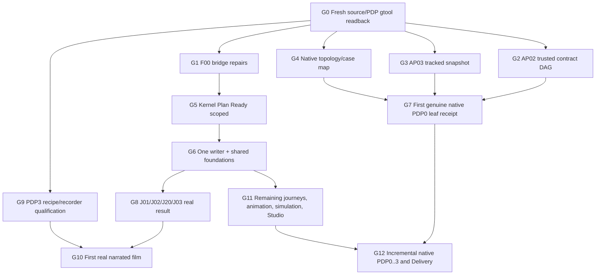

# Ghatana Media — executable gtool/PDP-0..3 implementer board (owner-approved v2)

**Date:** 2026-10-22. **Stage:** BUILD / `KDEV-STAGE-PLAN-IMPLEMENTATION`. **Owner decision:** APPROVED for routine technical/source-scoped implementation and coordination; `KCRIT-PLAN-READY`, real AP-02/AP-03 trust, native phase receipts, Build product behavior and Delivery remain independently **NOT PROVEN**. **Policy:** one `main` branch, one file writer, no CI hold, bounded headless testing. Current source/method/ABI fingerprints are mandatory at *run time*. The board is a derived execution handoff, not an alternative product definition, gtool receipt, or stage-state writer.

**Machine-readable queue:** [MEDIA-GTOOL-EXECUTION-QUEUE.v2.json](MEDIA-GTOOL-EXECUTION-QUEUE.v2.json), derived from the existing [19 owner dispositions](MEDIA-GTOOL-OWNER-EXECUTION-DISPOSITIONS.v1.json) and source [bridge blocker inventory](MEDIA-BUILD-BRIDGE-BLOCKER-INVENTORY.v1.json). Canonical [50-package/57-task implementation plan](MEDIA-BUILD-IMPLEMENTATION-PLAN.md) and [owner protocol](MEDIA-PDP0-3-GTOOL-OWNER-APPROVED-EXECUTION.md) remain authoritative. Do not edit generated task/bridge projections by hand.

## A. Non-negotiable execution contract

1. **Definition is not native closure.** The previous historical Lifecycle method readback establishes 54 subjects × 4 source-complete PDP views with zero local definition tasks **on its 2026-10-21 material read set only**. Its aggregate METHOD parent is intentionally `UNBOUND`. Re-run exact owner-housed readback for a new claim. An individual source `DEV_COMPLETE/CURRENT` PDP may progress to its next PDP *without* independent closure; an independently source-current complete unit may enter selected BUILD Plan work, but this does not assert `KCRIT-PLAN-READY`.
2. **Lifecycle owns phase operations.** `@ghatana/gtool/source-development-progression` projects source eligibility read-only and is wired into `scripts/lib/media-gtool-phase-status-io.mjs`; no Media-local phase machine. Work Planner/Kernel owner must actually authorize and commit method/stage transitions with expected revision/idempotency and source currentness; an advisory projection never writes phase state.
3. **PDP-3 includes narrated source-grounded recording.** New reusable `@ghatana/documentation-model/pdp3-demo-recording-source` and schema `pdp3-demo-recording-source.v1` validate selected scenarios, actual capture refs/fingerprints, static fixtures, narration audio+captions, storyboard, replay assertion, review and cleanup, or explicit owner-backed N/A. It is an OOB contract candidate for versioned owner/consumer binding, **not retroactive proof of past Media recordings** and not yet wired into the OOB method's completion guards. The later real-business-outcome film is distinct: actual product effect claims require independently checked runtime job/version/postcondition.
4. **Stage and acceptance are different lanes.** Native closure requires authenticated Lifecycle AP-02 contract DAG and AP-03 source snapshot, real source-to-case/oracle mapping, qualified Evidence Generator execution and canonical independent receipt. No cryptographic issuer, privileged effect, independent specialist, release grant or provider qualification can be asserted by owner prose, fabricated local key or policy JSON. A blocked receipt never blocks disjoint source-eligible coding/testing/refactoring.
5. **Ghatana ecosystem reuse first.** Single canonical running writer `ghatana/services/media` until F01/MIG-04 real parity/cutover; preserve canonical Flyway V001–V016 and reconcile divergent Media mirror V007–V009 without dual writing. Reuse published Shared security/governance/identity/outbox, Ghatana Event Plane/Data Cloud/AI Inference/Document Intelligence/Action Plane/Agents, Lifecycle/Tools proof and documentation contracts, Gharbatai neutral `@ghatana/experience-recorder` and TutorPutor AEF scientific owner interfaces. No private cross-repo imports.
6. **Proof reuse must be semantic.** Native PDP obligation census: 4,028 / 2,336 / 436 / 1,864 (**8,664**). One proof execution may cover many obligations only with per-obligation assertion and oracle. Never copy leaf evidence to a parent, bulk mark N/A, or reinterpret a source-current projection as accepted proof.

## B. Dependency and parallel execution DAG



**Parallelism:** G1/G2/G3/G4/G9 may proceed after G0 on disjoint owners. G5 is a gate only for packages whose true owner Plan exit requires it; a separate already-eligible scoped task is not held by unrelated root readiness. G7 native closure and G6/G8 BUILD are parallel, not sequential. Single writer per owned file/schema. Two concurrent packages maximum per shared family, and agents may be assigned 10–20 disjoint tasks per batch after real predecessor checks. Continue without routine approval roundtrips under existing delegated policy.

## C. Wave-by-wave work with structured I/O

### G0 — SOURCE_READBACK
- **Owner:** ghatana-media + ghatana-lifecycle; **current disposition:** `READY_TO_RUN_ON_FRESH_CHECKOUT`.
- **Depends on:** freshly selected current sources.
- **Required inputs:** PDP0..3 pinned source material, four matrices, exact current main roots, 54 topology identities.
- **Execution and output:** Read-only checks, host-composed gtool method plan, independent phase progression projection.
- **Accepted exit:** 54 IDs, 216 current phase observations, source owner axes + known-zero definition tasks; unchanged selected file set; native receipt still NOT_EVALUATED.

### G1 — SEMANTIC_BRIDGE
- **Owner:** ghatana-media; **current disposition:** `OPEN_TECHNICAL_WORK`.
- **Depends on:** `G0`.
- **Required inputs:** 17 exact P1 operations, 93 referring occurrences, eight explicit unresolved joins, handoff identity, 3186 trace rows.
- **Execution and output:** Repair source-defined cross-layer identities, rerun source generators/negative tests, freeze versioned Build handoff.
- **Accepted exit:** Zero required missing semantic links on affected units, no inferred N/A, trace/bridge/build projection deterministic.

### G2 — TRUST_CONTRACT_AP02
- **Owner:** ghatana-lifecycle Evidence Contracts trusted host; **current disposition:** `HOST_PROVISIONING_REQUIRED`.
- **Depends on:** `G0`.
- **Required inputs:** ghatana.closure@1 and assurance@1 pinned DAG, verifier owner registered trust.
- **Execution and output:** Issue/select and independently verify authenticated contract distribution AP02.
- **Accepted exit:** Trusted registered verifier, exact current DAG/material/ABI+revocation, negative trust tests; no test issuer.

### G3 — TRUST_SOURCE_AP03
- **Owner:** ghatana-media source owner + ghatana-lifecycle Planner host; **current disposition:** `HOST_PROVISIONING_REQUIRED`.
- **Depends on:** `G0`.
- **Required inputs:** Exact Media tracked membership, selected tar archive, source manifest and owner path.
- **Execution and output:** Build owner-selected AP03 archive, register genuine currentness and verifier selection.
- **Accepted exit:** No missing/changed tracked bytes, trusted signature/currentness/readback, negative archive and symlink tests.

### G4 — NATIVE_GRAPH_CASE_MAP
- **Owner:** ghatana-media + independent case/proof reviewers; **current disposition:** `OPEN_TECHNICAL_WORK`.
- **Depends on:** `G0`.
- **Required inputs:** 54 source identities, 8664 obligation IDs and applicability, 4028 PDP0 slots, source cases/oracles.
- **Execution and output:** Derive unique physical/composite/root closure-unit boundary, owner-reviewed obligation→case/proof map.
- **Accepted exit:** All 54 accounted, no duplicated ownership/ghost refs; first PDP0 leaf executable case coverage admitted.

### G5 — BUILD_PLAN_READY
- **Owner:** ghatana-media + Kernel Work Planner; **current disposition:** `NOT_PROVEN`.
- **Depends on:** `G1`.
- **Required inputs:** 57-task/50-package source plan, 19 owner-approved technical task repairs, typed task packets.
- **Execution and output:** Evaluate actual KCRIT-PLAN-TASK-CLOSURE and KCRIT-PLAN-READY per eligible unit.
- **Accepted exit:** Authenticated owner Work Planner transition readback; no plan-ready assertion from policy JSON or source projection.

### G6 — ONE_WRITER_AND_FOUNDATIONS
- **Owner:** ghatana canonical Media runtime + Shared mechanism owners; **current disposition:** `SCOPE_ELIGIBLE_AFTER_SELECTED_PLAN_READINESS`.
- **Depends on:** `G1`, `G5`.
- **Required inputs:** ghatana/services/media authoritative one writer, Flyway V001-V016, public Shared ABI, selected tasks.
- **Execution and output:** F01 migration source review/fencing, F02-F13 shared substrate and qualified providers.
- **Accepted exit:** Single writer, migration parity/rollback/replay proof, typed tenant/rights/job/outbox and negative tests.

### G7 — NATIVE_ADMISSION_AND_FIRST_RECEIPT
- **Owner:** ghatana-lifecycle + Media proof owner; **current disposition:** `NOT_ADMITTED`.
- **Depends on:** `G2`, `G3`, `G4`.
- **Required inputs:** Authenticated contract/snapshot selections, exact bounded PDP0 leaf, admitted proof route.
- **Execution and output:** gtool closure validate → prepare exact RunPlan → run with re-admission → owner receipt readback.
- **Accepted exit:** First independent CLOSED/CURRENT PDP0 leaf receipt; all failures/stale/UNKNOWN block only affected closure unit.

### G8 — J01_J02_J20_J03_REAL_OUTCOME
- **Owner:** ghatana-media product runtime and Ghatana canonical writer; **current disposition:** `NOT_VERIFIED`.
- **Depends on:** `G5`, `G6`.
- **Required inputs:** Existing requirements/journeys and actual provider+job/artifact/version/tenant/rights adapters.
- **Execution and output:** Implement authorization/project→source upload→job state/cancel→STT corrected caption version.
- **Accepted exit:** Real business postcondition with same source/version/provider/job lineage, denial and UNKNOWN recovery.

### G9 — PDP3_RECORDING_CONTRACT_AND_RECORDER
- **Owner:** ghatana-media + Gharbatai recorder consumer; **current disposition:** `STRUCTURAL_API_IMPLEMENTED_SOURCE_WIRING_PENDING`.
- **Depends on:** `G0`.
- **Required inputs:** Source-identified scenario roster, fixed fixture data, narration/caption/storyboard recipe, portable recorder ABI.
- **Execution and output:** Qualify read-only PDP3 source recording manifests and promotion of Gharbatai neutral recorder.
- **Accepted exit:** Explicit simulated Explorer vs live-product claims, replay/cleanup quality and independently auditable scenario coverage.

### G10 — EARLY_REAL_FILM
- **Owner:** ghatana-media Media recorder + business proof owners; **current disposition:** `NOT_VERIFIED`.
- **Depends on:** `G8`, `G9`.
- **Required inputs:** BUSINESS_OUTCOME_READY and CAPTURE_READY real readbacks, rights, traceable recipe, qualified encoder.
- **Execution and output:** Automated data-driven recorder, narration, captions, visual capture, manifest, cleanup and selective recapture.
- **Accepted exit:** Playable reviewed film with real job result and version source identity; no Explorer mock proof confusion.

### G11 — REMAINING_MEDIA_VERTICALS
- **Owner:** ghatana-media + Ghatana/Products/Shared published interfaces; **current disposition:** `OPEN_TECHNICAL_WORK`.
- **Depends on:** `G6`, `G8`.
- **Required inputs:** 30 source journeys, channel crosswalk and reusable renderer/animation/simulation/Studio/player contracts.
- **Execution and output:** Implement V and L packages with actual CLI/API/SDK/gRPC/Agent/event/browser parity.
- **Accepted exit:** Every applicable declared P0..3 behavior and negative case verified for real product; no fake provider/solver.

### G12 — PDP_NATIVE_INCREMENTS_AND_DELIVERY
- **Owner:** ghatana-lifecycle/Media independent acceptance + release owner; **current disposition:** `NOT_PROVEN`.
- **Depends on:** `G7`, `G11`.
- **Required inputs:** Per-unit current PDP0..3 proof/case receipts and Build verification/performance/security/rights.
- **Execution and output:** Incremental leaf/composition/root PDP0, then PDP1, PDP2, PDP3 native acceptance; release only after real gate.
- **Accepted exit:** Every applicable native unit CLOSED/CURRENT, Build dev complete and release-specific owner authorization separately.


## D. Exact 19 previously blocked Build tasks — approved but NOT complete

All ordinary task scope, technical review delegation and execution sequencing are **approved**. None of the 19 gets an artificial `COMPLETE` status from this document; the existing source-conditioned task tests and Work Planner must close each selected blocker with actual I/O and proof. The remaining **38** tasks also remain governed by the canonical 57-task projection.

### M-BLD-F00.T02 — Build trace coordinator
- **Lane / owner:** `SOURCE_BRIDGE` · `samujjwal/ghatana-media`; policy approved, technical completion **NOT_COMPLETE**.
- **Exact editable boundaries:** `.product-experience/pdp-1-domain-data/operations.yaml`, `docs/implementation/MEDIA-BUILD-IDENTITY-TRACE.v1.json`, `scripts/lib/media-build-semantic-source-joins.mjs`.
- **Prerequisites:** PDP0..3 current matrices; F00.T01 material receipt.
- **Implementation:** Resolve 93 P1 operation endpoints missing from the 3,186 trace without naming heuristics; reconcile 8 unresolved explicit relations and the exact media.handoff.identity selector. If the trace census changes, version the trace and regenerate all dependent projections after owner-reviewed impact.
- **Input I/O:** current PDP source selector; material fingerprint; resolved owner/ABI and dependency reference; declared positive and negative cases.
- **Expected I/O:** source-bound changed artifact or audited plan; exact test plan and result; negative/UNKNOWN/rollback readback; source-current owner review disposition.
- **Pass criterion:** Exact source ID and selector for every required operation; reconciled trace/bridge census, zero invented links; all affected source/currentness tests pass.

### M-BLD-F03.T01 — Media domain/contracts owner
- **Lane / owner:** `FOUNDATIONS` · `samujjwal/ghatana-media`; policy approved, technical completion **NOT_COMPLETE**.
- **Exact editable boundaries:** `runtime-contracts/`, `libs/audio-video-types/`, `.product-experience/pdp-1-domain-data/operations.yaml`.
- **Prerequisites:** F02 public ABI; F01 writer decision.
- **Implementation:** Select exact product-owned typed project/artifact/job/transcript/scene identities, revisions, CAS, units and error envelopes; reuse published Shared primitives; do not write runtime before canonical writer decision.
- **Input I/O:** current PDP source selector; material fingerprint; resolved owner/ABI and dependency reference; declared positive and negative cases.
- **Expected I/O:** source-bound changed artifact or audited plan; exact test plan and result; negative/UNKNOWN/rollback readback; source-current owner review disposition.
- **Pass criterion:** Typed request/result/error and source-defined version/UNKNOWN guards with packed consumer, boundary and negative tests.

### M-BLD-F06.T01 — Media runtime/reliability owner
- **Lane / owner:** `FOUNDATIONS` · `samujjwal/ghatana-media`; policy approved, technical completion **NOT_COMPLETE**.
- **Exact editable boundaries:** `ghatana/services/media/launcher/`, `ghatana/services/media/providers/aws-postgresql/`, `modules/infrastructure/cache/`.
- **Prerequisites:** F04/F05 real persistence and writer.
- **Implementation:** Implement bounded durable job lease/fencing, retries, cancellation, idempotency, provider UNKNOWN and crash reconciliation through the single writer and existing Shared messaging/outbox.
- **Input I/O:** current PDP source selector; material fingerprint; resolved owner/ABI and dependency reference; declared positive and negative cases.
- **Expected I/O:** source-bound changed artifact or audited plan; exact test plan and result; negative/UNKNOWN/rollback readback; source-current owner review disposition.
- **Pass criterion:** Exact job/attempt/readback and crash/timeout/replay/fencing/tenant-denial tests; no side-effect duplication.

### M-BLD-F10.T01 — Media UI/host owner
- **Lane / owner:** `FOUNDATIONS` · `samujjwal/ghatana-media`; policy approved, technical completion **NOT_COMPLETE**.
- **Exact editable boundaries:** `libs/audio-video-ui/`, `Shared product-shell/design-system public exports`, `production host ADR`.
- **Prerequisites:** F03/F04/F09 public contracts and source-dependent host entry.
- **Implementation:** Choose source-owned production GUI/embedded host separate from Explorer; implement authenticated shell and reusable adapters with keyboard/accessibility/UNKNOWN/recovery; leave full 47 screen behavior with vertical owners.
- **Input I/O:** current PDP source selector; material fingerprint; resolved owner/ABI and dependency reference; declared positive and negative cases.
- **Expected I/O:** source-bound changed artifact or audited plan; exact test plan and result; negative/UNKNOWN/rollback readback; source-current owner review disposition.
- **Pass criterion:** Packaged public UI consumer and authenticated host proof; representative screen/route, denial, keyboard/reflow/reduced-motion tests; no Explorer promotion.

### M-BLD-L01.T01 — Media recorder/story owner
- **Lane / owner:** `EARLY_DEMO` · `samujjwal/ghatana-media`; policy approved, technical completion **NOT_COMPLETE**.
- **Exact editable boundaries:** `docs/implementation/MEDIA-EARLY-BUSINESS-SCENARIO.v1.json`, `.product-experience/pdp-3-product-experience/journey-purpose-bindings.yaml`.
- **Prerequisites:** F00.T01 source-current inputs.
- **Implementation:** Derive bounded J01→J02→J20→J03 semantic actions and storyboard from current PDP sources, with source/config/data/narration and separate Explorer-vs-real product modes.
- **Input I/O:** current PDP source selector; material fingerprint; resolved owner/ABI and dependency reference; declared positive and negative cases.
- **Expected I/O:** source-bound changed artifact or audited plan; exact test plan and result; negative/UNKNOWN/rollback readback; source-current owner review disposition.
- **Pass criterion:** Deterministic scenario generator and source selector negative tests; 25 existing source blockers remain explicit until resolved.

### M-BLD-L01.T02 — Recorder reusable-core owner
- **Lane / owner:** `EARLY_DEMO` · `samujjwal/gharbatai`; policy approved, technical completion **NOT_COMPLETE**.
- **Exact editable boundaries:** `gharbatai/tooling/experience-recorder/`, `media capture-adapter boundaries`.
- **Prerequisites:** L01.T01 scenario selectors; recorder package ABI.
- **Implementation:** Qualify existing product-neutral recorder public API/dependency/license and first browser or qualified terminal adapter; retain Gharbatai-only drivers in Gharbatai.
- **Input I/O:** current PDP source selector; material fingerprint; resolved owner/ABI and dependency reference; declared positive and negative cases.
- **Expected I/O:** source-bound changed artifact or audited plan; exact test plan and result; negative/UNKNOWN/rollback readback; source-current owner review disposition.
- **Pass criterion:** Packed consumer, permitted capture, no credential leakage, deterministic selection/cancellation, negative permission and real-frame qualification.

### M-BLD-L01.T03 — Media business proof owner
- **Lane / owner:** `EARLY_DEMO` · `samujjwal/ghatana-media`; policy approved, technical completion **NOT_COMPLETE**.
- **Exact editable boundaries:** `ghatana/services/media`, `first J03 source/result/version readbacks`.
- **Prerequisites:** V03.T02; qualified real provider/channel; actual writer.
- **Implementation:** Accept first real single-channel J03 outcome only after authorized J01/J02/J20/J03 actual source, STT, transcript/CAS and immutable caption version receipts.
- **Input I/O:** current PDP source selector; material fingerprint; resolved owner/ABI and dependency reference; declared positive and negative cases.
- **Expected I/O:** source-bound changed artifact or audited plan; exact test plan and result; negative/UNKNOWN/rollback readback; source-current owner review disposition.
- **Pass criterion:** BUSINESS_OUTCOME_READY only with matching actual artifact/version/job/provider result and denial/UNKNOWN/conflict cases.

### M-BLD-L01.T04 — Media recording owner
- **Lane / owner:** `EARLY_DEMO` · `samujjwal/ghatana-media`; policy approved, technical completion **NOT_COMPLETE**.
- **Exact editable boundaries:** `Media recording manifest/scene/track`, `Gharbatai reusable recorder adapter`.
- **Prerequisites:** L01.T01/.T02/.T03 real outcomes.
- **Implementation:** Capture immediately after qualified T01–T03 with safe isolated fixture, declared rights, real frames/audio, narration, captions, provenance and teardown.
- **Input I/O:** current PDP source selector; material fingerprint; resolved owner/ABI and dependency reference; declared positive and negative cases.
- **Expected I/O:** source-bound changed artifact or audited plan; exact test plan and result; negative/UNKNOWN/rollback readback; source-current owner review disposition.
- **Pass criterion:** Playable current film with exact sources, verified semantic postcondition and cleanup; independent film approval remains separate.

### M-BLD-V01.T01 — Media first-use/runtime UX owner
- **Lane / owner:** `VERTICAL` · `samujjwal/ghatana-media`; policy approved, technical completion **NOT_COMPLETE**.
- **Exact editable boundaries:** `ghatana/services/media/launcher/`, `libs/audio-video-ui/`, `libs/audio-video-client/`.
- **Prerequisites:** F03/F04/F05/F09/F10/F12 and writer authority.
- **Implementation:** Implement authorized workspace/project creation and exact immutable initial version, idempotency and correct client readback for J01.
- **Input I/O:** current PDP source selector; material fingerprint; resolved owner/ABI and dependency reference; declared positive and negative cases.
- **Expected I/O:** source-bound changed artifact or audited plan; exact test plan and result; negative/UNKNOWN/rollback readback; source-current owner review disposition.
- **Pass criterion:** Same-tenant create/readback; cross-tenant/forged context/CAS negative cases.

### M-BLD-V02.T01 — Media artifact/storage owner
- **Lane / owner:** `VERTICAL` · `samujjwal/ghatana-media`; policy approved, technical completion **NOT_COMPLETE**.
- **Exact editable boundaries:** `ghatana/services/media/providers/aws-postgresql/`, `launcher/`, `source upload contracts`.
- **Prerequisites:** V01; F05/F09/F10 and migration decision.
- **Implementation:** Implement resumable artifact ingest/source digest and exact version/readback with safe lease/cleanup J02; preserve canonical V001–V016 migration history.
- **Input I/O:** current PDP source selector; material fingerprint; resolved owner/ABI and dependency reference; declared positive and negative cases.
- **Expected I/O:** source-bound changed artifact or audited plan; exact test plan and result; negative/UNKNOWN/rollback readback; source-current owner review disposition.
- **Pass criterion:** Content digest equality, resume/retry consistency and cross-tenant/partial upload/UNKNOWN negative cases.

### M-BLD-V03.T01 — Media STT/caption owner
- **Lane / owner:** `VERTICAL` · `samujjwal/ghatana-media`; policy approved, technical completion **NOT_COMPLETE**.
- **Exact editable boundaries:** `modules/speech/stt-service/`, `runtime-contracts/`, `libs/audio-video-ui/`.
- **Prerequisites:** V02/V20/F08/F11/F09/F10 and actual provider.
- **Implementation:** Implement full J03 transcription and caption correction across applicable channels, with source-grounded language/time and immutable versions; do not equate first channel with full V03.
- **Input I/O:** current PDP source selector; material fingerprint; resolved owner/ABI and dependency reference; declared positive and negative cases.
- **Expected I/O:** source-bound changed artifact or audited plan; exact test plan and result; negative/UNKNOWN/rollback readback; source-current owner review disposition.
- **Pass criterion:** All declared channels, real STT output, caption/revision integrity and denial/timeout/UNKNOWN/correction conflict tests.

### M-BLD-V03.T02 — Media STT first-channel owner
- **Lane / owner:** `EARLY_DEMO` · `samujjwal/ghatana-media`; policy approved, technical completion **NOT_COMPLETE**.
- **Exact editable boundaries:** `ghatana/services/media`, `exactly one source-authorized J03 channel`.
- **Prerequisites:** V02.T01/V20.T01/F08.T01/F11.T01/F09.T01.
- **Implementation:** Implement first J03 outcome on one admitted real channel under §5A prerequisites, with job/provider result, transcript and correction CAS.
- **Input I/O:** current PDP source selector; material fingerprint; resolved owner/ABI and dependency reference; declared positive and negative cases.
- **Expected I/O:** source-bound changed artifact or audited plan; exact test plan and result; negative/UNKNOWN/rollback readback; source-current owner review disposition.
- **Pass criterion:** Real BUSINESS_OUTCOME_READY, denied/broken/replayed/UNKNOWN/provider failure and correct final readback; no full V03 claim.

### M-BLD-V04.T01 — Media voice/rights owner
- **Lane / owner:** `VERTICAL` · `samujjwal/ghatana-media`; policy approved, technical completion **NOT_COMPLETE**.
- **Exact editable boundaries:** `modules/speech/tts-service/`, `modules/intelligence/ai-voice/`.
- **Prerequisites:** V01/V20/F08/F11 and qualified licensed model/provider.
- **Implementation:** Implement consent/rights-scoped TTS with exact source voice binding and approved output version J04.
- **Input I/O:** current PDP source selector; material fingerprint; resolved owner/ABI and dependency reference; declared positive and negative cases.
- **Expected I/O:** source-bound changed artifact or audited plan; exact test plan and result; negative/UNKNOWN/rollback readback; source-current owner review disposition.
- **Pass criterion:** Authorized output version and provenance plus revoked/region/unlicensed/UNKNOWN denials.

### M-BLD-V16.T01 — Media localization/dubbing owner
- **Lane / owner:** `VERTICAL` · `samujjwal/ghatana-media`; policy approved, technical completion **NOT_COMPLETE**.
- **Exact editable boundaries:** `modules/speech/{stt-service,tts-service}/`, `libs/audio-video-ui/`.
- **Prerequisites:** V03/V04/V18 and qualified model profiles.
- **Implementation:** Implement J16 translation/dubbing, timing/lip alignment and explicit loss/quality/rights review linked to exact versions.
- **Input I/O:** current PDP source selector; material fingerprint; resolved owner/ABI and dependency reference; declared positive and negative cases.
- **Expected I/O:** source-bound changed artifact or audited plan; exact test plan and result; negative/UNKNOWN/rollback readback; source-current owner review disposition.
- **Pass criterion:** Source-language/output timing accuracy and rights provenance with wrong voice/locale/UNKNOWN failures.

### M-BLD-V18.T01 — Media composition/render owner
- **Lane / owner:** `VERTICAL` · `samujjwal/ghatana-media`; policy approved, technical completion **NOT_COMPLETE**.
- **Exact editable boundaries:** `ghatana/services/media/launcher/`, `runtime-contracts/`, `libs/audio-video-ui/`.
- **Prerequisites:** V09/V11/V17/F13 and canonical render/codec.
- **Implementation:** Implement J18 multitrack timeline, captions, color adjustments, approved render/master and versioned output, never silently mutate source.
- **Input I/O:** current PDP source selector; material fingerprint; resolved owner/ABI and dependency reference; declared positive and negative cases.
- **Expected I/O:** source-bound changed artifact or audited plan; exact test plan and result; negative/UNKNOWN/rollback readback; source-current owner review disposition.
- **Pass criterion:** Review/version/render provenance and protected crop/track mute/solo/ramp with failure/codec/rights denials.

### M-BLD-V20.T01 — Media jobs/UX owner
- **Lane / owner:** `VERTICAL` · `samujjwal/ghatana-media`; policy approved, technical completion **NOT_COMPLETE**.
- **Exact editable boundaries:** `ghatana/services/media/launcher/`, `providers/aws-postgresql/`, `libs/audio-video-ui/`.
- **Prerequisites:** V02/F06/F07/F09/F10.
- **Implementation:** Implement J20 job submit/watch/cancel and same-request outcome reconciliation across authorized channels.
- **Input I/O:** current PDP source selector; material fingerprint; resolved owner/ABI and dependency reference; declared positive and negative cases.
- **Expected I/O:** source-bound changed artifact or audited plan; exact test plan and result; negative/UNKNOWN/rollback readback; source-current owner review disposition.
- **Pass criterion:** Observe identical job/attempt IDs and eventual genuine terminal effects; LOST_ACK/timeout/UNKNOWN/replay denied without duplicate effects.

### M-BLD-V23.T01 — Media offline/client owner
- **Lane / owner:** `VERTICAL` · `samujjwal/ghatana-media`; policy approved, technical completion **NOT_COMPLETE**.
- **Exact editable boundaries:** `libs/audio-video-client/`, `libs/audio-video-ui/`, `runtime-contracts/`.
- **Prerequisites:** V01/V02/V21/F10.
- **Implementation:** Implement local J23 work and safe reconnect, versioned queued intentions and deterministic merge/conflict resolution without unauthorized effects.
- **Input I/O:** current PDP source selector; material fingerprint; resolved owner/ABI and dependency reference; declared positive and negative cases.
- **Expected I/O:** source-bound changed artifact or audited plan; exact test plan and result; negative/UNKNOWN/rollback readback; source-current owner review disposition.
- **Pass criterion:** Offline read/cache durability, stale version conflict and denied/resumed effects with exact readback.

### M-BLD-V24.T01 — Media CLI/SDK owner
- **Lane / owner:** `VERTICAL` · `samujjwal/ghatana-media`; policy approved, technical completion **NOT_COMPLETE**.
- **Exact editable boundaries:** `libs/audio-video-client/`, `.product-experience/pdp-3-product-experience/cli/`.
- **Prerequisites:** V01/V02/V20/F09; published public API.
- **Implementation:** Implement J24 machine/batch CLI JSON commands, bounded operation identity and exit status matched to real verified output.
- **Input I/O:** current PDP source selector; material fingerprint; resolved owner/ABI and dependency reference; declared positive and negative cases.
- **Expected I/O:** source-bound changed artifact or audited plan; exact test plan and result; negative/UNKNOWN/rollback readback; source-current owner review disposition.
- **Pass criterion:** Machine schema stdout/stderr/exit invariants, same command identity/retry, error/UNKNOWN security denials.

### M-BLD-V26.T01 — Media privacy/retention owner
- **Lane / owner:** `VERTICAL` · `samujjwal/ghatana-media`; policy approved, technical completion **NOT_COMPLETE**.
- **Exact editable boundaries:** `ghatana/services/media/providers/aws-postgresql/`, `launcher/`, `modules/infrastructure/security/`.
- **Prerequisites:** V02/V04/V22/F05, actual retention policy.
- **Implementation:** Implement J26 exact artifact-version delete/revoke/retention/hold/erasure through one authorized writer, with readback and irreversible-effects boundary.
- **Input I/O:** current PDP source selector; material fingerprint; resolved owner/ABI and dependency reference; declared positive and negative cases.
- **Expected I/O:** source-bound changed artifact or audited plan; exact test plan and result; negative/UNKNOWN/rollback readback; source-current owner review disposition.
- **Pass criterion:** Policy checked erasure and holds; no invalid deletion, unauthorized tenant, stale lease or false physical erasure claim.


## E. Source join repair queue (F00 — deterministic, finite)

There are **17 unique existing PDP-1 operation IDs** missing from the implementation trace, generating **93** dependent missing-edge occurrences; do not create 93 new operations. Exact operation IDs:

  - `media.operation-slice.append-upload-chunk`
  - `media.operation-slice.begin-upload`
  - `media.operation-slice.cancel-job`
  - `media.operation-slice.complete-upload`
  - `media.operation-slice.create-project`
  - `media.operation-slice.inspect-artifact`
  - `media.operation-slice.inspect-job`
  - `media.operation-slice.inspect-project`
  - `media.operation-slice.inspect-upload`
  - `media.operation-slice.list-projects`
  - `media.operation-slice.retry-job`
  - `media.operation.caption-draft-write`
  - `media.operation.caption-version-read`
  - `media.operation.caption-version-write`
  - `media.operation.job-lifecycle`
  - `media.operation.transcript-version-read`
  - `media.operation.transcription-submission`

Source inspection also reports exactly **eight** unresolved cross-layer operation relations (`PDP-1:operations:media.operation.action.inspect-job-retry-policy`, `PDP-1:operations:media.operation.request-snapshot.inspect.v1`, `PDP-1:operations:media.operation.speaker-reference.resolve-version.v1`, `PDP-1:operations:media.operation.stt.profile.adapt.v1`, `PDP-1:operations:media.operation.stt.profile.create.v1`, `PDP-1:operations:media.operation.stt.profile.get.v1`, `PDP-1:operations:media.operation.stt.profile.update.v1`, `PDP-1:operations:media.operation.voice-profile.resolve-source-version.v1`) and one missing `media.handoff.identity` exact selector. Source location: `.product-experience/pdp-1-domain-data/operations.yaml`; trace owner: `scripts/lib/media-build-semantic-source-joins.mjs` and `MEDIA-BUILD-IDENTITY-TRACE.v1.json`. The generated [blocker inventory](MEDIA-BUILD-BRIDGE-BLOCKER-INVENTORY.v1.json) contains source selectors, dependent packages and occurrence paths. Preserve all 3,186 identities until true source impact permits a counted change; regenerate derived files via their generators, then run source-inclusion/omission/unknown-target negative tests.

## F. Concrete command and receipt protocol

```bash
# Media (fresh main; inspect status and preserve dirty files before writes)
pnpm run check:physical-topology
pnpm run check:lifecycle-source-inputs
pnpm run audit:lifecycle-obligations
pnpm run check:gtool-owner-dispositions
pnpm run test:gtool-owner-dispositions
node scripts/generate-media-pdp0-surface-phase-status-matrix.mjs --check
node scripts/generate-media-pdp1-surface-phase-status-matrix.mjs --check
node scripts/generate-media-pdp2-surface-phase-status-matrix.mjs --check
node scripts/generate-media-pdp3-surface-phase-status-matrix.mjs --check
node scripts/check-media-build-contract-bridge.mjs
pnpm run check:build-bridge-blockers
pnpm run test:build-bridge-blockers
pnpm run check:build-plan-task-closure
pnpm run test:build-plan-task-closure
pnpm run check:w3-pdp0-source-case-map

# Lifecycle (real Work Planner composition; use a NEW output path each run)
RUN_ID=$(date -u +%Y%m%dT%H%M%SZ)-$RANDOM
node scripts/gtool-media-method-dogfood.mjs --media-root /path/to/ghatana-media --lifecycle-root /path/to/ghatana-lifecycle --output "docs/engineering/MEDIA_METHOD_READBACK_${RUN_ID}.json"
node scripts/gtool-media-phase-status-io.mjs --input "docs/engineering/MEDIA_METHOD_READBACK_${RUN_ID}.json" --output "docs/engineering/MEDIA_SOURCE_STATUS_${RUN_ID}.json"
node --test scripts/__tests__/gtool-media-phase-status-io.test.mjs
node --test tools/gtool/test/source-development-progression.test.mjs
node --test tools/documentation-model/test/pdp3-demo-recording-source.test.mjs
node tools/documentation-model/bin/validate-pdp3-demo-recording.mjs --input /path/to/source-selected-recording-manifest.json

# Native closure ONLY through actual production-trusted owner host:
GHATANA_TARGET_ROOT=/path/to/ghatana-media node tools/gtool/bin/gtool.mjs closure validate --json
node tools/gtool/bin/gtool.mjs closure config check --root /path/to/ghatana-media --no-write --json
# RunPlan and receipt steps require actual admitted unit, authenticated AP02/AP03 and real proof.
```

Use a new run ID and immutable raw JSON file for every actual command. Capture `repo/materialFingerprint, methodFingerprint, subjectId, phaseId, applicability, sourceStatus, knownTaskIDs, sourceCurrent, ownerDecisionRef, acceptedProofRef, nativeClosureStatus, reasonCodes, nextAction`. Do not fabricate an output file because the command cannot run or because no trusted host is provisioned.

## G. Stage progression and typed failure handling

| Unit attempt | Required gate | Action when blocked |
| --- | --- | --- |
| PDP0→PDP1→PDP2→PDP3 | Selected own preceding PDP source status current/complete/known-zero and declared source dependencies | `SOURCE_PREDECESSOR_INCOMPLETE`: hold only affected subject; others advance |
| PDP3→Build Plan | All selected own PDP sources current/completed and profile/recording criteria of its **chosen source edition** | `SOURCE_HANDOFF_ELIGIBLE_NOT_BUILD_PLAN_READY`: produce Plan packet, do not claim Kernel stage switch |
| Plan→Build Implement | Actual selected `KCRIT-PLAN-TASK-CLOSURE`, `KCRIT-PLAN-READY`, owner transition and dependency scope | `PLAN_READY_NOT_PROVEN`: implement missing task source/tests/ABI; progress independently eligible tasks |
| Native PDP acceptance | Registered AP02+AP03 selections, case/oracle, independent result and current receipt | `NATIVE_CLOSURE_NOT_ADMITTED`: hold only closure/required Delivery, continue BUILD |
| Business film | Real same-version business terminal effect AND qualified recorder/rights/cleanup | `BUSINESS_OUTCOME_NOT_VERIFIED`: record Explorer simulation separately and continue product coding |
| Deliver | Current required native receipts + Build verification + owner release qualification | `DELIVERY_NOT_AUTHORIZED`: no release/production claim |

On UNKNOWN after a side effect, reconcile the **same operation ID** against the owner's durable journal, never blind-repeat or create a success receipt. For changed source material invalidate only affected units and declared dependent ancestors; do not rerun unaffected current proof. Local headless tests are acceptable when they prove exact obligations; GitHub CI must not become the sole blocker.

## H. Cross-repository execution ownership

| Repository | Exact work authorization and open coordination |
| --- | --- |
| `ghatana-media` | Own PDP semantics, trace repairs, 54-identity/native crosswalk, PDP3 scenario and recorder integration, Build 50/57. [#19](https://github.com/samujjwal/ghatana-media/issues/19), [#20](https://github.com/samujjwal/ghatana-media/issues/20), [#21](https://github.com/samujjwal/ghatana-media/issues/21), [#22](https://github.com/samujjwal/ghatana-media/issues/22) |
| `ghatana-lifecycle` | Method host/Work Planner, canonical PhaseProgram, AP02/AP03 registered owner trust, proof/receipt. [#24](https://github.com/samujjwal/ghatana-lifecycle/issues/24), [#25](https://github.com/samujjwal/ghatana-lifecycle/issues/25), [#26](https://github.com/samujjwal/ghatana-lifecycle/issues/26), [#27](https://github.com/samujjwal/ghatana-lifecycle/issues/27) |
| `ghatana-kernel` | 16 KDEV stages, authentic `KCRIT-PLAN-TASK-CLOSURE`, `KCRIT-PLAN-READY`, scoped stage transition; do not invent Media stage machine |
| `ghatana-tools`, `ghatana-toolchain` | Canonical documentation-model, implementation-handoff/evidence contract public APIs, no forked semantics or separate campaign stage promotion |
| `ghatana` | Canonical writer, Flyway history, external runtime/provider abilities, Media migration. [#257](https://github.com/samujjwal/ghatana/issues/257) |
| `ghatana-shared` | Actual public security/outbox/DS/accessibility API/source/ABI. [#245](https://github.com/samujjwal/ghatana-shared/issues/245) |
| `gharbatai` | Existing neutral recorder package qualification; product-specific drivers stay owned. [#56](https://github.com/samujjwal/gharbatai/issues/56) |
| `ghatana-products` | TutorPutor AEF model/solver scientific public contracts; Media owns rendering only. [#67](https://github.com/samujjwal/ghatana-products/issues/67) |

**Owner approval completion boundary:** normal architecture, scope, source selection, sequencing and source-eligible code/test execution decisions require no further routine approval in this program. Formal privileged credential/trust activation, independent specialist/verifier signoff, external license, actual migration/cutover, release grant and canonical closure are **real technical actions**, not unapproved discretionary policy votes and cannot be waived by text.

## I. Exact definition of a completed implementation batch

Every completed batch must output a versioned structured result with all changed source files and new material/ABI digests; exact `packageId/taskId/surfaceId/PDP mapping`; selected predecessor results and WIP locks; positive+negative tests with command, exit, trace, observer and oracle; denial/UNKNOWN/cancellation/recovery; cleanup/rollback; same-owner state readback; unaffected receipts to reuse; changed/remaining blocker IDs; and next admitted wave. Never replace counts of **completed source definitions** with counts of **implemented product journeys**, **native accepted receipts**, or **released artifacts**.

The implementer may start G0/G1/G2/G3/G4/G9 immediately without waiting on the other parallel lanes, and actual F01/Build progress on exact eligible packages when their Kernel owner allows it. The first product film starts immediately after its genuine J03 real business postcondition and capture qualification, rather than waiting for all 30 journeys.
