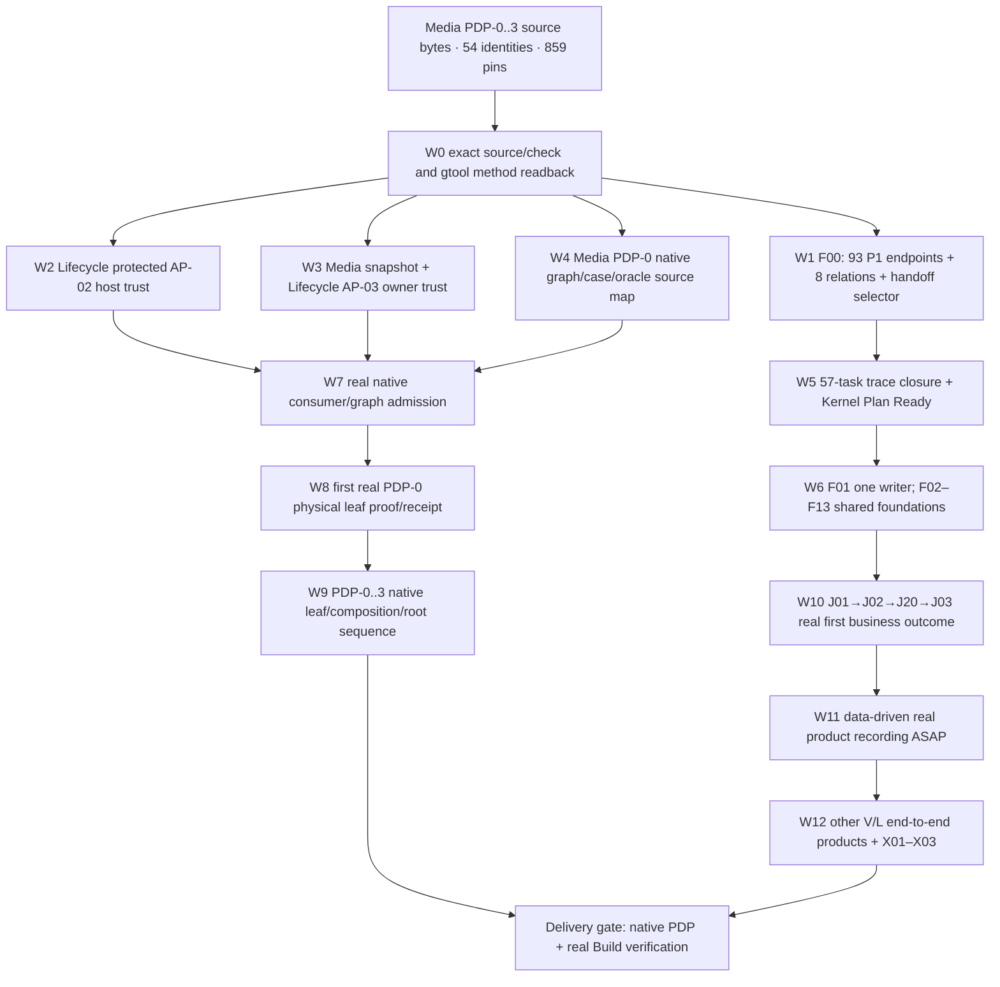

# Ghatana Media — Owner-approved PDP-0..3 gtool and BUILD execution protocol

**Status:** APPROVED_OWNER_EXECUTION_DIRECTION / TECHNICAL_ADMISSION_NOT_YET_PROVEN  
**Date:** 2026-10-22  
**Role:** This is the *live execution addendum* to [the canonical Media BUILD Implementation Plan](MEDIA-BUILD-IMPLEMENTATION-PLAN.md) and its generated [50-package/57-task work projection](MEDIA-BUILD-WORK-PACKAGES.v1.json), not an alternative PDP authority or regenerated source receipt. Its owner decisions are machine-readable in [MEDIA-GTOOL-OWNER-EXECUTION-DISPOSITIONS.v1.json](MEDIA-GTOOL-OWNER-EXECUTION-DISPOSITIONS.v1.json). Do not edit the frozen 859 PDP source pins or generated Work Package outputs merely to make the instructions look green; regenerate them through their authoring scripts only after genuine source changes. Original 50 package scopes and 54 identity denominator remain authoritative.

## 0. Campaign and verified/readback boundary

| Item | Current selected scope and legal meaning |
| --- | --- |
| Campaign | `samujjwal/ghatana-media`, with required source-owning dependencies in Lifecycle, Kernel, Tools/Toolchain, Shared, Ghatana runtime, Gharbatai recorder, and Products/TutorPutor; no takeover or stage promotion of unrelated projects |
| Source cuts inspected in this planning pass | Media `354452f29bea4a3b24cd456d39950967ab4d83c0`; Lifecycle `c8ad6200fffd6f4dfbaf359cc6a1a2d265509ab5`; immutable source/fingerprint inputs must be freshly checked at each execution |
| Macro stage | BUILD / `KDEV-STAGE-PLAN-IMPLEMENTATION`; PDP native acceptance/closure is a **separate parallel lane** |
| Media PDP denominator | 26 physical candidates + six semantic compositions + one repository-root composition + 21 logical consumer identities = **54 source identities**; the archived desktop consumer and explicit support N/A remain visible |
| Source-definition phase state | PDP-0..3 previously source-current `DEV_COMPLETE`, 859 material pins recorded current, zero phase-local definition tasks; rely on fresh native matrix and gtool **source** readbacks rather than Git HEAD alone |
| Build plan | 50 packages, 57 tasks, 3,186 implementation trace identities, 19 currently blocked planning tasks; structural validator PASS in the supplied handoff; **Kernel KCRIT-PLAN-TASK-CLOSURE and KCRIT-PLAN-READY remain unproven** |
| Bridge | 8,578 relations; **93 missing source-declared P1 operation edge occurrences across 17 distinct actual operations**, eight explicit unresolved source relations and one `media.handoff.identity` selector, affecting 65 trace rows. Exact machine source selectors and referring IDs: [generated blocker inventory](MEDIA-BUILD-BRIDGE-BLOCKER-INVENTORY.v1.json). Do not relabel absent endpoints N/A to clear it |
| PDP-0 native closure | 4,028 obligations remain open and zero executable source-case links in W3 projection. AP-02/AP-03 host code is merged and tests were reported passing, but no production trust selection/verifier/receipt is admitted |
| Release | No Delivery, product production readiness, physical migration or real-product-film approval follows from these source or planning statuses |

**Evidence attribution:** The task counts, 859 pins, 19 blockers, 4,028 W3 openings and test pass counts come from the owner's attached current-cut execution handoff, not a newly executed end-to-end gtool run from this GitHub-mediated planning session. Direct remote inspection confirms the newer `main` commits, scripts, owner contract files, and public method/host APIs. Refresh and record real run output before claiming any further status.

## 1. Final delegated owner decisions: accepted now

The owner has delegated ordinary technical, design, architecture, review, work-planning, sequencing, test-scope, resource-allocation and source-appropriate implementation decisions within this Media program. [The machine-readable owner task dispositions](MEDIA-GTOOL-OWNER-EXECUTION-DISPOSITIONS.v1.json) cover all 19 open Build-blocker task IDs. No repeated owner approval request is required for a choice already settled by this packet. The following are **decided**:

1. **One product meaning authority.** Media's PDP-0 Product Truth, PDP-1 canonical domain/data, PDP-2 interface/design, and PDP-3 complete experience remain source truth. The Experience Explorer is a PDP-3 projection, not PDP-4, nor the deployed product host. The 54 source identities are never equated with 54 native `ClosureSurface` registrations.
2. **One phase-management facade.** Lifecycle `gtool` is used through its packaged generic method contract and Work Planner owner readback for source `DEV_COMPLETE`; Lifecycle Surface Convergence + Verification Planner + Evidence Contracts + Evidence Generator own independent native phase proof and receipts. Do not implement a Media-local lifecycle engine, receipt store, verifier registry, or status machine.
3. **Plan approval ≠ Plan Ready.** Owner scope, dependencies and source-repair actions are approved, but the 19 actual task/source blockers, case/proof admission and correct tests remain to execute. `KCRIT-PLAN-TASK-CLOSURE` and `KCRIT-PLAN-READY` are **not** marked PASS by an owner text record. `KDEV-STAGE-IMPLEMENT` is only entered on the true Kernel/Work Planner transition after source-current package readiness. Independent already-eligible packages must not wait for unrelated root status.
4. **Cross-repo writer.** The executable Media writer remains `ghatana/services/media` until the F01/MIG-04 owner-reviewed one-writer migration. Prepared `ghatana-media` runtime packages do not justify running two DB/queue writers or applying divergent Flyway V007–V009 scripts to the canonical V001–V016 history.
5. **Reuse existing platform.** Shared publishes common security, governance, identity, outbox, observability, tokens and shell; Ghatana supplies Event Plane/Data Cloud/AI Inference/Document Intelligence/Action Plane/Agents and the canonical Media writer. Tools product-definition and implementation-handoff contracts are reused rather than forked. Gharbatai keeps its product-specific recorder drivers while the neutral package is qualified for Media. TutorPutor owns model/solver/pedagogy scientific truth; Media owns render/interactive media behavior.
6. **One actual proof may cover multiple obligations** only with per-obligation semantic assertions and source IDs that independent case/oracle mapping can check. Do not create thousands of redundant tests for 8,664 source obligations; do not pretend 8,620 formerly unmapped obligations already have proof. Child leaf evidence is not copied into composition/root as if it were direct evidence.
7. **Early recorded customer result.** Start declarative J-01 → J-02 → J-20 → J-03 scenario and recorder qualification in parallel with shared foundations. On the first real admitted business postcondition, capture source-authorized product operation, frames/audio, narration, captions, receipts and cleanup. The existing narrated simulated Explorer recording has a separate claim; no live-product effect can be inferred from its pixels.
8. **Controlled concurrency and source boundaries.** WIP: maximum 2 simultaneous edited packages in a family lane and one active writer per shared file/schema owner. Main branch only, preserve existing worktree modifications, no history-rewrite. Local headless verification is sufficient where it proves the exact obligation; GitHub Actions is not a blocking independent substitute. Reuse unchanged receipt evidence and reopen only actually impacted units/ancestors.
9. **Role/trust boundary.** Delegated AI technical design review is not a cryptographic owner key, authenticated provider assertion, real independent human/specialist certification, proof receipt or release grant. Fail closed on missing owner trust while independent eligible source/Build tasks continue.

**No unresolved discretionary owner-policy vote is left within these decisions.** Incomplete *technical* facts below retain named executor/receipt owners and cannot be set to PASS by fiat.

## 2. The structured gtool I/O protocol (mandatory)

Three distinct truth channels must never share a status field:

| Channel and owner | Exact structured input | Owning operation/command | Output semantics; forbidden inference |
| --- | --- | --- | --- |
| **A. PDP source development** — Media owner, read via Lifecycle Work Planner | Material-pinned Media `pdp-*-phase-dev-status.json`, four 54-row matrices, method preset `tools/documentation-model/presets/methods/media-product-development.v1.json`; owner-provided resolver | Lifecycle's existing `scripts/gtool-media-method-dogfood.mjs` dispatches `gtool method plan` for each of 54 subject IDs through owner-wired Work Planner; `scripts/gtool-media-phase-status-io.mjs` validates that report | Exactly 216 `sourceDevelopment` cell observations: `COMPLETE/CURRENT/known-zero` or explicit N/A/archive per authoritative row. Output **SOURCE_DEFINITION_DEV_COMPLETE_CURRENT** only when all 54×4 live observations pass. Independent acceptance/native closure remains `NOT_EVALUATED` |
| **B. Kernel Build Plan and Implement** — Media/Kernel Work Planner owner | `MEDIA-BUILD-WORK-PACKAGES.v1.json`, current `MEDIA-BUILD-IDENTITY-TRACE.v1.json`, contract bridge, material-source receipts, owner dispositions, 50 dependency packages/57 tasks, positive/adversarial test selection and rollback | `node scripts/check-media-build-plan-task-closure.mjs`, `node scripts/check-media-gtool-owner-dispositions.mjs`, and **actual** Kernel/Work Planner stage transition/evidence path | Structural `PASS` is not task closure, `APPROVED_OWNER_POLICY` is not `KCRIT-PLAN-READY`, and a ready task is not executed code. Real `KDEV-STAGE-IMPLEMENT` follows only authentic owner stage entry/result readback |
| **C. Native PDP acceptance/closure** — Lifecycle canonical authorities | Exact consumer contract set + AP-02 trusted selected distribution, AP-03 trusted source snapshot, owner-reviewed `ClosureSurface × phase`, source obligation/case/observer/oracle map and current allowed proof runner | `gtool closure validate`, config no-write admission, `closure run-plan prepare --unit-id ...`, re-admitted `closure run --run-plan ... --execute`, genuine native result/receipt adoption/readback | Separate `CLOSED/CURRENT` **only** on actual canonical receipt, current source, independent proof and predecessor/child satisfaction. Provider health, method `COMPLETE`, test-only issuer or owner packet never becomes a receipt |

### 2.1 Actual source-development commands

Run on a real machine with current checked-out Media and Lifecycle `main` worktrees, installed dependencies and correct public exports. Never use a repository-local fake owner module. The existing Lifecycle Media method bridge supplies the Work Planner owner readback; the bare stock gtool CLI may correctly return `UNBOUND` without that trusted composition.

```bash
# Media root
pnpm run check:physical-topology
pnpm run check:lifecycle-source-inputs
pnpm run audit:lifecycle-obligations
pnpm run test:gtool-closure-source
pnpm run test:ap03-source-snapshot
pnpm run check:gtool-owner-dispositions
pnpm run test:gtool-owner-dispositions
node scripts/generate-media-pdp0-surface-phase-status-matrix.mjs --check
node scripts/generate-media-pdp1-surface-phase-status-matrix.mjs --check
node scripts/generate-media-pdp2-surface-phase-status-matrix.mjs --check
node scripts/generate-media-pdp3-surface-phase-status-matrix.mjs --check

# Lifecycle root; choose a fresh report filename that does not exist
node scripts/gtool-media-method-dogfood.mjs \
  --media-root /path/to/ghatana-media \
  --lifecycle-root /path/to/ghatana-lifecycle \
  --output docs/engineering/MEDIA_METHOD_READBACK_CURRENT_RUN.json
node scripts/gtool-media-phase-status-io.mjs \
  --input docs/engineering/MEDIA_METHOD_READBACK_CURRENT_RUN.json \
  --output docs/engineering/MEDIA_METHOD_SOURCE_PHASE_STATUS_CURRENT_RUN.json
node --test scripts/__tests__/gtool-media-phase-status-io.test.mjs
```

The new pure validator verifies unique 54 subjects, all four phase IDs per subject, exact current material fingerprints, same-input preflight, owner read-only behavior, no phase-local tasks, and rejects duplicate/missing/stale rows and changed status flags. Its result is a **source-development projection**, not a publisher of `DEV_COMPLETE`. If the aggregate Work Planner root node remains `UNBOUND` but 216 individual PDP rows satisfy source currentness, do not reopen the PDPs merely to force the whole method DAG green.

### 2.2 Native closure input contract and phase identity

```text
PDP-0 -> media.product-truth.definition-acceptance               4,028 obligations
PDP-1 -> media.canonical-domain-data.definition-acceptance       2,336 obligations
PDP-2 -> media.design-interface-system.definition-acceptance       436 obligations
PDP-3 -> media.complete-product-experience.definition-acceptance 1,864 obligations
Total                                                           8,664 obligations
```

Current `media.product-definition` is a **single logical aggregate candidate** with no children; it is not authority to close 54 rows by one root run. Media must source-adjudicate actual independently closable leaves, direct cross-child compositions and root, then bind each applicable obligation exactly once to its owning closure boundary. A single physical implementation may be referenced by multiple logical consumer semantics without duplicate producers. All explicit N/A/archived/unsupported cells remain visible.

AP-02 must be a genuine authenticated `ghatana.evidence-contracts.contract-distribution-selection.v1` for `ghatana.closure@1` and pinned `ghatana.assurance@1`, with exact root/DAG/member bytes, currentness/admission/revocation, and registered **production** verifier. AP-03 must be a real `ghatana.evidence-contracts.tracked-source-snapshot-selection.v1` bound to the owner's current selected Media member manifest and archive and authenticated Planner host. The protected host code exists in Lifecycle, but actual owner trust setup is still required; TEST_ISSUER or fabricated `OWNER` labels are invalid.

```bash
# Read-only native preflight, through the genuinely owner-composed gtool host
GHATANA_TARGET_ROOT=/path/to/ghatana-media \
  node tools/gtool/bin/gtool.mjs closure validate --json
node tools/gtool/bin/gtool.mjs closure config check \
  --root /path/to/ghatana-media --no-write --json

# Use only an ACTUALLY ADMITTED leaf and actual returned RunPlan reference
node tools/gtool/bin/gtool.mjs closure run-plan prepare \
  --unit-id '<admitted-leaf>::media.product-truth.definition-acceptance' --json
node tools/gtool/bin/gtool.mjs closure run --run-plan '<actual-ref>' --execute --json
# Only for authentic eligible owner output when its native workflow requires adoption:
node tools/gtool/bin/gtool.mjs closure adopt-native-receipt \
  --surface '<admitted-leaf>' \
  --phase media.product-truth.definition-acceptance \
  --native-run-result '<actual-native-result.json>' --json
```

The stock launcher does **not** manufacture registered owner-trust verifiers or their selections. The code path with owner-provisioned trust must be used. If the stock launcher is blocked, document the specific missing host wiring; do not add a bypass flag or reinterpret a configuration check exit zero as admitted proof. On timeout/UNKNOWN, reconcile from the same owner journal; never blind-reissue an external effect.

### 2.3 Mandatory shape of every implementation/task I/O

Use the existing Tools/Kernel versioned contracts as the serialized authority and **do not introduce new generic source truth**. Every task packet needs (a) task/surface/phase identity, (b) selected material source/semantic fingerprints and referenced requirement/journey/operation/channel, (c) predecessor result/receipt IDs, (d) exact input request plus expected typed output/error including denial, UNKNOWN, cancellation/recovery, (e) declared provider/public ABI and owner, (f) target code/host/migration scope, (g) positive/adversarial test IDs and actual commands, (h) protected worktree/lease/cost/cleanup, and (i) source-current and independent readback. A task may have `NOT_ADMITTED` dependencies but cannot claim `READY` for the affected effect while they remain.

For each gtool run store its complete raw JSON output and a compact index of subject/method/phase/source fingerprints, admitted count, selected native units, tests, verdicts, receipt references, source-currentness and reason codes. Prefer content-addressed links and hashes to duplicating large media/test evidence. Never mutate the original result file or aggregate acceptance across an unknown required leaf.

## 3. Execution DAG and parallel lanes



**Concurrency:** W1, W2, W3 and W4 can run concurrently after W0 against isolated writers; approved source-eligible Build preparation does not wait for AP-02/03. W5 controls the selected legitimate Implement transition; W8/9 are separate native acceptance, not prerequisites to begin W6 unless the actual task dependency says so. Schedule no more than two packages in each family lane and one writer per shared file. Prefer 10–20 independently owned tasks per implementation agent batch where actual predecessor and write isolation permit; do not turn package count into simultaneous writers. Main-only commits after scoped tests and source-current review.

## 4. Exact 19 Build Plan blocker tasks and action disposition

The complete structured owner-approved action packet and acceptance text for each ID is in [owner task dispositions](MEDIA-GTOOL-OWNER-EXECUTION-DISPOSITIONS.v1.json). These are **remaining Build Plan/implementation work**, not PDP phase-local definition tasks. Execute the following in source/dependency order; no bulk status changes:

| Task ID | Assigned owner / concrete output | Stop/pass rule |
| --- | --- | --- |
| `M-BLD-F00.T02` | Media source-trace owner — source ID bridge: 93 missing P1 operation *references* to 17 distinct named operation IDs, eight unresolved explicit joins and `media.handoff.identity`; source-pinned trace/bridge generation | Exact source selectors, all required relations reconciled, census versioning if changed. No guessed IDs or false `N/A` |
| `M-BLD-F03.T01` | Media domain/types owner — public typed project/artifact/job/transcript/caption/recipe/scene records, CAS/time/UNKNOWN/error contracts | ABI and positive/negative type/consumer tests, no duplicate product definition |
| `M-BLD-F06.T01` | Media runtime owner — durable leases, job attempts, fencing, idempotency, cancellation, same-request UNKNOWN reconciliation using single canonical writer | Crash/lost-ACK/replay/stale-lease/tenant denial tests; no dual writer |
| `M-BLD-F10.T01` | Media UI/Shared host owner — real production shell and product-host ADR, core UI/embedded adapters, accessibility and typed states | A host-qualified non-Explorer consumer, denied/UNKNOWN/recovery and keyboard/reflow tests |
| `M-BLD-L01.T01` | Media recorder story owner — declarative J01/J02/J20/J03 source-bound recipe/scene/narration contract | Source-generated recipe, deterministic fixtures/negative source checks, no real-effect claim |
| `M-BLD-L01.T02` | Gharbatai neutral-recorder + Media capture owner — public/packed recorder ABI and one actual capture adapter | License/host/permissions/secret-redaction/real-frame tests, product-only code retained by original owner |
| `M-BLD-L01.T03` | Media proof owner — first actual one-channel J03 business terminal readback | Matching source digest/job/provider/transcript/corrected caption version/rights, genuine receipts |
| `M-BLD-L01.T04` | Media recording owner — first playable narrated real-product film with exact manifest and teardown | Real captured semantic actions, rights and privacy review; separate human/independent film approval |
| `M-BLD-V01.T01` | Media runtime/UI owner — J01 authorized workspace/project version, idempotent readback | Cross-tenant denial and exact project/version identity |
| `M-BLD-V02.T01` | Media storage owner — J02 resumable verified artifact ingest | Byte digest, resume, immutable version, partial/denied/UNKNOWN semantics |
| `M-BLD-V03.T01` | Media STT/captions owner — full J03 across applicable channels | Real STT, transcript/timing/CAS, denial and unavailable provider; one-channel success is not full completion |
| `M-BLD-V03.T02` | Media single-channel STT owner — early §5A J03 functioning real channel | Qualified actual provider, transcript/correction result and immutable version; precursor to L01.T03 |
| `M-BLD-V04.T01` | Media voice/rights owner — J04 consent-scoped TTS | Exact voice and output rights/readback; revoked/unlicensed/region/UNKNOWN denials |
| `M-BLD-V16.T01` | Media speech localization owner — J16 translate/dub/lip/timing | Real timing/rights/fidelity and mismatched language/voice/error tests |
| `M-BLD-V18.T01` | Media production owner — J18 multitrack composition and master render | Versioned output, protected edit and codec/rights/UNKNOWN negative tests |
| `M-BLD-V20.T01` | Media jobs/UX owner — J20 status/cancel/readback from canonical job | Same-request/cancellation/lost-ACK/crash and no false terminal success |
| `M-BLD-V23.T01` | Media offline UX owner — J23 safe local edits and reconnect/reconcile | Offline persisted intent, revision conflict, tenant denial and real remote merge readback |
| `M-BLD-V24.T01` | Media CLI owner — J24 JSON batch command and exact result readback | Machine stdout/stderr/exit schemas, idempotent outcome/UNKNOWN/denial parity |
| `M-BLD-V26.T01` | Media privacy/retention owner — J26 versioned revoke/hold/erase | Policy and physical effect truth with denied holds, stale version, erasure readback |

The other **38** generated tasks remain in the original [57-task projection](MEDIA-BUILD-WORK-PACKAGES.v1.json); they are *not* implicitly accepted or marked complete. Validate all 57 and execute eligible tasks by their actual declared package predecessor graph, not this table order alone. The separate first real recording subtasks have their special §5A early prerequisites; full L01 later requires full package dependencies.

## 5. Repository ownership, decisions and executable dependency handoffs

| Owning repository | Current authoritative responsibility | Owner disposition / remaining proof |
| --- | --- | --- |
| **ghatana-media** | Source PDP truth, 54 physical/composite/consumer identity crosswalk, 50-package/57-task Plan, semantic trace, native closure consumer/case/source ownership, Studio and media-specific recorder adapter | Owner source scope accepted; resolve exact P1 bridge/Plan readiness and W3 PDP-0 case map. [Media #19](https://github.com/samujjwal/ghatana-media/issues/19), [Media #20](https://github.com/samujjwal/ghatana-media/issues/20) |
| **ghatana-lifecycle** | gtool facade, Work Planner/method readback, PhaseProgram, Verification Planner, contract/snapshot admission, canonical Evidence Generator and Surface Convergence receipt | Protected host AP-02/AP-03 code is merged; provision current production trust/selection and independently run/admit exact cases. [Lifecycle #24](https://github.com/samujjwal/ghatana-lifecycle/issues/24), [#25](https://github.com/samujjwal/ghatana-lifecycle/issues/25) |
| **ghatana-kernel** | Authoritative 16 KDEV stages and PDP-0..3 source meaning, true `KCRIT-PLAN-TASK-CLOSURE` / `KCRIT-PLAN-READY` and stage transitions | Reuse existing policies; no new global gate, stage alias, or source reapproval invented. Actual Plan exit readback required |
| **ghatana-tools / ghatana-toolchain** | Reusable product-definition, experience-specification and implementation-handoff schemas, public tooling/evidence contracts by current version; Toolchain is an independently staged consumer | Reuse published `validateImplementationHandoff` and verified public exports; missing Media joins are fixed in Media, not by copying Tools internals |
| **ghatana** | Canonical `services/media` runtime writer, Data Cloud/Event Plane/AI Inference/Document Intelligence/Action Plane/Agents public APIs | [Ghatana #257](https://github.com/samujjwal/ghatana/issues/257): one-writer/Flyway MIG-04/ABI/migration evidence; do not overwrite or reinterpret concurrent ENI experiment owner restrictions |
| **ghatana-shared** | Public identity/security/governance, durable outbox, observability, product-shell/DS/accessibility primitives | [Shared #245](https://github.com/samujjwal/ghatana-shared/issues/245): exact public export/version/license/compatibility and clean consumer checks |
| **gharbatai** | Existing product-neutral `@ghatana/experience-recorder` candidate and Gharbatai-specific dogfood/recording drivers | [Gharbatai #56](https://github.com/samujjwal/gharbatai/issues/56): qualify/export shared recorder core, retain Gharbatai drivers; do not claim first Media film yet |
| **ghatana-products / TutorPutor** | AEF Model/Scene/Experience IR and owner-validated numerical/educational simulation semantics | [Products #67](https://github.com/samujjwal/ghatana-products/issues/67): versioned AEF/solver/public adapter contract for Media F13/V14–V15; not a dependency of first J03 film |
| **ghatana-yappc and unrelated products** | Independent source-owned campaigns | Not changed or reclassified by this Media execution authorization |

Cross-repository issue assignment identifies an accountable **coordination** owner and an owner-reviewed contract request. It does not itself publish the requested packages or complete their tests. At each dependency select `REUSE_PUBLIC`, `ADAPT_PUBLIC`, `OWNER_REQUEST`, `MEDIA_OWN_DOMAIN` or `NOT_ADMITTED` with real version/ABI and negative consumer test. No private cross-repo imports in release-bound runtime.

## 6. Exact admission, tests, closure and readiness sequence

### Step A — source meaning and Plan repair

- Re-pin all PDP status material and four source matrices; record a fresh 54×4 gtool method readback from its real host-wired owner resolver. Run the new structured validator. Keep already-source-complete, unaffected rows untouched.
- Reconcile `MEDIA-BUILD-CONTRACT-BRIDGE.v1.json` using the [deterministic source-linked blocker inventory](MEDIA-BUILD-BRIDGE-BLOCKER-INVENTORY.v1.json), produced by `node scripts/generate-media-build-bridge-blocker-inventory.mjs --check`. The 93 missing-edge occurrences share **17 unique exact PDP-1 operation identities**, each with its actual `operations.yaml` selector, owner package and referring source identities; no need to invent 93 operations. Separately adjudicate the eight source records lacking required cross-layer relations and one identity handoff selector, then fix only the authoring *implementation trace* or declared source selector at its actual owner. If authoritative PDP domain meaning truly changes, make a separate material-impact decision and reopen only affected phases; otherwise remain in Build bridge repair.
- Run `node scripts/check-media-build-contract-bridge.mjs`, `pnpm run check:build-bridge-blockers`, `pnpm run test:build-bridge-blockers`, `node scripts/generate-media-build-work-packages.mjs --check`, `node scripts/check-media-build-plan-task-closure.mjs`, `pnpm run check:gtool-owner-dispositions`, and focused generator/bridge/task tests. **Do not** convert structural PASS into Plan exit.
- Produce real task-level source/result/negative test/rollback evidence. Have Kernel/Work Planner authenticate owner approval and both Plan exit criteria on the exact current package/source/role/dependency set. Only then issue true Build Implement work packets for eligible tasks.

### Step B — protected AP-02 / AP-03 owner host

- Reuse merged Lifecycle `libs/evidence-contracts/runtime/contract-distribution-host.mjs`, `media-source-snapshot-host.mjs` and Verification Planner's public hosted admission exports. Tests reported passing in the attached handoff: AP-02 6/6, AP-03 7/7, Planner consumer admission 18/18, dependent Planner 32/32. Rerun exact affected tests and record an independent current result.
- Create actual owner-controlled contract DAG selection and current signed/revocable verifier registration from authenticated host config. Verify test-only issuers cannot be canonical. No keys/trust roots in Media config, command flags, code, or output logs.
- In Media, produce a real current-member AP-03 archive through `scripts/prepare-media-ap03-snapshot.mjs --create-archive --archive <outside-repo-archive> --output config/closure/admission/<run-id>.json`. Bind its actual bytes/manifest/currentness into the protected owner host; a generated digest alone cannot certify source ownership.
- Use the owner-composed Planner admission entrypoint to read current Media consumer/phase/surface/obligations. The 54 source identities do not self-create ClosureSurfaces. Exhaustive negative tests: tampered bytes/membership/DAG, wrong trust root, revoked key, partial archive, stale source, cross-tenant or signed-by-test-only assertions.

### Step C — native graph and independent acceptance (PDP-0 first)

- From `.product-experience/surfaces/media-physical-topology.v1.json`, derive owner-reviewed real closure leaf and composition boundaries. Preserve 26 physical, 7 compositions/root, 21 consumer identities. Avoid multiple parents duplicating leaf obligations: shared physical membership implies one physical proof reference and explicit cross-child direct assertions.
- Resolve every PDP-0 source obligation to a directly owned native leaf/composition requirement/case ID, expected oracle and negative branch, source fingerprint, observer/proof computation, applicability/deferral and independent review role. `w3-pdp0-source-case-map.json` currently has 4,028 open and zero executable links; no bulk completion.
- Select the first bounded **genuine** leaf whose cases/proof plan and declared predecessors pass, prepare RunPlan, re-admit at execution, produce real Evidence Generator result and canonical receipt. Read back `CLOSED/CURRENT` from the owning authority; fail closed for stale/UNKNOWN.
- Repeat for other PDP-0 leaves and declared compositions/root; then PDP-1, PDP-2, PDP-3 in source phase order **per genuinely admitted dependency-scoped ClosureUnit**. Skip unaffected current receipts, invalidate only changed source/contract/dependency closure. Maintain phase-by-surface matrix including 54-source-cell dispositions; do not fabricate native unit denominator.

### Step D — implementation and first live business film

- F01 one-writer/SQL-parity cut; F02–F13 reusable foundations; build J01 identity/project → J02 actual source artifact → J20 actual job status and recovery → J03 actual STT/corrected immutable captions. Preserve receipt/request/tenant/artifact version all the way through.
- Prepare L01.T01 declarative spec and L01.T02 qualified recorder in parallel. At J03 single-channel `BUSINESS_OUTCOME_READY` plus `CAPTURE_READY` and safe fixture/rights, immediately execute data-driven unattended capture with synced narration, captions, measurements, teardown and selective recapture. A playable film still requires separate film review/approval.
- Continue other 26 journeys, all named UI/API/SDK/CLI/gRPC/Agent/event channel edges, declarative 2D/3D animation and domain-grounded simulation, Studio and Interactive Player, X01 parity, X02 hardening, X03 Build development-complete evidence. An unavailable external model/license/host remains exact `NOT_ADMITTED` with no false success.
- Delivery requires its own actual current native PDP closures **and** real Build developmental verification, release/supply-chain/rights/profile qualification; no early release claim is authorized.

## 7. Readiness matrix: what may be asserted now

| Assertion | Present status | Owner-established terminal evidence |
| --- | --- | --- |
| 54×4 PDP source-authoring `DEV_COMPLETE` | **Previously PASS/current**; fresh gtool readback required after changed source | Same-host `SOURCE_DEFINITION_DEV_COMPLETE_CURRENT` and four native source `--check` results; zero phase-local definition tasks |
| Discretionary owner policy/implementation scope approval | **APPROVED** in [structured dispositions](MEDIA-GTOOL-OWNER-EXECUTION-DISPOSITIONS.v1.json) | Source-grounded owner approval record; no repeat generic owner review |
| 50/57 Build task structural handoff | **PASS reported** in source handoff | Current generated plan/bridge/task-projection validator |
| Kernel Plan task closure and `KCRIT-PLAN-READY` | **PENDING** | 19 previously-blocked task source joins and real per-task approval/negative checks; authoritative Kernel stage readback |
| Lifecycle AP-02/AP-03 | **Code merged; no production trust** | Authenticated registered verifier/selection, exact DAG/archive/currentness/revocation, real host test/admission |
| PDP-0 source→case map | **4,028 open; 0 executable** | Owner-reviewed applicable obligation-to-case/executable-oracle plan and proof route |
| Native PDP-0→3 closure | **NOT PROVEN** | Canonical `ClosureUnit × Phase` producer/independent oracle/native result/receipt `CLOSED/CURRENT` for admitted true leaves/compositions/root |
| Early first product demo film | **NOT RECORDED/VERIFIED** | Real business terminal and qualified recorder, playable artifact/manifest and independent film review |
| Build development-complete/Delivery | **NOT PROVEN** | Actual code tests, integration/security/privacy/performance, all true stage exit/effect readbacks and release grants |

**Immediate next executable batch:** (1) run W0 exact-source and new owner-decision audits; (2) implement F00.T02 source joins and Task-closure checks while AP02/AP03 host provisioning and native W3 case mapping run in parallel; (3) prove a first independently admitted native PDP-0 leaf receipt; (4) separately progress F01/common foundations/first real J03 business result and film as soon as source-ready. Every failure must emit typed reason, owning repository/task/phase/surface, changed material, missing actual input and bounded next action. Do not report a global blocker if only one independent unit is blocked.

## 8. Formal completion rules

A unit is **PDP source DEV_COMPLETE** only if gtool owner-linked method readback on exact current sources reports `COMPLETE`, `CURRENT`, known-zero phase-local definition tasks, source-admitted explicit N/A where applicable, and unchanged source snapshots. A `method plan` output does not itself mutate status.

A unit is **Kernel Build PLAN READY** only if that unit's task set is complete for trace/source/ownership/dependencies/test/evidence/risk/rollback and the owning Work Planner authenticates `KCRIT-PLAN-TASK-CLOSURE` and `KCRIT-PLAN-READY` with actual reviewer/approver input. Source-plan authorization does not meet these two criteria by itself.

A native PDP closure unit is **CLOSED/CURRENT** only when AP02/AP03 genuinely admit exact source/contract, the correct ClosureGraph/PhaseProgram recognizes the unit, actual eligible proof and separate required independent review pass, and a canonical immutable receipt reads back current with its declared phase/child dependencies. The 54 source identities are reconciled but not necessarily the number of native units.

The Media product is **BUILD development-complete** only when all applicable runtime behavior, real end-to-end multi-channel examples, security/privacy/performance/rollback, compatibility, integration, evidence and applicable film obligations pass on current implementation. The Discovery Explorer never substitutes for this. **DELIVER** additionally requires current native acceptance and release decisions.

**Owner disposition:** APPROVED to implement and verify this finite program without further routine owner choice. Nothing in this document claims false signatures, source-case closure, production trust, execution evidence, Build stage transition or release. When an actual verifier/credential/environment does not exist, preserve its typed blocker and advance every independent ready task.
