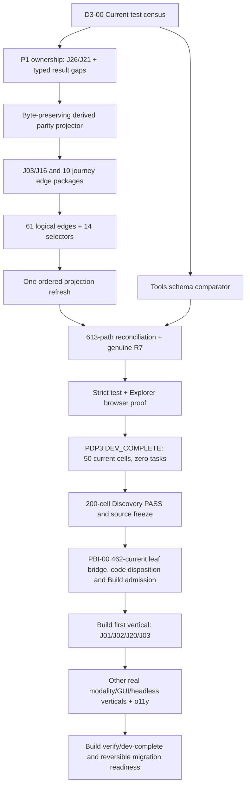

> **Applied to repository 2026-10-16** as a narrowly-scoped execution addendum to the controlling plans
> [MEDIA-DISCOVERY-PDP3-FINISH-2026-10-15.md](./MEDIA-DISCOVERY-PDP3-FINISH-2026-10-15.md) and
> [MEDIA-BUILD-COMPLETE-PRODUCT-PLAN-2026-10-15.md](./MEDIA-BUILD-COMPLETE-PRODUCT-PLAN-2026-10-15.md).
> It adds ordered execution steps and the D3-00 failure census; it is NOT a PDP phase exit or Build admission.
> Fresh census companion: [observations/media-discovery-pdp3-failure-census-2026-10-16.json](./observations/media-discovery-pdp3-failure-census-2026-10-16.json).

# Ghatana Media: PDP-3 DEV_COMPLETE → Complete-Product Build Plan
**Reviewed 2026-10-16 | Repository:** `samujjwal/ghatana-media` | **remote main:** `7bc723c150538001a111d3be13e254b405fea7ee`

> **Status:** REVIEWED PLAN / NOT A PDP PHASE EXIT / NOT A BUILD ADMISSION. This is a remaining-work **execution overlay**, not a competing product specification or another PBI backlog. The authoritative product definitions remain `.product-experience/pdp-0-product-truth/`, `pdp-1-domain-data/`, `pdp-2-design-interface-system/`, and `pdp-3-product-experience/`. Existing controlling plans remain `docs/implementation/MEDIA-DISCOVERY-PDP3-FINISH-2026-10-15.md`, `MEDIA-BUILD-COMPLETE-PRODUCT-PLAN-2026-10-15.md`, and `media-build-coverage-plan-2026-10-15.json`. On application to the repository, merge this into those plans or link as a narrowly-scoped execution addendum; do not maintain two independently editable inventories.

## A. Binding scope, reviewed facts and non-goals

**Current campaign:** 50 unique source/surface identities (26 physical candidates: 12 physical, 12 support-only, 2 subsumed; 6 semantic compositions; 1 root; 17 consumers, including 1 archived N/A), giving **200 PDP-phase cells**. PDP-3 defines **30 journeys, 130 steps, 147 action identities, 47 screen contracts, 61 intended logical channel edges, and 14 consequential selectors**. Prior PDP-0/1/2 technical exits are R15/R30/R19 on their dated cuts, *not a proof of unchanged currentness*. The most recent PDP-3 R6 observation is `UNKNOWN`: 613 referenced paths, 291 historical matches, 46 changes, 276 previously unpinned; 43 of 61 edges were source-bound definition-only, 18 required logical clarification across ten journeys (including two deliberately blocked J-21 rights-approval edges). All 61 transports remain `UNBOUND` and runtime `NOT_ADMITTED` by design during Discovery.

The **pasted review** describes an earlier 1,760-test suite with 72 failed assertions across 42 files and a six-file correction (146→147 actions; 144→145 derived effect/finality count); **that correction is now committed** on remote `main@7bc723c`. Its 66-failure residual is a reported expectation, *not a new execution result for the current remote HEAD*. No tests were executed from this planning environment; obtain a fresh deterministic census before claiming a count.

**Exclude from this campaign:** actual production feature coding before Discovery PASS; native PDP closure/convergence; independent specialist certifications or signatures; deployment, GA/release qualification, irreversible writer cutover. Do include *actual definition verification*, Explorer browser/accessibility behavior necessary to establish the described Explorer, and the **preparation** of the full Build implementation plan. Owner-reviewed internal semantic directions in `MEDIA-DISCOVERY-TO-BUILD-OWNER-REVIEW-2026-10-15.md` already settle J-21, J-26, J-27, J-16 and source ownership. Do **not** request these choices again absent a material change; do not fabricate an independent review.

**Never repeat without impact:** 30-file external R3 byte recapture where inputs are unchanged; completed J-27 PXD-163 source-envelope and J-16 authored fixes; historical PDP-0 R15/PDP-1 R30/PDP-2 R19 full recapture; 43 previously source-bound edge authoring; BASE-01…05 and other historically locally complete Build foundations. A real normative predecessor change warrants a *bounded successor* for impacted cells/dependents, not rewriting history.

## B. Prioritized and finite PDP-3 remaining work

Tasks use their controlling R2 identifiers so implementers can cross-reference machine register `docs/implementation/observations/media-discovery-pdp3-owner-r2-execution-2026-10-15.json`. All tasks below must finish before PDP-3 is labeled current `DEV_COMPLETE`. The table gives **what**, **where/how**, **dependencies**, and **acceptance**.

| Task / status | Concrete action (one owning writer) | Dependencies / actual proof |
|---|---|---|
| **D3-00 · OPEN — fresh source/test baseline** | Lock current `main` and toolchain, inspect clean state; run `node scripts/generate-media-phase-projections.mjs --check --strict`, `pnpm check:product-experience-local`, then reproducible per-file PDP source tests. Produce compact failure manifest `failingTestId → exact asserted field → normative owner (P0/P1/P2/P3 or generated/test) → material source ID → remedy`; compare with pasted 72/66 *without treating it as current*. Capture sha256 of input sources, test version, pass/fail, durations. | First; **100% current failures classified** (avoid treating concurrency flakes as semantic blockers). Do not alter source or baseline pins to satisfy stale assertions. |
| **D3-01 · OPEN — source graph and temporal-baseline audit** | Create a sorted unique 613-path **classification ledger** from immutable R6 and current material files: path, observed/prior hashes, `P0/P1/P2/P3/DERIVED/TEST/EXTERNAL`, meaning IDs, material/diagnostic role, affected cell(s), prior and current source identity, decision. Explicitly resolve 46 changed and 276 unpinned categories. Keep immutable R6/R15/R30/R19 intact. | Read-only in parallel with D3-00; **613/613 assigned**, no hidden paths or mass-repin of old observations. Complete ledger before R7. |
| **R2-D03-01 · OPEN — J-26 consent and erasure meaning** | Check owning `.product-experience/pdp-1-domain-data/{operations.yaml,owner-action-wire-contracts.yaml,authority.yaml,privacy.yaml}` and `pdp-3-product-experience/action-registry.yaml`. For exact consent/purpose/version/authority, distinguish request acceptance, *authoritative revocation acknowledgment*, access restriction, retention/legal hold, pending provider/backup cleanup, partial/unknown, and verified erasure. Preserve idempotent **same-request** reconciliation from `UNKNOWN`. Only change P1 normative contracts if the operation/result is genuinely absent; otherwise repair P1 `sourceEvidence` mirrors. | D3-00. Test exact request/result/guard/finality and J26 negative recovery; never infer worldwide deletion or revoked authority from accepted submission. If P1 meaning changes, log predecessor successor impact. |
| **R2-D03-02 · OPEN — J-21 rights query/actor/guard** | Reconcile P1 `operations.yaml`, `owner-action-wire-contracts.yaml`, `authority.yaml`, `privacy.yaml` with P3 `action-registry.yaml`, `step-guard-fact-contracts.yaml`, `step-guard-specialized-fact-contracts.yaml`, `journey-purpose-bindings.yaml`. Use exactly source-declared five actor roles and source-grounded read-only `QUERY`; assert wrong actor/tenant/scope/stale/expired/unknown deny. Preserve *both* J21 approval edges as explicit `BLOCKED_EXCLUDED` with visible unavailable UI state. | D3-00. Query never performs mutation/approval/publication; dedicated negative test. No missing external signature needed to **define** exclusion. |
| **D3-02 · OPEN — P1 results where actually missing** | Before any P1 addition, inventory each requested logical outcome in `pdp-1-domain-data/{operations,states,transitions,transition-guard-contracts,presentation-projections,events}.yaml`. Classify `EXISTS_AND_BOUND` or `SOURCE_CHANGE_REQUIRED` per J05 frame/region/model result, J08 exact metric pair, J10 conditioned generation, J13/14/19/28 terminal render/export/measurement/loss/ACK, J20 cancel and retry eligibility. Add only the minimum missing typed P1 operation/result/error/subject/version/authority meaning. | D3-00, R2-D03-01/02 for shared authority. Source-change log required only for true normative edits; status R30 historical remains truthful. |
| **R2-D03-03 · OPEN — exact source→mirror projector** | Implement or harden an **idempotent byte-preserving targeted projector** for three drifted actions `revoke-authorized-consent`, `review-rights-approval-and-format-effects`, `confirm-selected-fallback`. Treat `owner-action-wire-contracts.yaml` as P1-owned normative request/result semantics: change it only for an independently confirmed P1 source defect, **never** by copying P3 wording backwards. Project P1 `actionOperationDispositionInventory.sourceEvidence`, `.product-experience/interface-parity/operation-parity.yaml#typedUiActionSemantics`, P3 `step-definition-oracles`, screen action bindings, public taxonomy and generated handoff from their correct respective P1/P2/P3 owners. Use stable selector ID and a parsed range/AST patch that preserves all unrelated bytes; YAML stringify/parse round-trip that reformats 10k+ lines is disallowed. Source ownership: P1 operation and result, P3 action/step, P2 grammar; **never make parity a second normative author**. | R2-D03-01/02 and D3-02. Two successive projections byte-identical (second is no-op), three-action tests PASS, 147 action IDs preserved, PXD-163 remains distinct from historical PXD-075/PXD-078 and J29. Missing decision ID or wrong original request must fail. |
| **R2-D03-04 · OPEN — J-03/J-16 versioned speech states** | Update only necessary P3 `journey-contracts/transcribe-and-correct-captions.yaml`, `journey-purpose-bindings.yaml`, `step-version-binding-contracts.yaml` and oracle source, plus P1 if actually missing. Keep transcription accepted ≠ completed; session-local draft ≠ immutable caption version; aligned timebase/source/locale and same-authority version compare. Preserve J16 step02 `actionRef:null` non-dispatch choice and step03 exact versioned correction. | R2-D03-03. 130/130 step source grammar remains matched; J03 and J16 tests prove wrong tenant/version, stale timing, foreign source, timeout and recovery. |
| **R2-D03-05 · OPEN — Tools structural provenance** | Fix `tests/pdp-experience-public-taxonomy-tools-source.test.mjs` to compare the *actual historical and current effect/finality schema structures* against PXD-107, not literal `ghatana-tools` Git HEAD equality. Keep HEAD as provenance/diagnostic; strict schema enum/shape mismatch must still fail. | Independent after D3-00. Passing test with irrelevant Tools commits, failing test on material schema drift. No installed package/public boundary admitted by this check. |
| **R2-D04A…J · OPEN — 18 specific logical edges** | Complete the ten journey-local packages in subsection **C**; use P1 existing typed operation/results wherever available and P3 experience/negative/finality/unknown behavior where applicable. One integration writer owns the large `journey-channel-contract-bindings.yaml`; journey-local authors can work on disjoint `journey-contracts/*.yaml`. | R2-D03-03/04 and D3-02. 18 originally incomplete edge IDs addressed, 43 previously source-bound edges revalidated rather than recreated; no transport/runtime admission. |
| **R2-D05 · OPEN — 14 consequential selectors** | Reconcile `journey-transition-edge-bindings.yaml`, `step-definition-oracles.yaml` against P1 `transitions.yaml` and guards. Investigate J09 step09/J22 step02 receiving destination ACK, J20 step05 cancel result and step06 retry result. Bind real transition ID *only* when P1 machine actually defines it; otherwise explicit source-justified `NO_P1_MACHINE_TRANSITION` with typed same-subject outcome. Preserve J02 step03 guarded T01 and nine already scoped no-transition cases. | D3-02 / R2-D04 relevant journeys. **14/14 exact selectors** with authority/negative/UNKNOWN/recovery; no invented `CANCELLED`, provider ACK or generic terminal state. |
| **D3-03 · OPEN — canonical 61-edge integration reconciliation** | Consolidate the ten per-journey edits once, preserving all 61 IDs. For each edge record channel, actor, version/subject, P1 request/result, P2 presentation/transport grammar, P3 effect/finality/errors/negative state and sourced availability disposition; J21 2 intentional blocked cases stay present. Reject a `SOURCE_BOUND` label with a missing typed result, or omission of an unsupported channel. | R2-D04A…J, R2-D05. Current generated audit **61/61** with **zero unclassified mandatory logical gaps** (valid source-defined unavailable cases allowed); all transports stay UNBOUND and runtime NOT_ADMITTED. |
| **D3-04 · OPEN — one topological derived refresh** | After last normative source edit, regenerate only affected projections using owning scripts: `generate-media-phase-projections.mjs`, `generate-media-product-manifest.mjs`, `generate-media-pdp3-implementation-handoff.mjs`, `generate-media-lifecycle-source-inputs.mjs` *only where source-role inventory requires it*. Recompute artifact source pins/capability review/obligation and exact current-cut overlay as a **dependency DAG**, then update only current successor records. Preserve immutable R5/R6/R15/R30/R19 and dated migration source-claim observations. Never blanket-replace stale hash strings. | D3-03 and R2-D05. Targeted tests + projection `--check` pass; idempotent no-op rerun; source/derived/temporal statuses do not contradict each other. If a generator is nondeterministic, fix the generator, not expected hashes. |
| **R2-D06 · OPEN — authentic R7+ source currentness** | Fix hardcoded `'MEDIA-DISCOVERY-PDP3-CURRENTNESS-2026-10-15-R6'` in `scripts/record-media-discovery-pdp3-currentness.mjs`; accept validated caller-selected versioned observation ID, unique append-only path, explicit stable capture input. Use actual public `scripts/media-discovery-currentness.mjs` two-pass Lifecycle source capture; inspect membership/provider/journal continuity and use documented adoption protocol. R3 30-byte external recapture is **reused only if bytes and roles still match**. Emit new successor observation with exact affected predecessor P1/P2/P3 cells and reasoned change classification; don't edit frozen historical receipts or use current==current to assert history. | D3-01 and D3-04. No unexplained material/source membership drift, no missing required pin, 50 source-bound current PDP3 cells or exact genuine blocker; negative fixtures for stale pin, race, altered source, unknown external digest and journal reset. |
| **R2-D07 · OPEN — verification admission of definition cut** | Run focused P1/P2/P3 tests listed in subsection **D** using changed-path selection, then stable-cut broad suite with controlled concurrency. Triage each failing test: real P1/P2/P3 meaning, derived projection, immutable historical expectation, external provider precondition or runner/test isolation. Never weaken semantic or branch assertions. Capture concise fingerprinted test summary. | R2-D06; all applicable **definition tests PASS** (non-qualifiable runtime/provider tests remain separate and honestly labeled). No false phase acceptance from a snapshot. |
| **R2-D08 · OPEN — Discovery Explorer functional proof** | `apps/media-experience-explorer/src/` + `.product-experience/explorer/` must truthfully traverse root→composition→physical→consumer, PDP0/1/2/3 definitions, tokens/components/recipes and 47 screens, 30 journeys/130 steps, 61 logical channel edges, headless API/gRPC/SDK/CLI/event/Tool experiences, unavailable/denied/UNKNOWN/recovery, canonical search/deeplink. Test actual desktop/mobile keyboard/focus, contrast, reduced-motion, high-zoom/reflow, accessible names and no page errors. Explorer **must remain** read-only and visibly `CONTRACT_PREVIEW`/`LOCAL_SIMULATION`/`NOT_ADMITTED`. Use shared UI tokens; don't make new per-screen source of product truth. | R2-D07. `pnpm test:experience-browser` + matching Explorer source tests genuinely PASS; *independent professional a11y certification* is not a source-definition prerequisite. |
| **R2-D09 · OPEN — PDP3 exact-cut DEV_COMPLETE** | Issue append-only *technical phase exit* referencing current source IDs/fingerprint, successful R7+, deterministic checks and per-surface applicability. Join 50/50 (or explicit approved N/A, notably archived desktop) and prove **zero outstanding PDP-3 definition tasks**. Keep independent acceptance, native closure and runtime admission fields distinct and NOT_CLAIMED. Do **not** revise old `pdp-3-phase-dev-status.json` as if it were a new proof without verified current source. | R2-D07/08. New PDP3 `DEV_COMPLETE` technical record represents exact current source, no UNKNOWN material. |
| **R2-D10 · OPEN — all-PDP Discovery handoff** | Reconcile all **200 PDP0-3 cells**, R15/R30/R19 or **scoped successor** where normative changes actually affected predecessor phases, and new PDP3 exit; freeze material source graph and generated implementation handoff as **definition input only**. Keep Build admission and implementation separate. | R2-D09. `DISCOVERY=PASS` and 0 definition tasks are *proven*. Only then may Build Plan Implementation be **entered**, followed by actual coding. No native closure in this plan. |

### C. The ten D-04 edge authoring packages: do exactly these, not 61 reworks

For each, edit `.product-experience/pdp-3-product-experience/journey-contracts/<named-file>.yaml`, then a single coordinator synchronizes `.product-experience/pdp-3-product-experience/journey-channel-contract-bindings.yaml`; inspect the owning P1 operation/result before adding one. The numbers are R6 historical **incomplete logical edges**, not runtime endpoint counts.

| ID / journey / edges | Exact contract location (under `journey-contracts/`) | Necessary semantic and negative path |
|---|---|---|
| **D-04A J05 (3)** | `analyze-image-video-geometry-and-tracks.yaml` | Exact artifact/frame/region/rational timebase, provider/model identity + confidence/uncertainty + same-job terminal analysis; reject swapped artifact, malformed geometry, merely accepted submission. |
| **D-04B J08 (1)** | `repair-video-with-measured-quality.yaml` | Immutable original/candidate pair, nonempty unique metric refs, common evaluator/units/algorithm provenance; reject stale candidate, empty metrics or substituted evaluation. |
| **D-04C J10 (1)** | `generate-from-references-and-review-continuity.yaml` | Source/geometry/control-conditioned request, qualified provider availability, versioned output and nonterminal preview distinction; no fabricated output when model unavailable. |
| **D-04D J13 (1)** | `animate-3d-scenes-and-characters.yaml` | Scene/rig version, terminal render/export identity and typed coordinate/rig loss report; reject incomplete render and preview-as-export. |
| **D-04E J14 (2)** | `explore-domain-simulation-and-review-measurements.yaml` | Typed input and measurement units, fidelity/tolerance, terminal result, actual host/consumer authority; reject foreign simulation run and unknown fidelity. |
| **D-04F J19 (1)** | `inspect-quality-and-optimize-within-bounds.yaml` | Source→bounded successor candidate→post-render result, provenance and before/after improvement; acceptance != output. |
| **D-04G J20 (2)** | `long-running-job-observation-and-recovery.yaml` | Cancel deadline/guard/typed result; cancel requested != cancelled; retry allowed only by classified prior attempt + current rights/resources/budget; forbid replay after UNKNOWN or late provider receipt. |
| **D-04H J21 (2)** | `review-exact-version-and-recheck-changes.yaml` | Authorized read-only rights query plus two explicit `BLOCKED_EXCLUDED` approval-mutation edges; rejected approval must be apparent in experience. |
| **D-04I J26 (3)** | `delete-or-revoke-media-with-visible-lifecycle.yaml` | Separate revocation request, owner ACK, access restriction, legal hold/retention, partial/unknown and verified-copy erasure; deny implied universal deletion. |
| **D-04J J28 (2)** | `export-spatial-media-with-format-loss-reporting.yaml` | Exact source/render output version, conversion/coordinate loss report, same-subject recipient ACK; no submit-render=completed-export confusion. |

### D. Test and artifact gates (source semantics, not closure)

**Fast preflight at the current source cut** (read-only/check-only): `node scripts/generate-media-phase-projections.mjs --check --strict`, `pnpm check:product-experience-local`, `node --test tests/pdp-experience-action-inventory.test.mjs tests/pdp-ui-action-local-semantics.test.mjs tests/media-pdp3-j27-fallback-action-binding.test.mjs`.

**After specific source fixes:** run owning test files for consent/rights (`tests/media-pdp3-j26-consent-and-erasure-boundaries.test.mjs`, `tests/media-pdp3-j21-review-decision-evidence.test.mjs`), journey channels (`tests/pdp3-journey-channel-contract-bindings.test.mjs`), 14 steps (`tests/media-pdp3-mdc30-s-step-bindings.test.mjs`), J20/J22 (`tests/media-pdp3-j20-cancel-retry-branch-evidence.test.mjs`, `tests/media-pdp3-j22-destination-acknowledgment-binding.test.mjs`), P1 typed parity (`tests/pdp1-owner-action-wire-contracts.test.mjs`, `tests/pdp-design-interface-parity.test.mjs`), and source-currentness (`tests/media-discovery-pdp3-currentness-recorder.test.mjs`, phase-impact tests). These paths are verified present in the review/source inventory; recheck filenames on checkout before running.

**Stable source cut only:** recompute source manifest and status once in topological order, run broad test suite with controlled concurrency plus checks, then **actual** `pnpm test:experience-browser` and Explorer tests (`media-explorer-physical-topology`, `media-explorer-canonical-id-search`, `media-explorer-task-first-navigation`, `media-experience-explorer-accessibility`, `media-explorer-verification-interface-boundaries`). Capture only source fingerprints, command/env, summarized case results, failure references and bounded browser artifacts. Do not re-store media or full logs after each attempt.

**Fail phase exit on:** any unexplained normative source byte change, P1/P2 semantic predecessor impact unreviewed, 61-edge incomplete intended contract without approved explicit unavailable behavior, undefined one of 14 selectors, stale immutable currentness pin, missing applicable PDP3 surface, undeclared negative path, nonworking Explorer contract routing, failure to distinguish request/ACK/finality, or any remaining actual PDP-3 source task.

## E. Complete-product Build planning: extend the one existing PBI-00…15 DAG

**Important separation:** The tasks in this section can be **designed/documented now**. Runtime code changes, actual Build phase entry and runtime test claims are **after** R2-D10. Build preparation uses PDP0–3 as immutable source truth; it does not create additional PDP source work. Keep `docs/implementation/MEDIA-BUILD-COMPLETE-PRODUCT-PLAN-2026-10-15.md` as the canonical 16-package plan and add the following exact work-unit/detail fields inside it, rather than creating new competing PBI IDs.

### E1. Mandatory source-derived reconciliation before implementation (PBI-00)

1. **BPL-01 — freeze source-specific Build input**. Read phase-current PDP0 capability/requirements/actors/NFR/policy and channel inventory; PDP1 operations/state/result/error/event/provenance/retention; PDP2 GUI+headless grammar/components/tokens/accessibility; PDP3 all journey/action/screen/channel/negative cases. Record stable source ID + semantic fingerprint, not a commit SHA as truth. 50 identity and 200-cell applicability map stays authoritative.
2. **BPL-02 — generate complete capability bridge**. From `.product-experience/pdp-0-product-truth/{capability-leaf-review,capabilities,requirements,applications-channels}.yaml` produce `media-build-capability-coverage.v1.json` with **one row per exact currently applicable `capabilityIntentId`**. Historical population 462 (77 journey, 383 machine, two external/platform) is informative; recompute live. Fields: requirement; source hash; meaning class; actor/tenant/policy; P1 operation/typed request/result/error/authority/state; P2 UI/headless consumer grammar; P3 journey or machine experience; physical surface and consumers; single lead PBI ID; source implementation module + existing symbol/route; code disposition; provider/public dependency admission; positive/deny/UNKNOWN/recovery/security/performance test IDs. Reject duplicate/orphan/unsupported mappings and unsupported N/A.
3. **BPL-03 — inventory actual code and source authority across both repos**. Produce machine-readable **symbol/entrypoint-level** current-code inventory from `ghatana-media` and authoritative `ghatana/services/media` (Java, Rust, TS, SQL, OpenAPI, protobuf, Docker/Gradle and binaries). Resolve Git/file fingerprints and owning build coordinate; record currently used production host, route/ABI/API, database ownership and consumers. Never assume the destination's duplicate code is the live canonical runtime. Cross-check source registry, `migration/source-inventory.yaml`, `migration/consumer-inventory.yaml`, 47 historical tasks, and code test coverage.
4. **BPL-04 — build one exact ADD/UPDATE/REUSE/REMOVE/MOVE decision per implementation unit**. Compare BPL-02 intended contract and BPL-03 executable implementation. Classification: `REUSE_VERIFIED`, `UPDATE_IN_PLACE`, `ADD_MISSING`, `CONSOLIDATE_DUPLICATE`, `REPLACE_WITH_MIGRATION`, `REMOVE_AFTER_CONSUMER_ZERO`, `BLOCKED_EXTERNAL`, `ARCHIVE_ONLY`, `NOT_APPLICABLE_APPROVED`. Require `why`, normative source refs, code target, dependencies, actual consumer references, negative scenarios, migration plan and test. Never guess from filenames. A **missing required product capability cannot be classified merely as "future"** to pass Build.
5. **BPL-05 — preserve the one PBI hierarchy and split into bounded vertical commits**. Each of the 16 existing PBI-00…15 packages receives work-unit IDs with inputs, owned paths, action (add/update/reuse/remove), test design, dependency, code-review, cost/performance and rollback disposition. Route old BASE/SUR/DEP/MIG/RUN/EXP tasks into those IDs rather than creating another backlog. ACC/LC belong outside this requested scope; REL belongs to Delivery. Do not duplicate already locally complete BASE-01…05.
6. **BPL-06 — prove interface and module boundaries**. Single source and writer for effect state, DTO semantics, UI tokens and event authority. Media owns frame/scene/timebase/track/version/rights-specific semantics; Shared owns generic primitives/outbox/observability/design components, Data Cloud generic read-model/data governance, Event Plane durable delivery, AI Inference provider governance, DI generic OCR/extraction; consumers use public versioned API only. Architecture dependency lint must reject private cross-repo imports, two executable writers and parallel hand-maintained DTO copies.
7. **BPL-07 — Build Plan Implementation gate**. Once Discovery PASS, regenerate BPL-02/BPL-03 against the **frozen exact source cut**. `source-capability → unique PBI lead → exact owner/path/action/tests` must cover 100% of applicable leaves, 50 surface identities, 30 journeys, 47 screens, all intended machine capabilities, 61 defined edges and 47 old task IDs. Then enter `KDEV-STAGE-PLAN-IMPLEMENTATION` through authentic stage mechanics. *No production coding before this condition.*

### E2. PBI work package instructions — exactly what to do to existing code

The path lists here are **actual repository modules observed**, not a claim that their current implementation is ready. Production-authoritative writer remains `samujjwal/ghatana:services/media` until a separately authorized reversible MIG-04 cutover. Destination code in `ghatana-media` is a migration/verification candidate. Choose exact files/symbols from BPL-03 before modifying.

| Existing PBI / prereqs | REUSE + UPDATE / ADD (where, how and verification) | REMOVE / RETIRE decision |
|---|---|---|
| **PBI-01**; PBI00 | Reuse `launcher/`, `runtime-contracts/`, root `build.gradle.kts`, `settings.gradle.kts`, `Cargo.toml`, pnpm workspace, migration inventory. Compile canonical Java/Node/Rust/proto/UI **without excluding `compileJava`**, reproduce dependency lock, generated client/ABI and artifact-only source-free build. Pin upstream public APIs and license/security supply chain; dev composites explicitly TEST_ONLY. | Retire duplicate build/alias only after exact compile and consumer parity, not while it is the production writer. |
| **PBI-02**; PBI01 | Reuse `runtime-contracts/`, `contracts/openapi/media.yaml`, `config/route-manifest.json`, modules' proto, `libs/audio-video-types` and `libs/audio-video-client/src/{operations.ts,canonical-routes.ts}`. **Update** typed wire schemas from P1 and channel grammar from P2/P3; generate or validate clients/SDK; formalize bounded canonical errors, field/enum evolution, deadlines, version/idempotency/finality/UNKNOWN, authenticated/public route bindings. Check all observed routes and semantic parity. | The legacy `/api/v1/media/*` client in `operations.ts` is compatibility code: remove **only after** replacement route/SDK usage, negative and backwards-compatibility migration tests are proven. Do not create an independent DTO owner. |
| **PBI-03**; PBI02 | Reuse `launcher/`, `modules/infrastructure/security/`, typed client and source-defined J01. **Update** real principal/tenant/workspace/authz/consent membership and project create/read with idempotent readback. Test forged header, wrong tenant, stale rights and uncertain create; Shared public identity handoff must be qualified or fail closed. | Remove development identity stubs/parallel auth engines from live path after host ownership and consumer proof. Explorer synthetic identity remains isolated. |
| **PBI-04**; PBI03 | Reuse `providers/aws-postgresql/`, `modules/infrastructure/{persistence,security,cache}`, `adapters/ledger`, `launcher/`; inspect V008, `registerDerived()` candidate. **Update** resumable chunk upload, exact hash/scan/quarantine, artifact version/lineage DB transaction and retention/holds, atomic object-store reconciliation. Test real PostgreSQL+object store, crash, duplication, scanner deny and tenant leak. | Consolidate duplicate artifact persistence only after one canonical writer, live readers and rollback evidence. |
| **PBI-05**; PBI04 | Reuse runtime job/attempt/cancellation/recovery, `providers/aws-postgresql` V006 and jobs, P1 machines. **Update** lease/fence/CAS/attempt snapshots, receipt reconciliation, no retry from UNKNOWN, cancellation request ≠ terminal, J27 same-job fallback selection ≠ dispatch, J29 session/consent restoration. Test multi-worker PostgreSQL/restart/late receipt. | Retire optimistic UI/internal job finality or in-memory-only semantics as production **after** exact consumers switched; keep test doubles in test scope only. |
| **PBI-06**; PBI05 | Reuse messaging/outbox V012, `modules/infrastructure/messaging/`, Shared `OutboxPublicationSource`/`ClaimedOutboxPublisher` **public** SPI. **Update** atomic state/outbox transaction, claim/lease, bounded backoff/dead-letter, consumer idempotency, broker vs consumer ACK status. Prove crash/replay on PostgreSQL. | Remove `ConcurrentHashMap`/volatile production publisher and duplicate event bus only after consumer migration and restart tests. |
| **PBI-07**; PBI05/06 | Reuse `modules/speech/stt-service/`, `modules/intelligence/speech/libs/speech-audio-rust/`, candidate V011 transcript revisions, `libs/audio-video-ui/src/screens/TranscriptCaptionScreen.tsx`. **ADD/UPDATE** authorized STT profile, timing/diarization/locale, exact artifact version → transcript version → local caption draft → guarded immutable caption result and compare, typed errors and UI/headless view. Distinguish admission from provider completion. | Replace fixture-only speech path with guarded adapter without deleting deterministic Explorer simulation fixtures. |
| **PBI-08**; PBI05/06 | Reuse `modules/speech/tts-service/`, `modules/audio-streaming/`, AI voice UI/Rust candidates and Shared controls. Implement J04 TTS, J07 cleanup, J16 dubbing/translation and J17 effects/master *per defined capabilities*, exact timebase/version/rights/model/locale, bounded streaming/backpressure. Actual voice clone remains fail-closed absent special authority. | Consolidate legacy AI voice UI/processor only if source-correct current public consumer confirms replacement; no duplicate model router. |
| **PBI-09**; PBI05/06 | Reuse `modules/vision/vision-service/`, `modules/intelligence/multimodal-service/`, `modules/video-streaming/`, visual contracts. **UPDATE/ADD** J05 precise geometry/frame/track/model/confidence, J06 grounded multimodal, J08 measured before/after video repair, J11 region edit/undo. Use AI Inference and DI **public** interfaces for generic model/OCR functions; quality and errors scoped per profile. | Retire in-Media generic OCR/parser or model-router clones only after public-boundary parity and licensing/provider admission. |
| **PBI-10**; PBI05/06/09 | Extend Media creation/render adapters and `runtime-contracts/`, `launcher/`, video modules and UI; **ADD** missing J09/10/12/13/14/15/18/19/28 engines/connectors only where source capability is required. Exact source/version, scene/rig/coordinate/timebase, simulation units/fidelity, render/output/provenance/loss, same-subject delivery ACK. Real runtime work is not satisfied by Explorer procedural previews. | Remove duplicate media renderer/generic engine only after outcome parity, license check and safe artifact migration. Don't invent a wholesale new engine when adapters suffice. |
| **PBI-11**; PBI02/03/04 | **REUSE** `libs/audio-video-ui` components/ports, `MediaProductRenderer`, PDP2 design tokens/recipes and Explorer shared view definitions. **ADD/select** a genuine production/embedded GUI host and routed authorized data/action ports. Current renderer has 12 `LOCAL_SIMULATION` and 35 `CONTRACT_PREVIEW` screens, **0 admitted product routes**. Convert all 47 applicable contracts to authorized functional host routes in incremental families; preserve honest unavailable states. One design system, reusable components, responsive/RTL/accessibility, visual regression and actual error recovery. | Keep `apps/media-experience-explorer` as inspection tool (not product login/runtime); prevent duplicate business logic or per-screen CSS/tokens. Retire preview aliases in production only when live path is proven; preview tooling remains. |
| **PBI-12**; PBI02/03/05 | Reconcile source-declared HTTP/gRPC/SDK/CLI/events/Agent/integrations using `contracts/openapi/`, protobuf, `libs/audio-video-client`, `modules/infrastructure/messaging/`, `.product-experience/pdp-3-product-experience/{api,grpc,cli,events,agent-tools,services}/`. Observations include **27 HTTP operations, 43 RPCs, 11 planned CLI commands and 4 Agent Tool contracts**; **do not treat these inventories as admitted endpoints**. Implement exact bounded adapters + typed parity, `UNKNOWN` and error behavior, no agent self-authorizing effects, SIGINT/request-only cancellation, safe JSON output. | Remove legacy transport aliases only after proof of all consumers and compatibility; don't implement separate business semantics per transport. |
| **PBI-13**; PBI03/04/05/06 | Reuse `runtime-contracts`, `launcher`, persistence/security, UI rights/review. Implement J21 read-only review with blocked approval unless owner authority exists; J22 receiving-party ACK separately from send; J23 offline exact-version conflict/replay; J26 revocation/hold/retention/partial and verified deletion source states. Test wrong-recipient, delayed ACK, revoked consent, backups/provider copies and partial/UNKNOWN. | Never remove hold/retention audit history, overstate deletion, or expose an unauthorized approval path. |
| **PBI-14**; PBI01, throughout | Reuse `tests/`, `integration-tests/`, `benchmarks/`, `audio-video-observability/`, `monitoring/`, `prometheus.audio-video.yml`, `docs/OPERATIONS.md`. **ADD/UPDATE** end-to-end OpenTelemetry request→guard→artifact→job→provider→outbox→consumer spans; low-cardinality/redacted metrics, error/finality dashboards, alarms and runbooks. Derive numeric targets from PDP0 NFRs and measured source/version/profile baselines; test p50/p95/p99, startup/queue, multi-worker concurrency, DB indexes, GPU/CPU/memory, stream jitter, media quality, fault/chaos, retention/store growth, tenant fairness, cost/energy, a11y. Rootless test rigs where valid; real GPU/provider quality only on admitted hardware. | Remove unbounded/high-cardinality telemetry and redundant giant evidence copies; **never** log media bytes, access tokens or PII. |
| **PBI-15**; PBI02/05/14 | Reconcile `migration/{source-inventory,consumer-inventory,contract-compatibility,path-map,transfer-exceptions}.yaml`, existing route/schema/DB/data/SDK consumers in *both* repos, deployment/infra. **PLAN AND TEST** reversible source and writer migration and rollback; qualify immutable published dependencies/license/SBOM, contract and data parity, shadow/reverse read. Actual authoritative writer switch is **separately authorized cutover**, not a side effect of copying files. | Mark stale/duplicate modules `REMOVE_AFTER_CONSUMER_ZERO` rather than deleting them while source/consumer truth is ambiguous. |

### E3. Execution order once Build is admitted

**Foundation** `PBI-00 → PBI-01 → PBI-02 → PBI-03 → PBI-04 → PBI-05 → PBI-06`, with **PBI-14** starting at PBI-01.

**First governed vertical (must produce a real readback):** J01 identity/project → J02 upload & immutable artifact → J20 job/unknown/cancel/retry → J03 STT/transcript/caption, including PBI-11 real UI or applicable PBI-12 headless view. Every vertical must include positive, denied, timeout/UNKNOWN, stale or swapped version, wrong tenant, idempotency, crash/restart, observed finality and OTel trace. Without admitted live provider, keep that vertical clearly partial; progress on independent capabilities.

**Parallel capability-family expansion:** PBI-08 speech/audio; PBI-09 vision/multimodal; PBI-10 creation/render; PBI-11 real GUI/embedded route conversion; PBI-12 machine channels; PBI-13 rights/offline/delivery/erasure. Assign disjoint code owners and a shared runtime-interface contract. Max two to three concurrent heavy writers (serialize DB migrations, canonical route/OpenAPI/protobuf writers, large registries and production host bootstraps).

**Consolidation:** PBI-14 integration/security/reliability/load/soak and PBI-15 public artifact and reversible migration readiness. The definition of actual Build `DEV_COMPLETE` is **all source-required, applicable capability leaves**, 30 journeys and all relevant machine capabilities actually supported or explicitly approved out of scope, with positive/denied/unknown/recovery, traceability, quality and qualification. No native PDP closure work is specified by this plan.

### E4. Repeatable per-leaf implementation card (required for each of 462-current capabilities)

- **Stable key:** `<capabilityIntentId> / <requirementId> / <operationId> / <source fingerprint>`, one lead PBI and phase/surface owner; links to J or machine-only experience and 50-identity topology.
- **Reuse audit:** existing exact repository/module/symbol/route + SHA, tested behavior; source-required gap, present consumer(s), dependency version and public admission status.
- **Disposition:** reuse, modify, add adapter, replace with migration, remove after consumer-zero, externally blocked with truthful failure, or approved N/A (with owner rationale). Record *why* for each.
- **Implementation:** one small owned code diff for canonical host; typed input/output/error/authority/finality; migration/backwards compat/rollback if schema changes. No shadow implementation with same writer.
- **Proof cases:** real happy path, cross-tenant and policy denial, stale/wrong version, idempotent duplicate, timeout/UNKNOWN and same-request reconcile, late ACK/restart/replay, profile/data/cost/a11y/SLO checks where applicable.
- **Incremental finish:** compile/build + targeted tests pass; contracted producer and consumer agree; no omitted source intent; source/route/renderer parity; current code disposition updated; only changed dependencies retested.

## F. Dependency map, nonduplication and decision constraints

**Single source of responsibility**:
- P0: intent, requirements, capabilities, actors, policy, nonfunctional meaning.
- P1: canonical Media object/version/operation/result/state/event/security semantics.
- P2: design system and consumer/interface grammar, including non-GUI contracts.
- P3: action, screen, journey, safe decision/negative/recovery and channel-specific experience.
- Generated `operation-parity`, source manifests, Explorer specs, implementation-handoff and Build coverage are *derived*, never new authorities.
- Existing `ghatana/services/media` runtime remains authoritative writer until real authorized migration. `ghatana-media` destination tests may run, but no second live writer.

**Blocker rules**:
1. **Definition defect**: repair owning earliest PDP, scoped successor/revalidation, no closure task.
2. **Derived/source hash mismatch**: regenerate and version new current observations; never rewrite append-only history or pin to current content simply to silence a test.
3. **External authority unavailable**: define honest denial/unavailable contract in PDP and unblock unrelated definition work; keep actual affected Build operation `BLOCKED_EXTERNAL`/`NOT_ADMITTED`.
4. **Implementation/provider/host missing**: goes in the PBI unit, not the PDP-3 DEV_COMPLETE queue.
5. **Independent PDP acceptance, native Lifecycle closure, commercial/model release certification and Delivery**: explicit separate lanes, **excluded here**.
6. **Existing deprecated/duplicated code**: no deletion until actual caller/import/endpoint/schema/data consumer inventory proves zero dependence and tested replacement/rollback; archive only if history is required.

## G. First implementer batch (no re-review loop)

**Batch 1 — immediate, Discovery only:** D3-00 test census; D3-01 613-path owner graph; read-only inspection of J21/J26/J20 and projected 3-action drift; Tools comparator source inspection. Deliver compact failure manifest + source authority patch set with one approved owner per normative path. **Do not run a full wide suite per edit.**

**Batch 2 — semantic repairs:** P1 exact missing result/consent/rights contracts; 3-action surgical projection; J03/J16; D-04A…J disjoint journey files; R2-D05 14 selectors. After each group run its own tests and produce a change-impact fingerprint (not a new R7).

**Batch 3 — converge source graph exactly once:** single writer merges 61-edge registry, validates 47 screens and headless experiences, topological generated projections; 613-path successor classification; honest source-currentness adapter recapture with versioned R7+ append-only observation.

**Batch 4 — definition completion:** strict/focused/broad tests and actual Explorer/a11y browser checks; 50 PDP3 cells current; zero definition task IDs; record PDP3 DEV_COMPLETE and 200 PDP-cell Discovery PASS if truly satisfied.

**Parallel planning-only Batch P:** draft PBI-00 current-code inventory template and bridge generator, inspect `ghatana/services/media` versus destination, prepare ADD/UPDATE/REUSE/REMOVE decision schema and per-leaf tests, extend existing PBI-01…15 with owned code work. **Do not begin runtime Build coding until Batch 4 actually passes.**

**First Build batch after admission:** source-free compile + typed contracts/auth, then J01/J02/J20/J03 as one real verified vertical. Incrementally dogfood runtime, GUI and headless implementation against PDP source and reuse existing artifacts. Closure is intentionally not part of the scope.

## H. What this review did and did not do

**Did:** read the supplied 832-line review; inspect accessible GitHub `main@7bc723c`, `AGENTS.md`, R2 execution register, PDP3 finish/owner decisions, full-product PBI plan and coverage JSON, present registries, relevant verification scripts, product renderer/client/Explorer/simulation and canonical `ghatana/services/media` location. Verified that the latest commit only changes six tests; discovered 12 locally simulated/35 contract-preview GUI screens, no live admitted route according to `MediaProductRenderer`, historical 462-leaf bridge not yet completed, and R7 PDP3 source exit absent in listed observations.

**Did not:** execute local repository tests, perform a current real R7/Lifecycle two-pass capture, inspect all source file bodies recursively, obtain runtime/provider admission, make an independent qualified approval, commit files to remote GitHub, or declare PDP/Build completion. Those are not implied by this planning artifact.
