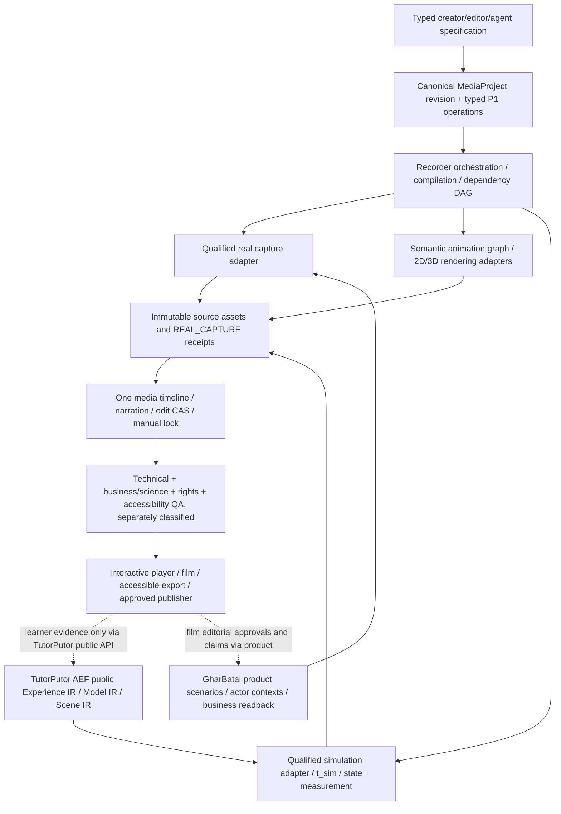

# Media unified production — live source reconciliation and implementation handoff

**Cut under review:** Media main `fe6bc15edf1c1ace6c5f47c4aa5c67053c85335d` (merged PR #17), successor branch `codex/media-declarative-pdp0-pdp3-adoption-20261018`.  
**Disposition:** SOURCE-AUTHORED / DISCOVERY SOURCE-CURRENT VERIFICATION REQUIRED. This file is a derived navigator and execution prescription, **not** another requirement authority, build admission, real solver validation, film approval, human signoff, or completed PDP receipt.

## Controlling sources and source priorities

1. Canonical Media meanings: `.product-experience/pdp-0-product-truth/{requirements.yaml,capabilities.yaml,recorder-studio-extension.yaml,time-units-fidelity.yaml,quality-policy.yaml}`.
2. Media domain and executable-contract *definitions*: `.product-experience/pdp-1-domain-data/{domain-objects.yaml,value-objects.yaml,operations.yaml,recorder-studio-contracts.yaml,declarative-production-contracts.yaml}`.
3. Shared UI/machine experience: `.product-experience/pdp-2-design-interface-system/{animation-simulation-grammar.yaml,recorder-studio-interface.yaml,component-contracts.yaml}`; exact actions/results come from PDP-1 and design system comes from Shared.
4. Scenario/preview experience: `.product-experience/pdp-3-product-experience/{recorder-studio-experience.yaml,declarative-production-experience.yaml,journey-contracts/,screen-contracts/}` with canonical registry, fixture and Explorer authorities. J-12/J-13/J-14/J-15 remain authoritative reused journey candidates; a candidate reuse reference is *not* an accepted step/channel binding.
5. Existing implementer plan: `docs/implementation/MEDIA-BUILD-COMPLETE-PRODUCT-PLAN-2026-10-15.md`, PBI-00…PBI-15. This handoff does not create a second Build scheduler.
6. First consumer's *sole active* execution queue: `samujjwal/gharbatai/docs/demo-recording/EXECUTION-CHECKLIST.md`. Gharbatai owns exact scenarios, storyboard, business proof, source-source sufficiency, consent, actors and human editorial approval; Media owns reusable recorder mechanics and media/animation/solver-adapter interfaces.

**Inputs reconciled, not copied into canonical product truth:** user's October 17 `ghatana-media-unified-data-driven-production-blueprint-2026-10-17-v3(1).md` (1386 lines; original feature taxonomy, license decisions, M-00…15, INV-01…12, DAS-01…12, C-01…28, DAS-A01…18 and additional 73-scope audit) and `GharBatai_Professional_Demo_Master_Plan_v2_2026-10-17.md` (730 lines; DX-01…32, G01…G24 and real seven-scene source-visibility and reviewer gates). Preserve these immutable source input files outside the runtime truth; the source-authoritative features and tasks are mapped below.

## The media/consumer ownership topology



The synthetic `libs/media-experience-simulation` supplies PDP Explorer fixtures *only*: it is neither GharBatai live-business proof nor a scientifically validated solver. Provenance mode has five distinct types: `REAL_CAPTURE`, `DECLARATIVE_ANIMATION`, `MODEL_SIMULATION`, `GENERATIVE_MEDIA`, `PDP_SYNTHETIC_FIXTURE`.

**Surface hierarchy:** `media.surface.recorder-orchestrator → media.surface.cli`; `media.surface.capture-adapters → media.surface.integrations`; `media.surface.production-studio → media.surface.web`; `media.surface.interactive-demo-player → media.surface.embedded`. Preserve historical 26 physical candidates, 7 compositions and 17 old consumers; four newer logical consumers yield 54 proposed entities × 4 PDP phases = 216 **proposed** cells, not accepted cells. No new project DB, queue, writer, physical package or top-level product.

## Reconciled full-scope feature audit

The user-supplied original 428 audit-local feature IDs cover the **complete 22-domain inventory** shown below. The 73 more focused audit checks expand, but do not overwrite, the 428. **Audit IDs are review targets, not PDP-0 requirement IDs.** Existing 38 Media requirement families and 462 leaf capabilities retain authority. The 61 newly authored source-owned declarative cases are acceptance specializations, not replacements for the full 501-feature audit. Do not assert 501/501 exact machine-ID crosswalk until it has been produced and validated.

| Audit domain | Original count | Canonical Media owner direction | Implementation emphasis |
| --- | ---: | --- | --- |
| SPEC | 20 | recorder-orchestrator / recipe / job / project | Typed YAML/JSON AST, planning, DAG, dry-run, policy |
| CAP | 28 | capture-adapters / stream and source capabilities | Browser/desktop/mobile/API/CLI, events, leases and recapture |
| ASSET | 19 | production-studio / artifact + project | Immutable source, relink, proxy, timecode, bounded cache |
| EDIT | 28 | production-studio / 52 PDP-1 edit kinds | NLE, CAS, locked edits, cross-channel undo and import |
| COLOR | 17 | production-studio / color + quality | Scopes, ACES/HDR, pixel depth, safe captions and grade |
| ASR | 20 | speech capabilities | Local/streaming STT, diarization, timestamps, correction |
| TTS | 24 | speech capabilities | Voice profiles, expressive TTS, audiobooks, provenance |
| CLONE | 17 | rights + governed voice model | Explicit speaker consent, identity/impersonation and erasure |
| DUB | 17 | speech + caption/edit | Time-aligned locale, lip sync optional under rights |
| DSP | 20 | master audio + edit | Waveforms, mixing, loudness, DSP and plugin isolation |
| MUSIC | 15 | generate-audio + rights | Admitted music/foley only, similarity/originality review |
| GEN | 28 | generate image/video and model governance | Model/seed provenance, safe GPU/codec and variants |
| VISION | 18 | vision/multimodal + DI handoff | Tracking, OCR, masks, face-safe composition |
| MOTION | 16 | animation / scene + animation graph | Declarative 2D/3D, keyframe, math and no unsafe scripts |
| DIRECT | 21 | orchestrator / governed agent tools | Agent as typed editor, creative plan, source-grounded claims |
| SOCIAL | 14 | compose/deliver + production-studio | Marketing derivative formats and protected brand |
| INTER | 11 | interactive-demo-player | Offline sandbox, hotspots, learning-safe interactions |
| COLLAB | 13 | project/edit/review | Digest/version-bound comments and approvals |
| DELIV | 24 | renderer/deliver | Qualified codec, OTIO, C2PA, separate publish ACK |
| QA | 17 | quality + rights/provenance | Decoded film/scientific/domain/source truth independent |
| TRUST | 19 | rights/privacy/provenance | Consent, retention, tenant isolation, anti-injection |
| OPS | 22 | job/source and AI Inference | CPU/GPU scheduling, telemetry, cancellation, retry and quotas |
| **Total** | **428** | **Preserve all original audit IDs** | **Source-to-feature crosswalk still requires exact audit-local per-ID row reconciliation** |

The blueprint's 73 add-on checks comprise 12 Recorder-specific, 17 animation, 22 simulation, 12 TutorPutor and 10 common/cross-cutting. The 12 Recorder checks reuse the existing **84** Media Recorder clauses; the other 61 are now specialized directly under the Media PDP-0 requirement file as `MEDIA-DECL-P0-AC-001…061`, with source-bound PDP-1, PDP-2 and PDP-3 companion definitions. They must not be mistakenly advertised as satisfying the entire 501-audit without individual crosswalk.

## Four-phase definition completion — exact next proofs

| Phase | Already authored successor | Necessary *remaining* work before successor DEV_COMPLETE |
| --- | --- | --- |
| **PDP-0** | 84 Recorder clauses; 61 new declarative clauses; existing 38 families/462 leaves; actor, rights, fidelity and surface bindings | Native strict YAML/duplicate keys + semantic and adversarial test; exact old/new leaf-to-case truth review; map all 501 audit candidates or explicit inapplicability/unavailable; validate history unaffected; obtain a source-current accepted P0 development receipt |
| **PDP-1** | Existing domain objects/operations and 52 edits; 61 additional case-to-operation references in `declarative-production-contracts.yaml` | Confirm each existing operation's full request/result schema, legal effect, CAS/UNKNOWN, model/solver units, time/checkpoint, privacy; bind 15 Recorder proposals without invented routes; qualify numerical solver separately; rerun exact P1 handoff tests and currentness |
| **PDP-2** | Existing 13 Studio workspaces, design system, recorder interface, extended animation/simulation grammar and 61 interface intents | Cross-check all 61 intents against actual component templates/recipes, GUI/keyboard/text and machine channel equivalence, no fake GUI, reduced-motion/RTL/mobile/accessibility and denial states; verify source-current P2 status |
| **PDP-3** | 84 Recorder PDP-3 steps plus declarative experience proposals and current J-12…J-15 contracts | Bind 61 P0 cases to exact existing journey steps, action registry, canonical screen/CLI/API/SDK and player contracts, positive/negative/UNKNOWN/recovery fixture; prove Explorer parity and native surface-cell source currentness; only then accept P3 |

**Key distinction:** the checked-in `docs/implementation/pdp-{0,1,2}-phase-dev-status.json` historically say `DEV_COMPLETE` at *older source cuts*. Do **not** re-label, edit or repin these receipts as current without re-running the native source verification on the exact branch commit. Record `SOURCE_AUTHORED_PENDING_NATIVE_VALIDATION_AND_CURRENTNESS` instead. Implementation, scientific F3/F4, legal rights, film signoff, and Lifecycle closure remain separate.

**Native command entrypoints after a complete checkout and frozen source:**
```sh
corepack pnpm install --frozen-lockfile
pnpm check:recorder-studio-definition
pnpm test:recorder-studio-definition
pnpm check:recorder-studio-experience
pnpm test:recorder-studio-experience
pnpm check:physical-topology
pnpm test:physical-topology
node scripts/check-media-declarative-production-definitions.mjs
node --test tests/media-declarative-production-definitions.test.mjs
node --test tests/pdp0-development-handoff.test.mjs tests/pdp1-phase-handoff-contract.test.mjs tests/pdp2-phase-handoff-contract.test.mjs
```
Use checked-in source-specific manifest/generator/explorer checks and exact phase-currentness procedures after these tests; do not claim a local check was run remotely. Regression mutants must remove/duplicate a case, change capability owner, mismatch an operation, erase a measured unit or clock, allow story-scrub to change t_sim, fabricate a GUI, and invert a rights/UNKNOWN disposition.

## GharBatai audience-grade demo plan — faithful extraction without duplicating ownership

The attached **32 DX tasks (DX-01…DX-32)** and **24 gaps (G01…G24)** are retained as GharBatai-specific *execution references*, not copied into a Media product requirements registry. They refine the original DX-01…16. The existing GharBatai `EXECUTION-CHECKLIST.md` remains the sole authority for active task status and current source. The October 17 supplied film observations are **historical, not a new October 18 runtime certification**.

| Lane | DX references | Canonical owner; required acceptance |
| --- | --- | --- |
| Scene and truth | DX-01/03/07/08/21/27/31/32 | GharBatai source/case/actor oracle and Media generic time/cue adapter; seven genuine case joins, UI/offscreen/missing status, expected REJECT/RECOVER/FINAL_READBACK preserved |
| Executive/business storytelling | DX-02/17/18/22/24/30 | Product-owned audience contracts, exact approved business claims, opening/closing, executive 60–120s only where footage supports it, full business and technical variants |
| Voice, captions and audio | DX-04/19/20/26 | Real spoken script distinct from actor-label overlay VTT; English and Nepali/translation separately reviewed; chosen voice/effective voice, glossary, measured spoken timing and mix rights |
| Real product UX | DX-05/06/09/10/11 | Product AuthFlowLayout and cost-center read-only/WRITE/create states; one true BrowserContext per separately authenticated actor/session, qualified multi-source provenance, honest auth/MFA handling |
| Generic creator contract | DX-12/14/15/16 | Existing product scenario v2 + one generic resolved preset and scenario-director schema; efficient preview ladder, broad reuse to S02 and a third story; no new queue |
| QA, review and release | DX-13/23/25/28/29 | Full decoded exact-digest playback, audience blind 5-question comprehension (at least 4/5 each as a proposed threshold, zero critical misconceptions), human review, privacy/license and append-only publication pointer |
| Producer proof & nine-film coverage | DX-15/16/30/32 | Preserve F01…F09 current portfolio and 83-journey dispositions; no fantasy completion from a film title, S02's 20-case native prerequisite, native currentness independent of editorial polish |

**S01/A06 preservation:** The attached October 17 plan reports a `228.23 s`, `1600×900`, `30 fps` VP8/Opus technical candidate, historical digest `2c4155bf2da117fff3bec72c499a08f7b81c251cb5e999645a3fda475d703d3e`, seven business receipts with mixed expected outcome classes and a stale/open native receipt. Treat this as a *source-described historical artifact*. Do not overwrite A06, recreate its provenance, claim the version approved, normalize all statuses to PASS, or infer business UI frames from 224 VTT cues. New editorial derivative gets a distinct content hash, reviewed voice/claims/time-map, audience variant and rights/currentness disposition.

**Six independent product acceptance stages:** (A) authentic source sufficiency and business readback → (B) narrative/script/rights → (C) inexpensive shot/voice/clock plan → (D) final decoded/voice/captions/privacy technical QA → (E) genuine full-film human comprehension → (F) authorized exact-package distribution. Negative: no automatic E/F from technical D; no assertion that any real human has reviewed the film unless they have.

## Existing PBI Build plan integration, not a parallel scheduler

| Existing lane | M/INV/DAS requirement inputs | Ordered implementation condition |
| --- | --- | --- |
| PBI-00/02 | M-00…03; INV-01…05; DAS-01…02 | Exact 501 review feature source dispositions, accepted PDP-0…3 and typed safe compiler schema |
| PBI-03…06 | M-04/05; INV-06; DAS-03 | Qualified first real GharBatai capture, seed ownership, authentic readback and factual video |
| PBI-07…08 | M-06/10; INV-08; DAS-05 | Voice/STT/TTS rights and actual effective voice, phrase-local regeneration |
| PBI-09…12 | M-07…10; INV-07/09/10; DAS-04/06/08/09/10 | Declarative scene+solver adapter, selected permissive render OSS, 52 edits, a11y, time and cache |
| PBI-10/11/13 | INV-03/04; DAS-07 | TutorPutor AEF public bridge, scientific owner invariants, sandboxed interactive learning |
| PBI-13/14 | M-11/12/14; INV-11/12; DAS-11 | AI security, licensing, quantitative science validation, OTel, bounded resources, real film/audio QA |
| PBI-14/15 | M-13/14/15; DAS-12 | Two distinct dogfood consumers and separately authorized MIG-04 (no writer swap during definition work) |

**Experiments are additive, not competed away:** 28 original `C-01…28` edge cases plus 18 `DAS-A01…18` new declarative/simulation experiments, including m=2 kg/F=6 N/t=2 s oracle (a=3 m/s², v=6 m/s, x=6 m), t_story pause no t_sim change, exact graph replay, stochastic classification, corrupted units, solver divergence, voice-only edit invalidation, GUI/headless edit parity, model/license/codec denial, multi-device/CPU/VRAM and independent film/audience gates. An experiment is `NOT_RUN` until its real runner evidence exists.

## OSS adoption decision and qualification

Use pinned permissive source candidates only after a transitive SPDX/SBOM, binary/codec/model/voice/font/checkpoint/NOTICE/security and hardware evaluation. Selective candidates: Motion Canvas and Manim Community for bounded animation compilation; Three.js/PixiJS for rendering; Theatre **core only** (Studio AGPL excluded); Rapier for qualified rigid body; SimPy for discrete-event; SciPy for numerical reference; OpenTimelineIO for interchange; qualified voice/vision models per license. VoiceStudio AGPL, OpenChatCut AGPL, GPL Pedalboard, MPL MediaBunny, LGPL/GPL FFmpeg variants, Remotion commercial and noncommercial/restricted checkpoints are **not** automatically embeddable into the strict-permissive default. A separate process is not a legal exemption.

## Definition-to-implementation stop conditions

* **Discovery blocker** — any materially affected requirement/capability, typed operation/result, GUI/CLI/API binding, P3 scenario/fixture or source-current phase receipt unresolved. Never substitute a planning diagram for a phase pass.
* **Scientific blocker** — missing model, solver, units, exact initial state, numerical tolerance, oracle or domain-owner acceptance. A photorealistic animation does not resolve it.
* **Recorder blocker** — unknown business effect, wrong actor, missing source frames, unowned fixture lease, unqualified capture/voice/codec, false success or missing real owner readback.
* **Editorial blocker** — unreviewed claims, A06 insufficient footage, different language than audio, inadequate human comprehension, stale native release claim or unapproved exact film digest.
* **License/security blocker** — unapproved code, codec, checkpoints, voice or egress; hostile recipe scripts; tenant leakage; unsafe embedded player.
* **Operations blocker** — missing bounded cancellation, fenced retries, redacted correlation, stream/proxy storage budget or unknown publication reconciliation.

**What is established by this handoff:** a source-owned feature specialization, complete target taxonomy and a non-duplicative route for PDP0→3 review and PBI plan. **What is NOT established:** successful local/native tests, formal source-current PDP0/1/2/3 DEV_COMPLETE, real film, validated scientific solver, license admission, Build transition, lifecycle closure or release.

## Source-identity correction and earliest-phase owner queue — 2026-10-18

**Exact inputs retained:** the [uploaded combined 501 audit](references/MEDIA-UNIFIED-PRODUCTION-ATTACHED-COMBINED-AUDIT-V3-2026-10-17.json) and the [byte-for-byte equivalent blueprint](references/MEDIA-UNIFIED-DATA-DRIVEN-PRODUCTION-BLUEPRINT-V3-2026-10-17.md). The 428 source `AUD-*` IDs and 73 original scoped source IDs remain separately traceable. The existing normalized `AUD-FOCUS-*` catalog is an *additional many-to-many planning projection*, not a lossless substitute for those 73. The [source-preserving identity and case-candidate crosswalk](observations/media-attached-third-pass-id-provenance-crosswalk-2026-10-18.json) retains the complete original acceptance/owner/verification context for all 73; 71 link to at least one broad existing P0 acceptance-case candidate, and `AUD-SIM3-009`/`AUD-SIM3-010` explicitly remain without any scoped canonical case candidate. **No source owner accepted these as fully represented solely through case labels.**

**Next legally admissible phase:** PDP-0. Resolve 428 original semantic leaf fits and the 73 exact source-ID meanings, starting with the two solver-family omissions and documented high-risk partial matches. Author only actual uncovered meaning in canonical PDP-0, then propagate dependent PDP-1, PDP-2, PDP-3 and Explorer definitions; run full native/source-current checks before statuses. A source-only catalogue comparison cannot certify real simulator accuracy, permit PBI-00 Build entry or count GharBatai human publication approvals.

**Status matrix for this review:** 26 historical physical candidates, 7 compositions, repository/root and existing logical/consumer inventory retain exact applicability from the live surface registry; no aggregate is newly accepted. For `media.surface.recorder-orchestrator`, `media.surface.capture-adapters`, `media.surface.production-studio` and `media.surface.interactive-demo-player`, PDP-0 successor is `SOURCE_AUTHORED_WITH_OWNER_SEMANTIC_REVIEW_PENDING`, PDP-1/PDP-2 successors are `SOURCE_AUTHORED_NATIVE_NOT_RUN`, PDP-3 is dependent on their currentness, and none gets a new `DEV_COMPLETE` receipt. Discovery barrier **FAIL/UNPROVEN**, Build lane **NOT_ENTERED**, independent PDP closure lane **NOT_ADMITTED_BY_THIS_REVIEW**, Delivery gate **BLOCKED**. Previously accepted, unaffected leaf receipts stay historical/current only when their native source fingerprint proves it.

