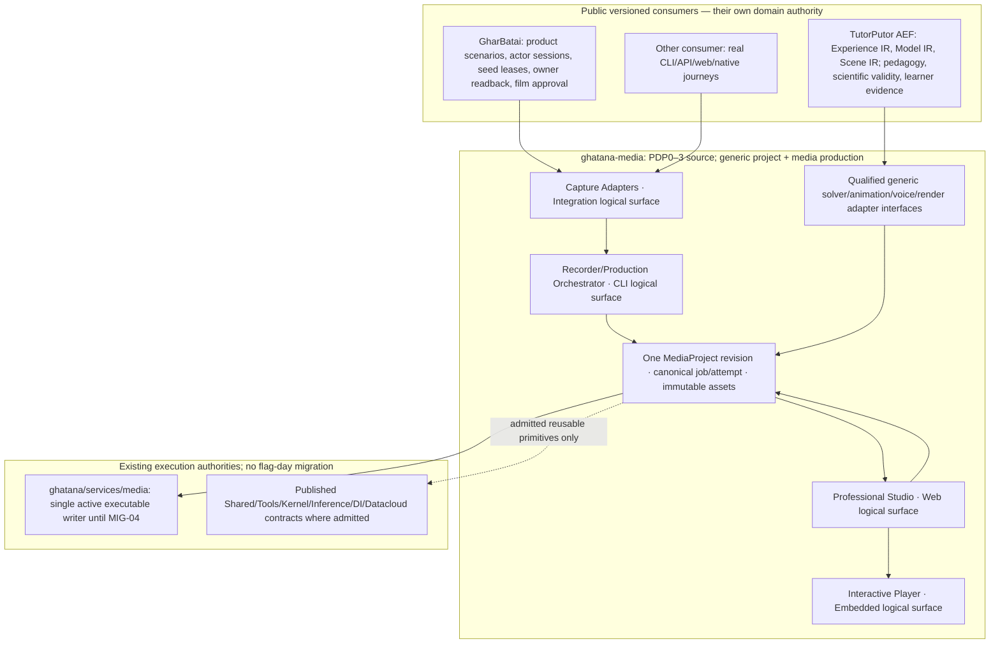
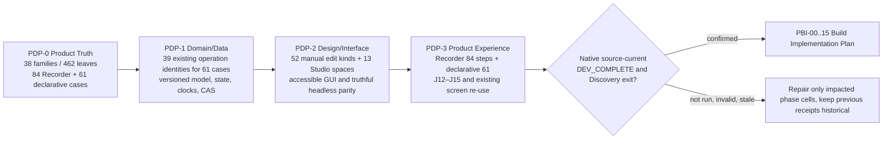

# Media unified declarative production — current PDP-0–3 and Build handoff

**Updated:** 2026-10-18. **Campaign:** Media Discovery, successor-definition/currentness; **Build entry: not established**. This is the **living orientation and execution-readiness index**, not a replacement for canonical PDP source, dated independent receipts, runtime acceptance, Lifecycle closure, or film/sign-off authority. Always read the live repository source and checkout reports before treating any status below as current.

## 1. Required source inputs and lossless preservation

- [Complete Media unified production blueprint v3](references/MEDIA-UNIFIED-DATA-DRIVEN-PRODUCTION-BLUEPRINT-V3-2026-10-17.md) preserves the user's full 22-domain/428-feature review, original M-00–M-15 and INV-01–INV-12 work, C-01–C-28 competitive tests, 73 focused audit additions, DAS-01–DAS-12 packages, DAS-A01–A18 experiments, OSS candidates, examples, and TutorPutor source boundaries. Original dated license/source observations are **review references, not current pinned approvals**.
- [501-item source-derived feature audit](observations/media-unified-production-501-feature-reconciliation-2026-10-18.json) accounts for every original `AUD-*` feature and all 73 focused extension items. The 428 lexical existing-capability candidates are **not** semantically accepted one-to-one mappings; each row must receive an exact review before a complete reference-baseline feature-coverage claim. The 12 Recorder focused items reuse existing acceptance cases; the 61 Animation/Simulation/TutorPutor/Unified cases are owned by `requirements.yaml#declarativeProductionProfile`.
- [GharBatai professional demo master plan v2](https://github.com/samujjwal/gharbatai/blob/codex/gharbatai-professional-demo-live-handoff-20261018/docs/demo-recording/reviews/GHARBATAI-PROFESSIONAL-DEMO-MASTER-PLAN-V2-2026-10-17.md) preserves all G01–G24 gaps, DX-01–DX-32 work and nine F01–F09 film narratives. [Product-owned current handoff](https://github.com/samujjwal/gharbatai/blob/codex/gharbatai-professional-demo-live-handoff-20261018/docs/demo-recording/CURRENT-PROFESSIONAL-DEMO-MEDIA-HANDOFF.md) and [source-backed DX mapping](https://github.com/samujjwal/gharbatai/blob/codex/gharbatai-professional-demo-live-handoff-20261018/docs/demo-recording/reviews/GHARBATAI-MEDIA-EDITORIAL-DX32-INTEGRATION-CROSSWALK-2026-10-18.json) are **consumers**, not new Media requirements.
- [Recorder PDP-0–2 source coverage](MEDIA-RECORDER-STUDIO-PDP0-2-SOURCE-COVERAGE-REVIEW-2026-10-17.md), [Recorder PDP-3 execution](MEDIA-RECORDER-STUDIO-PDP3-SUCCESSOR-EXECUTION-2026-10-17.md), and [declarative successor source review](MEDIA-DECLARATIVE-PDP0-3-SUCCESSOR-CURRENTNESS-REVIEW-2026-10-18.md) remain the detailed phase reviews.
- [Existing Build package plan](MEDIA-BUILD-COMPLETE-PRODUCT-PLAN-2026-10-15.md) owns PBI-00 through PBI-15, rather than M-/INV-/DAS-/DX- being competing schedulers. [Current Build coverage JSON](media-build-coverage-plan-2026-10-15.json) remains dated planning input and **must be regenerated/reviewed at the accepted successor source cut**.

## 2. One product, correct ownership, one evidence meaning

The four Recorder descendants remain logical children respectively of `media.surface.cli`, `media.surface.integrations`, `media.surface.web`, and `media.surface.embedded`. They are **not four new deployments**, and 26 physical candidates / 7 compositions / 17 historical consumers plus 4 logical children yield 54 proposed identities × 4 phases = **216 proposed phase cells**, never 216 accepted receipts. Source definitions already preserve 38 parent requirement families, 462 capability leaves, 84 Recorder cases, 16 Recorder feature profiles, 52 manual edit discriminants, 13 planned Studio workspace pages, 30 historical top-level journeys and 47 canonical screens. A new true physical leaf requires an independently verified build/deployment coordinate and phase applicability.

**Five source classes:** `REAL_CAPTURE` requires actual source/action and product owner-readback for claimed effects; `DECLARATIVE_ANIMATION` is authored semantic media; `MODEL_SIMULATION` is versioned model+solver+units+state+measurements and independent validity; `GENERATIVE_MEDIA` is disclosed model-generated art; `PDP_SYNTHETIC_FIXTURE` is a local Explorer/test fiction. `libs/media-experience-simulation` implements the *fifth*, **not** a scientific solver. A finished video may combine classes, but neither beauty nor a provider response proves product/business/scientific truth.

## 3. Canonical PDP pipeline and proof

Source authoring ≠ native development proof ≠ formal Discovery exit ≠ runtime execution/solver scientific certification ≠ GharBatai film acceptance ≠ TutorPutor lesson approval ≠ Lifecycle closure or release.

| Phase | Canonical editable source and new overlays | Required current-source completion |
| --- | --- | --- |
| **PDP-0** | `.product-experience/pdp-0-product-truth/{requirements,capabilities,time-units-fidelity,quality-policy,recorder-studio-extension}.yaml`; `requirements.yaml#declarativeProductionProfile` | Validate all 84+61 scoped Given/When/Then/Rejection cases, exact 38/462 parent/leaf ownership, 428 audit-feature owner dispositions, actor/source rights/quality/availability/privacy/units; no scientific claim from visuals; native negative tests, material source digest, reviewer decision |
| **PDP-1** | `.product-experience/pdp-1-domain-data/{operations,domain-objects,value-objects,states,recorder-studio-contracts,declarative-production-contracts,handoff-contracts}.yaml` | Exact canonical operation request/result/effect/finality (37 ordinary leaf identities plus specialized job/provenance operation binding), no new store; 61 P0→P1 case joins; typed semantic scene/model/checkpoint/observable/clock provenance; edit CAS/rights/UNKNOWN and negative property checks; current P1 source handoff |
| **PDP-2** | `.product-experience/pdp-2-design-interface-system/{animation-simulation-grammar,recorder-studio-interface,component-contracts,handoff-contracts}.yaml`, shared tokens/layout/recipes | Exact 61 P0/P1→P2 bindings and full 52-edit/13-workspace GUI/text/keyboard/CLI/SDK/API applicability; model units/tSim instruments, data-driven diagrams, scientific/fidelity labels, actor claims/voice/caption and source-sufficiency views; reduced-motion/screen-reader/locale/mobile/error/UNKNOWN states; no fictitious product screens |
| **PDP-3** | `.product-experience/pdp-3-product-experience/{recorder-studio-experience,declarative-production-experience}.yaml`, existing J-12–J-15, J-09/J-18, screen/action/scenario/Explorer registries | Exact source-bound 84 Recorder and 61 declarative positive/denial/unknown/recovery scenario behaviors per actually applicable channel, existing canonical journey/screen or justified new identity, source-vs-generated evidence views, TutorPutor predict→manipulate→measure→explain, GharBatai no-fake-UI proof, whole Explorer parity/currentness |

**Current source-cut interpretation:** The historical `pdp-0-phase-dev-status.json`, `pdp-1-phase-dev-status.json` and `pdp-2-phase-dev-status.json` report `DEV_COMPLETE` at their **recorded old source hashes**. Recorder/Animation/Simulation successors and this feature audit materially postdate those cuts. The successor is **SOURCE_AUTHORED**, while native YAML/parser/schema/semantic/property/manifest/Explorer and source-current gate proofs are **NOT_RUN** here. Never copy the old statuses to new source or rewrite independent receipts manually. Execute the checked-in generators/checkers on a complete workspace, record exact hashes and rerun only affected cells. Formal source-current DEV_COMPLETE remains **unproven** until then.

## 4. Full product, including professional voice/video and audience readiness

The 428 source-audit features span exactly 22 taxonomies: `SPEC, CAP, ASSET, EDIT, COLOR, ASR, TTS, CLONE, DUB, DSP, MUSIC, GEN, VISION, MOTION, DIRECT, SOCIAL, INTER, COLLAB, DELIV, QA, TRUST, OPS`. Preserve all source review meanings `B` broad/covered, `E` finer contract needed, `N` newly explicit, **none meaning implemented**. All 73 focused additions are accounted for with 12 reused Recorder cases, plus 17 animation, 22 simulation, 12 TutorPutor and 10 cross-modal contracts. Mapping all 428 audit IDs to **candidate** existing capability leaves does not complete exact source owner semantic reconciliation: weak matches stay deliberately unresolved, never falsely accepted.

Professional scope includes (and must not silently be dropped from PBI):

- Fully config-/metadata-/data-driven GharBatai real demo recording, qualified browser/desktop/mobile/camera/terminal/API sources; true actor/session/lease and business effect readback, event/source frame mapping, authored/director shots, retakes and minimal scene-local recapture.
- Human/AI/agent edits from the **same** 52 typed canonical revision-changing operations: NLE/ripple/keyframe/color/masks/track solo/mute/speed ramps/denoise, exact source time, reversible manual locks, previews, and GUI/CLI/SDK/agent equivalence.
- Local-first ASR/TTS/voice, explicit effective provider/voice readback, consented voice cloning, diarization, expressive prosody, dubbing, narration, lipsync, caption/transcript and multilingual scripts, DSP/music/SFX and managed conditional generation. No fake/silent synthetic voice treated as published audio.
- Visual generation, high-fidelity 2D/3D semantic animation, mathematical data-binding, procedural/rig/pose/keyframes, narrational synchronization, model-backed repeatable simulation, scientific observables and independent validation, TutorPutor public AEF compatibility.
- Professional color management, codec/export negotiation, C2PA/metadata when admitted, full render decode/QA, preservation of protected text/logo, interactive signed/offline viewer with no privileged product mutation, customer/social/locale variants, collab/review and resource/cost/storage quotas.
- Voicebox/OpenReel/FireRed/Motion Canvas/Manim/Three/Pixi/Rapier/SimPy/SciPy and other upstream tools are **pin-and-audit candidates**, not automatically admitted dependencies. AGPL Theatre Studio/VoiceStudio/OpenChatCut, noncommercial models, FFmpeg-dependent mixed-license trees and conditional codec stacks cannot be silently bundled as strict-permissive. Every source file, binary, model/checkpoint, voice, tokenizer, font, music asset, codec and dependency requires independent license/security/performance/policy qualification.

**GharBatai-specific requirements remain product-owned:** G01–G24 editorial gaps, 32 DX tasks, three audience contracts (executive/nontechnical/specialist), seven exactly sourced S01 actions/readbacks, actor-session isolation (old vs fresh after revoke), claim-to-evidence ledger, before/during/after voice scripts, actual speech captions vs actor badges, Nepali/English variants and pronunciation, source sufficiency `VISIBLE/VERIFIED_OFFSCREEN/AMBIGUOUS/MISSING`, accurate scene chapter PTS, timing where success claims never predate readbacks, full decoded film/privacy QA, honest edit disclosures, real target-audience comprehension and **authorized** human digest-bound publication. Historical A06 candidate digest `2c4155bf2da117fff3bec72c499a08f7b81c251cb5e999645a3fda475d703d3e` is immutable; a media-only edit does not change its business proof. The latest checklist determines its **actual current status**, not the October 17 reviewed plan. Nine current F01–F09 films remain, no tenth S01 film and no phantom financial settlements or compliance certificates.

## 5. Remaining source completion tasks — exact owner / where / how / exit

The rows below are **successor authoring/verification tasks** for the affected source, not a new Build planner or DX/film execution queue. Existing closed and unaffected surfaces must not be reopened.

| Order / ID | Where and how | Falsifiable exit |
| --- | --- | --- |
| **U-P0-01** | Audit all 428 rows in `media-unified-production-501-feature-reconciliation-2026-10-18.json`; confirm candidate leaf semantic fit against the actual PDP-0 `capabilities.yaml` leaf meaning and matching family requirement, not a token match. Record `BOUND_EXISTING`, `EXPLICIT_INAPPLICABILITY`, or `P0_MEANING_CHANGE_REQUIRED` for every ID and reissue only affected requirement/capability definitions. | 428 independently reasoned dispositions, 0 unreviewed rows; 501 audit IDs remain unique. |
| **U-P0-02** | Validate 84 Recorder +61 declarative acceptance IDs and all cross-modal AI/voice/security/fidelity/GharBatai editorial boundary semantics against full blueprint + DX scope. Verify source classes and 462 unique leaves/38 families and actor/capability ancestry. | Native schema/semantic/negative and owner-bounded source checks green at actual current cut; no source-level missing obligation. |
| **U-P0-03** | Run `corepack pnpm install --frozen-lockfile`, `pnpm check:recorder-studio-definition`, `pnpm test:recorder-studio-definition`, `pnpm check:declarative-production-definition`, `pnpm test:declarative-production-definition`, `pnpm check:physical-topology`, `pnpm test:physical-topology`, and source/trust handoff suites on checkout; fix actual failures. | Current phase-specific native PASS and digest/owner source-review receipt (do not inherit prior-cut DEV_COMPLETE). |
| **U-P1-01** | Reconcile new case bindings in `pdp-1-domain-data/declarative-production-contracts.yaml` with real `operations.yaml` schemas, exact result/finality/actor/tenant, typed voice/variant/scientific report, sequence/checkpoint and public AEF, testing denied, missing units, stale revision and unknown effect. | 61/61 exact P1 bindings and all affected audit-derived operations have typed positive/negative/finality rules, no duplicate owner. |
| **U-P1-02** | Run P1 handoff tests, clock/guard/provenance/CAS/rights/UNKNOWN property suites, including stop/retry/source version rebase; generate current P1 owner status after current P0 handoff. | P1 source-cut DEV_COMPLETE independently proven; no unqualified scientific result or editor overwrite. |
| **U-P2-01** | Complete affected `animation-simulation-grammar.yaml`, `recorder-studio-interface.yaml`, existing GUI component/style/layout/recipe/machine interface contracts for all audited feature impacts; numeric/accessible animation instruments and audience/voice/review controls. | All 61 focused P2 joins plus validated 428 applicable feature interface dispositions; all 52 edits, 13 Studio pages and CLI/API-only cases have truthful, testable parity. |
| **U-P2-02** | Run `pnpm check:design-conformance`, P2 phase handoff, 52-kind editor parity/keyboard/API/SDK/CLI, screen reader/reduced motion/RTL/Devanagari/mobile, error/UNKNOWN and source-projection tests; publish checked current P2 status after P1 source proof. | Native P2 source-cut DEV_COMPLETE proven with exact template/component identities; no fake UI or silent model/time conversion. |
| **U-P3-01** | Reconcile Recorder 84 and declarative 61 source cases against actual J-09/J-12/J-13/J-14/J-15/J-18 etc journey/screen/action/fixture/Explorer source (reuse 47 existing screens, not 13 invented routes). Include all C-01..C-28 and DAS-A01..A18 as scenario candidates and GharBatai 32 DX/7-scene product handoff. | Every required positive/denial/recovery story is a current source-linked GUI or truthful non-GUI experience; missing provider remains UNAVAILABLE. |
| **U-P3-02** | Run native Recorder and declarative P3 tests, Explorer sync, 30-journey screen/step/owner finality regressions, source manifest generators, negative scene and adapter projections; record independent current-source review and 216-cell applicability. | PDP-3 current source-cut DEV_COMPLETE and formal Discovery exit **actually proven**, not inferred from planning. |
| **U-PLAN-01** | Reconcile original M-00…15, INV-01…12, DAS-01…12 and 22 feature domains into *existing* PBI-00…15 task ownership; record source IDs, repository paths, acceptance tests, resource/OSS constraints, provider/codec/license decisions and dogfood order. | One Build Plan Implementation dependency list after exact Discovery PASS; no parallel scheduling registry. |
| **U-CONSUMER-01** | Keep GharBatai DX-01…32 / F01…09 in its live checklist; keep TutorPutor AEF/model/pedagogy/evidence in its product source and use separately admitted **public** compatibility adapters; prove S01 real film and F2 Newton/EXACT graph simulation in Build. | Actual independent consumer/product/QA/reviewer receipts; no fictional film, lesson, or physical-simulation ready claim. |

## 6. Native test suite, experiments, and stage boundary

**Discovery source checks:** `pnpm check:recorder-studio-definition`, `pnpm test:recorder-studio-definition`, `pnpm check:declarative-production-definition`, `pnpm test:declarative-production-definition`, `pnpm check:unified-production-inventory`, `pnpm test:unified-production-inventory`, topology, P0/P1/P2 handoffs, exact phase currentness, PDP3 action/step/screen/Explorer and actual rendered accessibility where applicable. Regression suites must reject missing/duplicate audit IDs, stale P0 source or wrong capability family, a mismatch at any P1–P3 case, false media/science/business proof, unapproved source credentials, invalid time/unit mapping and premature DEV_COMPLETE.

**Separate Build/certification experiments, not PDP acceptance:** Existing blueprint `C-01..C-28` and `DAS-A01..A18` stay the acceptance scenario backlog: actual GharBatai readback and fully decoded film; API-only truthful narration; 2D/3D and 16:9/9:16; Newton 2kg+6N+2s oracle (a=3m/s²,v=6m/s,x=6m), invalid units/divergence/unsupported solver; story pause not advancing tSim; EXACT checkpoint vs stochastic statistical replay; all 52 edits; incremental regen + manual locks; Narration/localization/source fact alignment; accessibility; strict-permissive license, codec/voice/model/PII/security/OTel negative trials; crash/UNKNOWN and cross-tenant isolation; CPU/GPU/mobile/offline and storage/energy budgets. TutorPutor scientific, pedagogy/learner-data and GharBatai business/human approval remain separate independent approvals, **never generated by Media tests**.

**Execution order:** Verify P0 source first → P1 typed handoff → P2 design/machine parity → P3 experience and Explorer → source-current Discovery and affected Lifecycle applicability → PBI-00 implementation admission → PBI-01..15 gated build verticals → actual GharBatai and TutorPutor dogfood → rights/solver/codec/film/release approvals. If native execution is unavailable, mark `NOT_RUN` and leave the relevant phase **unproven**; do not pad statuses or initiate a Build writer migration. Preserve previously closed unaffected leaves and follow fix-forward policy.

**Current owner disposition:** Reuse the architecture and existing Media capability families, four logical Recorder surfaces and 13 proposed Studio pages; integrate all 501 audit-local features and 32 DX tasks through existing owners. Source authoring and review links are prepared, but the 428 candidate semantic mappings, full native PDP0–3 successor/currentness, scientific qualification, and actual film human approval are not yet independently complete. The source/currentness barrier therefore remains **NOT_PROVEN**, not `DEV_COMPLETE` for this successor.
