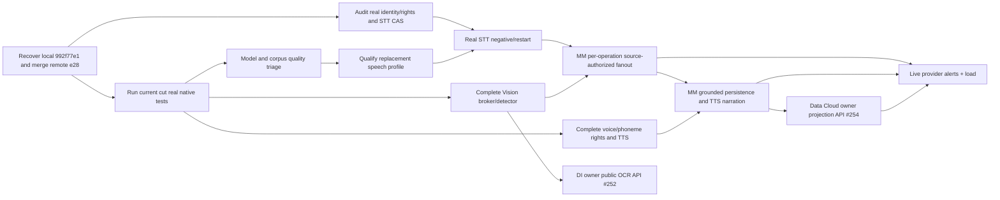

# Ghatana Media — ACTIVE Wave 2 implementation and blocker-elimination execution

**LATEST PULSE REVIEW — 2026-10-28 22:37 PT:** [§7 post-pulse source review and executable all-36-task completion plan](#7-post-pulse-992f77e1--implementation-review-and-all-remaining-wave-2-tasks-2026-10-28) supersedes the *execution order* in earlier dated §5/§6 notes, not the original R8 acceptance. The implementer reports local `992f77e1` with seven commits, but connected GitHub lacks those SHA refs; verified remote runtime source at review was `e28c755f` and documentation has subsequently advanced. Whisper tiny's **reported** real FLEURS WER upper bounds fail every approved locale, even though exact single-clip decoding reportedly works. The 36 unfinished R8 rows retain their status. Preserve nine existing dirty paths; reconcile and test a single merged implementation SHA before promoting any row. Detailed owner/wave selection is in the [same existing R10 JSON](MEDIA-WAVE2-R10-OWNER-BLOCKER-RESOLUTION.json#latestPulseReview).

**CURRENT-CUT EXECUTION CONTROL — 2026-10-28 16:38 PT:** Media `ef823571b1dbbed2c1ea38fa291657cb04855103`, Shared `d15b2ce353839ee3bf666be7c0737aa7192994f5`, Ghatana `875108953b069ba65803b8b99b713896bf9476f0` inspected through connected GitHub. Source changes include STT source-authorization contracts and candidate transcript outbox, TTS readiness guard, Vision resource/PTS hardening and Multimodal clock checks. Reported focused passes are not new whole-row acceptance. The **current 12-gate/36-task owner decisions** now reside in the existing [R10 machine-readable map](MEDIA-WAVE2-R10-OWNER-BLOCKER-RESOLUTION.json), with binding privacy/rights policy in [Media Privacy](../MEDIA_PRIVACY_AND_RETENTION_POLICY.md#13-wave-2-source-rights-model-admission-and-independent-acceptance-policy). Follow §6 of this same file as the latest executable sequence; older dated cut descriptions are evidence history, not fresh status.

**Owner engineering direction:** October 28, 2026. This is the **single current executable work queue** for five backend modality/observability surfaces; earlier R7–R10 plans are preserved as historical decisions and source/evidence references, not separate concurrent work plans. The original [58-task acceptance authority](MEDIA-BACKEND-MODALITY-WAVE2-EXECUTION.md) and the [exact original 36-row acceptance criteria](MEDIA-WAVE2-R8-FULL-ACCEPTANCE-MATRIX.json) remain unchanged. [R10 machine-readable 12-gate/36-task map](MEDIA-WAVE2-R10-OWNER-BLOCKER-RESOLUTION.json) is a selection input, not a second phase/provider contract.

**Starting reported status:** **58 tasks = 22 LOCALLY_VERIFIED + 30 PARTIAL + 6 OWNER_EXTERNAL**. No row is promoted by this document or the source commits linked below. All six external IDs remain STT-12, TTS-07, TTS-12, VIS-02, VIS-12, MM-12. The product still has 99 source capability memberships, 43 RPC identities and 12 declared end-to-end scenarios. This queue authorizes engineering execution without PDP/gtool closure, build/release/cutover or external-rights approval.

**Security qualification correction:** absence of a Docker socket *inside the codec container* does not establish absence of Docker privileges in the service process. Host-broker privilege separation is a distinct security requirement, not granted by this owner directive.

**Current reviewed Media implementation baseline:** `4196698a7fae2d82df13dce17e2a6a7ca9ef0de0` on remote main, containing the actual host OCI supervisor. Later implementation commits in this turn add OCI adversarial/real-codec tests; their JDK27/Docker results are **NOT RUN** here. Shared and Ghatana authorities must be pinned afresh from their latest remote main before a native current-cut claim. No cross-write to dirty Shared source; never force-push or reset others' work.

## 1. Final owner decisions, dispositions and no-reapproval policy

- **APPROVED NOW: implementation and tests.** Implement Media runtime/source-rights wiring, provider adapters, reusable native OCI worker, PCM/ONNX/decoder improvements, existing PostgreSQL/outbox integration, source-owned FLEURS extraction, bounded evaluation and source-free HTTP consumers; change source/Gradle/docs in owning repositories as required. No further blanket owner design meeting is needed.
- **APPROVED: one native isolation architecture.** The current [HostOciVisionWorkerSupervisor](../../modules/vision/vision-service/src/main/java/com/ghatana/audio/video/vision/video/HostOciVisionWorkerSupervisor.java) is the Linux ARM64 **trusted-developer-host qualification** route. **It currently invokes the Docker CLI from the Media JVM** and therefore is not yet a production privilege-separated container-management broker. The old [LinuxVisionWorkerSandbox](../../modules/vision/vision-service/src/main/java/com/ghatana/audio/video/vision/video/LinuxVisionWorkerSandbox.java) is an alternative only on hosts **actually offering delegated writable cgroup v2**; Docker Desktop's missing nested delegation is **not** a reason to stop. Never pass Docker socket, registry credentials, host environment or a privileged host mount into the codec worker; only the trusted host supervisor may contact Docker.
- **APPROVED: first-party, nonbiometric source fixtures for engineering development.** Original generated audio/video and a source-owner-signed recording/provenance record can support nonproduction rights/path/finality tests. It must have an independently checked **actual source/version/owner/purpose** at dispatch. It is not third-party training/voice/biometric consent, not a fabricated reviewer receipt, and not licensed quality-corpus evidence.
- **APPROVED: previously selected reference asset evaluation, not production promotion.** Whisper official multilingual tiny + independently compatible ONNX/tokenizer; Piper LJSpeech medium + real eSpeak or qualified phonemizer; YOLOX Nano distinct tensor model; FLEURS bounded en-US/hi-IN/ne-NP corpus; original generated sync fixtures. See [R9 source pins](../../config/qualification/wave2-reference-candidates.v1.json). These remain REVIEW_ONLY until exact rights, ground truth, model outputs, performance and qualified reviewers exist. **Do not invent human speaker/face consent or license changes.**
- **APPROVED: conditional positive admission, never a Boolean bypass.** Media's existing `MediaSpeechToTextAdmission` has an ADMITTED disposition but `MediaRuntime.admitSpeechToTextOrThrow` still always rejects, and `PostgresqlMediaTranscriptStore` refuses production writes and hardcodes CANDIDATE. The next implementation must replace these *specific* hard stops with actual, independently verified source/right/consent/model/store **proofs**. Missing authority continues to fail closed. Avoid new shadow transcript/job stores and environment-variable or caller-attested license/consent promotion.
- **APPROVED: explicit narrower reference performance profile.** On the cited 4CPU/8GiB Linux reference, Whisper c16/c64 is saturated (reported RTF ~2.14/2.06; p95 ~30/33sec). Keep safe typed admission rejection and honest per-profile concurrency ceiling. Run same-source ORT opt-in thread A/B with 0(default),1,2,4; only change default after equivalent full-gold outputs plus measured gain. This does **not** redefine original whole-task c16/c64 load acceptance or production SLO.
- **APPROVED: owner-public integrations, no cross-imports.** Ghatana's Document Intelligence [issue #252](https://github.com/samujjwal/ghatana/issues/252) owns source/frame/ROI/rights OCR; Data Cloud [issue #254](https://github.com/samujjwal/ghatana/issues/254) owns Java21-compatible governed read-model projection. Build Media consumer adapters **after the real public owner APIs exist**, not against imaginary routes.
- **EXTERNAL AUTHORITY REMAINS HONESTLY REQUIRED.** A third party's weight/voice/dataset license, human voice/face/biometric consent, non-first-party recording right, valid independent reviewer signature, or actual benchmark/host measurement cannot be bestowed by an engineering owner. These are **precisely scoped external evidence inputs**, not reasons to stop unrelated engineering. If unavailable, continue first-party nonhuman and other independent work, keep the gated sub-operation NOT_ADMITTED and record the exact evidence that is missing.

## 2. Executable critical-path tasks: what, where, how, exit

### V1 — finish kernel-enforced OCI adversarial + real codec (first acceptance candidate VIS-03)

**Owner:** Media Vision/native. **New source paths:**
- `modules/vision/vision-service/src/main/java/com/ghatana/audio/video/vision/video/{HostOciVisionWorkerSupervisor,VideoFrameExtractor}.java`.
- `modules/vision/vision-service/src/test/java/com/ghatana/audio/video/vision/video/{HostOciVisionWorkerDockerIntegrationTest,HostOciVisionRealCodecIntegrationTest}.java`.
- `modules/vision/vision-service/src/test/resources/vision-oci/ffmpeg`, `vision-oci-real/Dockerfile`; `scripts/qualification/{build-wave2-vision-real-oci-image,run-wave2-vision-oci-checks}.sh`.

**Actions:** Run stub OCI tests in their own JDK27 JVM against their **digest-pinned** stub image. They must now include real kernel `OOMKilled=true`, `pids.events max >0`, existing wall-time/container cleanup, mount/limits, zero-Docker-socket tests. Then provision the **existing fixed-digest** Linux ARM64 LGPL 8.1.2 FFmpeg archive and six SHA-pinned Ubuntu 24.04 native dependency packages, build the separate real FFmpeg OCI image without runtime downloads, and run the real-image JVM separately: original source Java-generated PNG -> actual FFmpeg -> exact decoded PNG; malformed bytes -> no successful frame; deliberately tiny output ceiling -> typed overrun. Add extra malformed codec/container tests against the original VIS-03 security corpus, including unsupported formats/symlinks and first-failure classification, and check max CPU, RSS, PIDs, scratch and process-tree cleanup at source-native boundary.

**Commands on trusted developer host (no untrusted Docker socket):**

```bash
# Uses its own locally built, content-ID-pinned stub image (4 OCI cases):
bash scripts/qualification/run-wave2-vision-oci-checks.sh stub

# Pin/obtain the LGPL archive plus exact six Ubuntu ARM64 runtime packages:
bash scripts/prepare-wave2-codecs.sh linux-arm64
export MEDIA_LINUX_CODECS_DIR=/tmp/ghatana-media-codecs/v8.1.2-27-aarch64-unknown-linux-gnu
# Verify this path against the exact provisioner's printed MEDIA_LINUX_CODECS_DIR.
# Runs the real codec image in a SEPARATE JVM (3 cases):
bash scripts/qualification/run-wave2-vision-oci-checks.sh real "$MEDIA_LINUX_CODECS_DIR"
```

**Mandatory exit:** Actual Docker/kernel OOM/PID limit, timed kill and cleanup, real FFmpeg decode/malformed/oversize output, source bytes and output mounts, no escaped processes/network/sockets/secrets. **Separate production privilege exit:** the current Java supervisor still invokes Docker CLI from the Media process. For production or untrusted Media service deployments, introduce a separately deployed, authenticated, narrowly scoped host/CRI broker with a typed FFmpeg/FFprobe-only operation, per-source owner authorization, bounded requests and audited peer identity; prove the Media service holds **no general Docker/CRI socket or CLI authority**. Until its independent tests pass, direct host invocation remains local trusted-development qualification only. Reread original VIS-03 criteria and mark its entire row verified **only if every adversarial input/expansion/CPU/memory/time/oracle passes on the required host**. Do not claim VIS-03 from test image/config checks alone. If a test fails, fix its exact resource/fixture contract and rerun; no return to unavailable nested-cgroup configuration.

### S1 — remove STT's unconditional pre-job dead end *only with genuine authority*

**Owner:** Media runtime/security plus Shared public PolicyEngine consumer. **Files:**
- `launcher/src/main/java/com/ghatana/media/launcher/MediaRuntime.java` (around `admitSpeechToTextOrThrow` and `submit`);
- `runtime-contracts/src/main/java/com/ghatana/media/runtime/{MediaSpeechToTextAdmission,MediaRuntimeContracts,MediaProcessingRuntimePort}.java`;
- `modules/speech/stt-service/src/main/java/com/ghatana/stt/grpc/{ProductionSttGrpcService,SharedPolicySttRequestAuthorization}.java`;
- existing artifact/consent/rights stores and tests, never new shadow writers.

**Implement step-by-step:**
1. Inspect existing Media source provenance and consent authority, and Shared `PolicyEngine/VerifiedPolicyContext`. Reuse an existing verified source-rights port if available; if missing, add **one canonical Media source/version/purpose/rights resolution port** to the current runtime contracts (not a new global policy engine). Implement owner-created original-media receipts only from authenticated producer and immutable artifact metadata, not user-chosen `rightsVerified=true` flags.
2. Resolve **actual** artifact bytes/version/digest and verified principal/tenant/purpose/classification/retention from Media stores. Obtain current Shared ALLOW policy plus rights and MediaConsentAuthority decision; revalidate after provider selection and immediately before every provider effect/retry. For nonhuman original source, the rights authority can return a verified `NOT_APPLICABLE_HUMAN_CONSENT` disposition only with a real trusted provenance fact; any human voice, clone, speaker/face match or unowned recording still requires authentic subject/holder approval.
3. Check the real admitted STT profile's exact model+export+tokenizer+locale/quality and the actual durable transcript store capability. Invoke the already-authored conditional `MediaSpeechToTextAdmission.evaluate(..., transcriptVersionStoreReady)` with facts returned by trusted components. If denied, create **zero** jobs/outbox/provider calls. For authenticated successful admission, continue to the existing `submit` path, and ensure the generic production source-rights guard does not re-reject the same independently authorized STT request.
4. Replace `ProductionSttGrpcService.isProviderReady() = false` and its `LOCAL_ONNX NOT_ADMITTED` *only after* a real externally reviewed model/provider receipt is bound, not merely because an operator set environment variables. Test missing, stale, mismatched and revoked profiles. Do not downgrade production readiness to get a green test.

**Mandatory exit:** Positive from a genuinely source-authorized first-party/rights-cleared voice request; wrong tenant, stale version, wrong principal, missing model, expired/revoked rights, missing transcript store or source clock must reject with no side effect. The authorized request has a durable, identity-scoped job ID before inference, not a fabricated transaction ID.

### S2 — connect real provider to canonical PostgreSQL immutable revision and restart

**Owner:** Media STT + runtime/PostgreSQL. **Files:** existing `MediaProcessingRuntimePort`, `MediaRuntime`, `providers/aws-postgresql/src/main/java/com/ghatana/media/provider/aws/PostgresqlMediaTranscriptStore.java`, migrations/tests, current STT provider adapters.

**Implement:** Reuse Media processing job/attempt/fence/outbox, exact artifact digest and bounded source-byte reader. Real Whisper inference must receive a **licensed, independently transcribed** speech audio clip, with complete output checked against ground truth—not merely the word “weather.” Provider result includes exact model/input/output hashes, successful **fenced** attempt, provider receipt, idempotency fingerprint and source clock. In one PostgreSQL transaction, verify the durable successful attempt + owner/rights/consent/policy + current source version; append the immutable transcript revision via existing CAS and outbox. Replace the store's unconditional production-write rejection only once the source/rights/attempt proof is checked **in the same transaction**. Continue to use CANDIDATE for nonproduction evaluation, and do not promote it by changing a SQL literal alone. Independently exercise wrong digest/attempt/fence/tenant, revoke-before-effect, crash after provider receipt but before commit, duplicate request, ambiguous outcome and restart/re-read.

**Mandatory exit:** Source-owned real audio -> true model transcript -> fenced successful job -> immutable PostgreSQL transcript version -> owner-only **exact same bytes/version read after process restart**, with negative/recovery tests. Then reassess entire STT-03/STT-04/STT-08/STT-09 original acceptance rows individually. Local store-only 17/17 tests are **not** this outcome.

### M1 — independently qualify speech, voice, vision and corpus (parallel to V1/S1)

**Owners:** STT reference quality, TTS voice/rights, Vision detector, evaluation/QA.
- **STT:** `libs/java/common/.../WhisperOnnxEngine.java` and tests, source-pinned split ONNX decoder. Compare an **independently recorded full ground truth** against real model output on Mac/Linux; don't count substring-only checks. Do not finalize when EOT is missing/token cap hit. Run ONNX intra-op default/1/2/4 A/B with same weights/audio and 1/16/64 *requested* concurrency; accept typed saturation rather than false 64 successes. If tiny fails exact reference quality, qualify a prior legal base/small or another already selected backend without changing public contracts.
- **TTS:** `PiperOnnxEngine.java` phonemizer adapter and `ProductionTtsGrpcService`; independently verify voice checkpoint/sidecar/export and owner/likeness rights. Replace heuristic phoneme mode with actually qualified eSpeak-NG behavior or original validated compatible phonemizer. Verify phoneme IDs, sample clocks, **real audible PCM** and locale; cloned/human-identity voices remain denied absent real subject approval.
- **Vision:** `YoloXNanoAdapter/OutputParser`; use one **real nonhuman-object photograph** created/owned by the team with independent bounding-box/COCO label as the positive fixture. The old synthetic glyph's **zero detections** is a valid negative but **not** positive accuracy. Run actual YOLOX tensor geometry/NMS and a rights-cleared held-out mAP/PR set; require individually checked model/export lineage.
- **Evaluation:** `config/qualification/fleurs-asr-evaluation.v1.json` is currently **METADATA_ONLY_NOT_FROZEN**. Obtain bounded exact en/hi/ne per-clip audio, real ground truth, digest, attribution/source revision, training overlap and lawful speaker-use boundaries. Do not substitute output text for gold, infer consent from a dataset name or download hundreds of GB. Pre-register source-appropriate WER/CER/DER/mAP limits before final independent held-out runs. Reference-only preliminary thresholds already documented under R10 are not production SLOs.

### P1 — public Ghatana integrations (disjoint from Media core)

**Owner Ghatana services/document-intelligence:** [#252](https://github.com/samujjwal/ghatana/issues/252) supplies authenticated source/frame SHA/version, oriented ROI, rights/retention and operation-finality public OCR endpoint. **Owner Ghatana services/data-cloud:** [#254](https://github.com/samujjwal/ghatana/issues/254) supplies Java21-compatible governed Media observation projection and exact readback. Both must ship source-controlled public schema, error/finality tests and a **source-free** Java27 Media consumer before declaring VIS-09/MM-10; do not create second internal services in Media.

### F1 — Multimodal and observability after real child results

**Owner:** existing `modules/intelligence/multimodal-service`, `audio-video-observability`. Compose **real** STT and Vision child attempts with independent source rights, fencing, failure/UNKNOWN and rational source clock. Emit grounded typed fusion, not dummy A/V sync or speaker/face identity. Run real provider liveness+quality through Prometheus to Alertmanager on a named receiver; execute requested concurrency 1/16/64 under a measured hardware/model profile. If 4CPU can't serve c64, preserve exact typed saturation/accepted count and qualify a lower supported profile; don't invent completed 64 requests or a production SLA.

## 3. Acceptance accounting and no-stall progress

| Engineering lane | Next required measurable outcome | Original candidate row | Stop/fallback |
|---|---|---|---|
| V1 OCI native | 4 stub cases incl real kernel OOM/PID + 3 actual FFmpeg cases + original adversarial parser corpus | **VIS-03** | Fix failed kernel probe/codec path, not more OOB reviews |
| S1 admission | Authorized source/version/purpose/policy verified, no-effect denials and accepted job | **STT-03** prerequisite | Add missing canonical source authority with independently authenticated record; no fake ALLOW |
| S2 durability | Actual model output and fenced CAS transcript, restart exact readback | **STT-04/08/09** | Reconcile attempt/rights/store; no new writer |
| M1 model quality | True exact Whisper full gold, Piper phonemizer/playable voice, real YOLOX object | **STT-10/12, TTS-07/12, VIS-02/06/12** | Switch to previously selected qualified model on genuine failure; no lowered gold |
| P1 public APIs | Owner-built DI OCR and Data Cloud source-free consumers | **VIS-09/MM-10** | Keep those specific operations unavailable, progress other lanes |
| F1 composed evidence | Actual STT/Vision/MM/alert and named-host capacity | **MM-05..12, OBS-07/08** | Honest partial/UNKNOWN/capacity limits, no fake physics or metrics |

**Task promotion requires the entire original row**, not these milestone labels. After each affected-source commit: run the exact focused test and both required host lanes; only then refresh the original Wave 2 ledger. One accepted row counts more than another whole-repository test rerun. Never rerun already closed unchanged surfaces or source-only validators in place of real provider, container or licensed-corpus evidence.

**Update cadence:** each 90-minute engineering pulse produces changed code, an actual executed test or the exact first failure+owner+fix. At four hours report newly accepted original IDs, real model/input/output hashes and one next fault. After two pulses without an original acceptance, **stop opening broad new planning tasks** and address the first active missing executable input or switch to an already selected legally eligible alternative. Parallel teams own distinct files; serialize edits to MediaRuntime, runtime-contracts and database migration authority.

**Expected engineering end state:** real usable backend features and full test coverage, then 58/58 original acceptance once each true source/rights/quality/integration/performance requirement has its genuine proof. A full 58/58 guarantee is **not credible until external rights holders and actual independent measurements provide their source inputs**; the execution queue is designed so those unavailable inputs block only the affected operation, never the entire product's development.

## 4. Source verification and change policy

```bash
git fetch origin
git status --short
git rev-parse HEAD origin/main
pnpm test:wave2-r10-owner-resolution
pnpm check:candidate-decision-crosswalk
pnpm check:wave2-reference-sources

# Fast first JNI/native test lane after syncing a clean checkout:
bash scripts/qualification/run-wave2-vision-oci-checks.sh stub

# True Linux codec qualification after the approved pinned R7 provision:
bash scripts/qualification/run-wave2-vision-oci-checks.sh real "$MEDIA_LINUX_CODECS_DIR"

# After changed-unit tests, run selected current JDK27 Mac/Linux matrices:
./scripts/test-media-wave2-platform-matrix.sh mac-core
./scripts/test-media-wave2-platform-matrix.sh linux-arm64-core
./scripts/test-media-wave2-platform-matrix.sh mac-integration
```

The stub/real OCI scripts deliberately use **separate Gradle selections and image environments** so the integration-image variable cannot hijack ordinary process stub tests. The real image uses a published LGPL FFmpeg archive plus independently hashed Ubuntu runtime packages; it is **not** a redistributable production image or licensing approval. All worker images and large media/corpora live in local, bounded cache; no binary/voice/consent raw data goes into Git. Delete only images/assets owned by this qualification run after verifying no other consumer uses them.

**Report:** exact Media/Shared/Ghatana git SHAs; changed source paths; test host/JDK/OCI image+codec hash; per-test pass/fail/skip and true kernel resource events; source/model/voice/data rights records actually available; immutable job/attempt/outbox/transcript IDs; any new whole-row acceptance; and specific still-required owner evidence. A Git commit, signed template, stub image, or source manifest alone is not a successful Media business outcome.


## 5. R10 implementation recovery lock — exact first-failure protocol (owner decision, 2026-10-28)

This section strengthens **the same active execution plan**; it does not introduce an R11 plan, another contract, another status ledger, or a second engineering admission authority. The 36 mutable work selections remain the **existing** [R10 selection JSON](MEDIA-WAVE2-R10-OWNER-BLOCKER-RESOLUTION.json#L1), whose `remainingTasks[].taskId` and `implementationGates[].id` map to the **unchanged original** [R8 whole-row matrix](MEDIA-WAVE2-R8-FULL-ACCEPTANCE-MATRIX.json). The historical 22/30/6 classifications are the last accepted ledger, not live CI results.

**Inspected remote source cut:** `a3abbfa94a84ee64e085f21a2a7f64264b31e03d` (2026-10-28). Commits since `4196698a` include isolated opt-in kernel OOM/PID, genuine FFmpeg OCI test-source, and an explicit check that PID exhaustion cannot masquerade as zero-exit success. No current-host test run is asserted here. Re-pin the actual Media/Shared/Ghatana SHAs at execution start; do not rely on this inspected commit after another push.

### 5.1 Approval and disposition lock

| ID | Owner decision | Status and non-waivable condition |
|---|---|---|
| OD-01 | Media owner authorizes all scoped source/refactor/tests, restricted original fixtures, model evaluation, and rights/source resolver implementation in `ghatana-media` without additional design approval. | **APPROVED_FOR_ENGINEERING; NOT_ACCEPTED_AS_RUNTIME**. Existing PDP0–3 semantic authority and 58 original task IDs are fixed. |
| OD-02 | One source-version-bound Media rights authority, Shared's public `PolicyEngine` with `VerifiedPolicyContext`, Media `MediaConsentAuthority`, qualified provider, existing canonical persistence. | **APPROVED_DESIGN; NOT_YET_COMPOSED**. No caller flag, env var, provenance template, consent fixture, or reviewer-free signature can cause admission. |
| OD-03 | Trusted-host OCI is the developer qualification route. A separate authenticated, least-privilege host/CRI worker broker is required for deployment where the Media service itself must be unprivileged. | **DEV_BOUNDARY_IMPLEMENTED_NOT_FULLY_TESTED; PRODUCTION_BROKER_NOT_IMPLEMENTED**. Docker privilege is not made safe merely because the codec container has no socket. |
| OD-04 | Reference Whisper/Piper/YOLOX/FLEURS use is authorized for bounded evaluation, with source-pinned model/export/voice/corpus manifests. | **EVALUATION_ONLY**. Qualification needs genuine licenses, independent gold/reviewer, actual outputs and measured resource/quality thresholds. |
| OD-05 | Ghatana Document Intelligence `#252`, Data Cloud `#254` own their public APIs; Media owns installed consumer adapters. | **OWNER_IMPLEMENTATION_PENDING**. No internal cross-repo imports, invented URLs, duplicate OCR engines or dual DB writers. |
| OD-06 | Existing 22 verified rows are protected; 30 partial and 6 owner-external rows remain open and must be dispositioned individually from the original R8 row. | **NO_PROMOTION** until positive, negative, fault/restart, privacy, quality, rights and host proof all pass; no gtool/PDP closure or release claims. |

The exact six `OWNER_EXTERNAL` rows are `STT-12`, `TTS-07`, `TTS-12`, `VIS-02`, `VIS-12`, `MM-12`. Their engineering substeps may proceed, but completion requires the corresponding real third-party rights/model/voice/corpus, human biometric consent where applicable, independently trusted evaluation and/or actual owner platform integration. The [private evidence intake and source-qualification plan](MEDIA-WAVE2-R9-EVIDENCE-ACQUISITION-AND-QUALIFICATION.md) remains the input checklist; signed templates are not signed evidence. The [trusted-reviewer register](../../config/qualification/wave2-trusted-reviewers.v1.json) currently has no installed trust anchors; a public fixture cannot substitute for the actual private independent review.

### 5.2 File-exclusive executable engineering lanes

**Lane A — VIS-03, immediately runnable on a trusted Mac ARM64 + Docker/Linux ARM64 host.** Media Vision owner exclusively edits `HostOciVisionWorkerSupervisor`, `VideoFrameExtractor`, OCI fixture scripts and tests. First execute `bash scripts/qualification/run-wave2-vision-oci-checks.sh stub` and, after the source-pinned archive is verified and exact codec path known, `bash scripts/qualification/run-wave2-vision-oci-checks.sh real "$MEDIA_LINUX_CODECS_DIR"`. Stub and real must use separate JVMs; do not export the image variable into general process-stub tests. Require four actual stub OCI cases (limits/mounts, timeout, OOMKilled, pids.events), three real FFmpeg cases (positive, malformed, overflow), and **original** VIS-03 adversarial image/video/parser cases. Hardening review must explicitly test effective FD limits (`nofile`; not currently apparent in the Docker create flags), output disk/inode/byte quota, CPU throttling, timed process-tree kill, malicious arguments, symlink/path race, container cleanup and zero host privilege exposure to untrusted service inputs. Inspect/verify OCI `HostConfig` semantically (JSON field/type checks, not only fragile serialized-substring matches). Record host, image digest, FFmpeg hash, kernel events, resource maxima, exit classification and all failures/skips. If native tests cannot run on this execution host, say `NOT_EXECUTED_HOST_UNAVAILABLE`, not `PASS`; keep implementation moving in other lanes. **Production branch:** add a distinct authenticated broker/client with narrowly allowed `ffmpeg`/`ffprobe` operations and audit/peer identity; remove broad Docker/CRI authority from Media JVM and prove it through a separately deployed real-host negative test before production admission.

**Lane B — STT-03 source authority and pre-job acceptance.** Media runtime/security owner exclusively edits `runtime-contracts`, `MediaRuntime`, and trusted source/consent integration; coordinate any Shared public-policy changes with the Shared owner (do not fork Governance). Implement a single source-rights resolve-and-revalidate contract, keyed by authenticated tenant/principal, exact immutable artifact `sha256:` version and bytes digest, processing purpose/operation, region, retention, allowed transformations, source owner, current decision/revocation epoch and expiry. Back it with an actual versioned owner/producer provenance and revocation record and a trusted authenticated ingress; never treat request-supplied metadata as evidence. Evaluate the current Shared ALLOW snapshot, Media consent, provider egress restrictions and qualified profile **before** creating a job; refresh before provider invocation and retries, and fail closed if any authority is stale, unknown, revoked or unavailable. The existing `MediaSpeechToTextAdmission.evaluate` takes four readiness booleans but cannot itself make a runtime authoritative: supply facts only from trusted components, bind decision IDs into the job/attempt and make time evaluations use an injected trusted clock rather than `Instant.now()` inside decision logic. Reconcile local/nonhuman consent via real authority-owned `NOT_APPLICABLE_HUMAN_CONSENT` semantics; do not silently convert an unchecked false into an ALLOW. Replace `admitSpeechToTextOrThrow`'s unconditional throw **only** for independently eligible requests; remove the second generic production rights rejection for the same verified decision without weakening other modalities. **Exit:** verified owner/version/purpose/profile/rights permits one durable job before inference; missing identity, mismatched tenant, revoked right, unknown policy, stale source or missing store yields zero job/outbox/provider/transcript effects.

**Lane C — STT-04/08/09 durable outcome.** Once Lane B's owned interfaces stabilize, Media STT/PostgreSQL owner exclusively edits `PostgresqlMediaTranscriptStore`, the canonical job/attempt/outbox runtime, STT adapter and needed schema migrations. Do not edit `MediaRuntime` simultaneously with Lane B; serialize the final composition patch. Introduce a qualified and genuinely invoked provider/profile using exact model/export/tokenizer and immutable audio bytes, with a separately authored **complete** transcript. A provider receipt is not a successful committed transcript. Under an actual PostgreSQL transaction, lock/verify durable successful fenced attempt, source version and digest, decision IDs and current authority/revocation, content result digest, idempotency fingerprint, expected transcript revision and outbox intent. Append via the existing `appendFromSuccessfulAttempt` CAS boundary; preserve candidate-only behavior for unqualified results. A production `ADMITTED` transition needs validated authoritative admission **inside the commit boundary** (or an equivalent verified revocation/fencing arrangement); do not merely delete `state.productionEligible()` rejection or change SQL `'CANDIDATE'` to `'ADMITTED'`. If external decision freshness cannot be established at commit, fail closed rather than claiming atomicity across unrelated systems. **Exit:** one authorized real audio -> true provider result -> fenced job/attempt -> immutable transcript revision/outbox -> exact principal-scoped readback after process restart. Test cross-tenant/wrong digest/wrong fence/repeated request/revoked-before-effect/crash-before-commit/crash-after-commit/ambiguous external receipt/duplicate outbox delivery. Leave `UNKNOWN` until provider reconciliation rather than blind retry.

**Lane D — independent model/corpus qualification and benchmarks.** Media speech/vision/evaluation owners exclusively edit the existing Whisper/Piper/YOLOX engines, opt-in test fixtures, phonemizer interfaces and `config/qualification` manifests. Verify full output against independently authored gold, no completion after token-cap without EOT, source/weight/digest/rights, and exact spoken audio playback. Use a bounded, attributed FLEURS `eng/hin/npi` subset with independently frozen split and hashes, not metadata-only data, and an authentic nonhuman-object photograph with gold bounding boxes rather than a synthetic glyph as a YOLOX positive. Keep natural human speaker/likeness, voice-clone, and biometric operations denied without actual subject/rights-holder consent. Run Whisper ORT `unset/1/2/4` and concurrent requested 1/16/64 on the **same** named reference host/profile, measuring p50/p95/p99, RSS/CPU/RTF and actual admitted vs throttled counts. Do not claim 64 completed requests on 4CPU/8GiB if it saturates. Failure demotes the candidate to REVIEW_ONLY; use an already-selected lawful alternative and requalify without redefining the 58 task criteria.

**Lane E — Ghatana owner API / composed scenarios.** Document Intelligence and Data Cloud owners implement `samujjwal/ghatana#252` and `#254` within the owning repository; verify public schema, owner auth, exact input/output/source provenance, retry/UNKNOWN and source-free installed Java21 server/Java27 Media consumer compatibility. Media adapters wait for the **actual published public contract**, not for private class imports. Independently keep Multimodal and observability source/test harnesses progressing, but only count MM/VIS/OBS integrated acceptance after genuine STT/Vision child attempts, source clock/ROI/finality, persistent readback and Prometheus -> Alertmanager named receiver delivery. The external API gaps affect these specific operation outcomes, not Lane A–D development.

### 5.3 First committed outcomes and escalation rule

1. **VIS-03 first:** execute stub/real/native tests on the exact post-`a3abbfa` source, remediate the *first failing real restriction*, and only then judge the entire original VIS-03 requirement. A test-source commit is not a runtime proof.
2. **STT first business effect:** trusted source-rights resolution -> qualified profile -> pre-job admission -> job/attempt -> real transcript -> PostgreSQL CAS/outbox -> kill/restart -> exact owner readback. Do not assert positive STT until an actual source/provenance record, complete independent gold and approved model profile exist.
3. **Next full rows:** take original R8 task IDs `STT-03`, `STT-04`, `STT-08`, `STT-09`, `VIS-03` as candidates, then the 31 other nonverified rows by R10 gate prerequisites; **never** promote a row from progress on one gate alone. Retain all 22 previously verified unless an actual regression invalidates an original acceptance.
4. **No engineering stall:** if a rights/model/reviewer/public-API input is absent, record its exact artifact name, owner, source ID, allowed scope and `EXTERNAL_INPUT_UNAVAILABLE`; stop only the **affected provider effect**. Continue independent code, negative cases, broker security, source-free consumers, first-party fixtures and other gates. No unspecific blanket `BLOCKED` status.
5. **Pulse / source accuracy:** use the existing 90-minute pulse and four-hour checkpoint. Each pulse reports `repo@commit`, single changed task ID, first failing executable command or actual pass, real input/provider/evidence IDs, owner, and next bounded code change; do not substitute new review documents for a missing binary/rights record. An empty test run, skip, unsigned receipt, unverified reviewer, Docker-only fixture or synthetic success is recorded as `NOT_VERIFIED`, never silently accepted.

### 5.4 Invocation preflight and proof boundaries

On the actual developer/CI host, begin with `git status --short` and `git rev-parse HEAD origin/main` in each owning checkout. Preserve a dirty tree rather than resetting it. Verify toolchain/JDK27, native Docker Linux ARM64 capability, fixed asset digests, free bounded scratch space and current provider/rights source permissions. Run `pnpm test:wave2-r10-owner-resolution`, `pnpm check:wave2-reference-sources` and `pnpm check:candidate-decision-crosswalk` to protect mapping source integrity; these are **selection/manifest checks, not acceptance tests**. Then run each affected unit/contract/real-host test separately, followed by the documented platform matrix. Never run Docker image-bound tests and ordinary stub tests with a shared global codec image environment. Preserve per-command exit code, exact skip reasons and artifact hashes.

**Terminal outcomes are intentionally distinct:** `ENGINEERING_IMPLEMENTED`, `SOURCE_TESTED`, `HOST_QUALIFIED`, `PROVIDER_AUTHORIZED`, `WHOLE_ROW_ACCEPTED` and (separate Track B) `PDP_CLOSED`/`DEPLOYED` are **reporting dimensions**, not new canonical phase or runtime state enums. None implies the next. Only update the existing Wave 2 task ledger after reading its full original acceptance and verifying actual source, legal authority, negative/fault cases, host constraints and effects. Operational migration M08, GH-90000 nine compose image skips, warn-only Checkstyle, Shared sourceless-module build logic and gtool/PDP closure remain separately owned handoffs; they do not block this Build implementation queue.


## 6. Current-cut completion orders, approved decisions and first-failure exits — 2026-10-28

**No further blanket engineering approval or redesign review is required.** The owner-approved one-active-plan approach continues; the R8 source preserves 58 immutable acceptance row IDs and 36 unfinished candidates, the R10 JSON owns the exact gate/row mapping, and [Media Privacy §13](../MEDIA_PRIVACY_AND_RETENTION_POLICY.md#13-wave-2-source-rights-model-admission-and-independent-acceptance-policy) is the current security/source-rights policy. Changes to source code and corresponding tests in the owning repo are approved; genuine independent rights/model/reviewer/host results are not granted by this document. Do not create a new R11 plan, shadow contract, alternate provider-admission service, parallel writer, or a second task ledger.

**Current verified source observation:** `ghatana-media/main@ef823571b1db`; Shared `d15b2ce35383`; Ghatana `875108953b06`. Newer commits to plans/tests do not replace the implementation baseline until actual source changes run. The implementer reports **4/4 OCI stub**, **3/3 real BMP FFmpeg**, **3/3 VFR**, **54/54 extractor adversarial**, other focused runtime/STT/PostgreSQL/TTS/MM passes and **one expected delegated-cgroup skip**. These are *reported focused executions*, not independently rerun by this remote review, and they do not meet all original VIS-03 or full STT/MM acceptance. The PNG-positive fixture remains unrun because this pinned FFmpeg lacks PNG support. Production broker, source-authority adapter, qualified real STT model/provider, rights-cleared full gold, and production transcript commit authority do not exist yet at this cut. Thus the original **22 LOCALLY_VERIFIED / 30 PARTIAL / 6 OWNER_EXTERNAL** remains correct.

### 6.1 Owner decisions now final for engineering; no request for a design meeting

| Decision | Approved owner action now | Missing independent input or fixed rule |
|---|---|---|
| SRC-01 | Media Runtime + PostgreSQL implement **one** real Media source-owner/rights/revocation authority for `MediaSourceAuthorizationContracts.Authority`. Use immutable artifact digest, authenticated producer claims, stored owner permission, Shared `PolicyEngine` current ALLOW and Media consent; wire through the already-added STT admission. | No fake `ALLOWED`/boolean bypass/unsigned self-approval; actor's actual rights and policy records must be present. No changes to Shared public contract unless actual inspection proves a deficiency. |
| SRC-02 | For first engineering positive, obtain an owner-authenticated **original** source and private permission record. Nonhuman tones/BMP/VFR are eligible without human biometric consent. Generated speech needs a genuine permitted synthesis voice + independent full scripted text; a human speaker requires authentic recording consent. | Does **not** certify speaker-disjoint ASR quality, commercial voices or human likeness. No synthetic result admitted unless real source/profile/rights authorities permit it. |
| STT-01 | Try exact Whisper ONNX export and full gold parity first; if incompatible, use a separately pinned, rights-reviewed **official Whisper reference inference** behind the existing Media provider/attempt port, preserving same jobs/outbox/transcripts. | Actual legal model and export, source audio and independent complete transcript; no keyword-only success, no assumed production promotion. |
| STT-02 | Complete the **existing** PostgreSQL fenced transcript CAS and content-free outbox with production admission checked at commit, owner-only exact readback after kill/restart. | `CANDIDATE` remains until trusted authority+qualified profile+successful attempt+source/revocation proof. Never flip SQL literal or create second writer. |
| VIS-01 | Keep 4/4 + 3/3 BMP results as true **BMP** development proof. Implement **additional source-pinned PNG-capable codec qualification** (check FFmpeg decoder+encoder, pinned zlib/dependency closure, binary hash and license), and exact PNG pixel oracle. | No waiver of named PNG positive or original VIS-03 adversarial expansion/input corpus. One delegated-cgroup skip is not a kernel sandbox pass. |
| VIS-02 | Keep developer OCI Docker supervisor; implement a narrow authenticated source-authorized host/CRI broker for any production deployment so the Media JVM has no Docker socket/CLI privileges. | Actual service/client peer-identity tests, least privilege, cleanup, FD/disk/memory/CPU/PID limits, no runtime downloads or general Docker access. |
| TTS-01 | License-review a real eSpeak-NG phonemizer adapter or independently validated compatible implementation; preserve Piper exact sidecar and full PCM quality evaluation. | No heuristic production readiness, voice cloning or human-like voice rights without actual documented grants. |
| YOLOX-01 | Use original team-owned ordinary nonhuman-object photograph with **independently authored** boxes, plus exact YOLOX weight/export lineage; measure actual positive/negative and held-out PR/mAP. | A synthetic glyph is not positive detection proof; model/dataset licenses need review. |
| DATA-01 | Select/copy only a bounded rights-cleared `eng/hin/npi` FLEURS subset or a lawful small alternative, freezing per-clip SHA, speaker-disjoint split, attribution and gold **before** inference. | Dataset metadata alone cannot qualify ASR or make a reviewer trusted. No full archive download. |
| INTEG-01 | Ghatana owners implement issues [#252](https://github.com/samujjwal/ghatana/issues/252) and [#254](https://github.com/samujjwal/ghatana/issues/254) now. Media builds source-free installed Java27 consumer adapters against exact published API; no internal Java DTO imports. | Do not count a public contract as an actual effect or accept transport 202 as final projection. |
| MM-01 | Media Multimodal/OBS continue clock/bounds/fault and metrics source work now; compose real STT + Vision only after source rights and child finality; real named alert receiver required. | No ungrounded AV sync, synthetic child success or 64-finished-requests claim on saturated hardware. |
| GOV-01 | Engineering owner may approve all above code/tests and narrow test fixture scopes. Human subject/rights-holder and independent reviewer trust remain separately required. | No production release, legacy writer cutover, PDP/gtool closure, provider license, biometric consent, or row acceptance is waived. |

**Design lock:** do not reopen unrelated PDP-0..3 definitions, frozen Shared public schema or completed rows for simple code/currentness drift. Implement from source truth. If an actual API deficiency is proven, propose one minimal patch in its owning repo with an installed consumer and compatibility test, not parallel versions.

### 6.2 Unblocked execution and exact outcomes

**Order 0 — readback and one failing command.** On the trusted host record exact Media/Shared/Ghatana commit SHA, dirty worktree state, JDK27, Docker `linux/arm64`, provider profiles, source-rights intake state and disk/CPU limits. Run the existing `pnpm test:wave2-r10-owner-resolution`, `pnpm check:wave2-reference-sources` and `pnpm check:candidate-decision-crosswalk`. Those check selections, **not** real provider effects. If a local checkout is dirty, preserve it; never reset/push over unrelated work. Subsequent source changes must carry their own native verification; user-reported earlier passes remain user-reported until reexecuted at current cut.

**Order 1 — two independent immediate lanes, parallel:**

- **Native Vision (Media Vision)** — `modules/vision/vision-service/video/{HostOciVisionWorkerSupervisor,VideoFrameExtractor}.java`, `HostOciVisionRealCodecIntegrationTest`, `VisionNativeBoundedIT`, `scripts/qualification/*`. Run existing `bash scripts/qualification/run-wave2-vision-oci-checks.sh stub` and `real "$MEDIA_LINUX_CODECS_DIR"` in independent Gradle/JVM runs. Add a **new opt-in pinned PNG-capable image profile** rather than mutating the existing BMP-pinned asset in place. Prove one pixel-exact original Java-generated PNG -> actual FFmpeg -> decoded PNG; corruption/oversize/symlink/traversal; kernel OOM and pids; actual CPU/FD/tmpfs/disk caps; timeout/cancel and zero container/process leakage. Report per-case first failure. Implement a production host broker/client in a separate file family, test wrong peer/scope/tool/input/source-owner identity, and prove no Docker/CRI daemon authority in the Media JVM. **Output:** entire original VIS-03 acceptance independently checked, not merely 7 OCI cases. If PNG support cannot be licensed/provisioned yet, keep the PNG subcase `INPUT_UNAVAILABLE`, continue broker/security tests; no relabel as BMP.
- **Authoritative STT source control (Media Runtime/Security and source-owning PostgreSQL)** — `runtime-contracts/MediaSourceAuthorizationContracts`, `launcher/MediaRuntime`, `providers/aws-postgresql` and migration following the last **actual current** Flyway version. Implement an authenticated rights grant/revoke/read SPI/storage using Media's canonical identity and immutable artifact digest (separate from consent); bind current Shared policy evaluation using `VerifiedPolicyContext` and real policy snapshot, plus current MediaConsentAuthority. Register exactly one production ServiceLoader `Authority`, no test adapter in production; ensure provider/tenant/principal/source/purpose/clock/retention match. Before job insertion, provider dispatch/retry, and transcript commit re-check version/rights/policy/finality; snapshot ID and revocation epochs must be immutable and replay-safe. Add unknown, mismatched, revoked, source replaced, expired, wrong-tenant and stale-policy tests that prove zero jobs/providers/outbox. **Output:** one genuinely owned and allowed source admits an authenticated durable STT job; all denied cases have no effects. If real owner record has not yet been created, implement the resolver and negative tests, report `RIGHTS_RECORD_ABSENT` specifically, and continue qualification in parallel.

**Order 2 — actual STT provider/ground truth, parallel with Order 1.** In `WhisperOnnxEngine`, current STT provider adapter and `config/qualification`, bind exact model/export/tokenizer/mel/EOT/checkpoint SHA; compare genuine full text with independent gold on a licensed immutable short speech clip. First repair ONNX parity against the pinned official reference; when impossible, add a **separate actual reference provider adapter** to the current Media Processing SPI (not a new job or transcript store), reuse the same artifact/rules/fence. Pin its binary/license/environment and require the same profile qualification. Run source-safe 1/16/64 load at admitted hardware limits, reject overload honestly, not by fabricated success. Freeze at least a legal, attributed tiny `eng/hin/npi` holdout and WER/CER thresholds before evaluation. **Output:** real full model text/receipt bound to actual authorized source; a `QUALIFIED` profile only with real review; otherwise explicit `REVIEW_ONLY`.

**Order 3 — canonical durable STT business outcome (after Orders 1 + 2).** In `MediaRuntime`, `ProductionSttGrpcService`, `PostgresqlMediaTranscriptStore` and the existing job/attempt/outbox, consume the trusted rights/profile decision. Use the already-implemented candidate CAS and content-free outbox; implement a transactionally consistent recheck or fenced-authority commit protocol, and only permit production `ADMITTED` when current rights, policy, consent, source version, qualified successful model receipt, transcript content hash, expected revision and idempotency all match. Test true source audio -> inference -> durable successful attempt -> transcript -> clean restart -> byte-identical principal-scoped read, duplicate retry, crash-before/after-commit, revoked race and `OUTCOME_UNKNOWN`. Do not claim a distributed transaction with Shared or outside authority unless proved. **Output:** the first real, authorized and restart-durable Media STT business outcome and independent reassessment of original STT-03/04/08/09.

**Order 4 — other physical outcomes, parallel and independent.** TTS group: real eSpeak/validated phonemes + voice rights + audible PCM + revocation/no-clone; Vision detector: genuinely labeled nonhuman photo, actual weight/export/license and held-out mAP; FLEURS: selected clip acquisition and frozen ground-truth metric; broker: production privilege separation. Validate their original TTS/VIS task rows individually, including privacy/retry and source-clock controls. Keep restricted biometrics `NOT_ADMITTED` when real participant rights are absent; continue unrelated TTS/scene-text/Vision development.

**Order 5 — platform integration and composite effect.** Ghatana #252 publishes Document Intelligence source/ROI/rights/operation-finality OCR and #254 publishes Data Cloud governed projection with 202 acceptance distinct from committed readback. Require stable schema/route/security tests, exact tenant/idempotency/duplicate/conflict/revocation/UNKNOWN and *source-free* Java21 owner/Java27 Media consumer. Data Cloud never becomes canonical Media job writer. Compose only real independently authorized STT/Vision child attempts with rational source-clock, PTS, epoch and bounded ROI; then run Media Multimodal, Prometheus -> Alertmanager receiver and named 1/16/64 host capacity/overload scenarios. **Output:** actual persisted and readback-backed MM/OBS business effects, not synthetic UI or telemetry.

### 6.3 No-stall task disposition and escalation

Every unfinished task in [R10 JSON](MEDIA-WAVE2-R10-OWNER-BLOCKER-RESOLUTION.json) now names its accountable **Media implementation role**, original `unblockingGateIds`, first source action, original dependency and independent proof. Cross-owner interfaces are specifically `VIS-09 -> #252` and `MM-10 -> #254`. The six `OWNER_EXTERNAL` tasks are still genuinely external for at least one proof. They are **engineering permitted** even while their positive restricted operation is not legally/runtime admitted.

**90-minute pulse output:** `repo@commit`, one original task ID, actual command/test result plus host/image/input/model SHA and first failure, affected code, owner and next bounded operation. **Four-hour checkpoint:** original rows newly accepted (not test count), first demonstrated real product effect, remaining owner receipts/inputs and work moved to the next independent lane. After two pulses without a row acceptance, stop generic planning/reshuffling and repair the exact first missing executable input, or switch to the already-selected lawful reference fallback. Do not recursively acquire more rights documents when the active failure is a code/ABI problem, and do not change code to bypass an actual rights failure.

**Terminal accounting:** `CODE_PRESENT`, `FOCUSED_TEST_PASSED`, `INDEPENDENT_MODEL_OR_RIGHTS_INPUT_ACQUIRED`, `AUTHORIZED_RUNTIME_EFFECT`, `WHOLE_ROW_ACCEPTED` and `PDP_CLOSED` are separate **reporting axes**, not new phase statuses or admission contracts. Track B (gtool/PDP closure, GH-90000 service-image skips, legacy writer operational cutover, warn-only Checkstyle and Shared source-free build logic) remains separately owned. No blank external approval, unavailable host capability or absent license should freeze development of independent code/test lanes.


### 6.4 FLEURS pilot/qualification implementation mismatch resolved (code, not data acquisition)

The previously registered R10 quality program requires **24 pilot** and **at least 100 qualification holdout clips per locale**, while `evaluate-fleurs-asr.mjs` previously imposed an unconditional 24 clips **total** per locale. This was an actual impossible engineering acceptance condition, unrelated to obtaining rights/approval. It is now corrected in committed source: [evaluator](../../scripts/qualification/evaluate-fleurs-asr.mjs), [selection policy](../../config/qualification/fleurs-asr-evaluation.v1.json) and [tests](../../tests/media-fleurs-asr-evaluation.test.mjs). Owner-selected provisional WER reference thresholds (English 0.30, Hindi 0.45, Nepali 0.55) are **read from the same R10 owner decision map**, not created as a second authoritative model policy; manifest values must match. A qualification manifest may select a bounded **up to 24 pilot + at least 100 holdout per locale** with actual speaker disjointness, per-clip immutable hashes, <=30s clips and the existing <=120 MiB selected-audio limit. The tool computes deterministic 1,000-resample 95% speaker-cluster WER uncertainty and uses the upper interval endpoint for the provisional reference decision; it **never** establishes source permission, independent reviewer authority, model admission or production SLO. The public dataset manifest remains `METADATA_ONLY_NOT_FROZEN`; actual clips and gold have not been acquired.

**New source commits:** evaluator `32f8c32bb13f888abf79c96a939d761dc7f263a7`; manifest `a7410e9f6cfdcf95bbbdca072d900012fdbf5175`; dedicated regression suite `a86ac3d6729114cc1ffe176e8381aefe8b51baef`. An isolated in-memory JavaScript functional check on the modified evaluator accepted 100 heldout/locale with exact independent-script test data, rejected a 99-item holdout and rejected deliberately bad model text. This is **not** the repository Node runner nor a real model/corpus evaluation. The next executable test on the actual checkout is:

```bash
node --test tests/media-fleurs-asr-evaluation.test.mjs
pnpm test:wave2-r10-owner-resolution
```

**Next still-missing G07 input:** lawful selected real per-clip audio and actual SHA, independently frozen transcript and speaker IDs backed by the source, documented usage rights and split/training-overlap, test results and an independent qualification reviewer. If chosen FLEURS clips cannot be source-attributed or fit the bounded 120MiB cache, select a smaller lawful alternate corpus with equivalent **original R8/R10** metric obligations; never lower the minimum holdout or falsely label synthetic gold as human-quality evidence.


## 7. Post-pulse 992f77e1 — implementation review and all remaining Wave 2 tasks (2026-10-28)

> **Source-access qualification:** The implementer reports seven local commits ending `992f77e1` and nine unrelated dirty worktree paths. As of this inspection, connected GitHub `main` is `e28c755fbaf88ac1cf2f35e8c48b4ef8bc5ddbdd`; GitHub does **not** resolve `992f77e1`, `c7969aa7`, `b03d35ca`, `2180a067`, `54471fad`, `80ade36f`, or `5207bb8b`. This review inspects the publicly available remote source and separately adjudicates the **user-reported** native tests. It neither fabricates review of inaccessible code nor overwrites local changes. **Before acceptance or test reproduction, recover/integrate the local commits and re-pin the exact implementation SHA.** The current R8 ledger remains 22 locally verified, 30 partial, 6 external-owner; 36 original nonverified rows retain `taskAccepted=false`.

### 7.1 Decisions and findings at this pulse

1. **Accept development progress, not blanket task closure.** Reported local results: Whisper merged-decoder step-0 encoder KV retention, actual reference transcript/EOT, authorized STT→successful fenced attempt→PostgreSQL `ADMITTED` transcript and reopened readback, PNG pixel oracle, separately authenticated OCI host broker, YOLOX official BGR preprocessing positive dog 0.80/blank negative, genuine Piper/espeak-derived 0.755s 22.05 kHz PCM, and 380 lawful FLEURS clip measurements. No specific original row is promoted solely from this report; verify source, host and all original row oracles.
2. **Whisper-tiny **FAILS** provisional multilingual reference qualification.** User-reported speaker-cluster upper 95% WER confidence limits: `eng 0.454 > 0.30`, `hin 1.267 > 0.45`, `npi 1.072 > 0.55`; observed WER `0.3996/1.0938/1.0448`. 89/380 decoder attempts hit a bounded token cap and were reported as empty output. **Decision:** do not promote quantized Whisper tiny to an unrestricted production/multilingual profile, do not lower pre-registered thresholds after seeing the holdout, and do not count keyword-EOT/single-clip correctness as corpus quality. WER > 1 is mathematically possible from insertions. Diagnose cap/codec/locale/text normalization on development data only; compare rights-cleared previously selected Whisper base/small or another already allowed backend, preserving the current STT SPI and admission rules. Use a **fresh blind holdout** for model-selection promotion after exploratory access to the existing holdout.
3. **Corpus accounting needs reconciliation before accepting G07.** The previous checked-in evaluator allows at most 24 pilot + 100 qualification clips per locale (372 total across three locales) under a 120 MiB selected-audio ceiling; the local report says **380 lawful clips**. Determine whether 380 means downloaded/cached metadata, pilot+holdout across extra splits, or the local evaluator legitimately amended those limits. Require an exact per-locale/split manifest, source IDs, authentic speaker/clip hashes, bounds and scoring denominator; do not silently discard eight clips or change existing thresholds. Report token-cap counts by locale and split, normalized-script WER/CER and an explicit failed model decision. A model result without source-linked frozen audio rights is an experiment observation, not independent rights signoff.
4. **MM remains a primary code integration gap in remote source.** `MultimodalGrpcServer.createRuntime` wires a default `MultimodalGrpcService`; the default `PlatformMultimodalAdapter` emits STT/Vision `NOT_ADMITTED`, `SourceAuthorization.unavailable()` is selected, `CanonicalOperationExecutor` is a test fixture only, `canonicalOperationExecutionAvailable()` rejects real production calls, and `isSttProviderReady/isVisionProviderReady` return false. `PersistentMultimodalService` has legacy family methods that fail closed and an aggregate `PARTIAL` type; this cannot satisfy per-capability finality. Implement the real composition **through existing Media owned job/attempt/outbox** and verified source authority; do not route live traffic through legacy family methods or promote a dummy fusion.
5. **Actual source clock is still separate from measured synchronization.** `SourceClockAssociation` and `MediaClockMapping` are deterministic candidate utilities; the gRPC cross-modal result explicitly reports `SYNC_UNDETERMINED`. Correct result until actual owner source clock, epoch/discontinuity, reference offset measurement and uncertainty are supplied. TTS output is a **generated narration effect**, not independent evidence of physical A/V synchronization; use it only as a separately authorized capability.
6. **OBS production alert and capacity still lack real effects.** `MediaAlertDeliveryExporterFixture` is synthetic; `MediaWorkflowAlertRulesTest` explicitly tests fixture-only regression, and `MediaResourceProfileHarness` is a bounded test workload rather than four actual admitted modality providers. Reuse existing low-cardinality metrics and alert rules, but add admitted per-profile observed quality/readiness, tested Prometheus→Alertmanager receiver delivery and c1/c16/c64 named-host real workloads. An absent/NaN quality signal must remain UNKNOWN, not zero/failure.
7. **Security review before promoting remote STT.** In remote `PostgresqlMediaSourceAuthorizationAuthority.evaluatePolicy`, a `PrincipalIdentity` is assembled using the processing request's tenant/principal and `Instant.now()`. Confirm a **genuinely verified ingress identity** is bound to those values; a freshly created wrapper is not authentication. `PostgresqlMediaSourceRightsAdministration.register` must only be reachable through an authenticated owner/admin boundary, not direct caller-chosen grants. `PostgresqlMediaTranscriptProductionAdmissionTest` seeds authorized jobs/rights/policy snapshots in SQL and reopens a store; do not mistake that fixture for a real provider/process restart. Revalidate policy, model profile, consent and revocation with a documented linearizable/fenced commit boundary: same-database rights epoch is necessary but does not atomically revalidate an external Shared policy engine. Fail closed where authority is stale.
8. **Platform handoffs still external.** Ghatana [#252](https://github.com/samujjwal/ghatana/issues/252) and [#254](https://github.com/samujjwal/ghatana/issues/254) are OPEN. Ghatana's Document Intelligence exposes its existing bounded Python worker, not yet the authorized Media frame/ROI public API. Ghatana Data Cloud's current `/api/v1/media` compatibility read model is not the requested committed observation projection. The Media `DataCloudMultimodalAdapter` consumes a Data Cloud in-process type, and the projection helper alone is not an authenticated cross-JVM write/read contract. **Ghatana owners must implement public APIs, Media consumes stable installed/source-free clients only.**
9. **Keep original human-rights boundaries.** The CC-BY-4.0 LibriTTS-R source, a real PCM waveform, a dog photograph and Apache-2.0 detector source do not independently grant human voice likeness, speaker identification, all model derivative weights or production publication rights. Preserve actual chain-of-title, per-voice/model/source license, biometric consent and independent reviewer evidence; unrelated nonbiometric engineering continues without waiting.

### 7.2 Recovery and baseline preflight — P0, first engineering pulse

**R00-SOURCE (Media owner, Git / worktree only):** On the local host, preserve all nine pre-existing dirty paths **without reset/stash/checkout replacement**. Record `git status --porcelain=v1 -uall`, `git rev-parse HEAD origin/main`, `git merge-base HEAD origin/main`, `git rev-list --left-right --count HEAD...origin/main`, `git log --oneline --left-right HEAD...origin/main`, `git cat-file -t 992f77e1`. Do not conflate this remote documentation HEAD with local implementation HEAD. Test the local commit in a **separate detached Git worktree** sharing Git objects; if remote and local diverge, use an **integration branch/worktree** based on latest `origin/main` and apply only the seven locally owned commits in order after reviewing diffs/overlap. Never force-push. On a real merge conflict, stop and record exact file+owner; do not discard the nine dirty entries or merge unreconciled contract changes. **Exit:** a single source cut containing both latest remote authorizations and all seven reported commits, with diff and merge-base attested; all nine preserved local modifications remain untouched.

**R01-EXECUTION (Media QA + modality owners):** Re-run exact JDK27 local-focused tests, real OCI/BMP/PNG/broker cases, PostgreSQL with real containers, actual Whisper/TTS/Vision model cases and FLEURS frozen-manifest checker **against the reconciled SHA**. Capture Gradle test totals, skip names/reasons, Docker image/FFmpeg, model/export/tokenizer/phonemizer hashes, GPU/CPU/OS/profile, host cgroup, 380 source manifest counts, per-clip cap events and observed outputs. Distinguish test-only SQL-seeded `ADMITTED` from real source→job→attempt→transcript. **Exit:** every previously reported local positive reproducible at the actual SHA; otherwise first failed command and owner are recorded and repaired before row acceptance.

**R02-ACCOUNTING (Media task owner):** Keep existing R8 58-task source and R10 36-task/12-gate mapping. For every originally unfinished row record `CODE_PRESENT`, `REAL_EFFECT_OBSERVED`, `NEGATIVE_AND_CHAOS_PROVED`, `LEGAL_MODEL_INPUTS_VERIFIED`, `NAMED_HOST_QUALIFIED` and `WHOLE_ROW_ACCEPTED` as independent **reporting observations**, never new runtime statuses. Do not update the 22/30/6 denominator until each original acceptance condition is actually met on the reconciled source; immediately promote only specific whole rows whose tests and rights can be independently reviewed.

### 7.3 Implementation waves — exact dependencies and changed code

#### Wave A — STT correctness, true model quality and durable authorization (G01/G02/G03/G07)

**A01 (STT Runtime+Security; STT-03/04/08/09):** Audit/finish verified token/service principal propagation through `MediaRuntime` → `MediaSourceAuthorizationContracts` → `PostgresqlMediaSourceAuthorizationAuthority` and `SharedPolicySttRequestAuthorization`. The Shared `VerifiedPolicyContext` must derive from a verified security-boundary `PrincipalIdentity`, not merely request strings. Bound tenant/principal/source SHA/version, provider, purpose, region, consent, revocation epoch, retention, qualified profile, source clock and source data to the admitted job snapshot. Re-evaluate before each provider effect/retry and at transcript commit; if current Shared policy cannot be consistently proven, return typed not-admitted or reconcile UNKNOWN rather than falsely certifying transaction isolation across services. Ensure the backend has no separate STT writer and reuses the source-pinned and fenced Media PostgreSQL CAS/outbox.

**A02 (STT Provider; STT-04/06/10/12):** Reproduce the reported merged-decoder encoder KV fix with exact tokenizer/mel/EOT and full reference transcript. Partition all 89 bounded cap cases by locale, source duration, token cap, model/hardware and output reason: invalid framing vs known non-English failure vs missing EOT vs cap exhaustion. Do not change a token cap merely to make WER better; retain time/memory bounds and mark a cap as genuine empty/missing prediction for scoring. Verify independent WAV/FLAC advertised codec handling; never claim FLAC support from WAV only. Preserve authoritative word/phoneme timing and unknown confidence where model does not supply it.

**A03 (Model Quality; STT-10/12):** Quarantine quantized Whisper tiny as `REVIEW_ONLY_FAILED_MULTILINGUAL_REFERENCE` (the product/public capability is not deleted). Compare pinned official reference inference with exact ONNX export, then evaluate previously selected, rights-cleared base/small or alternative model **using a development/tuning set only**. Pre-register threshold, normalization, per-locale policy, model size/CPU/RSS and inference budget. Because the existing holdout has now influenced model selection, create a **fresh blinded, speaker-disjoint promotion holdout**, with lawful audio SHA, speaker source references, independent gold, no training overlap and speaker-cluster CIs. Reevaluate English/Hindi/Nepali per model and keep an exact model+profile+locale ledger; a model passes only all admitted locales and normative thresholds without cap-induced false completions. An English-only accepted profile cannot silently serve Hindi/Nepali. Bound cache and do not download hundreds of GB.

**A04 (STT Streaming and diarization; STT-05/07):** On the now-real provider, test loss/reorder/duplicate chunks, backpressure, paused/broken streams, reconnect/cancel and revoked consent before finalization. Preserve one final transcript and durable UNKNOWN on ambiguous provider receipt. Keep diarization anonymous; speaker-to-identity association requires separate biometric consent and licensed gold. Evaluate overlap, speaker boundaries and DER where lawful, no fabricated speaker identity.

**A05 (Production STT E2E; STT-08/09/12):** Run W2-E01/E02/E12 real, not seeded SQL: authenticated upload immutable audio → current source/Shared policy + consent → qualified exact provider → durable job and fenced real attempt → actual resulting complete transcript → immutable revision/transactional outbox → kill/restart of process/pool → principal-scoped byte/version/attempt readback. Exercise lost ack before and after effect, duplicate same-ID/different-body, stale rights epoch, revoked consent at commit, wrong tenant, expired model/profile, wrong provider receipt and publisher replay. Do not promote broad production STT locale capability while the selected tiny fails WER.

#### Wave B — Vision native/detector complete quality and security (G05/G06)

**B01 (Vision Native; VIS-03):** Re-run reported PNG pixel-exact 4/4 plus existing 4/4 OCI stub, 3/3 BMP, VFR and 54 parser adversarial where applicable. The dedicated OCI broker must enforce authenticated peer identity, source-owner artifact and digest, FFmpeg/FFprobe command grammar, private mounts, output byte/frame/pixel/diagnostic bounds, cap-drop/seccomp/no-network/read-only root, uid/gid, CPU/PID/RSS/tmpfs/no-file limits and forced cleanup. Test client compromise attempts (arbitrary Docker arguments/socket/host mount, symlink race, shell injection), noncooperative codec kill, OOM, fork-bomb, disk exhaustion, delayed FD/child leaks and recovery after restart. **No unsandboxed fallback.** Report true Mac/Linux coverage per original NFR; a success test image alone is not VIS-03 closure.

**B02 (Vision Model/Geometry; VIS-02/05/06):** Reproduce the official YOLOX cv2 BGR preprocessing and correct scaling/NMS against source-pinned weights; assert dog/blank positive/negative only as **functional smoke**, not accuracy qualification. Run BGR vs RGB regression and deliberate /255 mismatch detection. Verify source RGB/BGR/alpha/orientation/letterbox inversion, multiple objects, invalid NaNs, bbox clipping, class indices and JNI Mat ownership. Acquire a separately lawful, labeled held-out corpus, compute mAP50, PR and CI against existing registered thresholds; include occluded/noisy/multiclass images, memory/leak/capacity and model/license lineage. Never infer probability calibration from score 0.80.

**B03 (Vision Video/Privacy; VIS-07/10/12):** Bind real detections/tracks to source PTS/timebase/epoch and provenance from a VFR source with reordering and discontinuities. Keep frame indices separate from physical time, and quantify tracking accuracy. Gated landmarks, gaze, face IDs and embeddings deny effects without biometric purpose/consent, retention/region and current owner rights. Then run W2-E05/E06/E11/E12 and Vision 1/16/64 measured workload; no generic OCR fork.

#### Wave C — TTS actual voice, format, rights, stream and durability (G04/G11)

**C01 (TTS Production; TTS-02/03/07):** Re-run pinned `piper_phonemize` with exact eSpeak sidecar phoneme-to-ID tables and libespeak/worker license, 22.05 kHz PCM 0.755s audio and real speech intelligibility. Harden subprocess cancellation/pipe deadlock, UTF-8/SSML injection, output length, bounded stderr/stdout, missing executable/sidecar, sample clock, multi-speaker `sid`, and source-controlled binary/digest provenance. Decode PCM and declared encoded formats under real audio decoder; do not call PCM MP3/OPUS. No runtime model download, no heuristics in qualified production.

**C02 (TTS Rights/Controls; TTS-05/06/10):** Review exact LibriTTS-R model/voice, dataset, sidecar, phonemizer, speaker/likeness and distribution terms independently; attribution where required. Non-cloning generic voice can proceed **only** under the verified licensed source and production purpose; never turn CC-BY-4.0 dataset text into implicit individual voice-clone consent. Keep cross-language, speaker conversion and biometric identification disabled without explicit model and actual subject grants. Run per-control A/B for supported prosody/SSML/rate/voice selection and typed unsupported responses; en/hi/ne capability matrix must be truthful.

**C03 (TTS Streaming/Persistence/Load; TTS-08/09/12):** Real generated chunks with backpressure, cancellation after first bytes, slow reader, timeout and no false completed audio. Persist through the existing Media job/outbox/artifact version + fenced provider result; compare exact bytes on restart/replay; reject changed digest and revoked voice before effect. Run c1/c16/c64 with real model and source-pinned voice on named host, p50/p95/p99, RTF/CPU/RSS, admitted vs rejected, and quality/format negative cases.

#### Wave D — real governed Multimodal operation composition (G02/G12)

**D01 (MM production admission/executor; MM-02/05):** In `MultimodalGrpcServer`, `MultimodalGrpcService`, `CanonicalOperationExecutor` and `PlatformMultimodalAdapter`, replace **production** default-not-admitted composition with the real authorized `MediaProcessingRuntimePort` job/attempt bridge and public STT/Vision clients. Build one production operation executor **per canonical operationRef**, not a legacy family handler. `SourceAuthorization` must be composed from Media's actual source/rights/consent+Shared policy decision and checked **per child**, with tenant/principal, source/version, purpose, provider/egress and rights revocation. Child discovery and readiness reflect supported, qualified provider/profile, not a permanent `false`; unavailable child remains typed unavailable. Cap concurrent fanout, deadlines, IPC bytes and cancellation; preserve `OUTCOME_UNKNOWN` after ambiguous remote effects without automatic retry.

**D02 (MM source clock and grounding; MM-03/06):** Reuse `SourceClockAssociation`, `MediaClockMapping`, `GrpcSttClientAdapter` bounded timing, real FFmpeg VFR PTS and source owner time mappings. Use sample-zero audio origin, rational resampling, frame reorder/epoch/discontinuity and independent sync reference impulses/markers with measured uncertainty. Timestamp comparability is **not** proof of A/V synchrony. Produce `SYNC_UNDETERMINED` when mapping or actual signals are absent. Tie every statement/entity/detection to child source version, frame/word time and model/attempt. Calibrate fusion confidence only with lawful labeled data; otherwise emit explicitly heuristic or abstain. No speaker↔face identity inference without separate grants.

**D03 (MM per-operation durability/finality; MM-08/09):** Eliminate using `MultimodalResult.Outcome.PARTIAL` or `PersistentMultimodalService` family aggregation as the canonical user-visible result of a selected operation. Each selected operation has its own identity, status, source version, successful/unknown child refs, causal watermark and result digest. Persist a grounded fused observation with the existing canonical Media fenced job/attempt/outbox and CAS; exact owner-scoped restart readback and idempotent replay. With STT response lost but Vision completed, retain independent STT `UNKNOWN` and Vision success, no falsely successful family output or duplicate effect. Unsupported semantic summarization / emotion / identity must remain typed unavailable.

**D04 (MM genuine three-modality composition; MM-05/09/12):** Exercise an original rights-cleared source with **real STT + real Vision** and known independent offset, verify child output digests and source clock, then compose a grounded scene/audio observation. Add **real TTS** as a separately authorized narration/synthesis operation after the source-grounded analysis, preserving the generated-audio version and voice rights; never present TTS narration as third independent sensor input. Run partial denial, child timeout/cancel, crash/restart, wrong tenant/digest, policy revocation, provider saturation and c1/c16/c64 bounded load. Complete W2-E07/E08/E12.

#### Wave E — Ghatana public API owners, independently parallel (G09/G10)

**E01 — Document Intelligence [#252] (Ghatana DI owner; VIS-09).** Implement and publish one bounded, versioned Media frame-region OCR public service/client over the **existing** Document Intelligence worker: verified service/delegated principal, actual source and frame SHA/version, oriented pixel XYWH ROI, source timebase/PTS/epoch, policy/rights/retention, purpose, idempotency, cancellation generation, typed error and UNKNOWN. No arbitrary URL fetch, tenant-only identity or Media generic OCR implementation. Test authentic source-owned text/box/time positive, wrong-tenant/stale/oversize/revoked/timeout/cancel and exact installed Java27 Media consumer; cross-repository revisions independently pinned.

**E02 — Data Cloud [#254] (Ghatana Data Cloud owner; MM-10).** Implement a **new qualified public projection route under existing Data Cloud route/security/OpenAPI authority**, not by turning the tenant-only in-process `MediaProcessorPort` into a remote effect API. Proposed source-authorized request and exact result lookup bind Media's successfully fenced job/attempt, source/observation hash, operation/rights/consent/policy/classification and retention. Differentiate HTTP 202 receipt from committed projection; same idempotency+digest returns stable ID, changed digest conflicts, timeout leaves UNKNOWN and GET reconciles. Verify Java21 Data Cloud service and **source-free** Java27 Media HTTP consumer, corrupt/wrong tenant/revoked/stale proof failures, restart readback, no duplicate Media writer. Run W2-E06/E07/E12 then review VIS-09/MM-10 original acceptance.

**E03 — Owner unblock tracking.** Post exact delivered public endpoint/schema/client SHA, source-free tests and response/finality contract to the existing two issues, not new competing issues. If the platform has not shipped, continue D01–D04 local real child composition and OBS tests; only DI-OCR and Data Cloud read-model operations remain unavailable.

#### Wave F — real observability and capacity (G08)

**F01 (OBS-07; real delivery):** Feed each admitted provider's **actual model/profile readiness, last quality observation and reasoned failure** to existing bounded `MediaWorkflowMetrics`; no tenant/user/content/model-weight hash or audio text in Prometheus labels. Use existing `infra/monitoring/alerts/audio-video.yml` and explicit source provider quality/freshness events, never the `MediaAlertDeliveryExporterFixture` as production source. Real endpoint scrape → Prometheus ingest/rule evaluation → Alertmanager routing → named test receiver delivery and clear-after-recovery; test unavailable model, quality regression, missing/stale gauge, and recovery. Verify target registration, `promtool`, Alertmanager endpoint and receiver receipt with timestamps. No real provider alert delivery means OBS-07 remains partial.

**F02 (OBS-08; real load):** Extend/drive `MediaResourceProfileHarness` or equivalent bounded harness against actual STT/TTS/Vision/MM service endpoints and native OCI broker on named Mac ARM64 and Linux ARM64 JDK27 with actual model weights, source input digests, selected license/locale and isolated cgroups. At requested c1/c16/c64, record queued/admitted/completed/rejected/timeout/cancel/UNKNOWN, p50/p95/p99 end-to-end and provider-only latency, RTF/fps/throughput, CPU RSS+native, fd/pids/threads, network, disk, DB/connection pool and memory. A legal c64 resource-exhausted response proves bounded overload but **not** a 64-completion latency SLO. Abort on declared resource ceilings, use ≤30s clips and limited cache; compare before/after against a stable source hash. Only name production SLO after real host/quality proof.

### 7.4 All 36 original unfinished rows — specific owner and acceptance work

The rows below map **exact original R8 identities**. Their current R8 status is retained until whole-row independent proof is actually recorded. This is a scoped implementation selection crosswalk, not a replacement requirement contract.

| Original ID | Lane | Specific remaining effect / negative oracle required |
|---|---|---|
| `STT-03` | A01 | Authenticated tenant/principal/purpose/rights/Shared ALLOW; unauth/wrong-tenant/revoked gives zero provider/job/outbox |
| `STT-04` | A02/A05 | Real source-pinned lawful WAV and admitted FLAC or explicitly typed unavailable; bad codec/clock/bomb bounded |
| `STT-05` | A04 | Real streaming resume/reorder/EOS/cancel/revocation; one terminal result with no phantom final |
| `STT-06` | A02 | Source clock, word/phoneme gold, ordered sample bounds and explicitly uncalibrated confidence |
| `STT-07` | A04 | Anonymous overlapping-speaker DER and revoked biometric identity/no unauthorized embedding |
| `STT-08` | A05 | Actual immutable version/CAS, parent source+attempt, draft captions and honest unmet derived operations |
| `STT-09` | A05 | Reconciled real attempt after loss/kill/replay; no duplicate transcript or fabricated UNKNOWN success |
| `STT-10` | A02/A03 | Multilingual gold distribution and per-locale WER/CER including capped predictions; tiny remains failed |
| `STT-12` | A03/A05/F02 | All 12 STT RPC and 16 intent members, qualified real provider, 1/16/64, privacy/restart/quality, no skip promotion |
| `TTS-02` | C01 | Genuine decoded speech not synthetic repeating bytes; exact format header/duration |
| `TTS-03` | C01/C02 | Sidecar/voice/model/locale/license readiness, no implicit model download |
| `TTS-05` | C02 | Clone/identity/revoked profile denies before call and embedding/credential leakage |
| `TTS-06` | C02 | Supported control A/B audible difference, unsupported explicitly typed without imaginary effect |
| `TTS-07` | C01 | Licensed phonemizer+voice gives decoded playable audio, exact PCM/codec/sample count |
| `TTS-08` | C03 | Stream chunks bounded/ordered, slow reader, cancel-after-output, no false complete |
| `TTS-09` | C03 | Generated audio immutable artifact/job/outbox, replay/digest conflict, owner restart readback |
| `TTS-10` | C02 | Real voice-locale support matrix en/hi/ne, unsupported language/clone typed not-admitted |
| `TTS-12` | C03/F02 | Real TTS c1/16/64, p50/95/99, RTF, quality, stream/restart/rights negative suites |
| `VIS-02` | B02 | Actual licensed detector model and exact export/class/digest, wrong package not ready |
| `VIS-03` | B01 | Full original malformed native codec, expansion, CPU/RAM/PIDs/disk/fd/time and zero leaked processes |
| `VIS-05` | B02 | Rotation/color/bbox/source ROI inverse and native memory bounded stress |
| `VIS-06` | B02 | YOLOX golden multi-object score/NMS/NaN/class and licensed held-out mAP/PR |
| `VIS-07` | B03 | Real VFR/reorder/discontinuity/shot tracking/source PTS with uncertainty |
| `VIS-09` | E01 | Real Ghatana public OCR ROI text/box/time/source and revoked/wrong tenant/UNKNOWN |
| `VIS-10` | B03 | Face/gaze/landmark identity/sensitive purpose denied before effect without appropriate consent |
| `VIS-12` | B03/F02 | All 10 source-declared Vision RPCs as applicable, real reference image/model, 1/16/64 native load and restart |
| `MM-02` | D01 | Every child tenant/principal/source/version/rights intersection verified before fanout |
| `MM-03` | D02 | Source rational clock vs measured sync, variable frame rate and honest `SYNC_UNDETERMINED` |
| `MM-05` | D01/D04 | Real STT/Vision child execution, bounded parallel timeouts/UNKNOWN without synthetic result |
| `MM-06` | D02 | Compatible embedding/coordinate dimensions, weighted fusion/calibration or explicit heuristic abstention |
| `MM-08` | D03 | Each canonical operation's attempt/finality separate; no legacy aggregate `PARTIAL` as success |
| `MM-09` | D03/D04 | Source-grounded immutable fusion readback/CAS/job/outbox/replay and no effect from missing children |
| `MM-10` | E02 | Data Cloud public projection 202/pending/committed/UNKNOWN; source-free Java21/27 consumer |
| `MM-12` | D04/F02 | Real composited, labeled relative clock and 1/16/64 capacity plus fault/restart/readback |
| `OBS-07` | F01 | Actual provider health/quality exporter→Prometheus→Alertmanager→named receiver event |
| `OBS-08` | F02 | Real four-modality and native measured c1/c16/c64 resource/latency/RTF/fps with abort budgets |

### 7.5 Dependency DAG, stop rules and acceptance reporting



This is a *dependency order*, not a request to serialize independent B/C/E/F coding. Source rights and the tested provider profile are prerequisites only for the **affected live dispatch**, not generic implementation, negative tests or seeded functional contract tests.

Use the existing 90-minute engineering pulse and 4-hour acceptance checkpoint. A pulse must produce changed code, executable test result or exact first failure; after two pulses without an original row accepted, fix the first bounded missing executable artifact/contract or switch to an already-approved lawful alternative. **Never** replace genuinely unavailable voice consent, source ownership or model-license records with fixture-author signatures. The local-only seven commits must not be counted as independently source-reviewed until safely integrated. Each whole-row promotion needs exact original R8 acceptance, named `repo@SHA`, host/JDK/model/codec SHA, authentic input/rights IDs, actual positive/negative/fault receipts and no unexamined skip.

**Execution commands from a clean worktree pinned to the integrated SHA:**

```bash
git fetch origin main
git status --porcelain=v1 -uall
git rev-parse HEAD origin/main
git rev-list --left-right --count HEAD...origin/main
git log --oneline --left-right HEAD...origin/main
git cat-file -t 992f77e1

pnpm test:wave2-r10-owner-resolution
node --test tests/media-fleurs-asr-evaluation.test.mjs
pnpm check:wave2-reference-sources
pnpm check:candidate-decision-crosswalk

./gradlew :services:media:modules:speech:stt-service:test --no-daemon --no-parallel --max-workers=2
./gradlew :services:media:modules:speech:tts-service:test --no-daemon --no-parallel --max-workers=2
./gradlew :services:media:modules:vision:vision-service:test --no-daemon --no-parallel --max-workers=2
./gradlew :services:media:modules:intelligence:multimodal-service:test --no-daemon --no-parallel --max-workers=2
./gradlew :services:media:audio-video-observability:test --no-daemon --no-parallel --max-workers=2
./gradlew :services:media:adapters:data-cloud-media:test --no-daemon --no-parallel --max-workers=2

# Opt-in native images are verified independently in dedicated JVMs:
bash scripts/qualification/run-wave2-vision-oci-checks.sh stub
# real-codec requires the actual provisioned MEDIA_LINUX_CODECS_DIR:
# bash scripts/qualification/run-wave2-vision-oci-checks.sh real "$MEDIA_LINUX_CODECS_DIR"
```

Use the existing [W2-E01 through W2-E12](MEDIA-BACKEND-MODALITY-WAVE2-EXECUTION.md#integrated-backend-effect-quality-and-fault-oracles) oracles as the final end-to-end test population; do not invent new acceptance IDs, stage enums or close gtool/PDP as a side effect. GH-90000 nine compose skips, legacy M08 writer cutover, warn-level Checkstyle and unrelated Shared build logic remain distinct operational handoffs. For the new OCI broker and source-rights implementation, full license/security/source review is required before deployment even if a local developer-host fixture passes.
